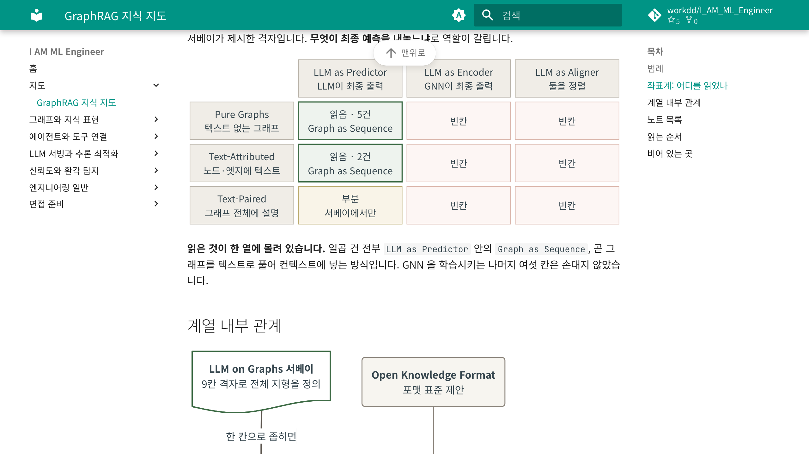

<div align="center">

# I AM ML Engineer

읽은 것을 **"왜 이렇게 만들었나"** 까지 파고들어 정리하는 저장소

<a href="https://workdd.github.io/I_AM_ML_Engineer/">
  
</a>

[](https://github.com/workdd/I_AM_ML_Engineer/actions/workflows/docs.yml)
[](https://github.com/workdd/I_AM_ML_Engineer/issues)
[](https://github.com/workdd/I_AM_ML_Engineer/stargazers)

<br>

<a href="https://workdd.github.io/I_AM_ML_Engineer/">
  
</a>

<br><br>

**전문 검색**, **주제별 목차**, **다이어그램 렌더**, **시스템 테마 자동 추종**

휴대폰에서도 그대로 읽힙니다.

</div>

## About

논문, 기술 블로그, 오픈소스 저장소를 읽고 **판단에 쓸 수 있는 형태**로 정리합니다. 수치는 원문에서 직접 확인하고, 결과가 나온 조건과 한계를 함께 적습니다.

## 최근 정리

- `2026-11-18` [Omnigraph: 에이전트가 브랜치로 쓰는 타입 그래프 DB](readings/repos/[20260410]%20ModernRelay_omnigraph_브랜치되는_타입_그래프DB.md) (GitHub, v0.15.0 기준 갱신)
- `2026-11-18` [Palantir Foundry Markings: 데이터를 따라 전파되는 필수 접근 제어](readings/blogs/[20261116]%20Palantir_Foundry_Markings_데이터를_따라가는_필수접근제어.md) (Palantir Foundry 문서)
- `2026-11-13` [trida-stack: AR LLM을 block-diffusion으로 바꾸고 self-speculative 생성과 typed decision을 한 가중치로 서빙](readings/repos/[20260928]%20trillion-labs_trida-stack_AR에서_블록디퓨전_변환_서빙스택.md) (GitHub)
- `2026-11-11` [auto-ontology-mcp: NVIDIA Auto Ontology 시맨틱 레이어를 LLM 없이 MCP 서버로, 개인 지식 저장소까지](readings/repos/[20261106]%20gogoymh_auto-ontology-mcp_MCP_시맨틱레이어_개인지식저장소.md) (GitHub)
- `2026-11-10` [토스 AI-Ready Data: 표준 마트 위에 온톨로지를 얹고 골든셋으로 관리하는 데이터 의미 층](readings/blogs/[20261109]%20토스_AI-Ready_Data_온톨로지_시맨틱레이어.md) (토스 채용 아티클)
- `2026-11-10` [카카오페이증권 if(kakao)26: 사건 중심 지식 그래프와 근거·가정을 나눠 말하는 금융 에이전트](readings/blogs/[20261014]%20카카오페이증권_ifkakao26_지식그래프_설명가능_금융에이전트.md) (if(kakao)26 발표)
- `2026-11-09` [iKnow: macOS가 사용자에 대해 쌓는 개인 지식 그래프를 읽기 전용으로 열어 보는 도구](readings/repos/[20260915]%208rank_iKnow_macOS_개인지식그래프_열람도구.md) (GitHub)
- `2026-11-09` [OntoSmith: 온톨로지를 먼저 정하고 판정 모델 게이트로 지식 그래프를 짓는 빌더](readings/repos/[20261022]%20Dongbumlee_ontosmith_온톨로지우선_판정게이트_지식그래프빌더.md) (GitHub)
- `2026-11-06` [auto-ontology-eval: 온톨로지가 Text-to-SQL 정확도를 얼마나 올리는지 재는 대조 평가 도구](readings/repos/[20260702]%20NVIDIA_auto-ontology-eval_TextToSQL_온톨로지효과_대조평가.md) (GitHub)
- `2026-11-06` [Forward Deployed Engineer Roadmap: 고객 현장 AI 엔지니어 학습 순서와 블로그 140편](readings/repos/[20261030]%20amitshekhariitbhu_forward-deployed-engineer-roadmap_FDE_학습로드맵.md) (GitHub)

전체 목록은 [사이트](https://workdd.github.io/I_AM_ML_Engineer/) 왼쪽 목차에 주제별로 있습니다.

## 주제

| 주제 | 다루는 것 | 지도 |
|------|-----------|------|
| 그래프와 지식 표현 | GraphRAG, 지식 그래프, 온톨로지, 시맨틱 레이어 | [지식 지도](readings/_maps/graphrag_%EC%A7%80%EC%8B%9D%EC%A7%80%EB%8F%84.md), [오픈소스 지형](readings/_maps/graphrag_%EC%98%A4%ED%94%88%EC%86%8C%EC%8A%A4_%EC%A7%80%ED%98%95.md), [읽을 논문](readings/_maps/graphrag_%EC%9D%BD%EC%9D%84_%EB%85%BC%EB%AC%B8.md) |
| 에이전트와 도구 연결 | MCP, 멀티 에이전트, 도구 선택, 에이전트 운영 | |
| LLM 서빙과 추론 최적화 | KV 캐시, 추론 엔진, 양자화, 비용 | |
| 모델 학습 | 사전학습, 최적화 방법 | |
| 신뢰도와 환각 탐지 | 신뢰도 신호, 판정기, 환각 검출 | [가드레일 읽을 논문](readings/_maps/guardrail_%EC%9D%BD%EC%9D%84_%EB%85%BC%EB%AC%B8.md) |
| 엔지니어링 일반 | 접근 제어, 플랫폼, 업계 사례 | |

## Books

오픈소스 하나를 코드 단위로 따라가는 책입니다.

- [DeepInfer 해부](https://workdd.github.io/I_AM_ML_Engineer/books/deepinfer/): DeepSeek 추론 엔진 코드 분석
- [LLM Wiki 해부](https://workdd.github.io/I_AM_ML_Engineer/books/llm-wiki/): 자동 정리형 지식 위키 앱 코드 분석

## 면접과 실습

- **면접**: [통계, 수학](interviews/01_통계_수학.md), [머신러닝](interviews/02_머신러닝.md), [딥러닝](interviews/03_딥러닝.md), [자연어처리](interviews/04_자연어처리.md), [OpenAI MLE 출제경향](interviews/14_OpenAI_MLE_출제경향.md)
- **실습 노트북**: [ML/DL 기초 6편](experiments/basics/), [Attention에서 Mini GPT까지 10편](experiments/transformer/). Pre-Quiz, TODO 구현, 테스트, 시각화, Post-Quiz 순서입니다

## 구조

```
readings/      읽은 자료 정리 (papers, blogs, repos, _maps)
books/         코드 분석 책
interviews/    면접 질문과 기업별 출제 경향
experiments/   직접 구현하는 실습 노트북
deep_learning/ Transformer, CNN, RNN 개념 정리
practical_tips/ 실무 경험과 팁
```

## 정리 형식

파일명은 `[YYYYMMDD] 출처_제목.md`. 메타데이터, 한 줄 요약, 본문, **읽을 때 감안할 것**(조건, 표본, 원문 오기), 가져갈 지점, 결론 순서로 씁니다. 논문은 원문 목차를 그대로 따르고, 블로그와 저장소는 주제 단위로 묶습니다.

## Contributing

피드백과 토론은 [Issues](https://github.com/workdd/I_AM_ML_Engineer/issues)에 남겨 주세요.

## License

MIT License
