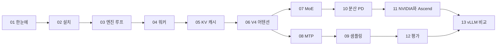

DeepInfer는 DeepSeek가 자사 대규모 서비스를 운영하는 추론 엔진에서 오프라인 추론 부분만 분리해 공개한 코드다. 이 책은 그 코드를 엔진 루프부터 커널 진입점까지 따라가며, 왜 그렇게 만들었는지를 소스 위치와 함께 설명한다.

## 책의 구성

DeepInfer는 vLLM에서 출발했지만 모델 하나(DeepSeek-V4.1-Flash)와 하드웨어 둘(NVIDIA SM100, Huawei Ascend 950)에 맞춰 최적화한 엔진이다. 범용 엔진에서 빠지는 부분과 특정 모델 전용으로 들어가는 부분이 함께 보이기 때문에, 추론 엔진이 어디서 성능을 얻는지 읽기에 좋은 교재다.

| 부분 | 장 |
|---|---|
| 전체 구성, 설치, 첫 실행 | 01~02장 |
| 엔진 루프, 워커, KV 캐시 | 03~05장 |
| 모델 쪽: V4 어텐션, MoE, MTP, 샘플링 | 06~09장 |
| 분산 배포와 하드웨어 이원화 | 10~11장 |
| 평가, vLLM과 비교 | 12~13장 |

## 권장 읽기 순서

- 엔진 구조만 알고 싶으면 01, 03, 04, 05장만 읽어도 된다
- 모델 구조(KV 압축, 인덱스 어텐션)에 관심이 있으면 06장부터 읽고 필요할 때 03~05장으로 돌아간다
- 운영 설계(Wide-EP, prefill/decode 분리)가 목적이면 10장과 원본의 [배포 Q&A 문서](https://github.com/deepseek-ai/DeepInfer/blob/a679bb86ce36e883a98a97733492b686e5b9a08e/doc/inference_deployment_qa.md)를 같이 읽는다

## 기준과 표기

- **기준 커밋**: [`a679bb8`](https://github.com/deepseek-ai/DeepInfer/blob/a679bb86ce36e883a98a97733492b686e5b9a08e) (2026-11-03). 모든 코드 링크는 이 커밋에 고정했다. 이후 커밋에서는 줄 번호가 바뀔 수 있다
- **코드 인용**: 원본은 Apache-2.0이다. 인용은 짧게 자르고 매번 원문 줄 범위를 링크로 건다
- **확인 수준**: 코드에서 직접 확인한 내용은 그대로 쓰고, 코드로 확인하지 못한 추정은 "(추정)" 또는 "(미검증)"으로 표시한다. 성능 수치는 모두 원본 문서의 자체 발표이고 직접 재현하지 않았다
- **용어**: KV cache, prefill, decode, expert parallel, CUDA graph처럼 업계에서 그대로 쓰는 말은 번역하지 않는다

## 실행 환경

DeepInfer를 직접 돌리려면 SM100(Blackwell) GPU 또는 Ascend 950 NPU가 있어야 한다(README의 지원 하드웨어 목록 기준). 이 책은 실행 결과보다 코드 읽기를 중심으로 썼다. 실행 절차는 02장에 원본 README와 examples 기준으로 정리했다.

## 정리

- DeepInfer는 vLLM 계열이지만 모델 하나, 하드웨어 둘에 특화된 엔진이다
- 이 책은 커밋 `a679bb8` 기준으로 소스 위치를 링크하며 읽는다
- 수치는 원본 문서의 자체 발표이고, 확인하지 못한 내용은 표시해 둔다
- 목적에 따라 읽는 순서를 고를 수 있다
