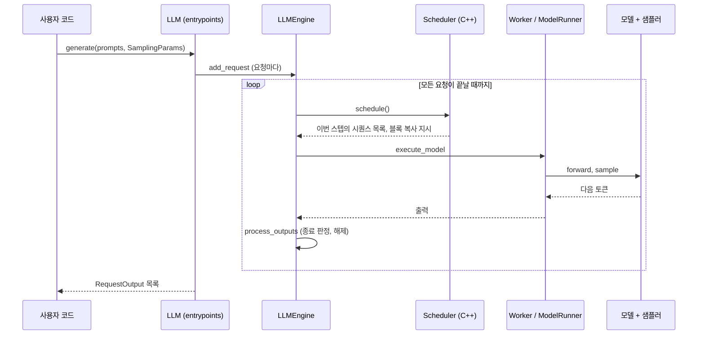
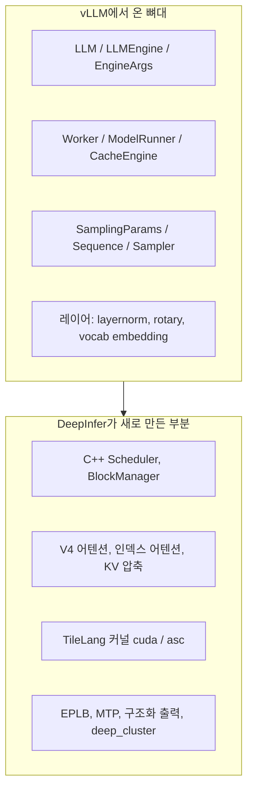

DeepInfer는 Python 엔진 위에 C++ 스케줄러를 얹고, 모델 실행은 DeepSeek 자체 커널(FlashMLA, DeepGEMM, DeepEP)과 TileLang 커널로 채운 구조다. 이 장에서는 디렉터리 구성, 요청 하나가 지나가는 경로, vLLM에서 물려받은 부분과 새로 만든 부분을 한 번에 본다.

## 원본 아키텍처 그림


출처: [DeepInfer doc/images/architecture_overview.png](https://github.com/deepseek-ai/DeepInfer/blob/a679bb86ce36e883a98a97733492b686e5b9a08e/doc/images/architecture_overview.png)

- 원본 저장소에 들어 있지만 README 본문에서는 쓰지 않는 그림이다. 공개본과 사내 전체 구성의 경계를 같이 보는 용도로 싣는다
- 공개본에는 KV 캐시 시스템, VE/Prefill/Decode 분리 배포, DP 복제본 간 로드밸런싱이 없다고 README가 직접 밝힌다. 그림에 이 부품이 보이더라도 코드는 공개되지 않았다

## 디렉터리 구성

| 경로 | 역할 | 코드 줄 수 |
|---|---|---|
| `deepinfer/entrypoints` | 오프라인 추론 API `LLM` | 198 |
| `deepinfer/engine` | `LLMEngine`, 인자, 통계 | 1,957 |
| `csrc/engine` | C++ 스케줄러, 블록 관리자, 입력 메타데이터 (pybind로 노출) | 2,425 (`csrc` 전체) |
| `deepinfer/worker` | 워커, 모델 러너, KV 캐시 엔진, CUDA graph 러너 | 2,805 |
| `deepinfer/model_executor` | 모델(V4, MTP, vision), 레이어, TileLang 커널, EPLB | 35,307 |
| `deepinfer/structure_output` | 구조화 출력 | 595 |
| `deepinfer/ve` | vision encoder 실행 | 979 |
| `deepinfer/distributed` | 공유 메모리 브로드캐스트 등 분산 보조 | 461 |
| `deep_cluster` | 하드웨어 · 토폴로지 탐지 | 656 |
| `eval`, `examples`, `tests` | 평가, 실행 예제, 테스트 | 1,694 / 3,018 / 3,117 |

> **주의**: 줄 수는 기준 커밋에서 `.py`, `.cpp`, `.cu`, `.h` 파일을 `wc -l`로 센 값이다(주석 · 빈 줄 포함). `vendor/` 아래 커널 서브모듈은 빼고 셌다.

코드의 대부분(약 35K줄)이 `model_executor`에 있다. 엔진과 워커는 합쳐도 5K줄 정도라, 이 엔진의 무게는 스케줄링보다 모델 전용 커널 쪽에 있다.

## 요청 하나의 경로



### 코드 따라가기: 진입점

사용자가 만지는 클래스는 [`deepinfer/entrypoints/llm.py`](https://github.com/deepseek-ai/DeepInfer/blob/a679bb86ce36e883a98a97733492b686e5b9a08e/deepinfer/entrypoints/llm.py#L23-L88)의 `LLM` 하나다. 생성자는 인자를 `EngineArgs`로 묶어 `LLMEngine`을 만든다.

```python
engine_args = EngineArgs(
    model=model,
    tokenizer=tokenizer,
    trust_remote_code=trust_remote_code,
    expert_parallel_size=expert_parallel_size,
    revision=revision,
    tokenizer_revision=tokenizer_revision,
    seed=seed,
    gpu_memory_utilization=gpu_memory_utilization,
    offline_inference=True,
    **kwargs,
)
self.decode_sequence = decode_sequence

self.llm_engine = LLMEngine.from_engine_args(engine_args)
```

- `offline_inference=True`를 고정으로 넘긴다. 공개본에 온라인 서버가 없다는 README 설명과 맞는다
- 인자 목록은 `expert_parallel_size`처럼 MoE 전제를 드러낸다. 전체 인자는 [`engine/arg_utils.py`](https://github.com/deepseek-ai/DeepInfer/blob/a679bb86ce36e883a98a97733492b686e5b9a08e/deepinfer/engine/arg_utils.py)에 있고 02장에서 정리한다

### 코드 따라가기: 한 스텝

엔진의 한 스텝은 [`LLMEngine.step`](https://github.com/deepseek-ai/DeepInfer/blob/a679bb86ce36e883a98a97733492b686e5b9a08e/deepinfer/engine/llm_engine.py#L860-L900)이다. 스케줄링을 Python이 아니라 C++ 스케줄러에 맡기는 부분이 먼저 보인다.

```python
with cpu_timer.record("schedule"):
    seq_metadata_list: list[SequenceMetadata]
    scheduler_outputs: SchedulerOutputs
    with cpu_timer.record("schedule:cpp"):
        seq_metadata_list, scheduler_outputs = self.scheduler.schedule(
            self.sequence_metadata_pool
        )  # Will also free the finished sequence groups.
```

- `schedule:cpp`라는 타이머 이름 그대로, `self.scheduler`는 [`csrc/engine/scheduler.hpp`](https://github.com/deepseek-ai/DeepInfer/blob/a679bb86ce36e883a98a97733492b686e5b9a08e/csrc/engine/scheduler.hpp#L79)의 `Scheduler`를 pybind로 감싼 객체다
- 결과에 `clone_states`, `clone_blocks`, `zero_states`가 함께 온다. 스케줄러가 KV 블록과 상태(state) 복사까지 지시한다는 뜻이고, 05장에서 다룬다
- 스텝 구간마다 `cpu_timer`를 두른 것은 CPU 쪽 오버헤드를 줄이는 것이 이 엔진의 주된 관심사임을 보여 준다. 비동기 스케줄링(`DEEPINFER_ZERO_OVERHEAD_SCHEDULING`)은 03장에서 다룬다

## 엔진 종류

[`engine/engine_type.py`](https://github.com/deepseek-ai/DeepInfer/blob/a679bb86ce36e883a98a97733492b686e5b9a08e/deepinfer/engine/engine_type.py)는 엔진을 세 종류로 나눈다.

| 값 | 처리 대상 | zero-overhead 스케줄링 기본값 |
|---|---|---|
| `NORMAL` | prompt와 completion 모두 | 켜짐 |
| `PROMPT` | prompt만 (prefill 전용) | 꺼짐 |
| `COMPLETION` | completion만 (decode 전용) | 켜짐 |

주석에 "csrc/engine/scheduler.hpp의 EngineType과 맞출 것"이라고 적혀 있다. prefill 전용, decode 전용 엔진이 이미 타입으로 들어 있어서, README가 말한 "분리 배포에 필요한 엔진 기능은 대부분 구현됨"이 이 지점에서 확인된다. 분리 배포 자체는 10장에서 다룬다.

## vLLM에서 물려받은 부분

README의 Acknowledgments는 "originally built primarily on vLLM"이라고 밝힌다. 파일 머리에 `Derived from vLLM; modified by DeepSeek.` 표기가 붙은 파일은 기준 커밋에서 `vendor/`를 뺀 소스 303개 중 23개다.



- 인터페이스 이름(`LLM`, `LLMEngine`, `Worker`, `ModelRunner`, `CacheEngine`)은 vLLM과 같아서, vLLM 코드를 읽어 본 사람이면 길을 찾기 쉽다
- 반대로 스케줄러와 블록 관리자는 C++로 옮겨져 vLLM의 Python 스케줄러와 구조가 다르다. vLLM 구버전 대응 관계는 13장에서 정리한다

## 공개본의 범위

| 들어 있음 | 들어 있지 않음 (README 기준) |
|---|---|
| 오프라인 배치 추론 API | 온라인 API 서버 |
| Attention DP, balanced CP, MoE EP + EPLB | KV 캐시 시스템 |
| DSpark, confidence 기반 검증 스케줄 | VE/Prefill/Decode 분리 배포 |
| SWA bounded replay, 비동기 스케줄링 | DP 복제본 간 로드밸런싱 |
| batch-invariant 추론, 결정적 샘플링, 구조화 출력 | |

## 정리

- 공개 API는 `LLM.generate` 하나이고, 내부는 `LLMEngine.step` 루프다
- 스케줄러와 블록 관리자는 C++(`csrc/engine`)에 있고 pybind로 불린다
- 코드 무게의 대부분은 `model_executor`(V4 전용 레이어와 TileLang 커널)에 있다
- vLLM 뼈대를 물려받은 파일은 23개이고, 이름은 같지만 스케줄링 구조는 다르다
- prefill 전용, decode 전용 엔진 타입이 이미 있어 분리 배포의 엔진 쪽 준비가 보인다
