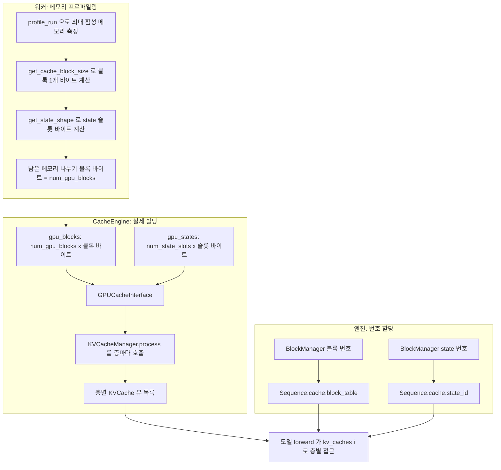
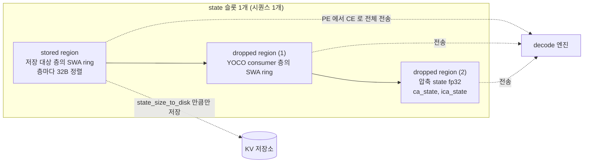
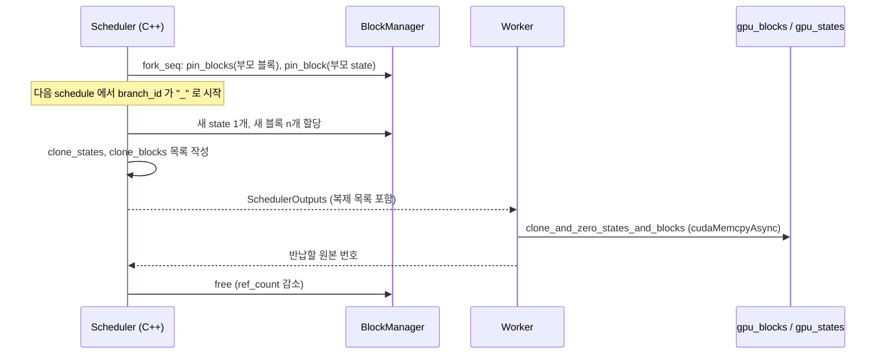

DeepInfer의 KV 캐시는 "블록 캐시"와 "state 캐시" 두 덩어리로 나뉜다. 압축된 main KV와 indexer K는 vLLM처럼 고정 크기 블록에 페이징으로 담고, sliding window KV와 압축 경계의 누적값은 시퀀스마다 슬롯 하나를 통째로 주는 state 캐시에 담는다. 이 장은 [`deepinfer/worker/cache_engine.py`](https://github.com/deepseek-ai/DeepInfer/blob/a679bb86ce36e883a98a97733492b686e5b9a08e/deepinfer/worker/cache_engine.py)를 중심으로 두 캐시의 크기가 어떻게 정해지고, 한 블록 안에서 층별 바이트가 어떻게 배치되며, 스케줄러가 블록 번호를 어떻게 나눠 주는지 따라간다.

## 두 종류의 캐시

DeepSeek-V4 계열 어텐션은 층마다 세 종류의 KV를 쓴다(어텐션 자체는 6장에서 다룬다). 압축 KV(`ca`), indexer K(`ica`), sliding window KV(`swa`)다. 앞의 둘은 문맥 길이에 비례해 늘어나므로 블록 단위로 페이징하고, SWA는 창 크기만큼만 있으면 되므로 시퀀스당 고정 크기 ring buffer로 둔다. 압축 비율이 2인 층은 아직 압축되지 않은 토큰의 중간값을 들고 있어야 하는데, 이것도 시퀀스당 고정 크기라 state 쪽에 들어간다.

| 구분 | 담는 것 | 단위 | 크기를 정하는 것 | 할당자 |
|---|---|---|---|---|
| 블록 캐시 (`gpu_blocks`) | 층별 압축 main KV(`ca_cache`), indexer K(`ica_cache`) | 블록 1개 = 압축 전 128토큰 | 프로파일링 뒤 남은 메모리 | `BlockManager(num_gpu_blocks)` |
| state 캐시 (`gpu_states`) | 층별 SWA ring(`swa_cache`), 압축 누적값(`ca_state`, `ica_state`) | 슬롯 1개 = 시퀀스 1개 | `max_num_seqs × 1.2 + 1` | `BlockManager(num_state_seqs)` |

두 할당자는 같은 C++ 클래스를 쓴다. [`llm_engine.py`](https://github.com/deepseek-ai/DeepInfer/blob/a679bb86ce36e883a98a97733492b686e5b9a08e/deepinfer/engine/llm_engine.py#L265-L266)에서 블록용과 state용을 하나씩 만든다.

```python
self.block_manager = BlockManager(cache_config.num_gpu_blocks)
self.state_manager = BlockManager(cache_config.num_state_seqs) if cache_config.bytes_of_state_per_seqs > 0 else None
```

state 바이트가 0인 모델(SWA도 압축 state도 없는 모델)에서는 state 할당자를 만들지 않는다. vLLM의 KV 캐시 매니저가 블록 하나만 관리하는 것과 달리(미검증), DeepInfer는 시퀀스마다 "블록 테이블 + state id" 두 자원을 함께 잡아야 스케줄링이 된다.



## 블록 개수 정하기: 프로파일링

블록 개수는 워커가 모델을 한 번 돌려 본 뒤 정한다. [`worker/base.py`의 `profile_num_available_blocks`](https://github.com/deepseek-ai/DeepInfer/blob/a679bb86ce36e883a98a97733492b686e5b9a08e/deepinfer/worker/base.py#L211-L268)가 그 일을 한다.

### 코드 따라가기: profile_num_available_blocks

state 캐시를 먼저 빼고 남는 메모리를 블록 크기로 나누는 부분을 본다.

```python
available_kv_cache_memory = total_gpu_memory * self.cache_config.gpu_memory_utilization - peak_allocated_memory

cache_block_size = CacheEngine.get_cache_block_size(
    self.cache_config.block_size,
    self.model_runner.model.cfg,
)
# 减去预留的固定大小的 state cache
state_size = math.prod(CacheEngine.get_state_shape(self.model_runner.model.cfg, self.model_config.max_num_seqs))
state_size *= 2  # state store & copy buffer, 所以要开两倍大小
available_kv_cache_memory -= state_size
num_gpu_blocks = int(available_kv_cache_memory // cache_block_size)
```

- `gpu_memory_utilization`의 기본값은 [`EngineArgs`](https://github.com/deepseek-ai/DeepInfer/blob/a679bb86ce36e883a98a97733492b686e5b9a08e/deepinfer/engine/arg_utils.py#L34-L36)에서 `0.90`이다. vLLM과 같은 이름, 같은 의미다
- state 크기를 두 배로 뺀다. 주석은 "state store & copy buffer"라고 적는다. 실제로 할당하는 `gpu_states`는 한 벌이므로, 나머지 한 벌은 저장 · 복사용 여유로 남겨 두는 셈이다(용도는 코드 주석 기준, 사용처는 미검증)
- 마지막에 모든 rank의 값을 [`all_reduce(SUM)`한 뒤 world size로 나누고 짝수로 내린다](https://github.com/deepseek-ai/DeepInfer/blob/a679bb86ce36e883a98a97733492b686e5b9a08e/deepinfer/worker/base.py#L264-L267). 최솟값이 아니라 평균을 쓴다는 점이 눈에 띈다

블록 하나가 몇 토큰을 담는지는 사용자가 고르지 않는다. [`ModelMetadata.resolved_tokens_per_block`](https://github.com/deepseek-ai/DeepInfer/blob/a679bb86ce36e883a98a97733492b686e5b9a08e/deepinfer/model_executor/model_metadata_utils.py#L133-L140)이 `128`을 돌려주고, `EngineArgs.tokens_per_block`을 지정하면 [이 값과 같은지 assert만 한다](https://github.com/deepseek-ai/DeepInfer/blob/a679bb86ce36e883a98a97733492b686e5b9a08e/deepinfer/engine/arg_utils.py#L83-L86). 같은 파일의 `kvcache_align_to`도 `128`(바이트)이다.

## 토큰 하나의 바이트: KV 캐시 포맷

블록 크기를 계산하려면 토큰 하나가 몇 바이트인지부터 알아야 한다. 포맷 정의는 [`tilelang_ops/cache_common.py`](https://github.com/deepseek-ai/DeepInfer/blob/a679bb86ce36e883a98a97733492b686e5b9a08e/deepinfer/model_executor/layers/tilelang_ops/cache_common.py#L109-L155)에 모여 있다.

### 코드 따라가기: V41_FORMAT

main · SWA KV의 기본 포맷을 본다.

```python
V41_FORMAT = KVCacheFormat(
    quantized_dtype="e4m3",
    quantized_elements=512,
    elements_per_sf=32,
    bf16_elements=0,
    do_cast=True,
    sf_format="ue8m0",
    note="V41, main/swa kv.",
    token_interleaved=True,
)
```

`bytes_per_token`은 [양자화 데이터 바이트 + scale 바이트](https://github.com/deepseek-ai/DeepInfer/blob/a679bb86ce36e883a98a97733492b686e5b9a08e/deepinfer/model_executor/layers/tilelang_ops/cache_common.py#L99-L101)다. 위 포맷이면 512 × 1B + (512 / 32) × 1B = 528B다. `token_interleaved=True`는 토큰마다 `[data | scale]`을 붙여 저장한다는 뜻이고, [`KVCache` docstring](https://github.com/deepseek-ai/DeepInfer/blob/a679bb86ce36e883a98a97733492b686e5b9a08e/deepinfer/worker/cache_engine.py#L205-L218)도 같은 숫자(FP4 288B, MXFP8 528B)를 적어 둔다.

| 포맷 | 쓰는 곳 | 원소 / scale 단위 | scale 형식 | 토큰당 바이트 |
|---|---|---|---|---|
| `V41_FORMAT` | main KV, SWA KV | e4m3 512개 / 32개당 1 | UE8M0 | 528 |
| `V41_FP4_FORMAT` | `use_fp4_sparse_kv` 일 때 main KV | e2m1 512개 / 16개당 1 | e4m3 | 288 |
| `FP4_INDEX_KV_FORMAT` | indexer K | e2m1 128개 / 32개당 1 | UE8M0 | 68 |
| `MXFP8_INDEX_KV_FORMAT` | indexer K (지원 목록) | e4m3 128개 / 32개당 1 | UE8M0 | 132 |
| `FP8_FLOAT32_SF_INDEX_KV_FORMAT` | indexer K (NVIDIA만) | e4m3 128개 / 128개당 1 | fp32 | 132 |

토큰당 바이트 칸은 위 `bytes_per_token` 공식에 각 포맷의 필드를 넣어 계산한 값이다. 어느 scale 단위를 쓸지는 [`derive_main_kv_cache_num_per_channels`](https://github.com/deepseek-ai/DeepInfer/blob/a679bb86ce36e883a98a97733492b686e5b9a08e/deepinfer/model_executor/model_metadata_utils.py#L37-L39)가 고른다. SWA는 항상 32, main KV는 `use_fp4_sparse_kv`가 켜져 있으면 16이다.

cache_engine 쪽 계산은 이 포맷을 그대로 가져다 쓴다. [`_kv_bytes_per_token`](https://github.com/deepseek-ai/DeepInfer/blob/a679bb86ce36e883a98a97733492b686e5b9a08e/deepinfer/worker/cache_engine.py#L46-L56)은 `kv_lora_rank + qk_rope_head_dim == 512`를 assert하고 포맷의 `bytes_per_token`을 돌려준다. indexer 쪽 [`_get_qk_topk_bytes`](https://github.com/deepseek-ai/DeepInfer/blob/a679bb86ce36e883a98a97733492b686e5b9a08e/deepinfer/worker/cache_engine.py#L73-L80)는 `index_head_dim // 2 + index_head_dim // 32`, 곧 FP4 두 값당 1바이트에 32채널당 scale 1바이트를 더한다.

> **주의**: 저장소의 테스트 설정은 `kv_lora_rank=448`, `qk_rope_head_dim=64`를 쓴다([`tests/worker/test_state_cache_ops.py`](https://github.com/deepseek-ai/DeepInfer/blob/a679bb86ce36e883a98a97733492b686e5b9a08e/tests/worker/test_state_cache_ops.py#L670-L672)). 실제 배포 모델의 설정 파일은 저장소에 없으므로, 합이 512라는 것만 코드의 assert로 확인된다.

## 블록 레이아웃: KVCacheManager

블록 하나는 "모든 층의 KV를 한 줄로 이어 붙인 바이트 열"이다. 텐서 모양은 `[num_gpu_blocks, 블록 바이트]`인 `uint8` 2차원이고, 층별 뷰는 그 안에서 오프셋을 잘라 만든다. 이 계산이 [`KVCacheManager.process`](https://github.com/deepseek-ai/DeepInfer/blob/a679bb86ce36e883a98a97733492b686e5b9a08e/deepinfer/worker/cache_engine.py#L376-L477)다.

### 코드 따라가기: KVCacheManager.process (main KV 부분)

압축 비율 `ratio`인 층이 블록 안에서 차지하는 구간을 잘라내는 부분을 본다.

```python
if ratio > 0:
    if kv_mapped_layer_id != layer_id:
        ca_cache = cache_list[kv_mapped_layer_id].ca_cache
    else:
        # 所有压缩率（c1/c2）统一处理
        token_per_block = block_size // ratio
        delta = token_per_block * self._bytes_per_token
        if gpu_blocks is not None:
            ca_cache = gpu_blocks[:, self._kv_offset : self._kv_offset + delta].as_strided(
                (gpu_blocks.shape[0], token_per_block, 1, self._bytes_per_token),
                (gpu_blocks.stride(0), self._bytes_per_token, self._bytes_per_token, 1),
            )
        padded_delta = _align_to_multiple(delta, 1, 32)
        self._kv_offset += padded_delta
        kv_length += padded_delta

        if _needs_compress_state(ratio):
            num_state_token = self._state_block.all_compress_block_size[ratio]
            ca_state = self._alloc_state(num_state_token, self._compress_dim)
```

- 블록 하나는 압축 전 128토큰을 뜻한다. 압축 비율 2인 층은 그 안에 64개 압축 토큰만 담으므로 `token_per_block = block_size // ratio`가 된다. 같은 블록 번호가 층마다 다른 개수의 압축 토큰을 담는 구조다
- `as_strided`의 첫 stride가 `gpu_blocks.stride(0)`, 곧 블록 전체 바이트다. 그래서 층별 뷰 `ca_cache[b, t]`는 "블록 b 안에서 이 층 구간의 t번째 토큰"을 가리키고, 커널은 `[num_blocks, token_per_block, 1, bytes_per_token]` 모양 하나만 알면 된다
- 층마다 32바이트 경계로 맞춘다. 마지막에 [`finalize`](https://github.com/deepseek-ai/DeepInfer/blob/a679bb86ce36e883a98a97733492b686e5b9a08e/deepinfer/worker/cache_engine.py#L479-L492)가 블록 전체를 `lcm(128, bytes_per_token)`으로 한 번 더 맞춘다. 주석은 DeepGEMM index 커널이 128바이트 배수 stride를, main 어텐션이 `bytes_per_token` 배수 stride를 요구한다고 적는다
- `kv_mapped_layer_id != layer_id`면 다른 층의 `ca_cache`를 그대로 빌려 쓰고 오프셋을 늘리지 않는다. share-kv 설정(6장)에서 앞 층의 캐시를 재사용하는 경로다

indexer K도 같은 방식으로 [바로 앞에서 잘라낸다](https://github.com/deepseek-ai/DeepInfer/blob/a679bb86ce36e883a98a97733492b686e5b9a08e/deepinfer/worker/cache_engine.py#L428-L443). 그래서 블록 한 줄은 `[0층 ica | 0층 ca | 1층 ica | 1층 ca | ...]` 순서로 채워진다. SWA만 쓰는 층은 블록 바이트를 차지하지 않는다(`kv_length == 0`).

| 층 종류 판정 | 함수 | 조건 |
|---|---|---|
| SWA 슬롯이 있는가 | [`_has_SWA`](https://github.com/deepseek-ai/DeepInfer/blob/a679bb86ce36e883a98a97733492b686e5b9a08e/deepinfer/worker/cache_engine.py#L682-L687) | `sink_mode == "swa"` |
| indexer K를 갖는가 | [`_is_sparse`](https://github.com/deepseek-ai/DeepInfer/blob/a679bb86ce36e883a98a97733492b686e5b9a08e/deepinfer/worker/cache_engine.py#L689-L693) | `index_topk > 0` |
| 압축 없는 full 어텐션 | [`_is_full`](https://github.com/deepseek-ai/DeepInfer/blob/a679bb86ce36e883a98a97733492b686e5b9a08e/deepinfer/worker/cache_engine.py#L695-L699) | `kv_compress_ratio == 0` 이고 SWA 아님 |
| 압축 state 가 필요한가 | `_needs_compress_state` | `kv_compress_ratio > 1` |

> **주의**: `_is_full`에 해당하는 층이 들어오면 `process`는 [`AssertionError`를 던진다](https://github.com/deepseek-ai/DeepInfer/blob/a679bb86ce36e883a98a97733492b686e5b9a08e/deepinfer/worker/cache_engine.py#L466-L468). 압축 없는 일반 MLA 층은 이 캐시 엔진이 지원하지 않는다. 클래스 docstring도 `compress_ratio in {1, 2}`만 지원한다고 적는다.

## state 슬롯 레이아웃: StateBlock

state 캐시의 한 행은 시퀀스 하나의 고정 크기 슬롯이다. 슬롯 안의 배치를 [`StateBlock`](https://github.com/deepseek-ai/DeepInfer/blob/a679bb86ce36e883a98a97733492b686e5b9a08e/deepinfer/worker/cache_engine.py#L221-L306)이 계산한다. 원칙은 docstring 첫 줄에 있다. 디스크로 저장할 것은 앞쪽 stored region에, 저장하지 않지만 실행 중 필요한 것은 뒤쪽 dropped region에 둔다.



### 코드 따라가기: SWA ring 크기

SWA ring이 창보다 몇 토큰 더 큰지 정하는 두 함수를 본다.

```python
def get_inference_swa_block_size(window_size: int) -> int:
    return (window_size + envs.DEEPINFER_MAX_BACKTRACKING_TOKENS) if window_size > 0 else 0

def get_kvstore_swa_block_size(window_size: int) -> int:
    return get_inference_swa_block_size(window_size) + (
        (envs.DEEPINFER_PREFILL_STORE_EXTRA_SIZE + get_yoco_store_extra_tokens()) if envs.DEEPINFER_PREFILL_STORE_EXTRA_STATE else 0
    )
```

[원본 88~110행](https://github.com/deepseek-ai/DeepInfer/blob/a679bb86ce36e883a98a97733492b686e5b9a08e/deepinfer/worker/cache_engine.py#L88-L110)에서 docstring을 빼고 옮겼다.

- `DEEPINFER_MAX_BACKTRACKING_TOKENS`는 추측 디코딩이 거절된 draft만큼 되돌아갈 여유다. [`environ.py`](https://github.com/deepseek-ai/DeepInfer/blob/a679bb86ce36e883a98a97733492b686e5b9a08e/deepinfer/environ.py#L136-L139)에서 이 값은 `max(설정값, DEEPINFER_USE_NEXTN_DECODE + 1)`로 강제되고, `DEEPINFER_USE_NEXTN_DECODE` 기본값이 5라 최소 6이다(8장)
- 저장 쪽(kvstore)은 128토큰 배수에서만 저장하므로([`KVSTORE_GRAIN = 128`](https://github.com/deepseek-ai/DeepInfer/blob/a679bb86ce36e883a98a97733492b686e5b9a08e/deepinfer/worker/cache_engine.py#L32-L33)), `DEEPINFER_PREFILL_STORE_EXTRA_STATE`를 켜면 [기본 128토큰](https://github.com/deepseek-ai/DeepInfer/blob/a679bb86ce36e883a98a97733492b686e5b9a08e/deepinfer/environ.py#L168-L171)을 더 들고 있다가 경계 위치의 창을 꺼낸다
- 창이 없는 모델(`window_size <= 0`)은 0이 되어 SWA 공간 자체가 없다

같은 이유로 압축 state ring도 [`get_inference_compress_block_size`](https://github.com/deepseek-ai/DeepInfer/blob/a679bb86ce36e883a98a97733492b686e5b9a08e/deepinfer/worker/cache_engine.py#L130-L133)에서 `compress_ratio + max(0, BACKTRACKING - 1)` 토큰을 잡는다. 압축 비율 2, backtracking 6이면 7토큰이다. 6장의 decode 압축 커널이 `state_cache_size >= ratio + max_seqlen_q - 1`을 assert하므로 이 크기와 맞물린다.

배포 문서는 V4.1 기준 숫자를 직접 적는다. [`doc/inference_deployment_qa.md`](https://github.com/deepseek-ai/DeepInfer/blob/a679bb86ce36e883a98a97733492b686e5b9a08e/doc/inference_deployment_qa.md#L223)에 따르면 디스크로 가는 `state_size_to_disk`는 "20 layers × 134 tokens × 528 B = 1,415,040 B"이고, 134는 128토큰 창에 6토큰 backtracking을 더한 값이다.

### 코드 따라가기: 슬롯 개수

```python
def get_num_state_slots(max_num_seqs: int) -> int:
    return int(max_num_seqs * envs.DEEPINFER_NUM_STATE_SLOTS_RATIO) + 1
```

[`get_num_state_slots`](https://github.com/deepseek-ai/DeepInfer/blob/a679bb86ce36e883a98a97733492b686e5b9a08e/deepinfer/worker/cache_engine.py#L201-L202)는 동시 시퀀스 수에 `1.2`(기본값)를 곱하고 1을 더한다. 더한 1은 0번 슬롯이다. C++ 할당자는 [0번을 "비어 있음"으로 쓰고 나눠 주지 않으며](https://github.com/deepseek-ai/DeepInfer/blob/a679bb86ce36e883a98a97733492b686e5b9a08e/csrc/engine/block_manager.hpp#L27-L35), 모델 코드는 CUDA graph padding 행을 이 0번 state에 쓴다([`deepseek.py` 주석](https://github.com/deepseek-ai/DeepInfer/blob/a679bb86ce36e883a98a97733492b686e5b9a08e/deepinfer/model_executor/models/deepseek.py#L220-L223)). 1.2배 여유는 fork처럼 슬롯을 하나 더 잡는 경로를 위한 것으로 보인다(추정).

SWA ring 뷰를 만드는 방식은 블록 쪽과 같다. [`process`의 SWA 분기](https://github.com/deepseek-ai/DeepInfer/blob/a679bb86ce36e883a98a97733492b686e5b9a08e/deepinfer/worker/cache_engine.py#L406-L422)는 `as_strided((num_slots, swa_block_size, 1, 528), (slot_stride, 528, 528, 1))`로 뷰를 잡는다. 슬롯 stride가 슬롯 전체 바이트라서, 커널 입장에서 SWA는 "블록 크기가 `swa_block_size`이고 블록 번호가 state id인 페이징 캐시"로 보인다. 6장의 slot mapping이 `state_id * swa_block_size + pos % swa_block_size`인 이유다.

## GPUCacheInterface와 CacheEngine

[`GPUCacheInterface._kvcache_layout`](https://github.com/deepseek-ai/DeepInfer/blob/a679bb86ce36e883a98a97733492b686e5b9a08e/deepinfer/worker/cache_engine.py#L580-L652)은 위 두 계산을 묶는 입구다. 버퍼를 넘기지 않으면 모양만 계산하고, 넘기면 층별 `KVCache` 목록까지 만든다. `block_size=-1`을 넘기면 state 모양만 돌려준다는 관례가 있어서, 프로파일링 단계에서 블록 크기를 모르는 상태로도 state 크기를 얻는다.

### 코드 따라가기: 층 순회

```python
kvcache_manager = KVCacheManager(cfg, gpu_blocks, state_blocks)
kvcache_manager.update_gpu_cache_interface_class_fields()
if not need_state_shape_only:
    for layer_id, _, attn_module in iter_runtime_attn_modules(attn_module_list, cfg.num_hidden_layers):
        ...
        kvcache, layout_item = kvcache_manager.process(layer_id, attn_module, block_size, cache_list)
        cache_list.append(kvcache)
        if layout_item[2] > 0:
            layout.append(layout_item)
    kvcache_manager.finalize()
```

[원본 626~644행](https://github.com/deepseek-ai/DeepInfer/blob/a679bb86ce36e883a98a97733492b686e5b9a08e/deepinfer/worker/cache_engine.py#L626-L644)에서 로그 출력만 생략했다. [`iter_runtime_attn_modules`](https://github.com/deepseek-ai/DeepInfer/blob/a679bb86ce36e883a98a97733492b686e5b9a08e/deepinfer/model_executor/layer_utils.py#L6-L16)는 config의 어텐션 목록에서 lm head 자리만 건너뛰고 번호를 다시 매긴다. 그래서 main 층 뒤에 붙은 MTP(DFlash) 층도 같은 `cache_list`에 이어서 들어가고, 8장의 DFlash 층은 `nextn_kv_caches[num_main_layers + i]`로 자기 캐시를 찾는다.

`update_gpu_cache_interface_class_fields`는 SWA 영역 크기들을 **클래스 변수**에 적는다. 저장 · 전송 함수(`select_state_slice_to_store` 등)가 인스턴스 없이 classmethod로 불리기 때문이다. 프로세스 하나에 모델 하나라는 전제가 깔린 설계다.

[`CacheEngine.allocate_gpu_cache`](https://github.com/deepseek-ai/DeepInfer/blob/a679bb86ce36e883a98a97733492b686e5b9a08e/deepinfer/worker/cache_engine.py#L918-L966)는 실제 메모리를 잡는다. 블록과 state 모두 `torch.empty`가 아니라 [`cuda_utils.alloc_tensor`](https://github.com/deepseek-ai/DeepInfer/blob/a679bb86ce36e883a98a97733492b686e5b9a08e/deepinfer/worker/cache_engine.py#L910-L916)로 원시 바이트를 받아 `uint8` 뷰로 바꾼다. PyTorch 캐싱 할당자 밖에서 메모리를 잡는 셈이라 `empty_cache` 영향을 받지 않는다(추정. `alloc_tensor` 구현은 `csrc/cuda_utils.cpp`에 있고 이 장에서 읽지 않았다). 할당 뒤에는 `cache_config`에 `num_state_seqs`, `bytes_of_state_per_seqs`, `bytes_per_block`을 적어 엔진이 할당자 두 개를 만들 때 쓰게 한다.

| 메서드 | 반환 | 호출 위치 |
|---|---|---|
| `get_cache_block_size(block_size, cfg)` | 블록 1개 바이트 | 워커 프로파일링 |
| `get_state_shape(cfg, max_num_seqs)` | `(슬롯 수, 슬롯 바이트)` | 워커 프로파일링, 할당 |
| `get_kvcache_layout(cfg, block_size)` | 층별 `(layer_id, offset, length)`, 저장 state 크기 | 할당 시 로그, 저장소 연동 |
| `allocate_gpu_cache()` | `GPUCacheInterface`, `gpu_blocks`, `gpu_states` | `CacheEngine.__init__` |

## 블록 번호 할당: C++ BlockManager

어느 블록 번호를 어느 시퀀스에 줄지는 Python이 아니라 [`csrc/engine/block_manager.hpp`](https://github.com/deepseek-ai/DeepInfer/blob/a679bb86ce36e883a98a97733492b686e5b9a08e/csrc/engine/block_manager.hpp)가 정한다. 구현은 참조 카운트가 붙은 이중 연결 free list 하나다.

### 코드 따라가기: Blocks::allocate / free

```cpp
int allocate() {
    int block_id = _pop_front(); // _erase 已校验 ref_count == 0
    _blocks[block_id].ref_count += 1;
    return block_id;
}

void pin_block(int block_id) {
    ...
    TORCH_CHECK(block.ref_count > 0, "try to pin free block");
    block.ref_count += 1;
}

void free(int block_id) {
    ...
    block.ref_count -= 1;
    TORCH_CHECK(block.ref_count >= 0, "ref_count corrupted: ref_count < 0");
    if (block.ref_count == 0) {
        _push_back(block_id);
    }
}
```

[원본 82~103행](https://github.com/deepseek-ai/DeepInfer/blob/a679bb86ce36e883a98a97733492b686e5b9a08e/csrc/engine/block_manager.hpp#L82-L103)에서 범위 검사를 생략했다. 앞에서 꺼내고 뒤에 돌려놓으므로 가장 오래전에 반납된 블록부터 다시 쓴다. vLLM의 prefix caching처럼 해시로 블록을 찾아 재사용하는 기능은 이 클래스에 없다. 재사용은 `pin_block`으로 참조 카운트를 올리는 방식 하나뿐이다.

시퀀스에 필요한 블록 수는 [`Sequence::get_num_blocks`](https://github.com/deepseek-ai/DeepInfer/blob/a679bb86ce36e883a98a97733492b686e5b9a08e/csrc/engine/sequence.hpp#L291-L293)가 계산한다.

$$
\text{num\_blocks} = \left\lceil \frac{\text{len} + \text{inflight} + \text{nextn\_len}}{\text{block\_size}} \right\rceil
$$

draft 토큰 수(`nextn_len`)까지 미리 블록을 잡는다. 검증 단계에서 draft 위치에도 KV를 쓰기 때문이다(8장). [`try_allocate_seq`](https://github.com/deepseek-ai/DeepInfer/blob/a679bb86ce36e883a98a97733492b686e5b9a08e/csrc/engine/block_manager.hpp#L216-L239)는 블록과 state를 둘 다 잡을 수 있을 때만 성공한다. 블록이 총량보다 많이 필요하면 `NEVER`, 지금만 부족하면 `LATER`를 돌려주고, 스케줄러는 `LATER`면 대기열 처리를 멈춘다(3장).

## prefix 재사용: fork와 블록 복제

공개된 코드에서 같은 prefix를 여러 시퀀스가 함께 쓰는 경로는 [`Scheduler::fork_seq`](https://github.com/deepseek-ai/DeepInfer/blob/a679bb86ce36e883a98a97733492b686e5b9a08e/csrc/engine/scheduler.hpp#L1061-L1121)다. 이미 prefill된 시퀀스의 블록 테이블과 state id를 그대로 복사하고 `pin_blocks` · `pin_block`으로 참조 카운트만 올린다. 저장소 안에서 이 함수를 부르는 곳은 [`examples/benchmark.py`](https://github.com/deepseek-ai/DeepInfer/blob/a679bb86ce36e883a98a97733492b686e5b9a08e/examples/benchmark.py#L331-L349) 하나로, 한 시퀀스의 캐시를 배치 크기만큼 복제해 decode 벤치마크를 돌리는 데 쓴다.

fork된 시퀀스가 처음 스케줄될 때는 마지막 블록을 복제해야 한다. 공유 블록에 새 토큰을 쓰면 원본이 오염되기 때문이다.

### 코드 따라가기: fork 시퀀스의 copy-on-write

```cpp
int num_reserve_blocks = seq->cache.num_tokens / seq->cache.block_size;
int to_allocate_blocks = seq->get_num_blocks() - num_reserve_blocks;
...
_clone_state(*seq);
auto new_blocks = block_manager->allocate_nolock(to_allocate_blocks);
if (seq->cache.num_tokens % seq->cache.block_size) { // 有尾巴，需要 copy
    clone_blocks.emplace_back(seq->cache.block_table[num_reserve_blocks]);
    clone_blocks.emplace_back(new_blocks.front());
}
for (size_t i = num_reserve_blocks + (seq->cache.num_tokens % seq->cache.block_size ? 1 : 0);
    i < seq->cache.block_table.size(); ++i) {
    clone_blocks.emplace_back(seq->cache.block_table[i]);
    clone_blocks.emplace_back(0);
}
```

[원본 413~437행](https://github.com/deepseek-ai/DeepInfer/blob/a679bb86ce36e883a98a97733492b686e5b9a08e/csrc/engine/scheduler.hpp#L413-L437)에서 할당 가능 검사를 생략했다. 이 경로는 prompt가 덜 계산된 채 fork되어 대기열로 간 시퀀스용이다. prompt가 끝난 뒤 fork된 시퀀스는 decode 쪽 [582~614행](https://github.com/deepseek-ai/DeepInfer/blob/a679bb86ce36e883a98a97733492b686e5b9a08e/csrc/engine/scheduler.hpp#L582-L614)에서 같은 방식으로 state와 마지막 블록을 복제한다.

- 꽉 찬 블록(`num_reserve_blocks`개)은 계속 공유한다. 덜 찬 마지막 블록만 `(src, dst)` 쌍으로 복제 목록에 올린다
- 그 뒤에 공유하던 블록은 `(src, 0)`으로 올린다. `dst = 0`은 "복사하지 말고 참조만 반납하라"는 뜻이다([`clone_blocks` 설명](https://github.com/deepseek-ai/DeepInfer/blob/a679bb86ce36e883a98a97733492b686e5b9a08e/deepinfer/_C/engine.pyi#L379-L383))
- state는 SWA ring 전체가 바뀌므로 [`_clone_state`](https://github.com/deepseek-ai/DeepInfer/blob/a679bb86ce36e883a98a97733492b686e5b9a08e/csrc/engine/scheduler.hpp#L203-L212)가 새 슬롯을 잡아 통째로 복제한다

복제 목록은 스케줄 결과에 실려 워커로 간다. 워커는 [`clone_and_zero_states_and_blocks_on_default_stream`](https://github.com/deepseek-ai/DeepInfer/blob/a679bb86ce36e883a98a97733492b686e5b9a08e/deepinfer/worker/base.py#L159-L168)에서 C++ 함수 [`clone_and_zero_states_and_blocks`](https://github.com/deepseek-ai/DeepInfer/blob/a679bb86ce36e883a98a97733492b686e5b9a08e/csrc/engine/scheduler.hpp#L1264-L1313)를 부른다. 이 함수는 블록 · 슬롯 단위로 `cuda_copy_async`를 걸고, `zero_states`에 오른 슬롯은 0으로 지운 뒤, 반납할 원본 번호 목록을 돌려준다. 블록 한 행 전체(모든 층)를 한 번에 복사하므로 층 수만큼 커널을 띄우지 않는다.



> **주의**: README는 공개본에 "A KV cache system"이 빠져 있다고 밝히고([README.md](https://github.com/deepseek-ai/DeepInfer/blob/a679bb86ce36e883a98a97733492b686e5b9a08e/README.md#L40)), 배포 문서도 KV 캐시 관리 구성요소는 아직 전부 공개하지 않았다고 적는다([doc 21행](https://github.com/deepseek-ai/DeepInfer/blob/a679bb86ce36e883a98a97733492b686e5b9a08e/doc/inference_deployment_qa.md#L21)). 해시 체인 prefix 매칭, 3FS 저장소에서 블록을 가져오는 경로는 이 저장소에 코드가 없다. 엔진의 저장 훅 [`pe_do_save_kvcache`](https://github.com/deepseek-ai/DeepInfer/blob/a679bb86ce36e883a98a97733492b686e5b9a08e/deepinfer/engine/llm_engine.py#L821-L822)도 빈 함수다.

## 저장소 연동용 state 함수

prefix 매칭은 공개되지 않았지만, state를 저장 형식과 실행 형식 사이에서 바꾸는 함수는 `GPUCacheInterface`에 남아 있다. 저장 쪽 SWA ring은 `swa_block_size_kvstore`, 실행 쪽은 `swa_block_size_inference` 크기라서 그대로 복사할 수 없다.

### 코드 따라가기: select_state_slice

```python
def select_state_slice_ref(
    state_tensor: torch.Tensor,
    state_cache: torch.Tensor,
    last_hit_position: int,
) -> None:
    _, block_size_kvstore, _ = state_cache.shape
    _, block_size_inference, _ = state_tensor.shape
    index = torch.arange(last_hit_position - block_size_inference, last_hit_position).cuda()
    state_tensor[:, index % block_size_inference] = state_cache[:, index % block_size_kvstore]
```

[`tilelang_ops/state_cache.py`의 PyTorch 참조 구현](https://github.com/deepseek-ai/DeepInfer/blob/a679bb86ce36e883a98a97733492b686e5b9a08e/deepinfer/model_executor/layers/tilelang_ops/state_cache.py#L37-L45)이다. 실제로는 같은 의미의 TileLang 커널 [`select_state_slice`](https://github.com/deepseek-ai/DeepInfer/blob/a679bb86ce36e883a98a97733492b686e5b9a08e/deepinfer/model_executor/layers/tilelang_ops/state_cache.py#L12-L34)를 쓴다. 논리 위치 `last_hit_position` 직전 `block_size_inference`개 토큰을, 큰 ring에서 꺼내 작은 ring의 같은 나머지 자리에 넣는다. 반대 방향은 `load_state_to_cache`다.

| classmethod | 하는 일 | 정렬 요구 |
|---|---|---|
| [`select_state_slice_to_store`](https://github.com/deepseek-ai/DeepInfer/blob/a679bb86ce36e883a98a97733492b686e5b9a08e/deepinfer/worker/cache_engine.py#L762-L818) | 슬롯에서 저장용(또는 `TO_CE=True`면 decode 엔진 전송용) state를 꺼낸다 | 저장이면 `last_hit_position % 128 == 0` |
| [`load_state_from_store_to_prefill_cache`](https://github.com/deepseek-ai/DeepInfer/blob/a679bb86ce36e883a98a97733492b686e5b9a08e/deepinfer/worker/cache_engine.py#L820-L848) | 저장된 stored region을 슬롯에 다시 채운다 | 없음 |

`DEEPINFER_PREFILL_STORE_EXTRA_STATE`가 꺼져 있으면 두 ring 크기가 같으므로 재배열 없이 앞 `state_size_to_disk` 바이트를 그대로 자르고 붙인다. 압축 state는 저장 대상이 아니다. 압축 창 경계가 128토큰 배수에 자연히 맞으므로 경계를 넘는 의존이 없다는 것이 [`StateBlock` 주석](https://github.com/deepseek-ai/DeepInfer/blob/a679bb86ce36e883a98a97733492b686e5b9a08e/deepinfer/worker/cache_engine.py#L285)의 설명이다. prefill에서 decode 엔진으로 넘길 때(`TO_CE=True`)는 dropped region까지 함께 보낸다(10장).

## KV 인덱스 커널 진입점

캐시에 KV를 쓰고 읽을 때 필요한 "논리 위치에서 물리 슬롯으로" 변환은 TileLang 커널 몇 개가 맡는다. 어텐션 커널은 블록 테이블을 직접 받지 않고, 토큰별 물리 슬롯 번호 배열(`indices`)을 받는다. 그래서 이 변환이 매 스텝 앞단에 붙는다.

### 코드 따라가기: get_kv_ca_index_decode

압축 main KV의 논리 위치를 블록 테이블로 물리 슬롯으로 바꾸는 참조 구현을 본다.

```python
kv_ca_index = torch.full((kv_ca_index_offset_len.shape[0], kv_ca_index_length), -1, dtype=torch.int32, device="cuda")
arange = torch.arange(kv_ca_index.shape[1], dtype=torch.int32, device="cuda").unsqueeze(0)
arange = arange.minimum(kv_ca_index_offset_len[:, 1].unsqueeze(1))  # clamp to safe range
pos = kv_ca_index_offset_len[:, 0].unsqueeze(1) + arange
kv_ca_index = torch.where(
    arange < kv_ca_index_offset_len[:, 1].unsqueeze(1),
    block_tables.flatten().index_select(0, (pos // token_per_block).flatten().long()).reshape_as(pos) * token_per_block
    + pos % token_per_block,
    kv_ca_index,
)
```

[`get_kv_index.py`의 `get_kv_ca_index_decode_ref`](https://github.com/deepseek-ai/DeepInfer/blob/a679bb86ce36e883a98a97733492b686e5b9a08e/deepinfer/model_executor/layers/tilelang_ops/get_kv_index.py#L41-L57)다. 행마다 `(offset, len)`을 받아 `len`개 위치를 `block_table[pos // tpb] * tpb + pos % tpb`로 바꾸고 나머지는 `-1`로 채운다. 실제 진입점 [`get_kv_ca_index_decode`](https://github.com/deepseek-ai/DeepInfer/blob/a679bb86ce36e883a98a97733492b686e5b9a08e/deepinfer/model_executor/layers/tilelang_ops/get_kv_index.py#L60-L77)는 같은 일을 `ops.load_kv_index_tl` 커널 하나로 한다.

| 함수 | 입력 | 출력 의미 | 쓰는 단계 |
|---|---|---|---|
| [`get_kv_ca_index_prefill`](https://github.com/deepseek-ai/DeepInfer/blob/a679bb86ce36e883a98a97733492b686e5b9a08e/deepinfer/model_executor/layers/tilelang_ops/get_kv_index.py#L24-L38) | `(offset, len)` | 모아 둔 prefill KV 버퍼 안의 연속 위치 | prefill, dense 압축 층 |
| [`get_kv_ca_index_decode`](https://github.com/deepseek-ai/DeepInfer/blob/a679bb86ce36e883a98a97733492b686e5b9a08e/deepinfer/model_executor/layers/tilelang_ops/get_kv_index.py#L60-L77) | `(offset, len)`, 블록 테이블 | `ca_cache`의 물리 슬롯 | decode, dense 압축 층 |
| [`get_kv_swa_index_decode`](https://github.com/deepseek-ai/DeepInfer/blob/a679bb86ce36e883a98a97733492b686e5b9a08e/deepinfer/model_executor/layers/tilelang_ops/get_kv_index.py#L97-L112) | `(offset, len)` | SWA ring 안의 슬롯 (`offset // bs * bs + (offset + j) % bs`) | decode, SWA |
| [`convert_kv_index`](https://github.com/deepseek-ai/DeepInfer/blob/a679bb86ce36e883a98a97733492b686e5b9a08e/deepinfer/model_executor/layers/tilelang_ops/flash_mla_utils.py#L10-L37) | top-k 논리 인덱스, 블록 테이블 | 같은 자리에 물리 슬롯으로 덮어씀 | decode, sparse 층 |
| [`get_fused_dflash_get_input`](https://github.com/deepseek-ai/DeepInfer/blob/a679bb86ce36e883a98a97733492b686e5b9a08e/deepinfer/model_executor/layers/tilelang_ops/get_kv_index.py#L209-L274) | 수락 위치, SWA slot mapping | draft 토큰의 저장 슬롯과 참조 슬롯 | decode, DFlash draft (8장) |

이 함수들은 [`InputMetadataV4.compute_attn_info`](https://github.com/deepseek-ai/DeepInfer/blob/a679bb86ce36e883a98a97733492b686e5b9a08e/deepinfer/model_executor/input_metadata/input_metadata.py#L343-L389)에서 처음 필요할 때 한 번만 계산해 층 사이에 공유한다. 폭은 `max_model_len // ratio`를 128 배수로 올린 값이다. 주석은 sparse 어텐션 커널이 128 패딩을 요구한다고 적는다. 오프셋 `(offset, len)` 자체는 decode 메타데이터 커널이 미리 채워 둔다(6장).

쓰기 쪽 진입점은 [`store_kv_cache`](https://github.com/deepseek-ai/DeepInfer/blob/a679bb86ce36e883a98a97733492b686e5b9a08e/deepinfer/model_executor/layers/tilelang_ops/store_kv_cache.py#L33-L78)다. BF16 KV와 `slot_mapping`을 받아 캐시 텐서 모양에서 포맷을 추론하고, 양자화와 scale 계산을 해서 해당 슬롯에 쓴다. `slot_mapping`이 `-1`인 행은 건너뛴다. 실제 어텐션 경로는 대부분 norm, RoPE, 양자화, 저장을 한 커널로 묶은 `fused_norm_rope_hadamard_cast_store_kvcache`를 쓴다(6장).

## 정리

- KV 캐시는 블록 캐시(압축 main KV, indexer K)와 state 캐시(SWA ring, 압축 누적값) 둘로 나뉘고, 엔진은 같은 C++ `BlockManager`를 두 벌 만들어 블록 번호와 state 번호를 따로 나눠 준다
- 블록 1개는 압축 전 128토큰이며, 한 블록 행 안에 모든 층의 `ica`, `ca` 구간이 32바이트 정렬로 이어 붙는다. 압축 비율 2인 층은 같은 블록에 64개 압축 토큰만 담는다
- main · SWA KV는 토큰당 528B(FP8 512개 + UE8M0 scale 16개), FP4 main KV는 288B, FP4 indexer K는 68B이고 포맷 정의는 `cache_common.py` 한 곳에 있다
- SWA ring과 압축 state ring은 추측 디코딩 되돌림 여유(`DEEPINFER_MAX_BACKTRACKING_TOKENS`, 최소 6)만큼 더 크게 잡는다. V4.1 배포 문서 기준 SWA ring은 134토큰이다
- 공개본의 prefix 재사용은 `fork_seq`의 참조 카운트 공유와 마지막 블록 copy-on-write뿐이다. 해시 기반 prefix 매칭과 외부 KV 저장소는 공개되지 않았고, state를 저장 형식으로 바꾸는 함수만 남아 있다
- 어텐션 커널은 블록 테이블 대신 물리 슬롯 인덱스 배열을 받으므로, `get_kv_index.py`, `convert_kv_index` 같은 인덱스 변환 커널이 매 스텝 앞단에서 돈다
