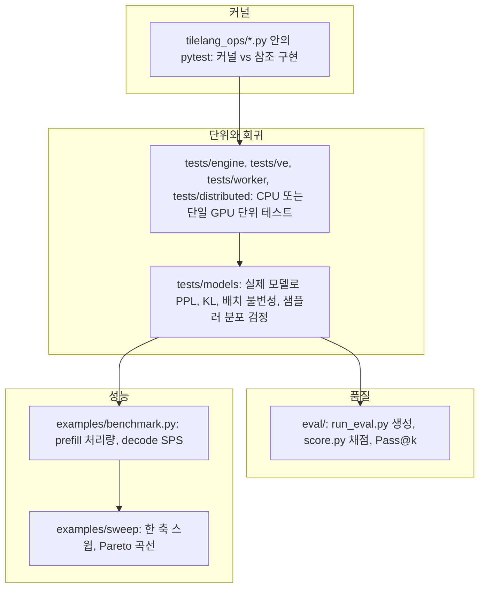
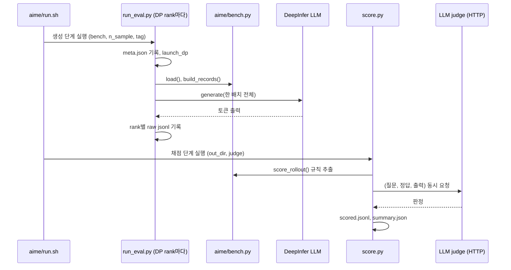

DeepInfer 저장소는 "정확한가"와 "빠른가"를 따로 잰다. 정확성은 `eval/`의 오프라인 벤치마크 평가(AIME 2026, HLE, GPQA Diamond)와 `tests/`의 회귀 테스트가 맡고, 속도는 `examples/benchmark.py`와 `examples/sweep/`이 맡는다. 이 장에서는 각 도구가 무엇을 어떻게 재는지, 그리고 수치를 해석할 때 코드가 어떤 전제를 깔고 있는지를 본다. 결과 수치는 저장소 문서에 적힌 것만 출처와 함께 옮긴다.

## 검증 도구의 층위



| 도구 | 묻는 질문 | 실행 단위 | 판정 방식 |
|---|---|---|---|
| 커널 테스트 | 커널이 참조 구현과 같은 값을 내는가 | 커널 하나 | 수치 비교, 분포 적합도 |
| `tests/` 단위 | 메타데이터 · 스케줄러 · 캐시 연산이 맞는가 | 함수 · 클래스 | assert |
| `tests/models` | 엔진 전체가 이전과 같은 출력을 내는가 | 다중 GPU 프로세스 | PPL 정확 일치, KL 상한, 통계 검정 |
| `eval/` | 모델 + 엔진이 기대 점수를 내는가 | 데이터셋 전체 | LLM judge 또는 규칙 |
| `benchmark.py` | 정상 상태에서 얼마나 빠른가 | 한 구성 | 측정창 평균 |
| `sweep/` | 배치 크기에 따라 처리량과 지연이 어떻게 바뀌는가 | 구성 여러 개 | Pareto 그림 |

## eval: 생성과 채점을 나눈 두 단계

`eval/README.md`는 구조를 이렇게 요약한다. 생성 단계는 모든 요청을 엔진에 한 배치로 넣고 원본 출력을 디스크에 쓰며, 채점 단계는 그 출력을 읽어 지표를 만든다. 그래서 judge를 바꿔 다시 채점해도 재생성이 필요 없다([eval/README.md L6-L9](https://github.com/deepseek-ai/DeepInfer/blob/a679bb86ce36e883a98a97733492b686e5b9a08e/eval/README.md#L6-L9)).



| 파일 | 역할 |
|---|---|
| `eval/run_eval.py` | 생성 진입점. 인자 처리, 환경 설정, DP rank별 샤딩, `llm.generate` 호출 |
| `eval/score.py` | 채점 진입점. rank별 출력 병합, judge 호출, coverage 확인, 요약 |
| `eval/common/loader.py` | `eval/<bench>/bench.py`를 모듈로 불러온다. 지원 목록은 `("aime", "hle", "gpqa")` |
| `eval/common/passk.py` | 비편향 Pass@k 추정기와 요약 |
| `eval/common/judge.py` | OpenAI 호환 `/chat/completions`로 judge 호출, 판정 파싱, 재시도 |
| `eval/common/encoder.py` | 체크포인트 안의 `encoding/encoding.py`를 불러 채팅 프롬프트를 렌더링 |
| `eval/common/paths.py`, `io.py` | 저장소 루트 탐지, JSONL 입출력 |
| `eval/<bench>/bench.py` | 프롬프트 구성, 답 추출, 규칙 채점 |
| `eval/<bench>/run.sh` | 생성 → 채점 두 단계 실행 스크립트 |

벤치마크마다 `bench.py`가 같은 함수 네 개(`load`, `build_records`, `score_rollout`, 그리고 내부의 답 추출)를 구현하면 `run_eval.py`와 `score.py`가 이름으로 찾아 쓴다. 새 벤치마크를 붙이려면 디렉터리 하나와 `SUPPORTED` 튜플 한 칸이면 된다([loader.py L9-L25](https://github.com/deepseek-ai/DeepInfer/blob/a679bb86ce36e883a98a97733492b686e5b9a08e/eval/common/loader.py#L9-L25)).

### 벤치마크별 기본값

무엇을 보는지: 벤치마크마다 샘플 수와 샘플링 설정.

[eval/run_eval.py L23-L27](https://github.com/deepseek-ai/DeepInfer/blob/a679bb86ce36e883a98a97733492b686e5b9a08e/eval/run_eval.py#L23-L27)

```python
BENCH_DEFAULTS = {
    "aime": {"n_sample": 32, "temperature": 1.0, "top_p": 1.0},
    "hle": {"n_sample": 1, "temperature": 1.0, "top_p": 1.0},
    "gpqa": {"n_sample": 8, "temperature": 1.0, "top_p": 1.0},
}
```

세 벤치마크 모두 temperature 1.0, top-p 1.0, top-k 끔이다. greedy가 아니라 분포에서 뽑은 샘플 여러 개의 평균 정확도로 Pass@1을 낸다. README 표 기준 문항 수는 AIME 2026 30개, HLE 2500개(텍스트 2158, 이미지 342), GPQA Diamond 198개다([eval/README.md L13-L17](https://github.com/deepseek-ai/DeepInfer/blob/a679bb86ce36e883a98a97733492b686e5b9a08e/eval/README.md#L13-L17)).

| 인자 | 기본값 | 의미 |
|---|---|---|
| `--reasoning-effort` | 100 | 1~100 정수 또는 `low` / `high` / `max`. 채팅 인코더에 그대로 전달 |
| `--max-len` | 147456 (`1024 * 144`) | 프롬프트 + 출력 길이 상한. `max_tokens = max_len - prompt_len` |
| `--ep` | 8 | expert parallel 크기 = 작업 전체 GPU 수 |
| `--cp` / `--dp` | 1 / `ep // cp` | context parallel, data parallel |
| `--max-num-seqs` | 384 | 엔진 동시 시퀀스 상한 |
| `--max-num-batched-tokens` | 32768 | 스텝당 토큰 상한 |
| `--decode-blacklist` | `0,2,129262..129264` | 생성 중 막을 토큰. 빈 문자열이면 끔 |
| `--batch-invariant` | 꺼짐 | `DEEPINFER_BATCH_INVARIANT=1`. 배치 구성과 무관한 결과, 느림 |

값은 [run_eval.py L46-L75](https://github.com/deepseek-ai/DeepInfer/blob/a679bb86ce36e883a98a97733492b686e5b9a08e/eval/run_eval.py#L46-L75)에 있다.

### 엔진 설정: 평가도 서빙 구성으로 돈다

무엇을 보는지: 평가 생성 시 켜는 엔진 기능.

[eval/run_eval.py L118-L133](https://github.com/deepseek-ai/DeepInfer/blob/a679bb86ce36e883a98a97733492b686e5b9a08e/eval/run_eval.py#L118-L133)

```python
def _setup_env() -> None:
    # MTP / DFlash speculative decoding, set before setup_common_env (which only setdefaults it).
    os.environ["DEEPINFER_USE_NEXTN_DECODE"] = "5"
    os.environ["DEEPINFER_ENABLE_MTP_VARLEN"] = "1"

    from examples._config import setup_common_env

    setup_common_env(model_name=args.model_name, sampler_force_topk=0, set_override_experts=True, enable_eplb=True)
    for item in args.env:
        key, _, value = item.partition("=")
        assert key and "=" in item, f"--env expects KEY=VALUE, got {item!r}"
        os.environ[key] = value
    if args.batch_invariant:
        os.environ["DEEPINFER_BATCH_INVARIANT"] = "1"
    if args.decode_blacklist:
        os.environ["DEEPINFER_DECODE_TOKEN_BLACKLIST"] = args.decode_blacklist
```

- MTP 5개 draft와 variable-length 검증, EPLB를 켠 상태로 생성한다. 평가 점수가 추측 디코딩 · expert 재배치를 포함한 실제 서빙 경로의 점수라는 뜻이다(MTP는 8장, EPLB는 7장)
- `sampler_force_topk=0`으로 vocab 전체에서 샘플링한다. force_topk는 분포를 자르는 근사라서(9장) 평가에서는 끈다
- `--env KEY=VALUE`로 엔진 생성 전에 임의 환경변수를 더 넣을 수 있다. 이 목록도 `meta.json`에 남는다

### 샤딩과 시드

무엇을 보는지: DP rank에 요청을 나누는 방식과 샘플별 시드.

[eval/run_eval.py L169-L174](https://github.com/deepseek-ai/DeepInfer/blob/a679bb86ce36e883a98a97733492b686e5b9a08e/eval/run_eval.py#L169-L174)

```python
    bench = load_bench(args.bench)
    problems = bench.load(args.data_file)
    records = bench.build_records(problems, limit=args.limit)

    # Shard by sample so every rank gets an equal share and no rank inherits a problem's long tail.
    plan = [(problem, sample) for problem in range(len(records)) for sample in range(args.n_sample)][dp_rank::dp_size]
```

- 문항 단위가 아니라 (문항, 샘플) 쌍 단위로 round-robin한다. 한 문항의 샘플 32개가 여러 rank에 흩어지므로, 출력이 유독 긴 문항이 한 rank에 몰려 전체 종료를 늦추는 일이 줄어든다
- 시드는 `(문항 번호 × n_sample + 샘플 번호) mod 2^64`다([L136-L138](https://github.com/deepseek-ai/DeepInfer/blob/a679bb86ce36e883a98a97733492b686e5b9a08e/eval/run_eval.py#L136-L138)). 9장에서 본 해시 난수 때문에 시드가 같으면 출력도 같아서, 샘플마다 시드를 다르게 줘야 한다는 주석이 붙어 있다
- rank 수가 요청 수보다 많아 빈 샤드를 받은 rank는 빈 `raw_rank###.jsonl`을 쓰고 끝낸다([L199-L205](https://github.com/deepseek-ai/DeepInfer/blob/a679bb86ce36e883a98a97733492b686e5b9a08e/eval/run_eval.py#L199-L205))

이미지 문항이 섞여 있으면 프롬프트를 문자열로 넘기고, 데이터셋의 `<image>` 자리를 엔진이 쓰는 이미지 토큰 문자열로 바꾼 뒤 `multi_modal_data`(이미지 바이트와 크기)를 요청마다 복사해 넣는다. 엔진이 `multi_modal_data`를 제자리에서 소비하기 때문이다([L211-L221](https://github.com/deepseek-ai/DeepInfer/blob/a679bb86ce36e883a98a97733492b686e5b9a08e/eval/run_eval.py#L211-L221)). 텍스트만 있으면 토큰 id를 직접 넘긴다. 엔진 쪽 이미지 처리는 9장 끝에서 다뤘다.

### 답 추출: 벤치마크마다 다르다

| 벤치마크 | 프롬프트 지시 | 규칙 추출 | 대체 경로 |
|---|---|---|---|
| AIME | `\boxed{}`에 최종 답 | 마지막 `\boxed{...}` | `</think>` 뒤(없으면 끝 400자)의 마지막 0~999 정수 (`tail_number`) |
| GPQA | 마지막 줄을 `ANSWER: $LETTER` 형식으로 | 줄머리 `ANSWER:` 뒤 A~D | `\boxed{X}`, 그다음 `</think>` 뒤(없으면 끝 400자)의 단독 A~D 문자 |
| HLE | 공식 3단 형식 (Explanation, Answer, Confidence) | 마지막 `Answer:` 줄 | 없음 |

무엇을 보는지: AIME 답 추출이 어느 경로로 나왔는지 기록하는 방식.

[eval/aime/bench.py L127-L136](https://github.com/deepseek-ai/DeepInfer/blob/a679bb86ce36e883a98a97733492b686e5b9a08e/eval/aime/bench.py#L127-L136)

```python
    boxed = extract_boxed(text)
    if boxed is not None:
        norm = normalize_answer(boxed)
        if norm:
            return norm, "boxed"
    tail = text.rsplit("</think>", 1)[-1] if "</think>" in text else text[-_TAIL_CHARS:]
    nums = _NUMBER_RE.findall(tail)
    if nums:
        return normalize_answer(nums[-1]), "tail_number"
    return None, "none"
```

추출 경로(`extract_source`)는 rollout마다 남고, `score.py`가 경로별 개수를 요약에 따로 보고한다. 대체 경로는 docstring이 "higher risk"라고 표시한 경로라, 비율이 높으면 점수를 의심해야 한다([L118-L126](https://github.com/deepseek-ai/DeepInfer/blob/a679bb86ce36e883a98a97733492b686e5b9a08e/eval/aime/bench.py#L118-L126)). 끝 400자만 보는 이유는 추론 본문에 숫자가 많아 중간 초안의 값을 잘못 집기 쉽기 때문이다([L113-L115](https://github.com/deepseek-ai/DeepInfer/blob/a679bb86ce36e883a98a97733492b686e5b9a08e/eval/aime/bench.py#L113-L115)).

## score: 채점과 결과 검증

### 두 가지 judge

| 모드 | 방법 | 결정성 |
|---|---|---|
| `llm` (기본) | judge 모델이 추출 답과 정답의 동치 여부를 판정 | judge 모델 샘플링에 좌우 |
| `rule` | 고정 규칙 추출 + 정확 비교 | 완전 결정적 |

기본은 세 벤치마크 모두 `llm`이다([score.py L23-L24](https://github.com/deepseek-ai/DeepInfer/blob/a679bb86ce36e883a98a97733492b686e5b9a08e/eval/score.py#L23-L24)). HLE는 `rule`을 아예 거부한다. 답의 절반 넘게가 자유 서술이라 정확 일치는 같은 뜻의 다른 표현을 틀렸다고 처리해 점수를 체계적으로 깎는다는 이유다([score.py L45-L51](https://github.com/deepseek-ai/DeepInfer/blob/a679bb86ce36e883a98a97733492b686e5b9a08e/eval/score.py#L45-L51), [README L165-L167](https://github.com/deepseek-ai/DeepInfer/blob/a679bb86ce36e883a98a97733492b686e5b9a08e/eval/README.md#L165-L167)).

judge 입력도 벤치마크마다 다르다. HLE는 공식 프로토콜대로 `</think>` 앞 생각 부분만 버리고 나머지를 자르지 않고 보낸다. AIME · GPQA는 `</think>` 뒤에서 마지막 10문단, 마지막 4000자만 보낸다([score.py L61-L65](https://github.com/deepseek-ai/DeepInfer/blob/a679bb86ce36e883a98a97733492b686e5b9a08e/eval/score.py#L61-L65), [judge.py L167-L170](https://github.com/deepseek-ai/DeepInfer/blob/a679bb86ce36e883a98a97733492b686e5b9a08e/eval/common/judge.py#L167-L170)).

무엇을 보는지: judge 응답에서 판정을 읽는 범위.

[eval/common/judge.py L249-L262](https://github.com/deepseek-ai/DeepInfer/blob/a679bb86ce36e883a98a97733492b686e5b9a08e/eval/common/judge.py#L249-L262)

```python
                choice = response.json()["choices"][0]
                message = choice.get("message") or {}
                # Read only `content`: a thinking model puts its draft in `reasoning_content`,
                # and a phrase such as "correct: no" there must not be taken as the verdict.
                text = (message.get("content") or "").strip()
                if kind == "hle":
                    judge_correct, verdict_unparsed = parse_hle_judge(text) if text else (False, True)
                    return {
                        "judge_correct": judge_correct,
                        "judge_raw": text,
                        "judge_parsed": bool(text),
                        "judge_verdict_unparsed": verdict_unparsed,
                        "judge_finish_reason": choice.get("finish_reason"),
                    }
```

- judge가 thinking 모델이면 초안이 `reasoning_content`에 들어가므로 `content`만 읽는다
- 요청은 `EVAL_JUDGE_ATTEMPTS`(기본 3)번까지 지수 대기로 재시도하고, 타임아웃은 `EVAL_JUDGE_TIMEOUT`(기본 600초), 응답 길이 상한은 65536 토큰이다([judge.py L161-L164](https://github.com/deepseek-ai/DeepInfer/blob/a679bb86ce36e883a98a97733492b686e5b9a08e/eval/common/judge.py#L161-L164)). 끝내 실패한 항목은 오답으로 세되 배치 전체는 멈추지 않는다
- HLE 판정은 `correct: yes/no` 정규식 → `answer: yes/no` → 문장 표현 순으로 세 번 시도하고, 모두 실패하면 `judge_verdict_unparsed`로 표시한다([judge.py L147-L156](https://github.com/deepseek-ai/DeepInfer/blob/a679bb86ce36e883a98a97733492b686e5b9a08e/eval/common/judge.py#L147-L156))

LLM judge를 쓰면 규칙 판정도 같이 계산해 `rule_vs_llm_agreement`(두 방식이 일치한 rollout 비율)를 요약에 넣는다. README는 AIME 2026에서 두 방식이 960개 rollout 모두에서 일치했다고 적는다([eval/README.md L186-L188](https://github.com/deepseek-ai/DeepInfer/blob/a679bb86ce36e883a98a97733492b686e5b9a08e/eval/README.md#L186-L188)). 960은 30문항 × 32샘플이다.

### coverage: 빠진 결과를 숨기지 않는다

무엇을 보는지: 점수를 내기 전에 rollout 수를 확인하는 부분.

[eval/score.py L127-L144](https://github.com/deepseek-ai/DeepInfer/blob/a679bb86ce36e883a98a97733492b686e5b9a08e/eval/score.py#L127-L144)

```python
    # Coverage: missing rank files, problems or samples must be surfaced, never silently ignored.
    seen = {row["task_id"] for row in results}
    n_sample = int(meta.get("n_sample", max((row["sample_idx"] for row in results), default=0) + 1))
    missing = sorted(set(by_id) - seen)
    expected_rollouts = len(records) * n_sample
    coverage_complete = not missing and len(results) == expected_rollouts
    if not coverage_complete:
        print(
            f"[warn] incomplete coverage: {len(seen)}/{len(records)} tasks, {len(results)}/{expected_rollouts} "
            "rollouts; this is not a complete result",
            flush=True,
        )

    # Truncated rollouts and fallback extraction paths both depress the score, so surface them.
    finish_reasons = dict(Counter(str(row["finish_reason"]) for row in results if row.get("finish_reason")))
    extract_sources = dict(Counter(str(row["extract_source"]) for row in results if row.get("extract_source")))
    truncated = sum(finish_reasons.get(reason, 0) for reason in ("length", "prompt_length_exceeded"))
    invalid = sum(finish_reasons.get(reason, 0) for reason in ("ignored", "aborted", "error", "preempted"))
```

- rank 하나가 죽어 `raw_rank###.jsonl`이 빠지면 `coverage_complete`가 거짓이 된다. README는 이 값이 참일 때만 Pass@1이 유효하다고 적는다([L203-L204](https://github.com/deepseek-ai/DeepInfer/blob/a679bb86ce36e883a98a97733492b686e5b9a08e/eval/README.md#L203-L204))
- 길이 초과로 잘린 rollout(`length`, `prompt_length_exceeded`)과 비정상 종료(`ignored`, `aborted`, `error`, `preempted`)는 모두 오답으로 세지만 개수를 따로 보고한다. 9장에서 본 SO 요청의 preemption 종료도 여기서 `preempted`로 잡힌다
- 같은 `(task_id, sample_idx)`가 여러 rank 파일에 있으면 나중 것이 이긴다([L27-L40](https://github.com/deepseek-ai/DeepInfer/blob/a679bb86ce36e883a98a97733492b686e5b9a08e/eval/score.py#L27-L40))

### Pass@k 추정기

무엇을 보는지: Pass@k 계산식.

[eval/common/passk.py L8-L19](https://github.com/deepseek-ai/DeepInfer/blob/a679bb86ce36e883a98a97733492b686e5b9a08e/eval/common/passk.py#L8-L19)

```python
def estimator(num_samples: int, num_correct: int, k: int) -> float:
    """Unbiased Pass@k estimator: 1 - C(n-c, k) / C(n, k).

    (The Codex/HumanEval estimator.)
      * for k=1 it degenerates to c/n, the mean per-sample accuracy, i.e. the usual avg@n / Pass@1;
      * when n-c < k (too few wrong samples for a k-subset to be all-correct) it returns 1.0.
    """
    assert 0 <= num_correct <= num_samples, f"invalid num_correct={num_correct} num_samples={num_samples}"
    assert 0 <= k <= num_samples, f"invalid k={k} num_samples={num_samples}"
    if num_samples - num_correct < k:
        return 1.0
    return float(1.0 - math.prod(1.0 - k / i for i in range(num_samples - num_correct + 1, num_samples + 1)))
```

문항마다 샘플 $n$개 중 정답 $c$개일 때

$$\text{Pass@}k = 1 - \frac{\binom{n-c}{k}}{\binom{n}{k}} = 1 - \prod_{i=n-c+1}^{n}\left(1 - \frac{k}{i}\right)$$

이고, 문항 평균을 낸다. $k=1$이면 $c/n$이므로 Pass@1은 샘플 평균 정확도다. 코드는 이항계수를 직접 계산하지 않고 곱 형태로 써서 큰 $n$에서도 넘치지 않게 한다. 샘플 수가 k보다 적은 문항은 버리지 않고 $\min(k, n)$으로 근사하는데, 주석은 버리면 남는 "깨끗한" 문항이 대개 쉬운 문항이라 결과가 위로 치우친다는 이유를 든다([L29-L34](https://github.com/deepseek-ai/DeepInfer/blob/a679bb86ce36e883a98a97733492b686e5b9a08e/eval/common/passk.py#L29-L34)). 보고할 k 목록 기본값은 1, 2, 4, ... 2의 거듭제곱에 n_sample을 더한 것이다.

### 산출물과 참고 수치

| 파일 | 내용 |
|---|---|
| `meta.json` | 생성 시 전체 설정 (`mtp: 5`, `mtp_varlen: true` 포함) |
| `raw_rank###.jsonl` | rank별 원본 출력. 시드, 프롬프트 길이, 출력 토큰 수, `finish_reason`, 원문 |
| `scored.jsonl` | rollout별 추출 답, 판정, judge 원문 |
| `summary.json` | Pass@k, `coverage_complete`, `finish_reasons`, `extract_sources`, `rule_vs_llm_agreement`, 이미지 문항이 있으면 `by_modality` |

README가 기본 구성에서 V4.1 모델의 참고값으로 적은 Pass@1은 다음과 같다([eval/README.md L208-L221](https://github.com/deepseek-ai/DeepInfer/blob/a679bb86ce36e883a98a97733492b686e5b9a08e/eval/README.md#L208-L221)).

| 벤치마크 | Pass@1 (README 기재값) |
|---|---:|
| AIME 2026 | 99.9% |
| GPQA Diamond | 93.4% |
| HLE-Full | 42.6% |

> **주의**: README는 이 값을 "indicative rather than exact"라고 하고, 배포 구성이 맞는지 확인하는 sanity check 용도로 둔다. 같은 설정으로 다시 돌려도 생성의 확률성 때문에 조금 달라질 수 있다. 위 값은 이 책에서 재현하지 않았다.

## examples/benchmark.py: prefill과 decode를 떼어 재기

`benchmark.py`는 엔진의 `step()`을 직접 돌리면서 시간을 잰다. 한 실행 안에서 prefill 측정과 decode 측정을 둘 다 하고, `PROFILE=1`(기본)이면 torch profiler trace도 남긴다. 설계 설명은 [examples/README.md L31-L57](https://github.com/deepseek-ai/DeepInfer/blob/a679bb86ce36e883a98a97733492b686e5b9a08e/examples/README.md#L31-L57)에 자세히 있다.


무엇을 보는지: 측정 단계별 스텝 수와 prefill 요청 수 계산.

[examples/benchmark.py L103-L117](https://github.com/deepseek-ai/DeepInfer/blob/a679bb86ce36e883a98a97733492b686e5b9a08e/examples/benchmark.py#L103-L117)

```python
prefill_warmup_steps = 5
prefill_measure_steps = 10
prefill_profile_steps = 2
prefill_total_steps = prefill_warmup_steps + 2 * (prefill_measure_steps + 1) + 2 * prefill_profile_steps

decode_warmup_steps = 50
decode_measure_steps = 60
decode_profile_steps = 3
decode_total_steps = decode_warmup_steps + 2 * (decode_measure_steps + 1) + 2 * (decode_profile_steps + 2)

prefill_num_requests = min(
    (prefill_total_steps * full_prefill_tokens + args.non_cached_tokens - 1) // args.non_cached_tokens,
    512,
)
batch_num_requests = max(prefill_num_requests, args.decode_num_requests)
```

- 측정 구간이 두 배인 이유: 앞 절반은 엔진 로그를 켜고(MoE 부하 통계 등을 읽기 위해) 뒤 절반은 로그를 끈 채 숫자만 잰다(README L49)
- prefill 요청 수 N은 필요한 chunk 수에서 거꾸로 계산하고 512로 자른다. decode 배치 K와는 독립이고, 배치 전체는 `max(N, K)`개 요청으로 만든다. N이 K보다 크면 남는 요청은 `max_tokens=1`로 prefill만 하고 빠진다
- 모든 요청은 소스 요청 하나가 `context_length - non_cached_tokens` 길이의 공통 prefix를 계산한 뒤 fork해서 만든다. 그래서 decode는 긴 KV를 갖고 있으면서도 prefill 측정은 non-cached 접미사만 잰다

| 인자 | 기본값 | 의미 |
|---|---|---|
| `--decode_num_requests` | 64 | decode 배치 크기 K |
| `--context_length` | 32768 | 요청 하나의 전체 컨텍스트 |
| `--non_cached_tokens` | 4096 | prefix 캐시에 없는 접미사 길이 |
| `--prefill_batch_size` | 32768 | prefill 한 스텝 토큰 수 (`max_num_batched_tokens`) |
| `--prompt_mode` | `text` | `image`면 ViT를 포함한 VL 요청 |
| `--sampler_force_topk` | 1024 | 9장의 force_topk |
| `--enable_so` | 꺼짐 | 모든 요청에 정규식 SO 적용 |
| `--yoco_clip` | 0 (값 없이 주면 140) | YoCo prefill 끝 보존 토큰 수 |

인자 정의는 [benchmark.py L24-L65](https://github.com/deepseek-ai/DeepInfer/blob/a679bb86ce36e883a98a97733492b686e5b9a08e/examples/benchmark.py#L24-L65). 샘플링은 temperature 0.3, top-p 0.95, `ignore_eos=True`, `top_logprobs=5`로 고정이다([L274-L283](https://github.com/deepseek-ai/DeepInfer/blob/a679bb86ce36e883a98a97733492b686e5b9a08e/examples/benchmark.py#L274-L283)). 측정 중 EOS로 요청이 빠지지 않게 하면서 logprob 계산 비용은 포함한 구성이다.

> **주의**: benchmark의 force_topk 기본값(1024)은 평가(0)와 다르다. 처리량 숫자와 평가 점수를 같은 구성의 결과로 묶어 읽으면 안 된다.

### 지표 정의

무엇을 보는지: decode 처리량을 어떤 가정으로 환산하는지.

[examples/benchmark.py L397-L409](https://github.com/deepseek-ai/DeepInfer/blob/a679bb86ce36e883a98a97733492b686e5b9a08e/examples/benchmark.py#L397-L409)

```python
    def measure_decode() -> dict[str, float]:
        """稳态窗口的 decode 原始量；窗口内无 flush-clean 区间时返回空 dict。"""
        clean = [ts - prev[0] for prev, (ts, flushed) in pairwise(stable_decode) if not flushed]
        if not clean:
            return {}
        avg_sps = len(clean) / sum(clean)
        return {
            "decode_window_steps": len(clean),
            "decode_avg_sps": avg_sps,  # VARLEN=0 下每 step 恒提交 1+nextn 个 token，故与接受率无关
            "decode_max_step_ms": max(clean) * 1000,
            # 满接受口径：每 step 每请求按 1 + nextn 个 token 计，换 τ 从 decode_avg_sps 重算
            "decode_tokens_per_s_per_gpu": avg_sps * args.decode_num_requests * (envs.DEEPINFER_USE_NEXTN_DECODE + 1) / cp_size,
        }
```

| 지표 | 식 | 해석 |
|---|---|---|
| prefill throughput | 측정창 토큰 합 / 측정창 시간 합 / `cp` | tokens/s/GPU |
| decode avg_SPS | 측정 구간 수 / 구간 시간 합 | 초당 decode 스텝 수 |
| decode throughput | avg_SPS × K × (1 + nextn) / `cp` | 모든 draft가 수락됐다고 가정한 tokens/s/GPU |
| max_step | 가장 느린 구간 (ms) | 정상이면 `1000 / avg_SPS` 근처 |

decode throughput은 수락률과 무관하게 스텝마다 요청당 `1 + nextn`개 토큰을 낸다고 센 상한값이다. 실제 처리량을 보려면 수락률을 반영해 다시 계산해야 하며, 스윕 그림이 그 일을 한다(아래).

측정창은 EPLB의 부하 통계 flush(EP all_gather)와 겹친 구간을 버린다. flush 시점을 `lb_flush_countdown()`으로 미리 알 수 있어, profile 창 앞에서는 스텝을 더 돌려 flush 위상을 피한다([L442-L455](https://github.com/deepseek-ai/DeepInfer/blob/a679bb86ce36e883a98a97733492b686e5b9a08e/examples/benchmark.py#L442-L455)). README는 profiler 관련 주의를 두 가지 적는다. profiler를 끈 뒤에도 bsz=1 기준 약 7~11% 느려진 상태가 남아 그 뒤에 측정을 두면 안 되고, trace 안의 스텝 시간은 profiler 부하로 bsz=1에서 최대 50% 가까이 부풀어 SPS 계산에 쓰면 안 된다는 것이다([examples/README.md L47](https://github.com/deepseek-ai/DeepInfer/blob/a679bb86ce36e883a98a97733492b686e5b9a08e/examples/README.md#L47)).

## examples/sweep: Pareto 곡선

`run_sweep.sh`는 한 축을 바꿔 가며 `benchmark.py`를 여러 번 실행하고(항상 `PROFILE=0`), 결과를 한 `results.jsonl`에 모은 뒤 `plot_pareto.py`로 그린다.

| 모드 | 스윕 축 | 값 | 고정 인자 |
|---|---|---|---|
| `decode` | `--decode_num_requests` | 8, 16, 32, 64, 128, 256 | `context_length`, nextn, draft 수락률, `--non_cached_tokens 4096` |
| `prefill` | `--prefill_batch_size` | 4096, 8192, 16384, 32768, 65536 | `context_length`, `--yoco_clip` (140) |
| `encoder` | 이미지 수 | 1, 2, 4, 8, 16, 32 (`ve_sweep.py` 기본) | 이미지 800×800 |

값은 [run_sweep.sh L28-L57](https://github.com/deepseek-ai/DeepInfer/blob/a679bb86ce36e883a98a97733492b686e5b9a08e/examples/sweep/run_sweep.sh#L28-L57)과 [ve_sweep.py L27-L33](https://github.com/deepseek-ai/DeepInfer/blob/a679bb86ce36e883a98a97733492b686e5b9a08e/examples/sweep/ve_sweep.py#L27-L33)에 있다. 스윕 점마다 `MASTER_PORT`를 하나씩 올린다. 앞 점의 TCPStore 포트가 TIME_WAIT에 남아 rendezvous가 걸리는 것을 피하기 위해서다.

무엇을 보는지: decode 곡선에 수락률을 반영하는 방법.

[examples/sweep/plot_pareto.py L58-L68](https://github.com/deepseek-ai/DeepInfer/blob/a679bb86ce36e883a98a97733492b686e5b9a08e/examples/sweep/plot_pareto.py#L58-L68)

```python
def decode_tau(points: list[dict], draft_acceptance: float) -> float:
    """τ = 1 + nextn × a：每 step 期望接受 nextn × a 个 draft token，另加 1 个主模型 token。"""
    assert not points[0]["mtp_varlen"], "VARLEN=1 时 avg_SPS 已含接受率，不能再乘 τ；这组数据不能用本口径出图"
    return 1 + points[0]["nextn"] * draft_acceptance


def decode_axes(points: list[dict], tau: float) -> tuple[list[float], list[float], list[str]]:
    """两轴同乘 τ：一个 step 发出的 token 数既进每用户速度，也进每卡吞吐。"""
    xs = [p["decode_avg_sps"] * tau for p in points]
    ys = [p["decode_avg_sps"] * p["decode_num_requests"] * tau / p["cp"] for p in points]
    return xs, ys, [f"{p['decode_num_requests']:,}" for p in points]
```

draft 토큰별 수락률을 $a$라 하면 스텝당 기대 출력 토큰 수는 $\tau = 1 + \text{nextn} \cdot a$로 둔다. 가로축은 사용자 한 명이 보는 속도(avg_SPS × τ), 세로축은 GPU당 처리량(avg_SPS × K × τ / cp)이다. 이 환산은 draft 수락이 위치와 무관하게 독립이라고 보는 단순화이고, 연속 접두사만 받아들이는 실제 규칙(9장)과는 다르다. 수락률은 사용자가 명령행에서 주는 가정값이다(README 예시는 0.75).

> **주의**: variable-length MTP(`DEEPINFER_ENABLE_MTP_VARLEN=1`)로 잰 데이터에는 이 환산을 쓰지 못하게 assert로 막는다. 그 경우 스텝마다 검증하는 draft 수가 달라 avg_SPS에 이미 수락률이 섞이기 때문이다. 평가(`run_eval.py`)는 VARLEN을 켜고, 벤치마크 스윕은 끈 상태를 전제로 한다.

`ve_sweep.py`는 LLM 없이 VE 쪽 가중치만 올려 한 프로세스 안에서 pad → ViT → downsample → aligner만 잰다. CPU 전처리는 엔진에서 워커 프로세스가 스텝 경로 밖에서 하고, H2D는 일반 입력 전송에 묻혀 가므로 둘 다 뺀다. 처리량은 이미지당 LLM 토큰 수로 환산해 prefill 곡선과 같은 단위로 맞춘다([examples/README.md L120](https://github.com/deepseek-ai/DeepInfer/blob/a679bb86ce36e883a98a97733492b686e5b9a08e/examples/README.md#L120)).

저장소 README의 성능 그림(prefill · decode Pareto)은 이 스윕으로 만든 것이며, 측정 환경은 prefill SM100 GPU 4장, decode 64장이고 각각 하나의 scale-up 도메인 안이라고 적혀 있다([README.md L77-L83](https://github.com/deepseek-ai/DeepInfer/blob/a679bb86ce36e883a98a97733492b686e5b9a08e/README.md#L77-L83)). 그림의 수치는 이미지라 이 책에서 옮기지 않는다.

## tests/ 구조

pytest 설정은 `testpaths = ["tests"]`이고, `--import-mode=importlib`으로 `deepinfer` 패키지 안의 테스트 파일(커널 파일들)을 모을 때 무거운 패키지 `__init__` 연쇄를 피한다([pyproject.toml L28-L41](https://github.com/deepseek-ai/DeepInfer/blob/a679bb86ce36e883a98a97733492b686e5b9a08e/pyproject.toml#L28-L41)). 마커는 `ci`, `ci_npu`, `benchmark`, `long_context`, `gpu` 다섯 개다.

| 디렉터리 · 파일 | 대상 | 비고 |
|---|---|---|
| `tests/engine/` | FLOPs 추정기, 이미지 프롬프트 확장(`overwrite_prompt`), `Sequence` 생성 | CPU 위주 |
| `tests/ve/` | `_chunk_mm_metadata`: chunked prefill에서 이미지 경계 자르기 | CPU 텐서, `_C` 필요 |
| `tests/worker/` | state cache 저장 · 복원, userbuffer | |
| `tests/distributed/` | expert shuffle, 공유 메모리 브로드캐스트 | |
| `tests/test_cuda_sync_guards.py` | CUDA 동기화 금지 가드의 스레드 동작 | |
| `tests/models/test_offline_inference.py` | 실제 모델 decode PPL을 저장된 기준값과 정확히 비교 + SO 검사 | `ci`, `ci_npu` |
| `tests/models/test_offline_inference_long.py` | 16389 토큰 입력, 4096 토큰 출력 PPL | `long_context` |
| `tests/models/test_kl.py` | 단계별 decode logprob vs 전체 prefill logprob의 KL | VL 입력 |
| `tests/models/test_batch_invariant.py` | 배치로 돌린 결과와 단독으로 돌린 결과가 같은가 | `DEEPINFER_BATCH_INVARIANT=1` |
| `tests/models/test_ve_batch_invariant.py` | ViT 경로만의 배치 불변성 (bit 단위 일치) | |
| `tests/models/test_sampler.py` | 샘플러 분포 검정 (KS + randomized PIT) | nightly |
| `tests/models/test_eplb_policy.py` | EPLB 재배치 정책의 구조와 결정성 | CPU/CUDA |
| `deepinfer/.../tilelang_ops/*.py` | 커널별 정확도 · 벤치마크 | 커널 파일 안에 테스트가 같이 있음 |

모델 회귀 테스트는 `tests/models/_runner.py`의 `run_model_test`로 별도 프로세스 그룹을 띄우고, 제한 시간(기본 1800초)이 지나면 그룹 전체를 SIGKILL한다([_runner.py L19-L32](https://github.com/deepseek-ai/DeepInfer/blob/a679bb86ce36e883a98a97733492b686e5b9a08e/tests/models/_runner.py#L19-L32)). 다중 rank 테스트가 일부만 죽어 나머지가 집합 통신에서 영원히 기다리는 상황을 정리하기 위해서다.

### PPL 정확 일치

무엇을 보는지: 오프라인 추론 회귀의 판정 기준.

[tests/models/test_offline_inference.py L153-L158](https://github.com/deepseek-ai/DeepInfer/blob/a679bb86ce36e883a98a97733492b686e5b9a08e/tests/models/test_offline_inference.py#L153-L158)

```python
    for rank in LOCAL_DP_RANKS:
        expected_values = expected_ppls[rank]
        actual_values = decode_ppls[rank]
        assert len(actual_values) == len(expected_values), f"DP {rank}: golden sample count mismatch"
        for sample, (actual, expected) in enumerate(zip(actual_values, expected_values, strict=True)):
            assert actual == expected, f"DP {rank}, sample {sample}: expected PPL {expected}, got {actual}"
```

허용 오차 없이 `==`로 비교한다. 기준값은 `tests/models/offline_decode_ppl.json`에 플랫폼 · 워크로드별, DP rank별로 저장되고, 수치 변화가 의도된 것이 확인되면 `examples/refresh_offline_decode_ppl.py`로 갱신한다([examples/README.md L15](https://github.com/deepseek-ai/DeepInfer/blob/a679bb86ce36e883a98a97733492b686e5b9a08e/examples/README.md#L15)). 해시 난수와 결정적 커널 덕분에 같은 입력 · 같은 구성이면 비트 단위로 같은 결과를 기대할 수 있다는 전제가 깔린 테스트다. `test_kl`도 같은 태도라, 기본 케이스의 `max_kl`이 0.0이다([test_kl.py L23-L35](https://github.com/deepseek-ai/DeepInfer/blob/a679bb86ce36e883a98a97733492b686e5b9a08e/tests/models/test_kl.py#L23-L35), 판정 [L206](https://github.com/deepseek-ai/DeepInfer/blob/a679bb86ce36e883a98a97733492b686e5b9a08e/tests/models/test_kl.py#L206)).

### 샘플러 분포 검정

PPL 일치는 "어제와 같은가"만 확인한다. 샘플러가 애초에 올바른 분포에서 뽑는지는 `test_sampler.py`가 통계적으로 확인한다.

무엇을 보는지: 한 trajectory를 균등분포 표본으로 바꾸는 randomized PIT.

[tests/models/test_sampler.py L78-L94](https://github.com/deepseek-ai/DeepInfer/blob/a679bb86ce36e883a98a97733492b686e5b9a08e/tests/models/test_sampler.py#L78-L94)

```python
def pit_ks(ssp: list[float], log_probs: list[float], seed: int = 42) -> tuple[float, float, int] | None:
    """Run randomized PIT + KS test on one trajectory. Returns (ks_stat, ks_quantile, n_tokens) or None."""
    n = len(ssp)
    if n < 1 or len(log_probs) != n:
        return None
    ssp_arr = np.array(ssp, dtype=np.float64)
    p_arr = np.exp(np.array(log_probs, dtype=np.float64))
    if not (np.all(np.isfinite(ssp_arr)) and np.all(np.isfinite(p_arr)) and np.all(p_arr > 0)):
        return None
    if (ssp_arr - p_arr < -0.01).sum() > 0:
        return None
    rng = np.random.RandomState(seed)
    u = np.clip(ssp_arr - p_arr * rng.uniform(0, 1, size=n), 0, 1)
    ks_stat, ks_quantile = ks_test_uniform(u.tolist())
    if ks_stat is None:
        return None
    return ks_stat, ks_quantile, n
```

1. 엔진을 `DEEPINFER_COMPUTE_SUM_SMALLER_PROBS=1`로 띄워 토큰마다 샘플 토큰의 확률 $p$와 `sum_smaller_probs`(ssp)를 받는다(9장)
2. 이산 분포에 PIT를 적용하면 값이 균등하지 않으므로, 샘플 토큰 확률 안에서 균등 잡음을 더해 $u = \text{ssp} - p \cdot U$로 연속화한다(randomized PIT). 샘플러가 맞다면 $u \sim U(0,1)$이다
3. trajectory 하나의 $u$들에 KS 검정을 해 분위수를 얻고, trajectory 128개의 분위수가 다시 $U(0,1)$인지 KS 검정한다

샘플링 설정은 greedy, (t=1.0, p=0.95), (t=8.0, p=0.95), (t=1.0, p=1.0) 네 가지이고([L40-L46](https://github.com/deepseek-ai/DeepInfer/blob/a679bb86ce36e883a98a97733492b686e5b9a08e/tests/models/test_sampler.py#L40-L46)), 최종 p값이 1e-5 이하면 실패다([L246-L247](https://github.com/deepseek-ai/DeepInfer/blob/a679bb86ce36e883a98a97733492b686e5b9a08e/tests/models/test_sampler.py#L246-L247)). MTP 5개를 켠 상태로 돌기 때문에 rejection sampling을 거친 최종 분포가 target 분포와 맞는지까지 같이 검사한다. force_topk는 0이다.

## 정리

- 평가는 `run_eval.py`(생성)와 `score.py`(채점)로 나뉘어 judge만 바꿔 다시 채점할 수 있다. 생성은 MTP 5 · variable-length 검증 · EPLB를 켠 서빙 구성으로 돌고, force_topk는 끈다
- 요청은 (문항, 샘플) 쌍 단위로 DP rank에 round-robin하고, 샘플마다 다른 시드를 준다. 해시 난수 때문에 같은 시드는 같은 출력을 낸다
- 채점은 LLM judge가 기본이며 HLE는 규칙 채점을 거부한다. coverage, 잘린 rollout, 대체 추출 경로 비율을 요약에 따로 남겨 점수가 왜곡된 원인을 드러낸다. Pass@k는 Codex 비편향 추정기다
- README 기재 참고값은 AIME 2026 99.9%, GPQA Diamond 93.4%, HLE-Full 42.6%(Pass@1)이며 sanity check 용도로 제시된다
- `benchmark.py`는 prefill과 decode 측정을 떼고 EPLB 통계 flush 구간을 버린다. decode 처리량은 모든 draft 수락을 가정한 값이고, 스윕 그림은 사용자가 준 수락률로 $\tau = 1 + \text{nextn} \cdot a$를 곱해 환산한다
- 회귀 테스트는 PPL 정확 일치, KL 0, 배치 불변성처럼 비트 단위 재현을 요구하고, 샘플러는 randomized PIT + KS 검정으로 분포 자체를 검증한다
