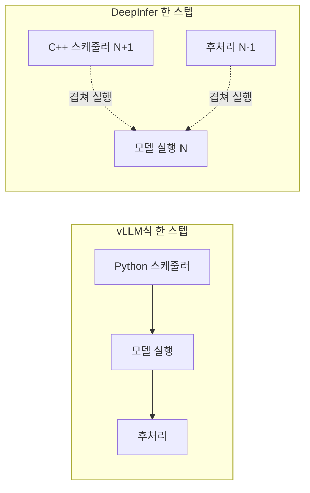
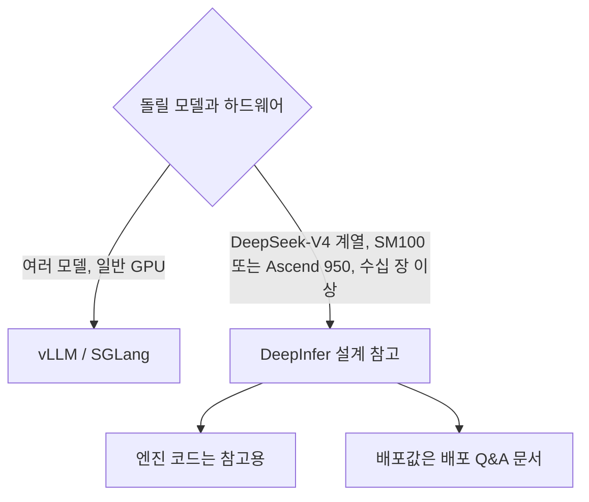

DeepInfer는 vLLM을 대신할 엔진이 아니다. DeepSeek 모델 하나를 Blackwell 수십 장 규모로 운영할 때의 설계를 코드와 문서로 보여 주는 자료다. 이 장은 앞 장들의 내용을 vLLM과 나란히 놓고, 자기 서빙 스택에 가져갈 수 있는 지점을 고른다.

## 기능 비교

| 항목 | DeepInfer | vLLM |
|---|---|---|
| 성격 | 자사 프로덕션 엔진의 일부 공개 | 범용 오픈소스 엔진 |
| 지원 모델 | DeepSeek-V4.1-Flash 하나 | Hugging Face 모델 구조 다수 |
| 하드웨어 | NVIDIA SM100, Huawei Ascend 950 | NVIDIA, AMD, Intel, CPU, 플러그인 하드웨어 |
| 제공 형태 | 오프라인 배치 API (`LLM.generate`) | OpenAI 호환 API 서버 포함 |
| 스케줄러 | C++ (`csrc/engine/scheduler.hpp`), 비동기 스케줄링 기본 | Python 스케줄러 |
| P/D 분리 | 엔진 타입(`PROMPT`, `COMPLETION`)과 빈 훅만 있고 P에서 D로 KV를 넘기는 구현은 없음 (10장) | 분리 배포 지원 |
| KV 캐시 | 블록 캐시 + 상태(state) 캐시, C++ `BlockManager`. 해시 기반 prefix caching은 없고 재사용 경로는 `fork_seq` 하나 (05장) | PagedAttention, prefix caching |
| 병렬화 | Attention DP, balanced CP, MoE EP + EPLB (재배치 주기 기본값 0, 곧 기본 꺼짐) (07장) | TP, PP, DP, EP, CP |
| 추측 디코딩 | DFlash 한 종류. README의 DSpark, 코드의 DFlash, 디렉터리 이름 MTP가 같은 기능 (08장) | n-gram, EAGLE 등 여러 방식 |
| 구조화 출력 | regex, JSON schema, EBNF | xgrammar, guidance 등 |
| 결정성 | batch-invariant 추론, 결정적 샘플링 (NVIDIA만) | 별도 모드 (미검증) |

> **주의**: vLLM 쪽 항목은 vLLM README의 기능 목록 기준이고 vLLM 코드까지 확인하지는 않았다(미검증). DeepInfer 쪽은 이 책의 앞 장에서 코드로 확인한 내용이다.

## 동일 명칭, 상이한 구조

01장에서 본 것처럼 `Derived from vLLM` 표기가 붙은 파일은 23개다. 이름이 같은 클래스가 실제로 어떤 역할을 맡는지는 다르다.

| 이름 | vLLM에서 온 부분 | DeepInfer에서 바뀐 부분 | 장 |
|---|---|---|---|
| `LLM`, `LLMEngine` | API 모양, `add_request` / `step` 루프 | 스케줄링을 C++에 위임, 스텝 구간 CPU 타이머, 엔진 타입 3종 | 03 |
| `Worker`, `ModelRunner` | 워커가 모델 러너를 감싸는 구조 | V4 전용 입력 메타데이터, CUDA graph 러너 분리 | 04 |
| `CacheEngine` | 레이어별 KV 텐서를 미리 잡는 구조 | 압축 KV, 상태(state) 블록 복제 · 초기화 | 05 |
| `Sampler`, `SamplingParams` | 샘플링 인자 모양 | TileLang fused sampler, `seq_seed` 결정적 샘플링, `so_args` | 09 |
| `model_loader`, 레이어 | 로더와 기본 레이어 | V4 어텐션 · MoE · MTP 모듈 전용 구현 | 06~08 |

- 비동기 스케줄링은 GPU가 스텝 N을 도는 동안 CPU가 N+1 스케줄과 N-1 후처리를 하는 구조다(README, 03장). 스케줄러를 C++로 옮긴 것과 같은 목적, 곧 GPU가 CPU를 기다리는 구간을 없애는 것이다
- vLLM도 비슷한 겹치기 기능을 갖고 있다(미검증). 차이는 DeepInfer가 이것을 기본값으로 두고 모델 하나에 맞춰 경로를 고정했다는 점이다

## 범용 엔진과 전용 엔진의 선택 기준

- **바로 서빙하려면** vLLM이나 SGLang이 현실적이다. DeepInfer 공개본에는 HTTP 서버, KV 캐시 시스템, 로드밸런서가 없다
- **DeepInfer를 읽는 이유**는 특정 모델 전용으로 최적화할 때 어느 부분을 덜어 내는지 확인할 수 있기 때문이다. 범용 엔진의 추상화 층(모델 레지스트리, 여러 어텐션 백엔드 선택)이 빠지고, 그 자리를 V4 전용 메타데이터 준비 커널과 fused 커널이 채운다

## 참고 지점

| 지점 | 내용 | 어디서 읽나 |
|---|---|---|
| 스케줄러를 네이티브 코드로 | 스텝당 CPU 오버헤드가 GPU 스텝 시간에 비해 무시할 수 없는 규모(높은 동시성 decode)에서 의미가 있다 | 03장, `csrc/engine` |
| 엔진 타입으로 P/D 역할 분리 | 같은 엔진 코드를 prefill 전용, decode 전용으로 띄우는 구조 | 01장, 10장 |
| prefill은 작은 EP, decode는 큰 EP | 운영 설계값을 문서로 공개 | 10장, [배포 Q&A 문서](https://github.com/deepseek-ai/DeepInfer/blob/a679bb86ce36e883a98a97733492b686e5b9a08e/doc/inference_deployment_qa.md) |
| EPLB 통계 주기 | 중복 expert 수와 재배치 주기를 prefill/decode로 다르게 둔다 | 07장 |
| confidence 기반 검증 길이 | draft 토큰마다 수용 확률을 예측해 검증할 길이를 정한다 | 08장 |
| batch-invariant · 결정적 샘플링 | 평가 재현성과 디버깅을 위한 모드 | 09장, 12장 |

## 해석 시 유의 사항

- **처리량 수치는 모두 자체 발표다.** README의 성능 그래프는 prefill 4 GPU, decode 64 GPU(SM100)에서 쟀고, 재현 스크립트만 있다
- **처리량과 평가 점수는 다른 설정의 결과다.** `examples/benchmark.py`는 `force_topk` 기본값이 1024(상위 1024개 밖 토큰을 샘플링 분포에서 뺌)이고, 평가와 샘플러 분포 검정은 0으로 둔다(09장, 12장)
- **하드웨어 조건이 좁다.** SM100 이전 세대 GPU는 지원 목록에 없다
- **사내 저장소를 옮겨 온 형태다.** 주석 일부가 중국어로 남아 있고, KV 캐시 저장(3FS)처럼 사내 인프라에 묶인 부분은 빠졌다
- 공개 FlashMLA는 사내 버전보다 decode 커널이 5~10% 느리고 종단 성능 차이는 5% 이내라고 배포 Q&A 문서가 밝힌다(자체 발표)

## 정리

- DeepInfer는 vLLM 기본 구조에 C++ 스케줄러와 V4 전용 모델 · 커널을 결합한 전용 엔진이다
- 서빙에 바로 쓰는 엔진이 아니라, 대규모 MoE 서빙 설계를 읽는 자료로 쓴다
- 가져갈 지점은 네이티브 스케줄러, 엔진 타입 기반 P/D 분리, EP 크기와 EPLB 주기, confidence 기반 추측 디코딩이다
- 수치는 자체 발표이고 vLLM 쪽 비교는 README 기준이라 둘 다 직접 검증하지 않았다
