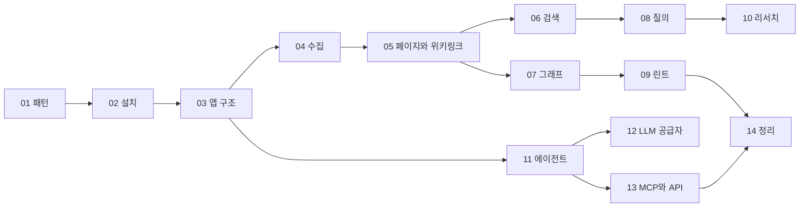

LLM Wiki는 문서를 넣으면 LLM이 위키 페이지를 쓰고 서로 링크를 걸어, 질문할 때마다 처음부터 찾지 않고 계속 쌓이는 지식 베이스를 유지하는 데스크톱 앱이다. 이 책은 그 앱의 코드를 따라가며 "LLM이 위키를 관리한다"는 아이디어가 실제 소프트웨어에서 어떤 부품으로 나뉘는지 설명한다.

## 책의 구성

출발점은 Andrej Karpathy가 공개한 [LLM Wiki 아이디어 문서](https://github.com/nashsu/llm_wiki/blob/e08cfce65aad8b76b13546a081c1a8d4422b70c3/llm-wiki.md)다. 그 문서는 일부러 추상적으로 쓰였고, 구현은 각자 LLM 에이전트와 함께 만들라고 권한다. llm_wiki는 그 패턴을 Tauri(Rust) 백엔드와 React 프론트엔드로 된 앱으로 구현하고 크게 넓혔다. 아이디어 문서의 한 문장이 코드에서는 수천 줄짜리 모듈이 되기도 한다.

| 부분 | 장 |
|---|---|
| 패턴, 설치, 앱 구조 | 01~03장 |
| 위키를 만드는 쪽: 수집, 페이지와 위키링크 | 04~05장 |
| 위키를 읽는 쪽: 검색, 그래프, 질의 | 06~08장 |
| 위키를 관리하는 쪽: 린트와 리뷰, 리서치와 자동 수집 | 09~10장 |
| 바깥과 잇는 쪽: 에이전트, LLM 공급자, MCP와 API | 11~13장 |
| 테스트와 정리 | 14장 |

## 권장 읽기 순서

- 아이디어를 내 도구에 적용하려는 사람은 01, 04, 05, 08, 09장을 먼저 읽는다. 위키가 쌓이고 유지되는 핵심 경로다
- 앱을 고치거나 기능을 붙이려는 사람은 03장으로 지도를 잡고 해당 장으로 간다
- 코딩 에이전트에서 위키를 쓰려는 사람은 13장(MCP 서버, 로컬 API)부터 읽어도 된다

## 기준과 표기

- **기준 커밋**: [`e08cfce`](https://github.com/nashsu/llm_wiki/blob/e08cfce65aad8b76b13546a081c1a8d4422b70c3) (2026-10-21). 모든 코드 링크는 이 커밋에 고정했다
- **라이선스**: 원본은 GPL-3.0이다. 코드는 해설에 필요한 만큼만 짧게 인용하고 매번 원문 줄 범위를 링크로 건다
- **확인 수준**: 코드에서 확인하지 못한 추정은 "(추정)" 또는 "(미검증)"으로 표시한다. 앱을 직접 실행해 확인한 내용은 없고, 모두 코드 읽기에 근거한다
- **용어**: RAG, embedding, frontmatter, wikilink, Tauri command, MCP처럼 개발자가 그대로 쓰는 말은 번역하지 않는다

## 정리

- LLM Wiki는 Karpathy의 아이디어 문서를 데스크톱 앱으로 구현하고 넓힌 프로젝트다
- 책은 만들기(수집), 읽기(검색 · 그래프 · 질의), 관리하기(린트 · 리서치), 잇기(에이전트 · MCP)로 나뉜다
- 코드 링크는 커밋 `e08cfce`에 고정했고 인용은 짧게 한다
- 실행이 아니라 코드 읽기에 근거하며, 확인하지 못한 내용은 표시한다
