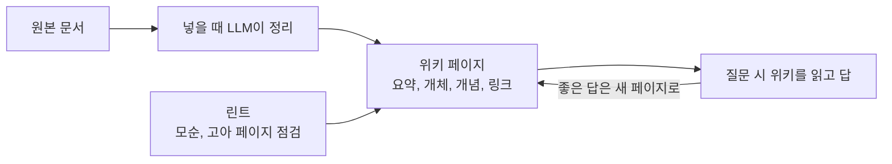

LLM Wiki 패턴의 핵심은 지식을 질문할 때마다 다시 찾지 않고, 문서를 넣을 때 한 번 정리해 위키에 쌓아 두는 것이다. 이 장은 아이디어 문서가 말하는 세 층과 세 작업을 정리하고, llm_wiki가 그것을 어떤 파일과 모듈로 옮겼는지 대응표로 본다.

## RAG와 무엇이 다른가

아이디어 문서는 일반적인 RAG를 이렇게 설명한다. 문서를 올려 두고, 질문이 오면 관련 조각을 찾아 답을 만든다. 이 방식은 잘 동작하지만 쌓이는 것이 없다.

> "the LLM is rediscovering knowledge from scratch on every question. There's no accumulation."
> ([llm-wiki.md](https://github.com/nashsu/llm_wiki/blob/e08cfce65aad8b76b13546a081c1a8d4422b70c3/llm-wiki.md))

일반 RAG는 질문이 올 때마다 같은 일을 반복한다.

LLM Wiki는 문서를 넣을 때 정리하고, 답과 점검 결과를 위키로 되돌린다.

| 구분 | 일반 RAG | LLM Wiki |
|---|---|---|
| 정리 시점 | 질문할 때마다 | 문서를 넣을 때 한 번 |
| 결과물 | 매번 사라지는 답 | 남는 마크다운 페이지와 링크 |
| 모순 처리 | 질문할 때 우연히 드러남 | 넣을 때 기존 페이지와 대조해 표시 |
| 사람의 역할 | 질문 | 원본 고르기, 방향 잡기, 리뷰 |
| 저장 형태 | 벡터 인덱스 | 마크다운 파일 묶음 (Obsidian vault로 열림) |

## 세 층

아이디어 문서는 세 층을 둔다. llm_wiki는 프로젝트 폴더 안에서 이를 그대로 디렉터리와 파일로 만든다.

| 층 | 아이디어 문서 | llm_wiki의 구현 |
|---|---|---|
| Raw sources | 바뀌지 않는 원본 모음. LLM은 읽기만 한다 | `raw/sources/` 폴더. 외부 변경도 감시한다(10장) |
| Wiki | LLM이 쓰고 유지하는 마크다운 | `wiki/` 폴더. `index.md`, `log.md`, `overview.md`와 타입별 페이지(05장) |
| Schema | 구조와 작업 규칙을 담은 문서 (CLAUDE.md 같은) | `schema.md`에 더해 `purpose.md`(왜 이 위키를 만드는지)를 따로 둔다 |

`purpose.md`는 아이디어 문서에 없는 추가다. README는 schema가 "구조 규칙"이고 purpose가 "방향성 있는 의도"라고 구분하고, LLM이 모든 수집과 질의에서 purpose를 읽는다고 적는다. 코드는 조금 다르다. 수집에서는 둘 다 읽지만(04장), 채팅 에이전트에 고정으로 들어가는 컨텍스트는 `overview.md`와 `schema.md`뿐이고 `purpose.md`는 빠져 있다(08장).

## 세 작업

| 작업 | 아이디어 문서 | llm_wiki의 구현 | 장 |
|---|---|---|---|
| Ingest | 원본을 읽고 요약 페이지를 쓰고, 관련 개체 · 개념 페이지와 index, log를 갱신한다. 원본 하나가 10~15개 페이지를 건드릴 수 있다 | 분석과 생성을 LLM 호출 두 번으로 나눈 2단계 수집, SHA256 증분 캐시, 디스크에 저장되는 수집 큐 | 04 |
| Query | 위키를 찾아 읽고 출처를 달아 답한다. 좋은 답은 새 페이지로 남긴다 | 채팅에서 위키 · 원본 · 그래프 검색, 답을 위키에 저장하는 기능 | 08 |
| Lint | 모순, 낡은 주장, 고아 페이지, 빠진 링크를 점검한다 | 린트 화면과 비동기 리뷰 큐 | 09 |

### 코드 따라가기: index.md와 log.md 규칙

아이디어 문서는 `index.md`(내용 목록)와 `log.md`(시간순 기록)를 두라고 한다. llm_wiki는 이 규칙을 LLM에 주는 템플릿 문자열로 박아 둔다. [`src/lib/templates.ts`](https://github.com/nashsu/llm_wiki/blob/e08cfce65aad8b76b13546a081c1a8d4422b70c3/src/lib/templates.ts#L46-L59)를 보면 두 파일의 형식을 프롬프트에 직접 적는다.

- `BASE_INDEX_FORMAT`: `wiki/index.md`는 모든 페이지를 타입별로 묶어 나열한다
- `BASE_LOG_FORMAT`: `wiki/log.md`는 활동을 최신순으로 기록한다
- 그리고 "모든 개체와 개념은 `wiki/index.md`에 나와야 한다"는 규칙을 둔다

아이디어 문서의 log는 시간순 append였지만, 템플릿은 "reverse chronological order"(최신이 위)로 적는다. 같은 아이디어라도 구현에서 세부가 바뀐 지점이다. 템플릿 전체 구조는 05장에서 다룬다.

## 원본 아키텍처 그림

출처: [llm_wiki assets/llm_wiki_arch.jpg](https://github.com/nashsu/llm_wiki/blob/e08cfce65aad8b76b13546a081c1a8d4422b70c3/assets/llm_wiki_arch.jpg)

- 그림의 왼쪽(원본 → 2단계 수집 → 위키)이 04~05장, 가운데(검색 · 그래프)가 06~07장, 오른쪽(채팅 · 리서치 · 리뷰)이 08~10장에 대응한다
- 그림만 보면 하나의 파이프라인 같지만, 코드에서는 프론트엔드(TypeScript)가 수집 · 그래프를 맡고 백엔드(Rust)가 파일 · 검색 · 에이전트를 맡는 식으로 나뉜다. 그 분담은 03장에서 본다

## 아이디어 문서 대비 추가된 것

README의 "변경하고 추가한 것들" 절을 범주로 묶으면 다음과 같다.

| 범주 | 추가 기능 | 장 |
|---|---|---|
| 형태 | CLI 패턴을 3열 데스크톱 앱으로, 시나리오 템플릿 | 02, 03 |
| 수집 | 2단계 수집, 증분 캐시, 영속 큐, 폴더 가져오기, 이미지 캡션, MinerU PDF 처리 | 04 |
| 그래프 | 4가지 신호 관련성 모델, Louvain 커뮤니티, 그래프 인사이트 | 07 |
| 검색 | LanceDB 벡터 검색(선택) | 06 |
| 관리 | 비동기 리뷰, Deep Research, 웹 클리퍼, 소스 폴더 감시 | 09, 10 |
| 연결 | Rust 에이전트 런타임, 스킬, 로컬 HTTP API, MCP 서버 | 11, 13 |

아이디어 문서는 "index 파일만으로도 중간 규모(원본 약 100개, 페이지 수백 개)에서는 잘 동작해 임베딩 기반 RAG 인프라가 필요 없다"고 말한다. llm_wiki가 벡터 검색을 선택 기능으로 둔 것은 이 판단과 맞는다. 규모가 커질 때를 위한 장치다.

## 정리

- LLM Wiki 패턴은 질문 시 검색 대신 수집 시 정리로 지식을 쌓는다
- 세 층(원본, 위키, 스키마)은 `raw/sources/`, `wiki/`, `schema.md`로 구현되고 `purpose.md`가 더해졌다
- 세 작업(수집, 질의, 린트)이 각각 04, 08, 09장의 주제다
- index.md · log.md 규칙은 LLM에 주는 템플릿 문자열로 코드에 들어 있다
- 앱은 아이디어 문서에 없는 그래프 분석, 벡터 검색, 에이전트, MCP를 크게 더했다
