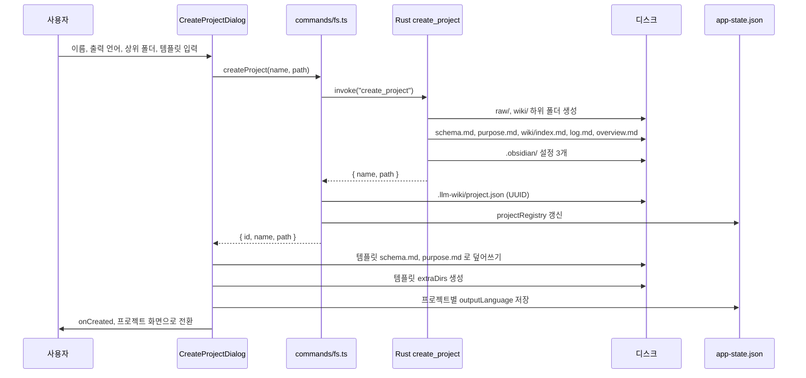

앱을 처음 실행하고 프로젝트를 만들 때 Rust 백엔드와 프론트엔드가 나눠 맡는 처리를 본다.

## 앱 첫 실행

앱이 뜨면 프론트엔드 루트 컴포넌트 `App` 이 저장된 설정을 읽고 마지막 프로젝트를 다시 연다. 열 프로젝트가 없으면 환영 화면을 보여 준다.

### 코드 분석: 시작 시 마지막 프로젝트 복원

시작 시 무엇을 어떤 순서로 불러오는지 본다. [src/App.tsx L305-L431](https://github.com/nashsu/llm_wiki/blob/e08cfce65aad8b76b13546a081c1a8d4422b70c3/src/App.tsx#L305-L431) 에서 일부를 인용한다 ([L313-L317](https://github.com/nashsu/llm_wiki/blob/e08cfce65aad8b76b13546a081c1a8d4422b70c3/src/App.tsx#L313-L317), [L415-L423](https://github.com/nashsu/llm_wiki/blob/e08cfce65aad8b76b13546a081c1a8d4422b70c3/src/App.tsx#L415-L423)).

```ts
const savedConfig = await loadLlmConfig()
if (savedConfig) {
  useWikiStore.getState().setLlmConfig(savedConfig)
  useWikiStore.getState().setGlobalLlmConfig(savedConfig)
}
// ... provider, embedding, proxy, API, general 설정 복원 ...
const lastProject = await getLastProject()
if (lastProject) {
  try {
    const proj = await openProject(lastProject.path)
    await handleProjectOpened(proj)
  } catch {
    // Last project no longer valid
  }
}
```

설정 복원이 프로젝트 열기보다 먼저다. LLM 설정, 공급자별 설정, 활성 프리셋, 작업별 모델 라우팅, 웹 검색, 임베딩, 멀티모달, MinerU, 프록시, API 서버, 일반 설정 순서로 읽는다. 이 값들은 모두 Tauri store 플러그인의 `app-state.json` 하나에 들어 있다 ([src/lib/project-store.ts L8-L14](https://github.com/nashsu/llm_wiki/blob/e08cfce65aad8b76b13546a081c1a8d4422b70c3/src/lib/project-store.ts#L8-L14)). 마지막 프로젝트가 옮겨졌거나 지워졌으면 `openProject` 가 실패하고 조용히 환영 화면으로 넘어간다.

환영 화면은 새 프로젝트 만들기, 기존 폴더 열기, 최근 프로젝트 목록 세 가지를 보여 준다 ([src/components/project/welcome-screen.tsx](https://github.com/nashsu/llm_wiki/blob/e08cfce65aad8b76b13546a081c1a8d4422b70c3/src/components/project/welcome-screen.tsx#L14-L31)). 최근 목록은 경로 기준으로 중복을 지우고 최대 10개까지 유지한다 ([project-store.ts L34-L42](https://github.com/nashsu/llm_wiki/blob/e08cfce65aad8b76b13546a081c1a8d4422b70c3/src/lib/project-store.ts#L34-L42)).

## 첫 프로젝트 생성

프로젝트 생성은 프론트엔드 다이얼로그와 Rust command 두 곳이 나눠 맡는다. Rust 는 기본 폴더 구조와 기본 파일을 만들고, 프론트엔드는 템플릿과 언어 설정을 적용한다.



### 입력 항목

다이얼로그는 네 항목을 받는다. 이름, AI 출력 언어, 상위 폴더가 필수이고 템플릿은 기본값 `general` 이 선택돼 있다 ([create-project-dialog.tsx L33-L47](https://github.com/nashsu/llm_wiki/blob/e08cfce65aad8b76b13546a081c1a8d4422b70c3/src/components/project/create-project-dialog.tsx#L33-L47)).

| 항목 | 필수 | 기본값 | 쓰임 |
|---|---|---|---|
| 이름 | 예 | 빈 문자열 | 상위 폴더 아래에 만들 폴더 이름 |
| AI 출력 언어 | 예 | 선택 안 됨 | 수집 · 채팅에서 LLM 이 쓸 언어. 목록에서 `auto` 는 빠진다 |
| 상위 폴더 | 예 | 빈 문자열 | 폴더 선택 대화상자 또는 직접 입력 |
| 템플릿 | 아니오 | `general` | `schema.md`, `purpose.md`, 추가 폴더 결정 |

출력 언어 목록은 [output-language-options.ts](https://github.com/nashsu/llm_wiki/blob/e08cfce65aad8b76b13546a081c1a8d4422b70c3/src/lib/output-language-options.ts#L17-L30) 에 있다. 생성 다이얼로그는 이 목록에서 `auto` 를 걸러 낸다 ([L180](https://github.com/nashsu/llm_wiki/blob/e08cfce65aad8b76b13546a081c1a8d4422b70c3/src/components/project/create-project-dialog.tsx#L180)). 주석은 새 프로젝트가 "처음 본 텍스트로 언어를 추측하는" 모드로 암묵적으로 시작하지 않게 하려는 의도라고 설명한다. `auto` 는 나중에 설정의 Output 항목에서 명시적으로 고를 수 있다.

### 코드 분석: 생성 버튼 핸들러

생성 버튼을 누르면 무엇이 어떤 순서로 실행되는지 본다. [src/components/project/create-project-dialog.tsx L114-L134](https://github.com/nashsu/llm_wiki/blob/e08cfce65aad8b76b13546a081c1a8d4422b70c3/src/components/project/create-project-dialog.tsx#L114-L134)

```ts
const project = await createProject(name.trim(), path.trim())
const pp = normalizePath(project.path)

const template = getTemplate(selectedTemplate)
await writeFile(`${pp}/schema.md`, template.schema)
await writeFile(`${pp}/purpose.md`, template.purpose)
for (const dir of template.extraDirs) {
  await createDirectory(`${pp}/${dir}`)
}

const lang = language as OutputLanguage
setOutputLanguage(lang)
await saveOutputLanguage(lang, project.id)

onCreated(project)
handleOpenChange(false)
```

Rust 의 `create_project` 가 기본 `schema.md` 와 `purpose.md` 를 이미 쓴 상태에서 프론트엔드가 템플릿 내용으로 다시 덮어쓴다. 그래서 디스크에 남는 `schema.md` 는 항상 템플릿 쪽이다. Rust 쪽 기본 스키마는 앱 밖에서 `create_project` 를 부르는 경우의 대비책으로 보인다 (추정). 출력 언어는 프로젝트 UUID 를 키로 `projectOutputLanguages` 에 저장되고, 같은 값이 전역 `outputLanguage` 에도 기록된다 ([project-store.ts L413-L420](https://github.com/nashsu/llm_wiki/blob/e08cfce65aad8b76b13546a081c1a8d4422b70c3/src/lib/project-store.ts#L413-L420)).

### 코드 분석: Rust create_project의 생성 폴더

기본 폴더 구조를 만드는 부분을 본다. [src-tauri/src/commands/project.rs L16-L37](https://github.com/nashsu/llm_wiki/blob/e08cfce65aad8b76b13546a081c1a8d4422b70c3/src-tauri/src/commands/project.rs#L16-L37)

```rust
fn create_project_impl(name: String, path: String) -> Result<WikiProject, String> {
    let root = Path::new(&path).join(&name);

    if root.exists() {
        return Err(format!("Directory already exists: '{}'", root.display()));
    }

    let dirs = [
        "raw/sources",
        "raw/assets",
        "wiki/entities",
        "wiki/concepts",
        "wiki/sources",
        "wiki/queries",
        "wiki/comparisons",
        "wiki/synthesis",
    ];
    for dir in &dirs {
        fs::create_dir_all(root.join(dir))
```

같은 이름의 폴더가 있으면 바로 실패한다. 기존 폴더를 덮어쓰거나 합치지 않는다. 기존 위키를 쓰려면 "프로젝트 열기"로 들어가야 한다.

이어서 같은 함수가 쓰는 파일은 다음과 같다.

| 파일 | 내용 | 줄 |
|---|---|---|
| `schema.md` | 페이지 타입 표, 파일명 규칙, frontmatter 형식, index · log 형식, 교차 참조 · 모순 처리 규칙 | [L41-L119](https://github.com/nashsu/llm_wiki/blob/e08cfce65aad8b76b13546a081c1a8d4422b70c3/src-tauri/src/commands/project.rs#L41-L119) |
| `purpose.md` | Goal, Key Questions, Scope, Thesis 빈 양식 | [L121-L152](https://github.com/nashsu/llm_wiki/blob/e08cfce65aad8b76b13546a081c1a8d4422b70c3/src-tauri/src/commands/project.rs#L121-L152) |
| `wiki/index.md` | 타입별 빈 헤딩 6개 | [L154-L169](https://github.com/nashsu/llm_wiki/blob/e08cfce65aad8b76b13546a081c1a8d4422b70c3/src-tauri/src/commands/project.rs#L154-L169) |
| `wiki/log.md` | 오늘 날짜 헤딩과 `- Project created` | [L171-L180](https://github.com/nashsu/llm_wiki/blob/e08cfce65aad8b76b13546a081c1a8d4422b70c3/src-tauri/src/commands/project.rs#L171-L180) |
| `wiki/overview.md` | `type: overview` frontmatter 와 빈 개요 | [L182-L194](https://github.com/nashsu/llm_wiki/blob/e08cfce65aad8b76b13546a081c1a8d4422b70c3/src-tauri/src/commands/project.rs#L182-L194) |
| `.obsidian/app.json` | 첨부 폴더 `raw/assets`, `.llm-wiki` 등 무시 | [L200-L212](https://github.com/nashsu/llm_wiki/blob/e08cfce65aad8b76b13546a081c1a8d4422b70c3/src-tauri/src/commands/project.rs#L200-L212) |
| `.obsidian/appearance.json`, `core-plugins.json` | 테마, 그래프 · 백링크 등 코어 플러그인 활성화 | [L214-L235](https://github.com/nashsu/llm_wiki/blob/e08cfce65aad8b76b13546a081c1a8d4422b70c3/src-tauri/src/commands/project.rs#L214-L235) |

`.obsidian/` 을 같이 만드는 것은 llm-wiki.md 의 "Obsidian 이 IDE 이고 LLM 이 프로그래머다" 라는 사용 방식을 그대로 받아들인 결과다. 원본 문서가 권하는 "첨부 폴더를 `raw/assets/` 로 고정" 팁이 `attachmentFolderPath` 설정으로 미리 들어가 있다. 같은 프로젝트 폴더를 Obsidian 볼트로 열면 그래프 뷰와 백링크가 바로 켜진 상태다.

### 프로젝트 식별자

Rust command 는 `{ name, path }` 만 돌려준다. UUID 는 프론트엔드 래퍼가 붙인다. [src/commands/fs.ts L248-L256](https://github.com/nashsu/llm_wiki/blob/e08cfce65aad8b76b13546a081c1a8d4422b70c3/src/commands/fs.ts#L248-L256)

```ts
export async function createProject(
  name: string,
  path: string,
): Promise<WikiProject> {
  const raw = await invoke<RawProject>("create_project", { name, path })
  const id = await ensureProjectId(raw.path)
  await upsertProjectInfo(id, raw.path, raw.name)
  return { id, name: raw.name, path: raw.path }
}
```

`ensureProjectId` 는 `.llm-wiki/project.json` 을 읽고, 없으면 `crypto.randomUUID()` 로 만들어 쓴다 ([project-identity.ts L46-L68](https://github.com/nashsu/llm_wiki/blob/e08cfce65aad8b76b13546a081c1a8d4422b70c3/src/lib/project-identity.ts#L46-L68)). 파일 첫 주석은 경로 대신 UUID 를 쓰는 이유를 적는다. 사용자가 프로젝트 폴더를 옮기거나 이름을 바꿔도 수집 큐 작업이 프로젝트를 잃지 않게 하려는 것이다 ([L1-L14](https://github.com/nashsu/llm_wiki/blob/e08cfce65aad8b76b13546a081c1a8d4422b70c3/src/lib/project-identity.ts#L1-L14)). 전역 등록부는 `app-state.json` 의 `projectRegistry` 키에 UUID 별 최신 경로를 담는다.

### 기존 폴더 열기의 검사 조건

"프로젝트 열기"는 폴더를 고른 뒤 Rust `open_project` 를 부른다. 이 command 는 두 가지만 확인한다. 루트에 `schema.md` 가 있는가, `wiki/` 가 디렉터리인가 ([project.rs L342-L364](https://github.com/nashsu/llm_wiki/blob/e08cfce65aad8b76b13546a081c1a8d4422b70c3/src-tauri/src/commands/project.rs#L342-L364)). `raw/` 나 `purpose.md` 는 검사하지 않는다. 다른 도구로 만든 LLM Wiki 패턴 저장소라도 이 두 조건만 맞추면 열 수 있다.

## 템플릿과 최종 폴더 구조

템플릿은 [src/lib/templates.ts](https://github.com/nashsu/llm_wiki/blob/e08cfce65aad8b76b13546a081c1a8d4422b70c3/src/lib/templates.ts#L640-L654) 에 다섯 개가 있다. 각 템플릿은 `schema`, `purpose` 문자열과 `extraDirs` 배열을 가진다.

| id | 이름 | 설명 (코드 원문 요지) | 추가 폴더 |
|---|---|---|---|
| `research` | Research | Deep-dive research with hypothesis tracking and methodology notes | `wiki/methodology`, `wiki/findings`, `wiki/thesis` |
| `reading` | Reading | Track a book's characters, themes, plot threads, and chapter notes | `wiki/characters`, `wiki/themes`, `wiki/plot-threads`, `wiki/chapters` |
| `personal` | Personal Growth | Track goals, habits, reflections, and journal entries for self-improvement | `wiki/goals`, `wiki/habits`, `wiki/reflections`, `wiki/journal` |
| `business` | Business | Manage meetings, decisions, projects, and stakeholder context for a team | `wiki/meetings`, `wiki/decisions`, `wiki/projects`, `wiki/stakeholders` |
| `general` | General | Minimal setup, a blank slate for any purpose | 없음 |

추가 폴더는 각 템플릿 정의의 `extraDirs` 줄에서 확인했다 ([research L74](https://github.com/nashsu/llm_wiki/blob/e08cfce65aad8b76b13546a081c1a8d4422b70c3/src/lib/templates.ts#L74), [reading L194](https://github.com/nashsu/llm_wiki/blob/e08cfce65aad8b76b13546a081c1a8d4422b70c3/src/lib/templates.ts#L194), [personal L311](https://github.com/nashsu/llm_wiki/blob/e08cfce65aad8b76b13546a081c1a8d4422b70c3/src/lib/templates.ts#L311), [business L439](https://github.com/nashsu/llm_wiki/blob/e08cfce65aad8b76b13546a081c1a8d4422b70c3/src/lib/templates.ts#L439), [general L577](https://github.com/nashsu/llm_wiki/blob/e08cfce65aad8b76b13546a081c1a8d4422b70c3/src/lib/templates.ts#L577)). 템플릿 스키마는 공통 페이지 타입 표 뒤에 템플릿 고유 타입을 덧붙인다. 예를 들어 research 템플릿은 `thesis`, `methodology`, `finding` 타입과 `confidence`, `status` frontmatter 필드를 더한다. 템플릿별 페이지 타입이 수집 프롬프트에 어떻게 들어가는지는 5장에서 다룬다.

`general` 템플릿으로 만든 직후의 폴더는 다음과 같다. 코드에서 확인한 항목만 적었다.

```text
my-wiki/
├── purpose.md            # 템플릿의 purpose (목적, 핵심 질문, 범위, 가설)
├── schema.md             # 템플릿의 schema (페이지 타입, 규칙)
├── raw/
│   ├── sources/          # 원본 문서
│   └── assets/           # 로컬 이미지, Obsidian 첨부 폴더
├── wiki/
│   ├── index.md
│   ├── log.md
│   ├── overview.md
│   ├── entities/  concepts/  sources/
│   └── queries/  comparisons/  synthesis/
├── .obsidian/            # app.json, appearance.json, core-plugins.json
└── .llm-wiki/
    └── project.json      # 프로젝트 UUID
```

README 의 프로젝트 구조 그림([README.md L473-L494](https://github.com/nashsu/llm_wiki/blob/e08cfce65aad8b76b13546a081c1a8d4422b70c3/README.md#L473-L494))과 같다. `.llm-wiki/` 아래에는 앱을 쓰면서 `review.json`, `lint.json`, `conversations.json`, `chats/`, `chat-preferences.json` 등이 더 생긴다 ([src/lib/persist.ts](https://github.com/nashsu/llm_wiki/blob/e08cfce65aad8b76b13546a081c1a8d4422b70c3/src/lib/persist.ts#L9-L33)). 이 파일들의 저장 시점은 3장에서 다룬다.

### llm-wiki.md 의 세 층과의 대응

원본 아이디어 문서는 저장소를 세 층으로 나눈다 ([llm-wiki.md L27-L33](https://github.com/nashsu/llm_wiki/blob/e08cfce65aad8b76b13546a081c1a8d4422b70c3/llm-wiki.md#L27-L33)).

| llm-wiki.md 의 층 | 원문 설명 요지 | LLM Wiki 앱의 구현 |
|---|---|---|
| Raw sources | 불변 원본. LLM 은 읽기만 한다 | `raw/sources/`, `raw/assets/` |
| The wiki | LLM 이 쓰고 유지하는 markdown 디렉터리 | `wiki/` 와 타입별 하위 폴더 |
| The schema | CLAUDE.md 나 AGENTS.md 처럼 LLM 에게 규칙을 알려 주는 문서 | `schema.md` |
| (원문에 없음) | | `purpose.md`. README 는 스키마가 구조 규칙이고 purpose 는 방향이라고 구분한다 ([README.md L98-L104](https://github.com/nashsu/llm_wiki/blob/e08cfce65aad8b76b13546a081c1a8d4422b70c3/README.md#L98-L104)) |
| index.md, log.md | 내용 목록과 시간순 기록 | `wiki/index.md`, `wiki/log.md` 를 생성 시 미리 만든다 |

원본은 스키마 파일을 에이전트 도구의 설정 파일로 두지만, 앱은 프로젝트 루트의 `schema.md` 로 옮겨 수집 단계가 직접 읽게 한다 ([src/lib/ingest.ts L781-L782](https://github.com/nashsu/llm_wiki/blob/e08cfce65aad8b76b13546a081c1a8d4422b70c3/src/lib/ingest.ts#L781-L782)). 원본이 "LLM 과 사람이 함께 고쳐 나가는 문서"라고 한 성격은 그대로다. 사용자는 앱 안의 편집기나 Obsidian 에서 `schema.md` 를 고칠 수 있다.

## 프로젝트 열림 이후 동작

`onCreated` 는 `App` 의 `handleProjectOpened` 로 연결된다 ([App.tsx L666-L670](https://github.com/nashsu/llm_wiki/blob/e08cfce65aad8b76b13546a081c1a8d4422b70c3/src/App.tsx#L666-L670)). 새로 만든 프로젝트와 기존 프로젝트를 여는 경로가 여기서 합쳐진다. 이 함수는 이전 프로젝트 상태를 비우고, 프로젝트별 LLM 설정과 출력 언어를 적용하고, 수집 큐를 복원하고, 파일 감시와 클립 서버 알림을 시작한다 ([App.tsx L433-L593](https://github.com/nashsu/llm_wiki/blob/e08cfce65aad8b76b13546a081c1a8d4422b70c3/src/App.tsx#L433-L593)). 각 단계는 3장의 상태 저장소 절에서 다시 본다. 첫 화면은 `activeView` 를 `"wiki"` 로 두므로 위키 트리가 보인다 ([L465](https://github.com/nashsu/llm_wiki/blob/e08cfce65aad8b76b13546a081c1a8d4422b70c3/src/App.tsx#L465)).
