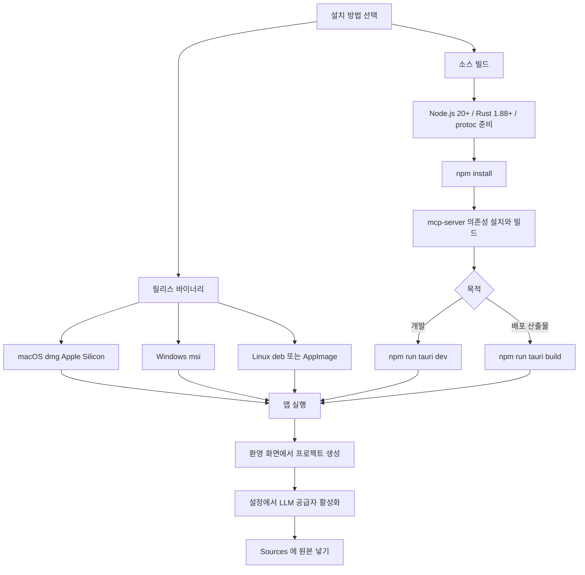

LLM Wiki 는 Tauri v2 데스크톱 앱이라 설치 경로가 둘이다. 릴리스 바이너리를 받거나, Node.js 와 Rust 툴체인으로 직접 빌드한다. 이 장은 두 경로를 코드와 설정 파일 기준으로 따라가고, 앱을 처음 켜서 프로젝트를 만들 때 디스크에 무엇이 생기는지, LLM 공급자를 어디서 고르는지까지 다룬다.

## 설치 경로 개요

README 의 설치 절은 짧다. 사전 빌드 바이너리, 소스 빌드, Chrome 확장 세 가지를 안내한다 ([README.md L396-L426](https://github.com/nashsu/llm_wiki/blob/e08cfce65aad8b76b13546a081c1a8d4422b70c3/README.md#L396-L426)). 한국어판도 같은 구성이다 ([README_KO.md L404-L435](https://github.com/nashsu/llm_wiki/blob/e08cfce65aad8b76b13546a081c1a8d4422b70c3/README_KO.md#L404-L435)).

| 경로 | 받는 것 | 필요한 것 | 근거 |
|---|---|---|---|
| 릴리스 바이너리 | `.dmg`, `.msi`, `.deb`, `.AppImage` | 없음 | README 설치 절 |
| 소스 빌드 | 개발 모드 창 또는 플랫폼 번들 | Node.js 20+, Rust 1.88+, protoc | README 소스 빌드 절, `Cargo.toml` 의 `rust-version` |
| Chrome 확장 | 웹 클리퍼 | 개발자 모드에서 `extension/` 로드 | README Chrome Extension 절 (10장에서 다룬다) |

## 정리

- 설치는 릴리스 바이너리 또는 소스 빌드다. 릴리스 워크플로는 README 목록보다 넓게 Linux ARM64, Windows NSIS exe, 포터블 zip 까지 만든다. macOS 는 Apple Silicon 만 빌드한다.
- `npm run tauri build` 는 `beforeBuildCommand` 로 MCP 서버까지 빌드하지만, `tauri dev` 는 Vite 만 띄우므로 README 대로 `mcp:build` 를 먼저 돌려 둔다.
- 프로젝트 생성은 Rust `create_project` 가 `raw/`, `wiki/` 기본 구조와 기본 파일, `.obsidian/` 을 만들고, 프론트엔드가 템플릿 `schema.md` · `purpose.md` · 추가 폴더와 프로젝트 UUID 를 덧입히는 두 단계다.
- llm-wiki.md 의 raw · wiki · schema 세 층이 그대로 폴더로 구현됐고, 앱은 방향을 적는 `purpose.md` 를 더했다. 기존 폴더는 `schema.md` 와 `wiki/` 만 있으면 열린다.
- LLM 설정은 프리셋 23개 중 하나를 활성화하는 방식이며 입력 즉시 `app-state.json` 에 저장된다. `hasUsableLlm` 이 참이 되기 전에는 수집 큐가 돌지 않는다.
