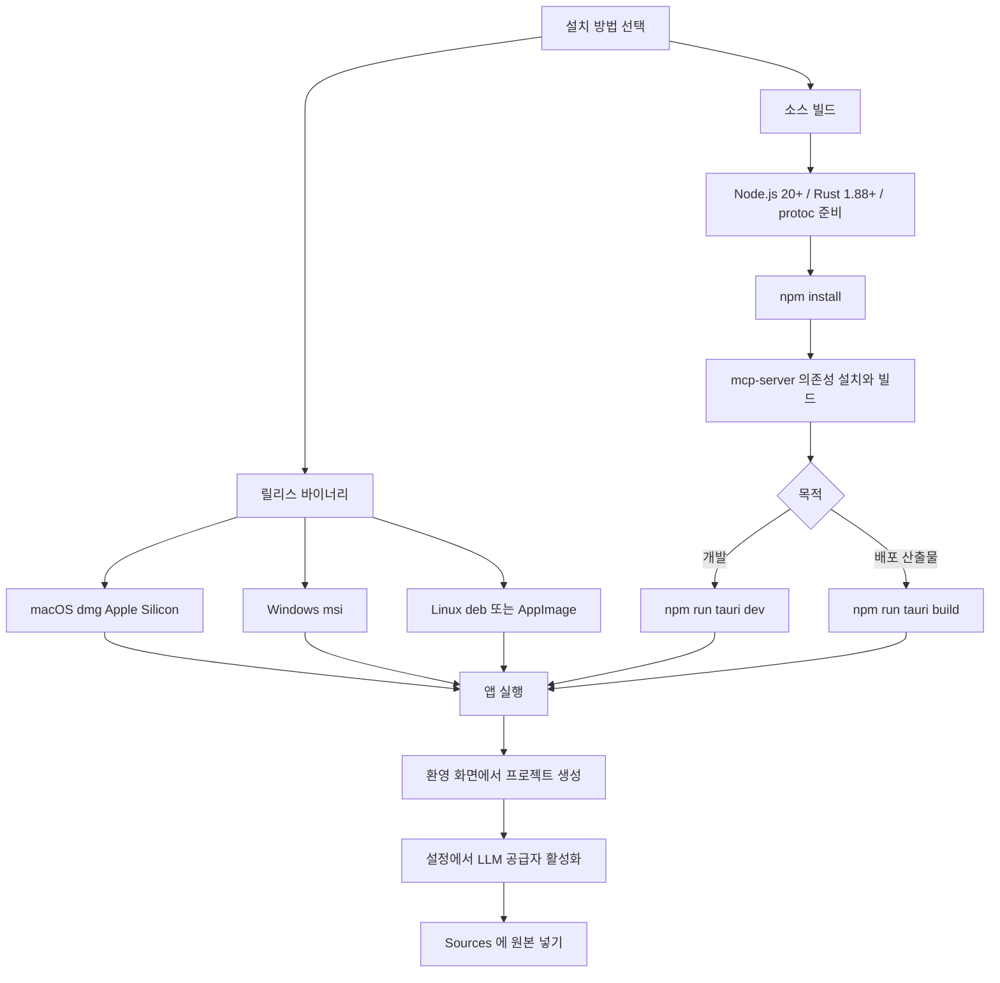
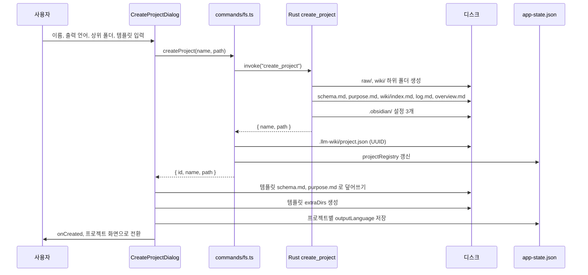

LLM Wiki 는 Tauri v2 데스크톱 앱이라 설치 경로가 둘이다. 릴리스 바이너리를 받거나, Node.js 와 Rust 툴체인으로 직접 빌드한다. 이 장은 두 경로를 코드와 설정 파일 기준으로 따라가고, 앱을 처음 켜서 프로젝트를 만들 때 디스크에 무엇이 생기는지, LLM 공급자를 어디서 고르는지까지 다룬다.

## 설치 경로 개요

README 의 설치 절은 짧다. 사전 빌드 바이너리, 소스 빌드, Chrome 확장 세 가지를 안내한다 ([README.md L396-L426](https://github.com/nashsu/llm_wiki/blob/e08cfce65aad8b76b13546a081c1a8d4422b70c3/README.md#L396-L426)). 한국어판도 같은 구성이다 ([README_KO.md L404-L435](https://github.com/nashsu/llm_wiki/blob/e08cfce65aad8b76b13546a081c1a8d4422b70c3/README_KO.md#L404-L435)).



| 경로 | 받는 것 | 필요한 것 | 근거 |
|---|---|---|---|
| 릴리스 바이너리 | `.dmg`, `.msi`, `.deb`, `.AppImage` | 없음 | README 설치 절 |
| 소스 빌드 | 개발 모드 창 또는 플랫폼 번들 | Node.js 20+, Rust 1.88+, protoc | README 소스 빌드 절, `Cargo.toml` 의 `rust-version` |
| Chrome 확장 | 웹 클리퍼 | 개발자 모드에서 `extension/` 로드 | README Chrome Extension 절 (10장에서 다룬다) |

## 릴리스 바이너리

README 는 Releases 페이지에서 macOS(Apple Silicon) `.dmg`, Windows `.msi`, Linux `.deb` / `.AppImage` 를 받으라고 적는다. 실제로 무엇이 올라가는지는 릴리스 워크플로가 정한다.

### 코드 분석: 릴리스 빌드 행렬

빌드 대상 플랫폼 목록을 본다. [.github/workflows/build.yml L3-L31](https://github.com/nashsu/llm_wiki/blob/e08cfce65aad8b76b13546a081c1a8d4422b70c3/.github/workflows/build.yml#L3-L31)

```yaml
on:
  push:
    tags:
      - 'v*'
  workflow_dispatch:
...
        include:
          - platform: macos-latest
            args: '--target aarch64-apple-darwin'
            rust_target: aarch64-apple-darwin
          - platform: ubuntu-22.04
          - platform: ubuntu-22.04-arm
          - platform: windows-latest
```

`v*` 태그를 push 하면 네 플랫폼에서 빌드가 돈다. README 에는 없지만 행렬에 `ubuntu-22.04-arm` 이 있어서 Linux ARM64 번들도 만들어진다. macOS 는 `aarch64-apple-darwin` 하나만 지정하므로 Intel Mac 용 번들은 이 워크플로에서 나오지 않는다.

같은 워크플로의 뒷부분을 보면 산출물이 README 목록보다 넓다.

| 단계 | 하는 일 | 위치 |
|---|---|---|
| PDFium 체크섬 검증 | 저장소에 커밋된 PDFium 바이너리를 `SHA256SUMS` 로 확인 | [build.yml L80-L90](https://github.com/nashsu/llm_wiki/blob/e08cfce65aad8b76b13546a081c1a8d4422b70c3/.github/workflows/build.yml#L80-L90) |
| MCP 서버 준비 | `npm --prefix mcp-server ci` 후 `npm run mcp:build` | [build.yml L106-L109](https://github.com/nashsu/llm_wiki/blob/e08cfce65aad8b76b13546a081c1a8d4422b70c3/.github/workflows/build.yml#L106-L109) |
| Tauri 빌드 | `tauri-action` 으로 번들 생성, 태그 빌드는 draft 릴리스 | [build.yml L111-L134](https://github.com/nashsu/llm_wiki/blob/e08cfce65aad8b76b13546a081c1a8d4422b70c3/.github/workflows/build.yml#L111-L134) |
| macOS 서명 검증 | 서명 · 공증 결과 확인 스크립트 실행 | [build.yml L136-L138](https://github.com/nashsu/llm_wiki/blob/e08cfce65aad8b76b13546a081c1a8d4422b70c3/.github/workflows/build.yml#L136-L138) |
| Windows 포터블 zip | 설치 없이 쓰는 zip 을 만들어 릴리스에 첨부 | [build.yml L140-L153](https://github.com/nashsu/llm_wiki/blob/e08cfce65aad8b76b13546a081c1a8d4422b70c3/.github/workflows/build.yml#L140-L153) |
| 수동 실행 산출물 | `workflow_dispatch` 일 때 msi, nsis exe, dmg, deb, AppImage, zip 을 아티팩트로 업로드 | [build.yml L160-L176](https://github.com/nashsu/llm_wiki/blob/e08cfce65aad8b76b13546a081c1a8d4422b70c3/.github/workflows/build.yml#L160-L176) |

PDFium 을 빌드 중에 내려받지 않고 저장소에 커밋해 두는 이유는 워크플로 주석에 적혀 있다. 외부 배포처에서 받는 단계가 자주 실패했기 때문이다. Windows 는 `.msi` 외에 NSIS `.exe` 와 포터블 zip 도 만든다.

> **주의**: 태그 빌드는 `releaseDraft: true` 로 올라간다. 모든 플랫폼 빌드와 macOS 서명 검증이 끝난 뒤 사람이 draft 를 공개해야 사용자에게 보인다 ([build.yml L130-L132](https://github.com/nashsu/llm_wiki/blob/e08cfce65aad8b76b13546a081c1a8d4422b70c3/.github/workflows/build.yml#L130-L132)).

## 소스에서 빌드

README 의 소스 빌드 절차는 여섯 줄이다.

```bash
# 사전 요구: Node.js 20+, Rust 1.88+, protoc
git clone https://github.com/nashsu/llm_wiki.git
cd llm_wiki
npm install
npm --prefix mcp-server ci && npm run mcp:build
npm run tauri dev      # 개발
npm run tauri build    # 배포 번들
```

각 줄이 왜 필요한지는 `package.json`, `tauri.conf.json`, `Cargo.toml` 세 파일을 함께 봐야 이해된다.

### 툴체인 요구사항의 출처

| 요구 | 값 | 어디서 정해지나 |
|---|---|---|
| Rust | 1.88 이상 | [Cargo.toml L7-L10](https://github.com/nashsu/llm_wiki/blob/e08cfce65aad8b76b13546a081c1a8d4422b70c3/src-tauri/Cargo.toml#L7-L10) 의 `rust-version = "1.88"`. 주석은 AnyDoc 과 그 압축 · 스프레드시트 의존성이 1.88 을 요구한다고 적는다 |
| Node.js | 20 | CI 와 릴리스 워크플로의 `node-version: 20` ([build.yml L98-L101](https://github.com/nashsu/llm_wiki/blob/e08cfce65aad8b76b13546a081c1a8d4422b70c3/.github/workflows/build.yml#L98-L101)) |
| protoc | 플랫폼 패키지 | 워크플로가 macOS 는 `brew install protobuf`, Ubuntu 는 `protobuf-compiler`, Windows 는 `arduino/setup-protoc` 로 설치한다. 어느 크레이트가 protoc 를 요구하는지는 코드에 적혀 있지 않다. LanceDB 의존성 트리일 가능성이 높다 (추정) |
| Linux 시스템 라이브러리 | webkit2gtk 4.1 등 | [build.yml L60-L69](https://github.com/nashsu/llm_wiki/blob/e08cfce65aad8b76b13546a081c1a8d4422b70c3/.github/workflows/build.yml#L60-L69) 의 `libwebkit2gtk-4.1-dev libappindicator3-dev librsvg2-dev patchelf protobuf-compiler xdg-utils` |

README 는 Linux 시스템 라이브러리를 따로 적지 않는다. Linux 에서 소스 빌드를 할 때는 워크플로의 `apt-get install` 줄을 그대로 쓰면 된다.

### 코드 분석: npm scripts

빌드 명령이 서로를 어떻게 부르는지 본다. [package.json L6-L18](https://github.com/nashsu/llm_wiki/blob/e08cfce65aad8b76b13546a081c1a8d4422b70c3/package.json#L6-L18)

```json
"scripts": {
  "dev": "vite",
  "typecheck": "tsc --build --pretty",
  "build": "npm run typecheck && vite build",
  "build:desktop": "npm --prefix mcp-server ci && npm run mcp:build && npm run build",
  "preview": "vite preview",
  "test": "npm run test:mocks && npm run test:llm",
  "test:mocks": "vitest run --exclude='**/*.real-llm.test.ts' --exclude='**/mcp-server/**'",
  "test:llm": "vitest run real-llm --no-file-parallelism --reporter=verbose",
  "mcp:build": "npm --prefix mcp-server run build",
  "mcp:test": "npm --prefix mcp-server test",
  "tauri": "tauri"
}
```

`tauri` 스크립트는 `@tauri-apps/cli` 를 그대로 부른다. 그래서 `npm run tauri dev` 와 `npm run tauri build` 는 Tauri CLI 의 `dev`, `build` 서브커맨드다. Tauri CLI 는 프론트엔드를 어떻게 띄우고 묶을지 `tauri.conf.json` 의 `build` 블록에서 읽는다.

| script | 역할 | 언제 쓰나 |
|---|---|---|
| `dev` | Vite 개발 서버 | `tauri dev` 가 `beforeDevCommand` 로 호출 |
| `typecheck` | `tsc --build` | `build` 의 첫 단계 |
| `build` | 타입 검사 후 `vite build` 로 `dist/` 생성 | 웹 번들만 필요할 때 |
| `build:desktop` | MCP 서버 설치 · 빌드 후 `build` | `tauri build` 가 `beforeBuildCommand` 로 호출 |
| `test:mocks` | 실제 LLM 을 부르지 않는 테스트 전체 | 평소 테스트 (14장) |
| `test:llm` | 파일명에 `real-llm` 이 든 테스트만 순차 실행 | API 키가 있을 때 (14장) |
| `mcp:build`, `mcp:test` | `mcp-server/` 하위 패키지 빌드 · 테스트 | MCP 서버 작업 (13장) |

### 코드 분석: tauri.conf.json 의 build 블록

`tauri dev` 와 `tauri build` 가 프론트엔드를 다루는 방식을 본다. [src-tauri/tauri.conf.json L6-L11](https://github.com/nashsu/llm_wiki/blob/e08cfce65aad8b76b13546a081c1a8d4422b70c3/src-tauri/tauri.conf.json#L6-L11)

```json
"build": {
  "beforeDevCommand": "npm run dev",
  "devUrl": "http://localhost:1420",
  "beforeBuildCommand": "npm run build:desktop",
  "frontendDist": "../dist"
},
```

개발 모드에서는 Vite 서버를 `1420` 포트로 띄우고 webview 가 그 주소를 연다. Vite 설정도 같은 포트를 `strictPort: true` 로 고정한다 ([vite.config.ts L30-L32](https://github.com/nashsu/llm_wiki/blob/e08cfce65aad8b76b13546a081c1a8d4422b70c3/vite.config.ts#L30-L32)). 1420 이 이미 쓰이고 있으면 다른 포트로 넘어가지 않고 실패한다.

배포 빌드에서는 `build:desktop` 이 MCP 서버까지 빌드한 다음 `dist/` 를 앱에 넣는다. 즉 `npm run tauri build` 만 실행해도 MCP 서버 빌드는 자동으로 따라온다. README 가 `mcp:build` 를 따로 실행하라고 하는 이유는 `tauri dev` 쪽에 있다. 개발 모드는 `npm run dev` 만 부르므로 MCP 서버가 빌드되지 않는다. 그런데 플랫폼별 설정 파일이 `mcp-server/dist` 를 번들 리소스로 지정한다.

```json
"resources": {
  "../mcp-server/package.json": "mcp-server/package.json",
  "../mcp-server/dist": "mcp-server/dist",
  "../mcp-server/node_modules": "mcp-server/node_modules"
}
```

위는 [src-tauri/tauri.macos.conf.json](https://github.com/nashsu/llm_wiki/blob/e08cfce65aad8b76b13546a081c1a8d4422b70c3/src-tauri/tauri.macos.conf.json#L3-L7) 의 리소스 목록이다. Windows 와 Linux 설정 파일도 같은 세 항목에 각자의 PDFium 라이브러리(`pdfium.dll`, `libpdfium.so`)를 더한다. 리소스 경로가 없으면 Rust 빌드 스크립트 단계에서 오류가 나므로 개발 모드에서도 먼저 MCP 서버를 빌드해 두어야 한다 (추정, Tauri 빌드 스크립트의 리소스 검사 동작은 이 저장소 코드에서 확인하지 않았다).

### 창과 보안 설정

같은 `tauri.conf.json` 의 나머지 부분은 첫 실행 모습을 정한다.

| 키 | 값 | 의미 |
|---|---|---|
| `productName` / `identifier` | `LLM Wiki` / `com.llmwiki.app` | 앱 이름과 OS 식별자. 앱 데이터 폴더 이름이 identifier 를 따른다 |
| `version` | `0.6.13` | `package.json`, `Cargo.toml` 과 같은 값 |
| `windows[0]` | 1200 x 800, `titleBarStyle: Transparent` | 기본 창 크기. Windows 설정 파일은 `Visible` 로 덮어쓴다 |
| `security.csp` | `connect-src 'self' https: http:` 등 | webview 에서 임의 HTTP(S) 연결 허용 |
| `assetProtocol.scope` | `["**"]` | 로컬 이미지를 `asset:` 프로토콜로 표시 |
| `bundle.targets` | `all` | 플랫폼에서 가능한 번들 형식을 모두 생성 |

설정 전문은 [tauri.conf.json L1-L44](https://github.com/nashsu/llm_wiki/blob/e08cfce65aad8b76b13546a081c1a8d4422b70c3/src-tauri/tauri.conf.json#L1-L44) 에 있다. `connect-src` 가 넓은 이유는 사용자가 지정하는 LLM 엔드포인트가 임의 주소이기 때문이다. 실제 LLM 요청은 대부분 Rust 쪽 HTTP 플러그인을 거치는데, 이 구조는 3장과 12장에서 다룬다.

### 릴리스 프로필

[Cargo.toml L77-L85](https://github.com/nashsu/llm_wiki/blob/e08cfce65aad8b76b13546a081c1a8d4422b70c3/src-tauri/Cargo.toml#L77-L85) 의 `[profile.release]` 는 `codegen-units = 1`, `lto = true`, `opt-level = "s"`, `strip = true` 로 크기를 줄인다. 눈여겨볼 값은 `panic = "unwind"` 다. 주석은 서드파티 문서 파서가 잘못된 입력에서 panic 을 내더라도 Tauri command 경계에서 잡아 오류로 바꾸기 위해서라고 설명한다. 그 경계 처리(`panic_guard`)는 3장에서 본다.

## 앱 첫 실행

앱이 뜨면 프론트엔드 루트 컴포넌트 `App` 이 저장된 설정을 읽고 마지막 프로젝트를 다시 연다. 열 프로젝트가 없으면 환영 화면을 보여 준다.

### 코드 분석: 시작 시 마지막 프로젝트 복원

시작 시 무엇을 어떤 순서로 불러오는지 본다. [src/App.tsx L305-L431](https://github.com/nashsu/llm_wiki/blob/e08cfce65aad8b76b13546a081c1a8d4422b70c3/src/App.tsx#L305-L431) 에서 일부를 인용한다 ([L313-L317](https://github.com/nashsu/llm_wiki/blob/e08cfce65aad8b76b13546a081c1a8d4422b70c3/src/App.tsx#L313-L317), [L415-L423](https://github.com/nashsu/llm_wiki/blob/e08cfce65aad8b76b13546a081c1a8d4422b70c3/src/App.tsx#L415-L423)).

```ts
const savedConfig = await loadLlmConfig()
if (savedConfig) {
  useWikiStore.getState().setLlmConfig(savedConfig)
  useWikiStore.getState().setGlobalLlmConfig(savedConfig)
}
// ... provider, embedding, proxy, API, general 설정 복원 ...
const lastProject = await getLastProject()
if (lastProject) {
  try {
    const proj = await openProject(lastProject.path)
    await handleProjectOpened(proj)
  } catch {
    // Last project no longer valid
  }
}
```

설정 복원이 프로젝트 열기보다 먼저다. LLM 설정, 공급자별 설정, 활성 프리셋, 작업별 모델 라우팅, 웹 검색, 임베딩, 멀티모달, MinerU, 프록시, API 서버, 일반 설정 순서로 읽는다. 이 값들은 모두 Tauri store 플러그인의 `app-state.json` 하나에 들어 있다 ([src/lib/project-store.ts L8-L14](https://github.com/nashsu/llm_wiki/blob/e08cfce65aad8b76b13546a081c1a8d4422b70c3/src/lib/project-store.ts#L8-L14)). 마지막 프로젝트가 옮겨졌거나 지워졌으면 `openProject` 가 실패하고 조용히 환영 화면으로 넘어간다.

환영 화면은 새 프로젝트 만들기, 기존 폴더 열기, 최근 프로젝트 목록 세 가지를 보여 준다 ([src/components/project/welcome-screen.tsx](https://github.com/nashsu/llm_wiki/blob/e08cfce65aad8b76b13546a081c1a8d4422b70c3/src/components/project/welcome-screen.tsx#L14-L31)). 최근 목록은 경로 기준으로 중복을 지우고 최대 10개까지 유지한다 ([project-store.ts L34-L42](https://github.com/nashsu/llm_wiki/blob/e08cfce65aad8b76b13546a081c1a8d4422b70c3/src/lib/project-store.ts#L34-L42)).

## 첫 프로젝트 생성

프로젝트 생성은 프론트엔드 다이얼로그와 Rust command 두 곳이 나눠 맡는다. Rust 는 기본 폴더 구조와 기본 파일을 만들고, 프론트엔드는 템플릿과 언어 설정을 적용한다.



### 입력 항목

다이얼로그는 네 항목을 받는다. 이름, AI 출력 언어, 상위 폴더가 필수이고 템플릿은 기본값 `general` 이 선택돼 있다 ([create-project-dialog.tsx L33-L47](https://github.com/nashsu/llm_wiki/blob/e08cfce65aad8b76b13546a081c1a8d4422b70c3/src/components/project/create-project-dialog.tsx#L33-L47)).

| 항목 | 필수 | 기본값 | 쓰임 |
|---|---|---|---|
| 이름 | 예 | 빈 문자열 | 상위 폴더 아래에 만들 폴더 이름 |
| AI 출력 언어 | 예 | 선택 안 됨 | 수집 · 채팅에서 LLM 이 쓸 언어. 목록에서 `auto` 는 빠진다 |
| 상위 폴더 | 예 | 빈 문자열 | 폴더 선택 대화상자 또는 직접 입력 |
| 템플릿 | 아니오 | `general` | `schema.md`, `purpose.md`, 추가 폴더 결정 |

출력 언어 목록은 [output-language-options.ts](https://github.com/nashsu/llm_wiki/blob/e08cfce65aad8b76b13546a081c1a8d4422b70c3/src/lib/output-language-options.ts#L17-L30) 에 있다. 생성 다이얼로그는 이 목록에서 `auto` 를 걸러 낸다 ([L180](https://github.com/nashsu/llm_wiki/blob/e08cfce65aad8b76b13546a081c1a8d4422b70c3/src/components/project/create-project-dialog.tsx#L180)). 주석은 새 프로젝트가 "처음 본 텍스트로 언어를 추측하는" 모드로 암묵적으로 시작하지 않게 하려는 의도라고 설명한다. `auto` 는 나중에 설정의 Output 항목에서 명시적으로 고를 수 있다.

### 코드 분석: 생성 버튼 핸들러

생성 버튼을 누르면 무엇이 어떤 순서로 실행되는지 본다. [src/components/project/create-project-dialog.tsx L114-L134](https://github.com/nashsu/llm_wiki/blob/e08cfce65aad8b76b13546a081c1a8d4422b70c3/src/components/project/create-project-dialog.tsx#L114-L134)

```ts
const project = await createProject(name.trim(), path.trim())
const pp = normalizePath(project.path)

const template = getTemplate(selectedTemplate)
await writeFile(`${pp}/schema.md`, template.schema)
await writeFile(`${pp}/purpose.md`, template.purpose)
for (const dir of template.extraDirs) {
  await createDirectory(`${pp}/${dir}`)
}

const lang = language as OutputLanguage
setOutputLanguage(lang)
await saveOutputLanguage(lang, project.id)

onCreated(project)
handleOpenChange(false)
```

Rust 의 `create_project` 가 기본 `schema.md` 와 `purpose.md` 를 이미 쓴 상태에서 프론트엔드가 템플릿 내용으로 다시 덮어쓴다. 그래서 디스크에 남는 `schema.md` 는 항상 템플릿 쪽이다. Rust 쪽 기본 스키마는 앱 밖에서 `create_project` 를 부르는 경우의 대비책으로 보인다 (추정). 출력 언어는 프로젝트 UUID 를 키로 `projectOutputLanguages` 에 저장되고, 같은 값이 전역 `outputLanguage` 에도 기록된다 ([project-store.ts L413-L420](https://github.com/nashsu/llm_wiki/blob/e08cfce65aad8b76b13546a081c1a8d4422b70c3/src/lib/project-store.ts#L413-L420)).

### 코드 분석: Rust create_project의 생성 폴더

기본 폴더 구조를 만드는 부분을 본다. [src-tauri/src/commands/project.rs L16-L37](https://github.com/nashsu/llm_wiki/blob/e08cfce65aad8b76b13546a081c1a8d4422b70c3/src-tauri/src/commands/project.rs#L16-L37)

```rust
fn create_project_impl(name: String, path: String) -> Result<WikiProject, String> {
    let root = Path::new(&path).join(&name);

    if root.exists() {
        return Err(format!("Directory already exists: '{}'", root.display()));
    }

    let dirs = [
        "raw/sources",
        "raw/assets",
        "wiki/entities",
        "wiki/concepts",
        "wiki/sources",
        "wiki/queries",
        "wiki/comparisons",
        "wiki/synthesis",
    ];
    for dir in &dirs {
        fs::create_dir_all(root.join(dir))
```

같은 이름의 폴더가 있으면 바로 실패한다. 기존 폴더를 덮어쓰거나 합치지 않는다. 기존 위키를 쓰려면 "프로젝트 열기"로 들어가야 한다.

이어서 같은 함수가 쓰는 파일은 다음과 같다.

| 파일 | 내용 | 줄 |
|---|---|---|
| `schema.md` | 페이지 타입 표, 파일명 규칙, frontmatter 형식, index · log 형식, 교차 참조 · 모순 처리 규칙 | [L41-L119](https://github.com/nashsu/llm_wiki/blob/e08cfce65aad8b76b13546a081c1a8d4422b70c3/src-tauri/src/commands/project.rs#L41-L119) |
| `purpose.md` | Goal, Key Questions, Scope, Thesis 빈 양식 | [L121-L152](https://github.com/nashsu/llm_wiki/blob/e08cfce65aad8b76b13546a081c1a8d4422b70c3/src-tauri/src/commands/project.rs#L121-L152) |
| `wiki/index.md` | 타입별 빈 헤딩 6개 | [L154-L169](https://github.com/nashsu/llm_wiki/blob/e08cfce65aad8b76b13546a081c1a8d4422b70c3/src-tauri/src/commands/project.rs#L154-L169) |
| `wiki/log.md` | 오늘 날짜 헤딩과 `- Project created` | [L171-L180](https://github.com/nashsu/llm_wiki/blob/e08cfce65aad8b76b13546a081c1a8d4422b70c3/src-tauri/src/commands/project.rs#L171-L180) |
| `wiki/overview.md` | `type: overview` frontmatter 와 빈 개요 | [L182-L194](https://github.com/nashsu/llm_wiki/blob/e08cfce65aad8b76b13546a081c1a8d4422b70c3/src-tauri/src/commands/project.rs#L182-L194) |
| `.obsidian/app.json` | 첨부 폴더 `raw/assets`, `.llm-wiki` 등 무시 | [L200-L212](https://github.com/nashsu/llm_wiki/blob/e08cfce65aad8b76b13546a081c1a8d4422b70c3/src-tauri/src/commands/project.rs#L200-L212) |
| `.obsidian/appearance.json`, `core-plugins.json` | 테마, 그래프 · 백링크 등 코어 플러그인 활성화 | [L214-L235](https://github.com/nashsu/llm_wiki/blob/e08cfce65aad8b76b13546a081c1a8d4422b70c3/src-tauri/src/commands/project.rs#L214-L235) |

`.obsidian/` 을 같이 만드는 것은 llm-wiki.md 의 "Obsidian 이 IDE 이고 LLM 이 프로그래머다" 라는 사용 방식을 그대로 받아들인 결과다. 원본 문서가 권하는 "첨부 폴더를 `raw/assets/` 로 고정" 팁이 `attachmentFolderPath` 설정으로 미리 들어가 있다. 같은 프로젝트 폴더를 Obsidian 볼트로 열면 그래프 뷰와 백링크가 바로 켜진 상태다.

### 프로젝트 식별자

Rust command 는 `{ name, path }` 만 돌려준다. UUID 는 프론트엔드 래퍼가 붙인다. [src/commands/fs.ts L248-L256](https://github.com/nashsu/llm_wiki/blob/e08cfce65aad8b76b13546a081c1a8d4422b70c3/src/commands/fs.ts#L248-L256)

```ts
export async function createProject(
  name: string,
  path: string,
): Promise<WikiProject> {
  const raw = await invoke<RawProject>("create_project", { name, path })
  const id = await ensureProjectId(raw.path)
  await upsertProjectInfo(id, raw.path, raw.name)
  return { id, name: raw.name, path: raw.path }
}
```

`ensureProjectId` 는 `.llm-wiki/project.json` 을 읽고, 없으면 `crypto.randomUUID()` 로 만들어 쓴다 ([project-identity.ts L46-L68](https://github.com/nashsu/llm_wiki/blob/e08cfce65aad8b76b13546a081c1a8d4422b70c3/src/lib/project-identity.ts#L46-L68)). 파일 첫 주석은 경로 대신 UUID 를 쓰는 이유를 적는다. 사용자가 프로젝트 폴더를 옮기거나 이름을 바꿔도 수집 큐 작업이 프로젝트를 잃지 않게 하려는 것이다 ([L1-L14](https://github.com/nashsu/llm_wiki/blob/e08cfce65aad8b76b13546a081c1a8d4422b70c3/src/lib/project-identity.ts#L1-L14)). 전역 등록부는 `app-state.json` 의 `projectRegistry` 키에 UUID 별 최신 경로를 담는다.

### 기존 폴더 열기의 검사 조건

"프로젝트 열기"는 폴더를 고른 뒤 Rust `open_project` 를 부른다. 이 command 는 두 가지만 확인한다. 루트에 `schema.md` 가 있는가, `wiki/` 가 디렉터리인가 ([project.rs L342-L364](https://github.com/nashsu/llm_wiki/blob/e08cfce65aad8b76b13546a081c1a8d4422b70c3/src-tauri/src/commands/project.rs#L342-L364)). `raw/` 나 `purpose.md` 는 검사하지 않는다. 다른 도구로 만든 LLM Wiki 패턴 저장소라도 이 두 조건만 맞추면 열 수 있다.

## 템플릿과 최종 폴더 구조

템플릿은 [src/lib/templates.ts](https://github.com/nashsu/llm_wiki/blob/e08cfce65aad8b76b13546a081c1a8d4422b70c3/src/lib/templates.ts#L640-L654) 에 다섯 개가 있다. 각 템플릿은 `schema`, `purpose` 문자열과 `extraDirs` 배열을 가진다.

| id | 이름 | 설명 (코드 원문 요지) | 추가 폴더 |
|---|---|---|---|
| `research` | Research | Deep-dive research with hypothesis tracking and methodology notes | `wiki/methodology`, `wiki/findings`, `wiki/thesis` |
| `reading` | Reading | Track a book's characters, themes, plot threads, and chapter notes | `wiki/characters`, `wiki/themes`, `wiki/plot-threads`, `wiki/chapters` |
| `personal` | Personal Growth | Track goals, habits, reflections, and journal entries for self-improvement | `wiki/goals`, `wiki/habits`, `wiki/reflections`, `wiki/journal` |
| `business` | Business | Manage meetings, decisions, projects, and stakeholder context for a team | `wiki/meetings`, `wiki/decisions`, `wiki/projects`, `wiki/stakeholders` |
| `general` | General | Minimal setup, a blank slate for any purpose | 없음 |

추가 폴더는 각 템플릿 정의의 `extraDirs` 줄에서 확인했다 ([research L74](https://github.com/nashsu/llm_wiki/blob/e08cfce65aad8b76b13546a081c1a8d4422b70c3/src/lib/templates.ts#L74), [reading L194](https://github.com/nashsu/llm_wiki/blob/e08cfce65aad8b76b13546a081c1a8d4422b70c3/src/lib/templates.ts#L194), [personal L311](https://github.com/nashsu/llm_wiki/blob/e08cfce65aad8b76b13546a081c1a8d4422b70c3/src/lib/templates.ts#L311), [business L439](https://github.com/nashsu/llm_wiki/blob/e08cfce65aad8b76b13546a081c1a8d4422b70c3/src/lib/templates.ts#L439), [general L577](https://github.com/nashsu/llm_wiki/blob/e08cfce65aad8b76b13546a081c1a8d4422b70c3/src/lib/templates.ts#L577)). 템플릿 스키마는 공통 페이지 타입 표 뒤에 템플릿 고유 타입을 덧붙인다. 예를 들어 research 템플릿은 `thesis`, `methodology`, `finding` 타입과 `confidence`, `status` frontmatter 필드를 더한다. 템플릿별 페이지 타입이 수집 프롬프트에 어떻게 들어가는지는 5장에서 다룬다.

`general` 템플릿으로 만든 직후의 폴더는 다음과 같다. 코드에서 확인한 항목만 적었다.

```text
my-wiki/
├── purpose.md            # 템플릿의 purpose (목적, 핵심 질문, 범위, 가설)
├── schema.md             # 템플릿의 schema (페이지 타입, 규칙)
├── raw/
│   ├── sources/          # 원본 문서
│   └── assets/           # 로컬 이미지, Obsidian 첨부 폴더
├── wiki/
│   ├── index.md
│   ├── log.md
│   ├── overview.md
│   ├── entities/  concepts/  sources/
│   └── queries/  comparisons/  synthesis/
├── .obsidian/            # app.json, appearance.json, core-plugins.json
└── .llm-wiki/
    └── project.json      # 프로젝트 UUID
```

README 의 프로젝트 구조 그림([README.md L473-L494](https://github.com/nashsu/llm_wiki/blob/e08cfce65aad8b76b13546a081c1a8d4422b70c3/README.md#L473-L494))과 같다. `.llm-wiki/` 아래에는 앱을 쓰면서 `review.json`, `lint.json`, `conversations.json`, `chats/`, `chat-preferences.json` 등이 더 생긴다 ([src/lib/persist.ts](https://github.com/nashsu/llm_wiki/blob/e08cfce65aad8b76b13546a081c1a8d4422b70c3/src/lib/persist.ts#L9-L33)). 이 파일들의 저장 시점은 3장에서 다룬다.

### llm-wiki.md 의 세 층과의 대응

원본 아이디어 문서는 저장소를 세 층으로 나눈다 ([llm-wiki.md L27-L33](https://github.com/nashsu/llm_wiki/blob/e08cfce65aad8b76b13546a081c1a8d4422b70c3/llm-wiki.md#L27-L33)).

| llm-wiki.md 의 층 | 원문 설명 요지 | LLM Wiki 앱의 구현 |
|---|---|---|
| Raw sources | 불변 원본. LLM 은 읽기만 한다 | `raw/sources/`, `raw/assets/` |
| The wiki | LLM 이 쓰고 유지하는 markdown 디렉터리 | `wiki/` 와 타입별 하위 폴더 |
| The schema | CLAUDE.md 나 AGENTS.md 처럼 LLM 에게 규칙을 알려 주는 문서 | `schema.md` |
| (원문에 없음) | | `purpose.md`. README 는 스키마가 구조 규칙이고 purpose 는 방향이라고 구분한다 ([README.md L98-L104](https://github.com/nashsu/llm_wiki/blob/e08cfce65aad8b76b13546a081c1a8d4422b70c3/README.md#L98-L104)) |
| index.md, log.md | 내용 목록과 시간순 기록 | `wiki/index.md`, `wiki/log.md` 를 생성 시 미리 만든다 |

원본은 스키마 파일을 에이전트 도구의 설정 파일로 두지만, 앱은 프로젝트 루트의 `schema.md` 로 옮겨 수집 단계가 직접 읽게 한다 ([src/lib/ingest.ts L781-L782](https://github.com/nashsu/llm_wiki/blob/e08cfce65aad8b76b13546a081c1a8d4422b70c3/src/lib/ingest.ts#L781-L782)). 원본이 "LLM 과 사람이 함께 고쳐 나가는 문서"라고 한 성격은 그대로다. 사용자는 앱 안의 편집기나 Obsidian 에서 `schema.md` 를 고칠 수 있다.

## 프로젝트가 열린 뒤

`onCreated` 는 `App` 의 `handleProjectOpened` 로 연결된다 ([App.tsx L666-L670](https://github.com/nashsu/llm_wiki/blob/e08cfce65aad8b76b13546a081c1a8d4422b70c3/src/App.tsx#L666-L670)). 새로 만든 프로젝트와 기존 프로젝트를 여는 경로가 여기서 합쳐진다. 이 함수는 이전 프로젝트 상태를 비우고, 프로젝트별 LLM 설정과 출력 언어를 적용하고, 수집 큐를 복원하고, 파일 감시와 클립 서버 알림을 시작한다 ([App.tsx L433-L593](https://github.com/nashsu/llm_wiki/blob/e08cfce65aad8b76b13546a081c1a8d4422b70c3/src/App.tsx#L433-L593)). 각 단계는 3장의 상태 저장소 절에서 다시 본다. 첫 화면은 `activeView` 를 `"wiki"` 로 두므로 위키 트리가 보인다 ([L465](https://github.com/nashsu/llm_wiki/blob/e08cfce65aad8b76b13546a081c1a8d4422b70c3/src/App.tsx#L465)).

## LLM 공급자 선택

프로젝트만 만들어서는 수집이 돌지 않는다. README 빠른 시작의 두 번째 단계가 "Settings 에서 LLM provider 설정"이다 ([README.md L428-L438](https://github.com/nashsu/llm_wiki/blob/e08cfce65aad8b76b13546a081c1a8d4422b70c3/README.md#L428-L438)).

### 설정 화면 진입

설정은 사이드바 톱니 아이콘이나 `Cmd+,` (Windows · Linux 는 `Ctrl+,`) 로 연다. 단축키는 `App` 에서 전역으로 등록한다 ([App.tsx L146-L153](https://github.com/nashsu/llm_wiki/blob/e08cfce65aad8b76b13546a081c1a8d4422b70c3/src/App.tsx#L146-L153)). 설정 화면은 왼쪽 범주 목록과 오른쪽 본문으로 나뉜다. 범주는 15개다 ([settings-view.tsx L83-L97](https://github.com/nashsu/llm_wiki/blob/e08cfce65aad8b76b13546a081c1a8d4422b70c3/src/components/settings/settings-view.tsx#L83-L97)).

| 범주 id | 다루는 장 |
|---|---|
| `general`, `interface`, `network`, `maintenance`, `changelog`, `about` | 이 장과 3장 |
| `llm` | 12장 |
| `embedding` | 6장 |
| `multimodal`, `mineru` | 4장 |
| `web-search`, `source-watch`, `scheduled-import` | 10장 |
| `api-server` | 13장 |
| `output` | 4장, 8장 |

### 코드 분석: LLM 범주만 저장 방식이 다른 이유

LLM 범주가 공용 저장 버튼을 쓰지 않는 부분을 본다. [settings-view.tsx L660-L668](https://github.com/nashsu/llm_wiki/blob/e08cfce65aad8b76b13546a081c1a8d4422b70c3/src/components/settings/settings-view.tsx#L660-L668)

```tsx
const body = useMemo(() => {
  switch (active) {
    case "general":
      return <GeneralSection draft={draft} setDraft={setDraft} />
    case "llm":
      // (주석 3줄 생략: LLM 범주는 자체 상태를 바로 저장한다)
      return <LlmProviderSection />
```

다른 범주는 draft 를 고친 뒤 화면 아래 저장 버튼을 눌러야 반영된다. LLM 범주는 입력할 때마다 바로 저장하므로 저장 바가 숨겨진다 ([L755-L758](https://github.com/nashsu/llm_wiki/blob/e08cfce65aad8b76b13546a081c1a8d4422b70c3/src/components/settings/settings-view.tsx#L755-L758)). 처음 쓰는 사람이 "저장 버튼이 없다"고 헷갈리기 쉬운 지점이다.

### 프리셋 목록과 활성화

LLM 범주는 프리셋 행 목록이다. 프리셋은 [llm-presets.ts L62](https://github.com/nashsu/llm_wiki/blob/e08cfce65aad8b76b13546a081c1a8d4422b70c3/src/components/settings/llm-presets.ts#L62) 의 `LLM_PRESETS` 배열에 23개가 정의돼 있다. Anthropic, Claude Code CLI, Codex CLI, OpenAI, Google, Azure OpenAI, DeepSeek, Groq, xAI, NVIDIA NIM, 여러 중국 클라우드, Ollama 로컬 · 클라우드, Custom 이 들어 있다. 사용자가 직접 만든 프리셋도 같은 목록에 붙는다.

한 번에 하나의 프리셋만 활성화된다. 행의 활성 토글은 다음 함수로 연결된다. [llm-provider-section.tsx L121-L126](https://github.com/nashsu/llm_wiki/blob/e08cfce65aad8b76b13546a081c1a8d4422b70c3/src/components/settings/sections/llm-provider-section.tsx#L121-L126)

```ts
function toggleActive(id: string) {
  const state = useWikiStore.getState()
  const next = id === state.activePresetId ? null : id
  setActivePresetId(next)
  persist(state.providerConfigs, next).catch(() => {})
}
```

이미 활성인 프리셋을 다시 누르면 `null` 이 되어 LLM 이 꺼진다. `persist` 는 공급자별 설정, 활성 프리셋 id, 그리고 프리셋 기본값에 사용자 덮어쓰기를 합친 최종 `llmConfig` 를 모두 `app-state.json` 에 쓴다 ([L74-L100](https://github.com/nashsu/llm_wiki/blob/e08cfce65aad8b76b13546a081c1a8d4422b70c3/src/components/settings/sections/llm-provider-section.tsx#L74-L100)). 모든 프리셋을 끄면 API 키가 비어 있는 상태로 바꿔서 수집 · 중복 제거 · 리뷰 큐가 즉시 멈추게 한다.

### LLM 준비 상태 판정

앱 곳곳의 큐는 같은 함수 하나로 LLM 사용 가능 여부를 판단한다. [src/lib/has-usable-llm.ts L42-L47](https://github.com/nashsu/llm_wiki/blob/e08cfce65aad8b76b13546a081c1a8d4422b70c3/src/lib/has-usable-llm.ts#L42-L47)

```ts
export function hasUsableLlm(
  cfg: Pick<LlmConfig, "provider" | "apiKey">,
): boolean {
  if (PROVIDERS_WITHOUT_KEY.has(cfg.provider)) return true
  return (cfg.apiKey ?? "").trim().length > 0
}
```

키가 필요 없는 공급자는 `ollama`, `custom`, `claude-code`, `codex-cli` 네 가지다 ([L21-L26](https://github.com/nashsu/llm_wiki/blob/e08cfce65aad8b76b13546a081c1a8d4422b70c3/src/lib/has-usable-llm.ts#L21-L26)). 나머지는 API 키가 비어 있지 않아야 한다. 기본 `llmConfig` 는 `provider: "openai"`, `apiKey: ""` 이므로 ([wiki-store.ts L504-L514](https://github.com/nashsu/llm_wiki/blob/e08cfce65aad8b76b13546a081c1a8d4422b70c3/src/stores/wiki-store.ts#L504-L514)) 설치 직후에는 판정이 거짓이고, 원본을 넣어도 수집이 시작되지 않는다.

가장 빨리 시작하는 조합은 다음 셋이다.

| 상황 | 고를 프리셋 | 추가 작업 |
|---|---|---|
| 상용 API 키가 있다 | Anthropic, OpenAI, Google 등 | 키 입력, 모델 선택 |
| Claude Code 또는 Codex 구독이 있다 | Claude Code CLI (local), Codex CLI (local) | CLI 가 PATH 에 있고 로그인돼 있어야 한다. 행에 감지 상태가 표시된다 |
| 로컬 모델만 쓴다 | Ollama (Local) 또는 Custom | 기본 Ollama 주소는 `http://localhost:11434` |

연결 테스트, 작업별 모델 라우팅(채팅과 수집에 다른 모델 쓰기), 프로젝트별 덮어쓰기, CLI 전송 방식은 모두 12장에서 다룬다.

> **주의**: API 키는 앱 데이터 폴더의 `app-state.json` 에 평문 JSON 으로 저장된다. Rust 쪽 에이전트도 이 파일을 직접 읽는다 ([src-tauri/src/lib.rs L405-L434](https://github.com/nashsu/llm_wiki/blob/e08cfce65aad8b76b13546a081c1a8d4422b70c3/src-tauri/src/lib.rs#L405-L434)). OS 키체인을 쓰는 코드는 찾지 못했다.

## 첫 원본 추가 절차

LLM 이 활성화되면 README 빠른 시작의 나머지 단계로 넘어간다.

1. Sources 화면에서 PDF, DOCX, Markdown 등을 가져온다. 파일은 `raw/sources/` 로 복사된다 (4장).
2. 오른쪽 Activity 패널에서 수집 진행을 본다. 완료되면 `wiki/` 아래에 페이지가 생기고 `index.md`, `log.md` 가 갱신된다 (4장, 5장).
3. Chat 에서 위키에 질문한다. 답을 위키 페이지로 저장할 수 있다 (8장).
4. Graph 화면에서 위키링크 연결을 본다 (7장).
5. Review 와 Lint 화면에서 사람이 판단할 항목과 위키 상태 문제를 확인한다 (9장).

사이드바의 화면 목록은 chat, wiki, sources, search, graph, lint, review 일곱 개다 ([icon-sidebar.tsx L20-L28](https://github.com/nashsu/llm_wiki/blob/e08cfce65aad8b76b13546a081c1a8d4422b70c3/src/components/layout/icon-sidebar.tsx#L20-L28)).

## 정리

- 설치는 릴리스 바이너리 또는 소스 빌드다. 릴리스 워크플로는 README 목록보다 넓게 Linux ARM64, Windows NSIS exe, 포터블 zip 까지 만든다. macOS 는 Apple Silicon 만 빌드한다.
- `npm run tauri build` 는 `beforeBuildCommand` 로 MCP 서버까지 빌드하지만, `tauri dev` 는 Vite 만 띄우므로 README 대로 `mcp:build` 를 먼저 돌려 둔다.
- 프로젝트 생성은 Rust `create_project` 가 `raw/`, `wiki/` 기본 구조와 기본 파일, `.obsidian/` 을 만들고, 프론트엔드가 템플릿 `schema.md` · `purpose.md` · 추가 폴더와 프로젝트 UUID 를 덧입히는 두 단계다.
- llm-wiki.md 의 raw · wiki · schema 세 층이 그대로 폴더로 구현됐고, 앱은 방향을 적는 `purpose.md` 를 더했다. 기존 폴더는 `schema.md` 와 `wiki/` 만 있으면 열린다.
- LLM 설정은 프리셋 23개 중 하나를 활성화하는 방식이며 입력 즉시 `app-state.json` 에 저장된다. `hasUsableLlm` 이 참이 되기 전에는 수집 큐가 돌지 않는다.
