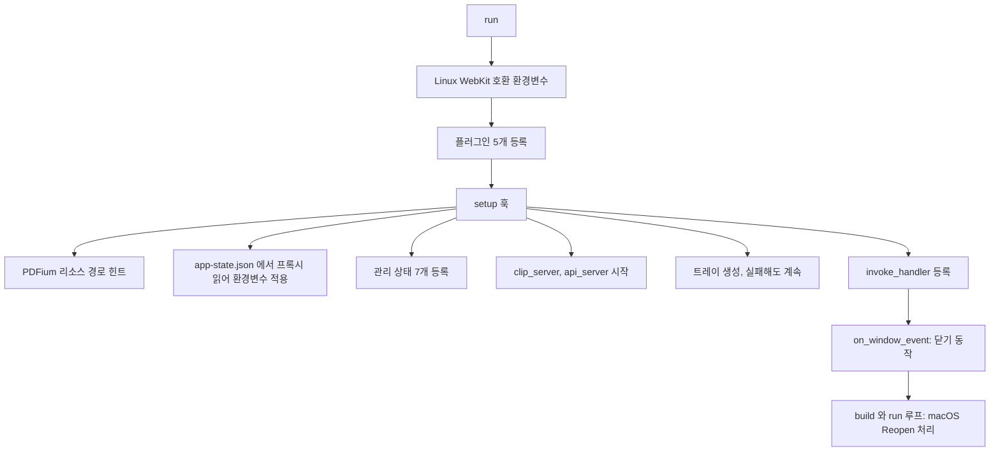

Rust 백엔드는 lib.rs에서 플러그인과 command를 등록하고, 파서와 맞닿은 command는 panic 경계로 감싼다.

## Rust 진입점: lib.rs

`main.rs` 는 여섯 줄이다. Windows 배포 빌드에서 콘솔 창을 숨기는 속성을 두고 `llm_wiki_lib::run()` 을 부른다 ([src-tauri/src/main.rs](https://github.com/nashsu/llm_wiki/blob/e08cfce65aad8b76b13546a081c1a8d4422b70c3/src-tauri/src/main.rs#L1-L6)). 실제 조립은 `lib.rs` 의 `run()` 이 한다. 이 함수는 플러그인 등록, `setup` 훅, command 등록, 창 이벤트 처리, 실행 루프 순서로 이어진다.



### 코드 분석: 플러그인 등록

어떤 Tauri 플러그인을 쓰는지 본다. [src-tauri/src/lib.rs L555-L567](https://github.com/nashsu/llm_wiki/blob/e08cfce65aad8b76b13546a081c1a8d4422b70c3/src-tauri/src/lib.rs#L555-L567)

```rust
tauri::Builder::default()
    .plugin(tauri_plugin_opener::init())
    .plugin(tauri_plugin_dialog::init())
    .plugin(tauri_plugin_store::Builder::default().build())
    .plugin(tauri_plugin_autostart::init(
        tauri_plugin_autostart::MacosLauncher::LaunchAgent,
        None::<Vec<&str>>,
    ))
    // Rust-backed fetch so third-party LLM APIs that reject
    // browser-origin headers via CORS preflight (MiniMax, Volcengine
    // Ark's api/coding/v3, etc.) still work. Requests leave the app
    // from Rust, never the webview.
    .plugin(tauri_plugin_http::init())
```

| 플러그인 | 프론트엔드에서의 쓰임 |
|---|---|
| opener | 프로젝트 폴더나 파일을 OS 기본 앱으로 열기 |
| dialog | 폴더 · 파일 선택 대화상자, 종료 확인 메시지 |
| store | `app-state.json` 에 전역 설정 저장 (`src/lib/project-store.ts`) |
| autostart | 로그인 시 자동 실행. macOS 는 LaunchAgent 방식 |
| http | webview 의 CORS 제약을 피해 Rust 에서 HTTP 요청 |

http 플러그인 주석이 이 앱의 중요한 설계 하나를 설명한다. 사용자가 설정하는 LLM 엔드포인트 중 일부는 브라우저 출처의 CORS preflight 를 통과시키지 않는다. 그래서 프론트엔드 코드가 보내는 HTTP 요청도 실제로는 Rust 프로세스에서 나간다. 이 플러그인이 허용하는 URL 범위는 capability 파일에서 `http://**`, `https://**` 전체로 열려 있다 ([src-tauri/capabilities/default.json](https://github.com/nashsu/llm_wiki/blob/e08cfce65aad8b76b13546a081c1a8d4422b70c3/src-tauri/capabilities/default.json#L14-L28)).

### setup 훅과 관리 상태

`setup` 훅은 앱이 뜰 때 한 번 실행된다 ([lib.rs L568-L623](https://github.com/nashsu/llm_wiki/blob/e08cfce65aad8b76b13546a081c1a8d4422b70c3/src-tauri/src/lib.rs#L568-L623)). 프록시 설정을 가장 먼저 적용하는 이유는 주석에 있다. HTTP 플러그인의 reqwest 클라이언트가 처음 만들어질 때 `HTTP_PROXY` 등의 환경변수를 읽기 때문에, 어떤 요청보다도 먼저 환경변수를 설정해야 한다.

이어서 `app.manage` 로 command 들이 공유할 상태를 등록한다.

| 관리 상태 | 담는 것 | 쓰는 곳 |
|---|---|---|
| `ClaudeCliState` | 실행 중인 `claude` 하위 프로세스, 스트림 id 별 | `claude_cli_spawn`, `claude_cli_kill` (12장) |
| `CodexCliState` | 실행 중인 `codex` 하위 프로세스 | `codex_cli_*` (12장) |
| `FileSyncState` | 프로젝트 파일 감시기 | `file_sync` command (10장) |
| `AgentSessionStore` | 에이전트 세션 대화 기록 | `agent_*` command, API 서버 (11장) |
| `AgentCancellationRegistry` | 진행 중인 에이전트 실행의 취소 토큰 | `agent_cancel_turn` (11장) |
| `CloseBehaviorState` | 창 닫기 동작, 기본 `"minimize"` | `set_close_behavior`, `on_window_event` |
| `TrayAvailabilityState` | 트레이 생성 성공 여부 | `on_window_event` |

그다음 두 로컬 HTTP 서버를 띄운다. 클립 서버는 포트 `19827` ([clip_server.rs L17](https://github.com/nashsu/llm_wiki/blob/e08cfce65aad8b76b13546a081c1a8d4422b70c3/src-tauri/src/clip_server.rs#L17)), API 서버는 포트 `19828` 이다 ([api_server.rs L23](https://github.com/nashsu/llm_wiki/blob/e08cfce65aad8b76b13546a081c1a8d4422b70c3/src-tauri/src/api_server.rs#L23)). 주석은 트레이 같은 부가 기능보다 API 서버를 먼저 띄워야 트레이 생성이 실패해도 백엔드에 접근할 수 있다고 적는다. 두 서버는 10장과 13장에서 다룬다.

### 코드 분석: 창 닫기 동작

닫기 버튼을 눌렀을 때의 분기를 본다. [lib.rs L704-L723](https://github.com/nashsu/llm_wiki/blob/e08cfce65aad8b76b13546a081c1a8d4422b70c3/src-tauri/src/lib.rs#L704-L723)

```rust
.on_window_event(|window, event| {
    if let tauri::WindowEvent::CloseRequested { api, .. } = event {
        api.prevent_close();
        let behavior = close_behavior(window);
        let win = window.clone();
        let app = window.app_handle().clone();
        match behavior.as_str() {
            "exit" => {
                tauri::async_runtime::spawn(async move {
                    let _ = win.destroy();
                    app.exit(0);
                });
            }
            "minimize" => {
                if tray_available(window) {
                    let _ = window.hide();
                } else {
                    let _ = window.minimize();
```

닫기 요청은 항상 막고(`prevent_close`) 설정에 따라 처리한다. 기본값 `minimize` 는 트레이가 있으면 창을 숨기고, 없으면 최소화한다. 그 밖의 값이면 "Quit" 과 "Hide Window" 를 고르는 대화상자를 띄운다 ([L724-L748](https://github.com/nashsu/llm_wiki/blob/e08cfce65aad8b76b13546a081c1a8d4422b70c3/src-tauri/src/lib.rs#L724-L748)). 창을 닫아도 프로세스가 살아 있어야 하는 이유는 파일 감시, 예약 수집, API 서버 같은 백그라운드 기능 때문이다. macOS 에서 Dock 아이콘을 누르면 `RunEvent::Reopen` 에서 숨겨진 `main` 창을 다시 보여 준다 ([L753-L769](https://github.com/nashsu/llm_wiki/blob/e08cfce65aad8b76b13546a081c1a8d4422b70c3/src-tauri/src/lib.rs#L753-L769)).

## command 등록과 panic 경계

`generate_handler!` 에 등록된 command 는 78개다 ([lib.rs L624-L703](https://github.com/nashsu/llm_wiki/blob/e08cfce65aad8b76b13546a081c1a8d4422b70c3/src-tauri/src/lib.rs#L624-L703)). 모듈별 개수는 다음과 같다.

| 모듈 | 개수 | 대표 command |
|---|---|---|
| `commands::fs` | 18 | `read_file`, `write_file`, `list_directory`, `preprocess_file`, `delete_file` |
| `commands::vectorstore` | 12 | `vector_upsert_chunks`, `vector_search_chunks`, `vector_delete_page` |
| `lib.rs` 자체 | 11 | `agent_start_turn_stream`, `agent_cancel_turn`, `api_server_status`, `set_proxy_env`, `set_close_behavior` |
| `commands::file_sync` | 7 | `start_project_file_watcher`, `rescan_project_files`, `get_file_change_queue` |
| `commands::file_history` | 6 | `list_file_history`, `restore_file_history` |
| `commands::project` | 4 | `create_project`, `open_project` |
| `commands::search` | 4 | `search_project`, `embedding_fetch_batch`, `get_page_links` |
| `commands::extract_images` | 4 | `extract_and_save_pdf_images_cmd` |
| `commands::claude_cli`, `codex_cli` | 3 + 3 | `*_detect`, `*_spawn`, `*_kill` |
| `commands::project_maintenance` | 3 | `export_project_archive`, `rebuild_wiki_index` |
| `commands::external_search` | 2 | `web_search`, `anytxt_search` |
| `agent::skills` | 1 | `agent_list_skills` |

### 코드 분석: run_guarded

command 본문을 감싸는 panic 경계 함수를 본다. [src-tauri/src/panic_guard.rs L14-L22](https://github.com/nashsu/llm_wiki/blob/e08cfce65aad8b76b13546a081c1a8d4422b70c3/src-tauri/src/panic_guard.rs#L14-L22)

```rust
pub fn run_guarded<T, F>(label: &str, f: F) -> Result<T, String>
where
    F: FnOnce() -> Result<T, String>,
{
    match catch_unwind(AssertUnwindSafe(f)) {
        Ok(r) => r,
        Err(payload) => Err(report(label, payload)),
    }
}
```

파일 첫 주석은 이 함수가 필요한 이유를 적는다. PDF, DOCX, 스프레드시트 파서 같은 서드파티 라이브러리는 잘못된 입력에서 `Err` 대신 panic 을 낸다. 그 panic 이 command 경계를 넘으면 앱 전체가 죽거나 정의되지 않은 동작이 된다 ([L1-L8](https://github.com/nashsu/llm_wiki/blob/e08cfce65aad8b76b13546a081c1a8d4422b70c3/src-tauri/src/panic_guard.rs#L1-L8)). `catch_unwind` 로 잡아 `"Internal error in {label}: ..."` 문자열 오류로 바꾸므로 프론트엔드는 평범한 실패로 받는다. 2장에서 본 `Cargo.toml` 의 `panic = "unwind"` 는 이 함수가 동작하기 위한 전제다. `panic = "abort"` 였다면 잡을 기회 없이 프로세스가 끝난다. async command 용으로 `run_guarded_async` 도 있다 ([L25-L34](https://github.com/nashsu/llm_wiki/blob/e08cfce65aad8b76b13546a081c1a8d4422b70c3/src-tauri/src/panic_guard.rs#L25-L34)).

이 경계를 쓰는 곳은 `commands/` 중 `fs`, `vectorstore`, `file_sync`, `project`, `search`, `extract_images`, `external_search` 모듈과 `lib.rs` 의 상태 조회 command 다. 문서 파서를 직접 호출하는 모듈들이다. `claude_cli`, `codex_cli`, `file_history`, `project_maintenance` 모듈에서는 `run_guarded` 호출을 찾지 못했다.

### 코드 분석: write_file의 세 가지 역할

프론트엔드가 가장 자주 부르는 command 하나가 안에서 무엇을 하는지 본다. [src-tauri/src/commands/fs.rs L1242-L1266](https://github.com/nashsu/llm_wiki/blob/e08cfce65aad8b76b13546a081c1a8d4422b70c3/src-tauri/src/commands/fs.rs#L1242-L1266)

```rust
pub async fn write_file(path: String, contents: String) -> Result<(), String> {
    tauri::async_runtime::spawn_blocking(move || {
        run_guarded("write_file", || {
            require_absolute_path("write_file", &path)?;
            let p = Path::new(&path);
            // (상위 폴더 생성 생략)
            file_sync::mark_app_write_path(p);
            crate::commands::file_history::record_file_version(
                p,
                "baseline",
                "before.ui.write_file",
            );
            fs::write(&path, contents)
                .map_err(|e| format!("Failed to write file '{}': {}", path, e))?;
            crate::commands::file_history::record_file_version(p, "human", "ui.write_file");
            file_sync::mark_app_write_path(p);
            Ok(())
        })
    })
```

파일 쓰기 하나에 세 가지가 얽혀 있다.

1. `spawn_blocking` 으로 tokio 의 blocking 풀에서 실행한다. `read_file` 주석은 PDF 추출처럼 수 초 걸리는 동기 작업이 async 워커를 막으면 진행률 UI 갱신까지 멈춘다고 설명한다 ([fs.rs L66-L77](https://github.com/nashsu/llm_wiki/blob/e08cfce65aad8b76b13546a081c1a8d4422b70c3/src-tauri/src/commands/fs.rs#L66-L77)).
2. 쓰기 전후로 파일 이력을 남긴다. 쓰기 전 상태를 `baseline`, 쓴 뒤를 `human` 으로 기록하므로 편집기의 이력 패널에서 되돌릴 수 있다.
3. 파일 감시기에 "앱이 쓴 파일" 표시를 남긴다. `mark_app_write_path` 는 경로를 `APP_WRITE_IGNORE_MS = 4_000` 밀리초 동안 무시 목록에 넣는다 ([file_sync.rs L26](https://github.com/nashsu/llm_wiki/blob/e08cfce65aad8b76b13546a081c1a8d4422b70c3/src-tauri/src/commands/file_sync.rs#L26), [L450-L459](https://github.com/nashsu/llm_wiki/blob/e08cfce65aad8b76b13546a081c1a8d4422b70c3/src-tauri/src/commands/file_sync.rs#L450-L459)). 앱이 쓴 파일이 외부 변경으로 오인돼 다시 수집 큐에 들어가는 것을 막는다.

`require_absolute_path` 는 상대 경로를 거부한다. 프론트엔드 래퍼도 같은 검사를 한 번 더 한다 ([src/commands/fs.ts L226-L230](https://github.com/nashsu/llm_wiki/blob/e08cfce65aad8b76b13546a081c1a8d4422b70c3/src/commands/fs.ts#L226-L230)).

## src-tauri/src/commands 모듈 표

command 를 담은 파일과 그 밖의 백엔드 모듈을 한 표로 정리한다. 줄 수는 기준 커밋에서 센 값이다.

| 파일 | 줄 수 | 역할 | 상세 |
|---|---|---|---|
| `commands/fs.rs` | 3121 | 파일 읽기 · 쓰기 · 목록 · 복사 · 삭제, 확장자별 텍스트 추출(PDF, Office, EPUB · MOBI, org), 추출 결과 캐시, 관련 위키 페이지 찾기 | 4장, 5장 |
| `commands/file_sync.rs` | 2018 | `notify` 기반 프로젝트 파일 감시, 변경 큐, 재스캔, 재시도 · 무시 | 10장 |
| `commands/search.rs` | 2453 | 토큰 검색과 벡터 검색을 합친 `search_project`, 임베딩 API 호출, 페이지 링크 조회 | 6장 |
| `commands/vectorstore.rs` | 1336 | LanceDB 테이블 관리, 청크 단위 upsert · 검색 · 삭제, 구형 테이블 정리 | 6장 |
| `commands/page_embedding.rs` | 893 | 위키 페이지 하나를 청크로 나눠 임베딩. API 서버의 `pages/embed` 에서 사용 (등록된 command 없음) | 6장, 13장 |
| `commands/extract_images.rs` | 1175 | PDF · PPTX · DOCX 에서 이미지 추출. LLM 호출 없음 | 4장 |
| `commands/ebook.rs` | 383 | EPUB spine 순서대로, DRM 없는 MOBI 텍스트 추출 | 4장 |
| `commands/file_history.rs` | 880 | 파일 버전 기록, 복원, 통계, 정리 | 5장 |
| `commands/project.rs` | 378 | 프로젝트 생성 · 열기 · 폴더 열기, 루트 검사 | 2장 |
| `commands/project_maintenance.rs` | 355 | ZIP 내보내기 · 가져오기, `wiki/index.md` 재생성 | 9장 |
| `commands/claude_cli.rs` | 715 | `claude` CLI 를 텍스트 생성 엔진으로 실행, 출력 스트리밍 | 12장 |
| `commands/codex_cli.rs` | 572 | `codex exec --json` 실행, 출력 스트리밍 | 12장 |
| `commands/cli_resolver.rs` | 340 | CLI 실행 파일 위치 탐색 (모듈 비공개) | 12장 |
| `commands/external_search.rs` | 122 | 웹 검색, AnyTXT 로컬 검색을 프론트엔드 형식으로 반환 | 10장 |
| `commands/fs_anydoc_benchmark.rs` | 297 | AnyDoc 과 기존 파서 비교 테스트. 테스트 빌드에서만 컴파일 | 14장 |
| `agent/` (13개 파일) | | 에이전트 런타임, 도구, 권한, 세션, 스킬, LLM 공급자 | 11장 |
| `api_server.rs` | 4106 | `127.0.0.1:19828` REST API | 13장 |
| `clip_server.rs` | 516 | `127.0.0.1:19827` 웹 클립 수신 | 10장 |
| `proxy.rs`, `cors.rs`, `server_bind.rs` | | 프록시 환경변수, 로컬 서버 CORS, 바인드 주소 검사 | 12장, 13장 |
| `tray.rs` | 51 | 시스템 트레이 메뉴 | |
| `types/wiki.rs` | | `WikiProject` 등 직렬화 타입 | |

`commands/mod.rs` 는 `cli_resolver` 만 `mod` 로, 나머지는 `pub mod` 로 선언한다 ([commands/mod.rs](https://github.com/nashsu/llm_wiki/blob/e08cfce65aad8b76b13546a081c1a8d4422b70c3/src-tauri/src/commands/mod.rs#L1-L14)).
