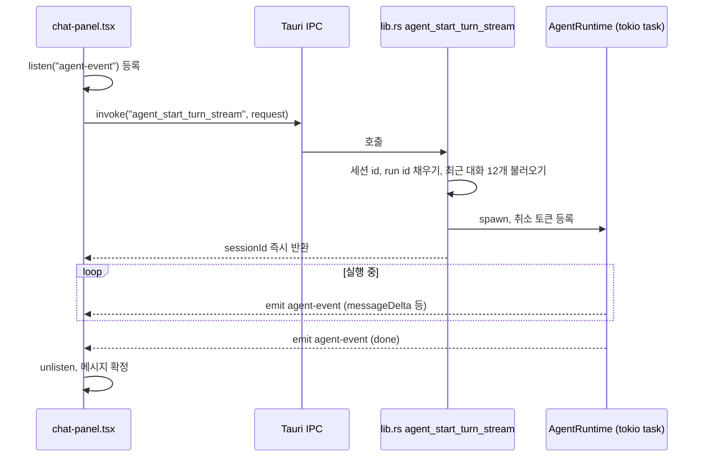

프론트엔드와 백엔드는 command 호출, 이벤트, 로컬 HTTP의 세 경로로 통신한다.

## 통신 경로 세 가지

### 1. invoke: 요청과 응답

대부분의 호출은 `invoke` 한 번에 결과 하나를 받는다. 파일 읽기, 검색, 프로젝트 생성이 여기에 속한다. Rust 쪽은 `Result<T, String>` 을 돌려주고 `Err` 는 프론트엔드에서 거부된 Promise 가 된다.

### 2. emit 과 listen: 스트림과 알림

시간이 걸리면서 중간 결과를 내는 작업은 이벤트를 쓴다. 코드에서 확인한 이벤트 이름은 다음과 같다.

| 이벤트 | 보내는 쪽 | 받는 쪽 | 내용 |
|---|---|---|---|
| `agent-event` | `lib.rs` 의 `agent_start_turn_stream` | `chat-panel.tsx` | 에이전트 메시지 조각, 완료, 오류 |
| `claude-cli:{streamId}` 와 완료 이벤트 | `claude_cli.rs` | `claude-cli-transport.ts` | CLI 표준출력 한 줄씩, 종료 코드 |
| `codex-cli:{streamId}` 와 완료 이벤트 | `codex_cli.rs` | `codex-cli-transport.ts` | 같은 구조 |
| `file-sync://queue-updated`, `file-sync://changed` | `file_sync.rs` | `project-file-sync.ts` | 변경 큐 갱신, 파일 변경 알림 |

에이전트 채팅 스트림을 예로 순서를 본다.



### 코드 분석: 이벤트 송신 측

Rust 가 에이전트 이벤트를 프론트엔드로 흘려보내는 부분을 본다. [lib.rs L210-L226](https://github.com/nashsu/llm_wiki/blob/e08cfce65aad8b76b13546a081c1a8d4422b70c3/src-tauri/src/lib.rs#L210-L226)

```rust
tauri::async_runtime::spawn(async move {
    let emit_app = app_for_task.clone();
    let emit_session = session_for_task.clone();
    let emit_run = run_for_task.clone();
    let sink: agent::runtime::AgentEventSink = std::sync::Arc::new(move |event| {
        let _ = emit_app.emit(
            "agent-event",
            serde_json::json!({
                "sessionId": emit_session.clone(),
                "runId": emit_run.clone(),
                "event": event,
            }),
        );
    });
    let result = runtime
        .run_once_with_cancel_and_events(request, Some(cancellation), Some(sink))
        .await;
```

command 는 작업을 tokio task 로 넘기고 바로 `sessionId` 를 돌려준다. 이벤트는 앱 전체로 방송되므로 모든 창의 모든 리스너가 받는다. 그래서 각 이벤트에 `sessionId` 와 `runId` 를 넣어 보낸다.

### 코드 분석: 이벤트 수신 측

프론트엔드가 자기 실행의 이벤트만 골라 받는 부분을 본다. [src/components/chat/chat-panel.tsx L828-L845](https://github.com/nashsu/llm_wiki/blob/e08cfce65aad8b76b13546a081c1a8d4422b70c3/src/components/chat/chat-panel.tsx#L828-L845)

```ts
streamUnlisten = await listen<BackendAgentEventPayload>("agent-event", (event) => {
  const payload = event.payload
  if (payload.sessionId !== convId || payload.runId !== backendRunId || !isCurrentRun()) return
  resetStreamTimeout()
  const agentEvent = payload.event
  if (agentEvent.type === "done") {
    if (!streamFinished) {
      streamFinished = true
      clearStreamTimeout()
      resolveStream?.()
    }
    return
  }
  if (agentEvent.type === "messageDelta" && agentEvent.text) {
    accumulated += agentEvent.text
    appendStreamToken(agentEvent.text)
    return
  }
```

리스너는 invoke 보다 먼저 등록한다. 순서가 반대면 첫 이벤트를 놓칠 수 있다. 대화 id 와 run id 가 다르면 버리고, 이벤트가 올 때마다 유휴 타임아웃을 다시 건다. `messageDelta` 는 `chat-store` 의 `appendStreamToken` 으로 들어가 화면에 바로 그려진다. 에이전트 이벤트 종류 전체는 11장에서 다룬다.

### 3. HTTP 플러그인 fetch

수집, 린트, 딥 리서치 같은 프론트엔드 파이프라인의 LLM 호출은 `src/lib/llm-client.ts` 의 `streamChat` 이 한다. 이 함수는 브라우저 `fetch` 대신 `tauri-fetch.ts` 의 `getHttpFetch` 를 쓴다 ([llm-client.ts L1-L5](https://github.com/nashsu/llm_wiki/blob/e08cfce65aad8b76b13546a081c1a8d4422b70c3/src/lib/llm-client.ts#L1-L5)). 파일 주석은 사용자가 설정한 URL 에 요청하는 코드는 모두 여기를 거쳐야 한다고 적는다. 일부 공급자 엔드포인트가 CORS 헤더에 `x-api-key` 나 `Authorization` 을 허용하지 않아 webview 의 `fetch` 로는 막히기 때문이다 ([src/lib/tauri-fetch.ts L1-L18](https://github.com/nashsu/llm_wiki/blob/e08cfce65aad8b76b13546a081c1a8d4422b70c3/src/lib/tauri-fetch.ts#L1-L18)). 테스트 환경(Node)에서는 플러그인 대신 `globalThis.fetch` 로 대체된다.
