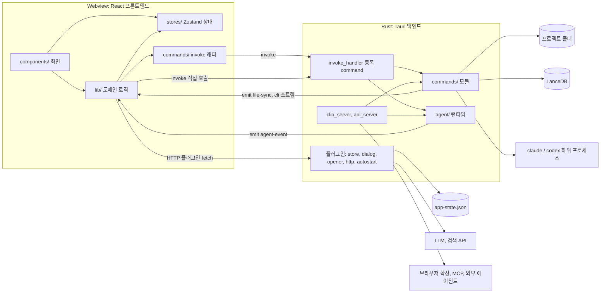

LLM Wiki 는 Rust 로 쓴 Tauri 백엔드와 React 프론트엔드를 결합한 구조다. 파일 입출력, 문서 파싱, 벡터 저장소, CLI 하위 프로세스, 로컬 HTTP 서버, 에이전트 런타임은 Rust 가 맡고, 화면과 상태, 수집 파이프라인 대부분, LLM 스트리밍 호출은 TypeScript 가 맡는다. 이 장은 두 층이 어디서 만나는지, 각 층에 어떤 모듈이 있는지 지도를 그린다. 하위 시스템의 세부 동작은 각 장으로 넘긴다.

## 전체 구조

README 의 기술 스택 표가 출발점이다 ([README.md L379-L394](https://github.com/nashsu/llm_wiki/blob/e08cfce65aad8b76b13546a081c1a8d4422b70c3/README.md#L379-L394)).

| 층 | 기술 | 저장소 위치 |
|---|---|---|
| 데스크톱 셸 | Tauri v2 (Rust) | `src-tauri/` |
| 프론트엔드 | React 19, TypeScript, Vite | `src/` |
| UI | shadcn/ui, Tailwind CSS v4 | `src/components/ui/` |
| 편집기 | Milkdown (ProseMirror 기반) | `src/components/editor/` |
| 그래프 | sigma.js, graphology, ForceAtlas2 | `src/components/graph/`, `src/lib/wiki-graph*.ts` |
| 상태 | Zustand | `src/stores/` |
| 벡터 DB | LanceDB (Rust, 내장) | `src-tauri/src/commands/vectorstore.rs` |
| 문서 파싱 | pdfium, docx-rs, calamine, AnyDoc, EPUB · MOBI | `src-tauri/src/commands/fs.rs`, `ebook.rs` |
| MCP 서버 | 별도 Node 패키지 | `mcp-server/` (13장) |

아래 그림은 한 프로세스 안의 두 층과 바깥 세계의 연결을 보여 준다.

경계를 넘는 길은 세 가지다. 프론트엔드가 Rust command 를 부르는 `invoke`, Rust 가 프론트엔드로 이벤트를 보내는 `emit` / `listen`, 그리고 Tauri HTTP 플러그인을 거치는 `fetch` 다. 각 길은 뒤의 "통신 경로" 절에서 코드로 본다.

## 프론트엔드와 백엔드의 책임 분담

기능별로 어느 층이 무엇을 하는지 정리한다.

| 기능 | 프론트엔드 (TypeScript) | 백엔드 (Rust) |
|---|---|---|
| 프로젝트 생성 · 열기 | 다이얼로그, 템플릿 적용, UUID, 최근 목록 | 폴더 · 기본 파일 생성, 루트 검사 |
| 원본 수집 | 큐, 프롬프트 구성, LLM 호출, 페이지 쓰기 결정 | 문서 텍스트 · 이미지 추출, 파일 쓰기, 이력 기록 |
| 검색 | 결과 표시, 임베딩 설정 전달 | 토큰 검색, 벡터 검색, 임베딩 API 호출, LanceDB |
| 채팅 | 화면, 대화 저장, 스트림 표시 | 에이전트 런타임, 도구 실행, 세션 기록 |
| 그래프 | 그래프 구성, 커뮤니티 탐지, 레이아웃, 렌더링 | 페이지 링크 조회 |
| 린트 · 리뷰 | 규칙 검사, LLM 점검, 리뷰 항목 관리 | 인덱스 재생성 |
| 외부 연동 | 설정 화면 | 클립 서버, API 서버, 파일 감시 |
| LLM 호출 | `streamChat` 으로 API 공급자 호출 (HTTP 플러그인 경유) | 에이전트용 공급자 클라이언트, CLI 하위 프로세스 |
| 설정 | store 플러그인으로 `app-state.json` 읽기 · 쓰기 | 에이전트 · API 서버가 같은 파일을 직접 읽음 |

두 층이 같은 LLM 설정을 각자 읽는다는 점은 짚어 둘 만하다. 프론트엔드는 `wiki-store` 의 `llmConfig` 를 쓰고, Rust 에이전트는 `app-state.json` 의 `llmConfig` 키를 직접 파싱한다 ([lib.rs L411-L434](https://github.com/nashsu/llm_wiki/blob/e08cfce65aad8b76b13546a081c1a8d4422b70c3/src-tauri/src/lib.rs#L411-L434)). 채팅 화면은 `agent_start_turn_stream` 에 `llmConfig` 를 인자로 같이 넘겨 디스크 값보다 우선하게 한다 ([lib.rs L191-L192](https://github.com/nashsu/llm_wiki/blob/e08cfce65aad8b76b13546a081c1a8d4422b70c3/src-tauri/src/lib.rs#L191-L192)). 프로젝트별 덮어쓰기가 반영된 값이 프론트엔드에만 있기 때문이다. 반면 API 서버로 들어온 외부 요청은 프론트엔드를 거치지 않으므로 디스크의 전역 설정을 쓴다 (추정, API 서버의 설정 해석 경로는 13장에서 확인한다).

llm-wiki.md 와 비교하면 이 분담의 의미가 보인다. 원본 문서는 LLM 에이전트 하나가 파일을 직접 읽고 쓰는 구성을 가정한다 ([llm-wiki.md L15](https://github.com/nashsu/llm_wiki/blob/e08cfce65aad8b76b13546a081c1a8d4422b70c3/llm-wiki.md#L15)). 앱은 그 역할을 둘로 나눴다. 수집 · 린트처럼 순서가 정해진 작업은 TypeScript 파이프라인이 LLM 을 텍스트 생성기로만 쓰고 파일 쓰기는 코드가 결정한다. 자유로운 질의응답은 Rust 에이전트가 도구를 써서 위키를 탐색한다. 두 경로가 어떻게 다른지는 4장과 11장에서 비교한다.

## 정리

- Rust 백엔드는 `lib.rs` 의 `run()` 에서 플러그인 5개, 관리 상태 7개, 로컬 서버 2개(19827, 19828), command 78개를 조립한다. 창을 닫아도 백그라운드 기능을 위해 프로세스는 남는다.
- 파서를 호출하는 command 는 `run_guarded` 로 감싸 서드파티 파서의 panic 을 오류 문자열로 바꾸며, 이를 위해 릴리스 프로필이 `panic = "unwind"` 를 쓴다. 무거운 파일 작업은 `spawn_blocking` 으로 돌린다.
- 프론트엔드는 `activeView` 값 하나로 화면을 고르고, Zustand 스토어 10개가 상태를 나눠 가진다. 디스크 저장은 `persist` 미들웨어 대신 `auto-save.ts` 의 구독과 디바운스로 하고, 프로젝트 전환 중에는 자동 저장을 멈춘다.
- 층 사이 통신은 invoke(요청 · 응답), emit/listen(에이전트 · CLI · 파일 감시 스트림), HTTP 플러그인 fetch(CORS 우회 LLM 호출) 세 가지다. invoke 이름은 문자열이라 `src/commands/` 밖에도 흩어져 있다.
- 수집 · 린트 · 리서치 같은 LLM 파이프라인은 TypeScript `src/lib/` 에 있고, Rust 는 파일 · 파서 · 벡터 저장소 · 검색 · CLI · 에이전트 런타임을 부품으로 제공한다.
- LLM 설정은 프론트엔드 스토어와 `app-state.json` 두 곳에서 읽히므로, 채팅은 프론트엔드가 계산한 설정을 인자로 넘겨 프로젝트별 덮어쓰기를 반영한다.
