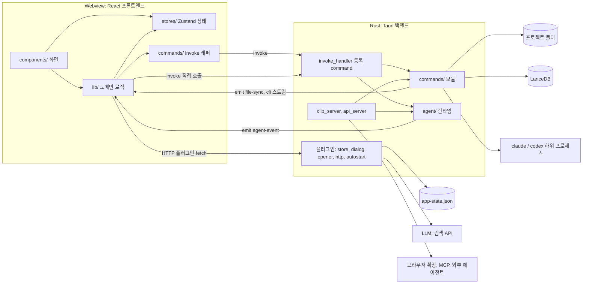
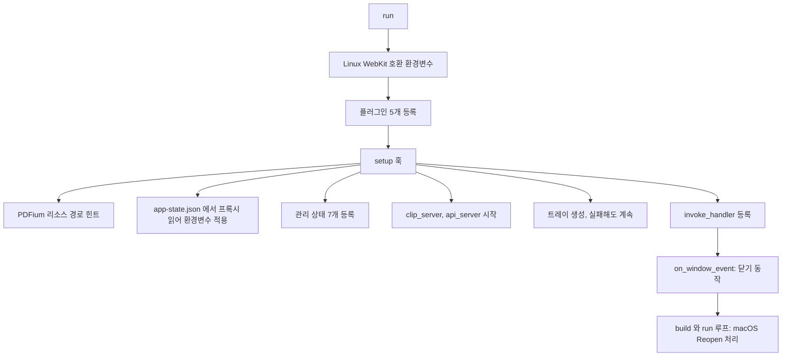
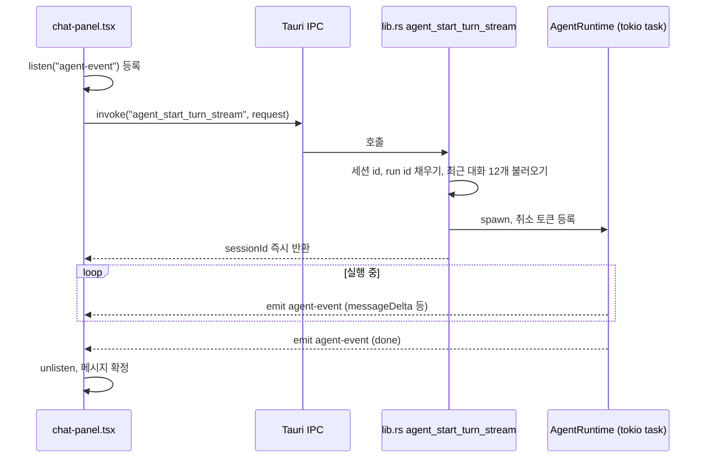

LLM Wiki 는 Rust 로 쓴 Tauri 백엔드와 React 프론트엔드를 결합한 구조다. 파일 입출력, 문서 파싱, 벡터 저장소, CLI 하위 프로세스, 로컬 HTTP 서버, 에이전트 런타임은 Rust 가 맡고, 화면과 상태, 수집 파이프라인 대부분, LLM 스트리밍 호출은 TypeScript 가 맡는다. 이 장은 두 층이 어디서 만나는지, 각 층에 어떤 모듈이 있는지 지도를 그린다. 하위 시스템의 세부 동작은 각 장으로 넘긴다.

## 전체 구조

README 의 기술 스택 표가 출발점이다 ([README.md L379-L394](https://github.com/nashsu/llm_wiki/blob/e08cfce65aad8b76b13546a081c1a8d4422b70c3/README.md#L379-L394)).

| 층 | 기술 | 저장소 위치 |
|---|---|---|
| 데스크톱 셸 | Tauri v2 (Rust) | `src-tauri/` |
| 프론트엔드 | React 19, TypeScript, Vite | `src/` |
| UI | shadcn/ui, Tailwind CSS v4 | `src/components/ui/` |
| 편집기 | Milkdown (ProseMirror 기반) | `src/components/editor/` |
| 그래프 | sigma.js, graphology, ForceAtlas2 | `src/components/graph/`, `src/lib/wiki-graph*.ts` |
| 상태 | Zustand | `src/stores/` |
| 벡터 DB | LanceDB (Rust, 내장) | `src-tauri/src/commands/vectorstore.rs` |
| 문서 파싱 | pdfium, docx-rs, calamine, AnyDoc, EPUB · MOBI | `src-tauri/src/commands/fs.rs`, `ebook.rs` |
| MCP 서버 | 별도 Node 패키지 | `mcp-server/` (13장) |

아래 그림은 한 프로세스 안의 두 층과 바깥 세계의 연결을 보여 준다.



경계를 넘는 길은 세 가지다. 프론트엔드가 Rust command 를 부르는 `invoke`, Rust 가 프론트엔드로 이벤트를 보내는 `emit` / `listen`, 그리고 Tauri HTTP 플러그인을 거치는 `fetch` 다. 각 길은 뒤의 "통신 경로" 절에서 코드로 본다.

## Rust 진입점: lib.rs

`main.rs` 는 여섯 줄이다. Windows 배포 빌드에서 콘솔 창을 숨기는 속성을 두고 `llm_wiki_lib::run()` 을 부른다 ([src-tauri/src/main.rs](https://github.com/nashsu/llm_wiki/blob/e08cfce65aad8b76b13546a081c1a8d4422b70c3/src-tauri/src/main.rs#L1-L6)). 실제 조립은 `lib.rs` 의 `run()` 이 한다. 이 함수는 플러그인 등록, `setup` 훅, command 등록, 창 이벤트 처리, 실행 루프 순서로 이어진다.



### 코드 분석: 플러그인 등록

어떤 Tauri 플러그인을 쓰는지 본다. [src-tauri/src/lib.rs L555-L567](https://github.com/nashsu/llm_wiki/blob/e08cfce65aad8b76b13546a081c1a8d4422b70c3/src-tauri/src/lib.rs#L555-L567)

```rust
tauri::Builder::default()
    .plugin(tauri_plugin_opener::init())
    .plugin(tauri_plugin_dialog::init())
    .plugin(tauri_plugin_store::Builder::default().build())
    .plugin(tauri_plugin_autostart::init(
        tauri_plugin_autostart::MacosLauncher::LaunchAgent,
        None::<Vec<&str>>,
    ))
    // Rust-backed fetch so third-party LLM APIs that reject
    // browser-origin headers via CORS preflight (MiniMax, Volcengine
    // Ark's api/coding/v3, etc.) still work. Requests leave the app
    // from Rust, never the webview.
    .plugin(tauri_plugin_http::init())
```

| 플러그인 | 프론트엔드에서의 쓰임 |
|---|---|
| opener | 프로젝트 폴더나 파일을 OS 기본 앱으로 열기 |
| dialog | 폴더 · 파일 선택 대화상자, 종료 확인 메시지 |
| store | `app-state.json` 에 전역 설정 저장 (`src/lib/project-store.ts`) |
| autostart | 로그인 시 자동 실행. macOS 는 LaunchAgent 방식 |
| http | webview 의 CORS 제약을 피해 Rust 에서 HTTP 요청 |

http 플러그인 주석이 이 앱의 중요한 설계 하나를 설명한다. 사용자가 설정하는 LLM 엔드포인트 중 일부는 브라우저 출처의 CORS preflight 를 통과시키지 않는다. 그래서 프론트엔드 코드가 보내는 HTTP 요청도 실제로는 Rust 프로세스에서 나간다. 이 플러그인이 허용하는 URL 범위는 capability 파일에서 `http://**`, `https://**` 전체로 열려 있다 ([src-tauri/capabilities/default.json](https://github.com/nashsu/llm_wiki/blob/e08cfce65aad8b76b13546a081c1a8d4422b70c3/src-tauri/capabilities/default.json#L14-L28)).

### setup 훅과 관리 상태

`setup` 훅은 앱이 뜰 때 한 번 실행된다 ([lib.rs L568-L623](https://github.com/nashsu/llm_wiki/blob/e08cfce65aad8b76b13546a081c1a8d4422b70c3/src-tauri/src/lib.rs#L568-L623)). 프록시 설정을 가장 먼저 적용하는 이유는 주석에 있다. HTTP 플러그인의 reqwest 클라이언트가 처음 만들어질 때 `HTTP_PROXY` 등의 환경변수를 읽기 때문에, 어떤 요청보다도 먼저 환경변수를 설정해야 한다.

이어서 `app.manage` 로 command 들이 공유할 상태를 등록한다.

| 관리 상태 | 담는 것 | 쓰는 곳 |
|---|---|---|
| `ClaudeCliState` | 실행 중인 `claude` 하위 프로세스, 스트림 id 별 | `claude_cli_spawn`, `claude_cli_kill` (12장) |
| `CodexCliState` | 실행 중인 `codex` 하위 프로세스 | `codex_cli_*` (12장) |
| `FileSyncState` | 프로젝트 파일 감시기 | `file_sync` command (10장) |
| `AgentSessionStore` | 에이전트 세션 대화 기록 | `agent_*` command, API 서버 (11장) |
| `AgentCancellationRegistry` | 진행 중인 에이전트 실행의 취소 토큰 | `agent_cancel_turn` (11장) |
| `CloseBehaviorState` | 창 닫기 동작, 기본 `"minimize"` | `set_close_behavior`, `on_window_event` |
| `TrayAvailabilityState` | 트레이 생성 성공 여부 | `on_window_event` |

그다음 두 로컬 HTTP 서버를 띄운다. 클립 서버는 포트 `19827` ([clip_server.rs L17](https://github.com/nashsu/llm_wiki/blob/e08cfce65aad8b76b13546a081c1a8d4422b70c3/src-tauri/src/clip_server.rs#L17)), API 서버는 포트 `19828` 이다 ([api_server.rs L23](https://github.com/nashsu/llm_wiki/blob/e08cfce65aad8b76b13546a081c1a8d4422b70c3/src-tauri/src/api_server.rs#L23)). 주석은 트레이 같은 부가 기능보다 API 서버를 먼저 띄워야 트레이 생성이 실패해도 백엔드에 접근할 수 있다고 적는다. 두 서버는 10장과 13장에서 다룬다.

### 코드 분석: 창 닫기 동작

닫기 버튼을 눌렀을 때의 분기를 본다. [lib.rs L704-L723](https://github.com/nashsu/llm_wiki/blob/e08cfce65aad8b76b13546a081c1a8d4422b70c3/src-tauri/src/lib.rs#L704-L723)

```rust
.on_window_event(|window, event| {
    if let tauri::WindowEvent::CloseRequested { api, .. } = event {
        api.prevent_close();
        let behavior = close_behavior(window);
        let win = window.clone();
        let app = window.app_handle().clone();
        match behavior.as_str() {
            "exit" => {
                tauri::async_runtime::spawn(async move {
                    let _ = win.destroy();
                    app.exit(0);
                });
            }
            "minimize" => {
                if tray_available(window) {
                    let _ = window.hide();
                } else {
                    let _ = window.minimize();
```

닫기 요청은 항상 막고(`prevent_close`) 설정에 따라 처리한다. 기본값 `minimize` 는 트레이가 있으면 창을 숨기고, 없으면 최소화한다. 그 밖의 값이면 "Quit" 과 "Hide Window" 를 고르는 대화상자를 띄운다 ([L724-L748](https://github.com/nashsu/llm_wiki/blob/e08cfce65aad8b76b13546a081c1a8d4422b70c3/src-tauri/src/lib.rs#L724-L748)). 창을 닫아도 프로세스가 살아 있어야 하는 이유는 파일 감시, 예약 수집, API 서버 같은 백그라운드 기능 때문이다. macOS 에서 Dock 아이콘을 누르면 `RunEvent::Reopen` 에서 숨겨진 `main` 창을 다시 보여 준다 ([L753-L769](https://github.com/nashsu/llm_wiki/blob/e08cfce65aad8b76b13546a081c1a8d4422b70c3/src-tauri/src/lib.rs#L753-L769)).

## command 등록과 panic 경계

`generate_handler!` 에 등록된 command 는 78개다 ([lib.rs L624-L703](https://github.com/nashsu/llm_wiki/blob/e08cfce65aad8b76b13546a081c1a8d4422b70c3/src-tauri/src/lib.rs#L624-L703)). 모듈별 개수는 다음과 같다.

| 모듈 | 개수 | 대표 command |
|---|---|---|
| `commands::fs` | 18 | `read_file`, `write_file`, `list_directory`, `preprocess_file`, `delete_file` |
| `commands::vectorstore` | 12 | `vector_upsert_chunks`, `vector_search_chunks`, `vector_delete_page` |
| `lib.rs` 자체 | 11 | `agent_start_turn_stream`, `agent_cancel_turn`, `api_server_status`, `set_proxy_env`, `set_close_behavior` |
| `commands::file_sync` | 7 | `start_project_file_watcher`, `rescan_project_files`, `get_file_change_queue` |
| `commands::file_history` | 6 | `list_file_history`, `restore_file_history` |
| `commands::project` | 4 | `create_project`, `open_project` |
| `commands::search` | 4 | `search_project`, `embedding_fetch_batch`, `get_page_links` |
| `commands::extract_images` | 4 | `extract_and_save_pdf_images_cmd` |
| `commands::claude_cli`, `codex_cli` | 3 + 3 | `*_detect`, `*_spawn`, `*_kill` |
| `commands::project_maintenance` | 3 | `export_project_archive`, `rebuild_wiki_index` |
| `commands::external_search` | 2 | `web_search`, `anytxt_search` |
| `agent::skills` | 1 | `agent_list_skills` |

### 코드 분석: run_guarded

command 본문을 감싸는 panic 경계 함수를 본다. [src-tauri/src/panic_guard.rs L14-L22](https://github.com/nashsu/llm_wiki/blob/e08cfce65aad8b76b13546a081c1a8d4422b70c3/src-tauri/src/panic_guard.rs#L14-L22)

```rust
pub fn run_guarded<T, F>(label: &str, f: F) -> Result<T, String>
where
    F: FnOnce() -> Result<T, String>,
{
    match catch_unwind(AssertUnwindSafe(f)) {
        Ok(r) => r,
        Err(payload) => Err(report(label, payload)),
    }
}
```

파일 첫 주석은 이 함수가 필요한 이유를 적는다. PDF, DOCX, 스프레드시트 파서 같은 서드파티 라이브러리는 잘못된 입력에서 `Err` 대신 panic 을 낸다. 그 panic 이 command 경계를 넘으면 앱 전체가 죽거나 정의되지 않은 동작이 된다 ([L1-L8](https://github.com/nashsu/llm_wiki/blob/e08cfce65aad8b76b13546a081c1a8d4422b70c3/src-tauri/src/panic_guard.rs#L1-L8)). `catch_unwind` 로 잡아 `"Internal error in {label}: ..."` 문자열 오류로 바꾸므로 프론트엔드는 평범한 실패로 받는다. 2장에서 본 `Cargo.toml` 의 `panic = "unwind"` 는 이 함수가 동작하기 위한 전제다. `panic = "abort"` 였다면 잡을 기회 없이 프로세스가 끝난다. async command 용으로 `run_guarded_async` 도 있다 ([L25-L34](https://github.com/nashsu/llm_wiki/blob/e08cfce65aad8b76b13546a081c1a8d4422b70c3/src-tauri/src/panic_guard.rs#L25-L34)).

이 경계를 쓰는 곳은 `commands/` 중 `fs`, `vectorstore`, `file_sync`, `project`, `search`, `extract_images`, `external_search` 모듈과 `lib.rs` 의 상태 조회 command 다. 문서 파서를 직접 호출하는 모듈들이다. `claude_cli`, `codex_cli`, `file_history`, `project_maintenance` 모듈에서는 `run_guarded` 호출을 찾지 못했다.

### 코드 분석: write_file의 세 가지 역할

프론트엔드가 가장 자주 부르는 command 하나가 안에서 무엇을 하는지 본다. [src-tauri/src/commands/fs.rs L1242-L1266](https://github.com/nashsu/llm_wiki/blob/e08cfce65aad8b76b13546a081c1a8d4422b70c3/src-tauri/src/commands/fs.rs#L1242-L1266)

```rust
pub async fn write_file(path: String, contents: String) -> Result<(), String> {
    tauri::async_runtime::spawn_blocking(move || {
        run_guarded("write_file", || {
            require_absolute_path("write_file", &path)?;
            let p = Path::new(&path);
            // (상위 폴더 생성 생략)
            file_sync::mark_app_write_path(p);
            crate::commands::file_history::record_file_version(
                p,
                "baseline",
                "before.ui.write_file",
            );
            fs::write(&path, contents)
                .map_err(|e| format!("Failed to write file '{}': {}", path, e))?;
            crate::commands::file_history::record_file_version(p, "human", "ui.write_file");
            file_sync::mark_app_write_path(p);
            Ok(())
        })
    })
```

파일 쓰기 하나에 세 가지가 얽혀 있다.

1. `spawn_blocking` 으로 tokio 의 blocking 풀에서 실행한다. `read_file` 주석은 PDF 추출처럼 수 초 걸리는 동기 작업이 async 워커를 막으면 진행률 UI 갱신까지 멈춘다고 설명한다 ([fs.rs L66-L77](https://github.com/nashsu/llm_wiki/blob/e08cfce65aad8b76b13546a081c1a8d4422b70c3/src-tauri/src/commands/fs.rs#L66-L77)).
2. 쓰기 전후로 파일 이력을 남긴다. 쓰기 전 상태를 `baseline`, 쓴 뒤를 `human` 으로 기록하므로 편집기의 이력 패널에서 되돌릴 수 있다.
3. 파일 감시기에 "앱이 쓴 파일" 표시를 남긴다. `mark_app_write_path` 는 경로를 `APP_WRITE_IGNORE_MS = 4_000` 밀리초 동안 무시 목록에 넣는다 ([file_sync.rs L26](https://github.com/nashsu/llm_wiki/blob/e08cfce65aad8b76b13546a081c1a8d4422b70c3/src-tauri/src/commands/file_sync.rs#L26), [L450-L459](https://github.com/nashsu/llm_wiki/blob/e08cfce65aad8b76b13546a081c1a8d4422b70c3/src-tauri/src/commands/file_sync.rs#L450-L459)). 앱이 쓴 파일이 외부 변경으로 오인돼 다시 수집 큐에 들어가는 것을 막는다.

`require_absolute_path` 는 상대 경로를 거부한다. 프론트엔드 래퍼도 같은 검사를 한 번 더 한다 ([src/commands/fs.ts L226-L230](https://github.com/nashsu/llm_wiki/blob/e08cfce65aad8b76b13546a081c1a8d4422b70c3/src/commands/fs.ts#L226-L230)).

## src-tauri/src/commands 모듈 표

command 를 담은 파일과 그 밖의 백엔드 모듈을 한 표로 정리한다. 줄 수는 기준 커밋에서 센 값이다.

| 파일 | 줄 수 | 역할 | 상세 |
|---|---|---|---|
| `commands/fs.rs` | 3121 | 파일 읽기 · 쓰기 · 목록 · 복사 · 삭제, 확장자별 텍스트 추출(PDF, Office, EPUB · MOBI, org), 추출 결과 캐시, 관련 위키 페이지 찾기 | 4장, 5장 |
| `commands/file_sync.rs` | 2018 | `notify` 기반 프로젝트 파일 감시, 변경 큐, 재스캔, 재시도 · 무시 | 10장 |
| `commands/search.rs` | 2453 | 토큰 검색과 벡터 검색을 합친 `search_project`, 임베딩 API 호출, 페이지 링크 조회 | 6장 |
| `commands/vectorstore.rs` | 1336 | LanceDB 테이블 관리, 청크 단위 upsert · 검색 · 삭제, 구형 테이블 정리 | 6장 |
| `commands/page_embedding.rs` | 893 | 위키 페이지 하나를 청크로 나눠 임베딩. API 서버의 `pages/embed` 에서 사용 (등록된 command 없음) | 6장, 13장 |
| `commands/extract_images.rs` | 1175 | PDF · PPTX · DOCX 에서 이미지 추출. LLM 호출 없음 | 4장 |
| `commands/ebook.rs` | 383 | EPUB spine 순서대로, DRM 없는 MOBI 텍스트 추출 | 4장 |
| `commands/file_history.rs` | 880 | 파일 버전 기록, 복원, 통계, 정리 | 5장 |
| `commands/project.rs` | 378 | 프로젝트 생성 · 열기 · 폴더 열기, 루트 검사 | 2장 |
| `commands/project_maintenance.rs` | 355 | ZIP 내보내기 · 가져오기, `wiki/index.md` 재생성 | 9장 |
| `commands/claude_cli.rs` | 715 | `claude` CLI 를 텍스트 생성 엔진으로 실행, 출력 스트리밍 | 12장 |
| `commands/codex_cli.rs` | 572 | `codex exec --json` 실행, 출력 스트리밍 | 12장 |
| `commands/cli_resolver.rs` | 340 | CLI 실행 파일 위치 탐색 (모듈 비공개) | 12장 |
| `commands/external_search.rs` | 122 | 웹 검색, AnyTXT 로컬 검색을 프론트엔드 형식으로 반환 | 10장 |
| `commands/fs_anydoc_benchmark.rs` | 297 | AnyDoc 과 기존 파서 비교 테스트. 테스트 빌드에서만 컴파일 | 14장 |
| `agent/` (13개 파일) | | 에이전트 런타임, 도구, 권한, 세션, 스킬, LLM 공급자 | 11장 |
| `api_server.rs` | 4106 | `127.0.0.1:19828` REST API | 13장 |
| `clip_server.rs` | 516 | `127.0.0.1:19827` 웹 클립 수신 | 10장 |
| `proxy.rs`, `cors.rs`, `server_bind.rs` | | 프록시 환경변수, 로컬 서버 CORS, 바인드 주소 검사 | 12장, 13장 |
| `tray.rs` | 51 | 시스템 트레이 메뉴 | |
| `types/wiki.rs` | | `WikiProject` 등 직렬화 타입 | |

`commands/mod.rs` 는 `cli_resolver` 만 `mod` 로, 나머지는 `pub mod` 로 선언한다 ([commands/mod.rs](https://github.com/nashsu/llm_wiki/blob/e08cfce65aad8b76b13546a081c1a8d4422b70c3/src-tauri/src/commands/mod.rs#L1-L14)).

## 프론트엔드 진입점

`src/main.tsx` 는 테마를 먼저 적용한 뒤 React 루트를 그린다 ([src/main.tsx L17-L28](https://github.com/nashsu/llm_wiki/blob/e08cfce65aad8b76b13546a081c1a8d4422b70c3/src/main.tsx#L17-L28)). 렌더 전에 테마를 정하는 이유는 화면 깜박임을 막기 위해서다. 루트에는 `App` 과 전역 대화상자 호스트 `AppDialogHost` 두 개가 붙는다. 시작 중 예외가 나면 React 없이 오류 스택을 HTML 로 직접 그린다.

`App` 은 2장에서 본 대로 설정 복원과 프로젝트 열기를 맡는다. 프로젝트가 열리면 `AppLayout` 이 화면을 구성한다. 왼쪽 아이콘 사이드바, 파일 트리와 Activity 패널, 가운데 본문, 오른쪽 리서치 패널 순서다 ([app-layout.tsx L110-L164](https://github.com/nashsu/llm_wiki/blob/e08cfce65aad8b76b13546a081c1a8d4422b70c3/src/components/layout/app-layout.tsx#L110-L164)). 본문은 `wiki-store` 의 `activeView` 값으로 바뀐다 ([content-area.tsx L43-L64](https://github.com/nashsu/llm_wiki/blob/e08cfce65aad8b76b13546a081c1a8d4422b70c3/src/components/layout/content-area.tsx#L43-L64)). 라우터 라이브러리를 쓰지 않고 상태 값 하나로 화면을 고르는 방식이다.

| `activeView` | 컴포넌트 폴더 | 상세 |
|---|---|---|
| `wiki` | `components/editor/` | 5장 |
| `sources` | `components/sources/` | 4장 |
| `search` | `components/search/` | 6장 |
| `graph` | `components/graph/` | 7장 |
| `chat` | `components/chat/` | 8장 |
| `lint` | `components/lint/` | 9장 |
| `review` | `components/review/` | 9장 |
| `skills`, `settings` | `components/settings/` | 11장, 12장 |

Sources 화면은 한 번 열리면 다른 화면으로 가도 숨김 처리만 하고 언마운트하지 않는다 ([content-area.tsx L20-L36](https://github.com/nashsu/llm_wiki/blob/e08cfce65aad8b76b13546a081c1a8d4422b70c3/src/components/layout/content-area.tsx#L20-L36)). 가져오기 진행 상태를 잃지 않으려는 처리로 보인다 (추정).

## 상태 저장소: src/stores

전역 상태는 Zustand 스토어 10개가 나눠 가진다. 모두 `create<State>()` 로 만든 단순 스토어이며 Zustand 의 `persist` 미들웨어는 쓰지 않는다. 디스크 저장은 별도 모듈이 맡는다.

| 스토어 | 줄 수 | 담는 것 | 디스크 저장 |
|---|---|---|---|
| `wiki-store` | 756 | 현재 프로젝트, 파일 트리, 선택 파일, `activeView`, LLM · 임베딩 · 검색 · 프록시 · API 등 모든 설정, 그래프 UI 상태, `dataVersion` | 설정은 각 설정 화면이 `project-store.ts` 로 `app-state.json` 에 저장 |
| `chat-store` | 398 | 대화 목록, 메시지, 스트리밍 상태, 에이전트 · 검색 모드, 선택한 스킬과 문맥 파일 | `auto-save.ts` 가 2초 지연 후 `.llm-wiki/` 에 저장 |
| `review-store` | 182 | 리뷰 항목 | 1초 지연 후 `.llm-wiki/review.json` |
| `lint-store` | 81 | 린트 결과 | 1초 지연 후 `.llm-wiki/lint.json` |
| `research-store` | 127 | 딥 리서치 작업 큐, 패널 열림, 동시 실행 수 | 저장 없음 |
| `activity-store` | 55 | 수집 · 린트 · 질의 진행 항목 | 저장 없음 |
| `file-sync-store` | 22 | 파일 변경 큐, 실행 여부, 마지막 오류 | Rust 쪽이 큐를 관리 |
| `update-store` | 87 | 업데이트 확인 결과, 숨긴 버전, 자동 확인 여부 | `project-store.ts` 의 업데이트 상태 저장 함수 |
| `zoom-store` | 29 | 화면 확대 비율 | `app-state.json` |
| `app-dialog-store` | 74 | 확인 · 경고 대화상자 요청 큐 | 저장 없음 |

### 코드 분석: wiki-store 의 두 LLM 설정

설정 상태 중 LLM 관련 필드를 본다. [src/stores/wiki-store.ts L430-L440](https://github.com/nashsu/llm_wiki/blob/e08cfce65aad8b76b13546a081c1a8d4422b70c3/src/stores/wiki-store.ts#L430-L440)

```ts
activeView: "chat" | "wiki" | "sources" | "search" | "graph" | "lint" | "review" | "skills" | "settings"
llmConfig: LlmConfig
/** Persisted global/default config, kept separate while a project override is effective. */
globalLlmConfig: LlmConfig
/** Per-provider-preset stored overrides (API key, model, endpoint, …). */
providerConfigs: ProviderConfigs
customLlmPresets: CustomLlmPreset[]
/** Which preset is currently active. `null` = no LLM configured. */
activePresetId: string | null
taskModelRouting: TaskModelRoutingConfig
projectLlmOverride: ProjectLlmOverride
```

`llmConfig` 는 지금 실제로 쓰는 값이고 `globalLlmConfig` 는 저장된 전역 값이다. 프로젝트별 덮어쓰기가 켜져 있으면 둘이 달라진다. 프로젝트를 열 때 `resolveProjectLlmConfig` 가 전역 값, 공급자별 설정, 프로젝트 덮어쓰기를 합쳐 `llmConfig` 를 다시 계산한다 ([App.tsx L448-L457](https://github.com/nashsu/llm_wiki/blob/e08cfce65aad8b76b13546a081c1a8d4422b70c3/src/App.tsx#L448-L457)). 해석 규칙은 12장에서 다룬다.

`dataVersion` 은 숫자 하나다. `bumpDataVersion` 이 1씩 올리고 ([wiki-store.ts L753](https://github.com/nashsu/llm_wiki/blob/e08cfce65aad8b76b13546a081c1a8d4422b70c3/src/stores/wiki-store.ts#L753)), 그래프 같은 무거운 화면은 이 값이 바뀌면 캐시를 버리고 다시 계산한다. README 는 이를 "dataVersion signaling" 이라고 부른다 ([README.md L377](https://github.com/nashsu/llm_wiki/blob/e08cfce65aad8b76b13546a081c1a8d4422b70c3/README.md#L377)).

### 코드 분석: 스토어 구독으로 자동 저장

스토어 변경을 디스크로 내보내는 방식을 본다. [src/lib/auto-save.ts L83-L94](https://github.com/nashsu/llm_wiki/blob/e08cfce65aad8b76b13546a081c1a8d4422b70c3/src/lib/auto-save.ts#L83-L94)

```ts
export function setupAutoSave(): void {
  // Auto-save review items (debounced 1s)
  useReviewStore.subscribe((state) => {
    if (suspended) return
    const projectPath = useWikiStore.getState().project?.path
    if (reviewTimer) clearTimeout(reviewTimer)
    reviewTimer = setTimeout(() => {
      if (projectPath) {
        saveReviewItems(projectPath, state.items).catch(() => {})
      }
    }, 1000)
  })
```

스토어마다 `subscribe` 로 변경을 받아 디바운스 후 `.llm-wiki/` 아래 JSON 으로 쓴다. 리뷰 · 린트는 1초, 채팅은 2초이며 채팅은 스트리밍 중이면 저장을 건너뛴다 ([L108-L129](https://github.com/nashsu/llm_wiki/blob/e08cfce65aad8b76b13546a081c1a8d4422b70c3/src/lib/auto-save.ts#L108-L129)). `suspended` 플래그는 프로젝트를 바꾸는 순간을 위한 것이다. 전환 중에는 스토어가 비워지는데, 그때 자동 저장이 돌면 빈 배열이 이전 프로젝트 파일을 덮어쓴다. 그래서 `App` 은 프로젝트를 열 때 `runWithSuspendedAutoSave` 안에서 이전 상태를 먼저 쓰고, 스토어를 비우고, 새 상태를 채운 뒤에 자동 저장을 다시 켠다 ([App.tsx L433-L445](https://github.com/nashsu/llm_wiki/blob/e08cfce65aad8b76b13546a081c1a8d4422b70c3/src/App.tsx#L433-L445)).

스토어를 비우는 일은 `resetProjectState` 가 한 곳에서 한다. 채팅, 리뷰, 린트, Activity, 리서치 스토어를 초기값으로 돌리고, 모듈 수준 캐시도 정리한다 ([src/lib/reset-project-state.ts L18-L56](https://github.com/nashsu/llm_wiki/blob/e08cfce65aad8b76b13546a081c1a8d4422b70c3/src/lib/reset-project-state.ts#L18-L56)). 프로젝트 간 데이터가 섞이지 않게 하는 지점이다.

## 프론트엔드의 invoke 래퍼: src/commands

`src/commands/` 에는 파일 두 개만 있다.

| 파일 | invoke 호출 수 | 감싸는 command |
|---|---|---|
| `fs.ts` | 33 | `commands::fs` 전부, `file_history`, 프로젝트 생성 · 열기, 서버 상태 조회, MCP 서버 경로 |
| `file-sync.ts` | 7 | `commands::file_sync` 전부 |

### 코드 분석: 래퍼의 역할

래퍼가 단순 전달 이상을 하는 예를 본다. [src/commands/fs.ts L22-L35](https://github.com/nashsu/llm_wiki/blob/e08cfce65aad8b76b13546a081c1a8d4422b70c3/src/commands/fs.ts#L22-L35)

```ts
export async function writeFile(path: string, contents: string): Promise<void> {
  assertAbsoluteFsPath("writeFile", path)
  return invoke<void>("write_file", { path, contents })
}

export async function writeFileBase64(path: string, base64: string): Promise<void> {
  assertAbsoluteFsPath("writeFileBase64", path)
  return invoke<void>("write_file_base64", { path, base64 })
}

export async function writeFileAtomic(path: string, contents: string): Promise<void> {
  assertAbsoluteFsPath("writeFileAtomic", path)
  return invoke<void>("write_file_atomic", { path, contents })
}
```

래퍼는 세 가지를 더한다. 첫째, 타입이다. `invoke<T>` 의 반환 타입과 인자 이름을 한 곳에 고정한다. Tauri 는 camelCase 인자를 Rust 의 snake_case 로 바꿔 주므로 `extractImages` 가 `extract_images` 로 들어간다. 둘째, 사전 검사다. 쓰기 계열은 절대 경로가 아니면 invoke 전에 예외를 던진다. 셋째, 보강이다. `listDirectory` 는 같은 인자의 동시 요청을 하나로 합치고 ([L48-L63](https://github.com/nashsu/llm_wiki/blob/e08cfce65aad8b76b13546a081c1a8d4422b70c3/src/commands/fs.ts#L48-L63)), `createProject` 와 `openProject` 는 Rust 가 돌려준 값에 프로젝트 UUID 를 붙인다 (2장).

그런데 invoke 가 모두 이 폴더를 거치지는 않는다. 하위 시스템 전용 command 는 해당 `lib/` 모듈이나 컴포넌트가 직접 부른다.

| 직접 invoke 하는 곳 | 호출 수 | command |
|---|---|---|
| `lib/embedding.ts` | 10 | `embedding_fetch*`, `vector_*_chunks`, `vector_delete_page`, `vector_legacy_row_count`, `vector_drop_legacy` |
| `lib/claude-cli-transport.ts`, `codex-cli-transport.ts` | 4, 3 | `claude_cli_spawn` · `kill`, `codex_cli_spawn` · `kill` |
| `components/chat/chat-panel.tsx` | 4 | `agent_list_skills`, `agent_start_turn_stream`, `agent_start_turn`, `agent_cancel_turn` |
| `components/settings/settings-view.tsx` | 3 | `set_proxy_env`, `api_server_reload_config`, `set_close_behavior` |
| `components/settings/sections/maintenance-section.tsx` | 3 | `rebuild_wiki_index`, `export_project_archive`, `import_project_archive` |
| `lib/search.ts`, `web-search.ts`, `anytxt-search.ts` | 1씩 | `search_project`, `web_search`, `anytxt_search` |

> **주의**: command 이름 문자열이 여러 파일에 흩어져 있어서 Rust 쪽 이름을 바꾸면 컴파일러가 잡아 주지 않는다. 타입 생성 도구(예: tauri-specta)는 쓰지 않는다. `invoke` 를 검색해 호출처를 모두 찾아야 한다.

## 통신 경로 세 가지

### 1. invoke: 요청과 응답

대부분의 호출은 `invoke` 한 번에 결과 하나를 받는다. 파일 읽기, 검색, 프로젝트 생성이 여기에 속한다. Rust 쪽은 `Result<T, String>` 을 돌려주고 `Err` 는 프론트엔드에서 거부된 Promise 가 된다.

### 2. emit 과 listen: 스트림과 알림

시간이 걸리면서 중간 결과를 내는 작업은 이벤트를 쓴다. 코드에서 확인한 이벤트 이름은 다음과 같다.

| 이벤트 | 보내는 쪽 | 받는 쪽 | 내용 |
|---|---|---|---|
| `agent-event` | `lib.rs` 의 `agent_start_turn_stream` | `chat-panel.tsx` | 에이전트 메시지 조각, 완료, 오류 |
| `claude-cli:{streamId}` 와 완료 이벤트 | `claude_cli.rs` | `claude-cli-transport.ts` | CLI 표준출력 한 줄씩, 종료 코드 |
| `codex-cli:{streamId}` 와 완료 이벤트 | `codex_cli.rs` | `codex-cli-transport.ts` | 같은 구조 |
| `file-sync://queue-updated`, `file-sync://changed` | `file_sync.rs` | `project-file-sync.ts` | 변경 큐 갱신, 파일 변경 알림 |

에이전트 채팅 스트림을 예로 순서를 본다.



### 코드 분석: 이벤트 송신 측

Rust 가 에이전트 이벤트를 프론트엔드로 흘려보내는 부분을 본다. [lib.rs L210-L226](https://github.com/nashsu/llm_wiki/blob/e08cfce65aad8b76b13546a081c1a8d4422b70c3/src-tauri/src/lib.rs#L210-L226)

```rust
tauri::async_runtime::spawn(async move {
    let emit_app = app_for_task.clone();
    let emit_session = session_for_task.clone();
    let emit_run = run_for_task.clone();
    let sink: agent::runtime::AgentEventSink = std::sync::Arc::new(move |event| {
        let _ = emit_app.emit(
            "agent-event",
            serde_json::json!({
                "sessionId": emit_session.clone(),
                "runId": emit_run.clone(),
                "event": event,
            }),
        );
    });
    let result = runtime
        .run_once_with_cancel_and_events(request, Some(cancellation), Some(sink))
        .await;
```

command 는 작업을 tokio task 로 넘기고 바로 `sessionId` 를 돌려준다. 이벤트는 앱 전체로 방송되므로 모든 창의 모든 리스너가 받는다. 그래서 각 이벤트에 `sessionId` 와 `runId` 를 넣어 보낸다.

### 코드 분석: 이벤트 수신 측

프론트엔드가 자기 실행의 이벤트만 골라 받는 부분을 본다. [src/components/chat/chat-panel.tsx L828-L845](https://github.com/nashsu/llm_wiki/blob/e08cfce65aad8b76b13546a081c1a8d4422b70c3/src/components/chat/chat-panel.tsx#L828-L845)

```ts
streamUnlisten = await listen<BackendAgentEventPayload>("agent-event", (event) => {
  const payload = event.payload
  if (payload.sessionId !== convId || payload.runId !== backendRunId || !isCurrentRun()) return
  resetStreamTimeout()
  const agentEvent = payload.event
  if (agentEvent.type === "done") {
    if (!streamFinished) {
      streamFinished = true
      clearStreamTimeout()
      resolveStream?.()
    }
    return
  }
  if (agentEvent.type === "messageDelta" && agentEvent.text) {
    accumulated += agentEvent.text
    appendStreamToken(agentEvent.text)
    return
  }
```

리스너는 invoke 보다 먼저 등록한다. 순서가 반대면 첫 이벤트를 놓칠 수 있다. 대화 id 와 run id 가 다르면 버리고, 이벤트가 올 때마다 유휴 타임아웃을 다시 건다. `messageDelta` 는 `chat-store` 의 `appendStreamToken` 으로 들어가 화면에 바로 그려진다. 에이전트 이벤트 종류 전체는 11장에서 다룬다.

### 3. HTTP 플러그인 fetch

수집, 린트, 딥 리서치 같은 프론트엔드 파이프라인의 LLM 호출은 `src/lib/llm-client.ts` 의 `streamChat` 이 한다. 이 함수는 브라우저 `fetch` 대신 `tauri-fetch.ts` 의 `getHttpFetch` 를 쓴다 ([llm-client.ts L1-L5](https://github.com/nashsu/llm_wiki/blob/e08cfce65aad8b76b13546a081c1a8d4422b70c3/src/lib/llm-client.ts#L1-L5)). 파일 주석은 사용자가 설정한 URL 에 요청하는 코드는 모두 여기를 거쳐야 한다고 적는다. 일부 공급자 엔드포인트가 CORS 헤더에 `x-api-key` 나 `Authorization` 을 허용하지 않아 webview 의 `fetch` 로는 막히기 때문이다 ([src/lib/tauri-fetch.ts L1-L18](https://github.com/nashsu/llm_wiki/blob/e08cfce65aad8b76b13546a081c1a8d4422b70c3/src/lib/tauri-fetch.ts#L1-L18)). 테스트 환경(Node)에서는 플러그인 대신 `globalThis.fetch` 로 대체된다.

## src/lib 모듈 지도

`src/lib/` 에는 테스트를 뺀 소스 파일이 112개(JSON 1개 포함), 테스트 파일이 123개 있다. 앱 로직 대부분이 여기에 있다. 하위 시스템별로 묶으면 다음과 같다.

| 하위 시스템 | 주요 모듈 | 상세 |
|---|---|---|
| 수집 | `ingest.ts`, `ingest-queue.ts`, `ingest-cache.ts`, `ingest-commit-coordinator.ts`, `ingest-sanitize.ts`, `source-preprocess.ts`, `parsed-source-output.ts`, `mineru.ts`, `extract-source-images.ts`, `image-caption-pipeline.ts`, `vision-caption.ts`, `text-chunker.ts`, `detect-language.ts`, `output-language.ts` | 4장 |
| 위키 페이지와 원본 | `frontmatter.ts`, `wiki-filename.ts`, `wiki-page-types.ts`, `wiki-schema.ts`, `templates.ts`, `wikilink-transform.ts`, `enrich-wikilinks.ts`, `page-merge.ts`, `wiki-page-resolver.ts`, `wiki-page-delete.ts`, `wiki-cleanup.ts`, `source-lifecycle.ts`, `source-identity.ts`, `source-delete-decision.ts`, `sources-merge.ts`, `raw-source-resolver.ts`, `markdown-image-resolver.ts` | 5장 |
| 검색과 중복 제거 | `search.ts`, `embedding.ts`, `dedup.ts`, `dedup_embedding.ts`, `dedup-queue.ts`, `dedup-runner.ts`, `dedup-storage.ts`, `knowledge-source-filter.ts` | 6장 |
| 그래프 | `wiki-graph.ts`, `wiki-graph-analysis.ts` (+ worker), `graph-relevance.ts`, `graph-insights.ts`, `graph-search.ts`, `graph-filters.ts`, `graph-visibility.ts` | 7장 |
| 채팅과 질의 | `chat-save-to-wiki.ts`, `chat-agent-types.ts`, `chat-image-utils.ts`, `context-budget.ts`, `greeting-detector.ts`, `agent-file-activity.ts`, `persist.ts` | 8장 |
| 린트와 리뷰 | `lint.ts`, `lint-structural-core.ts` (+ worker), `lint-fixes.ts`, `lint-config.ts`, `review-utils.ts`, `review-create-page.ts`, `review-batch-research.ts`, `sweep-reviews.ts` | 9장 |
| 리서치와 가져오기 | `deep-research.ts`, `optimize-research-topic.ts`, `research-query-grounding.ts`, `web-search.ts`, `anytxt-search.ts`, `scheduled-import.ts`, `url-source-import.ts`, `clip-watcher.ts`, `project-file-sync.ts`, `source-watch-config.ts` | 10장 |
| LLM 공급자 | `llm-client.ts`, `llm-providers.ts`, `llm-task-routing.ts`, `has-usable-llm.ts`, `claude-cli-transport.ts`, `codex-cli-transport.ts`, `azure-openai.ts`, `endpoint-normalizer.ts`, `reasoning-*.ts`, `connection-tests.ts`, `tauri-fetch.ts`, `proxy-config.ts` | 12장 |
| 로컬 API | `api-token.ts`, `api-server-constants.ts` | 13장 |
| 프로젝트와 앱 기반 | `project-store.ts`, `project-identity.ts`, `project-mutex.ts`, `reset-project-state.ts`, `auto-save.ts`, `project-file-tree-refresh.ts`, `file-tree-order.ts`, `path-utils.ts`, `file-types.ts`, `concurrency-limits.ts`, `theme.ts`, `update-check.ts`, `changelog.ts`, `keyboard-utils.ts`, `utils.ts` | 이 장, 2장 |

이 표에서 읽을 수 있는 것은 수집, 중복 제거, 린트, 딥 리서치 같은 LLM 파이프라인이 TypeScript 쪽에 있다는 점이다. Rust 는 그 파이프라인이 쓰는 부품(파일, 파서, 벡터 저장소, 검색, CLI 프로세스)을 command 로 제공한다. 무거운 계산 중 일부는 Web Worker 로 뺐다. 그래프 분석과 구조 린트가 `*.worker.ts` 로 따로 있다.

## 프론트엔드와 백엔드의 책임 분담

기능별로 어느 층이 무엇을 하는지 정리한다.

| 기능 | 프론트엔드 (TypeScript) | 백엔드 (Rust) |
|---|---|---|
| 프로젝트 생성 · 열기 | 다이얼로그, 템플릿 적용, UUID, 최근 목록 | 폴더 · 기본 파일 생성, 루트 검사 |
| 원본 수집 | 큐, 프롬프트 구성, LLM 호출, 페이지 쓰기 결정 | 문서 텍스트 · 이미지 추출, 파일 쓰기, 이력 기록 |
| 검색 | 결과 표시, 임베딩 설정 전달 | 토큰 검색, 벡터 검색, 임베딩 API 호출, LanceDB |
| 채팅 | 화면, 대화 저장, 스트림 표시 | 에이전트 런타임, 도구 실행, 세션 기록 |
| 그래프 | 그래프 구성, 커뮤니티 탐지, 레이아웃, 렌더링 | 페이지 링크 조회 |
| 린트 · 리뷰 | 규칙 검사, LLM 점검, 리뷰 항목 관리 | 인덱스 재생성 |
| 외부 연동 | 설정 화면 | 클립 서버, API 서버, 파일 감시 |
| LLM 호출 | `streamChat` 으로 API 공급자 호출 (HTTP 플러그인 경유) | 에이전트용 공급자 클라이언트, CLI 하위 프로세스 |
| 설정 | store 플러그인으로 `app-state.json` 읽기 · 쓰기 | 에이전트 · API 서버가 같은 파일을 직접 읽음 |

두 층이 같은 LLM 설정을 각자 읽는다는 점은 짚어 둘 만하다. 프론트엔드는 `wiki-store` 의 `llmConfig` 를 쓰고, Rust 에이전트는 `app-state.json` 의 `llmConfig` 키를 직접 파싱한다 ([lib.rs L411-L434](https://github.com/nashsu/llm_wiki/blob/e08cfce65aad8b76b13546a081c1a8d4422b70c3/src-tauri/src/lib.rs#L411-L434)). 채팅 화면은 `agent_start_turn_stream` 에 `llmConfig` 를 인자로 같이 넘겨 디스크 값보다 우선하게 한다 ([lib.rs L191-L192](https://github.com/nashsu/llm_wiki/blob/e08cfce65aad8b76b13546a081c1a8d4422b70c3/src-tauri/src/lib.rs#L191-L192)). 프로젝트별 덮어쓰기가 반영된 값이 프론트엔드에만 있기 때문이다. 반면 API 서버로 들어온 외부 요청은 프론트엔드를 거치지 않으므로 디스크의 전역 설정을 쓴다 (추정, API 서버의 설정 해석 경로는 13장에서 확인한다).

llm-wiki.md 와 비교하면 이 분담의 의미가 보인다. 원본 문서는 LLM 에이전트 하나가 파일을 직접 읽고 쓰는 구성을 가정한다 ([llm-wiki.md L15](https://github.com/nashsu/llm_wiki/blob/e08cfce65aad8b76b13546a081c1a8d4422b70c3/llm-wiki.md#L15)). 앱은 그 역할을 둘로 나눴다. 수집 · 린트처럼 순서가 정해진 작업은 TypeScript 파이프라인이 LLM 을 텍스트 생성기로만 쓰고 파일 쓰기는 코드가 결정한다. 자유로운 질의응답은 Rust 에이전트가 도구를 써서 위키를 탐색한다. 두 경로가 어떻게 다른지는 4장과 11장에서 비교한다.

## 정리

- Rust 백엔드는 `lib.rs` 의 `run()` 에서 플러그인 5개, 관리 상태 7개, 로컬 서버 2개(19827, 19828), command 78개를 조립한다. 창을 닫아도 백그라운드 기능을 위해 프로세스는 남는다.
- 파서를 호출하는 command 는 `run_guarded` 로 감싸 서드파티 파서의 panic 을 오류 문자열로 바꾸며, 이를 위해 릴리스 프로필이 `panic = "unwind"` 를 쓴다. 무거운 파일 작업은 `spawn_blocking` 으로 돌린다.
- 프론트엔드는 `activeView` 값 하나로 화면을 고르고, Zustand 스토어 10개가 상태를 나눠 가진다. 디스크 저장은 `persist` 미들웨어 대신 `auto-save.ts` 의 구독과 디바운스로 하고, 프로젝트 전환 중에는 자동 저장을 멈춘다.
- 층 사이 통신은 invoke(요청 · 응답), emit/listen(에이전트 · CLI · 파일 감시 스트림), HTTP 플러그인 fetch(CORS 우회 LLM 호출) 세 가지다. invoke 이름은 문자열이라 `src/commands/` 밖에도 흩어져 있다.
- 수집 · 린트 · 리서치 같은 LLM 파이프라인은 TypeScript `src/lib/` 에 있고, Rust 는 파일 · 파서 · 벡터 저장소 · 검색 · CLI · 에이전트 런타임을 부품으로 제공한다.
- LLM 설정은 프론트엔드 스토어와 `app-state.json` 두 곳에서 읽히므로, 채팅은 프론트엔드가 계산한 설정을 인자로 넘겨 프로젝트별 덮어쓰기를 반영한다.
