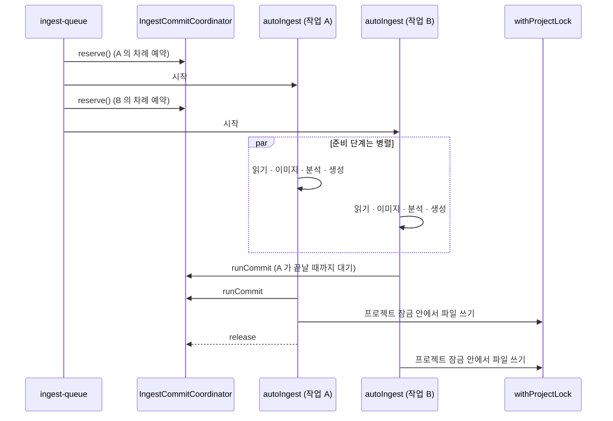

원본은 가져오기와 폴더 감시 두 경로로 수집 큐에 들어오고, 큐는 잠금과 커밋 순서로 동시 실행을 통제한다.

## 입구: 원본의 큐 진입 경로

원본이 수집 큐에 들어오는 경로는 두 가지다. 사용자가 파일을 가져오는 경우와, 앱 밖에서 `raw/sources/` 에 파일을 넣어 감시기가 알아차리는 경우다. 두 길 모두 `enqueueSourceIngest` 에서 만난다.

### 가져오기 경로

`importSourceFiles` 는 파일마다 민감 설정 파일 여부, 감시 제외 규칙, 확장자, 크기를 확인한 뒤 `raw/sources/` 로 복사한다. 이름이 겹치면 `getUniqueDestPath` 가 `이름-YYYYMMDD.확장자`, 그다음 `-2` ~ `-99` 를 붙인다([source-lifecycle.ts](https://github.com/nashsu/llm_wiki/blob/e08cfce65aad8b76b13546a081c1a8d4422b70c3/src/lib/source-lifecycle.ts#L665-L689)). 복사가 끝나면 큐에 넣는다.

코드 분석: 큐에 넣기 전에 텍스트 추출을 먼저 돌리는 부분이다. [src/lib/source-lifecycle.ts#L258-L286](https://github.com/nashsu/llm_wiki/blob/e08cfce65aad8b76b13546a081c1a8d4422b70c3/src/lib/source-lifecycle.ts#L258-L286)

```ts
  if (!hasUsableLlm(getTaskLlmConfig("ingest", llmConfig))) return []
  const files = sourcePaths
    .filter((sourcePath) =>
      isIngestableSourcePath(sourcePath) &&
      !isSensitiveConfigSourceFile(sourcePath)
    )
    .map((sourcePath) => ({
      sourcePath,
      folderContext: withRootContext(
        folderContextForSourcePath(sourcePath, options.sourceRoot),
        options.rootContext,
      ),
    }))
  if (files.length === 0) return []
  const parsingConcurrency = options.parsingConcurrency
    ?? normalizeSourceWatchConfig(useWikiStore.getState().sourceWatchConfig).parsingConcurrency
  await preprocessSourceFiles(files.map((file) => file.sourcePath), parsingConcurrency)
  return enqueueBatch(project.id, files)
```

세 가지를 볼 수 있다. 첫째, 수집용 모델이 설정되지 않았으면 비싼 파싱조차 하지 않는다. 둘째, `folderContext` 는 `raw/sources/papers/energy/a.pdf` 를 `papers > energy` 로 바꾼 문자열이며 분석 프롬프트에 "Folder context" 로 들어간다. 셋째, `preprocessSourceFiles` 가 Rust `preprocess_file` 을 제한된 동시성으로 호출해 `.cache/<파일명>.txt` 를 미리 만든다. 이 단계의 실패는 치명적이지 않다. 수집 본체가 `read_file` 로 다시 시도하기 때문이다.

### 감시기 경로

Rust 쪽 `file_sync.rs` 는 `notify` 크레이트로 프로젝트 폴더를 감시하고, 바뀐 경로를 `.llm-wiki/file-change-queue.json` 에 쌓은 뒤 `file-sync://changed` 이벤트를 프론트로 보낸다. 프론트의 `project-file-sync.ts` 가 이벤트를 받아 `raw/sources/` 의 생성 · 수정은 수집 큐로, 삭제는 원본 삭제 연쇄 정리(5장)로 보낸다.

코드 분석: 어떤 경로를 감시 대상으로 볼지 정하는 규칙이다. [src-tauri/src/commands/file_sync.rs#L1135-L1177](https://github.com/nashsu/llm_wiki/blob/e08cfce65aad8b76b13546a081c1a8d4422b70c3/src-tauri/src/commands/file_sync.rs#L1135-L1177)

```rust
    if rel.starts_with("raw/sources/") {
        let ext = extension_of(name);
        if !ext.is_empty() && rules.exclude_extensions.contains(ext) {
            return false;
        }
        if !rules.include_extensions.is_empty()
            && (ext.is_empty() || !rules.include_extensions.contains(ext))
        {
            return false;
        }
        return true;
    }
    rel == "purpose.md" || rel == "schema.md" || (rel.starts_with("wiki/") && rel.ends_with(".md"))
```

이 앞에서 `.llm-wiki/` 와 `wiki/media/` 는 전체가 제외된다. 원본은 확장자 허용 목록으로 거르고, 위키 쪽은 Markdown 과 `purpose.md` · `schema.md` 만 본다. 위키 페이지 변경은 수집이 아니라 그래프 · 인덱스 새로 고침에 쓰인다.

앱이 직접 쓴 파일이 감시기에 다시 걸려 무한 수집이 되는 것을 막는 장치가 `mark_app_write_path` 다. Rust `write_file` 은 쓰기 전후로 경로를 표시하고, 감시기는 표시 후 `APP_WRITE_IGNORE_MS = 4_000` ms 안에 들어온 이벤트를 무시한다([file_sync.rs#L26](https://github.com/nashsu/llm_wiki/blob/e08cfce65aad8b76b13546a081c1a8d4422b70c3/src-tauri/src/commands/file_sync.rs#L26), [#L450-L459](https://github.com/nashsu/llm_wiki/blob/e08cfce65aad8b76b13546a081c1a8d4422b70c3/src-tauri/src/commands/file_sync.rs#L450-L459)). 감시 이벤트가 유실되는 경우에 대비해 Linux 는 10초, 그 밖의 OS 는 60초 간격으로 스냅샷 재대조를 한다([#L32-L33](https://github.com/nashsu/llm_wiki/blob/e08cfce65aad8b76b13546a081c1a8d4422b70c3/src-tauri/src/commands/file_sync.rs#L32-L33)).

감시 기본값은 TS 와 Rust 가 같은 JSON 파일 하나를 공유한다([source-watch-defaults.json](https://github.com/nashsu/llm_wiki/blob/e08cfce65aad8b76b13546a081c1a8d4422b70c3/src/lib/source-watch-defaults.json)). Rust 는 `include_str!` 로 이 파일을 컴파일 시점에 끌어온다.

| 키 | 기본값 | 의미 |
|---|---|---|
| `enabled` / `autoIngest` | `true` / `true` | 감시와 자동 수집 |
| `persistExtractedMarkdown` | `false` | 추출 Markdown 을 `raw/parsed/` 에 보이는 사본으로 남길지 |
| `parsingConcurrency` | `2` | 텍스트 추출 동시성 |
| `ingestConcurrency` | `1` | 동시에 도는 수집 작업 수 |
| `excludeDirs` | `.git`, `.obsidian`, `node_modules`, `.cache` 등 9개 | 하위 폴더 제외 |
| `excludeGlobs` | `~$*`, `*.draft.*`, `*.private.*` 등 5개 | Office 잠금 파일, 초안 제외 |
| `maxFileSizeMb` | `100` | Rust 쪽에서 1~4096 으로 고정 범위 처리 |

## 수집 큐: `ingest-queue.ts`

큐는 프로젝트마다 하나이며 `.llm-wiki/ingest-queue.json` 에 저장된다. 상태는 `pending`, `processing`, `done`, `failed`, `cancelled` 다섯 가지이고, `done` 은 저장할 때 걸러져 파일에 남지 않는다([ingest-queue.ts#L12-L24](https://github.com/nashsu/llm_wiki/blob/e08cfce65aad8b76b13546a081c1a8d4422b70c3/src/lib/ingest-queue.ts#L12-L24), [#L125-L139](https://github.com/nashsu/llm_wiki/blob/e08cfce65aad8b76b13546a081c1a8d4422b70c3/src/lib/ingest-queue.ts#L125-L139)).

| 항목 | 값 · 동작 | 근거 |
|---|---|---|
| 작업 식별자 | `ingest-<시각>-<난수6자>` | [#L178-L180](https://github.com/nashsu/llm_wiki/blob/e08cfce65aad8b76b13546a081c1a8d4422b70c3/src/lib/ingest-queue.ts#L178-L180) |
| 같은 원본 재등록 | 대기 · 실패 · 취소 작업이 있으면 그 작업을 `pending` 으로 되살리고 재시도 횟수 초기화 | [#L206-L271](https://github.com/nashsu/llm_wiki/blob/e08cfce65aad8b76b13546a081c1a8d4422b70c3/src/lib/ingest-queue.ts#L206-L271) |
| 동시 작업 수 | `workerLimit`, 기본 1, 설정으로 변경 | [#L64](https://github.com/nashsu/llm_wiki/blob/e08cfce65aad8b76b13546a081c1a8d4422b70c3/src/lib/ingest-queue.ts#L64), [#L110-L113](https://github.com/nashsu/llm_wiki/blob/e08cfce65aad8b76b13546a081c1a8d4422b70c3/src/lib/ingest-queue.ts#L110-L113) |
| 재시도 | `MAX_RETRIES = 3` | [#L1030](https://github.com/nashsu/llm_wiki/blob/e08cfce65aad8b76b13546a081c1a8d4422b70c3/src/lib/ingest-queue.ts#L1030) |
| 사용량 제한(429 등) | 큐 전체 일시정지 후 15분 뒤 자동 재개 | [#L1031](https://github.com/nashsu/llm_wiki/blob/e08cfce65aad8b76b13546a081c1a8d4422b70c3/src/lib/ingest-queue.ts#L1031), [#L1041-L1054](https://github.com/nashsu/llm_wiki/blob/e08cfce65aad8b76b13546a081c1a8d4422b70c3/src/lib/ingest-queue.ts#L1041-L1054) |
| 앱 재시작 | `processing` 작업을 `pending` 으로 되돌리고 자동 재개 | [#L995-L1003](https://github.com/nashsu/llm_wiki/blob/e08cfce65aad8b76b13546a081c1a8d4422b70c3/src/lib/ingest-queue.ts#L995-L1003) |
| 큐가 빈 직후 | 해결된 리뷰를 정리하는 sweep 호출(9장) | [#L1056-L1077](https://github.com/nashsu/llm_wiki/blob/e08cfce65aad8b76b13546a081c1a8d4422b70c3/src/lib/ingest-queue.ts#L1056-L1077) |

README 는 큐를 "serial processing" 이라고 설명하지만, 이 커밋의 코드는 동시 작업 수를 설정으로 올릴 수 있다. 기본값이 1 이라 기본 동작은 README 설명과 같다.

코드 분석: 실패를 재시도와 최종 실패로 가르는 부분이다. [src/lib/ingest-queue.ts#L1166-L1175](https://github.com/nashsu/llm_wiki/blob/e08cfce65aad8b76b13546a081c1a8d4422b70c3/src/lib/ingest-queue.ts#L1166-L1175)

```ts
    task.retryCount++
    task.error = message
    if (task.retryCount >= MAX_RETRIES) {
      task.status = "failed"
      // ...
    } else {
      task.status = "pending"
      // ...
    }
    await saveQueue(projectPath)
```

이 분기 앞에 두 가지 예외가 있다. 오류 객체에 `nonRetryable: true` 가 붙어 있으면 곧바로 `failed` 가 되고, 메시지가 `429`, `rate limit`, `quota` 같은 패턴이면 재시도 횟수를 늘리지 않고 큐 전체를 멈춘다. 같은 공급자를 쓰는 형제 작업도 함께 `pending` 으로 돌려 토큰 소비를 바로 멈추게 한다.

`autoIngest` 가 빈 배열을 돌려주면 큐는 이를 성공으로 보지 않고 "Ingest produced no output files" 예외를 던진다([#L1114](https://github.com/nashsu/llm_wiki/blob/e08cfce65aad8b76b13546a081c1a8d4422b70c3/src/lib/ingest-queue.ts#L1114)). 그래서 `autoIngestImpl` 은 실패를 조용히 `return []` 으로 끝내지 않고 반드시 예외로 올린다. 이 규칙이 아래 단계 곳곳의 `throw` 를 설명한다.

## 두 겹의 잠금과 커밋 차례

작업을 여러 개 동시에 돌리면 `wiki/index.md` 같은 공유 파일을 동시에 읽고 고치는 문제가 생긴다. 구현은 "준비는 병렬, 쓰기는 순서대로" 로 푼다.



코드 분석: 시작 순서대로 커밋 차례를 예약하는 클래스다. [src/lib/ingest-commit-coordinator.ts#L12-L41](https://github.com/nashsu/llm_wiki/blob/e08cfce65aad8b76b13546a081c1a8d4422b70c3/src/lib/ingest-commit-coordinator.ts#L12-L41)

```ts
  reserve(): CommitReservation {
    const predecessor = this.tail.catch(() => {})
    let releaseTurn!: () => void
    const turnComplete = new Promise<void>((resolve) => {
      releaseTurn = resolve
    })
    this.tail = predecessor.then(() => turnComplete)
    // ...
    return {
      runCommit: async (operation) => {
        await predecessor
        try {
          return await operation()
        } finally {
          release()
        }
      },
      release,
    }
```

`reserve()` 는 바로 앞 작업의 완료 Promise 를 붙잡아 둔다. 실패하거나 취소된 작업도 큐의 `finally` 에서 `releaseTurn` 을 호출해 뒤 작업이 영원히 기다리지 않게 한다.

`autoIngestImpl` 안에서는 큐가 넘긴 `runCommit` 을 한 번 더 감싸 `withProjectLock(pp, ...)` 안에서 실행한다([ingest.ts#L723-L726](https://github.com/nashsu/llm_wiki/blob/e08cfce65aad8b76b13546a081c1a8d4422b70c3/src/lib/ingest.ts#L723-L726)). 프로젝트 잠금은 큐 밖의 쓰기 주체(채팅의 Save to Wiki, 딥 리서치)와도 차례를 나누기 위한 것이다. 그리고 `autoIngest` 진입 자체는 `ingest-source\0<프로젝트>\0<원본>` 키로 잠가 같은 원본이 두 번 동시에 처리되지 않게 한다([#L627-L650](https://github.com/nashsu/llm_wiki/blob/e08cfce65aad8b76b13546a081c1a8d4422b70c3/src/lib/ingest.ts#L627-L650)). 잠금 구현은 타임아웃 없는 Promise 체인이다([project-mutex.ts](https://github.com/nashsu/llm_wiki/blob/e08cfce65aad8b76b13546a081c1a8d4422b70c3/src/lib/project-mutex.ts#L24-L56)).
