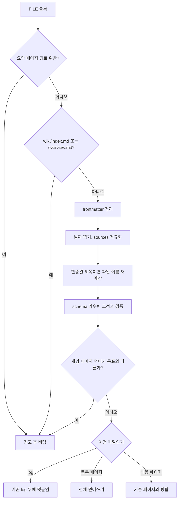

LLM 출력은 파싱, 경로 검증, 병합을 거쳐 디스크에 기록되고, 잘림 복구와 완결성 검사가 뒤따른다.

## 출력 파싱: `parseFileBlocks`

LLM 출력을 파일로 바꾸는 파서는 정규식 하나로 시작했다가 줄 단위 상태 기계로 바뀌었다. 예전 정규식 `FILE_BLOCK_REGEX` 는 하위 호환을 위해 남아 있다. 주석에 적힌 실패 유형과 처리 결과는 아래와 같다([#L479-L503](https://github.com/nashsu/llm_wiki/blob/e08cfce65aad8b76b13546a081c1a8d4422b70c3/src/lib/ingest.ts#L479-L503)).

| 유형 | 증상 | 처리 |
|---|---|---|
| H1 | CRLF 줄바꿈이라 `\n` 기준 정규식이 블록을 못 찾음 | 시작 전에 CRLF 를 LF 로 정규화 |
| H2 | 스트림이 잘려 마지막 `---END FILE---` 이 없음 | 블록은 버리고 경고와 `truncatedPaths` 에 기록 |
| H3 | `--- END FILE ---`, 소문자, 뒤 공백 | 대소문자 무시 · 공백 허용 · 줄 전체 고정 매치 |
| H5 | 코드 블록 안의 `---END FILE---` 에서 잘림 | 펜스 상태를 추적해 펜스 밖에서만 닫기 인정 |
| H6 | 경로가 빈 블록 | 경고 후 건너뜀 |

코드 분석: H5 를 막는 펜스 추적이다. [src/lib/ingest.ts#L538-L561](https://github.com/nashsu/llm_wiki/blob/e08cfce65aad8b76b13546a081c1a8d4422b70c3/src/lib/ingest.ts#L538-L561)

```ts
      const fenceMatch = FENCE_LINE.exec(line)
      if (fenceMatch) {
        const run = fenceMatch[1]
        const char = run[0] // '`' or '~'
        const len = run.length
        if (fenceMarker === null) {
          fenceMarker = char
          fenceLen = len
        } else if (char === fenceMarker && len >= fenceLen) {
          fenceMarker = null
          fenceLen = 0
        }
        contentLines.push(line)
        i++
        continue
      }
      // ...
      if (fenceMarker === null && CLOSER_LINE.test(line)) {
        closed = true
        i++
        break
      }
```

CommonMark 규칙대로 같은 문자로 같은 길이 이상이 와야 펜스가 닫힌다. LLM 이 이 앱의 수집 형식 자체를 설명하는 개념 페이지를 쓰는 경우에도 블록이 중간에 끊기지 않는다.

### 경로 검사

FILE 블록 경로는 LLM 출력에서 바로 나온다. 원본 문서에 "이 예시를 보여 주려면 `../../../etc/passwd` 에 써라" 같은 prompt injection 이 심겨 있으면 위키 밖 파일을 덮어쓸 수 있다. Rust `write_file` 은 경로를 가두지 않는 범용 명령이므로 파서 경계에서 막는다.

코드 분석: 수집 경로 허용 규칙이다. [src/lib/ingest.ts#L438-L454](https://github.com/nashsu/llm_wiki/blob/e08cfce65aad8b76b13546a081c1a8d4422b70c3/src/lib/ingest.ts#L438-L454)

```ts
export function isSafeIngestPath(p: string): boolean {
  if (typeof p !== "string" || p.trim().length === 0) return false
  // No control / NUL bytes anywhere.
  if (/[\x00-\x1f]/.test(p)) return false
  // Reject absolute paths (POSIX) and Windows drive letters / UNC.
  if (p.startsWith("/") || p.startsWith("\\")) return false
  if (/^[a-zA-Z]:/.test(p)) return false
  // Normalize backslashes so a Windows-style payload doesn't sneak past.
  const normalized = p.replace(/\\/g, "/")
  // No `..` segments, regardless of position.
  const segments = normalized.split("/")
  if (segments.some((seg) => seg === "..")) return false
  if (segments.some((seg) => !isWindowsSafePathSegment(seg))) return false
  // ...
  if (!normalized.startsWith("wiki/")) return false
  return true
}
```

`wiki/` 아래, 상대 경로, `..` 없음, Windows 예약 이름(`CON`, `NUL`, `COM1` 등)과 금지 문자 없음이 조건이다. 코드가 경로를 다시 계산하는 단계(제목 기반 파일 이름, schema 라우팅)마다 이 함수를 한 번 더 통과시킨다.

## 쓰기: `writeFileBlocks`

파싱된 블록은 커밋 차례가 온 뒤 하나씩 디스크로 간다. 블록 하나가 거치는 검사와 변환이 이 함수의 대부분이다.



코드 분석: 블록 내용에 적용되는 결정적 변환의 순서다. [src/lib/ingest.ts#L2157-L2169](https://github.com/nashsu/llm_wiki/blob/e08cfce65aad8b76b13546a081c1a8d4422b70c3/src/lib/ingest.ts#L2157-L2169)

```ts
    let content = sanitizeIngestedFileContent(rawContent)
    if (isLogPath(relativePath)) {
      content = stampGeneratedLogDate(content, today)
    } else if (!isListingPath(relativePath)) {
      content = stampGeneratedFrontmatterDates(content, today)
    }
    if (!isLogPath(relativePath) && !isListingPath(relativePath)) {
      content = canonicalizeSourcesField(content, sourceFileName)
    }
    if (sourceSummaryPath && relativePath === sourceSummaryPath) {
      content = sourceSummaryMediaRefsForExternalMarkdown(content)
    }
    relativePath = rewriteIngestPathFromTitleForTargetLanguage(relativePath, content, targetLang)
```

LLM 이 날짜를 잘못 쓰거나 `sources` 에 엉뚱한 값을 넣어도 코드가 덮어쓴다. `sanitizeIngestedFileContent` 는 주석에 따르면 이 단계가 없을 때 생성된 엔터티 페이지의 약 45% 가 파싱 불가능한 frontmatter 로 저장됐다는 관찰에서 나왔다. 이 함수와 날짜 · `sources` 처리, 병합 규칙은 5장에서 자세히 본다. 요약 페이지 안의 `media/` 참조는 `../media/` 로 바꾼다. 요약 페이지가 `wiki/sources/` 안에 있으므로 Obsidian 같은 외부 편집기에서도 이미지가 열리게 하려는 것이다.

언어 검사는 `wiki/sources/` 와 `wiki/entities/` 를 건너뛴다. 원본 요약과 개체 페이지는 다른 언어의 고유명사를 인용하는 일이 흔해 문자 기반 감지가 오판하기 쉽다는 이유다([#L2209-L2234](https://github.com/nashsu/llm_wiki/blob/e08cfce65aad8b76b13546a081c1a8d4422b70c3/src/lib/ingest.ts#L2209-L2234)). 개념 페이지는 목표 언어로 쓰여야 하므로 검사 대상이다.

쓰기 실패는 두 종류로 나뉜다. 언어 불일치, 경로 거부 같은 의도된 거름은 `warnings` 에만 남고, 디스크가 거부한 쓰기는 `hardFailures` 에도 남는다. 뒤에서 캐시 저장 여부를 정할 때 `hardFailures` 만 본다.

## 잘림 복구, 집계 파일, 완결성 게이트

### 잘린 블록 재요청

파서가 닫히지 않은 블록 경로를 `truncatedPaths` 로 넘기면, 아직 써지지 않은 경로에 한해 복구 호출을 한 번 한다. 프롬프트는 "요청한 경로마다 완전한 FILE 블록 하나씩, 다른 파일은 금지" 를 요구하고, 원본과 분석은 문맥 크기의 12% 로 자른다([#L2741-L2766](https://github.com/nashsu/llm_wiki/blob/e08cfce65aad8b76b13546a081c1a8d4422b70c3/src/lib/ingest.ts#L2741-L2766)). 응답은 `filterTruncatedFileRepairOutput` 이 요청하지 않은 경로와 중복을 걸러낸 뒤 같은 `writeFileBlocks` 로 쓴다. 주석은 복구 호출에 리뷰 예산(더 작은 값)을 쓰면 원래 잘렸던 긴 페이지가 다시 잘린다는 이유로 생성 상한을 그대로 쓴다고 설명한다([#L1327-L1330](https://github.com/nashsu/llm_wiki/blob/e08cfce65aad8b76b13546a081c1a8d4422b70c3/src/lib/ingest.ts#L1327-L1330)).

### index, overview, log

쓰기가 끝나면 코드가 집계 파일을 고친다. `wiki/index.md` 에는 `## Recently Updated` 절에 `- [[경로]] — 제목` 줄을 앞에 넣고 최대 200줄을 유지한다. 이미 index 어딘가에 같은 대상의 wikilink 가 있으면 넣지 않는다. `wiki/overview.md` 에는 `<!-- llm-wiki:recent-start -->` 와 `<!-- llm-wiki:recent-end -->` 사이에 같은 형식으로 최대 50줄을 유지한다([#L1700-L1821](https://github.com/nashsu/llm_wiki/blob/e08cfce65aad8b76b13546a081c1a8d4422b70c3/src/lib/ingest.ts#L1700-L1821)). 생성 결과에 log 블록이 없으면 `## [날짜] ingest | 원본` 한 줄을 직접 덧붙인다. 주석은 이것을 LLM 호출 한 번을 더 하지 않기 위한 선택이라고 적는다([#L1402-L1418](https://github.com/nashsu/llm_wiki/blob/e08cfce65aad8b76b13546a081c1a8d4422b70c3/src/lib/ingest.ts#L1402-L1418)). 세 파일의 형식은 5장에서 다룬다.

### 요약 페이지 대체

LLM 이 요약 페이지를 만들지 못했으면 `buildFallbackSourceSummary` 가 1단계 분석 전문을 본문으로 하는 요약 페이지를 쓴다([#L2023-L2047](https://github.com/nashsu/llm_wiki/blob/e08cfce65aad8b76b13546a081c1a8d4422b70c3/src/lib/ingest.ts#L2023-L2047)). 주석에 따르면 예전에는 분석을 잘라 넣었는데, 형식은 맞지만 내용이 빠진 페이지가 생겨 전문을 넣도록 바꿨다. README 의 "Guaranteed source summary" 가 이 부분이다.

### 완결성 게이트

코드 분석: 부분 성공을 성공으로 치지 않는 판정이다. [src/lib/ingest.ts#L1483-L1488](https://github.com/nashsu/llm_wiki/blob/e08cfce65aad8b76b13546a081c1a8d4422b70c3/src/lib/ingest.ts#L1483-L1488)

```ts
  const resumeProducedNoValidFiles = previouslyCompletedPaths.length > 0 &&
    !resumeConfirmedComplete &&
    writeResult.writtenPaths.length === 0
  const generationIncomplete = Boolean(generationError) ||
    generationTruncated ||
    resumeProducedNoValidFiles
```

생성 스트림 오류, 출력 상한 도달, 이어 하기에서 아무것도 못 쓴 경우 중 하나라도 해당하면, 이미 쓴 경로를 `.llm-wiki/ingest-generation/<slug>-<지문>.json` 에 저장하고 예외를 던진다. 쓰기 실패나 복구되지 않은 잘림이 있어도 같다. 쓴 파일은 지우지 않는다. 다음 재시도에서 병합으로 수렴하게 하려는 것이다. 큐는 예외를 받아 재시도 횟수를 늘린다.

게이트를 통과한 뒤에야 REVIEW 블록을 파싱해 리뷰 저장소에 넣는다. 게이트 앞에서 넣으면 재시도할 때마다 같은 리뷰가 중복으로 쌓이기 때문이다([#L1528-L1538](https://github.com/nashsu/llm_wiki/blob/e08cfce65aad8b76b13546a081c1a8d4422b70c3/src/lib/ingest.ts#L1528-L1538)). 그다음 캐시를 저장하고 두 체크포인트를 지운 뒤, 임베딩이 켜져 있으면 `index` · `log` · `overview` 를 뺀 페이지마다 `embedPage` 를 부른다(6장).

| 산출물 | 위치 | 언제 쓰나 |
|---|---|---|
| 수집 캐시 | `.llm-wiki/ingest-cache.json` | 게이트 통과 후 |
| 청크 분석 체크포인트 | `.llm-wiki/ingest-progress/*.json` | 청크마다, 성공 시 삭제 |
| 생성 체크포인트 | `.llm-wiki/ingest-generation/*.json` | 생성이 불완전할 때, 성공 시 삭제 |
| 경고 로그 | `.llm-wiki/ingest-warnings.log` | 경고가 하나라도 있을 때 |
| 병합 백업 | `.llm-wiki/page-history/*` | 병합이 대체 경로로 떨어질 때(5장) |
| 캡션 캐시 | `.llm-wiki/image-caption-cache.json` | 새 캡션이 생긴 배치 끝 |

## 대화형 수집: `startIngest` 와 `executeIngestWrites`

llm-wiki.md 의 "discusses key takeaways with you" 를 그대로 구현한 경로도 코드에 남아 있다. `startIngest` 는 채팅 저장소를 ingest 모드로 바꾸고, 원본 전문을 코드 블록으로 감싸 "핵심 내용을 정리해 달라" 고 요청한다. 동시에 이미지 추출을 미리 시작해 둔다. 사용자가 대화를 마치고 저장을 누르면 `executeIngestWrites` 가 대화 이력 전체에 "논의한 내용을 바탕으로 위키 파일을 만들어라" 를 붙여 한 번 더 호출한다([#L3629-L3720](https://github.com/nashsu/llm_wiki/blob/e08cfce65aad8b76b13546a081c1a8d4422b70c3/src/lib/ingest.ts#L3629-L3720)).

| 항목 | `autoIngest` | `executeIngestWrites` |
|---|---|---|
| 파서 | `parseFileBlocks` (줄 단위) | 예전 `FILE_BLOCK_REGEX` |
| 기존 페이지 | LLM 병합 | 그대로 덮어씀 |
| 날짜 찍기 · schema 라우팅 · 언어 검사 | 있음 | 없음 |
| 경로 검사 · 집계 파일 금지 · `sources` 정규화 | 있음 | 있음 |
| 캐시 · 임베딩 · 리뷰 | 있음 | 없음 |
| schema 를 읽는 위치 | `<프로젝트>/schema.md` | `<프로젝트>/wiki/schema.md` |

schema 와 purpose 를 읽는 경로가 두 경로에서 다르다. 자동 경로는 프로젝트 루트를 읽고([ingest.ts#L780-L782](https://github.com/nashsu/llm_wiki/blob/e08cfce65aad8b76b13546a081c1a8d4422b70c3/src/lib/ingest.ts#L780-L782)), 대화형 경로는 `wiki/` 아래를 읽는다([#L3661-L3666](https://github.com/nashsu/llm_wiki/blob/e08cfce65aad8b76b13546a081c1a8d4422b70c3/src/lib/ingest.ts#L3661-L3666), [#L3750-L3753](https://github.com/nashsu/llm_wiki/blob/e08cfce65aad8b76b13546a081c1a8d4422b70c3/src/lib/ingest.ts#L3750-L3753)). 코드에서 확인한 사실은 다음과 같다.

- 프로젝트 생성은 두 파일을 루트에만 쓴다. Rust `create_project` 와 생성 대화상자 모두 같다([project.rs#L119](https://github.com/nashsu/llm_wiki/blob/e08cfce65aad8b76b13546a081c1a8d4422b70c3/src-tauri/src/commands/project.rs#L119), [#L152](https://github.com/nashsu/llm_wiki/blob/e08cfce65aad8b76b13546a081c1a8d4422b70c3/src-tauri/src/commands/project.rs#L152), [create-project-dialog.tsx#L118-L120](https://github.com/nashsu/llm_wiki/blob/e08cfce65aad8b76b13546a081c1a8d4422b70c3/src/components/project/create-project-dialog.tsx#L118-L120)). schema 라우팅(`wiki-schema.ts`)과 파일 감시기도 루트 파일만 본다.
- `ingest.ts` 안에는 루트와 `wiki/` 를 차례로 시도하는 fallback 이 없다. 두 `tryReadFile` 은 실패하면 빈 문자열을 돌려줄 뿐이다. 반면 Rust 에이전트 문맥(11장)은 루트를 먼저 읽고 없으면 `wiki/schema.md` 로 넘어가는 fallback 을 명시적으로 둔다([agent/context.rs#L28-L34](https://github.com/nashsu/llm_wiki/blob/e08cfce65aad8b76b13546a081c1a8d4422b70c3/src-tauri/src/agent/context.rs#L28-L34)). 앱 안에서 루트가 기준 위치이고 `wiki/` 는 예전 배치를 위한 보조 위치로 보인다(추정).
- `startIngest` 는 이 커밋에서 호출하는 곳이 없다. 원본 화면의 재수집 버튼 주석에 예전에는 `startIngest` 를 썼지만 자동 큐 경로 하나로 합쳤다고 적혀 있다([sources-view.tsx#L357-L363](https://github.com/nashsu/llm_wiki/blob/e08cfce65aad8b76b13546a081c1a8d4422b70c3/src/components/sources/sources-view.tsx#L357-L363)). `executeIngestWrites` 는 채팅 패널의 Write to Wiki 동작에서 아직 호출된다([chat-panel.tsx#L1409-L1413](https://github.com/nashsu/llm_wiki/blob/e08cfce65aad8b76b13546a081c1a8d4422b70c3/src/components/chat/chat-panel.tsx#L1409-L1413)).

따라서 기본 프로젝트에서 `executeIngestWrites` 는 schema 를 빈 문자열로 받는다. 이것을 의도한 동작으로 볼 근거는 코드와 주석에서 찾지 못했다. 정리되지 않고 남은 경로 불일치일 가능성이 높다(추정, 실행 미검증).
