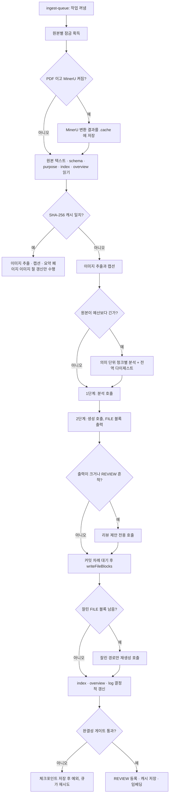

수집(ingest)은 `raw/sources/` 에 놓인 원본 하나를 읽어 위키 페이지 여러 장으로 바꾸는 과정이다. LLM Wiki 에서 가장 많은 코드가 몰린 곳이 여기이며, 핵심 파일 `src/lib/ingest.ts` 하나만 약 3,900줄이다. 이 장은 원본이 큐에 들어가는 순간부터 페이지가 디스크에 쓰이고 캐시와 임베딩이 갱신될 때까지를 단계별로 따라간다.

## 원본 아이디어와 구현의 대응

Karpathy 의 아이디어 문서 [llm-wiki.md](https://github.com/nashsu/llm_wiki/blob/e08cfce65aad8b76b13546a081c1a8d4422b70c3/llm-wiki.md#L37) 는 ingest 를 이렇게 설명한다. "the LLM reads the source, discusses key takeaways with you, writes a summary page in the wiki, updates the index, updates relevant entity and concept pages across the wiki, and appends an entry to the log." 한 원본이 10~15개 페이지를 건드릴 수 있다고도 적는다.

구현은 이 문장을 거의 그대로 단계로 쪼갰다. 다만 "LLM 이 index 를 갱신한다"는 부분은 의도적으로 LLM 손에서 뺐다. 아래 표가 대응 관계다.

| llm-wiki.md 의 동작 | 구현 위치 | 차이점 |
|---|---|---|
| 원본을 읽는다 | Rust `read_file` + MinerU (선택) | PDF · Office · EPUB 를 Markdown 으로 바꾸고 `.cache/` 에 저장 |
| 요점을 함께 논의한다 | `startIngest` / `executeIngestWrites` (대화형) | 자동 경로 `autoIngest` 는 논의 대신 1단계 분석 호출로 대체 |
| 요약 페이지를 쓴다 | 2단계 생성의 `wiki/sources/<slug>.md` | 경로를 코드가 정해 주고, 빠지면 코드가 대체 페이지를 쓴다 |
| 개체 · 개념 페이지를 갱신한다 | `writeFileBlocks` + `mergePageContent` | 기존 페이지는 LLM 병합, 실패 시 결정적 병합 |
| index 를 갱신한다 | `updateWikiIndexDeterministically` | LLM 이 아니라 코드가 "Recently Updated" 절만 덧붙인다 |
| log 에 항목을 덧붙인다 | `writeFileBlocks` 의 append 분기 + `buildDeterministicIngestLog` | LLM 이 빠뜨리면 코드가 한 줄을 쓴다 |

README 는 이 구성을 "Two-Step Chain-of-Thought Ingest" 라고 부른다([README.md](https://github.com/nashsu/llm_wiki/blob/e08cfce65aad8b76b13546a081c1a8d4422b70c3/README.md#L106-L123)). 분석 호출과 생성 호출을 나눈 것이 원본 아이디어에서 가장 크게 달라진 점이다.

## 전체 흐름

아래 그림은 큐에서 꺼낸 작업 하나가 `autoIngestImpl` 안에서 거치는 단계다. 굵은 경로가 캐시 미스(전체 파이프라인)다.

LLM 호출은 최소 두 번(분석, 생성)이고, 조건에 따라 청크 분석 N번, 리뷰 제안 1번, 잘림 복구 1번, 페이지 병합 페이지당 1번, 이미지 캡션 이미지당 1번이 더 붙는다.

## 정리

- 수집은 llm-wiki.md 의 ingest 묘사(요약 · 개체 · 개념 · index · log)를 단계별 코드로 옮겼고, "LLM 이 index 를 갱신한다" 는 부분만 코드의 결정적 갱신으로 바꿨다.
- 분석과 생성을 나눈 두 번의 LLM 호출이 핵심 구조이며, 긴 원본은 의미 단위 청크와 전역 다이제스트로 먼저 압축하고 청크마다 체크포인트를 남긴다.
- LLM 출력은 줄 단위 파서, 경로 허용 규칙, frontmatter 정리, 날짜 · `sources` 덮어쓰기, schema 라우팅을 거친 뒤에야 디스크에 기록된다.
- 큐는 준비를 병렬로, 쓰기를 시작 순서대로 처리하며 실패는 예외로 올려 최대 3회 재시도하고, 사용량 제한은 15분 일시정지로 처리한다.
- 부분 성공은 성공으로 치지 않는다. 캐시와 리뷰 등록은 완결성 게이트 뒤에만 일어나고, 쓴 파일은 남겨 다음 시도에서 병합으로 수렴시킨다.
- 이미지는 Rust 추출, SHA-256 캡션 캐시, 요약 페이지의 표식 절이라는 세 겹으로 처리되어 LLM 이 이미지를 빠뜨려도 위키에 남는다.
