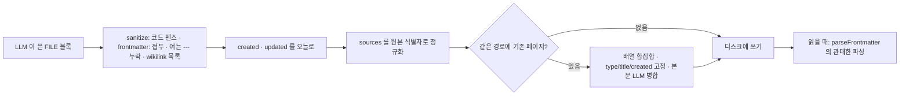

위키 페이지의 형식은 템플릿이 LLM에 주는 규칙과 frontmatter 계약으로 정해진다.

## 템플릿: `templates.ts`

템플릿은 schema 와 purpose 문자열, 추가 폴더 목록을 묶은 객체다. 다섯 개가 있고, 모두 공통 조각(기본 페이지 타입 표, 이름 규칙, frontmatter, index 형식, log 형식, 교차 참조 규칙, 모순 처리)을 이어 붙여 만든다.

코드 분석: 모든 템플릿이 공유하는 기본 페이지 타입 표다. [src/lib/templates.ts#L11-L17](https://github.com/nashsu/llm_wiki/blob/e08cfce65aad8b76b13546a081c1a8d4422b70c3/src/lib/templates.ts#L11-L17)

```ts
const BASE_SCHEMA_TYPES = `| entity | wiki/entities/ | Named things (people, tools, organizations, datasets) |
| concept | wiki/concepts/ | Ideas, techniques, phenomena, frameworks |
| source | wiki/sources/ | Papers, articles, talks, books, blog posts |
| query | wiki/queries/ | Open questions under active investigation |
| comparison | wiki/comparisons/ | Side-by-side analysis of related entities |
| synthesis | wiki/synthesis/ | Cross-cutting summaries and conclusions |
| overview | wiki/ | High-level project summary (one per project) |`
```

이 표는 사람이 읽는 설명이면서 동시에 기계가 읽는 설정이다. 아래의 schema 라우팅이 `## Page Types` 절의 표에서 첫 칸(타입)과 둘째 칸(폴더)을 뽑아 쓴다. 템플릿마다 표에 행을 더해 사용자 정의 타입을 만든다.

| 템플릿 id | 추가 폴더(`extraDirs`) | 성격 |
|---|---|---|
| `research` | `wiki/methodology`, `wiki/findings`, `wiki/thesis` | 가설 · 방법론 · 발견 추적 |
| `reading` | `wiki/characters`, `wiki/themes`, `wiki/plot-threads`, `wiki/chapters` | 책 읽기 동반 위키 |
| `personal` | `wiki/goals`, `wiki/habits`, `wiki/reflections`, `wiki/journal` | 목표 · 습관 · 회고 |
| `business` | `wiki/meetings`, `wiki/decisions`, `wiki/projects`, `wiki/stakeholders` | 회의 · 결정 · 이해관계자 |
| `general` | 없음 | 기본 타입만 |

템플릿 구성은 llm-wiki.md 의 활용 예(Personal, Research, Reading a book, Business/team)와 거의 일대일로 대응한다([llm-wiki.md#L17-L23](https://github.com/nashsu/llm_wiki/blob/e08cfce65aad8b76b13546a081c1a8d4422b70c3/llm-wiki.md#L17-L23)). 원본 문서가 "schema 는 사용자와 LLM 이 함께 발전시키는 문서" 라고 한 부분은, 템플릿이 첫 판을 만들고 사용자가 고치는 형태로 구현됐다.

`research` 템플릿은 thesis 페이지에 `confidence` · `status`, finding 페이지에 `source` · `confidence` · `replicated` 같은 추가 frontmatter 를 정의한다([templates.ts#L69-L186](https://github.com/nashsu/llm_wiki/blob/e08cfce65aad8b76b13546a081c1a8d4422b70c3/src/lib/templates.ts#L69-L186)). 코드는 이 추가 필드를 검사하지 않는다. LLM 이 schema 를 읽고 따르기를 기대할 뿐이다.

### schema 라우팅

수집할 때 LLM 이 개념 페이지를 `wiki/concepts/` 에 쓰라는 기본값과 schema 의 사용자 정의 폴더 사이에서 헷갈리는 경우가 생긴다. `wiki-schema.ts` 가 이것을 코드로 교정한다.

코드 분석: schema 의 페이지 타입 표를 읽는 부분이다. [src/lib/wiki-schema.ts#L32-L50](https://github.com/nashsu/llm_wiki/blob/e08cfce65aad8b76b13546a081c1a8d4422b70c3/src/lib/wiki-schema.ts#L32-L50)

```ts
export function parseWikiSchemaRouting(markdown: string): WikiSchemaRouting {
  const typeDirs: Record<string, string> = {}
  for (const line of pageTypesSectionLines(markdown)) {
    if (!line.trim().startsWith("|")) continue
    const cells = line
      .split("|")
      .slice(1, -1)
      .map((cell) => cell.trim())
    if (cells.length < 2) continue

    const [type, dir] = cells
    if (!/^[a-z][a-z0-9_-]*$/i.test(type)) continue
    if (!isSafeWikiDirectory(dir)) continue

    typeDirs[type] = stripTrailingSlash(dir)
  }

  return { typeDirs }
}
```

머리글 줄(`| Type | Directory |`)과 구분 줄(`|---|`)은 둘째 칸이 `wiki/` 로 시작하지 않아 `isSafeWikiDirectory` 에서 걸러진다. 그래서 표 형식만 맞으면 따로 파서 규칙 없이 타입 → 폴더 지도가 나온다. 수집의 `writeFileBlocks` 는 이 지도로 두 단계를 거친다. `correctWikiPageRouting` 이 frontmatter `type` 에 맞는 폴더로 경로를 옮기고("Auto-routed page type ..." 경고), `validateWikiPageRouting` 이 그래도 폴더와 타입이 어긋나면 블록을 버린다([wiki-schema.ts#L71-L122](https://github.com/nashsu/llm_wiki/blob/e08cfce65aad8b76b13546a081c1a8d4422b70c3/src/lib/wiki-schema.ts#L71-L122)). 즉 경로보다 `type` 필드가 우선이다.

## frontmatter 계약

수집 프롬프트가 요구하는 frontmatter 필드는 일곱 개다([ingest.ts#L2547-L2590](https://github.com/nashsu/llm_wiki/blob/e08cfce65aad8b76b13546a081c1a8d4422b70c3/src/lib/ingest.ts#L2547-L2590)). 각 필드를 코드의 어느 부분이 강제하는지가 이 장의 중심이다.

| 필드 | 형식 | 누가 정하나 | 강제하는 코드 |
|---|---|---|---|
| `type` | 알려진 타입 또는 schema 정의 타입 | LLM | schema 라우팅, 병합 시 기존 값 고정 |
| `title` | 문자열, 콜론이 있으면 따옴표 | LLM | 병합 시 기존 값 고정, 한중일 제목이면 파일 이름 결정 |
| `created` | `YYYY-MM-DD` | 코드 | `stampGeneratedFrontmatterDates`, 병합 시 기존 값 고정 |
| `updated` | `YYYY-MM-DD` | 코드 | 쓸 때마다 오늘 날짜 |
| `tags` | 인라인 배열 | LLM | 병합 시 합집합 |
| `related` | 대괄호 없는 slug 배열 | LLM | 병합 시 합집합, 삭제 시 정리 |
| `sources` | 원본 식별자 배열 | 코드가 보정 | `canonicalizeSourcesField`, 병합 시 합집합 |

알려진 타입은 `source`, `entity`, `concept`, `comparison`, `query`, `synthesis`, `thesis`, `methodology`, `finding` 의 아홉 개다([wiki-page-types.ts#L1-L11](https://github.com/nashsu/llm_wiki/blob/e08cfce65aad8b76b13546a081c1a8d4422b70c3/src/lib/wiki-page-types.ts#L1-L11)). 경로에서 타입을 추정할 때는 `standards`, `playbooks` 폴더도 인식하고, 그 밖의 `wiki/<폴더>/` 는 폴더 이름을 그대로 타입으로 쓴다([#L27-L39](https://github.com/nashsu/llm_wiki/blob/e08cfce65aad8b76b13546a081c1a8d4422b70c3/src/lib/wiki-page-types.ts#L27-L39)).



쓰기 쪽에서 엄격하게 정리하고, 읽기 쪽에서는 관대하게 받아들이는 구조다. 이미 디스크에 있는 오래된 파일은 쓰기 쪽 정리를 거치지 않았으므로 읽기 쪽이 그 몫을 한다.

### 읽기: `frontmatter.ts`

`parseFrontmatter` 는 두 단계로 frontmatter 블록을 찾는다. 먼저 파일 맨 앞의 `---` 쌍을 찾고, 없으면 파일 어디서든 첫 `---` 쌍을 찾되 여는 줄이 6번째 줄 이내일 때만 인정한다([frontmatter.ts#L22-L35](https://github.com/nashsu/llm_wiki/blob/e08cfce65aad8b76b13546a081c1a8d4422b70c3/src/lib/frontmatter.ts#L22-L35)). 본문 깊숙이 있는 수평선(`---`)을 frontmatter 로 오인하지 않으면서, LLM 이 앞에 ` ```yaml ` 같은 줄을 붙인 경우를 살리는 절충이다.

코드 분석: YAML 파싱을 두 번 시도하는 부분이다. [src/lib/frontmatter.ts#L49-L58](https://github.com/nashsu/llm_wiki/blob/e08cfce65aad8b76b13546a081c1a8d4422b70c3/src/lib/frontmatter.ts#L49-L58)

```ts
  let parsed: unknown
  try {
    parsed = yaml.load(yamlPayload, { schema: yaml.JSON_SCHEMA })
  } catch {
    try {
      parsed = yaml.load(repairWikilinkLists(yamlPayload), { schema: yaml.JSON_SCHEMA })
    } catch {
      return { frontmatter: null, body, rawBlock }
    }
  }
```

`yaml.JSON_SCHEMA` 를 쓰므로 `created: 2026-11-13` 은 Date 객체가 아니라 문자열로 남는다. 첫 시도가 실패하면 `related: [[a]], [[b]]` 처럼 유효하지 않은 YAML 한 가지만 `["[[a]]", "[[b]]"]` 로 고쳐 다시 시도한다. 그 밖의 오류는 "frontmatter 없음" 으로 돌려준다. 결과는 `Record<string, string | string[]>` 로 납작하게 만든다. 중첩 객체는 JSON 문자열로 바뀌어 UI 에 그대로 보인다([#L180-L204](https://github.com/nashsu/llm_wiki/blob/e08cfce65aad8b76b13546a081c1a8d4422b70c3/src/lib/frontmatter.ts#L180-L204)).

`rawBlock` 은 frontmatter 블록 원문이다. 본문만 고치는 기능은 `rawBlock + body` 로 다시 써서 사용자가 손댄 YAML 을 바이트 단위로 보존한다.

> **주의**: frontmatter 를 다루는 코드는 두 벌이다. 표시용 `frontmatter.ts` 는 js-yaml 로 파싱하고, 배열 필드 편집용 `sources-merge.ts` 는 정규식으로 인라인 `[a, b]` 와 블록 `- a` 두 형태만 읽고 쓴다([sources-merge.ts#L36-L63](https://github.com/nashsu/llm_wiki/blob/e08cfce65aad8b76b13546a081c1a8d4422b70c3/src/lib/sources-merge.ts#L36-L63)). 블록 형태는 쓸 때 인라인 형태로 바뀐다([#L114-L150](https://github.com/nashsu/llm_wiki/blob/e08cfce65aad8b76b13546a081c1a8d4422b70c3/src/lib/sources-merge.ts#L114-L150)). 정규식 쪽은 맨 앞 `---` 만 인식하므로, 읽기 쪽 fallback 으로만 읽히는 오래된 파일에서는 두 결과가 다를 수 있다(코드상 추정).

### 쓰기: `sanitizeIngestedFileContent`

주석에 따르면 한 실제 말뭉치의 엔터티 페이지 67개 중 30개가 엄격 파싱에 실패했고, 그 원인이 네 가지 모양으로 반복됐다([ingest-sanitize.ts#L1-L57](https://github.com/nashsu/llm_wiki/blob/e08cfce65aad8b76b13546a081c1a8d4422b70c3/src/lib/ingest-sanitize.ts#L1-L57)).

| 모양 | 예 | 고치는 함수 |
|---|---|---|
| 파일 전체를 코드 펜스로 감쌈 | ` ```yaml ` ... ` ``` ` | `stripOuterCodeFence` |
| `frontmatter:` 키를 앞에 붙임 | `frontmatter:` 다음 줄에 `---` | `stripFrontmatterKeyPrefix` |
| 여는 `---` 누락 | `type: entity` 로 시작해 `---` 로 닫음 | `addMissingOpeningFrontmatterFence` |
| 바깥 대괄호 없는 wikilink 목록 | `related: [[a]], [[b]]` | `repairWikilinkListsInFrontmatter` |

다섯 번째로 본문의 잘못된 wikilink 를 정규화한다(`normalizeMalformedWikilinks`). 코드 펜스, `$$` 수식 블록, `<pre>` · `<code>`, 들여쓰기 코드 블록, 인라인 코드는 건드리지 않는다([#L95-L140](https://github.com/nashsu/llm_wiki/blob/e08cfce65aad8b76b13546a081c1a8d4422b70c3/src/lib/ingest-sanitize.ts#L95-L140)). 각 패턴은 문서 맨 앞이나 frontmatter 범위에만 걸리도록 고정돼 있어, 본문의 정상적인 코드 블록은 바뀌지 않는다.

### 날짜와 `sources`

날짜는 LLM 에게 맡기지 않는다. 프롬프트에 오늘 날짜를 알려 주지만, 쓰기 직전에 `stampGeneratedFrontmatterDates` 가 `created` 와 `updated` 를 오늘로 덮어쓰거나 없으면 덧붙인다([ingest.ts#L2049-L2058](https://github.com/nashsu/llm_wiki/blob/e08cfce65aad8b76b13546a081c1a8d4422b70c3/src/lib/ingest.ts#L2049-L2058)). 기존 페이지라면 병합 단계가 `created` 를 원래 값으로 되돌린다. 날짜는 로컬 시간대 기준(`currentWikiDate`)이다.

`sources` 는 위키의 출처 추적 장치다. 원본 삭제, 그래프의 "같은 원본 공유" 가중치(7장), 단독 소유 판정이 모두 이 필드를 읽는다. 그래서 LLM 이 쓴 값을 그대로 믿지 않는다.

코드 분석: `sources` 를 원본 식별자 기준으로 고치는 함수다. [src/lib/ingest.ts#L1835-L1863](https://github.com/nashsu/llm_wiki/blob/e08cfce65aad8b76b13546a081c1a8d4422b70c3/src/lib/ingest.ts#L1835-L1863)

```ts
  const sourceValues = parseSources(content)
  const canonicalValues = sourceValues.filter((source) =>
    isValidSourceReference(source, sourceIdentity)
  ).map((source) => {
    const normalized = sourceReferenceIdentity(source)
    const key = normalized.toLowerCase()
    if (key === identityKey) return sourceIdentity
    if (!normalized.includes("/") && key === identityBaseName) return sourceIdentity
    return normalized
  })
  if (!canonicalValues.some((source) => normalizePath(source).toLowerCase() === identityKey)) {
    canonicalValues.push(sourceIdentity)
  }
```

절대 경로, `..`, `wiki/index.md` 같은 집계 파일, `.llm-wiki/` 아래 경로는 출처로 인정하지 않는다([#L1823-L1833](https://github.com/nashsu/llm_wiki/blob/e08cfce65aad8b76b13546a081c1a8d4422b70c3/src/lib/ingest.ts#L1823-L1833)). `raw/sources/a/b.pdf` 처럼 접두가 붙은 값은 `a/b.pdf` 로 줄이고, 파일 이름만 쓴 값이 현재 원본과 같으면 전체 식별자로 바꾼다. 현재 원본이 빠져 있으면 덧붙인다. 대소문자를 무시하고 중복을 없앤다.
