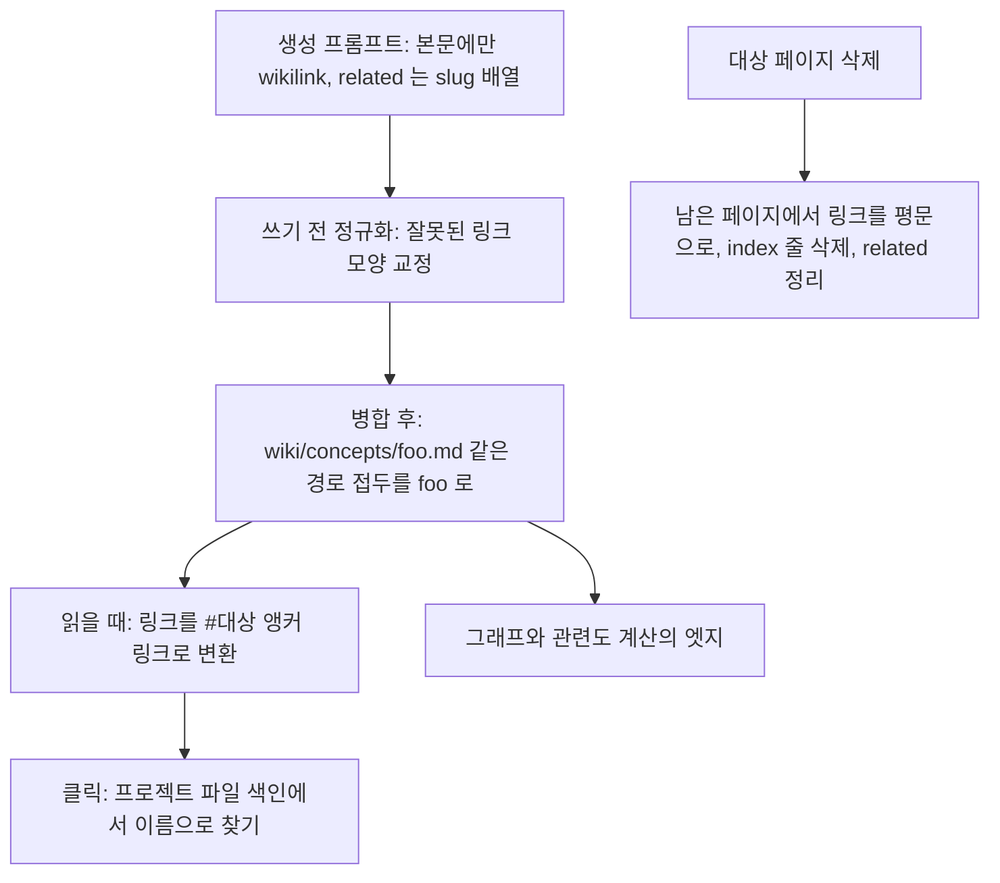

요약 페이지 이름을 정하는 규칙, 같은 페이지를 다시 쓸 때의 병합, 위키링크 처리 과정을 본다.

## 원본 식별자와 요약 페이지 이름

원본 식별자는 `raw/sources/` 아래 상대 경로다. `raw/sources/papers/rope.pdf` 의 식별자는 `papers/rope.pdf` 다([source-identity.ts#L11-L28](https://github.com/nashsu/llm_wiki/blob/e08cfce65aad8b76b13546a081c1a8d4422b70c3/src/lib/source-identity.ts#L11-L28)). 파일 이름만 쓰지 않는 이유는 서로 다른 폴더의 `config.yaml` 두 개가 같은 출처로 섞이지 않게 하려는 것이다.

요약 페이지 경로 `wiki/sources/<slug>.md` 의 slug 는 식별자에서 계산한다.

| 식별자 | slug 규칙 |
|---|---|
| 폴더 없음 (`rope.pdf`) | 확장자를 뺀 이름 그대로 (`rope`) |
| 폴더 있음 (`papers/rope.pdf`) | 조각마다 `<길이>-<읽을 수 있는 이름>` 을 `--` 로 잇고 끝에 해시 (`6-papers--4-rope--<해시>`) |
| 120자 초과 | 읽을 수 있는 앞부분을 자르고 해시 유지 |
| UTF-8 252바이트 초과 | 바이트 기준으로 다시 자르고 `--<해시>` 유지 |

코드 근거는 [source-identity.ts#L42-L91](https://github.com/nashsu/llm_wiki/blob/e08cfce65aad8b76b13546a081c1a8d4422b70c3/src/lib/source-identity.ts#L42-L91) 이다. 읽을 수 있는 이름은 NFKC 정규화 후 문자 · 숫자 · 하이픈만 남긴다. 길이 접두와 해시는 `a-b/c` 와 `a/b-c` 처럼 이어 붙이면 같아지는 경로를 구분하기 위한 것이다(추정). 252바이트 제한은 대부분의 파일 시스템 이름 길이 한도(255바이트)에서 `.md` 를 뺀 값으로 보인다(추정).

slug 규칙은 여러 번 바뀌었고, 예전 규칙 세 가지가 `sourceSummarySlugCandidatesFromIdentity` 에 후보로 남아 있다. 수집 시작 시 `migrateLegacySourceSummaryIfSafe` 가 예전 이름의 요약 페이지를 찾아, 같은 원본을 가리킬 때만 새 이름으로 옮긴다([ingest.ts#L1865-L1977](https://github.com/nashsu/llm_wiki/blob/e08cfce65aad8b76b13546a081c1a8d4422b70c3/src/lib/ingest.ts#L1865-L1977)). 파일 이름만으로는 같은 원본인지 확신할 수 없으면 옮기지 않는다.

일반 페이지(개체 · 개념)의 파일 이름은 LLM 이 정한다. 출력 언어가 한중일이거나, 언어 설정이 `auto` 이고 제목에 한중일 문자가 있으면, 파일 이름에 한중일 문자가 없을 때 제목에서 다시 만든다(`rewriteIngestPathFromTitleForTargetLanguage`). 영어 slug 를 버리고 `makeQuerySlug(title)` 로 바꾼다. 로마자 변환이나 번역 대신 제목 글자를 그대로 쓴다([ingest.ts#L1664-L1698](https://github.com/nashsu/llm_wiki/blob/e08cfce65aad8b76b13546a081c1a8d4422b70c3/src/lib/ingest.ts#L1664-L1698), [wiki-filename.ts#L32-L48](https://github.com/nashsu/llm_wiki/blob/e08cfce65aad8b76b13546a081c1a8d4422b70c3/src/lib/wiki-filename.ts#L32-L48)).

## 동일 페이지 재작성 시 병합

두 번째 원본이 이미 있는 개념 페이지를 다시 생성하면, 새 내용으로 덮어쓰지 않고 병합한다. llm-wiki.md 의 "The wiki keeps getting richer with every source you add" 를 코드로 지키는 부분이다([llm-wiki.md#L13](https://github.com/nashsu/llm_wiki/blob/e08cfce65aad8b76b13546a081c1a8d4422b70c3/llm-wiki.md#L13)).

코드 분석: 병합의 고정 규칙 세 가지다. [src/lib/page-merge.ts#L31-L54](https://github.com/nashsu/llm_wiki/blob/e08cfce65aad8b76b13546a081c1a8d4422b70c3/src/lib/page-merge.ts#L31-L54)

```ts
const UNION_FIELDS = ["sources", "tags", "related"] as const
// ...
const LOCKED_FIELDS = ["type", "title", "created"] as const
// ...
const BODY_SHRINK_THRESHOLD = 0.7
```

`mergePageContent` 의 순서는 다음과 같다([page-merge.ts#L96-L215](https://github.com/nashsu/llm_wiki/blob/e08cfce65aad8b76b13546a081c1a8d4422b70c3/src/lib/page-merge.ts#L96-L215)).

1. 기존 페이지가 없거나 내용이 같으면 그대로 쓴다.
2. 배열 필드(`sources` · `tags` · `related`)를 대소문자 무시 합집합으로 합친다. 본문이 같으면 여기서 끝낸다.
3. 기존 페이지의 `sources` 가 전부 현재 원본이면(단독 소유) 본문을 새 것으로 교체한다. 원본을 고쳐 다시 수집했을 때 철회된 문장이 병합으로 계속 살아남는 문제를 막는다([ingest.ts#L2267-L2275](https://github.com/nashsu/llm_wiki/blob/e08cfce65aad8b76b13546a081c1a8d4422b70c3/src/lib/ingest.ts#L2267-L2275)).
4. 그 밖에는 LLM 병합을 부른다. 병합 프롬프트는 두 입력을 "버전" 이 아닌 "같은 페이지의 출처별 자료" 로 부르고, 모든 사실을 보존하되 비교 대상의 주장을 주 대상의 주장으로 섞지 말라고 요구한다([ingest.ts#L3454-L3480](https://github.com/nashsu/llm_wiki/blob/e08cfce65aad8b76b13546a081c1a8d4422b70c3/src/lib/ingest.ts#L3454-L3480)).
5. 병합 결과에 frontmatter 가 없거나, 본문이 두 입력 중 긴 쪽의 70% 보다 짧으면 버린다. 이때와 LLM 호출 실패 때는 기존 페이지를 `.llm-wiki/page-history/` 에 백업하고 "새 본문 + 배열 합집합" 으로 쓴다.
6. 통과하면 `type` · `title` · `created` 를 기존 값으로 되돌리고, 배열 필드를 다시 합집합하고, `updated` 를 오늘로 찍는다. 본문 wikilink 의 경로 접두를 떼고 잘못된 wikilink 를 정규화한다.

`title` 을 고정하는 이유는 주석에 적혀 있다. 사용자가 기억하는 제목과 본문에서 제목을 그대로 인용한 문장이 조용히 어긋나는 것을 막기 위해서다. 병합 뒤에 `canonicalizeSourcesField` 를 한 번 더 부르는 것도 같은 이유다. 합집합은 디스크에 이미 있던 잘못된 출처 값까지 되살리기 때문이다.

## 위키링크 처리 과정

wikilink 는 Obsidian 문법 `[[대상]]` · `[[대상|표시 글자]]` 를 그대로 쓴다. llm-wiki.md 가 Obsidian 을 옆에 띄워 두고 쓰는 방식을 전제로 하므로, 앱 밖 Obsidian 에서도 같은 파일이 열리게 한 선택이다. 대상은 경로가 아니라 파일 이름(slug)이 기준이다.



### 렌더링과 이동

Markdown 렌더러는 `[[...]]` 를 모르므로 `transformWikilinks` 가 `[표시 글자](#인코딩된-대상)` 로 바꾼다. 펜스 코드 블록과 인라인 코드는 건너뛴다. 이미지 embed `![[x.png]]` 는 먼저 `transformImageEmbeds` 가 일반 이미지 문법으로 바꿔야 한다. 순서가 바뀌면 이미지가 앵커 링크가 된다([wikilink-transform.ts#L40-L117](https://github.com/nashsu/llm_wiki/blob/e08cfce65aad8b76b13546a081c1a8d4422b70c3/src/lib/wikilink-transform.ts#L40-L117)).

`#` 앵커를 쓰는 이유는 Tauri 웹뷰가 링크를 외부 주소로 열려고 하지 않게 하려는 것이다. 클릭은 `wiki-reader.tsx` 가 가로채 `resolveRelatedSlug` 로 실제 파일을 찾는다([wiki-reader.tsx#L91-L103](https://github.com/nashsu/llm_wiki/blob/e08cfce65aad8b76b13546a081c1a8d4422b70c3/src/components/editor/wiki-reader.tsx#L91-L103)).

코드 분석: wikilink 대상을 파일로 풀어내는 규칙이다. [src/lib/wiki-page-resolver.ts#L136-L155](https://github.com/nashsu/llm_wiki/blob/e08cfce65aad8b76b13546a081c1a8d4422b70c3/src/lib/wiki-page-resolver.ts#L136-L155)

```ts
  // Path-like refs can be project-relative (`wiki/concepts/foo`) or
  // wiki-root-relative (`concepts/foo`). Index generation uses the latter.
  if (normalizedRef.includes("/")) {
    const projectRoot = normalizedWikiRoot.replace(/\/wiki$/, "")
    const withExtension = normalizedRef.endsWith(".md") ? normalizedRef : `${normalizedRef}.md`
    const target = withExtension.startsWith("wiki/")
      ? `${projectRoot}/${withExtension}`
      : `${normalizedWikiRoot}/${withExtension}`
    const found = findInTreeByPath(index, target)
    return found && found.replace(/\\/g, "/").startsWith(`${normalizedWikiRoot}/`) ? found : null
  }

  const filename = normalizedRef.endsWith(".md") ? normalizedRef : `${normalizedRef}.md`
  return findInTreeByName(index, filename, `${normalizedWikiRoot}/`)
```

경로가 있으면 경로로, 없으면 `wiki/` 아래에서 같은 파일 이름을 찾는다. 이름으로 찾을 때는 색인에 먼저 등록된 파일이 이긴다([#L97-L106](https://github.com/nashsu/llm_wiki/blob/e08cfce65aad8b76b13546a081c1a8d4422b70c3/src/lib/wiki-page-resolver.ts#L97-L106)). 다른 폴더에 같은 이름의 페이지가 둘 있으면 어느 쪽으로 갈지는 파일 트리 순서에 달린다. 절대 경로, `..`, 제어 문자는 거부하고, 결과가 `wiki/` 밖이면 버린다. `raw/sources/` 의 같은 이름 파일이 잡히지 않게 하려는 것이다.

### wikilink 보강: `enrich-wikilinks.ts`

저장한 페이지에 LLM 으로 wikilink 를 더하는 모듈도 있다. 주석에 설계 변경 이유가 적혀 있다. 처음에는 페이지 전체를 돌려받았는데, 중간 크기 모델이 이를 "다시 써도 된다" 로 받아들여 사용자 내용을 바꿔 버렸다. 그래서 LLM 은 `{ "links": [{ "term", "target" }] }` JSON 만 돌려주고 치환은 코드가 한다.

코드 분석: 치환을 코드가 직접 하는 부분이다. [src/lib/enrich-wikilinks.ts#L213-L239](https://github.com/nashsu/llm_wiki/blob/e08cfce65aad8b76b13546a081c1a8d4422b70c3/src/lib/enrich-wikilinks.ts#L213-L239)

```ts
  const fmEnd = content.startsWith("---\n") ? content.indexOf("\n---\n", 3) : -1
  const frontmatter = fmEnd > 0 ? content.slice(0, fmEnd + 5) : ""
  let body = fmEnd > 0 ? content.slice(fmEnd + 5) : content

  // Track what we've already linked so we don't double-link
  const linkedTargets = new Set<string>()

  for (const { term, target } of links) {
    if (linkedTargets.has(target.toLowerCase())) continue
    if (!term || !target) continue

    // Find first literal occurrence NOT already inside a [[...]] block
    const idx = findUnlinkedOccurrence(body, term)
    if (idx === -1) continue

    const displayEqualsTarget = term.toLowerCase() === target.toLowerCase()
    const replacement = displayEqualsTarget
      ? `[[${term}]]`
      : `[[${target}|${term}]]`
    body = body.slice(0, idx) + replacement + body.slice(idx + term.length)
```

본문은 `[[` · `]]` (그리고 필요하면 `대상|`) 가 끼어드는 것 외에는 바이트 단위로 같다. 대상은 프롬프트에 준 index 가 아니라 실제 `wiki/` 파일 목록으로 다시 확인하고, 대소문자 · 유니코드 정규화 후 같은 이름이 둘 이상이면 링크하지 않는다([#L93-L105](https://github.com/nashsu/llm_wiki/blob/e08cfce65aad8b76b13546a081c1a8d4422b70c3/src/lib/enrich-wikilinks.ts#L93-L105), [#L121-L147](https://github.com/nashsu/llm_wiki/blob/e08cfce65aad8b76b13546a081c1a8d4422b70c3/src/lib/enrich-wikilinks.ts#L121-L147)).

> **주의**: 이 커밋에서 `enrichWithWikilinks` 를 부르는 곳은 테스트 파일뿐이다. 앱 화면이나 수집 경로에서는 호출되지 않는다. 남아 있는 모듈이지만 현재 동작에는 영향이 없다.
