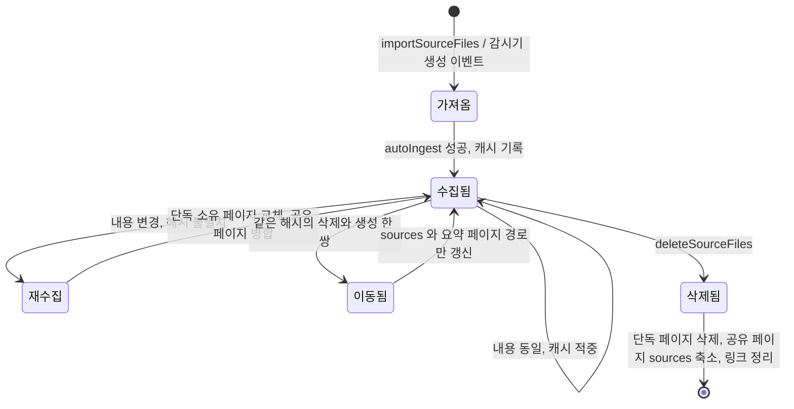

index, log, overview 같은 특수 파일의 갱신 규칙과 원본 이동 · 수정 · 삭제 시의 처리를 본다.

## 특수 파일: index, log, overview

llm-wiki.md 는 두 특수 파일을 이렇게 구분한다. index.md 는 내용 중심의 목록이고 수집 때마다 LLM 이 갱신한다. log.md 는 시간 순 기록이며 append-only 이고, `## [2026-04-02] ingest | Article Title` 처럼 일정한 접두를 쓰면 `grep "^## \[" log.md | tail -5` 로 최근 항목을 뽑을 수 있다고 제안한다([llm-wiki.md#L43-L49](https://github.com/nashsu/llm_wiki/blob/e08cfce65aad8b76b13546a081c1a8d4422b70c3/llm-wiki.md#L43-L49)). 구현은 log 는 이 제안을 따르고, index 는 LLM 대신 코드가 맡는다.

| 파일 | 생성 시 내용 | 수집 때 | 삭제 때 | 기타 |
|---|---|---|---|---|
| `wiki/index.md` | `# Wiki Index` + 타입별 빈 절 6개 | LLM 출력 금지, 코드가 `## Recently Updated` 에 최대 200줄 | 삭제된 대상의 목록 줄 제거 | 설정의 유지 관리 메뉴에서 전체 재생성 |
| `wiki/overview.md` | `type: overview` frontmatter + 안내 주석 | LLM 출력 금지, 코드가 표식 사이에 최근 50줄 | 삭제 대상 wikilink 를 평문으로 | |
| `wiki/log.md` | `# Research Log` + 생성일 절 | LLM 항목을 뒤에 덧붙임, 없으면 코드가 한 줄 | `## [날짜] delete \| 원본` 항목 추가 | 날짜는 코드가 덮어씀 |

### index.md

수집 경로의 index 갱신은 목록 전체를 다시 쓰지 않는다. 이번에 쓴 페이지 중 index 에 아직 wikilink 가 없는 것만 골라 `- [[경로]] — 제목` 줄을 `## Recently Updated` 절 맨 앞에 넣는다.

코드 분석: 최근 갱신 절을 교체하는 함수다. [src/lib/ingest.ts#L1807-L1821](https://github.com/nashsu/llm_wiki/blob/e08cfce65aad8b76b13546a081c1a8d4422b70c3/src/lib/ingest.ts#L1807-L1821)

```ts
export function updateBoundedRecentIndexSection(index: string, additions: string[]): string {
  const section = "## Recently Updated"
  const lines = index.trimEnd().split("\n")
  const start = lines.findIndex((line) => line.trim() === section)
  const prefix = start >= 0 ? lines.slice(0, start) : lines
  const sectionEnd = start >= 0
    ? lines.findIndex((line, position) => position > start && /^##\s+/.test(line))
    : -1
  const existing = start >= 0
    ? lines.slice(start + 1, sectionEnd >= 0 ? sectionEnd : undefined).filter((line) => /^-\s+/.test(line))
    : []
  const suffix = sectionEnd >= 0 ? lines.slice(sectionEnd) : []
  const recent = Array.from(new Set([...additions, ...existing])).slice(0, 200)
  return [...prefix, "", section, ...recent, ...(suffix.length ? ["", ...suffix] : []), ""].join("\n")
}
```

결과적으로 수집만 반복한 위키의 index 는 생성 때 만든 빈 타입 절(`## Entities` 등)과, 200줄로 잘리는 최근 목록 하나로 이뤄진다. 200줄을 넘어 밀려난 페이지는 index 에서 사라지지만, 다음 수집에서 다시 쓰이지 않는 한 돌아오지 않는다. 그래서 타입별 전체 목록이 필요하면 Rust `rebuild_wiki_index` 를 쓴다. 모든 `.md` 를 조회해 frontmatter `type` 으로 묶고 제목 순으로 `- [[경로|제목]]` 을 쓰며, 임시 파일에 쓴 뒤 이름을 바꿔 원자적으로 교체한다([project_maintenance.rs#L294-L350](https://github.com/nashsu/llm_wiki/blob/e08cfce65aad8b76b13546a081c1a8d4422b70c3/src-tauri/src/commands/project_maintenance.rs#L294-L350)).

index 가 커져도 프롬프트 비용은 고정된다. 수집 프롬프트는 index 를 최대 32,000자로 자르고 앞 60% 와 끝부분만 넣는다(4장). index 가 "LLM 이 질의 때 먼저 읽는 지도" 라는 llm-wiki.md 의 역할은 유지하되, 크기 상한을 둔 셈이다.

### log.md

log 는 이 앱에서 유일하게 LLM 이 쓴 내용을 덮어쓰지 않고 덧붙이는 파일이다. `isLogPath` 는 `wiki/log.md` 와 이름이 `log.md` 인 모든 경로를 log 로 본다.

코드 분석: LLM 이 쓴 log 항목의 날짜를 오늘로 바꾸는 함수다. [src/lib/ingest.ts#L2060-L2069](https://github.com/nashsu/llm_wiki/blob/e08cfce65aad8b76b13546a081c1a8d4422b70c3/src/lib/ingest.ts#L2060-L2069)

```ts
export function stampGeneratedLogDate(content: string, date: string): string {
  const normalized = content.replace(/\bYYYY-MM-DD\b/g, date)
  if (/^\s*##\s*\[?\d{4}-\d{2}-\d{2}\]?/m.test(normalized)) {
    return normalized.replace(
      /^(\s*##\s*\[?)\d{4}-\d{2}-\d{2}(\]?)/m,
      `$1${date}$2`,
    )
  }
  return normalized
}
```

LLM 이 형식 예시의 `YYYY-MM-DD` 를 그대로 베끼거나, 학습 시점의 날짜를 쓰는 경우를 모두 막는다. 첫 날짜 머리글만 바꾸므로 항목 하나에 여러 날짜가 있으면 첫 번째만 바뀐다.

log 머리글 형식은 코드 안에서 세 가지가 공존한다.

| 출처 | 형식 |
|---|---|
| 프로젝트 생성(`project.rs`) | `## 2026-11-13` 아래 `- Project created` |
| 템플릿 schema 의 Log Format 절 | `## YYYY-MM-DD` 아래 `- Action taken` |
| 수집 프롬프트 · 결정적 log · 삭제 log | `## [YYYY-MM-DD] ingest \| 제목`, `## [YYYY-MM-DD] delete \| 원본` |

llm-wiki.md 가 제안한 grep 가능한 접두는 세 번째 형식만 따른다. schema 는 LLM 이 읽는 규칙 문서인데 수집 프롬프트와 다른 형식을 안내하고 있어, LLM 이 둘 중 하나를 고르게 된다. 수집 프롬프트가 더 뒤에, 더 구체적으로 지시하므로 대개 세 번째 형식이 나올 것으로 보인다(추정).

### overview.md

overview 는 llm-wiki.md 의 "an overview, a synthesis" 에 해당한다. 코드는 `<!-- llm-wiki:recent-start -->` 와 `<!-- llm-wiki:recent-end -->` 사이만 관리하고 그 밖의 내용은 건드리지 않는다([ingest.ts#L1776-L1798](https://github.com/nashsu/llm_wiki/blob/e08cfce65aad8b76b13546a081c1a8d4422b70c3/src/lib/ingest.ts#L1776-L1798)). 표식이 없으면 파일 끝에 붙인다. 개요 문단 자체를 다시 쓰는 일은 수집 경로에 없다. README 의 "overview.md auto-update, global summary page regenerated on every ingest" 설명은 이 커밋에서는 "최근 갱신 목록 갱신" 으로 읽는 것이 맞다.

## 원본 수명주기: 이동, 수정, 삭제

llm-wiki.md 는 원본을 "immutable" 이라고 부른다. 그러나 실제 사용자는 원본 파일을 옮기고, 고치고, 지운다. `source-lifecycle.ts` 가 그 세 경우에 위키를 맞춰 준다.



### 이동

감시기가 같은 배치 안에서 삭제 하나와 생성 하나를 보고, 두 파일의 해시가 같고 크기가 32바이트 이상이면 이동으로 판정한다([project-file-sync.ts#L269-L312](https://github.com/nashsu/llm_wiki/blob/e08cfce65aad8b76b13546a081c1a8d4422b70c3/src/lib/project-file-sync.ts#L269-L312)). 이때 다시 수집하지 않고 `migrateSourcePath` 가 모든 위키 페이지의 `sources` 에서 옛 식별자를 새 식별자로 바꾸고, 요약 페이지를 새 slug 로 옮기고, 수집 캐시 항목의 키를 옮긴다([source-lifecycle.ts#L137-L233](https://github.com/nashsu/llm_wiki/blob/e08cfce65aad8b76b13546a081c1a8d4422b70c3/src/lib/source-lifecycle.ts#L137-L233)). 중간에 실패하면 이미 고친 파일을 원래 내용으로 되돌린다. 새 요약 경로에 이미 파일이 있으면 아예 시작하지 않는다.

### 수정

내용이 바뀐 원본은 해시가 달라 캐시를 지나 전체 수집을 다시 탄다(4장). 이 원본만을 출처로 가진 페이지는 본문이 교체되고, 다른 원본과 공유하는 페이지는 병합된다. 앞 절의 단독 소유 판정이 이 둘을 가른다.

### 삭제

코드 분석: 지워진 원본을 출처에서 빼고, 남는 출처가 없는 페이지만 삭제 목록에 넣는 부분이다. [src/lib/source-lifecycle.ts#L539-L556](https://github.com/nashsu/llm_wiki/blob/e08cfce65aad8b76b13546a081c1a8d4422b70c3/src/lib/source-lifecycle.ts#L539-L556)

```ts
    const survivors = sources.filter(
      (source) => !sourceNameMatchesAny(source, deletingIdentities, deletingNames),
    )
    if (survivors.length === sources.length) {
      continue
    }

    if (survivors.length === 0) {
      pagesToDelete.push(file.path)
    } else {
      try {
        await writeFile(file.path, writeSources(content, survivors))
        rewrittenSourcePages++
      } catch (err) {
        console.warn(`[source-lifecycle] failed to rewrite sources for ${file.path}:`, err)
      }
    }
```

`sources` 가 여러 개인 공유 개체 · 개념 페이지는 살아남고 출처 목록만 줄어든다. README 의 "Shared entity preservation" 이 이것이다. 식별자 비교는 경로 기준이며, 파일 이름만 적힌 예전 페이지에 한해 이름으로도 비교한다. 경로가 있는 `project-b/config.yaml` 이 다른 폴더의 `config.yaml` 삭제에 휩쓸리지 않게 하려는 구분이다([#L725-L741](https://github.com/nashsu/llm_wiki/blob/e08cfce65aad8b76b13546a081c1a8d4422b70c3/src/lib/source-lifecycle.ts#L725-L741)).

삭제 순서를 정리하면 다음과 같다.

1. 원본 파일 삭제(감시기가 이미 지운 경우 생략)
2. `.cache/<이름>.txt`, `.txt.parser`, `raw/parsed/` 사본, 수집 캐시 항목 삭제
3. 위 코드로 `sources` 축소 또는 삭제 목록 작성
4. `cascadeDeleteWikiPagesWithRefs` 로 페이지 · 임베딩 · 요약 페이지의 `wiki/media/<slug>/` 삭제와 참조 정리
5. `wiki/log.md` 에 `## [날짜] delete | 원본` 과 삭제 · 유지 페이지 수 기록

참조 정리는 `wiki-cleanup.ts` 의 문자열 함수가 맡는다. 비교 키는 대소문자를 무시하고 공백 · 하이픈 · 밑줄을 지운 값이라 `KV Cache`, `kv-cache`, `wiki/concepts/kv_cache.md` 가 모두 `kvcache` 가 된다([wiki-cleanup.ts#L49-L54](https://github.com/nashsu/llm_wiki/blob/e08cfce65aad8b76b13546a081c1a8d4422b70c3/src/lib/wiki-cleanup.ts#L49-L54)). index 에서는 첫 wikilink 가 삭제 대상인 목록 줄을 지우고, 모든 페이지 본문에서는 삭제 대상 wikilink 를 표시 글자만 남긴 평문으로 바꾸고, `related` 배열에서 뺀다([source-lifecycle.ts#L606-L663](https://github.com/nashsu/llm_wiki/blob/e08cfce65aad8b76b13546a081c1a8d4422b70c3/src/lib/source-lifecycle.ts#L606-L663)). 링크가 사라져도 문장은 읽히게 남기는 방식이다.

| 상황 | 페이지 처리 | 링크 처리 |
|---|---|---|
| 원본 하나만 출처인 페이지 | 삭제 | 다른 페이지의 링크를 평문으로, index 줄 삭제 |
| 여러 원본이 출처인 페이지 | `sources` 에서 지운 원본만 제거 | 그대로 |
| 요약 페이지 | 삭제, `wiki/media/<slug>/` 도 삭제 | 평문으로 |
| `sources` 가 없는 페이지(사용자 작성) | 건드리지 않음 | 그대로 |
