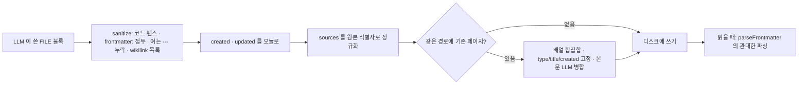
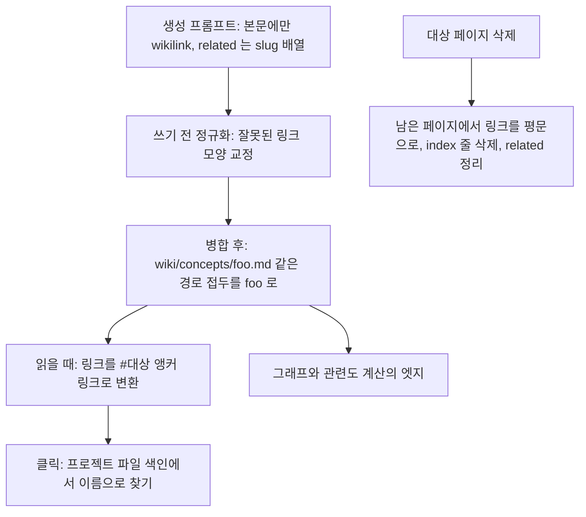
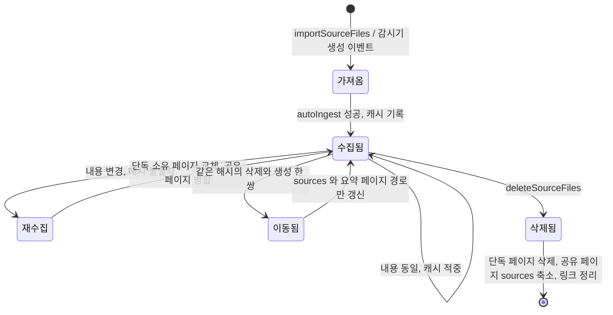

위키 페이지는 YAML frontmatter 와 Markdown 본문으로 된 평범한 `.md` 파일이고, 페이지끼리는 `[[wikilink]]` 로 이어진다. 이 장은 그 파일 형식을 코드가 어떻게 정의하고, LLM 이 망가뜨린 형식을 어떻게 고치고, 원본이 바뀌거나 지워질 때 페이지를 어떻게 따라 바꾸는지 본다. `index.md` · `log.md` · `overview.md` 같은 특수 파일과, 파일을 고치기 전 내용을 남기는 `file_history.rs` 도 함께 다룬다.

## 원본 아이디어의 세 층과 파일 배치

llm-wiki.md 는 시스템을 세 층으로 나눈다([llm-wiki.md#L25-L33](https://github.com/nashsu/llm_wiki/blob/e08cfce65aad8b76b13546a081c1a8d4422b70c3/llm-wiki.md#L25-L33)). 변하지 않는 원본(raw sources), LLM 이 쓰는 위키(the wiki), 위키 구조와 규칙을 적은 스키마(the schema)다. 팁 절에서는 "If your LLM adds YAML frontmatter to wiki pages (tags, dates, source counts), Dataview can generate dynamic tables" 라고 frontmatter 를 선택 사항으로 언급한다([#L61](https://github.com/nashsu/llm_wiki/blob/e08cfce65aad8b76b13546a081c1a8d4422b70c3/llm-wiki.md#L61)). LLM Wiki 는 이 선택 사항을 필수 계약으로 바꿨다. 수집 · 삭제 · 검색 · 그래프가 모두 frontmatter 의 `type` 과 `sources` 를 읽기 때문이다.

| 층 | 위치 | 누가 쓰나 | 코드가 보는 방식 |
|---|---|---|---|
| 원본 | `raw/sources/**` | 사용자(가져오기, 감시기) | 읽기 전용. 식별자는 `raw/sources/` 아래 상대 경로 |
| 위키 | `wiki/**/*.md` | LLM 과 코드 | frontmatter 로 타입 · 출처를 판정 |
| 스키마 | `schema.md`, `purpose.md` (프로젝트 루트) | 템플릿이 생성, 사용자가 수정 | 페이지 타입 표를 파싱해 폴더 라우팅에 사용 |
| 앱 상태 | `.llm-wiki/**` | 코드 | 캐시 · 큐 · 체크포인트 · 변경 이력. 위키 처리 대상에서 제외 |

프로젝트를 만들면 Rust `create_project` 가 기본 폴더(`raw/sources`, `raw/assets`, `wiki/entities`, `wiki/concepts`, `wiki/sources`, `wiki/queries`, `wiki/comparisons`, `wiki/synthesis`)와 `schema.md` · `purpose.md` · `wiki/index.md` · `wiki/log.md` · `wiki/overview.md` 를 만들고, Obsidian 설정 폴더도 함께 만든다([project.rs#L15-L197](https://github.com/nashsu/llm_wiki/blob/e08cfce65aad8b76b13546a081c1a8d4422b70c3/src-tauri/src/commands/project.rs#L15-L197)). 이어서 생성 대화상자가 고른 템플릿의 schema 와 purpose 로 두 파일을 덮어쓰고 템플릿 전용 폴더를 만든다.

> **주의**: 대화형 수집 경로 `executeIngestWrites` 는 `wiki/schema.md` 를 읽지만 프로젝트는 루트에 `schema.md` 를 만든다. `ingest.ts` 안에는 두 위치를 차례로 시도하는 fallback 이 없다. 이 차이는 4장 끝에서 다뤘다.

## 템플릿: `templates.ts`

템플릿은 schema 와 purpose 문자열, 추가 폴더 목록을 묶은 객체다. 다섯 개가 있고, 모두 공통 조각(기본 페이지 타입 표, 이름 규칙, frontmatter, index 형식, log 형식, 교차 참조 규칙, 모순 처리)을 이어 붙여 만든다.

코드 분석: 모든 템플릿이 공유하는 기본 페이지 타입 표다. [src/lib/templates.ts#L11-L17](https://github.com/nashsu/llm_wiki/blob/e08cfce65aad8b76b13546a081c1a8d4422b70c3/src/lib/templates.ts#L11-L17)

```ts
const BASE_SCHEMA_TYPES = `| entity | wiki/entities/ | Named things (people, tools, organizations, datasets) |
| concept | wiki/concepts/ | Ideas, techniques, phenomena, frameworks |
| source | wiki/sources/ | Papers, articles, talks, books, blog posts |
| query | wiki/queries/ | Open questions under active investigation |
| comparison | wiki/comparisons/ | Side-by-side analysis of related entities |
| synthesis | wiki/synthesis/ | Cross-cutting summaries and conclusions |
| overview | wiki/ | High-level project summary (one per project) |`
```

이 표는 사람이 읽는 설명이면서 동시에 기계가 읽는 설정이다. 아래의 schema 라우팅이 `## Page Types` 절의 표에서 첫 칸(타입)과 둘째 칸(폴더)을 뽑아 쓴다. 템플릿마다 표에 행을 더해 사용자 정의 타입을 만든다.

| 템플릿 id | 추가 폴더(`extraDirs`) | 성격 |
|---|---|---|
| `research` | `wiki/methodology`, `wiki/findings`, `wiki/thesis` | 가설 · 방법론 · 발견 추적 |
| `reading` | `wiki/characters`, `wiki/themes`, `wiki/plot-threads`, `wiki/chapters` | 책 읽기 동반 위키 |
| `personal` | `wiki/goals`, `wiki/habits`, `wiki/reflections`, `wiki/journal` | 목표 · 습관 · 회고 |
| `business` | `wiki/meetings`, `wiki/decisions`, `wiki/projects`, `wiki/stakeholders` | 회의 · 결정 · 이해관계자 |
| `general` | 없음 | 기본 타입만 |

템플릿 구성은 llm-wiki.md 의 활용 예(Personal, Research, Reading a book, Business/team)와 거의 일대일로 대응한다([llm-wiki.md#L17-L23](https://github.com/nashsu/llm_wiki/blob/e08cfce65aad8b76b13546a081c1a8d4422b70c3/llm-wiki.md#L17-L23)). 원본 문서가 "schema 는 사용자와 LLM 이 함께 발전시키는 문서" 라고 한 부분은, 템플릿이 첫 판을 만들고 사용자가 고치는 형태로 구현됐다.

`research` 템플릿은 thesis 페이지에 `confidence` · `status`, finding 페이지에 `source` · `confidence` · `replicated` 같은 추가 frontmatter 를 정의한다([templates.ts#L69-L186](https://github.com/nashsu/llm_wiki/blob/e08cfce65aad8b76b13546a081c1a8d4422b70c3/src/lib/templates.ts#L69-L186)). 코드는 이 추가 필드를 검사하지 않는다. LLM 이 schema 를 읽고 따르기를 기대할 뿐이다.

### schema 라우팅

수집할 때 LLM 이 개념 페이지를 `wiki/concepts/` 에 쓰라는 기본값과 schema 의 사용자 정의 폴더 사이에서 헷갈리는 경우가 생긴다. `wiki-schema.ts` 가 이것을 코드로 교정한다.

코드 분석: schema 의 페이지 타입 표를 읽는 부분이다. [src/lib/wiki-schema.ts#L32-L50](https://github.com/nashsu/llm_wiki/blob/e08cfce65aad8b76b13546a081c1a8d4422b70c3/src/lib/wiki-schema.ts#L32-L50)

```ts
export function parseWikiSchemaRouting(markdown: string): WikiSchemaRouting {
  const typeDirs: Record<string, string> = {}
  for (const line of pageTypesSectionLines(markdown)) {
    if (!line.trim().startsWith("|")) continue
    const cells = line
      .split("|")
      .slice(1, -1)
      .map((cell) => cell.trim())
    if (cells.length < 2) continue

    const [type, dir] = cells
    if (!/^[a-z][a-z0-9_-]*$/i.test(type)) continue
    if (!isSafeWikiDirectory(dir)) continue

    typeDirs[type] = stripTrailingSlash(dir)
  }

  return { typeDirs }
}
```

머리글 줄(`| Type | Directory |`)과 구분 줄(`|---|`)은 둘째 칸이 `wiki/` 로 시작하지 않아 `isSafeWikiDirectory` 에서 걸러진다. 그래서 표 형식만 맞으면 따로 파서 규칙 없이 타입 → 폴더 지도가 나온다. 수집의 `writeFileBlocks` 는 이 지도로 두 단계를 거친다. `correctWikiPageRouting` 이 frontmatter `type` 에 맞는 폴더로 경로를 옮기고("Auto-routed page type ..." 경고), `validateWikiPageRouting` 이 그래도 폴더와 타입이 어긋나면 블록을 버린다([wiki-schema.ts#L71-L122](https://github.com/nashsu/llm_wiki/blob/e08cfce65aad8b76b13546a081c1a8d4422b70c3/src/lib/wiki-schema.ts#L71-L122)). 즉 경로보다 `type` 필드가 우선이다.

## frontmatter 계약

수집 프롬프트가 요구하는 frontmatter 필드는 일곱 개다([ingest.ts#L2547-L2590](https://github.com/nashsu/llm_wiki/blob/e08cfce65aad8b76b13546a081c1a8d4422b70c3/src/lib/ingest.ts#L2547-L2590)). 각 필드를 코드의 어느 부분이 강제하는지가 이 장의 중심이다.

| 필드 | 형식 | 누가 정하나 | 강제하는 코드 |
|---|---|---|---|
| `type` | 알려진 타입 또는 schema 정의 타입 | LLM | schema 라우팅, 병합 시 기존 값 고정 |
| `title` | 문자열, 콜론이 있으면 따옴표 | LLM | 병합 시 기존 값 고정, 한중일 제목이면 파일 이름 결정 |
| `created` | `YYYY-MM-DD` | 코드 | `stampGeneratedFrontmatterDates`, 병합 시 기존 값 고정 |
| `updated` | `YYYY-MM-DD` | 코드 | 쓸 때마다 오늘 날짜 |
| `tags` | 인라인 배열 | LLM | 병합 시 합집합 |
| `related` | 대괄호 없는 slug 배열 | LLM | 병합 시 합집합, 삭제 시 정리 |
| `sources` | 원본 식별자 배열 | 코드가 보정 | `canonicalizeSourcesField`, 병합 시 합집합 |

알려진 타입은 `source`, `entity`, `concept`, `comparison`, `query`, `synthesis`, `thesis`, `methodology`, `finding` 의 아홉 개다([wiki-page-types.ts#L1-L11](https://github.com/nashsu/llm_wiki/blob/e08cfce65aad8b76b13546a081c1a8d4422b70c3/src/lib/wiki-page-types.ts#L1-L11)). 경로에서 타입을 추정할 때는 `standards`, `playbooks` 폴더도 인식하고, 그 밖의 `wiki/<폴더>/` 는 폴더 이름을 그대로 타입으로 쓴다([#L27-L39](https://github.com/nashsu/llm_wiki/blob/e08cfce65aad8b76b13546a081c1a8d4422b70c3/src/lib/wiki-page-types.ts#L27-L39)).



쓰기 쪽에서 엄격하게 정리하고, 읽기 쪽에서는 관대하게 받아들이는 구조다. 이미 디스크에 있는 오래된 파일은 쓰기 쪽 정리를 거치지 않았으므로 읽기 쪽이 그 몫을 한다.

### 읽기: `frontmatter.ts`

`parseFrontmatter` 는 두 단계로 frontmatter 블록을 찾는다. 먼저 파일 맨 앞의 `---` 쌍을 찾고, 없으면 파일 어디서든 첫 `---` 쌍을 찾되 여는 줄이 6번째 줄 이내일 때만 인정한다([frontmatter.ts#L22-L35](https://github.com/nashsu/llm_wiki/blob/e08cfce65aad8b76b13546a081c1a8d4422b70c3/src/lib/frontmatter.ts#L22-L35)). 본문 깊숙이 있는 수평선(`---`)을 frontmatter 로 오인하지 않으면서, LLM 이 앞에 ` ```yaml ` 같은 줄을 붙인 경우를 살리는 절충이다.

코드 분석: YAML 파싱을 두 번 시도하는 부분이다. [src/lib/frontmatter.ts#L49-L58](https://github.com/nashsu/llm_wiki/blob/e08cfce65aad8b76b13546a081c1a8d4422b70c3/src/lib/frontmatter.ts#L49-L58)

```ts
  let parsed: unknown
  try {
    parsed = yaml.load(yamlPayload, { schema: yaml.JSON_SCHEMA })
  } catch {
    try {
      parsed = yaml.load(repairWikilinkLists(yamlPayload), { schema: yaml.JSON_SCHEMA })
    } catch {
      return { frontmatter: null, body, rawBlock }
    }
  }
```

`yaml.JSON_SCHEMA` 를 쓰므로 `created: 2026-11-13` 은 Date 객체가 아니라 문자열로 남는다. 첫 시도가 실패하면 `related: [[a]], [[b]]` 처럼 유효하지 않은 YAML 한 가지만 `["[[a]]", "[[b]]"]` 로 고쳐 다시 시도한다. 그 밖의 오류는 "frontmatter 없음" 으로 돌려준다. 결과는 `Record<string, string | string[]>` 로 납작하게 만든다. 중첩 객체는 JSON 문자열로 바뀌어 UI 에 그대로 보인다([#L180-L204](https://github.com/nashsu/llm_wiki/blob/e08cfce65aad8b76b13546a081c1a8d4422b70c3/src/lib/frontmatter.ts#L180-L204)).

`rawBlock` 은 frontmatter 블록 원문이다. 본문만 고치는 기능은 `rawBlock + body` 로 다시 써서 사용자가 손댄 YAML 을 바이트 단위로 보존한다.

> **주의**: frontmatter 를 다루는 코드는 두 벌이다. 표시용 `frontmatter.ts` 는 js-yaml 로 파싱하고, 배열 필드 편집용 `sources-merge.ts` 는 정규식으로 인라인 `[a, b]` 와 블록 `- a` 두 형태만 읽고 쓴다([sources-merge.ts#L36-L63](https://github.com/nashsu/llm_wiki/blob/e08cfce65aad8b76b13546a081c1a8d4422b70c3/src/lib/sources-merge.ts#L36-L63)). 블록 형태는 쓸 때 인라인 형태로 바뀐다([#L114-L150](https://github.com/nashsu/llm_wiki/blob/e08cfce65aad8b76b13546a081c1a8d4422b70c3/src/lib/sources-merge.ts#L114-L150)). 정규식 쪽은 맨 앞 `---` 만 인식하므로, 읽기 쪽 fallback 으로만 읽히는 오래된 파일에서는 두 결과가 다를 수 있다(코드상 추정).

### 쓰기: `sanitizeIngestedFileContent`

주석에 따르면 한 실제 말뭉치의 엔터티 페이지 67개 중 30개가 엄격 파싱에 실패했고, 그 원인이 네 가지 모양으로 반복됐다([ingest-sanitize.ts#L1-L57](https://github.com/nashsu/llm_wiki/blob/e08cfce65aad8b76b13546a081c1a8d4422b70c3/src/lib/ingest-sanitize.ts#L1-L57)).

| 모양 | 예 | 고치는 함수 |
|---|---|---|
| 파일 전체를 코드 펜스로 감쌈 | ` ```yaml ` ... ` ``` ` | `stripOuterCodeFence` |
| `frontmatter:` 키를 앞에 붙임 | `frontmatter:` 다음 줄에 `---` | `stripFrontmatterKeyPrefix` |
| 여는 `---` 누락 | `type: entity` 로 시작해 `---` 로 닫음 | `addMissingOpeningFrontmatterFence` |
| 바깥 대괄호 없는 wikilink 목록 | `related: [[a]], [[b]]` | `repairWikilinkListsInFrontmatter` |

다섯 번째로 본문의 잘못된 wikilink 를 정규화한다(`normalizeMalformedWikilinks`). 코드 펜스, `$$` 수식 블록, `<pre>` · `<code>`, 들여쓰기 코드 블록, 인라인 코드는 건드리지 않는다([#L95-L140](https://github.com/nashsu/llm_wiki/blob/e08cfce65aad8b76b13546a081c1a8d4422b70c3/src/lib/ingest-sanitize.ts#L95-L140)). 각 패턴은 문서 맨 앞이나 frontmatter 범위에만 걸리도록 고정돼 있어, 본문의 정상적인 코드 블록은 바뀌지 않는다.

### 날짜와 `sources`

날짜는 LLM 에게 맡기지 않는다. 프롬프트에 오늘 날짜를 알려 주지만, 쓰기 직전에 `stampGeneratedFrontmatterDates` 가 `created` 와 `updated` 를 오늘로 덮어쓰거나 없으면 덧붙인다([ingest.ts#L2049-L2058](https://github.com/nashsu/llm_wiki/blob/e08cfce65aad8b76b13546a081c1a8d4422b70c3/src/lib/ingest.ts#L2049-L2058)). 기존 페이지라면 병합 단계가 `created` 를 원래 값으로 되돌린다. 날짜는 로컬 시간대 기준(`currentWikiDate`)이다.

`sources` 는 위키의 출처 추적 장치다. 원본 삭제, 그래프의 "같은 원본 공유" 가중치(7장), 단독 소유 판정이 모두 이 필드를 읽는다. 그래서 LLM 이 쓴 값을 그대로 믿지 않는다.

코드 분석: `sources` 를 원본 식별자 기준으로 고치는 함수다. [src/lib/ingest.ts#L1835-L1863](https://github.com/nashsu/llm_wiki/blob/e08cfce65aad8b76b13546a081c1a8d4422b70c3/src/lib/ingest.ts#L1835-L1863)

```ts
  const sourceValues = parseSources(content)
  const canonicalValues = sourceValues.filter((source) =>
    isValidSourceReference(source, sourceIdentity)
  ).map((source) => {
    const normalized = sourceReferenceIdentity(source)
    const key = normalized.toLowerCase()
    if (key === identityKey) return sourceIdentity
    if (!normalized.includes("/") && key === identityBaseName) return sourceIdentity
    return normalized
  })
  if (!canonicalValues.some((source) => normalizePath(source).toLowerCase() === identityKey)) {
    canonicalValues.push(sourceIdentity)
  }
```

절대 경로, `..`, `wiki/index.md` 같은 집계 파일, `.llm-wiki/` 아래 경로는 출처로 인정하지 않는다([#L1823-L1833](https://github.com/nashsu/llm_wiki/blob/e08cfce65aad8b76b13546a081c1a8d4422b70c3/src/lib/ingest.ts#L1823-L1833)). `raw/sources/a/b.pdf` 처럼 접두가 붙은 값은 `a/b.pdf` 로 줄이고, 파일 이름만 쓴 값이 현재 원본과 같으면 전체 식별자로 바꾼다. 현재 원본이 빠져 있으면 덧붙인다. 대소문자를 무시하고 중복을 없앤다.

## 원본 식별자와 요약 페이지 이름

원본 식별자는 `raw/sources/` 아래 상대 경로다. `raw/sources/papers/rope.pdf` 의 식별자는 `papers/rope.pdf` 다([source-identity.ts#L11-L28](https://github.com/nashsu/llm_wiki/blob/e08cfce65aad8b76b13546a081c1a8d4422b70c3/src/lib/source-identity.ts#L11-L28)). 파일 이름만 쓰지 않는 이유는 서로 다른 폴더의 `config.yaml` 두 개가 같은 출처로 섞이지 않게 하려는 것이다.

요약 페이지 경로 `wiki/sources/<slug>.md` 의 slug 는 식별자에서 계산한다.

| 식별자 | slug 규칙 |
|---|---|
| 폴더 없음 (`rope.pdf`) | 확장자를 뺀 이름 그대로 (`rope`) |
| 폴더 있음 (`papers/rope.pdf`) | 조각마다 `<길이>-<읽을 수 있는 이름>` 을 `--` 로 잇고 끝에 해시 (`6-papers--4-rope--<해시>`) |
| 120자 초과 | 읽을 수 있는 앞부분을 자르고 해시 유지 |
| UTF-8 252바이트 초과 | 바이트 기준으로 다시 자르고 `--<해시>` 유지 |

코드 근거는 [source-identity.ts#L42-L91](https://github.com/nashsu/llm_wiki/blob/e08cfce65aad8b76b13546a081c1a8d4422b70c3/src/lib/source-identity.ts#L42-L91) 이다. 읽을 수 있는 이름은 NFKC 정규화 후 문자 · 숫자 · 하이픈만 남긴다. 길이 접두와 해시는 `a-b/c` 와 `a/b-c` 처럼 이어 붙이면 같아지는 경로를 구분하기 위한 것이다(추정). 252바이트 제한은 대부분의 파일 시스템 이름 길이 한도(255바이트)에서 `.md` 를 뺀 값으로 보인다(추정).

slug 규칙은 여러 번 바뀌었고, 예전 규칙 세 가지가 `sourceSummarySlugCandidatesFromIdentity` 에 후보로 남아 있다. 수집 시작 시 `migrateLegacySourceSummaryIfSafe` 가 예전 이름의 요약 페이지를 찾아, 같은 원본을 가리킬 때만 새 이름으로 옮긴다([ingest.ts#L1865-L1977](https://github.com/nashsu/llm_wiki/blob/e08cfce65aad8b76b13546a081c1a8d4422b70c3/src/lib/ingest.ts#L1865-L1977)). 파일 이름만으로는 같은 원본인지 확신할 수 없으면 옮기지 않는다.

일반 페이지(개체 · 개념)의 파일 이름은 LLM 이 정한다. 출력 언어가 한중일이거나, 언어 설정이 `auto` 이고 제목에 한중일 문자가 있으면, 파일 이름에 한중일 문자가 없을 때 제목에서 다시 만든다(`rewriteIngestPathFromTitleForTargetLanguage`). 영어 slug 를 버리고 `makeQuerySlug(title)` 로 바꾼다. 로마자 변환이나 번역 대신 제목 글자를 그대로 쓴다([ingest.ts#L1664-L1698](https://github.com/nashsu/llm_wiki/blob/e08cfce65aad8b76b13546a081c1a8d4422b70c3/src/lib/ingest.ts#L1664-L1698), [wiki-filename.ts#L32-L48](https://github.com/nashsu/llm_wiki/blob/e08cfce65aad8b76b13546a081c1a8d4422b70c3/src/lib/wiki-filename.ts#L32-L48)).

## 같은 페이지를 다시 쓸 때: 병합

두 번째 원본이 이미 있는 개념 페이지를 다시 생성하면, 새 내용으로 덮어쓰지 않고 병합한다. llm-wiki.md 의 "The wiki keeps getting richer with every source you add" 를 코드로 지키는 부분이다([llm-wiki.md#L13](https://github.com/nashsu/llm_wiki/blob/e08cfce65aad8b76b13546a081c1a8d4422b70c3/llm-wiki.md#L13)).

코드 분석: 병합의 고정 규칙 세 가지다. [src/lib/page-merge.ts#L31-L54](https://github.com/nashsu/llm_wiki/blob/e08cfce65aad8b76b13546a081c1a8d4422b70c3/src/lib/page-merge.ts#L31-L54)

```ts
const UNION_FIELDS = ["sources", "tags", "related"] as const
// ...
const LOCKED_FIELDS = ["type", "title", "created"] as const
// ...
const BODY_SHRINK_THRESHOLD = 0.7
```

`mergePageContent` 의 순서는 다음과 같다([page-merge.ts#L96-L215](https://github.com/nashsu/llm_wiki/blob/e08cfce65aad8b76b13546a081c1a8d4422b70c3/src/lib/page-merge.ts#L96-L215)).

1. 기존 페이지가 없거나 내용이 같으면 그대로 쓴다.
2. 배열 필드(`sources` · `tags` · `related`)를 대소문자 무시 합집합으로 합친다. 본문이 같으면 여기서 끝낸다.
3. 기존 페이지의 `sources` 가 전부 현재 원본이면(단독 소유) 본문을 새 것으로 교체한다. 원본을 고쳐 다시 수집했을 때 철회된 문장이 병합으로 계속 살아남는 문제를 막는다([ingest.ts#L2267-L2275](https://github.com/nashsu/llm_wiki/blob/e08cfce65aad8b76b13546a081c1a8d4422b70c3/src/lib/ingest.ts#L2267-L2275)).
4. 그 밖에는 LLM 병합을 부른다. 병합 프롬프트는 두 입력을 "버전" 이 아닌 "같은 페이지의 출처별 자료" 로 부르고, 모든 사실을 보존하되 비교 대상의 주장을 주 대상의 주장으로 섞지 말라고 요구한다([ingest.ts#L3454-L3480](https://github.com/nashsu/llm_wiki/blob/e08cfce65aad8b76b13546a081c1a8d4422b70c3/src/lib/ingest.ts#L3454-L3480)).
5. 병합 결과에 frontmatter 가 없거나, 본문이 두 입력 중 긴 쪽의 70% 보다 짧으면 버린다. 이때와 LLM 호출 실패 때는 기존 페이지를 `.llm-wiki/page-history/` 에 백업하고 "새 본문 + 배열 합집합" 으로 쓴다.
6. 통과하면 `type` · `title` · `created` 를 기존 값으로 되돌리고, 배열 필드를 다시 합집합하고, `updated` 를 오늘로 찍는다. 본문 wikilink 의 경로 접두를 떼고 잘못된 wikilink 를 정규화한다.

`title` 을 고정하는 이유는 주석에 적혀 있다. 사용자가 기억하는 제목과 본문에서 제목을 그대로 인용한 문장이 조용히 어긋나는 것을 막기 위해서다. 병합 뒤에 `canonicalizeSourcesField` 를 한 번 더 부르는 것도 같은 이유다. 합집합은 디스크에 이미 있던 잘못된 출처 값까지 되살리기 때문이다.

## 위키링크의 생애

wikilink 는 Obsidian 문법 `[[대상]]` · `[[대상|표시 글자]]` 를 그대로 쓴다. llm-wiki.md 가 Obsidian 을 옆에 띄워 두고 쓰는 방식을 전제로 하므로, 앱 밖 Obsidian 에서도 같은 파일이 열리게 한 선택이다. 대상은 경로가 아니라 파일 이름(slug)이 기준이다.



### 렌더링과 이동

Markdown 렌더러는 `[[...]]` 를 모르므로 `transformWikilinks` 가 `[표시 글자](#인코딩된-대상)` 로 바꾼다. 펜스 코드 블록과 인라인 코드는 건너뛴다. 이미지 embed `![[x.png]]` 는 먼저 `transformImageEmbeds` 가 일반 이미지 문법으로 바꿔야 한다. 순서가 바뀌면 이미지가 앵커 링크가 된다([wikilink-transform.ts#L40-L117](https://github.com/nashsu/llm_wiki/blob/e08cfce65aad8b76b13546a081c1a8d4422b70c3/src/lib/wikilink-transform.ts#L40-L117)).

`#` 앵커를 쓰는 이유는 Tauri 웹뷰가 링크를 외부 주소로 열려고 하지 않게 하려는 것이다. 클릭은 `wiki-reader.tsx` 가 가로채 `resolveRelatedSlug` 로 실제 파일을 찾는다([wiki-reader.tsx#L91-L103](https://github.com/nashsu/llm_wiki/blob/e08cfce65aad8b76b13546a081c1a8d4422b70c3/src/components/editor/wiki-reader.tsx#L91-L103)).

코드 분석: wikilink 대상을 파일로 풀어내는 규칙이다. [src/lib/wiki-page-resolver.ts#L136-L155](https://github.com/nashsu/llm_wiki/blob/e08cfce65aad8b76b13546a081c1a8d4422b70c3/src/lib/wiki-page-resolver.ts#L136-L155)

```ts
  // Path-like refs can be project-relative (`wiki/concepts/foo`) or
  // wiki-root-relative (`concepts/foo`). Index generation uses the latter.
  if (normalizedRef.includes("/")) {
    const projectRoot = normalizedWikiRoot.replace(/\/wiki$/, "")
    const withExtension = normalizedRef.endsWith(".md") ? normalizedRef : `${normalizedRef}.md`
    const target = withExtension.startsWith("wiki/")
      ? `${projectRoot}/${withExtension}`
      : `${normalizedWikiRoot}/${withExtension}`
    const found = findInTreeByPath(index, target)
    return found && found.replace(/\\/g, "/").startsWith(`${normalizedWikiRoot}/`) ? found : null
  }

  const filename = normalizedRef.endsWith(".md") ? normalizedRef : `${normalizedRef}.md`
  return findInTreeByName(index, filename, `${normalizedWikiRoot}/`)
```

경로가 있으면 경로로, 없으면 `wiki/` 아래에서 같은 파일 이름을 찾는다. 이름으로 찾을 때는 색인에 먼저 등록된 파일이 이긴다([#L97-L106](https://github.com/nashsu/llm_wiki/blob/e08cfce65aad8b76b13546a081c1a8d4422b70c3/src/lib/wiki-page-resolver.ts#L97-L106)). 다른 폴더에 같은 이름의 페이지가 둘 있으면 어느 쪽으로 갈지는 파일 트리 순서에 달린다. 절대 경로, `..`, 제어 문자는 거부하고, 결과가 `wiki/` 밖이면 버린다. `raw/sources/` 의 같은 이름 파일이 잡히지 않게 하려는 것이다.

### wikilink 보강: `enrich-wikilinks.ts`

저장한 페이지에 LLM 으로 wikilink 를 더하는 모듈도 있다. 주석에 설계 변경 이유가 적혀 있다. 처음에는 페이지 전체를 돌려받았는데, 중간 크기 모델이 이를 "다시 써도 된다" 로 받아들여 사용자 내용을 바꿔 버렸다. 그래서 LLM 은 `{ "links": [{ "term", "target" }] }` JSON 만 돌려주고 치환은 코드가 한다.

코드 분석: 치환을 코드가 직접 하는 부분이다. [src/lib/enrich-wikilinks.ts#L213-L239](https://github.com/nashsu/llm_wiki/blob/e08cfce65aad8b76b13546a081c1a8d4422b70c3/src/lib/enrich-wikilinks.ts#L213-L239)

```ts
  const fmEnd = content.startsWith("---\n") ? content.indexOf("\n---\n", 3) : -1
  const frontmatter = fmEnd > 0 ? content.slice(0, fmEnd + 5) : ""
  let body = fmEnd > 0 ? content.slice(fmEnd + 5) : content

  // Track what we've already linked so we don't double-link
  const linkedTargets = new Set<string>()

  for (const { term, target } of links) {
    if (linkedTargets.has(target.toLowerCase())) continue
    if (!term || !target) continue

    // Find first literal occurrence NOT already inside a [[...]] block
    const idx = findUnlinkedOccurrence(body, term)
    if (idx === -1) continue

    const displayEqualsTarget = term.toLowerCase() === target.toLowerCase()
    const replacement = displayEqualsTarget
      ? `[[${term}]]`
      : `[[${target}|${term}]]`
    body = body.slice(0, idx) + replacement + body.slice(idx + term.length)
```

본문은 `[[` · `]]` (그리고 필요하면 `대상|`) 가 끼어드는 것 외에는 바이트 단위로 같다. 대상은 프롬프트에 준 index 가 아니라 실제 `wiki/` 파일 목록으로 다시 확인하고, 대소문자 · 유니코드 정규화 후 같은 이름이 둘 이상이면 링크하지 않는다([#L93-L105](https://github.com/nashsu/llm_wiki/blob/e08cfce65aad8b76b13546a081c1a8d4422b70c3/src/lib/enrich-wikilinks.ts#L93-L105), [#L121-L147](https://github.com/nashsu/llm_wiki/blob/e08cfce65aad8b76b13546a081c1a8d4422b70c3/src/lib/enrich-wikilinks.ts#L121-L147)).

> **주의**: 이 커밋에서 `enrichWithWikilinks` 를 부르는 곳은 테스트 파일뿐이다. 앱 화면이나 수집 경로에서는 호출되지 않는다. 남아 있는 모듈이지만 현재 동작에는 영향이 없다.

## 특수 파일: index, log, overview

llm-wiki.md 는 두 특수 파일을 이렇게 구분한다. index.md 는 내용 중심의 목록이고 수집 때마다 LLM 이 갱신한다. log.md 는 시간 순 기록이며 append-only 이고, `## [2026-04-02] ingest | Article Title` 처럼 일정한 접두를 쓰면 `grep "^## \[" log.md | tail -5` 로 최근 항목을 뽑을 수 있다고 제안한다([llm-wiki.md#L43-L49](https://github.com/nashsu/llm_wiki/blob/e08cfce65aad8b76b13546a081c1a8d4422b70c3/llm-wiki.md#L43-L49)). 구현은 log 는 이 제안을 따르고, index 는 LLM 대신 코드가 맡는다.

| 파일 | 생성 시 내용 | 수집 때 | 삭제 때 | 기타 |
|---|---|---|---|---|
| `wiki/index.md` | `# Wiki Index` + 타입별 빈 절 6개 | LLM 출력 금지, 코드가 `## Recently Updated` 에 최대 200줄 | 삭제된 대상의 목록 줄 제거 | 설정의 유지 관리 메뉴에서 전체 재생성 |
| `wiki/overview.md` | `type: overview` frontmatter + 안내 주석 | LLM 출력 금지, 코드가 표식 사이에 최근 50줄 | 삭제 대상 wikilink 를 평문으로 | |
| `wiki/log.md` | `# Research Log` + 생성일 절 | LLM 항목을 뒤에 덧붙임, 없으면 코드가 한 줄 | `## [날짜] delete \| 원본` 항목 추가 | 날짜는 코드가 덮어씀 |

### index.md

수집 경로의 index 갱신은 목록 전체를 다시 쓰지 않는다. 이번에 쓴 페이지 중 index 에 아직 wikilink 가 없는 것만 골라 `- [[경로]] — 제목` 줄을 `## Recently Updated` 절 맨 앞에 넣는다.

코드 분석: 최근 갱신 절을 교체하는 함수다. [src/lib/ingest.ts#L1807-L1821](https://github.com/nashsu/llm_wiki/blob/e08cfce65aad8b76b13546a081c1a8d4422b70c3/src/lib/ingest.ts#L1807-L1821)

```ts
export function updateBoundedRecentIndexSection(index: string, additions: string[]): string {
  const section = "## Recently Updated"
  const lines = index.trimEnd().split("\n")
  const start = lines.findIndex((line) => line.trim() === section)
  const prefix = start >= 0 ? lines.slice(0, start) : lines
  const sectionEnd = start >= 0
    ? lines.findIndex((line, position) => position > start && /^##\s+/.test(line))
    : -1
  const existing = start >= 0
    ? lines.slice(start + 1, sectionEnd >= 0 ? sectionEnd : undefined).filter((line) => /^-\s+/.test(line))
    : []
  const suffix = sectionEnd >= 0 ? lines.slice(sectionEnd) : []
  const recent = Array.from(new Set([...additions, ...existing])).slice(0, 200)
  return [...prefix, "", section, ...recent, ...(suffix.length ? ["", ...suffix] : []), ""].join("\n")
}
```

결과적으로 수집만 반복한 위키의 index 는 생성 때 만든 빈 타입 절(`## Entities` 등)과, 200줄로 잘리는 최근 목록 하나로 이뤄진다. 200줄을 넘어 밀려난 페이지는 index 에서 사라지지만, 다음 수집에서 다시 쓰이지 않는 한 돌아오지 않는다. 그래서 타입별 전체 목록이 필요하면 Rust `rebuild_wiki_index` 를 쓴다. 모든 `.md` 를 조회해 frontmatter `type` 으로 묶고 제목 순으로 `- [[경로|제목]]` 을 쓰며, 임시 파일에 쓴 뒤 이름을 바꿔 원자적으로 교체한다([project_maintenance.rs#L294-L350](https://github.com/nashsu/llm_wiki/blob/e08cfce65aad8b76b13546a081c1a8d4422b70c3/src-tauri/src/commands/project_maintenance.rs#L294-L350)).

index 가 커져도 프롬프트 비용은 고정된다. 수집 프롬프트는 index 를 최대 32,000자로 자르고 앞 60% 와 끝부분만 넣는다(4장). index 가 "LLM 이 질의 때 먼저 읽는 지도" 라는 llm-wiki.md 의 역할은 유지하되, 크기 상한을 둔 셈이다.

### log.md

log 는 이 앱에서 유일하게 LLM 이 쓴 내용을 덮어쓰지 않고 덧붙이는 파일이다. `isLogPath` 는 `wiki/log.md` 와 이름이 `log.md` 인 모든 경로를 log 로 본다.

코드 분석: LLM 이 쓴 log 항목의 날짜를 오늘로 바꾸는 함수다. [src/lib/ingest.ts#L2060-L2069](https://github.com/nashsu/llm_wiki/blob/e08cfce65aad8b76b13546a081c1a8d4422b70c3/src/lib/ingest.ts#L2060-L2069)

```ts
export function stampGeneratedLogDate(content: string, date: string): string {
  const normalized = content.replace(/\bYYYY-MM-DD\b/g, date)
  if (/^\s*##\s*\[?\d{4}-\d{2}-\d{2}\]?/m.test(normalized)) {
    return normalized.replace(
      /^(\s*##\s*\[?)\d{4}-\d{2}-\d{2}(\]?)/m,
      `$1${date}$2`,
    )
  }
  return normalized
}
```

LLM 이 형식 예시의 `YYYY-MM-DD` 를 그대로 베끼거나, 학습 시점의 날짜를 쓰는 경우를 모두 막는다. 첫 날짜 머리글만 바꾸므로 항목 하나에 여러 날짜가 있으면 첫 번째만 바뀐다.

log 머리글 형식은 코드 안에서 세 가지가 공존한다.

| 출처 | 형식 |
|---|---|
| 프로젝트 생성(`project.rs`) | `## 2026-11-13` 아래 `- Project created` |
| 템플릿 schema 의 Log Format 절 | `## YYYY-MM-DD` 아래 `- Action taken` |
| 수집 프롬프트 · 결정적 log · 삭제 log | `## [YYYY-MM-DD] ingest \| 제목`, `## [YYYY-MM-DD] delete \| 원본` |

llm-wiki.md 가 제안한 grep 가능한 접두는 세 번째 형식만 따른다. schema 는 LLM 이 읽는 규칙 문서인데 수집 프롬프트와 다른 형식을 안내하고 있어, LLM 이 둘 중 하나를 고르게 된다. 수집 프롬프트가 더 뒤에, 더 구체적으로 지시하므로 대개 세 번째 형식이 나올 것으로 보인다(추정).

### overview.md

overview 는 llm-wiki.md 의 "an overview, a synthesis" 에 해당한다. 코드는 `<!-- llm-wiki:recent-start -->` 와 `<!-- llm-wiki:recent-end -->` 사이만 관리하고 그 밖의 내용은 건드리지 않는다([ingest.ts#L1776-L1798](https://github.com/nashsu/llm_wiki/blob/e08cfce65aad8b76b13546a081c1a8d4422b70c3/src/lib/ingest.ts#L1776-L1798)). 표식이 없으면 파일 끝에 붙인다. 개요 문단 자체를 다시 쓰는 일은 수집 경로에 없다. README 의 "overview.md auto-update, global summary page regenerated on every ingest" 설명은 이 커밋에서는 "최근 갱신 목록 갱신" 으로 읽는 것이 맞다.

## 원본 수명주기: 이동, 수정, 삭제

llm-wiki.md 는 원본을 "immutable" 이라고 부른다. 그러나 실제 사용자는 원본 파일을 옮기고, 고치고, 지운다. `source-lifecycle.ts` 가 그 세 경우에 위키를 맞춰 준다.



### 이동

감시기가 같은 배치 안에서 삭제 하나와 생성 하나를 보고, 두 파일의 해시가 같고 크기가 32바이트 이상이면 이동으로 판정한다([project-file-sync.ts#L269-L312](https://github.com/nashsu/llm_wiki/blob/e08cfce65aad8b76b13546a081c1a8d4422b70c3/src/lib/project-file-sync.ts#L269-L312)). 이때 다시 수집하지 않고 `migrateSourcePath` 가 모든 위키 페이지의 `sources` 에서 옛 식별자를 새 식별자로 바꾸고, 요약 페이지를 새 slug 로 옮기고, 수집 캐시 항목의 키를 옮긴다([source-lifecycle.ts#L137-L233](https://github.com/nashsu/llm_wiki/blob/e08cfce65aad8b76b13546a081c1a8d4422b70c3/src/lib/source-lifecycle.ts#L137-L233)). 중간에 실패하면 이미 고친 파일을 원래 내용으로 되돌린다. 새 요약 경로에 이미 파일이 있으면 아예 시작하지 않는다.

### 수정

내용이 바뀐 원본은 해시가 달라 캐시를 지나 전체 수집을 다시 탄다(4장). 이 원본만을 출처로 가진 페이지는 본문이 교체되고, 다른 원본과 공유하는 페이지는 병합된다. 앞 절의 단독 소유 판정이 이 둘을 가른다.

### 삭제

코드 분석: 지워진 원본을 출처에서 빼고, 남는 출처가 없는 페이지만 삭제 목록에 넣는 부분이다. [src/lib/source-lifecycle.ts#L539-L556](https://github.com/nashsu/llm_wiki/blob/e08cfce65aad8b76b13546a081c1a8d4422b70c3/src/lib/source-lifecycle.ts#L539-L556)

```ts
    const survivors = sources.filter(
      (source) => !sourceNameMatchesAny(source, deletingIdentities, deletingNames),
    )
    if (survivors.length === sources.length) {
      continue
    }

    if (survivors.length === 0) {
      pagesToDelete.push(file.path)
    } else {
      try {
        await writeFile(file.path, writeSources(content, survivors))
        rewrittenSourcePages++
      } catch (err) {
        console.warn(`[source-lifecycle] failed to rewrite sources for ${file.path}:`, err)
      }
    }
```

`sources` 가 여러 개인 공유 개체 · 개념 페이지는 살아남고 출처 목록만 줄어든다. README 의 "Shared entity preservation" 이 이것이다. 식별자 비교는 경로 기준이며, 파일 이름만 적힌 예전 페이지에 한해 이름으로도 비교한다. 경로가 있는 `project-b/config.yaml` 이 다른 폴더의 `config.yaml` 삭제에 휩쓸리지 않게 하려는 구분이다([#L725-L741](https://github.com/nashsu/llm_wiki/blob/e08cfce65aad8b76b13546a081c1a8d4422b70c3/src/lib/source-lifecycle.ts#L725-L741)).

삭제 순서를 정리하면 다음과 같다.

1. 원본 파일 삭제(감시기가 이미 지운 경우 생략)
2. `.cache/<이름>.txt`, `.txt.parser`, `raw/parsed/` 사본, 수집 캐시 항목 삭제
3. 위 코드로 `sources` 축소 또는 삭제 목록 작성
4. `cascadeDeleteWikiPagesWithRefs` 로 페이지 · 임베딩 · 요약 페이지의 `wiki/media/<slug>/` 삭제와 참조 정리
5. `wiki/log.md` 에 `## [날짜] delete | 원본` 과 삭제 · 유지 페이지 수 기록

참조 정리는 `wiki-cleanup.ts` 의 문자열 함수가 맡는다. 비교 키는 대소문자를 무시하고 공백 · 하이픈 · 밑줄을 지운 값이라 `KV Cache`, `kv-cache`, `wiki/concepts/kv_cache.md` 가 모두 `kvcache` 가 된다([wiki-cleanup.ts#L49-L54](https://github.com/nashsu/llm_wiki/blob/e08cfce65aad8b76b13546a081c1a8d4422b70c3/src/lib/wiki-cleanup.ts#L49-L54)). index 에서는 첫 wikilink 가 삭제 대상인 목록 줄을 지우고, 모든 페이지 본문에서는 삭제 대상 wikilink 를 표시 글자만 남긴 평문으로 바꾸고, `related` 배열에서 뺀다([source-lifecycle.ts#L606-L663](https://github.com/nashsu/llm_wiki/blob/e08cfce65aad8b76b13546a081c1a8d4422b70c3/src/lib/source-lifecycle.ts#L606-L663)). 링크가 사라져도 문장은 읽히게 남기는 방식이다.

| 상황 | 페이지 처리 | 링크 처리 |
|---|---|---|
| 원본 하나만 출처인 페이지 | 삭제 | 다른 페이지의 링크를 평문으로, index 줄 삭제 |
| 여러 원본이 출처인 페이지 | `sources` 에서 지운 원본만 제거 | 그대로 |
| 요약 페이지 | 삭제, `wiki/media/<slug>/` 도 삭제 | 평문으로 |
| `sources` 가 없는 페이지(사용자 작성) | 건드리지 않음 | 그대로 |

## 변경 이력: `file_history.rs`

LLM 이 위키를 고치는 앱에서는 "무엇이 바뀌었나" 를 되돌릴 방법이 필요하다. llm-wiki.md 는 "The wiki is just a git repo of markdown files" 라며 git 에 맡긴다([llm-wiki.md#L62](https://github.com/nashsu/llm_wiki/blob/e08cfce65aad8b76b13546a081c1a8d4422b70c3/llm-wiki.md#L62)). LLM Wiki 는 git 을 요구하지 않고, 파일 쓰기 명령 안에 작은 버전 저장소를 넣었다.

코드 분석: Rust `write_file` 이 쓰기 전후로 버전을 남기는 부분이다. [src-tauri/src/commands/fs.rs#L1252-L1261](https://github.com/nashsu/llm_wiki/blob/e08cfce65aad8b76b13546a081c1a8d4422b70c3/src-tauri/src/commands/fs.rs#L1252-L1261)

```rust
            file_sync::mark_app_write_path(p);
            crate::commands::file_history::record_file_version(
                p,
                "baseline",
                "before.ui.write_file",
            );
            fs::write(&path, contents)
                .map_err(|e| format!("Failed to write file '{}': {}", path, e))?;
            crate::commands::file_history::record_file_version(p, "human", "ui.write_file");
            file_sync::mark_app_write_path(p);
```

쓰기 직전 내용을 `baseline` 으로, 쓴 뒤 내용을 다시 기록한다. 직전 기록과 내용이 같으면 새 항목을 만들지 않으므로, 앱이 연속으로 쓴 파일은 버전이 하나씩만 늘어난다([file_history.rs#L234-L290](https://github.com/nashsu/llm_wiki/blob/e08cfce65aad8b76b13546a081c1a8d4422b70c3/src-tauri/src/commands/file_history.rs#L234-L290)). 에이전트 도구(11장)는 `author: "agent"`, `tool: "wiki.write_page"` 처럼 다른 꼬리표로 같은 함수를 부른다.

| 항목 | 값 | 근거 |
|---|---|---|
| 기본 상태 | 꺼짐(`enabled: false`) | [#L42-L49](https://github.com/nashsu/llm_wiki/blob/e08cfce65aad8b76b13546a081c1a8d4422b70c3/src-tauri/src/commands/file_history.rs#L42-L49) |
| 파일당 버전 수 | 기본 10, 최대 30 | [#L10-L11](https://github.com/nashsu/llm_wiki/blob/e08cfce65aad8b76b13546a081c1a8d4422b70c3/src-tauri/src/commands/file_history.rs#L10-L11) |
| 기록 대상 파일 크기 | 512 KB 이하 | [#L9](https://github.com/nashsu/llm_wiki/blob/e08cfce65aad8b76b13546a081c1a8d4422b70c3/src-tauri/src/commands/file_history.rs#L9) |
| 저장소 전체 | 128 MB, 파일 2,048개까지, 넘으면 오래된 것부터 삭제 | [#L12-L13](https://github.com/nashsu/llm_wiki/blob/e08cfce65aad8b76b13546a081c1a8d4422b70c3/src-tauri/src/commands/file_history.rs#L12-L13), [#L189-L205](https://github.com/nashsu/llm_wiki/blob/e08cfce65aad8b76b13546a081c1a8d4422b70c3/src-tauri/src/commands/file_history.rs#L189-L205) |
| 저장 위치 | `.llm-wiki/history/<경로의 FNV-1a 해시>.json` | [#L112-L122](https://github.com/nashsu/llm_wiki/blob/e08cfce65aad8b76b13546a081c1a8d4422b70c3/src-tauri/src/commands/file_history.rs#L112-L122) |
| 설정 위치 | `.llm-wiki/history-settings.json` | [#L58-L60](https://github.com/nashsu/llm_wiki/blob/e08cfce65aad8b76b13546a081c1a8d4422b70c3/src-tauri/src/commands/file_history.rs#L58-L60) |
| 제외 | `.llm-wiki/` 아래 파일 | [#L238-L240](https://github.com/nashsu/llm_wiki/blob/e08cfce65aad8b76b13546a081c1a8d4422b70c3/src-tauri/src/commands/file_history.rs#L238-L240) |

프로젝트 루트는 경로를 거슬러 올라가며 `.llm-wiki` 폴더가 있는 첫 디렉터리로 정한다. 심볼릭 링크인 `.llm-wiki` 는 인정하지 않는다([#L98-L110](https://github.com/nashsu/llm_wiki/blob/e08cfce65aad8b76b13546a081c1a8d4422b70c3/src-tauri/src/commands/file_history.rs#L98-L110)). 해시 키로 FNV-1a 를 직접 구현한 이유는 주석에 "Rust 툴체인이 바뀌어도 주소가 같게" 라고 적혀 있다. 표준 라이브러리 해시는 버전 간 안정성을 보장하지 않기 때문이다.

복원(`restore_file_history`)은 현재 내용이 고르려는 버전과 다르면 먼저 현재 내용을 `before.history.restore` 로 기록한 뒤 덮어쓴다([#L379-L434](https://github.com/nashsu/llm_wiki/blob/e08cfce65aad8b76b13546a081c1a8d4422b70c3/src-tauri/src/commands/file_history.rs#L379-L434)). 복원 자체도 되돌릴 수 있다. 현재 파일이 512 KB 를 넘으면 백업을 남길 수 없어 복원을 거부한다.

> **주의**: 프론트의 `writeFile` 은 모두 Rust `write_file` 하나로 간다([commands/fs.ts#L22-L25](https://github.com/nashsu/llm_wiki/blob/e08cfce65aad8b76b13546a081c1a8d4422b70c3/src/commands/fs.ts#L22-L25)). 그래서 수집 파이프라인이 LLM 출력으로 쓴 페이지도 이력에는 `author: "human"`, `tool: "ui.write_file"` 로 남는다. 이력의 author 칸만으로 사람 편집과 수집 결과를 구분할 수는 없다.

수집의 병합 대체 경로가 남기는 `.llm-wiki/page-history/<경로>-<시각>` 백업은 이 저장소와 별개다. 그쪽은 설정과 무관하게 병합이 실패할 때만 쓰이고, 개수나 크기 제한이 없다(코드상 정리 루틴을 찾지 못함, 미검증).

## 앱 변경 기록: `changelog.ts`

이름이 비슷하지만 `changelog.ts` 는 위키 페이지가 아니라 앱 자체의 릴리스 기록이다. 설정 화면의 Changelog 절이 그대로 렌더한다. 주석은 GitHub Releases 를 받아오지 않고 코드에 넣은 이유를 "오프라인에서도 보이고 코드와 함께 버전 관리되도록" 이라고 적는다([changelog.ts#L1-L16](https://github.com/nashsu/llm_wiki/blob/e08cfce65aad8b76b13546a081c1a8d4422b70c3/src/lib/changelog.ts#L1-L16)).

| 항목 | 내용 |
|---|---|
| 형식 | `{ version, date, highlights: { en, zh, it?, ru? } }` |
| 순서 | 최신 버전이 배열 맨 앞 |
| 범위 | 이 커밋 기준 41개 항목, 0.4.0 부터 0.6.13(2026-10-21)까지 |
| 규칙 | 사용자에게 보이는 변경만, 내부 리팩터링과 테스트는 커밋 메시지로 |

위키 쪽 `log.md` 와 비교하면 쓰임이 분명히 갈린다. `log.md` 는 위키에 무슨 일이 있었는지(수집 · 삭제)를 기록하고, `changelog.ts` 는 앱이 어떻게 바뀌었는지를 기록한다. 이 장과 관련된 항목도 보인다. 0.6.12 에는 "malformed generated wikilinks, page-merge scaffolding" 수정이 있고([#L78](https://github.com/nashsu/llm_wiki/blob/e08cfce65aad8b76b13546a081c1a8d4422b70c3/src/lib/changelog.ts#L78)), 더 이전 항목에는 원본을 앱 밖에서 지웠을 때 index · wikilink · `related` 를 일관되게 정리한다는 설명이 있다([#L638](https://github.com/nashsu/llm_wiki/blob/e08cfce65aad8b76b13546a081c1a8d4422b70c3/src/lib/changelog.ts#L638)). 이 장에서 본 정규화 함수와 삭제 연쇄가 어떤 순서로 들어왔는지 거꾸로 추적할 때 쓸 수 있다.

## 타입 정의: `src/types/wiki.ts`

앱 전역의 위키 타입은 20줄짜리 파일 하나다([types/wiki.ts#L1-L20](https://github.com/nashsu/llm_wiki/blob/e08cfce65aad8b76b13546a081c1a8d4422b70c3/src/types/wiki.ts#L1-L20)).

| 타입 | 필드 | 메모 |
|---|---|---|
| `WikiProject` | `id`, `name`, `path` | `id` 는 `.llm-wiki/project.json` 의 UUID. 폴더를 옮겨도 유지 |
| `FileNode` | `name`, `path`, `is_dir`, `children?` | Rust `list_directory` 응답 모양 그대로(`is_dir` 이 snake_case) |
| `WikiPage` | `path`, `content`, `frontmatter` | `frontmatter` 는 `Record<string, unknown>` |

페이지 타입이나 frontmatter 필드가 타입 시스템에 없다는 점이 눈에 띈다. `type`, `sources`, `related` 는 모두 문자열로 다뤄지고, 계약은 이 장에서 본 런타임 함수들이 지킨다. schema 가 프로젝트마다 사용자 정의 타입을 허용하므로, 정적 타입으로 고정하기 어려운 설계와 맞물린 선택으로 보인다(추정).

## 정리

- 위키 페이지는 frontmatter 일곱 필드와 Markdown 본문으로 된 파일이며, `type` 과 `sources` 가 라우팅 · 병합 · 삭제 · 그래프의 기준이 된다. llm-wiki.md 에서 선택 사항이던 frontmatter 가 필수 계약이 됐다.
- 쓰기 쪽은 엄격하다. LLM 출력의 네 가지 frontmatter 손상을 고치고, 날짜와 `sources` 는 코드가 덮어쓰고, schema 표에서 읽은 타입 → 폴더 지도로 경로를 교정한다. 읽기 쪽은 관대하게 받아 오래된 파일을 살린다.
- 기존 페이지는 배열 합집합, `type` · `title` · `created` 고정, 본문 LLM 병합(70% 길이 하한)으로 갱신되고, 한 원본만 출처인 페이지는 재수집 때 본문을 교체한다.
- wikilink 는 Obsidian 문법을 쓰고 파일 이름 기준으로 풀린다. 생성 · 정규화 · 렌더 · 클릭 · 삭제 정리의 각 단계에 전용 함수가 있으며, LLM 보강 모듈은 이 커밋에서 호출되지 않는다.
- index 와 overview 는 LLM 이 아니라 코드가 상한 있는 최근 목록만 관리하고, log 는 llm-wiki.md 가 제안한 `## [날짜] 동작 | 대상` 접두로 덧붙인다. 다만 템플릿 schema 와 초기 log 는 다른 형식을 쓴다.
- 원본의 이동 · 수정 · 삭제는 `sources` 를 따라 위키에 반영되고, 선택 기능인 파일 이력은 모든 쓰기의 전후 내용을 파일당 최대 30개까지 남긴다.
