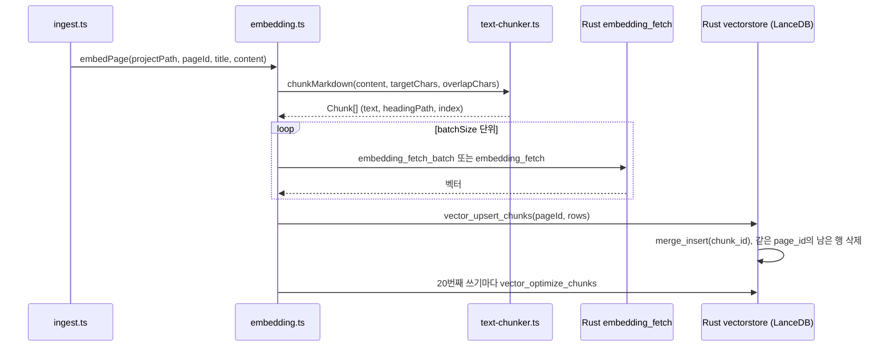

벡터 검색용 인덱스는 페이지를 chunk로 나눠 LanceDB에 적재해 만들고, 위키 밖 파일은 AnyTXT로 검색한다.

## 인덱싱: 페이지 chunk 분할과 LanceDB 적재

벡터 검색이 쓰는 인덱스는 수집(4장)이 페이지를 쓴 직후 `embedPage`로 만든다. README는 이 기능을 "disabled by default"라고 밝힌다([README.md#L232](https://github.com/nashsu/llm_wiki/blob/e08cfce65aad8b76b13546a081c1a8d4422b70c3/README.md#L232)). `embedding.ts` 머리 주석이 흐름을 요약한다([embedding.ts#L1-L22](https://github.com/nashsu/llm_wiki/blob/e08cfce65aad8b76b13546a081c1a8d4422b70c3/src/lib/embedding.ts#L1-L22)). markdown을 chunk로 나누고, chunk마다 "페이지 제목 + heading 경로 + 본문"을 임베딩하고, 그 페이지의 행을 한 번에 교체한다. HTTP 호출은 CORS를 피하려고 Rust `embedding_fetch` command가 대신한다.



### chunk 생성과 문맥 보강

TypeScript chunker의 기본값은 `targetChars 1000`, `maxChars 1500`, `minChars 200`, `overlapChars 200`이다([text-chunker.ts#L64-L69](https://github.com/nashsu/llm_wiki/blob/e08cfce65aad8b76b13546a081c1a8d4422b70c3/src/lib/text-chunker.ts#L64-L69)). `preparePageEmbeddingRows`는 설정의 `maxChunkChars`, `overlapChunkChars`로 앞의 두 값을 덮어쓰고, `batchSize`(1..64)씩 묶어 OpenAI 호환 batch 요청을 보낸다. Google `:embedContent`와 doubao vision 모델은 batch를 지원하지 않는 것으로 보고 하나씩 보낸다([embedding.ts#L382-L420](https://github.com/nashsu/llm_wiki/blob/e08cfce65aad8b76b13546a081c1a8d4422b70c3/src/lib/embedding.ts#L382-L420)).

코드 분석: 실제로 임베딩되는 텍스트를 만드는 함수를 본다. [embedding.ts#L353-L363](https://github.com/nashsu/llm_wiki/blob/e08cfce65aad8b76b13546a081c1a8d4422b70c3/src/lib/embedding.ts#L353-L363)

```ts
function enrichChunkForEmbedding(
  pageTitle: string,
  chunk: Chunk,
): string {
  const parts: string[] = []
  if (pageTitle.trim().length > 0) parts.push(pageTitle.trim())
  if (chunk.headingPath.trim().length > 0) parts.push(chunk.headingPath.trim())
  parts.push(chunk.text.trim())
  return parts.join("\n\n")
}
```

저장되는 `chunk_text`는 문맥을 붙이기 전 원문이고, 임베딩만 문맥을 붙인 텍스트로 만든다. 주석은 짧은 chunk일수록 "## Techniques > ### Flash Attention" 같은 heading 경로가 검색 가능성을 크게 올린다고 설명한다. LLM으로 문맥 문장을 따로 생성하지 않고 이미 있는 구조 정보만 붙이는 방식이다.

### LanceDB v2 스키마와 원자적 교체

벡터 저장소는 프로젝트 안 `.llm-wiki/lancedb`에 있는 LanceDB다([vectorstore.rs#L48-L50](https://github.com/nashsu/llm_wiki/blob/e08cfce65aad8b76b13546a081c1a8d4422b70c3/src-tauri/src/commands/vectorstore.rs#L48-L50)). 페이지 단위 벡터를 담던 v1 테이블 `wiki_vectors`와 chunk 단위 v2 테이블 `wiki_chunks_v2`가 함께 정의되어 있고, 검색은 v2만 본다([vectorstore.rs#L63-L66](https://github.com/nashsu/llm_wiki/blob/e08cfce65aad8b76b13546a081c1a8d4422b70c3/src-tauri/src/commands/vectorstore.rs#L63-L66)).

| 컬럼 | 타입 | 의미 |
| --- | --- | --- |
| `chunk_id` | Utf8 | `${page_id}#${chunk_index}`. upsert의 일치 키 |
| `page_id` | Utf8 | `wiki/` 기준 상대 경로에서 `.md`를 뺀 값 (예: `entities/foo`) |
| `chunk_index` | UInt32 | 페이지 안 0부터 시작하는 순번 |
| `chunk_text` | Utf8 | 문맥을 붙이기 전 chunk 원문 |
| `heading_path` | Utf8 | `## A > ### B` 형태의 경로, 첫 heading 이전이면 빈 문자열 |
| `vector` | FixedSizeList<Float32, dim> | 임베딩, 차원은 첫 chunk에서 정함 |

스키마 정의는 [vectorstore.rs#L382-L395](https://github.com/nashsu/llm_wiki/blob/e08cfce65aad8b76b13546a081c1a8d4422b70c3/src-tauri/src/commands/vectorstore.rs#L382-L395)에 있다. page id에 디렉터리를 넣는 이유는 `wikiPageIdFromPath` 주석이 밝힌다. `sources/topic.md`와 `entities/topic.md`가 서로의 chunk를 덮어쓰지 않게 하기 위해서다([embedding.ts#L444-L462](https://github.com/nashsu/llm_wiki/blob/e08cfce65aad8b76b13546a081c1a8d4422b70c3/src/lib/embedding.ts#L444-L462)).

코드 분석: 한 페이지의 chunk를 교체하는 upsert를 본다. [vectorstore.rs#L520-L529](https://github.com/nashsu/llm_wiki/blob/e08cfce65aad8b76b13546a081c1a8d4422b70c3/src-tauri/src/commands/vectorstore.rs#L520-L529)

```rust
        let data = RecordBatchIterator::new(vec![Ok(batch)], schema);
        let mut merge = table.merge_insert(&["chunk_id"]);
        merge
            .when_matched_update_all(None)
            .when_not_matched_insert_all()
            .when_not_matched_by_source_delete(Some(format!("page_id = '{}'", page_id)));
        merge
            .execute(Box::new(data))
            .await
            .map_err(|e| format!("Atomic page upsert failed: {e}"))?;
```

섹션 주석은 "DELETE every row with the target page_id and then ADD"라고 설명하지만([vectorstore.rs#L367-L372](https://github.com/nashsu/llm_wiki/blob/e08cfce65aad8b76b13546a081c1a8d4422b70c3/src-tauri/src/commands/vectorstore.rs#L367-L372)), 현재 코드는 `merge_insert` 한 번으로 같은 결과를 낸다. 새 batch에 있는 `chunk_id`는 갱신하거나 넣고, 같은 `page_id`인데 새 batch에 없는 행은 지운다. 삭제와 추가 사이에 검색이 들어와 그 페이지가 비어 보이는 순간이 없다. 프로젝트별 `RwLock`으로 쓰기는 직렬화하고 읽기는 동시에 허용한다. 빈 chunk 목록으로 upsert를 부르면 아무것도 지우지 않는데, 일시적인 임베딩 실패가 기존 인덱스를 날리지 않게 하려는 장치다([vectorstore.rs#L455-L493](https://github.com/nashsu/llm_wiki/blob/e08cfce65aad8b76b13546a081c1a8d4422b70c3/src-tauri/src/commands/vectorstore.rs#L455-L493)).

LanceDB는 쓰기마다 새 버전을 만들므로 `noteIncrementalVectorWrite`가 프로젝트별 쓰기 횟수를 세다가 20번째마다 `vector_optimize_chunks`(compaction과 오래된 버전 정리)를 부른다([embedding.ts#L333-L343](https://github.com/nashsu/llm_wiki/blob/e08cfce65aad8b76b13546a081c1a8d4422b70c3/src/lib/embedding.ts#L333-L343)).

### 두 개의 임베딩 경로

같은 일을 하는 경로가 TypeScript와 Rust에 하나씩 있다. 앱 안 수집과 설정 화면의 "전체 재인덱싱"은 TypeScript `embedPage`, `embedAllPages`를 쓰고, 로컬 API 서버는 Rust `embed_wiki_page`를 쓴다([api_server.rs#L1915](https://github.com/nashsu/llm_wiki/blob/e08cfce65aad8b76b13546a081c1a8d4422b70c3/src-tauri/src/api_server.rs#L1915)).

| 항목 | TypeScript `embedPage` | Rust `embed_wiki_page` |
| --- | --- | --- |
| chunker | `text-chunker.ts` (target 1000, max 1500, min 200, overlap 200) | `chunk_markdown` (기본 1000, overlap 200, 64..32,000으로 clamp) |
| 제외 페이지 | 전체 재인덱싱 시 `index`, `log`, `overview`, `purpose`, `schema` | `index`, `log`, `overview` |
| 변경 감지 | 없음, 호출마다 다시 임베딩 | 본문 SHA-256과 임베딩 설정의 fingerprint가 같으면 `unchanged` |
| 크기 제한 | 별도 상한 없음 (미검증) | 2 MiB, chunk 512개 |
| 실패 처리 | chunk 단위로 건너뛰고 3회까지 재시도 | 공급자 단계 300초 timeout |

Rust 쪽 상수와 제외 규칙은 [page_embedding.rs#L15-L23](https://github.com/nashsu/llm_wiki/blob/e08cfce65aad8b76b13546a081c1a8d4422b70c3/src-tauri/src/commands/page_embedding.rs#L15-L23), [page_embedding.rs#L115-L125](https://github.com/nashsu/llm_wiki/blob/e08cfce65aad8b76b13546a081c1a8d4422b70c3/src-tauri/src/commands/page_embedding.rs#L115-L125)에 있다. TypeScript 제외 목록은 [embedding.ts#L605-L614](https://github.com/nashsu/llm_wiki/blob/e08cfce65aad8b76b13546a081c1a8d4422b70c3/src/lib/embedding.ts#L605-L614)에 있다.

코드 분석: Rust 경로가 재인덱싱 여부를 판단하는 fingerprint를 본다. [page_embedding.rs#L266-L280](https://github.com/nashsu/llm_wiki/blob/e08cfce65aad8b76b13546a081c1a8d4422b70c3/src-tauri/src/commands/page_embedding.rs#L266-L280)

```rust
fn embedding_fingerprint(revision: &str, config: &SearchEmbeddingConfig) -> String {
    let signature = serde_json::json!({
        "revision": revision,
        "endpoint": config.endpoint.trim(),
        "model": config.model.trim(),
        "outputDimensionality": config.output_dimensionality,
        "extraHeaders": config.extra_headers,
        "maxChunkChars": config.max_chunk_chars.unwrap_or(DEFAULT_CHUNK_CHARS),
        "overlapChunkChars": config.overlap_chunk_chars.unwrap_or(DEFAULT_OVERLAP_CHARS),
    });
```

API 키는 서명에 들어가지 않는다. 테스트 이름 그대로 "fingerprint changes with embedding semantics but not api key rotation"이다. fingerprint는 `.llm-wiki/embedding-revisions` 아래 페이지별 파일로 남는다.

> **주의**: 집계 페이지(`index.md`, `log.md`, `overview.md`)는 벡터 인덱스에서 빠지지만 키워드 검색 순회에서는 빠지지 않는다. `search_project_inner`는 `wiki/` 아래 모든 `.md`를 점수 매기므로, 모든 페이지 제목을 나열한 `index.md`가 키워드 결과에 자주 끼어들 수 있다(코드로 확인한 동작, 실측 미검증).

## AnyTXT: 위키 밖 로컬 파일 검색

`anytxt-search.ts`는 위키 검색이 아니라 PC에 설치된 AnyTXT Searcher의 로컬 HTTP 서비스를 부르는 어댑터다. 기본 endpoint는 `http://127.0.0.1:9920`, 결과 수는 20이고 1..100으로 clamp한다([anytxt-search.ts#L8-L11](https://github.com/nashsu/llm_wiki/blob/e08cfce65aad8b76b13546a081c1a8d4422b70c3/src/lib/anytxt-search.ts#L8-L11), [anytxt-search.ts#L167-L171](https://github.com/nashsu/llm_wiki/blob/e08cfce65aad8b76b13546a081c1a8d4422b70c3/src/lib/anytxt-search.ts#L167-L171)). 실제 HTTP 호출은 Rust `anytxt_search` command가 한다.

`anyTxtSearchSmart`는 LLM 설정이 있으면 먼저 질문을 키워드 질의 1~3개로 바꾼다. 프롬프트가 "Natural-language questions often fail, so produce keyword-style searches"라고 이유를 밝힌다([anytxt-search.ts#L87-L121](https://github.com/nashsu/llm_wiki/blob/e08cfce65aad8b76b13546a081c1a8d4422b70c3/src/lib/anytxt-search.ts#L87-L121)). 재작성한 질의와 원래 질의를 합쳐 중복을 지운 다음 최대 3개만 남기고, 결과는 URL 기준으로 중복을 걸러 `maxResults`에서 멈춘다. 채팅 에이전트가 이 결과를 어떻게 쓰는지는 11장에서 다룬다.
