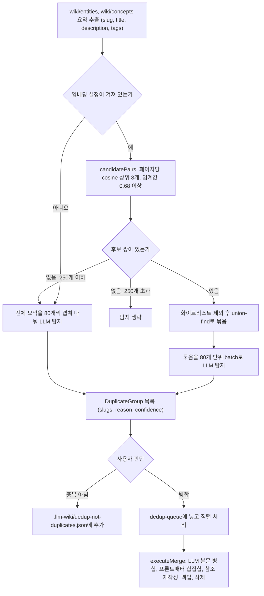

이름만 다르고 같은 대상을 다루는 페이지를 찾아 합치는 중복 제거 파이프라인을 본다.

## 중복 제거: 이름만 다른 동일 페이지 탐지

수집을 반복하면 LLM이 같은 대상을 다른 이름으로 부르는 일이 생긴다. `dedup.ts` 머리 주석은 영어와 중국어 표기, 단수와 복수, 약어와 풀네임이 각각 다른 페이지가 되는 사례를 들고, 슬러그가 정확히 같을 때만 잡는 page-merge 계층(4장)을 보완하려는 모듈이라고 설명한다([dedup.ts#L1-L29](https://github.com/nashsu/llm_wiki/blob/e08cfce65aad8b76b13546a081c1a8d4422b70c3/src/lib/dedup.ts#L1-L29)). llm-wiki.md가 Lint 작업으로 꼽는 "missing cross-references"와 같은 결의 유지보수지만, 이 구현은 린트(9장)와 따로 설정 화면의 유지보수 섹션에 두었다.



### 1단계와 2단계: 요약과 LLM 탐지

`extractEntitySummary`는 프론트매터의 `type`, `title`, `description`(없으면 본문 첫 문단), `tags`를 꺼낸다. LLM 없이 하는 단계다. `detectDuplicateGroups`는 이 목록을 `type=..., slug=..., title=...` 한 줄씩 나열해 LLM에 보내고, JSON으로 그룹을 받는다. 시스템 프롬프트는 같은 이름의 다른 언어 표기, 단복수, 약어, 동의어, 철자 차이를 예로 들고, type이 다른 페이지는 명백할 때만 묶으라고 지시한다([dedup.ts#L171-L199](https://github.com/nashsu/llm_wiki/blob/e08cfce65aad8b76b13546a081c1a8d4422b70c3/src/lib/dedup.ts#L171-L199)).

코드 분석: LLM 응답을 믿지 않고 걸러 내는 후처리를 본다. [dedup.ts#L218-L230](https://github.com/nashsu/llm_wiki/blob/e08cfce65aad8b76b13546a081c1a8d4422b70c3/src/lib/dedup.ts#L218-L230)

```ts
  const parsed = parseDetectorResponse(response)

  const validSlugs = new Set(summaries.map((s) => s.slug))
  const notDupSet = new Set(
    (options.notDuplicates ?? []).map((g) => normalizeGroupKey(g)),
  )

  return parsed
    .map((g) => ({ ...g, slugs: g.slugs.filter((s) => validSlugs.has(s)) }))
    .filter((g) => g.slugs.length >= 2)
    .filter((g) => !notDupSet.has(normalizeGroupKey(g.slugs)))
```

입력에 없는 slug는 지우고, 두 개 미만이 된 그룹은 버리고, 사용자가 이전에 "중복 아님"으로 표시한 그룹은 다시 보이지 않게 한다. 응답 파싱은 코드 펜스나 앞뒤 인사말이 붙어도 첫 번째 균형 잡힌 `{...}` 블록을 찾아 읽고, 실패하면 빈 목록을 돌려준다. "중복 없음"과 "응답 깨짐"을 같은 결과로 다룬다.

### 임베딩 사전 필터

페이지가 많을 때 전체 요약을 LLM 한 번에 보내면 응답이 끝나지 않는 문제가 있었고, 코드 주석은 이를 이슈 #359로 가리킨다([dedup_embedding.ts#L1-L9](https://github.com/nashsu/llm_wiki/blob/e08cfce65aad8b76b13546a081c1a8d4422b70c3/src/lib/dedup_embedding.ts#L1-L9)). 해법은 임베딩 cosine 유사도로 후보 쌍만 먼저 고르는 것이다. 이 사전 필터는 LanceDB 인덱스를 쓰지 않고, 페이지마다 "slug, 제목, 태그, 설명 앞 1500자"를 새로 임베딩해 메모리에서 모든 쌍을 비교한다($O(N^2)$).

| 상수 | `dedup-runner.ts` 값 | `candidatePairs` 기본값 | 의미 |
| --- | --- | --- | --- |
| top-K | 8 | 8 | 페이지당 남길 이웃 수 |
| threshold | 0.68 | 0.82 | cosine 하한 |
| maxPages | 5,000 | 5,000 | 비교 대상 상한 |
| minSuccessRatio | (기본값 사용) | 0.8 | 임베딩 성공 비율이 이보다 낮으면 예외 |
| detector batch | 80 | | LLM 한 번에 보내는 요약 수 |
| fallback overlap | 8 | | 전체 스캔 batch 사이 겹치는 요약 수 |
| full scan limit | 250 | | 후보 0개일 때 전체 스캔을 허용하는 페이지 수 |

값은 [dedup-runner.ts#L31-L51](https://github.com/nashsu/llm_wiki/blob/e08cfce65aad8b76b13546a081c1a8d4422b70c3/src/lib/dedup-runner.ts#L31-L51)과 [dedup_embedding.ts#L115-L118](https://github.com/nashsu/llm_wiki/blob/e08cfce65aad8b76b13546a081c1a8d4422b70c3/src/lib/dedup_embedding.ts#L115-L118)에 있다. 러너가 임계값을 0.82에서 0.68로 낮춘 이유는 주석에 있다. 이 도구는 언어가 다른 별칭을 잡아야 하는데, 다국어 학습이 약한 임베딩 모델에서는 그런 쌍의 cosine이 낮게 나온다.

코드 분석: 후보 쌍을 그룹으로 합치는 union-find를 본다. [dedup_embedding.ts#L183-L200](https://github.com/nashsu/llm_wiki/blob/e08cfce65aad8b76b13546a081c1a8d4422b70c3/src/lib/dedup_embedding.ts#L183-L200)

```ts
  const find = (x: string): string => {
    let root = x
    while (parent.get(root) !== root) root = parent.get(root)!
    // path compression
    let cur = x
    while (parent.get(cur) !== root) {
      const next = parent.get(cur)!
      parent.set(cur, root)
      cur = next
    }
    return root
  }

  for (const [a, b] of pairs) {
    const ra = find(a)
    const rb = find(b)
    if (ra !== rb) parent.set(ra, rb)
  }
```

재귀 대신 반복문으로 경로 압축을 해서 큰 입력에서도 스택이 넘치지 않게 했다. A-B, B-C가 후보면 A, B, C가 한 묶음이 되어 LLM에 같이 간다. 최종 판정은 여전히 LLM이 하므로 묶음 안에서 일부만 중복으로 돌아올 수 있다.

후보가 하나도 없을 때의 처리가 비대칭이다. 페이지 250개 이하면 전체 스캔으로 넘어가 재현율을 지키고, 그보다 많으면 #359 문제가 다시 생기지 않도록 LLM을 아예 부르지 않는다. 임베딩 성공률이 낮아 예외가 난 경우도 같은 기준으로 나뉜다([dedup-runner.ts#L187-L225](https://github.com/nashsu/llm_wiki/blob/e08cfce65aad8b76b13546a081c1a8d4422b70c3/src/lib/dedup-runner.ts#L187-L225), [dedup-runner.ts#L252-L293](https://github.com/nashsu/llm_wiki/blob/e08cfce65aad8b76b13546a081c1a8d4422b70c3/src/lib/dedup-runner.ts#L252-L293)). 전체 스캔은 제목 순으로 정렬해 비슷한 이름이 가까이 오게 한 뒤, 80개씩 자르되 8개를 겹쳐 batch 경계에서 쌍이 갈라지지 않게 한다.

LLM 출력 길이도 용도별로 상한을 둔다. 탐지는 JSON 목록이라 8,192 토큰, 병합은 페이지 전체를 다시 쓰므로 16,384 토큰이다. 주석은 추론 기능을 끄는 옵션을 무시하는 모델이 사고 과정을 끝없이 출력하다 30분 backstop에 걸리는 상황을 막으려는 것이라고 설명한다.

### 3단계: 병합과 참조 재작성

사용자가 그룹과 남길 slug(canonical)를 고르면 `enqueueMerge`가 `.llm-wiki/dedup-queue.json`에 작업을 남긴다. 큐는 한 번에 하나씩 처리하고, 실패하면 3회까지 다시 시도한다([dedup-queue.ts#L322-L405](https://github.com/nashsu/llm_wiki/blob/e08cfce65aad8b76b13546a081c1a8d4422b70c3/src/lib/dedup-queue.ts#L322-L405)). 직렬로 처리하는 이유는 머리 주석에 있다. 병합은 위키 전체의 참조를 다시 쓰므로 두 병합이 동시에 돌면 같은 파일을 두고 경쟁해 재작성 일부가 사라진다. 앱을 다시 열었을 때 남은 작업은 불러오기만 하고 자동 실행하지 않는다. 열자마자 LLM 토큰을 쓰지 않게 하려는 것이다.

`mergeDuplicateGroup`은 계산만 하고 파일을 쓰지 않는다([dedup.ts#L348-L420](https://github.com/nashsu/llm_wiki/blob/e08cfce65aad8b76b13546a081c1a8d4422b70c3/src/lib/dedup.ts#L348-L420)).

| 순서 | 작업 | LLM 사용 |
| --- | --- | --- |
| 1 | 그룹 페이지 전문을 주고 하나의 페이지로 다시 쓰게 함 | 예 |
| 2 | `sources`, `tags`, `related`를 모든 입력 페이지 값의 합집합으로 덮어씀 | 아니오 |
| 3 | `updated`를 오늘 날짜로 바꿈 | 아니오 |
| 4 | 다른 모든 위키 페이지의 `[[old]]`, `[[old\|별칭]]`, `related:` 값을 canonical로 재작성 | 아니오 |
| 5 | 건드리는 모든 파일의 병합 전 내용을 백업 목록에 담음 | 아니오 |
| 6 | canonical을 뺀 그룹 페이지를 삭제 목록에 담음 | 아니오 |

LLM에게는 본문만 맡기고 출처 목록 같은 정형 필드는 코드가 합집합으로 계산한다. 병합 프롬프트도 "The caller will overwrite sources / tags / related / updated with deterministic unions afterward"라고 LLM에게 알린다([dedup.ts#L321-L333](https://github.com/nashsu/llm_wiki/blob/e08cfce65aad8b76b13546a081c1a8d4422b70c3/src/lib/dedup.ts#L321-L333)). 출처 추적이 LLM의 누락에 흔들리지 않게 하는 구성이다.

코드 분석: 본문 위키링크를 canonical로 바꾸는 정규식을 본다. [dedup.ts#L463-L467](https://github.com/nashsu/llm_wiki/blob/e08cfce65aad8b76b13546a081c1a8d4422b70c3/src/lib/dedup.ts#L463-L467)

```ts
  for (const [oldSlug, newSlug] of slugRedirects) {
    const escaped = escapeRegex(oldSlug)
    const re = new RegExp(`\\[\\[${escaped}(\\|[^\\]]+)?\\]\\]`, "g")
    out = out.replace(re, (_match, alias) => `[[${newSlug}${alias ?? ""}]]`)
  }
```

별칭은 그대로 두고 대상만 바꾼다. 대소문자는 구분하므로 `[[Foo]]`처럼 다른 대소문자로 쓴 링크는 바뀌지 않는다. `executeMerge`는 계산 결과를 받아 `.llm-wiki/page-history/dedup-<시각>/`에 백업을 먼저 쓰고, canonical 페이지, 재작성한 페이지, 삭제, `index.md` 정리 순서로 디스크에 반영한 뒤 `dataVersion`을 올려 그래프와 화면을 새로 고친다([dedup-runner.ts#L394-L486](https://github.com/nashsu/llm_wiki/blob/e08cfce65aad8b76b13546a081c1a8d4422b70c3/src/lib/dedup-runner.ts#L394-L486)).

> **주의**: `executeMerge`는 지운 페이지의 벡터 chunk를 지우는 `removePageEmbedding`을 부르지 않고, canonical 페이지를 다시 임베딩하지도 않는다. `removePageEmbedding` 호출은 원본 삭제(`source-lifecycle.ts`)와 위키 페이지 삭제(`wiki-page-delete.ts`) 경로에만 있다. 병합 뒤에는 삭제된 페이지의 chunk가 전체 재인덱싱 전까지 남을 수 있다. 다만 검색 단계의 `materialize_vector_only_results`는 파일을 읽지 못하면 그 결과를 건너뛰므로 사용자에게 죽은 링크로 보이지는 않는다(코드 확인 범위 내의 판단).

> **주의**: `executeMerge`는 slug를 파일 basename으로 찾는다. 서로 다른 폴더에 같은 basename이 있으면 나중에 순회한 파일이 이긴다. 탐지 대상이 `wiki/entities`와 `wiki/concepts` 두 폴더뿐이라 실제로 겹칠 일은 드물지만, 두 폴더에 같은 이름이 있으면 의도와 다른 파일을 병합할 수 있다(추정).

"중복 아님" 화이트리스트는 slug를 소문자로 바꿔 정렬한 키로 비교해, 순서나 대소문자가 달라도 같은 그룹으로 본다([dedup-storage.ts#L52-L68](https://github.com/nashsu/llm_wiki/blob/e08cfce65aad8b76b13546a081c1a8d4422b70c3/src/lib/dedup-storage.ts#L52-L68)).
