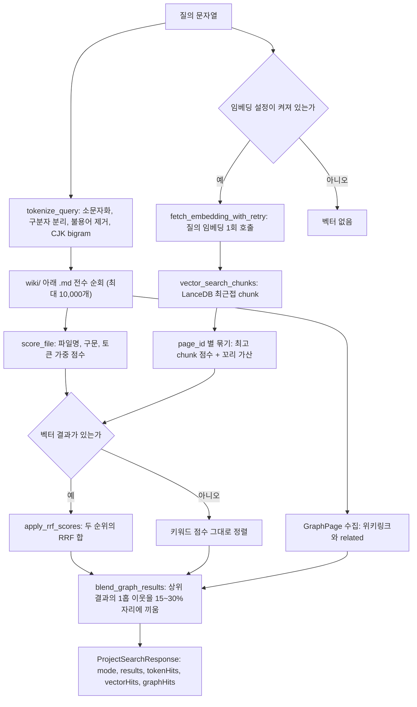

LLM Wiki의 검색은 BM25가 아니다. 제목과 본문에 질의 토큰이 몇 개 들어 있는지 세는 가중 키워드 점수, LanceDB에 저장한 chunk 임베딩의 최근접 검색, 그리고 위키링크 1홉 이웃을 덧붙이는 그래프 확장을 Rust 한 함수 안에서 차례로 합친다. 이 장은 그 검색 경로와, 같은 임베딩 인프라를 재사용해 "이름만 다른 같은 페이지"를 찾아 병합하는 중복 제거 도구를 코드로 따라간다.

## 검색 기능의 위치

Karpathy의 원본 문서 llm-wiki.md는 검색을 필수로 보지 않는다. 질의할 때 LLM이 `index.md`를 먼저 읽고 필요한 페이지로 내려가는 방식이 "~100 sources, ~hundreds of pages" 규모까지는 잘 동작해서 "embedding-based RAG infrastructure"가 필요 없다고 적는다([llm-wiki.md#L47](https://github.com/nashsu/llm_wiki/blob/e08cfce65aad8b76b13546a081c1a8d4422b70c3/llm-wiki.md#L47)). 규모가 커지면 qmd 같은 "hybrid BM25/vector search" 도구를 붙이라고 권한다([llm-wiki.md#L53](https://github.com/nashsu/llm_wiki/blob/e08cfce65aad8b76b13546a081c1a8d4422b70c3/llm-wiki.md#L53)).

이 구현은 두 번째 길을 직접 만들었다. 다만 외부 도구를 쓰지 않고 Tauri 백엔드 안에 검색기를 넣었고, 채팅 에이전트(8장, 11장)와 로컬 API, MCP 서버(13장)가 모두 같은 함수를 부른다. 검색 결과가 위키 본문을 대신하는 것이 아니라, 위키 페이지를 찾는 입구 역할을 한다는 점은 원본 패턴과 같다. 찾는 대상은 원본 문서 chunk가 아니라 LLM이 이미 정리해 둔 `wiki/` 아래 페이지다.

## 정리

- 검색은 Rust `search_project_inner` 하나가 담당하고, 프론트 검색 패널, 채팅 에이전트의 `wiki.search`, 로컬 API가 같은 함수를 부른다. 질의마다 `wiki/` 아래 파일을 전수로 읽으며 별도 키워드 인덱스는 없다.
- 키워드 점수는 BM25가 아니라 파일명 일치 200, 제목 구문 50, 본문 구문 20/회, 제목 토큰 5, 본문 토큰 1을 더하는 포함 개수 방식이다. CJK bigram은 한자 범위에만 적용되어 한글은 공백 토큰으로만 비교한다.
- 임베딩을 켜면 LanceDB `wiki_chunks_v2`에서 chunk를 찾아 "최고 chunk + 꼬리 30%(상한 있음)"로 페이지 점수를 만들고, 키워드 순위와 RRF($k=60$)로 합친다.
- 마지막으로 상위 결과의 위키링크 1홉 이웃에게 결과 창의 15~30%를 할당한다. 벡터 결과가 적을수록 그래프 몫이 커진다.
- 인덱싱은 제목과 heading 경로를 붙여 임베딩하고, `merge_insert`로 페이지 단위 교체를 원자적으로 한다. TypeScript와 Rust에 같은 기능의 경로가 둘 있고 chunker 상한과 변경 감지 방식이 다르다.
- 중복 제거는 임베딩 cosine으로 후보를 좁힌 뒤 LLM이 판정하고, 병합 본문은 LLM이, 출처와 태그와 참조 재작성은 코드가 맡는다. 병합은 백업을 먼저 쓰고 직렬 큐로 처리하지만 벡터 인덱스 정리는 하지 않는다.
