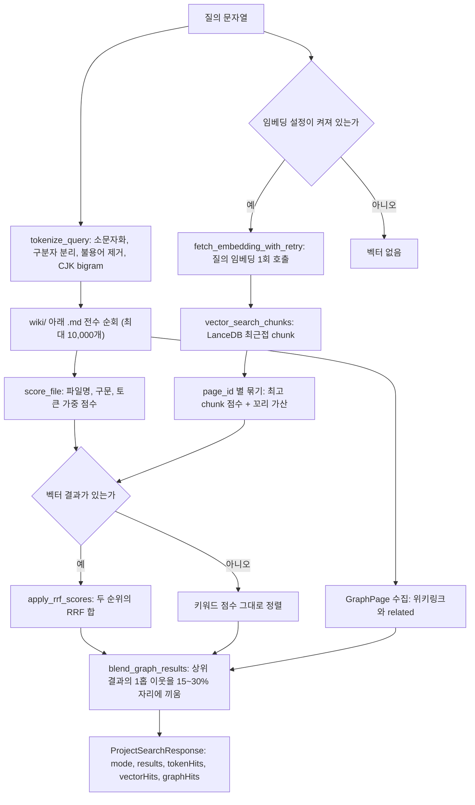
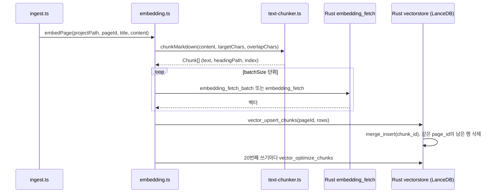
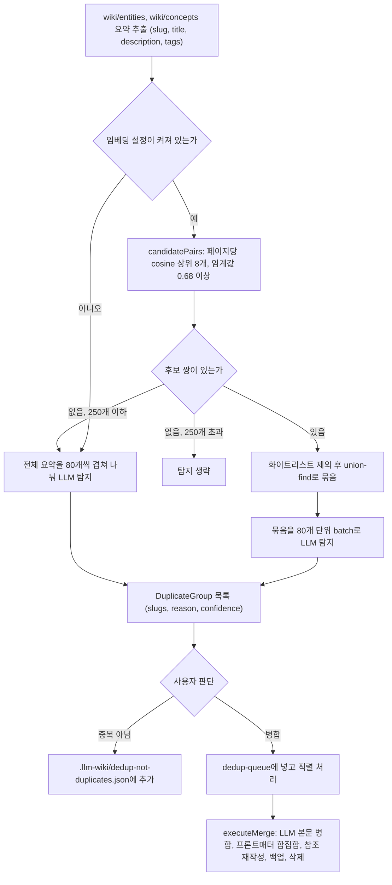

LLM Wiki의 검색은 BM25가 아니다. 제목과 본문에 질의 토큰이 몇 개 들어 있는지 세는 가중 키워드 점수, LanceDB에 저장한 chunk 임베딩의 최근접 검색, 그리고 위키링크 1홉 이웃을 덧붙이는 그래프 확장을 Rust 한 함수 안에서 차례로 합친다. 이 장은 그 검색 경로와, 같은 임베딩 인프라를 재사용해 "이름만 다른 같은 페이지"를 찾아 병합하는 중복 제거 도구를 코드로 따라간다.

## 검색이 놓인 자리

Karpathy의 원본 문서 llm-wiki.md는 검색을 필수로 보지 않는다. 질의할 때 LLM이 `index.md`를 먼저 읽고 필요한 페이지로 내려가는 방식이 "~100 sources, ~hundreds of pages" 규모까지는 잘 동작해서 "embedding-based RAG infrastructure"가 필요 없다고 적는다([llm-wiki.md#L47](https://github.com/nashsu/llm_wiki/blob/e08cfce65aad8b76b13546a081c1a8d4422b70c3/llm-wiki.md#L47)). 규모가 커지면 qmd 같은 "hybrid BM25/vector search" 도구를 붙이라고 권한다([llm-wiki.md#L53](https://github.com/nashsu/llm_wiki/blob/e08cfce65aad8b76b13546a081c1a8d4422b70c3/llm-wiki.md#L53)).

이 구현은 두 번째 길을 직접 만들었다. 다만 외부 도구를 쓰지 않고 Tauri 백엔드 안에 검색기를 넣었고, 채팅 에이전트(8장, 11장)와 로컬 API, MCP 서버(13장)가 모두 같은 함수를 부른다. 검색 결과가 위키 본문을 대신하는 것이 아니라, 위키 페이지를 찾는 입구 역할을 한다는 점은 원본 패턴과 같다. 찾는 대상은 원본 문서 chunk가 아니라 LLM이 이미 정리해 둔 `wiki/` 아래 페이지다.



## 진입점: searchWiki와 search_project

프론트엔드 검색 패널은 `searchWiki`를 부르고, 이 함수는 Tauri command `search_project`를 그대로 호출한다. 질의 임베딩은 프론트에서 만들지 않고 `queryEmbedding: null`과 임베딩 설정만 넘긴다.

코드 따라가기: 프론트 진입점이 백엔드에 넘기는 인자를 본다. [src/lib/search.ts#L62-L83](https://github.com/nashsu/llm_wiki/blob/e08cfce65aad8b76b13546a081c1a8d4422b70c3/src/lib/search.ts#L62-L83)

```ts
  const response = await invoke<BackendSearchResponse>("search_project", {
    projectPath: pp,
    query,
    topK: 20,
    includeContent: false,
    queryEmbedding: null,
    embeddingConfig: embCfg,
  })
```

`topK`는 20으로 고정이고, 본문 전체(`includeContent`)는 받지 않는다. 백엔드 쪽 `search_project`는 `resolve_query_embedding`으로 질의 벡터를 먼저 얻은 다음 `search_project_inner`에 넘긴다([search.rs#L107-L130](https://github.com/nashsu/llm_wiki/blob/e08cfce65aad8b76b13546a081c1a8d4422b70c3/src-tauri/src/commands/search.rs#L107-L130)). 질의 벡터를 프론트에서 만들지 않는 이유는 `BackendSearchResponse` 주석이 밝힌다. API와 WebView 검색이 "the same retrieval contract"를 공유하도록 하기 위해서다([search.ts#L20-L28](https://github.com/nashsu/llm_wiki/blob/e08cfce65aad8b76b13546a081c1a8d4422b70c3/src/lib/search.ts#L20-L28)).

검색 동작을 정하는 상수는 파일 맨 위에 모여 있다([search.rs#L12-L26](https://github.com/nashsu/llm_wiki/blob/e08cfce65aad8b76b13546a081c1a8d4422b70c3/src-tauri/src/commands/search.rs#L12-L26)).

| 상수 | 값 | 쓰이는 곳 |
| --- | --- | --- |
| `DEFAULT_RESULTS` | 20 | `top_k` 미지정 시 기본 결과 수 |
| `MAX_RESULTS` | 50 | `top_k`를 1..50으로 clamp |
| `RRF_K` | 60.0 | RRF 분모의 상수 |
| `FILENAME_EXACT_BONUS` | 200.0 | 파일명 stem이 질의 구문과 같을 때 |
| `PHRASE_IN_TITLE_BONUS` | 50.0 | 제목에 질의 구문이 통째로 있을 때 |
| `PHRASE_IN_CONTENT_PER_OCC` | 20.0 | 본문에 질의 구문이 나온 횟수당 |
| `MAX_PHRASE_OCC_COUNTED` | 10 | 본문 구문 횟수 상한 |
| `TITLE_TOKEN_WEIGHT` | 5.0 | 제목에 들어 있는 토큰 하나당 |
| `CONTENT_TOKEN_WEIGHT` | 1.0 | 본문에 들어 있는 토큰 하나당 |
| `SEARCH_EMBEDDING_TIMEOUT_SECS` | 8 | 임베딩 HTTP 요청 시간 제한 |
| `MAX_SEARCH_FILES` | 10,000 | 한 번에 읽는 markdown 파일 상한 |
| `MIN_GRAPH_RESULT_RATIO` / `MAX_GRAPH_RESULT_RATIO` | 0.15 / 0.30 | 그래프 이웃에 배정하는 자리 비율 |
| `MAX_GRAPH_SEEDS` | 20 | 그래프 확장의 시작점 수 상한 |

## 키워드 점수: BM25가 아닌 가중 포함 개수

`search_project_inner`는 인덱스를 미리 만들어 두지 않는다. 질의가 올 때마다 `wiki/` 아래 `.md` 파일을 `WalkDir`로 전부 읽고, 파일 하나마다 `score_file`을 부른다([search.rs#L349-L413](https://github.com/nashsu/llm_wiki/blob/e08cfce65aad8b76b13546a081c1a8d4422b70c3/src-tauri/src/commands/search.rs#L349-L413)). 같은 순회에서 그래프 확장에 쓸 링크 목록도 함께 모은다.

코드 따라가기: 한 파일의 키워드 점수를 어떻게 합산하는지 본다. [search.rs#L960-L970](https://github.com/nashsu/llm_wiki/blob/e08cfce65aad8b76b13546a081c1a8d4422b70c3/src-tauri/src/commands/search.rs#L960-L970)

```rust
    let score = (if filename_exact {
        FILENAME_EXACT_BONUS
    } else {
        0.0
    }) + (if title_has_phrase {
        PHRASE_IN_TITLE_BONUS
    } else {
        0.0
    }) + content_phrase_occ as f64 * PHRASE_IN_CONTENT_PER_OCC
        + title_token_score as f64 * TITLE_TOKEN_WEIGHT
        + content_token_score as f64 * CONTENT_TOKEN_WEIGHT;
```

`title_token_score`와 `content_token_score`는 `token_match_score`가 돌려주는 값인데, 이 함수는 "토큰이 텍스트에 포함되어 있는가"를 토큰마다 한 번씩 세는 것이 전부다([search.rs#L1103-L1109](https://github.com/nashsu/llm_wiki/blob/e08cfce65aad8b76b13546a081c1a8d4422b70c3/src-tauri/src/commands/search.rs#L1103-L1109)). 정리하면 한 페이지의 점수는 다음과 같다.

$$
\text{score} = 200\cdot[\text{stem}=q] + 50\cdot[q \subset \text{title}] + 20\cdot\min(\text{occ}(q),10) + 5\cdot|T\cap\text{title}| + 1\cdot|T\cap\text{body}|
$$

여기서 $q$는 구두점을 걷어낸 소문자 질의 구문, $T$는 토큰 집합이다. 문서 빈도(IDF)도, 문서 길이 정규화도, 토큰 반복 횟수도 들어가지 않으므로 BM25가 아니다. `embedding.ts` 주석에는 벡터 검색이 실패하면 "fell back to BM25"라는 표현이 남아 있지만([embedding.ts#L35-L40](https://github.com/nashsu/llm_wiki/blob/e08cfce65aad8b76b13546a081c1a8d4422b70c3/src/lib/embedding.ts#L35-L40)), 실제 대체 경로는 위의 가중 키워드 점수다. README의 "Title match bonus (+10 score)" 설명([README.md#L204-L208](https://github.com/nashsu/llm_wiki/blob/e08cfce65aad8b76b13546a081c1a8d4422b70c3/README.md#L204-L208))도 현재 상수(구문 50, 토큰 5)와 맞지 않는다.

> **주의**: README는 Phase 1 검색이 "Searches both wiki/ and raw/sources/"라고 적지만, `search_project_inner`가 순회하는 경로는 `project_path/wiki` 하나다([search.rs#L350-L351](https://github.com/nashsu/llm_wiki/blob/e08cfce65aad8b76b13546a081c1a8d4422b70c3/src-tauri/src/commands/search.rs#L350-L351)). 원본 문서 검색은 에이전트의 `source.search` 도구가 따로 맡는다(11장).

### 토큰화와 CJK bigram

`tokenize_query`는 소문자로 바꾼 뒤 공백, ASCII 구두점, 중국어 전각 구두점으로 자르고, 한 글자 토큰과 불용어를 버린다. 토큰에 CJK 문자가 있고 세 글자 이상이면 인접 두 글자(bigram), 낱글자, 원 토큰을 모두 넣는다([search.rs#L995-L1027](https://github.com/nashsu/llm_wiki/blob/e08cfce65aad8b76b13546a081c1a8d4422b70c3/src-tauri/src/commands/search.rs#L995-L1027)).

```rust
        let has_cjk = chars.iter().any(|c| ('\u{3400}'..='\u{9fff}').contains(c));
        if has_cjk && chars.len() > 2 {
            for pair in chars.windows(2) {
                out.push(pair.iter().collect());
            }
```

CJK 판정 범위가 `U+3400..U+9FFF`(한자)라서 한글 음절(`U+AC00..U+D7A3`)은 이 분기에 들어가지 않는다. 한국어 질의는 공백 단위 토큰 그대로 부분 문자열 포함 여부를 보게 된다. `token_match_score`가 `contains`로 비교하므로 "임베딩을"처럼 조사가 붙은 토큰은 본문의 "임베딩"과 맞지 않는다(코드로 확인한 동작이며 실측은 미검증). 불용어 목록도 중국어와 영어만 있다.

프론트의 `tokenizeQuery`([search.ts#L38-L60](https://github.com/nashsu/llm_wiki/blob/e08cfce65aad8b76b13546a081c1a8d4422b70c3/src/lib/search.ts#L38-L60))는 같은 규칙의 TypeScript 사본이다. 검색 패널이 결과 snippet에서 일치 구간을 강조할 때만 쓴다.

## 벡터 검색: chunk를 찾고 페이지로 묶는다

질의 임베딩은 `resolve_query_embedding`이 만든다. 호출자가 벡터를 직접 넘기면 비어 있지 않은지, 모든 값이 유한한지만 검사하고 쓴다. 설정이 꺼져 있거나 endpoint, model이 비어 있으면 `None`을 돌려 키워드 검색만 한다. 임베딩 호출이 실패해도 오류를 올리지 않고 로그만 남긴 채 `None`이 된다([search.rs#L294-L315](https://github.com/nashsu/llm_wiki/blob/e08cfce65aad8b76b13546a081c1a8d4422b70c3/src-tauri/src/commands/search.rs#L294-L315)). 질의 쪽은 재시도 횟수 0으로 호출하므로, 입력이 길다는 오류가 와도 절반으로 줄여 다시 보내지 않는다.

코드 따라가기: LanceDB가 돌려준 chunk를 페이지 점수로 바꾸는 부분을 본다. [search.rs#L826-L836](https://github.com/nashsu/llm_wiki/blob/e08cfce65aad8b76b13546a081c1a8d4422b70c3/src-tauri/src/commands/search.rs#L826-L836)

```rust
    for (id, mut chunks) in by_page {
        chunks.sort_by(|a, b| {
            b.score
                .partial_cmp(&a.score)
                .unwrap_or(std::cmp::Ordering::Equal)
                .then_with(|| a.chunk_index.cmp(&b.chunk_index))
        });
        let top_chunk = chunks[0].clone();
        let top = top_chunk.score;
        let tail: f32 = chunks.iter().skip(1).map(|chunk| chunk.score).sum();
        let blended = top + (tail * 0.3).min((1.0 - top).max(0.0));
```

`search_by_embedding`은 원하는 페이지 수의 세 배(최소 30)만큼 chunk를 가져와 `page_id`로 묶는다([search.rs#L802-L852](https://github.com/nashsu/llm_wiki/blob/e08cfce65aad8b76b13546a081c1a8d4422b70c3/src-tauri/src/commands/search.rs#L802-L852)). 페이지 점수는 가장 가까운 chunk 점수에 나머지 chunk 점수 합의 30%를 더하되, 더하는 양이 $1 - s_{top}$을 넘지 않게 자른다.

$$
s_{page} = s_{top} + \min\left(0.3\sum_{i\ge 2} s_i,\ \max(0,\ 1 - s_{top})\right)
$$

chunk 하나의 점수는 LanceDB가 준 거리 $d$를 $1/(1+d)$로 바꾼 값이다([vectorstore.rs#L660-L669](https://github.com/nashsu/llm_wiki/blob/e08cfce65aad8b76b13546a081c1a8d4422b70c3/src-tauri/src/commands/vectorstore.rs#L660-L669)). 꼬리 가산에 상한을 둔 이유는 TypeScript 쪽 같은 계산의 주석이 설명한다. 약한 chunk가 많은 페이지가 강한 chunk 하나를 가진 페이지를 덮지 못하게 하려는 것이고, 0.3은 "empirical; adjust later with real data"라고 적혀 있다([embedding.ts#L817-L823](https://github.com/nashsu/llm_wiki/blob/e08cfce65aad8b76b13546a081c1a8d4422b70c3/src/lib/embedding.ts#L817-L823)).

키워드 단계에서 잡히지 않았지만 벡터로만 찾은 페이지는 `materialize_vector_only_results`가 파일을 다시 읽어 결과 목록에 더한다. 이때 snippet은 가장 가까운 chunk의 앞부분 160자에 heading 경로를 붙인 문자열이다([search.rs#L854-L909](https://github.com/nashsu/llm_wiki/blob/e08cfce65aad8b76b13546a081c1a8d4422b70c3/src-tauri/src/commands/search.rs#L854-L909)).

## 두 순위의 결합: RRF

벡터 결과가 하나라도 있으면 키워드 점수를 버리고 순위만 남겨 Reciprocal Rank Fusion으로 다시 매긴다.

코드 따라가기: 한 결과의 최종 점수를 계산하는 부분을 본다. [search.rs#L519-L537](https://github.com/nashsu/llm_wiki/blob/e08cfce65aad8b76b13546a081c1a8d4422b70c3/src-tauri/src/commands/search.rs#L519-L537)

```rust
        let mut rrf = 0.0;
        if let Some(rank) = token {
            rrf += 1.0 / (RRF_K + rank as f64);
        }
        if let Some(rank) = vector {
            rrf += 1.0 / (RRF_K + rank as f64);
        }
```

$$
\text{RRF}(p) = \frac{1}{60 + r_{tok}(p)} + \frac{1}{60 + r_{vec}(p)}
$$

한쪽 순위에만 있는 페이지는 해당 항 하나만 받는다. 순위로만 합치므로 키워드 점수의 절댓값(파일명 일치 보너스 200 등)은 벡터가 켜진 순간 의미를 잃는다. 파일명이 질의와 정확히 같은 페이지는 키워드 1위가 되어 $1/61$을 받지만, 벡터 순위가 낮으면 양쪽 모두 중간쯤인 페이지에 밀릴 수 있다. 벡터 순위를 찾을 때는 경로 기반 page id(`entities/foo`)를 먼저 보고, 예전 형식인 파일명 stem 행은 같은 stem을 가진 파일이 하나뿐일 때만 인정한다([search.rs#L497-L539](https://github.com/nashsu/llm_wiki/blob/e08cfce65aad8b76b13546a081c1a8d4422b70c3/src-tauri/src/commands/search.rs#L497-L539)).

## 그래프 확장: 상위 결과의 1홉 이웃을 끼워 넣기

정렬이 끝나면 `blend_graph_results`가 결과 창의 일부를 위키링크 이웃에게 내준다. 이웃 관계는 같은 순회에서 모은 본문 `[[...]]`와 프론트매터 `related:` 값으로 만들고([search.rs#L707-L727](https://github.com/nashsu/llm_wiki/blob/e08cfce65aad8b76b13546a081c1a8d4422b70c3/src-tauri/src/commands/search.rs#L707-L727)), 경로, `wiki/` 뺀 경로, 파일명 stem, 제목을 모두 별칭으로 등록해 링크 대상을 찾는다. 방향은 무시하고 양방향 인접 목록으로 만든다.

코드 따라가기: 그래프 이웃에게 몇 자리를 줄지 정하는 함수를 본다. [search.rs#L541-L553](https://github.com/nashsu/llm_wiki/blob/e08cfce65aad8b76b13546a081c1a8d4422b70c3/src-tauri/src/commands/search.rs#L541-L553)

```rust
fn graph_result_quota(limit: usize, vector_hits: usize) -> usize {
    if limit < 2 {
        return 0;
    }
    let vector_coverage = vector_hits.min(limit) as f64 / limit as f64;
    let ratio = MAX_GRAPH_RESULT_RATIO
        - (MAX_GRAPH_RESULT_RATIO - MIN_GRAPH_RESULT_RATIO) * vector_coverage;
    ((limit as f64 * ratio).ceil() as usize).clamp(1, limit - 1)
}
```

벡터 결과가 창을 가득 채우면 15%, 벡터가 없으면 30%를 그래프에 준다. 테스트가 `limit=20`일 때 벡터 0개면 6자리, 10개면 5자리, 20개면 3자리라고 고정해 둔다([search.rs#L2117-L2123](https://github.com/nashsu/llm_wiki/blob/e08cfce65aad8b76b13546a081c1a8d4422b70c3/src-tauri/src/commands/search.rs#L2117-L2123)). 벡터 검색이 약할수록 링크 구조에 더 기대는 설계다.

후보 점수는 상위 결과(최대 20개)를 씨앗으로 삼아, 씨앗 순위 $r$에서 닿는 이웃마다 $1/(r+1)$을 더한 값이다. 이미 씨앗인 페이지는 후보에서 빠진다([search.rs#L609-L625](https://github.com/nashsu/llm_wiki/blob/e08cfce65aad8b76b13546a081c1a8d4422b70c3/src-tauri/src/commands/search.rs#L609-L625)). 뽑힌 이웃은 원래 결과 뒤에 붙고, 키워드나 벡터로 이미 찾았던 페이지라면 그 결과에 `graph_related_to`만 채운다. 새로 들어온 이웃의 snippet은 "Graph neighbor of ..." 문자열이고 점수는 $\text{graph\_score}/61$이다. 그래프 이웃 후보가 없으면 그 자리는 키워드와 벡터 결과에 돌아간다.

`search_mode`가 응답에 적는 모드는 다음 규칙을 따른다([search.rs#L782-L794](https://github.com/nashsu/llm_wiki/blob/e08cfce65aad8b76b13546a081c1a8d4422b70c3/src-tauri/src/commands/search.rs#L782-L794)).

| 조건 | `mode` |
| --- | --- |
| 그래프 이웃이 하나라도 들어감 | `hybrid` |
| 벡터 결과 0개 | `keyword` |
| 벡터 결과는 있고 키워드 결과 0개 | `vector` |
| 벡터와 키워드 결과가 모두 있음 | `hybrid` |

결국 질문 "검색은 BM25/벡터/하이브리드 중 무엇인가"에 대한 답은 이렇다. 임베딩을 켜지 않으면 가중 키워드 점수에 그래프 확장을 더한 방식이고, 켜면 키워드 순위와 chunk 벡터 순위를 RRF로 합친 뒤 그래프 확장을 더한 방식이다. 두 경우 모두 그래프 이웃이 들어가면 응답 모드는 `hybrid`로 표시된다.

## 인덱싱: 페이지를 chunk로 잘라 LanceDB에 넣기

벡터 검색이 쓰는 인덱스는 수집(4장)이 페이지를 쓴 직후 `embedPage`로 만든다. README는 이 기능을 "disabled by default"라고 밝힌다([README.md#L232](https://github.com/nashsu/llm_wiki/blob/e08cfce65aad8b76b13546a081c1a8d4422b70c3/README.md#L232)). `embedding.ts` 머리 주석이 흐름을 요약한다([embedding.ts#L1-L22](https://github.com/nashsu/llm_wiki/blob/e08cfce65aad8b76b13546a081c1a8d4422b70c3/src/lib/embedding.ts#L1-L22)). markdown을 chunk로 나누고, chunk마다 "페이지 제목 + heading 경로 + 본문"을 임베딩하고, 그 페이지의 행을 한 번에 교체한다. HTTP 호출은 CORS를 피하려고 Rust `embedding_fetch` command가 대신한다.



### chunk 만들기와 문맥 덧붙이기

TypeScript chunker의 기본값은 `targetChars 1000`, `maxChars 1500`, `minChars 200`, `overlapChars 200`이다([text-chunker.ts#L64-L69](https://github.com/nashsu/llm_wiki/blob/e08cfce65aad8b76b13546a081c1a8d4422b70c3/src/lib/text-chunker.ts#L64-L69)). `preparePageEmbeddingRows`는 설정의 `maxChunkChars`, `overlapChunkChars`로 앞의 두 값을 덮어쓰고, `batchSize`(1..64)씩 묶어 OpenAI 호환 batch 요청을 보낸다. Google `:embedContent`와 doubao vision 모델은 batch를 지원하지 않는 것으로 보고 하나씩 보낸다([embedding.ts#L382-L420](https://github.com/nashsu/llm_wiki/blob/e08cfce65aad8b76b13546a081c1a8d4422b70c3/src/lib/embedding.ts#L382-L420)).

코드 따라가기: 실제로 임베딩되는 텍스트를 만드는 함수를 본다. [embedding.ts#L353-L363](https://github.com/nashsu/llm_wiki/blob/e08cfce65aad8b76b13546a081c1a8d4422b70c3/src/lib/embedding.ts#L353-L363)

```ts
function enrichChunkForEmbedding(
  pageTitle: string,
  chunk: Chunk,
): string {
  const parts: string[] = []
  if (pageTitle.trim().length > 0) parts.push(pageTitle.trim())
  if (chunk.headingPath.trim().length > 0) parts.push(chunk.headingPath.trim())
  parts.push(chunk.text.trim())
  return parts.join("\n\n")
}
```

저장되는 `chunk_text`는 문맥을 붙이기 전 원문이고, 임베딩만 문맥을 붙인 텍스트로 만든다. 주석은 짧은 chunk일수록 "## Techniques > ### Flash Attention" 같은 heading 경로가 검색 가능성을 크게 올린다고 설명한다. LLM으로 문맥 문장을 따로 생성하지 않고 이미 있는 구조 정보만 붙이는 방식이다.

### LanceDB v2 스키마와 원자적 교체

벡터 저장소는 프로젝트 안 `.llm-wiki/lancedb`에 있는 LanceDB다([vectorstore.rs#L48-L50](https://github.com/nashsu/llm_wiki/blob/e08cfce65aad8b76b13546a081c1a8d4422b70c3/src-tauri/src/commands/vectorstore.rs#L48-L50)). 페이지 단위 벡터를 담던 v1 테이블 `wiki_vectors`와 chunk 단위 v2 테이블 `wiki_chunks_v2`가 함께 정의되어 있고, 검색은 v2만 본다([vectorstore.rs#L63-L66](https://github.com/nashsu/llm_wiki/blob/e08cfce65aad8b76b13546a081c1a8d4422b70c3/src-tauri/src/commands/vectorstore.rs#L63-L66)).

| 컬럼 | 타입 | 의미 |
| --- | --- | --- |
| `chunk_id` | Utf8 | `${page_id}#${chunk_index}`. upsert의 일치 키 |
| `page_id` | Utf8 | `wiki/` 기준 상대 경로에서 `.md`를 뺀 값 (예: `entities/foo`) |
| `chunk_index` | UInt32 | 페이지 안 0부터 시작하는 순번 |
| `chunk_text` | Utf8 | 문맥을 붙이기 전 chunk 원문 |
| `heading_path` | Utf8 | `## A > ### B` 형태의 경로, 첫 heading 이전이면 빈 문자열 |
| `vector` | FixedSizeList<Float32, dim> | 임베딩, 차원은 첫 chunk에서 정함 |

스키마 정의는 [vectorstore.rs#L382-L395](https://github.com/nashsu/llm_wiki/blob/e08cfce65aad8b76b13546a081c1a8d4422b70c3/src-tauri/src/commands/vectorstore.rs#L382-L395)에 있다. page id에 디렉터리를 넣는 이유는 `wikiPageIdFromPath` 주석이 밝힌다. `sources/topic.md`와 `entities/topic.md`가 서로의 chunk를 덮어쓰지 않게 하기 위해서다([embedding.ts#L444-L462](https://github.com/nashsu/llm_wiki/blob/e08cfce65aad8b76b13546a081c1a8d4422b70c3/src/lib/embedding.ts#L444-L462)).

코드 따라가기: 한 페이지의 chunk를 교체하는 upsert를 본다. [vectorstore.rs#L520-L529](https://github.com/nashsu/llm_wiki/blob/e08cfce65aad8b76b13546a081c1a8d4422b70c3/src-tauri/src/commands/vectorstore.rs#L520-L529)

```rust
        let data = RecordBatchIterator::new(vec![Ok(batch)], schema);
        let mut merge = table.merge_insert(&["chunk_id"]);
        merge
            .when_matched_update_all(None)
            .when_not_matched_insert_all()
            .when_not_matched_by_source_delete(Some(format!("page_id = '{}'", page_id)));
        merge
            .execute(Box::new(data))
            .await
            .map_err(|e| format!("Atomic page upsert failed: {e}"))?;
```

섹션 주석은 "DELETE every row with the target page_id and then ADD"라고 설명하지만([vectorstore.rs#L367-L372](https://github.com/nashsu/llm_wiki/blob/e08cfce65aad8b76b13546a081c1a8d4422b70c3/src-tauri/src/commands/vectorstore.rs#L367-L372)), 현재 코드는 `merge_insert` 한 번으로 같은 결과를 낸다. 새 batch에 있는 `chunk_id`는 갱신하거나 넣고, 같은 `page_id`인데 새 batch에 없는 행은 지운다. 삭제와 추가 사이에 검색이 들어와 그 페이지가 비어 보이는 순간이 없다. 프로젝트별 `RwLock`으로 쓰기는 직렬화하고 읽기는 동시에 허용한다. 빈 chunk 목록으로 upsert를 부르면 아무것도 지우지 않는데, 일시적인 임베딩 실패가 기존 인덱스를 날리지 않게 하려는 장치다([vectorstore.rs#L455-L493](https://github.com/nashsu/llm_wiki/blob/e08cfce65aad8b76b13546a081c1a8d4422b70c3/src-tauri/src/commands/vectorstore.rs#L455-L493)).

LanceDB는 쓰기마다 새 버전을 만들므로 `noteIncrementalVectorWrite`가 프로젝트별 쓰기 횟수를 세다가 20번째마다 `vector_optimize_chunks`(compaction과 오래된 버전 정리)를 부른다([embedding.ts#L333-L343](https://github.com/nashsu/llm_wiki/blob/e08cfce65aad8b76b13546a081c1a8d4422b70c3/src/lib/embedding.ts#L333-L343)).

### 두 개의 임베딩 경로

같은 일을 하는 경로가 TypeScript와 Rust에 하나씩 있다. 앱 안 수집과 설정 화면의 "전체 재인덱싱"은 TypeScript `embedPage`, `embedAllPages`를 쓰고, 로컬 API 서버는 Rust `embed_wiki_page`를 쓴다([api_server.rs#L1915](https://github.com/nashsu/llm_wiki/blob/e08cfce65aad8b76b13546a081c1a8d4422b70c3/src-tauri/src/api_server.rs#L1915)).

| 항목 | TypeScript `embedPage` | Rust `embed_wiki_page` |
| --- | --- | --- |
| chunker | `text-chunker.ts` (target 1000, max 1500, min 200, overlap 200) | `chunk_markdown` (기본 1000, overlap 200, 64..32,000으로 clamp) |
| 제외 페이지 | 전체 재인덱싱 시 `index`, `log`, `overview`, `purpose`, `schema` | `index`, `log`, `overview` |
| 변경 감지 | 없음, 호출마다 다시 임베딩 | 본문 SHA-256과 임베딩 설정의 fingerprint가 같으면 `unchanged` |
| 크기 제한 | 별도 상한 없음 (미검증) | 2 MiB, chunk 512개 |
| 실패 처리 | chunk 단위로 건너뛰고 3회까지 재시도 | 공급자 단계 300초 timeout |

Rust 쪽 상수와 제외 규칙은 [page_embedding.rs#L15-L23](https://github.com/nashsu/llm_wiki/blob/e08cfce65aad8b76b13546a081c1a8d4422b70c3/src-tauri/src/commands/page_embedding.rs#L15-L23), [page_embedding.rs#L115-L125](https://github.com/nashsu/llm_wiki/blob/e08cfce65aad8b76b13546a081c1a8d4422b70c3/src-tauri/src/commands/page_embedding.rs#L115-L125)에 있다. TypeScript 제외 목록은 [embedding.ts#L605-L614](https://github.com/nashsu/llm_wiki/blob/e08cfce65aad8b76b13546a081c1a8d4422b70c3/src/lib/embedding.ts#L605-L614)에 있다.

코드 따라가기: Rust 경로가 재인덱싱 여부를 판단하는 fingerprint를 본다. [page_embedding.rs#L266-L280](https://github.com/nashsu/llm_wiki/blob/e08cfce65aad8b76b13546a081c1a8d4422b70c3/src-tauri/src/commands/page_embedding.rs#L266-L280)

```rust
fn embedding_fingerprint(revision: &str, config: &SearchEmbeddingConfig) -> String {
    let signature = serde_json::json!({
        "revision": revision,
        "endpoint": config.endpoint.trim(),
        "model": config.model.trim(),
        "outputDimensionality": config.output_dimensionality,
        "extraHeaders": config.extra_headers,
        "maxChunkChars": config.max_chunk_chars.unwrap_or(DEFAULT_CHUNK_CHARS),
        "overlapChunkChars": config.overlap_chunk_chars.unwrap_or(DEFAULT_OVERLAP_CHARS),
    });
```

API 키는 서명에 들어가지 않는다. 테스트 이름 그대로 "fingerprint changes with embedding semantics but not api key rotation"이다. fingerprint는 `.llm-wiki/embedding-revisions` 아래 페이지별 파일로 남는다.

> **주의**: 집계 페이지(`index.md`, `log.md`, `overview.md`)는 벡터 인덱스에서 빠지지만 키워드 검색 순회에서는 빠지지 않는다. `search_project_inner`는 `wiki/` 아래 모든 `.md`를 점수 매기므로, 모든 페이지 제목을 나열한 `index.md`가 키워드 결과에 자주 끼어들 수 있다(코드로 확인한 동작, 실측 미검증).

## AnyTXT: 위키 밖 로컬 파일 검색

`anytxt-search.ts`는 위키 검색이 아니라 PC에 설치된 AnyTXT Searcher의 로컬 HTTP 서비스를 부르는 어댑터다. 기본 endpoint는 `http://127.0.0.1:9920`, 결과 수는 20이고 1..100으로 clamp한다([anytxt-search.ts#L8-L11](https://github.com/nashsu/llm_wiki/blob/e08cfce65aad8b76b13546a081c1a8d4422b70c3/src/lib/anytxt-search.ts#L8-L11), [anytxt-search.ts#L167-L171](https://github.com/nashsu/llm_wiki/blob/e08cfce65aad8b76b13546a081c1a8d4422b70c3/src/lib/anytxt-search.ts#L167-L171)). 실제 HTTP 호출은 Rust `anytxt_search` command가 한다.

`anyTxtSearchSmart`는 LLM 설정이 있으면 먼저 질문을 키워드 질의 1~3개로 바꾼다. 프롬프트가 "Natural-language questions often fail, so produce keyword-style searches"라고 이유를 밝힌다([anytxt-search.ts#L87-L121](https://github.com/nashsu/llm_wiki/blob/e08cfce65aad8b76b13546a081c1a8d4422b70c3/src/lib/anytxt-search.ts#L87-L121)). 재작성한 질의와 원래 질의를 합쳐 중복을 지운 다음 최대 3개만 남기고, 결과는 URL 기준으로 중복을 걸러 `maxResults`에서 멈춘다. 채팅 에이전트가 이 결과를 어떻게 쓰는지는 11장에서 다룬다.

## 중복 제거: 이름만 다른 같은 페이지 찾기

수집을 반복하면 LLM이 같은 대상을 다른 이름으로 부르는 일이 생긴다. `dedup.ts` 머리 주석은 영어와 중국어 표기, 단수와 복수, 약어와 풀네임이 각각 다른 페이지가 되는 사례를 들고, 슬러그가 정확히 같을 때만 잡는 page-merge 계층(4장)을 보완하려는 모듈이라고 설명한다([dedup.ts#L1-L29](https://github.com/nashsu/llm_wiki/blob/e08cfce65aad8b76b13546a081c1a8d4422b70c3/src/lib/dedup.ts#L1-L29)). llm-wiki.md가 Lint 작업으로 꼽는 "missing cross-references"와 같은 결의 유지보수지만, 이 구현은 린트(9장)와 따로 설정 화면의 유지보수 섹션에 두었다.



### 1단계와 2단계: 요약과 LLM 탐지

`extractEntitySummary`는 프론트매터의 `type`, `title`, `description`(없으면 본문 첫 문단), `tags`를 꺼낸다. LLM 없이 하는 단계다. `detectDuplicateGroups`는 이 목록을 `type=..., slug=..., title=...` 한 줄씩 나열해 LLM에 보내고, JSON으로 그룹을 받는다. 시스템 프롬프트는 같은 이름의 다른 언어 표기, 단복수, 약어, 동의어, 철자 차이를 예로 들고, type이 다른 페이지는 명백할 때만 묶으라고 지시한다([dedup.ts#L171-L199](https://github.com/nashsu/llm_wiki/blob/e08cfce65aad8b76b13546a081c1a8d4422b70c3/src/lib/dedup.ts#L171-L199)).

코드 따라가기: LLM 응답을 믿지 않고 걸러 내는 후처리를 본다. [dedup.ts#L218-L230](https://github.com/nashsu/llm_wiki/blob/e08cfce65aad8b76b13546a081c1a8d4422b70c3/src/lib/dedup.ts#L218-L230)

```ts
  const parsed = parseDetectorResponse(response)

  const validSlugs = new Set(summaries.map((s) => s.slug))
  const notDupSet = new Set(
    (options.notDuplicates ?? []).map((g) => normalizeGroupKey(g)),
  )

  return parsed
    .map((g) => ({ ...g, slugs: g.slugs.filter((s) => validSlugs.has(s)) }))
    .filter((g) => g.slugs.length >= 2)
    .filter((g) => !notDupSet.has(normalizeGroupKey(g.slugs)))
```

입력에 없는 slug는 지우고, 두 개 미만이 된 그룹은 버리고, 사용자가 이전에 "중복 아님"으로 표시한 그룹은 다시 보이지 않게 한다. 응답 파싱은 코드 펜스나 앞뒤 인사말이 붙어도 첫 번째 균형 잡힌 `{...}` 블록을 찾아 읽고, 실패하면 빈 목록을 돌려준다. "중복 없음"과 "응답 깨짐"을 같은 결과로 다룬다.

### 임베딩 사전 필터

페이지가 많을 때 전체 요약을 LLM 한 번에 보내면 응답이 끝나지 않는 문제가 있었고, 코드 주석은 이를 이슈 #359로 가리킨다([dedup_embedding.ts#L1-L9](https://github.com/nashsu/llm_wiki/blob/e08cfce65aad8b76b13546a081c1a8d4422b70c3/src/lib/dedup_embedding.ts#L1-L9)). 해법은 임베딩 cosine 유사도로 후보 쌍만 먼저 고르는 것이다. 이 사전 필터는 LanceDB 인덱스를 쓰지 않고, 페이지마다 "slug, 제목, 태그, 설명 앞 1500자"를 새로 임베딩해 메모리에서 모든 쌍을 비교한다($O(N^2)$).

| 상수 | `dedup-runner.ts` 값 | `candidatePairs` 기본값 | 의미 |
| --- | --- | --- | --- |
| top-K | 8 | 8 | 페이지당 남길 이웃 수 |
| threshold | 0.68 | 0.82 | cosine 하한 |
| maxPages | 5,000 | 5,000 | 비교 대상 상한 |
| minSuccessRatio | (기본값 사용) | 0.8 | 임베딩 성공 비율이 이보다 낮으면 예외 |
| detector batch | 80 | | LLM 한 번에 보내는 요약 수 |
| fallback overlap | 8 | | 전체 스캔 batch 사이 겹치는 요약 수 |
| full scan limit | 250 | | 후보 0개일 때 전체 스캔을 허용하는 페이지 수 |

값은 [dedup-runner.ts#L31-L51](https://github.com/nashsu/llm_wiki/blob/e08cfce65aad8b76b13546a081c1a8d4422b70c3/src/lib/dedup-runner.ts#L31-L51)과 [dedup_embedding.ts#L115-L118](https://github.com/nashsu/llm_wiki/blob/e08cfce65aad8b76b13546a081c1a8d4422b70c3/src/lib/dedup_embedding.ts#L115-L118)에 있다. 러너가 임계값을 0.82에서 0.68로 낮춘 이유는 주석에 있다. 이 도구는 언어가 다른 별칭을 잡아야 하는데, 다국어 학습이 약한 임베딩 모델에서는 그런 쌍의 cosine이 낮게 나온다.

코드 따라가기: 후보 쌍을 그룹으로 합치는 union-find를 본다. [dedup_embedding.ts#L183-L200](https://github.com/nashsu/llm_wiki/blob/e08cfce65aad8b76b13546a081c1a8d4422b70c3/src/lib/dedup_embedding.ts#L183-L200)

```ts
  const find = (x: string): string => {
    let root = x
    while (parent.get(root) !== root) root = parent.get(root)!
    // path compression
    let cur = x
    while (parent.get(cur) !== root) {
      const next = parent.get(cur)!
      parent.set(cur, root)
      cur = next
    }
    return root
  }

  for (const [a, b] of pairs) {
    const ra = find(a)
    const rb = find(b)
    if (ra !== rb) parent.set(ra, rb)
  }
```

재귀 대신 반복문으로 경로 압축을 해서 큰 입력에서도 스택이 넘치지 않게 했다. A-B, B-C가 후보면 A, B, C가 한 묶음이 되어 LLM에 같이 간다. 최종 판정은 여전히 LLM이 하므로 묶음 안에서 일부만 중복으로 돌아올 수 있다.

후보가 하나도 없을 때의 처리가 비대칭이다. 페이지 250개 이하면 전체 스캔으로 넘어가 재현율을 지키고, 그보다 많으면 #359 문제가 다시 생기지 않도록 LLM을 아예 부르지 않는다. 임베딩 성공률이 낮아 예외가 난 경우도 같은 기준으로 나뉜다([dedup-runner.ts#L187-L225](https://github.com/nashsu/llm_wiki/blob/e08cfce65aad8b76b13546a081c1a8d4422b70c3/src/lib/dedup-runner.ts#L187-L225), [dedup-runner.ts#L252-L293](https://github.com/nashsu/llm_wiki/blob/e08cfce65aad8b76b13546a081c1a8d4422b70c3/src/lib/dedup-runner.ts#L252-L293)). 전체 스캔은 제목 순으로 정렬해 비슷한 이름이 가까이 오게 한 뒤, 80개씩 자르되 8개를 겹쳐 batch 경계에서 쌍이 갈라지지 않게 한다.

LLM 출력 길이도 용도별로 상한을 둔다. 탐지는 JSON 목록이라 8,192 토큰, 병합은 페이지 전체를 다시 쓰므로 16,384 토큰이다. 주석은 추론 기능을 끄는 옵션을 무시하는 모델이 사고 과정을 끝없이 출력하다 30분 backstop에 걸리는 상황을 막으려는 것이라고 설명한다.

### 3단계: 병합과 참조 재작성

사용자가 그룹과 남길 slug(canonical)를 고르면 `enqueueMerge`가 `.llm-wiki/dedup-queue.json`에 작업을 남긴다. 큐는 한 번에 하나씩 처리하고, 실패하면 3회까지 다시 시도한다([dedup-queue.ts#L322-L405](https://github.com/nashsu/llm_wiki/blob/e08cfce65aad8b76b13546a081c1a8d4422b70c3/src/lib/dedup-queue.ts#L322-L405)). 직렬로 처리하는 이유는 머리 주석에 있다. 병합은 위키 전체의 참조를 다시 쓰므로 두 병합이 동시에 돌면 같은 파일을 두고 경쟁해 재작성 일부가 사라진다. 앱을 다시 열었을 때 남은 작업은 불러오기만 하고 자동 실행하지 않는다. 열자마자 LLM 토큰을 쓰지 않게 하려는 것이다.

`mergeDuplicateGroup`은 계산만 하고 파일을 쓰지 않는다([dedup.ts#L348-L420](https://github.com/nashsu/llm_wiki/blob/e08cfce65aad8b76b13546a081c1a8d4422b70c3/src/lib/dedup.ts#L348-L420)).

| 순서 | 작업 | LLM 사용 |
| --- | --- | --- |
| 1 | 그룹 페이지 전문을 주고 하나의 페이지로 다시 쓰게 함 | 예 |
| 2 | `sources`, `tags`, `related`를 모든 입력 페이지 값의 합집합으로 덮어씀 | 아니오 |
| 3 | `updated`를 오늘 날짜로 바꿈 | 아니오 |
| 4 | 다른 모든 위키 페이지의 `[[old]]`, `[[old\|별칭]]`, `related:` 값을 canonical로 재작성 | 아니오 |
| 5 | 건드리는 모든 파일의 병합 전 내용을 백업 목록에 담음 | 아니오 |
| 6 | canonical을 뺀 그룹 페이지를 삭제 목록에 담음 | 아니오 |

LLM에게는 본문만 맡기고 출처 목록 같은 정형 필드는 코드가 합집합으로 계산한다. 병합 프롬프트도 "The caller will overwrite sources / tags / related / updated with deterministic unions afterward"라고 LLM에게 알린다([dedup.ts#L321-L333](https://github.com/nashsu/llm_wiki/blob/e08cfce65aad8b76b13546a081c1a8d4422b70c3/src/lib/dedup.ts#L321-L333)). 출처 추적이 LLM의 누락에 흔들리지 않게 하는 구성이다.

코드 따라가기: 본문 위키링크를 canonical로 바꾸는 정규식을 본다. [dedup.ts#L463-L467](https://github.com/nashsu/llm_wiki/blob/e08cfce65aad8b76b13546a081c1a8d4422b70c3/src/lib/dedup.ts#L463-L467)

```ts
  for (const [oldSlug, newSlug] of slugRedirects) {
    const escaped = escapeRegex(oldSlug)
    const re = new RegExp(`\\[\\[${escaped}(\\|[^\\]]+)?\\]\\]`, "g")
    out = out.replace(re, (_match, alias) => `[[${newSlug}${alias ?? ""}]]`)
  }
```

별칭은 그대로 두고 대상만 바꾼다. 대소문자는 구분하므로 `[[Foo]]`처럼 다른 대소문자로 쓴 링크는 바뀌지 않는다. `executeMerge`는 계산 결과를 받아 `.llm-wiki/page-history/dedup-<시각>/`에 백업을 먼저 쓰고, canonical 페이지, 재작성한 페이지, 삭제, `index.md` 정리 순서로 디스크에 반영한 뒤 `dataVersion`을 올려 그래프와 화면을 새로 고친다([dedup-runner.ts#L394-L486](https://github.com/nashsu/llm_wiki/blob/e08cfce65aad8b76b13546a081c1a8d4422b70c3/src/lib/dedup-runner.ts#L394-L486)).

> **주의**: `executeMerge`는 지운 페이지의 벡터 chunk를 지우는 `removePageEmbedding`을 부르지 않고, canonical 페이지를 다시 임베딩하지도 않는다. `removePageEmbedding` 호출은 원본 삭제(`source-lifecycle.ts`)와 위키 페이지 삭제(`wiki-page-delete.ts`) 경로에만 있다. 병합 뒤에는 삭제된 페이지의 chunk가 전체 재인덱싱 전까지 남을 수 있다. 다만 검색 단계의 `materialize_vector_only_results`는 파일을 읽지 못하면 그 결과를 건너뛰므로 사용자에게 죽은 링크로 보이지는 않는다(코드 확인 범위 내의 판단).

> **주의**: `executeMerge`는 slug를 파일 basename으로 찾는다. 서로 다른 폴더에 같은 basename이 있으면 나중에 순회한 파일이 이긴다. 탐지 대상이 `wiki/entities`와 `wiki/concepts` 두 폴더뿐이라 실제로 겹칠 일은 드물지만, 두 폴더에 같은 이름이 있으면 의도와 다른 파일을 병합할 수 있다(추정).

"중복 아님" 화이트리스트는 slug를 소문자로 바꿔 정렬한 키로 비교해, 순서나 대소문자가 달라도 같은 그룹으로 본다([dedup-storage.ts#L52-L68](https://github.com/nashsu/llm_wiki/blob/e08cfce65aad8b76b13546a081c1a8d4422b70c3/src/lib/dedup-storage.ts#L52-L68)).

## 정리

- 검색은 Rust `search_project_inner` 하나가 담당하고, 프론트 검색 패널, 채팅 에이전트의 `wiki.search`, 로컬 API가 같은 함수를 부른다. 질의마다 `wiki/` 아래 파일을 전수로 읽으며 별도 키워드 인덱스는 없다.
- 키워드 점수는 BM25가 아니라 파일명 일치 200, 제목 구문 50, 본문 구문 20/회, 제목 토큰 5, 본문 토큰 1을 더하는 포함 개수 방식이다. CJK bigram은 한자 범위에만 적용되어 한글은 공백 토큰으로만 비교한다.
- 임베딩을 켜면 LanceDB `wiki_chunks_v2`에서 chunk를 찾아 "최고 chunk + 꼬리 30%(상한 있음)"로 페이지 점수를 만들고, 키워드 순위와 RRF($k=60$)로 합친다.
- 마지막으로 상위 결과의 위키링크 1홉 이웃에게 결과 창의 15~30%를 내준다. 벡터 결과가 적을수록 그래프 몫이 커진다.
- 인덱싱은 제목과 heading 경로를 붙여 임베딩하고, `merge_insert`로 페이지 단위 교체를 원자적으로 한다. TypeScript와 Rust에 같은 기능의 경로가 둘 있고 chunker 상한과 변경 감지 방식이 다르다.
- 중복 제거는 임베딩 cosine으로 후보를 좁힌 뒤 LLM이 판정하고, 병합 본문은 LLM이, 출처와 태그와 참조 재작성은 코드가 맡는다. 병합은 백업을 먼저 쓰고 직렬 큐로 처리하지만 벡터 인덱스 정리는 하지 않는다.
