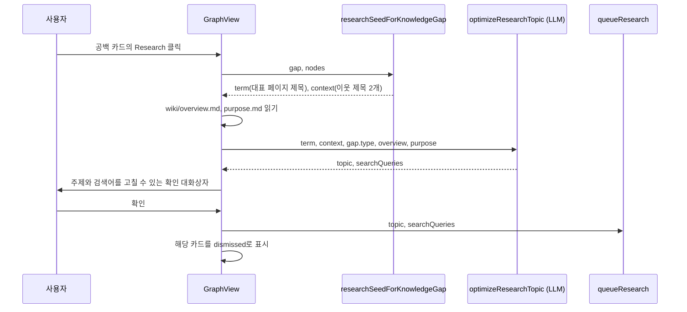

Louvain 커뮤니티와 응집도를 계산하고, 이를 바탕으로 예상 밖 연결과 지식 공백을 찾는다.

## 커뮤니티: Louvain과 응집도

`detectCommunities`는 graphology의 무방향 그래프에 엣지 weight를 속성으로 넣고 `graphology-communities-louvain`을 `resolution: 1`로 돌린다([wiki-graph-analysis.ts#L17-L35](https://github.com/nashsu/llm_wiki/blob/e08cfce65aad8b76b13546a081c1a8d4422b70c3/src/lib/wiki-graph-analysis.ts#L17-L35)). Louvain은 modularity를 키우는 방향으로 노드를 묶어 나가는 알고리즘이라, 사전에 정한 page type과 상관없이 링크 구조만으로 주제 묶음을 찾는다. 노드가 500개 이상이면 같은 함수를 Web Worker에서 돌리고, Worker가 실패하면 메인 스레드에서 다시 계산한다([wiki-graph.ts#L37-L72](https://github.com/nashsu/llm_wiki/blob/e08cfce65aad8b76b13546a081c1a8d4422b70c3/src/lib/wiki-graph.ts#L37-L72)).

코드 분석: 커뮤니티마다 붙는 두 지표를 본다. [wiki-graph-analysis.ts#L5-L14](https://github.com/nashsu/llm_wiki/blob/e08cfce65aad8b76b13546a081c1a8d4422b70c3/src/lib/wiki-graph-analysis.ts#L5-L14)

```ts
export function computeCommunityConnectivity(nodeCount: number, intraEdges: number): {
  cohesion: number
  meanIntraDegree: number
} {
  const possibleEdges = nodeCount > 1 ? (nodeCount * (nodeCount - 1)) / 2 : 1
  return {
    cohesion: intraEdges / possibleEdges,
    meanIntraDegree: nodeCount > 0 ? (2 * intraEdges) / nodeCount : 0,
  }
}
```

$$
\text{cohesion} = \frac{E_{in}}{n(n-1)/2}, \qquad \text{meanIntraDegree} = \frac{2E_{in}}{n}
$$

`cohesion`은 가능한 쌍 중 실제로 이어진 비율이라 커뮤니티가 커질수록 자연히 작아진다. `meanIntraDegree`는 페이지 하나가 커뮤니티 안에서 평균 몇 개와 이어지는지라 크기와 무관하게 비교할 수 있다. 내부 엣지 수는 모든 엣지를 한 번 조회해 두 끝이 같은 커뮤니티인지 보는 $O(E)$ 방식으로 센다. 계산이 끝나면 커뮤니티를 크기 내림차순으로 정렬하고 id를 0부터 다시 매긴다. 그래서 커뮤니티 0은 항상 가장 큰 묶음이고, 12색 팔레트에서 같은 색을 받는다([wiki-graph-analysis.ts#L78-L86](https://github.com/nashsu/llm_wiki/blob/e08cfce65aad8b76b13546a081c1a8d4422b70c3/src/lib/wiki-graph-analysis.ts#L78-L86)). 각 커뮤니티의 `topNodes`는 `linkCount` 상위 5개 페이지 제목이고, 범례가 이 중 첫 번째를 대표 이름으로 쓴다.

## 그래프 인사이트

인사이트는 두 종류다. 엣지 단위의 "놀라운 연결"과 노드, 커뮤니티 단위의 "지식 공백"이다. 둘 다 LLM을 쓰지 않는 규칙 계산이다.

### 놀라운 연결

`findSurprisingConnections`는 엣지마다 점수를 매겨 3점 이상인 것 중 상위 5개를 고른다. `index`, `log`, `overview` 노드에 연결된 엣지는 "link to everything" 구조 페이지라서 처음부터 뺀다([graph-insights.ts#L52-L123](https://github.com/nashsu/llm_wiki/blob/e08cfce65aad8b76b13546a081c1a8d4422b70c3/src/lib/graph-insights.ts#L52-L123)).

| 신호 | 점수 | 조건 |
| --- | --- | --- |
| 커뮤니티 경계 넘기 | +3 | 두 끝의 Louvain 커뮤니티가 다름 |
| 먼 type 연결 | +2 | `source-concept`, `source-synthesis`, `query-entity` 쌍 (양방향) |
| 다른 type | +1 | type이 다르지만 위 쌍이 아님 |
| 주변부와 허브 연결 | +2 | 한쪽 `linkCount ≤ 2`, 다른 쪽이 최대 `linkCount`의 50% 이상 |
| 약한 연결 | +1 | 엣지 weight가 0보다 크고 2 미만 |

코드 분석: 허브 판정과 채택 조건을 본다. [graph-insights.ts#L99-L118](https://github.com/nashsu/llm_wiki/blob/e08cfce65aad8b76b13546a081c1a8d4422b70c3/src/lib/graph-insights.ts#L99-L118)

```ts
    // Signal 3: Peripheral-to-hub coupling (+2)
    const sourceDeg = degreeMap.get(source.id) ?? 0
    const targetDeg = degreeMap.get(target.id) ?? 0
    const minDeg = Math.min(sourceDeg, targetDeg)
    const maxDeg = Math.max(sourceDeg, targetDeg)
    if (minDeg <= 2 && maxDeg >= maxDegree * 0.5) {
      score += 2
      reasons.push("peripheral node links to hub")
    }

    // Signal 4: Low-weight edge between connected nodes (+1)
    if (edge.weight < 2 && edge.weight > 0) {
      score += 1
      reasons.push("weak but present connection")
    }

    if (score >= 3 && reasons.length > 0) {
      const key = [source.id, target.id].sort().join(":::")
      scored.push({ source, target, score, reasons, key })
    }
```

이 코드에서 "허브"는 독립된 인사이트가 아니라, 그래프에서 연결이 가장 많은 노드의 절반 이상인 노드를 가리키는 상대 기준이다. 약한 연결 신호는 실제로는 드물게 켜진다. 엣지가 존재하면 직접 링크 신호(3.0)와 type 친화도(0.5 이상)만으로 weight가 2를 넘기 때문이다. `RetrievalGraph` 생성이 실패하거나 그 그래프에서 노드를 찾지 못해 weight가 기본값 1로 남는 경우에만 켜진다(코드로 확인한 조건, 실제 빈도는 미검증). `query-entity` 쌍도 `query` 노드를 그래프에서 빼므로 지금 구조에서는 나오지 않는다.

### 지식 공백

`detectKnowledgeGaps`는 세 가지를 찾고 합쳐서 최대 8개를 돌려준다([graph-insights.ts#L135-L215](https://github.com/nashsu/llm_wiki/blob/e08cfce65aad8b76b13546a081c1a8d4422b70c3/src/lib/graph-insights.ts#L135-L215)).

| 유형 | 판정 기준 | 표시 |
| --- | --- | --- |
| `isolated-node` | `linkCount ≤ 1`, `overview` type과 `index`, `log` 제외 | 하나의 카드로 묶고 앞 5개 제목과 나머지 개수 |
| `sparse-community` | `meanIntraDegree < 2`이고 페이지 3개 이상 | 커뮤니티마다 한 카드 |
| `bridge-node` | 이웃이 속한 커뮤니티가 3개 이상, 구조 페이지 제외 | 커뮤니티 수 상위 3개 |

고립 페이지 기준이 `linkCount ≤ 1`이라 링크를 하나만 가진 페이지도 고립으로 본다. llm-wiki.md가 말하는 "orphan pages with no inbound links"보다 넓은 기준이고, 들어오는 링크와 나가는 링크를 구분하지 않는다.

코드 분석: 희소 커뮤니티 판정을 본다. [graph-insights.ts#L160-L172](https://github.com/nashsu/llm_wiki/blob/e08cfce65aad8b76b13546a081c1a8d4422b70c3/src/lib/graph-insights.ts#L160-L172)

```ts
  // 2. Sparse communities. Raw density shrinks as communities grow, so use
  // mean internal degree: a stable and directly actionable metric.
  for (const comm of communities) {
    if (comm.meanIntraDegree < 2 && comm.nodeCount >= 3) {
      gaps.push({
        type: "sparse-community",
        title: `Sparse cluster: ${comm.topNodes[0] ?? `Community ${comm.id}`}`,
        description: `${comm.nodeCount} pages average ${comm.meanIntraDegree.toFixed(1)} internal links per page.`,
        nodeIds: nodes.filter((n) => n.community === comm.id).map((n) => n.id),
```

README는 희소 커뮤니티 기준을 "cohesion < 0.15, ≥ 3 pages"로 설명하지만([README.md#L185-L187](https://github.com/nashsu/llm_wiki/blob/e08cfce65aad8b76b13546a081c1a8d4422b70c3/README.md#L185-L187)), 코드는 평균 내부 차수 2 미만으로 바뀌었다. 주석이 이유를 밝힌다. 밀도는 커뮤니티가 커질수록 줄어들어서 큰 커뮤니티가 항상 희소로 잡히기 때문이다. 평균 내부 차수 2 미만은 "트리보다 약간 나은 수준"보다 덜 이어졌다는 뜻으로 읽을 수 있다. $n$개 노드의 트리는 내부 엣지 $n-1$개, 평균 차수 $2(n-1)/n < 2$이므로, 순환이 하나도 없는 묶음은 모두 희소로 잡힌다.

다리 노드(bridge)는 betweenness centrality를 계산하지 않는다. 함수 주석은 "high betweenness"라고 쓰지만, 실제로는 이웃 노드들이 속한 커뮤니티의 가짓수만 센다. 같은 커뮤니티 이웃이 하나라도 있으면 자기 커뮤니티도 한 가지로 세므로, 다른 커뮤니티 두 곳과만 더 이어져도 기준(3)을 충족한다.

### 인사이트와 딥 리서치 연계

공백 카드와 다리 노드 카드에는 딥 리서치 버튼이 붙는다. 흐름은 이렇다.



`researchSeedForKnowledgeGap`은 고립 페이지면 첫 페이지 제목만, 그 밖에는 `linkCount`가 가장 큰 페이지를 대표로 삼고 다음 두 페이지 제목을 문맥으로 붙인다([graph-insights.ts#L23-L42](https://github.com/nashsu/llm_wiki/blob/e08cfce65aad8b76b13546a081c1a8d4422b70c3/src/lib/graph-insights.ts#L23-L42)). LLM 최적화가 실패하면 `groundedFallbackResearchQuery`로 만든 검색어 하나로 대화상자를 연다([graph-view.tsx#L815-L870](https://github.com/nashsu/llm_wiki/blob/e08cfce65aad8b76b13546a081c1a8d4422b70c3/src/components/graph/graph-view.tsx#L815-L870)). 리서치 큐 이후는 10장에서 다룬다. 원본 패턴이 Lint에서 기대한 "data gaps that could be filled with a web search"를 그래프 구조에서 출발해 자동화한 경로다.

> **주의**: 카드의 "dismiss"는 `GraphView` 컴포넌트의 `useState` Set에만 기록된다([graph-view.tsx#L655](https://github.com/nashsu/llm_wiki/blob/e08cfce65aad8b76b13546a081c1a8d4422b70c3/src/components/graph/graph-view.tsx#L655)). README는 "mark connections as reviewed so they don't reappear"라고 쓰지만, 이 파일에서는 디스크에 저장하는 코드를 찾지 못했다. 그래프 뷰가 다시 마운트되면 같은 카드가 다시 나타날 수 있다(미검증).
