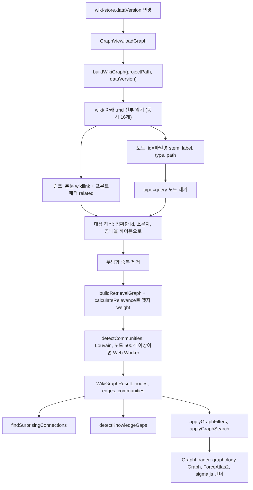

그래프 뷰는 별도의 그래프 데이터베이스 없이, 위키 페이지를 열 때마다 본문의 `[[wikilink]]`와 프론트매터 `related:`를 읽어 브라우저 안에서 그래프를 다시 만든다. 엣지 굵기는 네 가지 신호를 더한 관련도 점수로, 노드 색은 페이지 type이나 Louvain 커뮤니티로 정하고, 같은 그래프 위에서 "놀라운 연결"과 "지식 공백"을 규칙 기반으로 뽑는다. 이 장은 그 계산을 파일 단위로 따라간다.

## 원본 패턴 내 그래프의 위치

llm-wiki.md에서 그래프는 사람이 위키를 둘러보는 창이다. Karpathy는 LLM이 편집하는 동안 Obsidian으로 "checking the graph view"를 한다고 쓰고([llm-wiki.md#L15](https://github.com/nashsu/llm_wiki/blob/e08cfce65aad8b76b13546a081c1a8d4422b70c3/llm-wiki.md#L15)), Obsidian 그래프 뷰가 "which pages are hubs, which are orphans"를 보는 가장 좋은 방법이라고 적는다([llm-wiki.md#L59](https://github.com/nashsu/llm_wiki/blob/e08cfce65aad8b76b13546a081c1a8d4422b70c3/llm-wiki.md#L59)). 고립 페이지(orphan) 찾기는 Lint 작업 목록에도 들어 있다([llm-wiki.md#L41](https://github.com/nashsu/llm_wiki/blob/e08cfce65aad8b76b13546a081c1a8d4422b70c3/llm-wiki.md#L41)).

README는 이 부분을 직접 구현했다고 밝힌다. 원본은 `[[wikilinks]]`를 언급할 뿐 "has no graph analysis"라서 관련도 모델, 커뮤니티 탐지, 인사이트를 더했다는 설명이다([README.md#L138-L196](https://github.com/nashsu/llm_wiki/blob/e08cfce65aad8b76b13546a081c1a8d4422b70c3/README.md#L138-L196)). 그래프는 앱 안에서 Obsidian 그래프 뷰를 대신하고, 고립 페이지와 허브를 사람에게 보여 주는 진단 도구 역할을 한다. 린트(9장)가 같은 질문을 텍스트 목록으로 답한다면, 그래프 인사이트는 구조 지표로 답한다.

## 전체 흐름

그래프 뷰는 `wiki-store`의 `dataVersion`이 바뀌었을 때만 다시 만든다([graph-view.tsx#L750-L754](https://github.com/nashsu/llm_wiki/blob/e08cfce65aad8b76b13546a081c1a8d4422b70c3/src/components/graph/graph-view.tsx#L750-L754)). 수집, 병합(6장), 채팅 답 저장(8장)처럼 위키 파일을 바꾸는 작업이 끝에 `bumpDataVersion`을 부르면 그래프가 따라온다. 인사이트는 필터를 적용하기 전의 전체 그래프에서 계산한다([graph-view.tsx#L700-L725](https://github.com/nashsu/llm_wiki/blob/e08cfce65aad8b76b13546a081c1a8d4422b70c3/src/components/graph/graph-view.tsx#L700-L725)).

## 그래프 생성 지점 두 곳

같은 위키에서 링크 그래프를 만드는 코드가 TypeScript와 Rust에 따로 있다.

| 항목 | TypeScript `buildWikiGraph` | Rust `blend_graph_results` (6장) |
| --- | --- | --- |
| 쓰는 곳 | 그래프 뷰, 인사이트 | 검색 결과의 1홉 이웃 확장, 에이전트 `wiki.search` |
| 링크 원천 | 본문 wikilink + `related` | 본문 wikilink + `related` |
| 대상 별칭 | id, 소문자, 공백을 하이픈으로 | 경로, `wiki/` 뺀 경로, stem, 제목 (모두 소문자, 공백을 하이픈으로) |
| `query` 페이지 | 제외 | 포함 |
| 엣지 weight | 4신호 관련도 | 없음 (씨앗 순위로만 점수) |

Rust 쪽은 페이지 제목으로도 링크 대상을 찾으므로, 그래프 뷰에서 끊겨 보이는 `[[제목 그대로]]` 링크가 검색 확장에서는 이어질 수 있다. 채팅의 참고 자료 패널은 또 하나의 작은 그래프를 그린다. `reference-knowledge-graph.tsx`는 응답 참조 중 출처가 `Graph`인 항목과 그 `graphRelations`만으로 노드와 엣지를 만든다([reference-knowledge-graph.tsx#L17-L41](https://github.com/nashsu/llm_wiki/blob/e08cfce65aad8b76b13546a081c1a8d4422b70c3/src/components/chat/reference-knowledge-graph.tsx#L17-L41)). 에이전트의 `graph.search` 도구는 11장에서 다룬다.

## 정리

- 그래프는 저장된 구조가 아니라 `dataVersion`이 바뀔 때마다 `wiki/` 파일을 다시 읽어 만드는 파생 데이터다. 노드는 파일명 stem, 엣지는 본문 wikilink와 프론트매터 `related`이고, 대상을 찾지 못한 링크와 `query` type 페이지는 빠진다.
- 엣지 weight는 직접 링크 3.0, 원본 겹침 4.0, Adamic-Adar 1.5, type 친화도 1.0을 더한 값이다. 이 관련도 모델의 실제 쓰임은 엣지 굵기와 Louvain 가중치이고, README가 말하는 질의 단계의 2홉 확장에는 쓰이지 않는다.
- 커뮤니티는 graphology Louvain(resolution 1)으로 찾고, 크기 순으로 번호를 다시 매긴다. 희소 판정은 README의 밀도 0.15가 아니라 평균 내부 차수 2 미만이다.
- 인사이트는 LLM 없는 규칙 계산이다. 놀라운 연결은 커뮤니티 경계, type 차이, 주변부와 허브 연결을 점수로 더하고, 지식 공백은 `linkCount ≤ 1` 고립 페이지, 희소 커뮤니티, 커뮤니티 3개 이상과 연결된 bridge 노드를 찾는다.
- 공백 카드는 overview와 purpose를 문맥으로 LLM이 리서치 주제를 다듬은 뒤 딥 리서치 큐로 넘기므로, 원본 패턴의 Lint 단계 "웹 검색으로 채울 공백"을 그래프에서 출발해 실행한다.
- 렌더링은 sigma.js와 ForceAtlas2이고, 노드 수에 따라 반복 횟수, 라벨 밀도, 약한 엣지 기준을 바꾸며 220개 이상이면 Web Worker에서 레이아웃을 계산한다.
