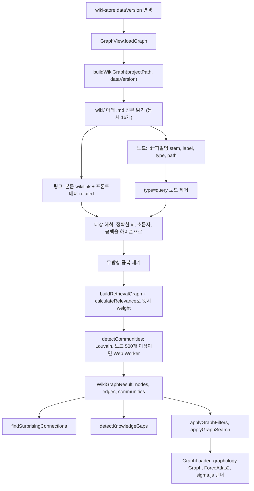
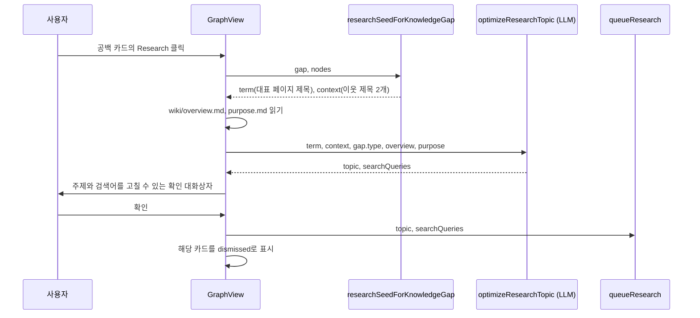

그래프 뷰는 별도의 그래프 데이터베이스 없이, 위키 페이지를 열 때마다 본문의 `[[wikilink]]`와 프론트매터 `related:`를 읽어 브라우저 안에서 그래프를 다시 만든다. 엣지 굵기는 네 가지 신호를 더한 관련도 점수로, 노드 색은 페이지 type이나 Louvain 커뮤니티로 정하고, 같은 그래프 위에서 "놀라운 연결"과 "지식 공백"을 규칙 기반으로 뽑는다. 이 장은 그 계산을 파일 단위로 따라간다.

## 원본 패턴에서 그래프의 자리

llm-wiki.md에서 그래프는 사람이 위키를 둘러보는 창이다. Karpathy는 LLM이 편집하는 동안 Obsidian으로 "checking the graph view"를 한다고 쓰고([llm-wiki.md#L15](https://github.com/nashsu/llm_wiki/blob/e08cfce65aad8b76b13546a081c1a8d4422b70c3/llm-wiki.md#L15)), Obsidian 그래프 뷰가 "which pages are hubs, which are orphans"를 보는 가장 좋은 방법이라고 적는다([llm-wiki.md#L59](https://github.com/nashsu/llm_wiki/blob/e08cfce65aad8b76b13546a081c1a8d4422b70c3/llm-wiki.md#L59)). 고립 페이지(orphan) 찾기는 Lint 작업 목록에도 들어 있다([llm-wiki.md#L41](https://github.com/nashsu/llm_wiki/blob/e08cfce65aad8b76b13546a081c1a8d4422b70c3/llm-wiki.md#L41)).

README는 이 부분을 직접 구현했다고 밝힌다. 원본은 `[[wikilinks]]`를 언급할 뿐 "has no graph analysis"라서 관련도 모델, 커뮤니티 탐지, 인사이트를 더했다는 설명이다([README.md#L138-L196](https://github.com/nashsu/llm_wiki/blob/e08cfce65aad8b76b13546a081c1a8d4422b70c3/README.md#L138-L196)). 그래프는 앱 안에서 Obsidian 그래프 뷰를 대신하고, 고립 페이지와 허브를 사람에게 보여 주는 진단 도구 역할을 한다. 린트(9장)가 같은 질문을 텍스트 목록으로 답한다면, 그래프 인사이트는 구조 지표로 답한다.

## 전체 흐름



그래프 뷰는 `wiki-store`의 `dataVersion`이 바뀌었을 때만 다시 만든다([graph-view.tsx#L750-L754](https://github.com/nashsu/llm_wiki/blob/e08cfce65aad8b76b13546a081c1a8d4422b70c3/src/components/graph/graph-view.tsx#L750-L754)). 수집, 병합(6장), 채팅 답 저장(8장)처럼 위키 파일을 바꾸는 작업이 끝에 `bumpDataVersion`을 부르면 그래프가 따라온다. 인사이트는 필터를 적용하기 전의 전체 그래프에서 계산한다([graph-view.tsx#L700-L725](https://github.com/nashsu/llm_wiki/blob/e08cfce65aad8b76b13546a081c1a8d4422b70c3/src/components/graph/graph-view.tsx#L700-L725)).

## 위키링크에서 그래프 만들기: buildWikiGraph

`buildWikiGraph`는 같은 프로젝트와 `dataVersion` 조합이면 캐시를 돌려주고, 같은 조합의 빌드가 진행 중이면 그 Promise를 공유한다. 캐시는 프로젝트 2개까지만 유지하고, 늦게 끝난 오래된 빌드가 새 결과를 덮지 않게 버전을 비교한다([wiki-graph.ts#L170-L204](https://github.com/nashsu/llm_wiki/blob/e08cfce65aad8b76b13546a081c1a8d4422b70c3/src/lib/wiki-graph.ts#L170-L204)).

실제 계산은 `buildWikiGraphUncached`가 한다. 파일마다 제목(프론트매터 `title`, 없으면 첫 `# ` heading, 그것도 없으면 파일명), type(없으면 `other`), 링크 목록을 뽑는다. 링크 목록은 본문 위키링크와 프론트매터 `related` 값을 합쳐 중복을 지운 것이다. 위키링크 정규식은 `[[대상|별칭]]`에서 대상만 잡는다([wiki-graph.ts#L74](https://github.com/nashsu/llm_wiki/blob/e08cfce65aad8b76b13546a081c1a8d4422b70c3/src/lib/wiki-graph.ts#L74)). `related` 값은 `[[...]]`, `|별칭`, `#앵커`, 디렉터리, `.md`를 모두 걷어내 파일명 stem만 남긴다([wiki-graph.ts#L114-L123](https://github.com/nashsu/llm_wiki/blob/e08cfce65aad8b76b13546a081c1a8d4422b70c3/src/lib/wiki-graph.ts#L114-L123)).

코드 분석: 링크를 엣지로 바꾸고 연결 수를 세는 루프를 본다. [wiki-graph.ts#L269-L281](https://github.com/nashsu/llm_wiki/blob/e08cfce65aad8b76b13546a081c1a8d4422b70c3/src/lib/wiki-graph.ts#L269-L281)

```ts
  for (const [sourceId, nodeData] of nodeMap) {
    for (const targetRaw of nodeData.links) {
      // Normalize target: try matching by id (case-insensitive, hyphen/space)
      const targetId = resolveTarget(targetRaw, targetIndex)
      if (targetId === null) continue
      if (targetId === sourceId) continue

      rawEdges.push({ source: sourceId, target: targetId, weight: 1 })

      linkCounts.set(sourceId, (linkCounts.get(sourceId) ?? 0) + 1)
      linkCounts.set(targetId, (linkCounts.get(targetId) ?? 0) + 1)
    }
  }
```

대상 해석은 정확한 id를 먼저 보고, 없으면 소문자, 소문자에 공백을 하이픈으로 바꾼 별칭 순으로 찾는다. 대소문자를 구분하는 파일 시스템에서 `Foo.md`와 `foo.md`가 따로 있으면 `[[foo]]`는 정확히 `foo`로 간다([wiki-graph.ts#L129-L147](https://github.com/nashsu/llm_wiki/blob/e08cfce65aad8b76b13546a081c1a8d4422b70c3/src/lib/wiki-graph.ts#L129-L147)). 대상을 찾지 못한 링크(아직 없는 페이지를 가리키는 링크)는 조용히 버린다. 그래프에 "빈 노드"를 그리지 않는다는 뜻이고, 깨진 링크 진단은 린트(9장)의 몫이다.

이 루프를 읽을 때 놓치기 쉬운 세 가지가 있다.

| 지점 | 동작 | 영향 |
| --- | --- | --- |
| 노드 id | 파일명 stem만 쓴다 (`fileNameToId`) | `entities/foo.md`와 `concepts/foo.md`가 있으면 `nodeMap.set`이 뒤의 것으로 덮는다. 벡터 인덱스(6장)의 디렉터리 포함 page id와 규칙이 다르다 |
| `linkCount` | 중복 제거 전 `rawEdges` 기준으로 센다 | A와 B가 서로 링크하면 각자 2를 받는다. 노드 크기와 고립 판정이 "링크 표기 수"를 따른다 |
| `query` type | 노드에서 제거한다 | 저장한 채팅 답(8장)과 리서치 결과는 그래프에 나오지 않는다 |

`query` 제거 이유는 주석에 적혀 있다. 질의 페이지는 "intermediate artifacts, not knowledge structure"이고, auto-ingest로 거기서 뽑아낸 entity와 concept가 그래프에 들어가야 한다는 판단이다([wiki-graph.ts#L250-L258](https://github.com/nashsu/llm_wiki/blob/e08cfce65aad8b76b13546a081c1a8d4422b70c3/src/lib/wiki-graph.ts#L250-L258)). 엣지는 방향을 무시하고 `A:::B`와 `B:::A`를 같은 것으로 보아 하나만 남긴다.

## 엣지 weight: 4신호 관련도 모델

중복 제거된 엣지마다 `calculateRelevance`로 weight를 매긴다. 이를 위해 `graph-relevance.ts`가 같은 파일들을 한 번 더 읽어 별도의 `RetrievalGraph`를 만든다([graph-relevance.ts#L202-L297](https://github.com/nashsu/llm_wiki/blob/e08cfce65aad8b76b13546a081c1a8d4422b70c3/src/lib/graph-relevance.ts#L202-L297)). 이 그래프는 방향 있는 `outLinks`, `inLinks`와 프론트매터 `sources` 목록을 노드에 담는다. `query` 노드를 빼지 않으므로 공통 이웃 계산에는 질의 페이지도 들어간다.

| 신호 | 가중치 | 계산 |
| --- | --- | --- |
| 직접 링크 | 3.0 | A→B, B→A 각각 1. 양방향이면 6.0 |
| 원본 겹침 | 4.0 | 두 페이지 `sources[]`에 같이 있는 원본 수 |
| 공통 이웃 (Adamic-Adar) | 1.5 | 공통 이웃 $z$마다 $1/\ln(\max(\deg z, 2))$의 합 |
| type 친화도 | 1.0 | `TYPE_AFFINITY[A.type][B.type]`, 표에 없으면 0.5 |

가중치와 type 친화도 표는 [graph-relevance.ts#L33-L46](https://github.com/nashsu/llm_wiki/blob/e08cfce65aad8b76b13546a081c1a8d4422b70c3/src/lib/graph-relevance.ts#L33-L46)에 있다.

$$
w(A,B) = 3\,(l_{AB}+l_{BA}) + 4\,|S_A \cap S_B| + 1.5\sum_{z \in N(A)\cap N(B)} \frac{1}{\ln \max(\deg z, 2)} + \tau(A,B)
$$

코드 분석: 공통 이웃 신호의 계산을 본다. [graph-relevance.ts#L328-L346](https://github.com/nashsu/llm_wiki/blob/e08cfce65aad8b76b13546a081c1a8d4422b70c3/src/lib/graph-relevance.ts#L328-L346)

```ts
  // Signal 3: Common neighbors - Adamic-Adar (weight 1.5)
  const neighborsA = getNeighbors(nodeA)
  const neighborsB = getNeighbors(nodeB)
  let adamicAdar = 0
  for (const neighborId of neighborsA) {
    if (neighborsB.has(neighborId)) {
      const neighbor = graph.nodes.get(neighborId)
      if (neighbor) {
        const degree = getNodeDegree(neighbor)
        adamicAdar += 1 / Math.log(Math.max(degree, 2))
      }
    }
  }
  const commonNeighborScore = adamicAdar * WEIGHTS.commonNeighbor

  // Signal 4: Type affinity (weight 1.0)
  const affinityMap = TYPE_AFFINITY[nodeA.type]
  const typeAffinityScore = (affinityMap?.[nodeB.type] ?? 0.5) * WEIGHTS.typeAffinity
```

Adamic-Adar는 링크 예측에서 쓰는 지표로, 연결이 많은 허브를 공유하는 것보다 연결이 적은 페이지를 공유하는 것을 더 강한 신호로 친다. 차수 하한을 2로 잡아 $\ln 1 = 0$으로 나누는 일을 막는다. 원본 겹침에 가장 큰 가중치(4.0)를 준 것은, 같은 원본에서 수집된 페이지는 링크가 없어도 내용이 가깝다는 가정이다. 이 가정은 원본 수명주기(5장)의 `sources[]` 프론트매터가 정확할 때만 성립한다.

type 친화도는 항상 0.5 이상이라 `calculateRelevance`는 0보다 큰 값을 돌려준다. 이 모듈의 `getRelatedNodes`는 "relevance > 0"인 노드를 모두 후보로 삼는데, 그러면 실질적으로 모든 노드가 후보가 된다. 다만 `getRelatedNodes`는 테스트 밖에서 호출하는 곳이 없다. README가 질의 파이프라인 Phase 2로 설명하는 "4-signal relevance model finds related pages, 2-hop traversal with decay"([README.md#L216-L219](https://github.com/nashsu/llm_wiki/blob/e08cfce65aad8b76b13546a081c1a8d4422b70c3/README.md#L216-L219))는 현재 코드에서는 이 TypeScript 모델이 아니라 Rust 검색의 1홉 확장(6장)이 맡는다. 현재 이 관련도 모델의 실제 쓰임은 그래프 뷰 엣지 weight 하나다.

> **주의**: `RetrievalGraph`의 프론트매터 파서는 정규식으로 `sources:` 블록 목록과 한 줄 배열만 읽는다([graph-relevance.ts#L91-L151](https://github.com/nashsu/llm_wiki/blob/e08cfce65aad8b76b13546a081c1a8d4422b70c3/src/lib/graph-relevance.ts#L91-L151)). 같은 파일의 `related`는 공용 `parseFrontmatter`로 읽는다. YAML 표기가 이 두 형태를 벗어나면 원본 겹침 신호가 0이 될 수 있다(추정).

## 커뮤니티: Louvain과 응집도

`detectCommunities`는 graphology의 무방향 그래프에 엣지 weight를 속성으로 넣고 `graphology-communities-louvain`을 `resolution: 1`로 돌린다([wiki-graph-analysis.ts#L17-L35](https://github.com/nashsu/llm_wiki/blob/e08cfce65aad8b76b13546a081c1a8d4422b70c3/src/lib/wiki-graph-analysis.ts#L17-L35)). Louvain은 modularity를 키우는 방향으로 노드를 묶어 나가는 알고리즘이라, 사전에 정한 page type과 상관없이 링크 구조만으로 주제 묶음을 찾는다. 노드가 500개 이상이면 같은 함수를 Web Worker에서 돌리고, Worker가 실패하면 메인 스레드에서 다시 계산한다([wiki-graph.ts#L37-L72](https://github.com/nashsu/llm_wiki/blob/e08cfce65aad8b76b13546a081c1a8d4422b70c3/src/lib/wiki-graph.ts#L37-L72)).

코드 분석: 커뮤니티마다 붙는 두 지표를 본다. [wiki-graph-analysis.ts#L5-L14](https://github.com/nashsu/llm_wiki/blob/e08cfce65aad8b76b13546a081c1a8d4422b70c3/src/lib/wiki-graph-analysis.ts#L5-L14)

```ts
export function computeCommunityConnectivity(nodeCount: number, intraEdges: number): {
  cohesion: number
  meanIntraDegree: number
} {
  const possibleEdges = nodeCount > 1 ? (nodeCount * (nodeCount - 1)) / 2 : 1
  return {
    cohesion: intraEdges / possibleEdges,
    meanIntraDegree: nodeCount > 0 ? (2 * intraEdges) / nodeCount : 0,
  }
}
```

$$
\text{cohesion} = \frac{E_{in}}{n(n-1)/2}, \qquad \text{meanIntraDegree} = \frac{2E_{in}}{n}
$$

`cohesion`은 가능한 쌍 중 실제로 이어진 비율이라 커뮤니티가 커질수록 자연히 작아진다. `meanIntraDegree`는 페이지 하나가 커뮤니티 안에서 평균 몇 개와 이어지는지라 크기와 무관하게 비교할 수 있다. 내부 엣지 수는 모든 엣지를 한 번 조회해 두 끝이 같은 커뮤니티인지 보는 $O(E)$ 방식으로 센다. 계산이 끝나면 커뮤니티를 크기 내림차순으로 정렬하고 id를 0부터 다시 매긴다. 그래서 커뮤니티 0은 항상 가장 큰 묶음이고, 12색 팔레트에서 같은 색을 받는다([wiki-graph-analysis.ts#L78-L86](https://github.com/nashsu/llm_wiki/blob/e08cfce65aad8b76b13546a081c1a8d4422b70c3/src/lib/wiki-graph-analysis.ts#L78-L86)). 각 커뮤니티의 `topNodes`는 `linkCount` 상위 5개 페이지 제목이고, 범례가 이 중 첫 번째를 대표 이름으로 쓴다.

## 그래프 인사이트

인사이트는 두 종류다. 엣지 단위의 "놀라운 연결"과 노드, 커뮤니티 단위의 "지식 공백"이다. 둘 다 LLM을 쓰지 않는 규칙 계산이다.

### 놀라운 연결

`findSurprisingConnections`는 엣지마다 점수를 매겨 3점 이상인 것 중 상위 5개를 고른다. `index`, `log`, `overview` 노드에 연결된 엣지는 "link to everything" 구조 페이지라서 처음부터 뺀다([graph-insights.ts#L52-L123](https://github.com/nashsu/llm_wiki/blob/e08cfce65aad8b76b13546a081c1a8d4422b70c3/src/lib/graph-insights.ts#L52-L123)).

| 신호 | 점수 | 조건 |
| --- | --- | --- |
| 커뮤니티 경계 넘기 | +3 | 두 끝의 Louvain 커뮤니티가 다름 |
| 먼 type 연결 | +2 | `source-concept`, `source-synthesis`, `query-entity` 쌍 (양방향) |
| 다른 type | +1 | type이 다르지만 위 쌍이 아님 |
| 주변부와 허브 연결 | +2 | 한쪽 `linkCount ≤ 2`, 다른 쪽이 최대 `linkCount`의 50% 이상 |
| 약한 연결 | +1 | 엣지 weight가 0보다 크고 2 미만 |

코드 분석: 허브 판정과 채택 조건을 본다. [graph-insights.ts#L99-L118](https://github.com/nashsu/llm_wiki/blob/e08cfce65aad8b76b13546a081c1a8d4422b70c3/src/lib/graph-insights.ts#L99-L118)

```ts
    // Signal 3: Peripheral-to-hub coupling (+2)
    const sourceDeg = degreeMap.get(source.id) ?? 0
    const targetDeg = degreeMap.get(target.id) ?? 0
    const minDeg = Math.min(sourceDeg, targetDeg)
    const maxDeg = Math.max(sourceDeg, targetDeg)
    if (minDeg <= 2 && maxDeg >= maxDegree * 0.5) {
      score += 2
      reasons.push("peripheral node links to hub")
    }

    // Signal 4: Low-weight edge between connected nodes (+1)
    if (edge.weight < 2 && edge.weight > 0) {
      score += 1
      reasons.push("weak but present connection")
    }

    if (score >= 3 && reasons.length > 0) {
      const key = [source.id, target.id].sort().join(":::")
      scored.push({ source, target, score, reasons, key })
    }
```

이 코드에서 "허브"는 독립된 인사이트가 아니라, 그래프에서 연결이 가장 많은 노드의 절반 이상인 노드를 가리키는 상대 기준이다. 약한 연결 신호는 실제로는 드물게 켜진다. 엣지가 존재하면 직접 링크 신호(3.0)와 type 친화도(0.5 이상)만으로 weight가 2를 넘기 때문이다. `RetrievalGraph` 생성이 실패하거나 그 그래프에서 노드를 찾지 못해 weight가 기본값 1로 남는 경우에만 켜진다(코드로 확인한 조건, 실제 빈도는 미검증). `query-entity` 쌍도 `query` 노드를 그래프에서 빼므로 지금 구조에서는 나오지 않는다.

### 지식 공백

`detectKnowledgeGaps`는 세 가지를 찾고 합쳐서 최대 8개를 돌려준다([graph-insights.ts#L135-L215](https://github.com/nashsu/llm_wiki/blob/e08cfce65aad8b76b13546a081c1a8d4422b70c3/src/lib/graph-insights.ts#L135-L215)).

| 유형 | 판정 기준 | 표시 |
| --- | --- | --- |
| `isolated-node` | `linkCount ≤ 1`, `overview` type과 `index`, `log` 제외 | 하나의 카드로 묶고 앞 5개 제목과 나머지 개수 |
| `sparse-community` | `meanIntraDegree < 2`이고 페이지 3개 이상 | 커뮤니티마다 한 카드 |
| `bridge-node` | 이웃이 속한 커뮤니티가 3개 이상, 구조 페이지 제외 | 커뮤니티 수 상위 3개 |

고립 페이지 기준이 `linkCount ≤ 1`이라 링크를 하나만 가진 페이지도 고립으로 본다. llm-wiki.md가 말하는 "orphan pages with no inbound links"보다 넓은 기준이고, 들어오는 링크와 나가는 링크를 구분하지 않는다.

코드 분석: 희소 커뮤니티 판정을 본다. [graph-insights.ts#L160-L172](https://github.com/nashsu/llm_wiki/blob/e08cfce65aad8b76b13546a081c1a8d4422b70c3/src/lib/graph-insights.ts#L160-L172)

```ts
  // 2. Sparse communities. Raw density shrinks as communities grow, so use
  // mean internal degree: a stable and directly actionable metric.
  for (const comm of communities) {
    if (comm.meanIntraDegree < 2 && comm.nodeCount >= 3) {
      gaps.push({
        type: "sparse-community",
        title: `Sparse cluster: ${comm.topNodes[0] ?? `Community ${comm.id}`}`,
        description: `${comm.nodeCount} pages average ${comm.meanIntraDegree.toFixed(1)} internal links per page.`,
        nodeIds: nodes.filter((n) => n.community === comm.id).map((n) => n.id),
```

README는 희소 커뮤니티 기준을 "cohesion < 0.15, ≥ 3 pages"로 설명하지만([README.md#L185-L187](https://github.com/nashsu/llm_wiki/blob/e08cfce65aad8b76b13546a081c1a8d4422b70c3/README.md#L185-L187)), 코드는 평균 내부 차수 2 미만으로 바뀌었다. 주석이 이유를 밝힌다. 밀도는 커뮤니티가 커질수록 줄어들어서 큰 커뮤니티가 항상 희소로 잡히기 때문이다. 평균 내부 차수 2 미만은 "트리보다 약간 나은 수준"보다 덜 이어졌다는 뜻으로 읽을 수 있다. $n$개 노드의 트리는 내부 엣지 $n-1$개, 평균 차수 $2(n-1)/n < 2$이므로, 순환이 하나도 없는 묶음은 모두 희소로 잡힌다.

다리 노드(bridge)는 betweenness centrality를 계산하지 않는다. 함수 주석은 "high betweenness"라고 쓰지만, 실제로는 이웃 노드들이 속한 커뮤니티의 가짓수만 센다. 같은 커뮤니티 이웃이 하나라도 있으면 자기 커뮤니티도 한 가지로 세므로, 다른 커뮤니티 두 곳과만 더 이어져도 기준(3)을 충족한다.

### 인사이트와 딥 리서치 연계

공백 카드와 다리 노드 카드에는 딥 리서치 버튼이 붙는다. 흐름은 이렇다.



`researchSeedForKnowledgeGap`은 고립 페이지면 첫 페이지 제목만, 그 밖에는 `linkCount`가 가장 큰 페이지를 대표로 삼고 다음 두 페이지 제목을 문맥으로 붙인다([graph-insights.ts#L23-L42](https://github.com/nashsu/llm_wiki/blob/e08cfce65aad8b76b13546a081c1a8d4422b70c3/src/lib/graph-insights.ts#L23-L42)). LLM 최적화가 실패하면 `groundedFallbackResearchQuery`로 만든 검색어 하나로 대화상자를 연다([graph-view.tsx#L815-L870](https://github.com/nashsu/llm_wiki/blob/e08cfce65aad8b76b13546a081c1a8d4422b70c3/src/components/graph/graph-view.tsx#L815-L870)). 리서치 큐 이후는 10장에서 다룬다. 원본 패턴이 Lint에서 기대한 "data gaps that could be filled with a web search"를 그래프 구조에서 출발해 자동화한 경로다.

> **주의**: 카드의 "dismiss"는 `GraphView` 컴포넌트의 `useState` Set에만 기록된다([graph-view.tsx#L655](https://github.com/nashsu/llm_wiki/blob/e08cfce65aad8b76b13546a081c1a8d4422b70c3/src/components/graph/graph-view.tsx#L655)). README는 "mark connections as reviewed so they don't reappear"라고 쓰지만, 이 파일에서는 디스크에 저장하는 코드를 찾지 못했다. 그래프 뷰가 다시 마운트되면 같은 카드가 다시 나타날 수 있다(미검증).

## 필터와 그래프 안 검색

화면에 그리기 전에 `applyGraphFilters`와 `applyGraphSearch`를 차례로 적용한다([graph-view.tsx#L925-L931](https://github.com/nashsu/llm_wiki/blob/e08cfce65aad8b76b13546a081c1a8d4422b70c3/src/components/graph/graph-view.tsx#L925-L931)). 숨긴 노드에 연결된 엣지는 함께 사라진다.

| 필터 필드 | 기본값 | 숨기는 노드 |
| --- | --- | --- |
| `hiddenTypes` | 빈 Set | type이 Set에 있는 노드 |
| `hiddenNodeIds` | 빈 Set | 사용자가 하나씩 숨긴 노드 |
| `hideStructural` | `true` | id가 `index`, `overview`, `log`, `schema`, `purpose`이거나 type이 `overview`이거나 해당 경로로 끝나는 노드 |
| `hideIsolated` | `false` | `linkCount ≤ 0` |
| `minLinks` / `maxLinks` | 없음 | 연결 수가 범위 밖인 노드 |

값은 [graph-filters.ts#L19-L43](https://github.com/nashsu/llm_wiki/blob/e08cfce65aad8b76b13546a081c1a8d4422b70c3/src/lib/graph-filters.ts#L19-L43)에 있다. 구조 페이지를 기본으로 숨기는 이유는 인사이트에서 빼는 이유와 같다. `index.md`는 모든 페이지를 링크하므로, 그리면 모든 노드가 한 점으로 끌려가 레이아웃이 의미를 잃는다.

그래프 안 검색은 6장의 검색기와 무관한 단순 필터다. 질의를 공백으로 나눠, 모든 토큰이 노드의 제목, id, type, 경로를 이은 문자열에 들어 있는 노드만 남긴다(AND 조건)([graph-search.ts#L9-L43](https://github.com/nashsu/llm_wiki/blob/e08cfce65aad8b76b13546a081c1a8d4422b70c3/src/lib/graph-search.ts#L9-L43)). 일치한 노드끼리의 엣지만 남기므로 검색 중에는 이웃이 함께 보이지 않는다.

## 렌더링: sigma.js, graphology, ForceAtlas2

`GraphLoader`는 결과를 graphology `Graph`로 옮기고 sigma.js(`@react-sigma/core`)로 그린다. 노드 크기와 엣지 모양은 데이터에서 계산한다.

코드 분석: 노드 크기 계산을 본다. [graph-view.tsx#L228-L238](https://github.com/nashsu/llm_wiki/blob/e08cfce65aad8b76b13546a081c1a8d4422b70c3/src/components/graph/graph-view.tsx#L228-L238)

```tsx
function graphDensityScale(nodeCount: number): number {
  if (nodeCount <= 150) return 1
  return Math.max(0.35, Math.sqrt(150 / nodeCount))
}

function nodeSize(linkCount: number, maxLinks: number, nodeCount: number, userScale: number): number {
  if (maxLinks === 0) return BASE_NODE_SIZE
  const ratio = linkCount / maxLinks
  const size = BASE_NODE_SIZE + Math.sqrt(ratio) * (MAX_NODE_SIZE - BASE_NODE_SIZE)
  return size * graphDensityScale(nodeCount) * userScale
}
```

노드 크기는 8에서 28 사이에서 `linkCount` 비율의 제곱근을 따른다. 제곱근을 쓰면 허브 하나가 화면을 덮지 않고, 연결이 적은 노드끼리의 차이도 보인다. 노드가 150개를 넘으면 전체 크기를 줄이되 0.35배 아래로는 줄이지 않는다. 엣지는 weight를 최댓값으로 나눈 비율로 굵기 0.5..4, 불투명도 40..220/255를 정한다([graph-view.tsx#L350-L373](https://github.com/nashsu/llm_wiki/blob/e08cfce65aad8b76b13546a081c1a8d4422b70c3/src/components/graph/graph-view.tsx#L350-L373)). README의 "green=strong, gray=weak" 설명([README.md#L156](https://github.com/nashsu/llm_wiki/blob/e08cfce65aad8b76b13546a081c1a8d4422b70c3/README.md#L156))과 달리 현재 코드는 slate 한 색에 투명도만 바꾼다.

노드 수에 따라 바뀌는 설정은 다음과 같다([graph-view.tsx#L240-L267](https://github.com/nashsu/llm_wiki/blob/e08cfce65aad8b76b13546a081c1a8d4422b70c3/src/components/graph/graph-view.tsx#L240-L267)).

| 노드 수 | ForceAtlas2 반복 | 약한 엣지 기준 (정규화 weight) | 라벨 크기 하한 | 라벨 밀도 |
| --- | --- | --- | --- | --- |
| 250 이하 | 140 | 0 (모두 표시) | 6 | 0.4 |
| 251..600 | 90 | 0 | 6 | 0.4 |
| 601..700 | 65 | 0 | 10 | 0.24 |
| 701..1200 | 65 | 0.05 | 10 | 0.24 |
| 1201..2500 | 40 | 0.1 | 14 | 0.14 |
| 2500 초과 | 28 | 0.16 | 18 | 0.08 |

약한 엣지 기준보다 낮은 엣지는 `lowPriority`로 표시해 덜 중요하게 그린다. 레이아웃은 ForceAtlas2에 `strongGravityMode`, 노드 50개 초과 시 Barnes-Hut 근사를 켠다. 노드가 220개 이상이면 `graph-layout-worker.ts`의 Web Worker에서 계산하고 끝나면 좌표만 받아 반영한다([graph-layout-worker.ts#L12-L45](https://github.com/nashsu/llm_wiki/blob/e08cfce65aad8b76b13546a081c1a8d4422b70c3/src/components/graph/graph-layout-worker.ts#L12-L45)). 계산된 좌표는 모듈 수준 `positionCache`에 남겨, 데이터가 조금 바뀌어도 기존 노드가 제자리에 있게 한다. 레이아웃은 노드 id, 엣지, weight, 간격 설정으로 만든 키가 바뀔 때만 다시 돌린다.

마우스를 노드에 올리면 sigma 그래프의 `neighbors`로 이웃 Set을 만들어 이웃만 밝게 남기고, 클릭하면 오른쪽 미리보기 패널에서 페이지를 연다([graph-view.tsx#L536-L573](https://github.com/nashsu/llm_wiki/blob/e08cfce65aad8b76b13546a081c1a8d4422b70c3/src/components/graph/graph-view.tsx#L536-L573)). 색은 type 모드(entity 파랑, concept 보라, source 주황 등 11종)와 커뮤니티 모드(12색 순환) 사이를 오간다([graph-view.tsx#L28-L66](https://github.com/nashsu/llm_wiki/blob/e08cfce65aad8b76b13546a081c1a8d4422b70c3/src/components/graph/graph-view.tsx#L28-L66)).

## 그래프 생성 지점 두 곳

같은 위키에서 링크 그래프를 만드는 코드가 TypeScript와 Rust에 따로 있다.

| 항목 | TypeScript `buildWikiGraph` | Rust `blend_graph_results` (6장) |
| --- | --- | --- |
| 쓰는 곳 | 그래프 뷰, 인사이트 | 검색 결과의 1홉 이웃 확장, 에이전트 `wiki.search` |
| 링크 원천 | 본문 wikilink + `related` | 본문 wikilink + `related` |
| 대상 별칭 | id, 소문자, 공백을 하이픈으로 | 경로, `wiki/` 뺀 경로, stem, 제목 (모두 소문자, 공백을 하이픈으로) |
| `query` 페이지 | 제외 | 포함 |
| 엣지 weight | 4신호 관련도 | 없음 (씨앗 순위로만 점수) |

Rust 쪽은 페이지 제목으로도 링크 대상을 찾으므로, 그래프 뷰에서 끊겨 보이는 `[[제목 그대로]]` 링크가 검색 확장에서는 이어질 수 있다. 채팅의 참고 자료 패널은 또 하나의 작은 그래프를 그린다. `reference-knowledge-graph.tsx`는 응답 참조 중 출처가 `Graph`인 항목과 그 `graphRelations`만으로 노드와 엣지를 만든다([reference-knowledge-graph.tsx#L17-L41](https://github.com/nashsu/llm_wiki/blob/e08cfce65aad8b76b13546a081c1a8d4422b70c3/src/components/chat/reference-knowledge-graph.tsx#L17-L41)). 에이전트의 `graph.search` 도구는 11장에서 다룬다.

## 정리

- 그래프는 저장된 구조가 아니라 `dataVersion`이 바뀔 때마다 `wiki/` 파일을 다시 읽어 만드는 파생 데이터다. 노드는 파일명 stem, 엣지는 본문 wikilink와 프론트매터 `related`이고, 대상을 찾지 못한 링크와 `query` type 페이지는 빠진다.
- 엣지 weight는 직접 링크 3.0, 원본 겹침 4.0, Adamic-Adar 1.5, type 친화도 1.0을 더한 값이다. 이 관련도 모델의 실제 쓰임은 엣지 굵기와 Louvain 가중치이고, README가 말하는 질의 단계의 2홉 확장에는 쓰이지 않는다.
- 커뮤니티는 graphology Louvain(resolution 1)으로 찾고, 크기 순으로 번호를 다시 매긴다. 희소 판정은 README의 밀도 0.15가 아니라 평균 내부 차수 2 미만이다.
- 인사이트는 LLM 없는 규칙 계산이다. 놀라운 연결은 커뮤니티 경계, type 차이, 주변부와 허브 연결을 점수로 더하고, 지식 공백은 `linkCount ≤ 1` 고립 페이지, 희소 커뮤니티, 커뮤니티 3개 이상과 연결된 bridge 노드를 찾는다.
- 공백 카드는 overview와 purpose를 문맥으로 LLM이 리서치 주제를 다듬은 뒤 딥 리서치 큐로 넘기므로, 원본 패턴의 Lint 단계 "웹 검색으로 채울 공백"을 그래프에서 출발해 실행한다.
- 렌더링은 sigma.js와 ForceAtlas2이고, 노드 수에 따라 반복 횟수, 라벨 밀도, 약한 엣지 기준을 바꾸며 220개 이상이면 Web Worker에서 레이아웃을 계산한다.
