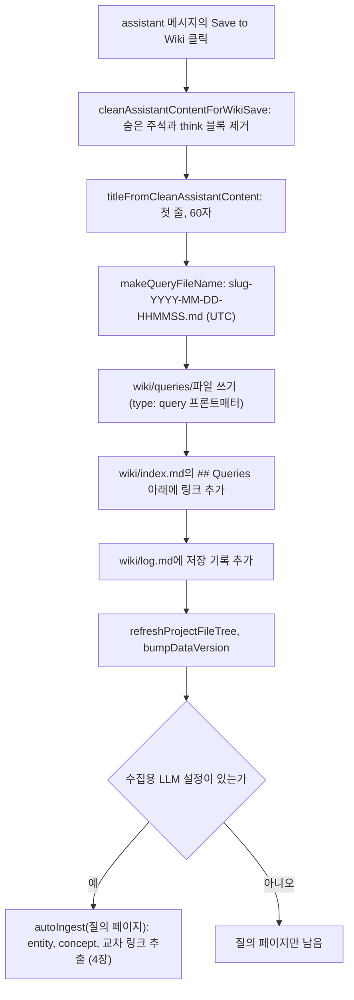

좋은 답을 위키 페이지로 남기는 Save to Wiki와 위키에 직접 쓰는 다른 경로를 본다.

## 참조와 대화 저장

에이전트가 도구를 실행하면 `referenceAdded` 이벤트가 오고, `handleSend`는 `kind:url-or-path` 키로 중복을 지워 `references` 배열에 모은다. 스트림이 끝나면 답, 참조, 도구 단계, 파일 변경 내역을 함께 assistant 메시지로 확정한다. 메시지 아래 참고 자료 패널은 이 참조를 type별 아이콘으로 묶어 보여 주고, 그래프 출처 참조는 작은 관계 그래프로 그린다(7장).

대화는 `.llm-wiki/conversations.json`과 대화별 `.llm-wiki/chats/<id>.json`에 저장한다. 대화마다 마지막 100개 메시지만 남기고, 이미지는 저장하기 전에 걷어낸다([persist.ts#L95-L112](https://github.com/nashsu/llm_wiki/blob/e08cfce65aad8b76b13546a081c1a8d4422b70c3/src/lib/persist.ts#L95-L112)). 주석이 이유를 밝힌다. 수 MB짜리 base64가 자동 저장 파일과 프로젝트 백업을 빠르게 키우기 때문이다. 앱을 다시 열면 이미지가 빠진 대화가 복원되고, "다시 생성"은 메모리에 남아 있는 같은 세션에서만 이미지를 다시 보낸다([chat-panel.tsx#L1295-L1321](https://github.com/nashsu/llm_wiki/blob/e08cfce65aad8b76b13546a081c1a8d4422b70c3/src/components/chat/chat-panel.tsx#L1295-L1321)).

이미지 첨부 제한은 프론트와 Rust 양쪽에 있다.

| 항목 | 프론트 `chat-image-utils.ts` | Rust `validate_images` |
| --- | --- | --- |
| 허용 형식 | png, jpeg, webp, gif | png, jpeg, webp, gif |
| 개수 | 메시지당 5 | 턴당 5 |
| 크기 | 원본 5 MB | base64 문자열 7 MiB |

값은 [chat-image-utils.ts#L4-L12](https://github.com/nashsu/llm_wiki/blob/e08cfce65aad8b76b13546a081c1a8d4422b70c3/src/lib/chat-image-utils.ts#L4-L12)와 [runtime.rs#L36-L37](https://github.com/nashsu/llm_wiki/blob/e08cfce65aad8b76b13546a081c1a8d4422b70c3/src-tauri/src/agent/runtime.rs#L36-L37), [runtime.rs#L3891-L3913](https://github.com/nashsu/llm_wiki/blob/e08cfce65aad8b76b13546a081c1a8d4422b70c3/src-tauri/src/agent/runtime.rs#L3891-L3913)에 있다. base64는 원본보다 약 4/3배 크므로 5 MB 원본은 약 6.7 MB가 되어 Rust 상한 안에 들어간다. `fileToMessageImage`는 `FileReader.readAsDataURL` 결과에서 `data:...;base64,` 접두어를 떼고 본문만 남긴다. 공급자별 이미지 포맷 변환은 12장에서 다룬다.

## 답변의 위키 저장: Save to Wiki

원본 패턴의 "file back into the wiki"는 assistant 메시지마다 붙는 `SaveToWikiButton`이 구현한다. 예전에는 답이 저장할 가치가 있는지 자동으로 판단하는 기능이 있었으나 지금은 지워졌고, 코드 주석에 "save-worthy detection removed"와 함께 각 메시지에 "Save to Wiki" 버튼이 있다는 설명이 남아 있다([chat-panel.tsx#L1235](https://github.com/nashsu/llm_wiki/blob/e08cfce65aad8b76b13546a081c1a8d4422b70c3/src/components/chat/chat-panel.tsx#L1235)). 무엇을 위키에 쌓을지는 사람이 정한다.



### 본문 정리와 제목

코드 분석: 저장하기 전에 답 본문에서 지우는 것을 본다. [chat-save-to-wiki.ts#L1-L16](https://github.com/nashsu/llm_wiki/blob/e08cfce65aad8b76b13546a081c1a8d4422b70c3/src/lib/chat-save-to-wiki.ts#L1-L16)

```ts
export function cleanAssistantContentForWikiSave(content: string): string {
  return content
    .replace(/<!--\s*(?:save-worthy|sources):[^\n]*?-->/g, "")
    .replace(/<think(?:ing)?>\s*[\s\S]*?<\/think(?:ing)?>\s*/gi, "")
    .replace(/<think(?:ing)?>\s*[\s\S]*$/gi, "")
    .replace(/^\s+/, "")
    .trimEnd()
}

export function titleFromCleanAssistantContent(clean: string): string {
  const firstVisibleLine = clean
    .split("\n")
    .map((line) => line.replace(/^#+\s*/, "").trim())
    .find((line) => line.length > 0)
  return firstVisibleLine?.slice(0, 60) || "Saved Query"
}
```

세 번째 정규식은 닫는 태그 없이 끝난 `<think>` 블록, 즉 사고 과정이 중간에 끊긴 답의 나머지를 모두 지운다. 채팅 스트림이 추론 토큰을 `<think>...</think>`로 감싸 본문과 같은 문자열에 이어 붙이기 때문에 필요한 처리다. 제목은 질문이 아니라 답의 첫 줄이다. 답이 "## 요약"처럼 일반적인 heading으로 시작하면 제목도 "요약"이 된다.

파일명은 `wiki-filename.ts`가 만든다. 제목을 NFKC로 정규화하고 소문자로 바꾼 뒤 Unicode 문자, 숫자, 하이픈만 남겨 50자로 자르고, UTC 날짜와 시분초를 붙인다([wiki-filename.ts#L32-L66](https://github.com/nashsu/llm_wiki/blob/e08cfce65aad8b76b13546a081c1a8d4422b70c3/src/lib/wiki-filename.ts#L32-L66)). 머리 주석에 따르면 예전 구현이 ASCII 밖 문자를 모두 지워 중국어 제목이 빈 slug가 되었고, 하루에 하나만 저장되는 충돌이 있었다. 한국어 제목도 `\p{L}`에 들어가므로 slug에 그대로 남는다.

### 파일 쓰기와 색인 갱신

코드 분석: 질의 페이지와 `index.md`를 쓰는 부분을 본다. [chat-message.tsx#L567-L577](https://github.com/nashsu/llm_wiki/blob/e08cfce65aad8b76b13546a081c1a8d4422b70c3/src/components/chat/chat-message.tsx#L567-L577)

```tsx
      const frontmatter = [
        "---",
        `type: query`,
        `title: "${title.replace(/"/g, '\\"')}"`,
        `created: ${date}`,
        `tags: []`,
        "---",
        "",
      ].join("\n")

      await writeFile(filePath, frontmatter + cleanContent)
```

질의 페이지의 프론트매터는 `type`, `title`, `created`, `tags` 네 개다. `index.md`에는 `## Queries` 절 바로 아래에 `- [[queries/<파일명>|<제목>]]` 줄을 넣고, 절이 없으면 파일 끝에 절을 만든다. `log.md`에는 "Saved query page" 한 줄을 붙인다. 원본 패턴의 `index.md`(내용 목록)와 `log.md`(시간순 기록) 관례를 그대로 따른 것이다([llm-wiki.md#L47-L49](https://github.com/nashsu/llm_wiki/blob/e08cfce65aad8b76b13546a081c1a8d4422b70c3/llm-wiki.md#L47-L49)).

이어서 파일 트리를 새로 고치고 `dataVersion`을 올린 다음, 수집용 LLM 설정(`getTaskLlmConfig("ingest")`)이 쓸 수 있으면 질의 페이지 경로를 원본 삼아 `autoIngest`를 부른다([chat-message.tsx#L614-L625](https://github.com/nashsu/llm_wiki/blob/e08cfce65aad8b76b13546a081c1a8d4422b70c3/src/components/chat/chat-message.tsx#L614-L625)). 이 수집은 기다리지 않고 백그라운드에서 돌며, 실패는 콘솔에만 남는다. 수집 파이프라인(4장)이 답 안의 entity와 concept를 뽑아 해당 페이지를 만들거나 고치고, 교차 링크를 건다. 리뷰 화면(9장)의 "save:" 액션도 같은 두 함수와 같은 파일명 규칙으로 질의 페이지를 쓴다([review-view.tsx#L118-L140](https://github.com/nashsu/llm_wiki/blob/e08cfce65aad8b76b13546a081c1a8d4422b70c3/src/components/review/review-view.tsx#L118-L140)).

### 저장된 답의 위치

저장된 질의 페이지가 위키 안에서 어떻게 다뤄지는지 정리하면 다음과 같다.

| 기능 | 질의 페이지 (`type: query`) 취급 | 근거 |
| --- | --- | --- |
| 그래프 뷰 | 노드에서 제외 | `wiki-graph.ts`의 `HIDDEN_TYPES` (7장) |
| 키워드 검색 | 포함 | `wiki/` 전수 순회 (6장) |
| 벡터 검색 | 수집이 `embedPage`를 부르면 포함 (미검증) | auto-ingest 경로 |
| `index.md` | `## Queries` 절에 링크 | `SaveToWikiButton` |
| 관련도 모델 | type 친화도 표에 `query` 행이 있음 | `graph-relevance.ts` |

설계 의도는 `wiki-graph.ts` 주석에 드러난다. 질의 페이지는 "intermediate artifacts"이고, 지식 구조로 남는 것은 auto-ingest가 거기서 뽑은 entity와 concept다. 답 자체는 기록으로 남기고, 답이 담은 지식은 기존 페이지 체계로 흡수한다. 원본 패턴의 "explorations compound in the knowledge base"를 두 단계로 나눈 셈이다.

> **주의**: 저장되는 것은 정리한 답 본문뿐이다. 메시지에 붙어 있던 참조 목록(어느 위키 페이지를 근거로 답했는지)은 질의 페이지의 프론트매터에도 본문에도 들어가지 않는다. 답 본문이 페이지 경로를 언급했다면 그 문자열만 남는다. 원본 패턴의 "synthesizes an answer with citations"를 위키에 누적할 때 인용 관계가 끊길 수 있다.

> **주의**: `index.md`가 없을 때 새로 만드는 기본 내용은 "# Wiki Index" 제목과 `## Queries` 절뿐이다. 수집이 만든 다른 절 구조와 다를 수 있다. 정규식이 `## Queries\n`을 찾으므로 Windows 줄바꿈(`\r\n`)으로 저장된 `index.md`에서는 기존 절을 찾지 못하고 같은 이름의 절을 파일 끝에 하나 더 만들 수 있다(추정).

## 위키 직접 쓰기의 다른 두 경로

Save to Wiki 말고도 대화에서 위키로 가는 길이 두 개 더 있다.

| 경로 | 동작 | 범위 |
| --- | --- | --- |
| 에이전트 `wiki.write_page` | 사용자가 명시적으로 요청할 때만 페이지를 만들거나 고침. 기존 페이지는 `allowOverwrite`가 정당할 때만 덮어씀 | 11장 |
| 수집 모드의 "Write to Wiki" | 채팅 패널이 `ingest` 모드일 때 대화 내용으로 `executeIngestWrites` 실행 | 4장 |

에이전트 루프 시스템 프롬프트는 "Use wiki.write_page only when the user explicitly asks to create or update a wiki page"라고 제한한다([runtime.rs#L2915-L2951](https://github.com/nashsu/llm_wiki/blob/e08cfce65aad8b76b13546a081c1a8d4422b70c3/src-tauri/src/agent/runtime.rs#L2915-L2951)). 수집 모드 버튼은 `mode === "ingest"`이고 스트리밍 중이 아니며 assistant 메시지가 있을 때만 보인다([chat-panel.tsx#L1409-L1421](https://github.com/nashsu/llm_wiki/blob/e08cfce65aad8b76b13546a081c1a8d4422b70c3/src/components/chat/chat-panel.tsx#L1409-L1421)).
