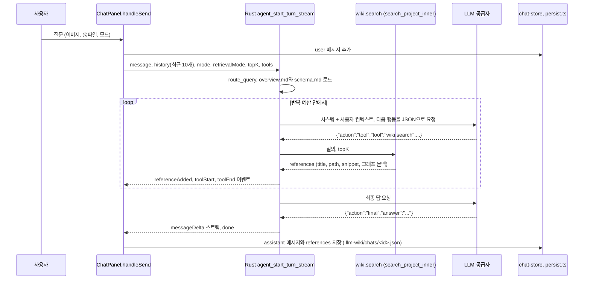

질의는 LLM Wiki의 세 핵심 작업(수집, 질의, 린트) 가운데 위키를 "읽는" 쪽이지만, 원본 패턴은 좋은 답을 다시 위키 페이지로 쌓으라고 요구한다. 이 구현에서 채팅은 Rust 에이전트에 질문을 넘기고, 에이전트가 `wiki.search`로 페이지를 찾아 답하며, 사용자가 답 아래의 "Save to Wiki" 버튼을 누르면 `wiki/queries/`에 새 페이지를 쓰고 수집 파이프라인을 다시 돌려 entity와 concept를 뽑는다. 이 장은 질의 때 어떤 내용이 프롬프트에 들어가는지, 그리고 답이 위키로 돌아가는 경로를 코드로 확인한다.

## 원본 패턴의 질의와 구현 차이

llm-wiki.md의 Query 설명은 세 문장으로 요약된다. LLM이 관련 페이지를 찾아 읽고 인용과 함께 답한다. 답은 표, 슬라이드, 차트 등 여러 형태일 수 있다. 그리고 "good answers can be filed back into the wiki as new pages"이므로 탐색도 수집처럼 지식에 누적된다([llm-wiki.md#L39](https://github.com/nashsu/llm_wiki/blob/e08cfce65aad8b76b13546a081c1a8d4422b70c3/llm-wiki.md#L39)). 관련 페이지를 찾는 방법으로는 `index.md`를 먼저 읽고 필요한 페이지로 내려가는 방식을 제안한다([llm-wiki.md#L47](https://github.com/nashsu/llm_wiki/blob/e08cfce65aad8b76b13546a081c1a8d4422b70c3/llm-wiki.md#L47)).

| 원본 패턴 | 이 구현 | 확인 위치 |
| --- | --- | --- |
| 질의 시 `index.md`를 먼저 읽음 | `index.md`를 프롬프트에 넣지 않음. 에이전트가 `wiki.search`로 검색 | `agent/context.rs`, `agent/tools.rs` |
| LLM이 관련 페이지를 찾아 읽음 | 키워드, 벡터, 그래프 1홉 검색 결과의 제목, 경로, snippet을 넣음. deep 모드는 본문 포함 | `chat-panel.tsx` 요청 인자 |
| 인용과 함께 답함 | 시스템 프롬프트가 페이지 경로 언급을 요구, 참조 목록을 메시지에 저장 | `agent/context.rs`, `referenceAdded` 이벤트 |
| 좋은 답을 위키로 다시 저장 | 사용자가 버튼을 눌러 `wiki/queries/`에 저장한 뒤 auto-ingest | `chat-message.tsx` |
| 답의 형태가 다양함 | Mermaid 블록, `agent-workspace/` 아래 생성 파일 | `agent/context.rs` 생성 파일 정책 |

첫 행이 이 장의 핵심 질문에 대한 답이다. 질의 시 컨텍스트는 `index.md` 우선이 아니라 검색 우선이다. 이유는 6장의 첫 절과 같다. 원본 문서가 "moderate scale"에서만 잘 동작한다고 한 방식을, 이 구현은 처음부터 검색기로 대신했다. `index.md`는 벡터 인덱스에서 제외되지만 키워드 검색 대상에는 남아 있으므로, 검색 결과에 섞여 들어올 때만 프롬프트에 보인다.

## 단일 질문 처리 경로



`handleSend`는 공급자에 따라 두 경로로 나뉜다. 일반 HTTP 공급자는 위 그림처럼 Rust 에이전트가 검색부터 최종 답까지 모두 맡는다. `claude-code`, `codex-cli` 같은 CLI 공급자(12장)는 Rust 에이전트를 검색용으로만 부르고, 받은 참조를 프롬프트에 붙여 CLI로 답을 스트리밍한다.

코드 분석: 백엔드 에이전트를 쓸지 정하는 조건을 본다. [chat-panel.tsx#L771-L773](https://github.com/nashsu/llm_wiki/blob/e08cfce65aad8b76b13546a081c1a8d4422b70c3/src/components/chat/chat-panel.tsx#L771-L773)

```tsx
        const useBackendAgent =
          llmConfig.provider !== "claude-code" &&
          llmConfig.provider !== "codex-cli"
```

`chat-agent-types.ts` 머리 주석은 이 구조를 규칙으로 못 박는다. 라우팅, 검색, 도구 실행, 프롬프트 조립은 Rust 에이전트 런타임에 두고, 이 TypeScript 파일에는 화면 표시와 저장 형태만 남긴다. "so API, MCP, and UI callers share one backend behavior"가 이유다([chat-agent-types.ts#L1-L9](https://github.com/nashsu/llm_wiki/blob/e08cfce65aad8b76b13546a081c1a8d4422b70c3/src/lib/chat-agent-types.ts#L1-L9)). 에이전트 루프의 세부(도구 목록, 권한, 취소)는 11장에서 다루고, 이 장은 컨텍스트에 들어가는 내용과 답이 저장되는 흐름에 집중한다.

## 정리

- 채팅의 검색, 도구 실행, 프롬프트 조립은 모두 Rust 에이전트에 있고, React는 요청 인자와 화면 표시만 맡는다. CLI 공급자는 Rust에서 검색만 받아 프롬프트에 붙여 답한다.
- 질의 컨텍스트는 `index.md` 우선이 아니라 검색 우선이다. 시스템에는 `overview.md`(8,000자)와 `schema.md`(6,000자)가, 사용자 부분에는 최근 대화, `@` 첨부 파일, `wiki.search` 결과의 제목, 경로, snippet, 그래프 문맥이 들어간다.
- `mode`는 반복과 검색 횟수의 상한을, `retrievalMode`는 근거 범위를 정한다. `faithful`은 `overview.md`, `schema.md`, 웹, AnyTXT를 데이터 단계에서 빼고 원본 발췌만 근거로 삼는다.
- 답을 위키로 되돌리는 경로는 사람이 누르는 Save to Wiki 버튼이다. `wiki/queries/`에 `type: query` 페이지를 쓰고 `index.md`와 `log.md`를 갱신한 뒤 auto-ingest로 entity와 concept를 추출한다.
- 질의 페이지는 그래프에서 숨기고 지식은 auto-ingest 결과로 흡수하는 설계지만, 답의 참조 목록은 저장하지 않아 인용 관계가 위키에 남지 않는다.
- `context-budget.ts`의 페이지 50%, 색인 5%, 응답 15% 배분은 이제 채팅이 아니라 수집과 Anthropic `max_tokens` 기본값 계산에 쓰이고, 채팅 길이 맞춤은 Rust가 문자 단위로 한다.
