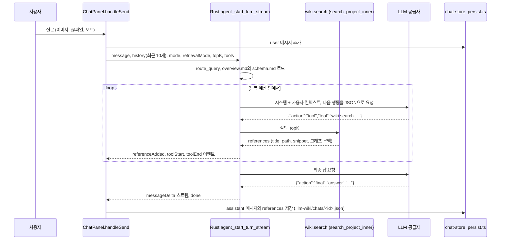
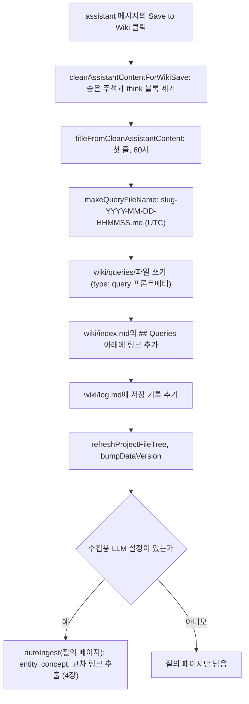

질의는 LLM Wiki의 세 핵심 작업(수집, 질의, 린트) 가운데 위키를 "읽는" 쪽이지만, 원본 패턴은 좋은 답을 다시 위키 페이지로 쌓으라고 요구한다. 이 구현에서 채팅은 Rust 에이전트에 질문을 넘기고, 에이전트가 `wiki.search`로 페이지를 찾아 답하며, 사용자가 답 아래의 "Save to Wiki" 버튼을 누르면 `wiki/queries/`에 새 페이지를 쓰고 수집 파이프라인을 다시 돌려 entity와 concept를 뽑는다. 이 장은 질의 때 어떤 내용이 프롬프트에 들어가는지, 그리고 답이 위키로 돌아가는 경로를 코드로 확인한다.

## 원본 패턴의 질의와 이 구현의 차이

llm-wiki.md의 Query 설명은 세 문장으로 요약된다. LLM이 관련 페이지를 찾아 읽고 인용과 함께 답한다. 답은 표, 슬라이드, 차트 등 여러 형태일 수 있다. 그리고 "good answers can be filed back into the wiki as new pages"이므로 탐색도 수집처럼 지식에 누적된다([llm-wiki.md#L39](https://github.com/nashsu/llm_wiki/blob/e08cfce65aad8b76b13546a081c1a8d4422b70c3/llm-wiki.md#L39)). 관련 페이지를 찾는 방법으로는 `index.md`를 먼저 읽고 필요한 페이지로 내려가는 방식을 제안한다([llm-wiki.md#L47](https://github.com/nashsu/llm_wiki/blob/e08cfce65aad8b76b13546a081c1a8d4422b70c3/llm-wiki.md#L47)).

| 원본 패턴 | 이 구현 | 확인 위치 |
| --- | --- | --- |
| 질의 시 `index.md`를 먼저 읽음 | `index.md`를 프롬프트에 넣지 않음. 에이전트가 `wiki.search`로 검색 | `agent/context.rs`, `agent/tools.rs` |
| LLM이 관련 페이지를 찾아 읽음 | 키워드, 벡터, 그래프 1홉 검색 결과의 제목, 경로, snippet을 넣음. deep 모드는 본문 포함 | `chat-panel.tsx` 요청 인자 |
| 인용과 함께 답함 | 시스템 프롬프트가 페이지 경로 언급을 요구, 참조 목록을 메시지에 저장 | `agent/context.rs`, `referenceAdded` 이벤트 |
| 좋은 답을 위키로 다시 저장 | 사용자가 버튼을 눌러 `wiki/queries/`에 저장한 뒤 auto-ingest | `chat-message.tsx` |
| 답의 형태가 다양함 | Mermaid 블록, `agent-workspace/` 아래 생성 파일 | `agent/context.rs` 생성 파일 정책 |

첫 행이 이 장의 핵심 질문에 대한 답이다. 질의 시 컨텍스트는 `index.md` 우선이 아니라 검색 우선이다. 이유는 6장의 첫 절과 같다. 원본 문서가 "moderate scale"에서만 잘 동작한다고 한 방식을, 이 구현은 처음부터 검색기로 대신했다. `index.md`는 벡터 인덱스에서 제외되지만 키워드 검색 대상에는 남아 있으므로, 검색 결과에 섞여 들어올 때만 프롬프트에 보인다.

## 한 번의 질문이 흐르는 길



`handleSend`는 공급자에 따라 두 갈래로 나뉜다. 일반 HTTP 공급자는 위 그림처럼 Rust 에이전트가 검색부터 최종 답까지 모두 맡는다. `claude-code`, `codex-cli` 같은 CLI 공급자(12장)는 Rust 에이전트를 검색용으로만 부르고, 받은 참조를 프롬프트에 붙여 CLI로 답을 스트리밍한다.

코드 따라가기: 백엔드 에이전트를 쓸지 정하는 조건을 본다. [chat-panel.tsx#L771-L773](https://github.com/nashsu/llm_wiki/blob/e08cfce65aad8b76b13546a081c1a8d4422b70c3/src/components/chat/chat-panel.tsx#L771-L773)

```tsx
        const useBackendAgent =
          llmConfig.provider !== "claude-code" &&
          llmConfig.provider !== "codex-cli"
```

`chat-agent-types.ts` 머리 주석은 이 구조를 규칙으로 못 박는다. 라우팅, 검색, 도구 실행, 프롬프트 조립은 Rust 에이전트 런타임에 두고, 이 TypeScript 파일에는 화면 표시와 저장 형태만 남긴다. "so API, MCP, and UI callers share one backend behavior"가 이유다([chat-agent-types.ts#L1-L9](https://github.com/nashsu/llm_wiki/blob/e08cfce65aad8b76b13546a081c1a8d4422b70c3/src/lib/chat-agent-types.ts#L1-L9)). 에이전트 루프의 세부(도구 목록, 권한, 취소)는 11장에서 다루고, 이 장은 컨텍스트에 들어가는 내용과 답이 저장되는 흐름에 집중한다.

## 요청 인자: 모드, 히스토리, 검색 범위

코드 따라가기: 스트리밍 경로가 에이전트에 넘기는 요청을 본다. [chat-panel.tsx#L987-L1006](https://github.com/nashsu/llm_wiki/blob/e08cfce65aad8b76b13546a081c1a8d4422b70c3/src/components/chat/chat-panel.tsx#L987-L1006)

```tsx
            await invoke<string>("agent_start_turn_stream", {
              projectId: project?.id ?? "current",
              llmConfig,
              request: {
                message: text,
                sessionId: convId,
                runId: backendRunId,
                mode: sendOptions.agentMode,
                retrievalMode: sendOptions.retrievalMode,
                stream: true,
                tools: {
                  wiki: true,
                  web: sendOptions.useWebSearch,
                  anytxt: sendOptions.useAnyTxtSearch,
                },
                topK: sendOptions.agentMode === "deep" ? 8 : 5,
                includeContent: sendOptions.agentMode === "deep",
                history: activeConvMessages,
                historyExplicit: true,
```

위키 검색 도구는 항상 켜고, 웹 검색과 AnyTXT 검색(6장)은 입력창의 토글을 따른다. 히스토리는 현재 대화의 user, assistant 메시지 중 마지막 `maxHistoryMessages`개이고 기본값은 10이다([chat-store.ts#L119-L123](https://github.com/nashsu/llm_wiki/blob/e08cfce65aad8b76b13546a081c1a8d4422b70c3/src/stores/chat-store.ts#L119-L123)). 방금 추가한 질문 메시지는 히스토리에서 빼고 `message`로 따로 보낸다.

| 인자 | 값 | 의미 |
| --- | --- | --- |
| `mode` | `fast`, `standard`(기본), `deep`, `local_first` | 반복 예산과 검색 예산 |
| `retrievalMode` | `standard`(기본), `smart`, `faithful` | 근거를 모으는 방식과 근거로 인정하는 범위 |
| `topK` | deep이면 8, 그 밖에는 5 | `wiki.search` 한 번에 받는 결과 수 |
| `includeContent` | deep이면 `true` | 검색 결과에 페이지 본문 전체를 실을지 |
| `contextFiles` | 입력창에서 `@`로 고른 파일 | 사용자가 명시한 첨부 파일 |
| `skills`, `skillMode` | 선택한 스킬 또는 전체 | 스킬 지시문 (11장) |
| `images` | base64 이미지 | vision 입력 |

에이전트 루프의 반복 횟수와 검색 도구 호출 횟수에는 상한이 있다([runtime.rs#L2798-L2847](https://github.com/nashsu/llm_wiki/blob/e08cfce65aad8b76b13546a081c1a8d4422b70c3/src-tauri/src/agent/runtime.rs#L2798-L2847)).

| `mode` | 반복 상한 (스킬 없음) | 검색 상한 `standard` | 검색 상한 `smart` | 검색 상한 `faithful` |
| --- | --- | --- | --- | --- |
| `fast` | 4 | 2 | 3 | 2 |
| `standard`, `local_first` | 8 | 4 | 4 | 3 |
| `deep` | 12 | 8 | 6 | 5 |

`standard` 반복 상한 8은 `MAX_AGENT_TOOL_ITERATIONS` 상수다([runtime.rs#L38](https://github.com/nashsu/llm_wiki/blob/e08cfce65aad8b76b13546a081c1a8d4422b70c3/src-tauri/src/agent/runtime.rs#L38)). 스킬을 쓰면 반복 상한이 8, 16, 20으로 늘고, `standard` 검색 모드에서 명시 스킬이 있으면 검색 상한에 4를 더한다. 검색 상한에 닿으면 다음 반복은 도구 없이 최종 답만 요구하는 시스템 프롬프트로 바뀐다.

### 세 가지 검색 모드

`AgentRetrievalMode` 정의의 주석이 세 모드의 뜻을 한 줄씩 적는다([types.rs#L20-L29](https://github.com/nashsu/llm_wiki/blob/e08cfce65aad8b76b13546a081c1a8d4422b70c3/src-tauri/src/agent/types.rs#L20-L29)).

| 모드 | 동작 | 근거로 쓰는 것 |
| --- | --- | --- |
| `standard` | 기존의 플래너 중심 검색 | 위키 페이지, 그래프 문맥, 켜져 있으면 웹과 AnyTXT |
| `smart` | 관찰마다 남은 근거 공백만 찾아 질의를 고쳐 다시 검색, 같은 질의 반복 금지 | `standard`와 같음 |
| `faithful` | 첫 반복 전에 `source.search`를 질문 그대로 실행 | 원본 문서 발췌와 명시 첨부 파일만. 위키 페이지, 그래프, 웹, AnyTXT는 근거가 아님 |

`faithful`은 이 장의 주제와 반대 방향의 선택지다. 위키는 LLM이 원본을 요약하고 해석한 2차 산출물이므로, 사용자가 원문 그대로의 근거를 원하면 위키를 건너뛰고 `raw/` 원본을 직접 본다. 이를 프롬프트 지시만으로 맡기지 않고, `overview.md`와 `schema.md`를 컨텍스트에서 아예 지운다.

코드 따라가기: faithful 모드가 프로젝트 문맥을 비우는 함수를 본다. [runtime.rs#L2783-L2796](https://github.com/nashsu/llm_wiki/blob/e08cfce65aad8b76b13546a081c1a8d4422b70c3/src-tauri/src/agent/runtime.rs#L2783-L2796)

```rust
fn project_context_for_retrieval_mode(
    mut project: super::context::ProjectContext,
    retrieval_mode: AgentRetrievalMode,
) -> super::context::ProjectContext {
    if retrieval_mode == AgentRetrievalMode::Faithful {
        // Faithful-source mode must enforce its evidence boundary before prompt
        // construction. overview.md is generated knowledge, and schema.md can
        // contain domain descriptions; asking the model to ignore either would
        // be a soft guarantee rather than source-only context isolation.
        project.overview = None;
        project.schema = None;
    }
    project
}
```

주석의 "soft guarantee"라는 표현이 설계 의도를 보여 준다. "무시하라"는 지시는 모델이 따르지 않을 수 있으니, 근거 경계는 프롬프트를 만들기 전에 데이터 단계에서 강제한다. 같은 이유로 faithful 모드에서는 웹과 AnyTXT 도구를 아예 등록하지 않는다([runtime.rs#L225-L240](https://github.com/nashsu/llm_wiki/blob/e08cfce65aad8b76b13546a081c1a8d4422b70c3/src-tauri/src/agent/runtime.rs#L225-L240)).

## 프롬프트에 들어가는 것

에이전트 컨텍스트는 `build_agent_context`가 시스템과 사용자 두 덩어리로 만든다([context.rs#L57-L62](https://github.com/nashsu/llm_wiki/blob/e08cfce65aad8b76b13546a081c1a8d4422b70c3/src-tauri/src/agent/context.rs#L57-L62)). 각 조각의 글자 수 상한은 파일 맨 위에 있다([context.rs#L9-L18](https://github.com/nashsu/llm_wiki/blob/e08cfce65aad8b76b13546a081c1a8d4422b70c3/src-tauri/src/agent/context.rs#L9-L18)).

| 위치 | 조각 | 상한 (문자) | 출처 |
| --- | --- | --- | --- |
| 시스템 | 에이전트 역할과 근거 원칙 | 고정 문구 | 코드 상수 |
| 시스템 | 도구 정책, 라우터 힌트, 생성 파일 정책 | 고정 문구 | `route_query` 결과 |
| 시스템 | Project overview | 8,000 | `overview.md` 또는 `wiki/overview.md` |
| 시스템 | Project schema | 6,000 | `schema.md` 또는 `wiki/schema.md` |
| 시스템 | 스킬 목록 또는 선택 스킬 본문 | 12,000 / 18,000 | 스킬 폴더 (11장) |
| 사용자 | 최근 대화 | 12,000 (최대 12개) | 요청의 `history` |
| 사용자 | 사용자가 고른 파일 | 전체 24,000, 파일당 8,000, 최대 8개 | `contextFiles` |
| 사용자 | Retrieved project context | 24,000 | 지금까지 쌓인 `references` |
| 사용자 | Retrieval summary | 8,000 | 루프에서는 빈 문자열 |
| 사용자 | Latest user request | 제한 없음 | `message` |

`load_project_context`가 읽는 파일은 `overview.md`와 `schema.md` 두 개뿐이다([context.rs#L27-L35](https://github.com/nashsu/llm_wiki/blob/e08cfce65aad8b76b13546a081c1a8d4422b70c3/src-tauri/src/agent/context.rs#L27-L35)). README의 Phase 4 설명은 시스템 프롬프트에 "purpose.md, language rules, citation format, index.md"가 들어간다고 적지만([README.md#L226-L229](https://github.com/nashsu/llm_wiki/blob/e08cfce65aad8b76b13546a081c1a8d4422b70c3/README.md#L226-L229)), 현재 Rust 에이전트 컨텍스트에는 `purpose.md`와 `index.md`가 없다. README의 "numbered pages", "[1], [2]" 인용 형식도 현재 시스템 프롬프트에서는 "mention the relevant page paths naturally"로 바뀌었다.

코드 따라가기: 검색 결과 하나가 프롬프트에 어떤 모양으로 들어가는지 본다. [context.rs#L223-L240](https://github.com/nashsu/llm_wiki/blob/e08cfce65aad8b76b13546a081c1a8d4422b70c3/src-tauri/src/agent/context.rs#L223-L240)

```rust
        for (idx, reference) in input.references.iter().enumerate() {
            rendered.push_str(&format!(
                "{}. [{}] {} ({})\n",
                idx + 1,
                reference.kind,
                reference.title,
                reference.path
            ));
            if let Some(snippet) = reference.snippet.as_deref() {
                rendered.push_str(&format!("Snippet: {}\n", collapse_whitespace(snippet)));
            }
            if let Some(context) = reference.knowledge_context.as_ref() {
                if !context.related_to.is_empty() {
                    rendered.push_str(&format!(
                        "Graph neighbors of: {}\n",
                        context.related_to.join(", ")
                    ));
                }
```

참조 한 줄은 번호, 종류(`wiki` 또는 `graph`), 제목, 경로이고, 그 아래 snippet과 그래프 문맥이 붙는다. 그래프 문맥은 `run_wiki_search`가 검색 결과마다 덧붙인 태그, 나가는 링크, 백링크, 링크 수, 최근 편집 이력이다([tools.rs#L942-L997](https://github.com/nashsu/llm_wiki/blob/e08cfce65aad8b76b13546a081c1a8d4422b70c3/src-tauri/src/agent/tools.rs#L942-L997)). 6장의 그래프 확장으로 들어온 결과는 종류가 `graph`로 바뀌고 "Graph neighbors of: ..." 줄을 받는다. 기본 모드에서는 페이지 본문이 아니라 snippet만 들어가므로, 모델이 본문이 필요하다고 판단하면 `wiki.read_page` 도구로 다시 읽는다.

마지막으로 `fit_context_to_model`이 전체 길이를 모델 설정의 `max_context_size`에 맞춘다. 이 값을 8,000..400,000 문자로 clamp하고, 넘치면 시스템을 먼저 줄이되 사용자 부분은 최소 4,000자를 남긴다([runtime.rs#L3845-L3867](https://github.com/nashsu/llm_wiki/blob/e08cfce65aad8b76b13546a081c1a8d4422b70c3/src-tauri/src/agent/runtime.rs#L3845-L3867)). 단위가 토큰이 아니라 문자다. 잘리는 쪽은 문자열 끝이므로, 사용자 부분이 길면 맨 뒤의 최신 질문이 잘릴 수 있다(코드로 확인한 동작, 실측 미검증).

> **주의**: 모델이 검색을 한 번도 부르지 않고 바로 `final`을 고르면 프롬프트에는 위키 근거가 없다. "Retrieved project context" 절에는 "No matching wiki references were found."만 들어가고, 모델은 일반 지식으로 답한다. 시스템 프롬프트가 근거가 부족하면 그렇다고 말하라고 지시하지만, 검색을 강제하지는 않는다. 플래너를 쓸 수 없는 경우(CLI 공급자 등)에는 런타임이 일반 위키 질문에 한해 `wiki.search`를 대신 실행한다([runtime.rs#L303-L313](https://github.com/nashsu/llm_wiki/blob/e08cfce65aad8b76b13546a081c1a8d4422b70c3/src-tauri/src/agent/runtime.rs#L303-L313)).

### CLI 공급자 경로의 프롬프트

CLI 공급자는 `agent_start_turn`(비스트리밍)으로 검색만 받아 온 뒤, 결과를 텍스트로 이어 붙여 사용자 메시지를 만든다.

코드 따라가기: 검색 결과가 있을 때와 없을 때 프롬프트를 다르게 만드는 부분을 본다. [chat-panel.tsx#L1129-L1143](https://github.com/nashsu/llm_wiki/blob/e08cfce65aad8b76b13546a081c1a8d4422b70c3/src/components/chat/chat-panel.tsx#L1129-L1143)

```tsx
        const contextText = retrievedContext
          ? [
              "You have access to the current LLM Wiki project context below. Use it as retrieved evidence when it is relevant.",
              "",
              retrievedContext,
              "",
              `User request: ${text}`,
            ].join("\n")
          : [
              "No relevant LLM Wiki evidence was retrieved for this request.",
              "Answer the request directly with the selected CLI provider. Clearly distinguish general knowledge from project evidence.",
              "",
              `User request: ${text}`,
            ].join("\n")
```

근거가 없을 때 "general knowledge"와 "project evidence"를 구분하라고 명시한다. 추론 모델이 답 없이 사고 과정만 내보내면(`isReasoningOnlyResponseError`) 추론을 끄고 한 번 더 스트리밍한다.

## 참조와 대화 저장

에이전트가 도구를 실행하면 `referenceAdded` 이벤트가 오고, `handleSend`는 `kind:url-or-path` 키로 중복을 지워 `references` 배열에 모은다. 스트림이 끝나면 답, 참조, 도구 단계, 파일 변경 내역을 함께 assistant 메시지로 확정한다. 메시지 아래 참고 자료 패널은 이 참조를 type별 아이콘으로 묶어 보여 주고, 그래프 출처 참조는 작은 관계 그래프로 그린다(7장).

대화는 `.llm-wiki/conversations.json`과 대화별 `.llm-wiki/chats/<id>.json`에 저장한다. 대화마다 마지막 100개 메시지만 남기고, 이미지는 저장하기 전에 걷어낸다([persist.ts#L95-L112](https://github.com/nashsu/llm_wiki/blob/e08cfce65aad8b76b13546a081c1a8d4422b70c3/src/lib/persist.ts#L95-L112)). 주석이 이유를 밝힌다. 수 MB짜리 base64가 자동 저장 파일과 프로젝트 백업을 빠르게 키우기 때문이다. 앱을 다시 열면 이미지가 빠진 대화가 복원되고, "다시 생성"은 메모리에 남아 있는 같은 세션에서만 이미지를 다시 보낸다([chat-panel.tsx#L1295-L1321](https://github.com/nashsu/llm_wiki/blob/e08cfce65aad8b76b13546a081c1a8d4422b70c3/src/components/chat/chat-panel.tsx#L1295-L1321)).

이미지 첨부 제한은 프론트와 Rust 양쪽에 있다.

| 항목 | 프론트 `chat-image-utils.ts` | Rust `validate_images` |
| --- | --- | --- |
| 허용 형식 | png, jpeg, webp, gif | png, jpeg, webp, gif |
| 개수 | 메시지당 5 | 턴당 5 |
| 크기 | 원본 5 MB | base64 문자열 7 MiB |

값은 [chat-image-utils.ts#L4-L12](https://github.com/nashsu/llm_wiki/blob/e08cfce65aad8b76b13546a081c1a8d4422b70c3/src/lib/chat-image-utils.ts#L4-L12)와 [runtime.rs#L36-L37](https://github.com/nashsu/llm_wiki/blob/e08cfce65aad8b76b13546a081c1a8d4422b70c3/src-tauri/src/agent/runtime.rs#L36-L37), [runtime.rs#L3891-L3913](https://github.com/nashsu/llm_wiki/blob/e08cfce65aad8b76b13546a081c1a8d4422b70c3/src-tauri/src/agent/runtime.rs#L3891-L3913)에 있다. base64는 원본보다 약 4/3배 크므로 5 MB 원본은 약 6.7 MB가 되어 Rust 상한 안에 들어간다. `fileToMessageImage`는 `FileReader.readAsDataURL` 결과에서 `data:...;base64,` 접두어를 떼고 본문만 남긴다. 공급자별 이미지 포맷 변환은 12장에서 다룬다.

## 답을 위키로 되돌리기: Save to Wiki

원본 패턴의 "file back into the wiki"는 assistant 메시지마다 붙는 `SaveToWikiButton`이 구현한다. 예전에는 답이 저장할 가치가 있는지 자동으로 판단하는 기능이 있었으나 지금은 지워졌고, 코드 주석에 "save-worthy detection removed"와 함께 각 메시지에 "Save to Wiki" 버튼이 있다는 설명이 남아 있다([chat-panel.tsx#L1235](https://github.com/nashsu/llm_wiki/blob/e08cfce65aad8b76b13546a081c1a8d4422b70c3/src/components/chat/chat-panel.tsx#L1235)). 무엇을 위키에 쌓을지는 사람이 정한다.



### 본문 정리와 제목

코드 따라가기: 저장하기 전에 답 본문에서 지우는 것을 본다. [chat-save-to-wiki.ts#L1-L16](https://github.com/nashsu/llm_wiki/blob/e08cfce65aad8b76b13546a081c1a8d4422b70c3/src/lib/chat-save-to-wiki.ts#L1-L16)

```ts
export function cleanAssistantContentForWikiSave(content: string): string {
  return content
    .replace(/<!--\s*(?:save-worthy|sources):[^\n]*?-->/g, "")
    .replace(/<think(?:ing)?>\s*[\s\S]*?<\/think(?:ing)?>\s*/gi, "")
    .replace(/<think(?:ing)?>\s*[\s\S]*$/gi, "")
    .replace(/^\s+/, "")
    .trimEnd()
}

export function titleFromCleanAssistantContent(clean: string): string {
  const firstVisibleLine = clean
    .split("\n")
    .map((line) => line.replace(/^#+\s*/, "").trim())
    .find((line) => line.length > 0)
  return firstVisibleLine?.slice(0, 60) || "Saved Query"
}
```

세 번째 정규식은 닫는 태그 없이 끝난 `<think>` 블록, 즉 사고 과정이 중간에 끊긴 답의 나머지를 통째로 지운다. 채팅 스트림이 추론 토큰을 `<think>...</think>`로 감싸 본문과 같은 문자열에 이어 붙이기 때문에 필요한 처리다. 제목은 질문이 아니라 답의 첫 줄이다. 답이 "## 요약"처럼 일반적인 heading으로 시작하면 제목도 "요약"이 된다.

파일명은 `wiki-filename.ts`가 만든다. 제목을 NFKC로 정규화하고 소문자로 바꾼 뒤 Unicode 문자, 숫자, 하이픈만 남겨 50자로 자르고, UTC 날짜와 시분초를 붙인다([wiki-filename.ts#L32-L66](https://github.com/nashsu/llm_wiki/blob/e08cfce65aad8b76b13546a081c1a8d4422b70c3/src/lib/wiki-filename.ts#L32-L66)). 머리 주석에 따르면 예전 구현이 ASCII 밖 문자를 모두 지워 중국어 제목이 빈 slug가 되었고, 하루에 하나만 저장되는 충돌이 있었다. 한국어 제목도 `\p{L}`에 들어가므로 slug에 그대로 남는다.

### 파일 쓰기와 색인 갱신

코드 따라가기: 질의 페이지와 `index.md`를 쓰는 부분을 본다. [chat-message.tsx#L567-L577](https://github.com/nashsu/llm_wiki/blob/e08cfce65aad8b76b13546a081c1a8d4422b70c3/src/components/chat/chat-message.tsx#L567-L577)

```tsx
      const frontmatter = [
        "---",
        `type: query`,
        `title: "${title.replace(/"/g, '\\"')}"`,
        `created: ${date}`,
        `tags: []`,
        "---",
        "",
      ].join("\n")

      await writeFile(filePath, frontmatter + cleanContent)
```

질의 페이지의 프론트매터는 `type`, `title`, `created`, `tags` 네 개다. `index.md`에는 `## Queries` 절 바로 아래에 `- [[queries/<파일명>|<제목>]]` 줄을 넣고, 절이 없으면 파일 끝에 절을 만든다. `log.md`에는 "Saved query page" 한 줄을 붙인다. 원본 패턴의 `index.md`(내용 목록)와 `log.md`(시간순 기록) 관례를 그대로 따른 것이다([llm-wiki.md#L47-L49](https://github.com/nashsu/llm_wiki/blob/e08cfce65aad8b76b13546a081c1a8d4422b70c3/llm-wiki.md#L47-L49)).

이어서 파일 트리를 새로 고치고 `dataVersion`을 올린 다음, 수집용 LLM 설정(`getTaskLlmConfig("ingest")`)이 쓸 수 있으면 질의 페이지 경로를 원본 삼아 `autoIngest`를 부른다([chat-message.tsx#L614-L625](https://github.com/nashsu/llm_wiki/blob/e08cfce65aad8b76b13546a081c1a8d4422b70c3/src/components/chat/chat-message.tsx#L614-L625)). 이 수집은 기다리지 않고 백그라운드에서 돌며, 실패는 콘솔에만 남는다. 수집 파이프라인(4장)이 답 안의 entity와 concept를 뽑아 해당 페이지를 만들거나 고치고, 교차 링크를 건다. 리뷰 화면(9장)의 "save:" 액션도 같은 두 함수와 같은 파일명 규칙으로 질의 페이지를 쓴다([review-view.tsx#L118-L140](https://github.com/nashsu/llm_wiki/blob/e08cfce65aad8b76b13546a081c1a8d4422b70c3/src/components/review/review-view.tsx#L118-L140)).

### 저장된 답의 위치

저장된 질의 페이지가 위키 안에서 어떻게 다뤄지는지 정리하면 다음과 같다.

| 기능 | 질의 페이지 (`type: query`) 취급 | 근거 |
| --- | --- | --- |
| 그래프 뷰 | 노드에서 제외 | `wiki-graph.ts`의 `HIDDEN_TYPES` (7장) |
| 키워드 검색 | 포함 | `wiki/` 전수 순회 (6장) |
| 벡터 검색 | 수집이 `embedPage`를 부르면 포함 (미검증) | auto-ingest 경로 |
| `index.md` | `## Queries` 절에 링크 | `SaveToWikiButton` |
| 관련도 모델 | type 친화도 표에 `query` 행이 있음 | `graph-relevance.ts` |

설계 의도는 `wiki-graph.ts` 주석에 드러난다. 질의 페이지는 "intermediate artifacts"이고, 지식 구조로 남는 것은 auto-ingest가 거기서 뽑은 entity와 concept다. 답 자체는 기록으로 남기고, 답이 담은 지식은 기존 페이지 체계로 흡수한다. 원본 패턴의 "explorations compound in the knowledge base"를 두 단계로 나눈 셈이다.

> **주의**: 저장되는 것은 정리한 답 본문뿐이다. 메시지에 붙어 있던 참조 목록(어느 위키 페이지를 근거로 답했는지)은 질의 페이지의 프론트매터에도 본문에도 들어가지 않는다. 답 본문이 페이지 경로를 언급했다면 그 문자열만 남는다. 원본 패턴의 "synthesizes an answer with citations"를 위키에 누적할 때 인용 관계가 끊길 수 있다.

> **주의**: `index.md`가 없을 때 새로 만드는 기본 내용은 "# Wiki Index" 제목과 `## Queries` 절뿐이다. 수집이 만든 다른 절 구조와 다를 수 있다. 정규식이 `## Queries\n`을 찾으므로 Windows 줄바꿈(`\r\n`)으로 저장된 `index.md`에서는 기존 절을 찾지 못하고 같은 이름의 절을 파일 끝에 하나 더 만들 수 있다(추정).

## 위키에 직접 쓰는 다른 두 길

Save to Wiki 말고도 대화에서 위키로 가는 길이 두 개 더 있다.

| 경로 | 동작 | 범위 |
| --- | --- | --- |
| 에이전트 `wiki.write_page` | 사용자가 명시적으로 요청할 때만 페이지를 만들거나 고침. 기존 페이지는 `allowOverwrite`가 정당할 때만 덮어씀 | 11장 |
| 수집 모드의 "Write to Wiki" | 채팅 패널이 `ingest` 모드일 때 대화 내용으로 `executeIngestWrites` 실행 | 4장 |

에이전트 루프 시스템 프롬프트는 "Use wiki.write_page only when the user explicitly asks to create or update a wiki page"라고 제한한다([runtime.rs#L2915-L2951](https://github.com/nashsu/llm_wiki/blob/e08cfce65aad8b76b13546a081c1a8d4422b70c3/src-tauri/src/agent/runtime.rs#L2915-L2951)). 수집 모드 버튼은 `mode === "ingest"`이고 스트리밍 중이 아니며 assistant 메시지가 있을 때만 보인다([chat-panel.tsx#L1409-L1421](https://github.com/nashsu/llm_wiki/blob/e08cfce65aad8b76b13546a081c1a8d4422b70c3/src/components/chat/chat-panel.tsx#L1409-L1421)).

## 웹 검색 공급자

채팅 입력창의 웹 검색 토글을 켜면 요청의 `tools.web`이 `true`가 되고, 에이전트는 `web.search` 도구를 쓸 수 있다. 라우터는 이 토글이 켜져 있으면 시스템 프롬프트에 "web.search is available" 힌트를 넣을 뿐이고([router.rs#L95](https://github.com/nashsu/llm_wiki/blob/e08cfce65aad8b76b13546a081c1a8d4422b70c3/src-tauri/src/agent/router.rs#L95)), 실제로 검색할지는 모델이 루프에서 정한다. `faithful` 모드에서는 토글과 상관없이 등록하지 않는다.

공급자 선택은 설정 화면의 `SearchApiConfig.provider` 하나로 정한다. 타입이 허용하는 값은 `tavily`, `serpapi`, `searxng`, `ollama`, `brave`, `bocha`, `firecrawl`, `none`이다([wiki-store.ts#L65-L73](https://github.com/nashsu/llm_wiki/blob/e08cfce65aad8b76b13546a081c1a8d4422b70c3/src/stores/wiki-store.ts#L65-L73)). README는 Tavily, SerpApi, SearXNG 세 가지를 소개하지만 코드에는 이후 추가된 공급자가 더 있다. `resolveSearchConfig`는 공급자별 설정(`providerConfigs`)에서 활성 공급자의 API 키, SerpApi 엔진, SearXNG URL과 카테고리를 꺼내 하나의 평면 설정으로 만든다([web-search.ts#L45-L108](https://github.com/nashsu/llm_wiki/blob/e08cfce65aad8b76b13546a081c1a8d4422b70c3/src/lib/web-search.ts#L45-L108)). 예전처럼 최상위 `apiKey` 하나만 있는 설정도 이 단계에서 공급자별 형태로 옮긴다.

| 공급자 | 필요한 설정 | 비고 |
| --- | --- | --- |
| `tavily`, `serpapi`, `brave`, `bocha` | API 키 | SerpApi는 Google, News, Scholar, Patents, Bing, DuckDuckGo 등 엔진 선택 |
| `searxng` | 인스턴스 URL | 카테고리 기본값 `general` |
| `ollama` | API 키 | 기본 URL `https://ollama.com` |
| `firecrawl` | 없음 (키 선택) | 기본 URL `https://api.firecrawl.dev` |

설정 검사는 프론트 `webSearch`가 먼저 하고([web-search.ts#L130-L162](https://github.com/nashsu/llm_wiki/blob/e08cfce65aad8b76b13546a081c1a8d4422b70c3/src/lib/web-search.ts#L130-L162)), 실제 HTTP 요청은 Rust가 한다. 프론트 `webSearch`는 Tauri command `web_search`를 부르고, 이 command와 에이전트의 `web.search` 도구가 같은 `run_web_search` 함수를 공유한다([external_search.rs#L19-L38](https://github.com/nashsu/llm_wiki/blob/e08cfce65aad8b76b13546a081c1a8d4422b70c3/src-tauri/src/commands/external_search.rs#L19-L38)). 주석은 공급자와 네트워크 로직을 Rust로 옮기되, 딥 리서치(10장) 같은 기존 프론트 코드가 쓰던 `{ title, url, snippet, source }` 형태는 유지한다고 설명한다.

코드 따라가기: 공급자 문자열로 구현을 고르는 분기를 본다. [tools.rs#L1295-L1319](https://github.com/nashsu/llm_wiki/blob/e08cfce65aad8b76b13546a081c1a8d4422b70c3/src-tauri/src/agent/tools.rs#L1295-L1319) 중 일부

```rust
    let config = config.resolved();
    let provider = config.provider.trim().to_ascii_lowercase();
    if provider.is_empty() || provider == "none" {
        return Err("Web search provider is not configured.".to_string());
    }
    let max_results = web_search_result_limit(&provider, top_k);
    let raw = match provider.as_str() {
        "firecrawl" => firecrawl_search(&client, query, &config, max_results).await?,
        "searxng" => searxng_search(&client, query, &config, max_results).await?,
        "tavily" => tavily_search(&client, query, &config, max_results).await?,
        "ollama" => ollama_search(&client, query, &config, max_results).await?,
        "brave" => brave_search(&client, query, &config, max_results).await?,
        "bocha" => bocha_search(&client, query, &config, max_results).await?,
        "serpapi" => serpapi_search(&client, query, &config, max_results).await?,
```

공급자는 한 번에 하나만 쓰고, 실패하면 다른 공급자로 넘어가지 않고 오류를 돌려준다. 결과 수는 Bocha만 1..50, 나머지는 1..20으로 clamp하고([tools.rs#L1322-L1327](https://github.com/nashsu/llm_wiki/blob/e08cfce65aad8b76b13546a081c1a8d4422b70c3/src-tauri/src/agent/tools.rs#L1322-L1327)), 요청 timeout은 30초다. HTTP client는 앱의 프록시 설정을 따른다. 웹 결과는 `AgentReference`로 바뀌어 위키 참조와 같은 참고 자료 목록에 섞이지만, 위키에 저장되지는 않는다. 웹에서 찾은 내용을 위키로 쌓으려면 Save to Wiki로 답을 저장하거나 딥 리서치(10장)를 쓴다.

## context-budget.ts의 현재 쓰임

`context-budget.ts`는 원래 채팅 패널이 프롬프트를 채울 때 쓰던 예산 계산기다. 머리 주석은 아직 "used by chat-panel when packing the prompt"라고 적고 있고, `tryAddPage in chat-panel`도 언급한다([context-budget.ts#L1-L33](https://github.com/nashsu/llm_wiki/blob/e08cfce65aad8b76b13546a081c1a8d4422b70c3/src/lib/context-budget.ts#L1-L33)). 그러나 기준 커밋에서 이 모듈을 가져다 쓰는 곳은 `llm-providers.ts`와 `ingest.ts` 두 곳뿐이고, 채팅 프롬프트 조립은 Rust `fit_context_to_model`로 옮겨 갔다.

코드 따라가기: 예산 비율 상수와 계산을 본다. [context-budget.ts#L55-L91](https://github.com/nashsu/llm_wiki/blob/e08cfce65aad8b76b13546a081c1a8d4422b70c3/src/lib/context-budget.ts#L55-L91) 중 일부

```ts
const DEFAULT_MAX_CTX = 204_800
const RESPONSE_RESERVE_FRAC = 0.15
const INDEX_BUDGET_FRAC = 0.05
const PAGE_BUDGET_FRAC = 0.5
const PER_PAGE_FRAC = 0.3
const PER_PAGE_FLOOR = 5_000
```

| 예산 | 비율 | 기본 `maxCtx` 204,800자일 때 |
| --- | --- | --- |
| `responseReserve` | 15% | 30,720 |
| `indexBudget` | 5% | 10,240 |
| `pageBudget` | 50% | 102,400 |
| `maxPageSize` | `pageBudget`의 30%, 최소 5,000, 최대 `pageBudget` | 30,720 |

README는 "60% wiki pages, 20% chat history, 5% index, 15% system"으로 적지만([README.md#L221-L224](https://github.com/nashsu/llm_wiki/blob/e08cfce65aad8b76b13546a081c1a8d4422b70c3/README.md#L221-L224)), 코드의 배분은 페이지 50%, 색인 5%, 응답 여유 15%이고 나머지 약 30%를 히스토리와 시스템 몫으로 남긴다. 현재 쓰임 중 하나는 Anthropic 계열 요청의 기본 `max_tokens`다. `deriveAnthropicMaxTokens`가 `responseReserve`를 3으로 나눠 토큰으로 근사하고 1..16,384로 자른다([llm-providers.ts#L924-L927](https://github.com/nashsu/llm_wiki/blob/e08cfce65aad8b76b13546a081c1a8d4422b70c3/src/lib/llm-providers.ts#L924-L927)). 단위가 문자라는 점은 주석이 "quirky unit"이라고 인정한다.

## 정리

- 채팅의 검색, 도구 실행, 프롬프트 조립은 모두 Rust 에이전트에 있고, React는 요청 인자와 화면 표시만 맡는다. CLI 공급자는 Rust에서 검색만 받아 프롬프트에 붙여 답한다.
- 질의 컨텍스트는 `index.md` 우선이 아니라 검색 우선이다. 시스템에는 `overview.md`(8,000자)와 `schema.md`(6,000자)가, 사용자 부분에는 최근 대화, `@` 첨부 파일, `wiki.search` 결과의 제목, 경로, snippet, 그래프 문맥이 들어간다.
- `mode`는 반복과 검색 횟수의 상한을, `retrievalMode`는 근거 범위를 정한다. `faithful`은 `overview.md`, `schema.md`, 웹, AnyTXT를 데이터 단계에서 빼고 원본 발췌만 근거로 삼는다.
- 답을 위키로 되돌리는 경로는 사람이 누르는 Save to Wiki 버튼이다. `wiki/queries/`에 `type: query` 페이지를 쓰고 `index.md`와 `log.md`를 갱신한 뒤 auto-ingest로 entity와 concept를 추출한다.
- 질의 페이지는 그래프에서 숨기고 지식은 auto-ingest 결과로 흡수하는 설계지만, 답의 참조 목록은 저장하지 않아 인용 관계가 위키에 남지 않는다.
- `context-budget.ts`의 페이지 50%, 색인 5%, 응답 15% 배분은 이제 채팅이 아니라 수집과 Anthropic `max_tokens` 기본값 계산에 쓰이고, 채팅 길이 맞춤은 Rust가 문자 단위로 한다.
