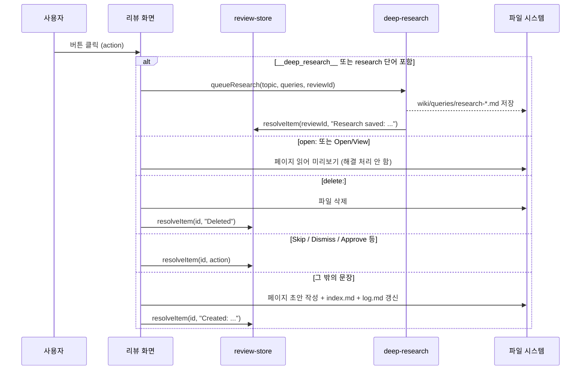
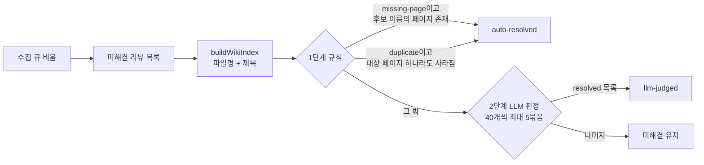

LLM이 사람의 판단을 요청한 항목은 리뷰 큐에 쌓이고, 사람이 처리하거나 자동 정리로 해소된다.

## 리뷰 큐

### 리뷰 항목의 출처

리뷰 항목은 세 곳에서 들어온다.

| 출처 | 진입 함수 | 들어오는 유형 |
| --- | --- | --- |
| 수집 파이프라인의 `---REVIEW: type \| Title---` 블록 | `parseReviewBlocks` → `addItems` | `contradiction`, `duplicate`, `missing-page`, `suggestion`, 그 밖은 `confirm` |
| 린트 화면의 "리뷰로 보내기", 추천 없는 "고치기" | `addLintItemToReview` → `addItem` | `confirm`, `suggestion` |
| 외부 API (`/reviews` 엔드포인트) | Rust 쪽 API 서버 | 조회와 해결 처리만 |

수집 단계의 REVIEW 블록은 `OPTIONS:`, `PAGES:`, `SEARCH:` 세 줄을 따로 파싱한다([ingest.ts#L2326-L2389](https://github.com/nashsu/llm_wiki/blob/e08cfce65aad8b76b13546a081c1a8d4422b70c3/src/lib/ingest.ts#L2326-L2389)). `OPTIONS`가 없으면 `Approve`와 `Skip` 두 버튼이 붙는다. `SEARCH`는 딥 리서치용 검색어를 수집 시점에 미리 뽑아 두는 줄로, 10장에서 이 값이 어떻게 쓰이는지 본다. 블록 프롬프트 자체는 4장에서 다룬다. 외부 API의 리뷰 엔드포인트는 README에 정리되어 있고([README.md#L447-L449](https://github.com/nashsu/llm_wiki/blob/e08cfce65aad8b76b13546a081c1a8d4422b70c3/README.md#L447-L449)), 13장에서 다룬다.

린트 결과를 리뷰로 바꿀 때는 유형별로 버튼 구성이 다르다. 깨진 링크는 "열어서 편집", "페이지 삭제", "건너뛰기"를, 고아와 나가는 링크 없음은 "열어서 편집", "건너뛰기"를 받는다([lint-view.tsx#L210-L254](https://github.com/nashsu/llm_wiki/blob/e08cfce65aad8b76b13546a081c1a8d4422b70c3/src/components/lint/lint-view.tsx#L210-L254)). 버튼의 `action` 문자열은 `open:<page>`, `delete:<절대경로>`, `Skip`처럼 접두어로 의도를 담는다.

### 내용 기반의 안정적 id

리뷰 저장소의 핵심은 id를 내용에서 계산한다는 점이다. 같은 유형과 같은 (정규화한) 제목을 가진 리뷰는 언제 만들어져도 같은 id를 받는다.

무엇을 보는지: `type::정규화제목`의 32비트 FNV-1a 해시.
[src/stores/review-store.ts#L49-L58](https://github.com/nashsu/llm_wiki/blob/e08cfce65aad8b76b13546a081c1a8d4422b70c3/src/stores/review-store.ts#L49-L58)

```ts
export function reviewIdFor(item: Pick<ReviewItem, "type" | "title">): string {
  const key = `${item.type}::${normalizeReviewTitle(item.title)}`
  let h = 0x811c9dc5
  for (let i = 0; i < key.length; i++) {
    h ^= key.charCodeAt(i)
    h = Math.imul(h, 0x01000193)
  }
  return `review-${(h >>> 0).toString(16).padStart(8, "0")}`
}
```

함수 위 주석이 왜 이렇게 했는지 설명한다([review-store.ts#L33-L48](https://github.com/nashsu/llm_wiki/blob/e08cfce65aad8b76b13546a081c1a8d4422b70c3/src/stores/review-store.ts#L33-L48)). 예전의 `review-N` 카운터 방식은 큐를 다시 만들 때마다 번호가 바뀌어 해결 상태가 사라졌다. `sourcePath`를 키에 넣지 않은 것도 파일 이름이 바뀌면 id가 바뀌기 때문이다. 안정적 id 덕분에 외부 API가 특정 리뷰를 id로 지정해 해결할 수 있다.

`normalizeReviewTitle`은 `Missing page:`, `Duplicate page:`, `Possible duplicate:`와 중국어 대응 접두어를 떼고, 공백을 하나로 줄이고, 소문자로 바꾼다([review-utils.ts](https://github.com/nashsu/llm_wiki/blob/e08cfce65aad8b76b13546a081c1a8d4422b70c3/src/lib/review-utils.ts#L9-L28)). LLM이 같은 개념에 접두어를 붙였다 뗐다 해도 같은 리뷰로 묶이게 하는 장치다.

> **주의**: 32비트 해시라서 서로 다른 내용이 같은 id를 받을 수 있다. 주석은 같은 내용이 같은 id를 받는 "의도된 충돌"만 언급하고, 우연한 해시 충돌은 다루지 않는다. 충돌하면 나중에 들어온 항목이 앞 항목에 병합되어 사라진다(코드 동작으로 추론, 실제 사례는 미검증).

### 추가와 병합 규칙

`addItem`과 `addItems`의 동작은 조금 다르다.

| 메서드 | 같은 id가 이미 있을 때 | 쓰는 곳 |
| --- | --- | --- |
| `addItem` | 아무것도 바꾸지 않는다 | 린트에서 리뷰로 보낼 때 |
| `addItems` | 기존 항목을 유지하되 `description`, `sourcePath`는 새 값 우선, `affectedPages`, `searchQueries`는 합집합 | 수집 파이프라인 |
| `setItems` | 모든 항목의 id를 다시 계산하고 같은 id끼리 병합(`normalizeReviewItems`) | 디스크에서 불러올 때 |

`addItems`의 주석이 이 설계의 이유를 적고 있다([review-store.ts#L122-L154](https://github.com/nashsu/llm_wiki/blob/e08cfce65aad8b76b13546a081c1a8d4422b70c3/src/stores/review-store.ts#L122-L154)). 이전 구현은 해결되지 않은 항목하고만 중복을 비교했다. 그래서 사람이 해결한 리뷰를 다음 수집이 다시 만들면 새 미해결 항목이 생겼다. 지금은 해결된 항목까지 포함해 비교하고, 해결 상태는 그대로 둔다.

`setItems`의 병합(`mergeReviewItems`)은 "해결됨이 이긴다", 배열 필드는 합집합, `createdAt`은 더 이른 값, 설명은 비어 있지 않은 쪽을 고른다([review-store.ts#L79-L93](https://github.com/nashsu/llm_wiki/blob/e08cfce65aad8b76b13546a081c1a8d4422b70c3/src/stores/review-store.ts#L79-L93)). 옛 `review-N` id로 저장된 파일을 불러와도 내용으로 id를 다시 계산하므로, 마이그레이션 버전 플래그 없이 몇 번 불러와도 결과가 같다.

### property test의 보장 항목

`review-store.property.test.ts`는 fast-check로 무작위 입력을 만들어 병합 규칙의 불변식을 검사한다([review-store.property.test.ts](https://github.com/nashsu/llm_wiki/blob/e08cfce65aad8b76b13546a081c1a8d4422b70c3/src/stores/review-store.property.test.ts#L34-L124)). 생성기는 다섯 유형 중 하나, 1~60자 제목, 최대 4개의 `affectedPages`와 `searchQueries`를 만든다.

| 테스트 | 입력 | 보장하는 불변식 |
| --- | --- | --- |
| 미해결 항목 유일성 | 최대 6번의 `addItems` 호출, 호출마다 최대 8개 항목 | 어떤 순서로 넣어도 미해결 항목의 `(type, 정규화 제목)`은 모두 다르다 |
| `affectedPages` 합집합 | 같은 유형과 제목으로 2~5번 추가, 매번 다른 페이지 목록 | 항목은 1개만 남고, `affectedPages`는 넣은 모든 페이지의 합집합과 같다 |
| 해결됨 우선 | 추가 → `resolveItem` → 같은 키로 다시 추가 | 항목은 1개, id는 처음 것, `resolved`와 `resolvedAction`이 유지되고, 새 페이지는 합쳐진다 |

세 번째 테스트는 처음 받은 id와 `resolvedAction: "auto-resolved"`가 그대로인지, 두 번째로 넣은 `second.md`가 `affectedPages`에 합쳐졌는지를 단언한다([review-store.property.test.ts#L110-L119](https://github.com/nashsu/llm_wiki/blob/e08cfce65aad8b76b13546a081c1a8d4422b70c3/src/stores/review-store.property.test.ts#L110-L119)). 세 번째 테스트는 수집이 같은 리뷰를 다시 만들 때 해결 상태가 되살아나던 회귀를 막는다. 주석이 "that revival was the bug being fixed"라고 적어 두었다. 이 테스트들은 `addItems` 경로만 다루고, `setItems`의 마이그레이션 병합이나 `addItem` 단건 경로는 별도의 예제 테스트(`review-store.test.ts`)가 맡는다. 테스트 전략 전체는 14장에서 정리한다.

## 사람의 리뷰 처리 흐름

리뷰 화면의 버튼을 누르면 `handleResolve(id, action)`이 `action` 문자열을 보고 할 일을 정한다([review-view.tsx#L90-L316](https://github.com/nashsu/llm_wiki/blob/e08cfce65aad8b76b13546a081c1a8d4422b70c3/src/components/review/review-view.tsx#L90-L316)). LLM이 `OPTIONS:` 줄에 자유 문장을 쓸 수 있기 때문에, 접두어가 정해진 내부 action과 함께 문자열 휴리스틱도 쓴다.



판정 순서가 중요하다.

| 순서 | 조건 | 동작 | 해결 처리 |
| --- | --- | --- | --- |
| 1 | `action === "__deep_research__"` | 검색 소스 설정 확인 후 `queueResearch` | 연구 결과가 저장된 뒤 |
| 2 | `save:` 접두어 | base64로 인코딩된 채팅 답변을 `wiki/queries/`에 저장 | 즉시 |
| 3 | `open:` 접두어 또는 Open/View류 | 미리보기에 열기 | 하지 않음 |
| 4 | `delete:` 접두어 | 파일 삭제 | 즉시 |
| 5 | research, investigate, explore, look into 등 포함 | 딥 리서치. 검색 소스가 없으면 6번으로 넘김 | 연구 결과가 저장된 뒤 |
| 6 | `__create_page__:` 접두어 또는 "dismissal이 아닌 모든 문장" | 페이지 초안 생성 | 즉시 |
| 7 | 그 밖 | 기록만 남김 | 즉시 |

"페이지 열기는 해결이 아니다"라는 원칙이 3번에 들어 있다. 주석이 "Viewing is not the same as accepting / fixing it"이라고 적고 있다([review-view.tsx#L167-L169](https://github.com/nashsu/llm_wiki/blob/e08cfce65aad8b76b13546a081c1a8d4422b70c3/src/components/review/review-view.tsx#L167-L169)).

6번은 휴리스틱의 폭이 넓다. `actionLooksLikeCreate`는 `actionIsDismissal`의 부정이다([review-view.tsx#L663-L681](https://github.com/nashsu/llm_wiki/blob/e08cfce65aad8b76b13546a081c1a8d4422b70c3/src/components/review/review-view.tsx#L663-L681)). `skip`, `dismiss`, `ignore`, `approve`, `keep existing`, `no`와 중국어 두 단어 외의 문장은 모두 "페이지를 만들라"로 해석된다. 예를 들어 LLM이 `Merge pages`라는 선택지를 만들면 병합이 아니라 페이지 생성이 실행된다(코드 분기로 추론). README가 "Predefined action types: Create Page, Deep Research, Skip"이라고 쓴 것은 이 세 유형으로 수렴시킨다는 뜻으로 읽힌다.

> **주의**: dismissal 단어 목록은 영어와 중국어뿐이다. 한국어 위키에서 LLM이 `건너뛰기` 같은 선택지를 만들면 6번으로 가서 페이지가 생성된다(코드의 단어 목록으로 추론, 미검증). 수집 프롬프트가 선택지 언어를 어떻게 정하는지는 4장을 참고한다.

딥 리서치를 거친 리뷰는 버튼을 누르는 순간 해결되지 않는다. 연구 작업에 `sourceReviewId`를 실어 보내고, 결과 페이지가 실제로 저장되고 검증을 통과한 뒤에야 `resolveReviewForSavedResearch`가 리뷰를 해결한다([deep-research.ts#L384-L401](https://github.com/nashsu/llm_wiki/blob/e08cfce65aad8b76b13546a081c1a8d4422b70c3/src/lib/deep-research.ts#L384-L401)). 검색이 실패하거나 합성이 비어 있으면 리뷰는 미해결로 남아 다시 시도할 수 있다. 이 흐름은 10장에서 이어서 본다.

리뷰 화면에는 여러 항목을 골라 한꺼번에 딥 리서치를 거는 기능도 있다. `selectedResearchReviews`는 미해결이고, 유형이 `suggestion`이나 `missing-page`이고, 이미 진행 중인 연구 작업이 없는 항목만 고른다([review-batch-research.ts#L11-L44](https://github.com/nashsu/llm_wiki/blob/e08cfce65aad8b76b13546a081c1a8d4422b70c3/src/lib/review-batch-research.ts#L11-L44)).

## 오래된 리뷰 자동 정리: sweepResolvedReviews

수집을 계속하다 보면 "X 페이지가 없다"던 리뷰가 다음 수집에서 X 페이지가 생기며 의미를 잃는다. 사람에게 이런 항목까지 처리하게 하면 큐가 쓸모없어진다. 수집 큐가 비는 순간 `sweepResolvedReviews`가 미해결 리뷰를 전수 확인해 이미 해소된 것을 자동으로 해결한다([ingest-queue.ts#L1067-L1069](https://github.com/nashsu/llm_wiki/blob/e08cfce65aad8b76b13546a081c1a8d4422b70c3/src/lib/ingest-queue.ts#L1067-L1069)).



1단계 규칙은 두 유형만 다룬다([sweep-reviews.ts#L371-L393](https://github.com/nashsu/llm_wiki/blob/e08cfce65aad8b76b13546a081c1a8d4422b70c3/src/lib/sweep-reviews.ts#L371-L393)). `missing-page`는 제목과 설명에서 뽑은 후보 이름 중 하나라도 위키 파일명이나 제목과 맞으면 해결한다. `duplicate`는 `affectedPages` 가운데 하나라도 사라졌으면 사람이 이미 정리했거나 연쇄 삭제가 처리한 것으로 보고 해결한다.

2단계는 남은 항목을 LLM에게 묻는다. 프롬프트는 현재 위키 페이지 목록(최대 300개)과 리뷰 목록을 주고, `{"resolved": ["id1", ...]}` 형식의 JSON만 돌려 달라고 한다([sweep-reviews.ts#L217-L234](https://github.com/nashsu/llm_wiki/blob/e08cfce65aad8b76b13546a081c1a8d4422b70c3/src/lib/sweep-reviews.ts#L217-L234)). "모순, 확인, 사람 판단 항목은 기본적으로 미해결로 두라"고 명시해, 사람만 판단할 수 있는 항목을 LLM이 대신 닫지 않게 한다.

| 상수 | 값 | 의미 |
| --- | --- | --- |
| `JUDGE_BATCH_SIZE` | 40 | LLM 한 번에 묻는 리뷰 수 |
| `MAX_JUDGE_BATCHES` | 5 | 한 번 정리할 때 LLM 호출 상한 |
| `MAX_PAGES_IN_PROMPT` | 300 | 프롬프트에 넣는 페이지 목록 상한 |

([sweep-reviews.ts#L182-L184](https://github.com/nashsu/llm_wiki/blob/e08cfce65aad8b76b13546a081c1a8d4422b70c3/src/lib/sweep-reviews.ts#L182-L184))

한 묶음이 아무것도 해결하지 못하면 남은 묶음도 그럴 것으로 보고 일찍 멈춘다. 오류, 파싱 실패, LLM 미설정, 취소는 모두 "해결 없음"으로 처리한다. 이 단계는 수집용 LLM 설정(`getTaskLlmConfig("ingest")`)을 쓴다.

정리 도중 사용자가 다른 프로젝트로 바꾸면 결과가 엉뚱한 프로젝트의 리뷰에 적용될 수 있다. 그래서 비동기 작업이 끝날 때마다 `matchesCurrentProject`로 프로젝트가 그대로인지 다시 확인하고, 바뀌었으면 쓰지 않고 빠져나온다([sweep-reviews.ts#L342-L367](https://github.com/nashsu/llm_wiki/blob/e08cfce65aad8b76b13546a081c1a8d4422b70c3/src/lib/sweep-reviews.ts#L342-L367)). 자동으로 해결된 항목의 `resolvedAction`은 `auto-resolved` 또는 `llm-judged`로 남아, 사람이 해결한 항목과 구분된다.

> **주의**: `missing-page`의 후보 이름 추출과 `duplicate`의 파일명 비교는 소문자 파일명만 본다. 같은 파일명이 다른 폴더에 있으면 이미 지워진 페이지도 남아 있는 것으로 판정될 수 있다(코드 동작으로 추론).
