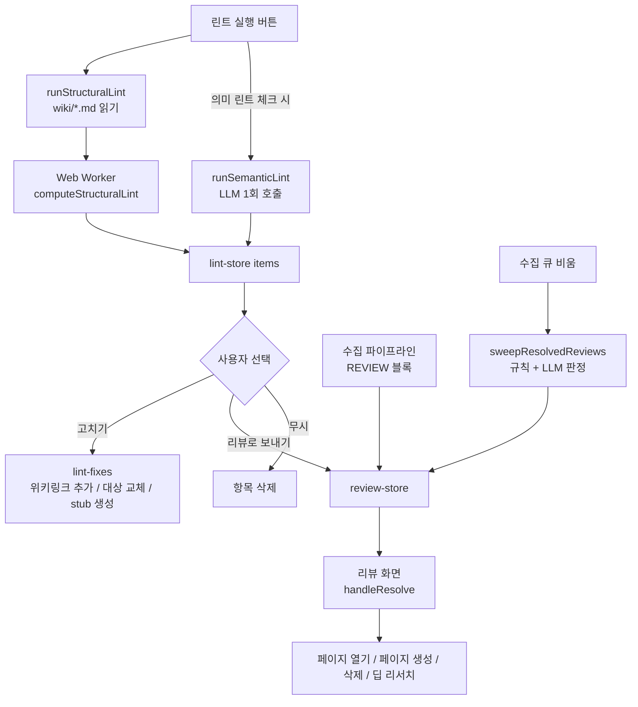

위키는 수집과 질의가 쌓일수록 끊어진 링크, 아무도 가리키지 않는 페이지, 서로 어긋나는 주장이 함께 쌓인다. LLM Wiki는 이 문제를 두 단계로 나눠 다룬다. 코드만으로 확정할 수 있는 구조 결함은 린트(Lint)가 찾아 바로 고치고, 사람의 판단이 필요한 항목은 리뷰(Review) 큐로 넘겨 사람이 처리한다.

이 장은 린트 화면(`src/components/lint`)과 린트 모듈(`src/lib/lint*.ts`), 리뷰 저장소(`src/stores/review-store.ts`)와 리뷰 화면, 그리고 수집이 끝날 때 오래된 리뷰를 자동으로 정리하는 sweep 단계를 차례로 읽는다.

## 원본 아이디어와 구현의 대응

Karpathy의 [llm-wiki.md](https://github.com/nashsu/llm_wiki/blob/e08cfce65aad8b76b13546a081c1a8d4422b70c3/llm-wiki.md#L41-L41)는 Lint를 Ingest, Query와 나란히 세 번째 기본 동작으로 둔다. 원문은 LLM에게 주기적으로 위키를 점검하게 하고, 다음 여섯 가지를 찾으라고 한다. 페이지 간 모순, 새 원본이 대체한 오래된 주장, 들어오는 링크가 없는 고아 페이지, 자주 언급되지만 자기 페이지가 없는 개념, 빠진 상호 참조, 웹 검색으로 채울 수 있는 데이터 공백이다.

구현은 이 여섯 가지를 "코드로 확정 가능한가"를 기준으로 둘로 나눴다.

| 원문 점검 항목 | 구현에서 찾는 방법 | 결과 유형 |
| --- | --- | --- |
| 고아 페이지 (inbound link 없음) | 구조 린트: 위키링크 그래프에서 들어오는 링크 수 계산 | `orphan` |
| 빠진 상호 참조 | 구조 린트: 나가는 위키링크가 0개인 페이지 | `no-outlinks` |
| 빠진 상호 참조 (깨진 쪽) | 구조 린트: 가리키는 대상 페이지가 없는 위키링크 | `broken-link` |
| 페이지 간 모순 | 의미 린트: LLM이 페이지 요약을 읽고 판정 | `semantic` + `[contradiction]` |
| 오래된 주장 | 의미 린트 | `semantic` + `[stale]` |
| 자기 페이지가 없는 개념 | 의미 린트 + 기존 페이지 이름 필터 | `semantic` + `[missing-page]` |
| 웹 검색으로 채울 공백 | 의미 린트 `suggestion` → 리뷰 큐 → 딥 리서치 | `semantic` + `[suggestion]` |

앞의 세 가지는 LLM 없이 결정적으로 계산되고, 뒤의 네 가지는 LLM 호출이 필요하다. 그래서 린트 화면에서 의미 린트는 체크박스로 따로 켜야 하고, LLM 설정이 쓸 수 있는 상태일 때만 실행된다([lint-view.tsx#L164-L167](https://github.com/nashsu/llm_wiki/blob/e08cfce65aad8b76b13546a081c1a8d4422b70c3/src/components/lint/lint-view.tsx#L164-L167)).

원문에 없는 부분은 리뷰 큐다. 원문은 "수집 중에 사람이 관여하라"고만 하는데, 구현은 LLM이 사람의 판단이 필요하다고 표시한 항목을 비동기 큐에 쌓아 두고 사람이 나중에 처리하게 한다(README의 "Review System" 절, [README.md#L276-L283](https://github.com/nashsu/llm_wiki/blob/e08cfce65aad8b76b13546a081c1a8d4422b70c3/README.md#L276-L283)).

## 전체 흐름

린트 결과와 리뷰 항목은 각각 `.llm-wiki/lint.json`, `.llm-wiki/review.json`에 저장되어 앱을 다시 열어도 남는다([persist.ts#L14-L44](https://github.com/nashsu/llm_wiki/blob/e08cfce65aad8b76b13546a081c1a8d4422b70c3/src/lib/persist.ts#L14-L44)). 저장 시점은 저장소 구독과 디바운스로 정해지며, 10장의 auto-save 절에서 다룬다.

## 린트와 리뷰의 역할 분담

마지막으로 두 기능의 성격 차이를 표로 정리한다.

| 항목 | 린트 | 리뷰 |
| --- | --- | --- |
| 실행 시점 | 사용자가 버튼을 누를 때 | 수집 중 상시, 린트에서 넘길 때 |
| 결과 수명 | 다시 실행하면 전부 교체 | 누적, 해결 상태 보존 |
| id | `lint-N` 카운터 | 내용 해시 (`review-xxxxxxxx`) |
| 저장 위치 | `.llm-wiki/lint.json` | `.llm-wiki/review.json` |
| 자동 수정 | 위키링크 추가, 대상 교체, stub 생성 | 없음. 사람이 버튼으로 선택 |
| 자동 정리 | 없음 | 수집 큐가 빌 때 sweep |
| LLM 사용 | 선택 (의미 린트) | 수집 시 생성, sweep 2단계 판정 |

원문은 "LLM이 위키를 점검하고 사람은 방향을 잡는다"는 분업을 제안했다. 구현은 여기에 코드로 확정할 수 있는 결함을 LLM 없이 처리하는 층을 하나 더 두었다. 구조 결함은 결정적으로 찾고 고치며, LLM이 필요한 판단은 결과를 바로 쓰지 않고 리뷰 큐를 거쳐 사람이 고르게 했다.

## 정리

- 린트는 구조 린트(고아, 나가는 링크 없음, 깨진 링크)와 의미 린트(모순, 오래된 주장, 빠진 페이지, 조사 제안)로 나뉜다. 구조 린트는 LLM 없이 Web Worker에서 계산하고, 의미 린트는 페이지당 앞 500자 요약을 모아 LLM을 한 번 호출한다.
- 구조 결함마다 토큰 겹침과 2글자 조각, Levenshtein 유사도로 연결 후보를 함께 계산해, 위키링크 추가나 대상 교체를 버튼 하나로 처리한다. 후보가 없으면 stub 페이지를 만들거나 리뷰로 넘긴다.
- 의미 린트의 `missing-page` 오탐은 기존 파일명과 제목을 정규화한 집합과 정확히 일치하는지로 걸러 낸다. 부분 일치는 일부러 쓰지 않는다.
- 리뷰 id는 `type::정규화제목`의 FNV-1a 해시다. 같은 리뷰가 다시 생겨도 해결 상태가 유지되고, property test가 미해결 항목 유일성, `affectedPages` 합집합, 해결됨 우선을 무작위 입력으로 검사한다.
- 리뷰 처리는 `action` 문자열을 접두어와 단어 휴리스틱으로 해석해 열기, 삭제, 페이지 생성, 딥 리서치로 나눈다. 딥 리서치를 건 리뷰는 결과 페이지가 저장된 뒤에야 해결된다.
- 수집 큐가 비면 sweep이 규칙과 LLM 판정 두 단계로 이미 해소된 리뷰를 자동으로 닫는다. 모순과 확인 항목은 기본적으로 사람 몫으로 남긴다.
