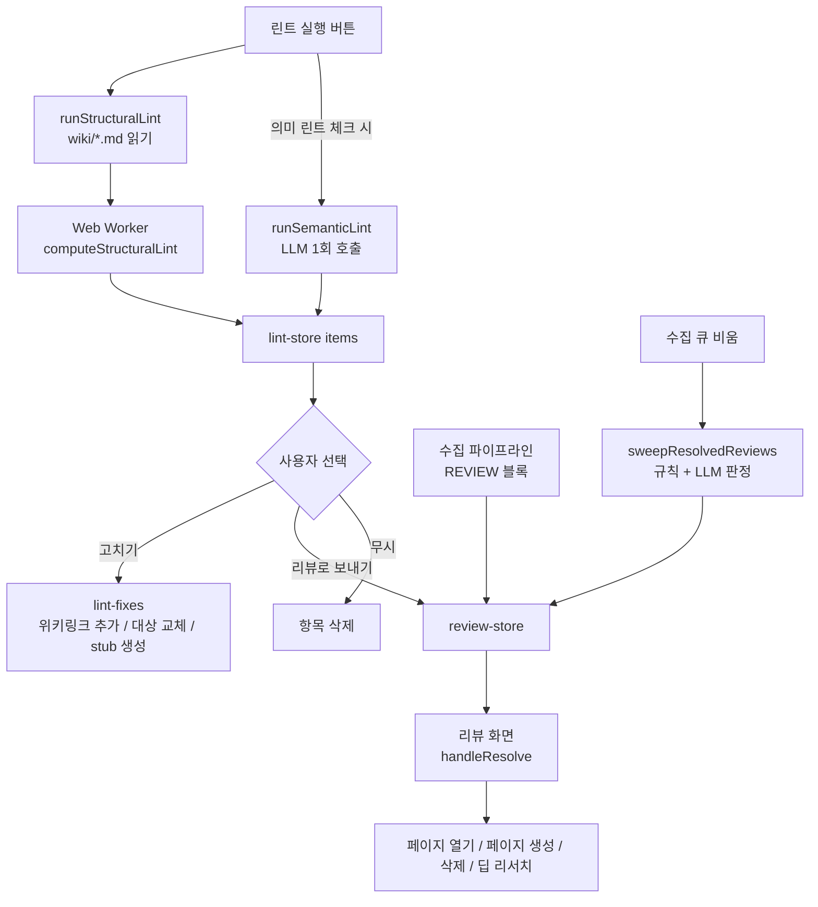
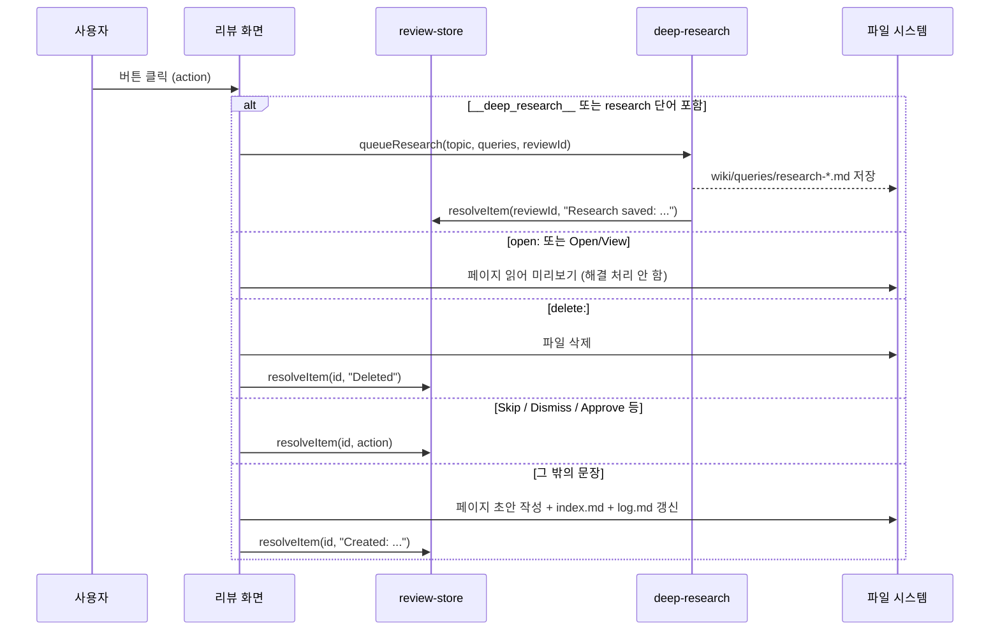
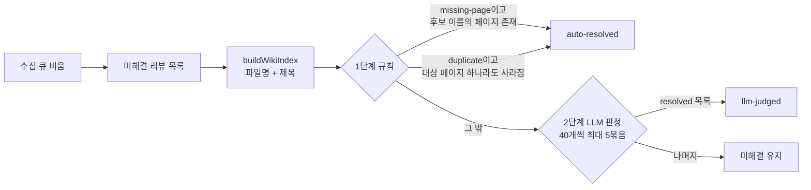

위키는 수집과 질의가 쌓일수록 끊어진 링크, 아무도 가리키지 않는 페이지, 서로 어긋나는 주장이 함께 쌓인다. LLM Wiki는 이 문제를 두 단계로 나눠 다룬다. 코드만으로 확정할 수 있는 구조 결함은 린트(Lint)가 찾아 바로 고치고, 사람의 판단이 필요한 항목은 리뷰(Review) 큐로 넘겨 사람이 처리한다.

이 장은 린트 화면(`src/components/lint`)과 린트 모듈(`src/lib/lint*.ts`), 리뷰 저장소(`src/stores/review-store.ts`)와 리뷰 화면, 그리고 수집이 끝날 때 오래된 리뷰를 자동으로 정리하는 sweep 단계를 차례로 읽는다.

## 원본 아이디어와 구현의 대응

Karpathy의 [llm-wiki.md](https://github.com/nashsu/llm_wiki/blob/e08cfce65aad8b76b13546a081c1a8d4422b70c3/llm-wiki.md#L41-L41)는 Lint를 Ingest, Query와 나란히 세 번째 기본 동작으로 둔다. 원문은 LLM에게 주기적으로 위키를 점검하게 하고, 다음 여섯 가지를 찾으라고 한다. 페이지 간 모순, 새 원본이 대체한 오래된 주장, 들어오는 링크가 없는 고아 페이지, 자주 언급되지만 자기 페이지가 없는 개념, 빠진 상호 참조, 웹 검색으로 채울 수 있는 데이터 공백이다.

구현은 이 여섯 가지를 "코드로 확정 가능한가"를 기준으로 둘로 나눴다.

| 원문 점검 항목 | 구현에서 찾는 방법 | 결과 유형 |
| --- | --- | --- |
| 고아 페이지 (inbound link 없음) | 구조 린트: 위키링크 그래프에서 들어오는 링크 수 계산 | `orphan` |
| 빠진 상호 참조 | 구조 린트: 나가는 위키링크가 0개인 페이지 | `no-outlinks` |
| 빠진 상호 참조 (깨진 쪽) | 구조 린트: 가리키는 대상 페이지가 없는 위키링크 | `broken-link` |
| 페이지 간 모순 | 의미 린트: LLM이 페이지 요약을 읽고 판정 | `semantic` + `[contradiction]` |
| 오래된 주장 | 의미 린트 | `semantic` + `[stale]` |
| 자기 페이지가 없는 개념 | 의미 린트 + 기존 페이지 이름 필터 | `semantic` + `[missing-page]` |
| 웹 검색으로 채울 공백 | 의미 린트 `suggestion` → 리뷰 큐 → 딥 리서치 | `semantic` + `[suggestion]` |

앞의 세 가지는 LLM 없이 결정적으로 계산되고, 뒤의 네 가지는 LLM 호출이 필요하다. 그래서 린트 화면에서 의미 린트는 체크박스로 따로 켜야 하고, LLM 설정이 쓸 수 있는 상태일 때만 실행된다([lint-view.tsx#L164-L167](https://github.com/nashsu/llm_wiki/blob/e08cfce65aad8b76b13546a081c1a8d4422b70c3/src/components/lint/lint-view.tsx#L164-L167)).

원문에 없는 부분은 리뷰 큐다. 원문은 "수집 중에 사람이 관여하라"고만 하는데, 구현은 LLM이 사람의 판단이 필요하다고 표시한 항목을 비동기 큐에 쌓아 두고 사람이 나중에 처리하게 한다(README의 "Review System" 절, [README.md#L276-L283](https://github.com/nashsu/llm_wiki/blob/e08cfce65aad8b76b13546a081c1a8d4422b70c3/README.md#L276-L283)).

## 전체 흐름



린트 결과와 리뷰 항목은 각각 `.llm-wiki/lint.json`, `.llm-wiki/review.json`에 저장되어 앱을 다시 열어도 남는다([persist.ts#L14-L44](https://github.com/nashsu/llm_wiki/blob/e08cfce65aad8b76b13546a081c1a8d4422b70c3/src/lib/persist.ts#L14-L44)). 저장 시점은 저장소 구독과 디바운스로 정해지며, 10장의 auto-save 절에서 다룬다.

## 린트 결과의 모양

모든 린트 결과는 `LintResult` 하나의 타입으로 표현된다.

무엇을 보는지: 결과 타입과 선택 필드.
[src/lib/lint.ts#L16-L25](https://github.com/nashsu/llm_wiki/blob/e08cfce65aad8b76b13546a081c1a8d4422b70c3/src/lib/lint.ts#L16-L25)

```ts
export interface LintResult {
  type: "orphan" | "broken-link" | "no-outlinks" | "semantic"
  severity: "warning" | "info"
  page: string
  detail: string
  affectedPages?: string[]
  brokenTarget?: string
  suggestedTarget?: string
  suggestedSource?: string
}
```

선택 필드 세 개가 자동 수정의 재료다. 어떤 필드가 채워지는지는 유형마다 다르다.

| 유형 | 심각도 | `page` 의미 | 자동 수정 재료 |
| --- | --- | --- | --- |
| `orphan` | info | 고아 페이지의 wiki 상대 경로 | `suggestedSource`: 이 페이지로 링크를 걸 만한 다른 페이지 |
| `no-outlinks` | info | 나가는 링크가 없는 페이지 | `suggestedTarget`: 이 페이지가 링크할 만한 다른 페이지 |
| `broken-link` | warning | 깨진 링크가 들어 있는 페이지 | `brokenTarget`: 깨진 링크 대상, `suggestedTarget`: 철자가 비슷한 실제 페이지 |
| `semantic` | LLM이 정한 값 | LLM이 붙인 짧은 제목 | 없음. `affectedPages`만 채워진다 |

`semantic` 결과는 자동 수정 재료가 없어서 "고치기"를 누르면 항상 리뷰 큐로 간다. 코드가 확정할 수 없는 일은 사람에게 넘긴다는 원칙이 타입 수준에서 드러난다.

## 구조 린트

### 페이지 수집: runStructuralLint

구조 린트는 `wiki/` 아래의 모든 `.md`를 읽어 페이지마다 경로, 제목, 나가는 위키링크, 토큰 집합을 만든다. `index.md`와 `log.md`는 처음부터 제외한다. 두 파일은 모든 페이지를 나열하거나 기록하는 용도라서 고아 판정과 나가는 링크 판정에 넣으면 결과가 왜곡된다.

무엇을 보는지: 페이지 하나를 `StructuralLintPage`로 바꾸는 루프.
[src/lib/lint.ts#L169-L193](https://github.com/nashsu/llm_wiki/blob/e08cfce65aad8b76b13546a081c1a8d4422b70c3/src/lib/lint.ts#L169-L193)

```ts
const wikiFiles = flattenMdFiles(tree)
// Exclude index.md and log.md from orphan checks
const contentFiles = wikiFiles.filter(
  (f) => f.name !== "index.md" && f.name !== "log.md"
)
const pages: StructuralLintPage[] = []
for (let index = 0; index < contentFiles.length; index += 1) {
  if (options.signal?.aborted) throw new DOMException("Structural lint cancelled", "AbortError")
  const f = contentFiles[index]
  try {
    const content = await readFile(f.path)
    const shortName = getRelativePath(f.path, wikiRoot)
    const slug = relativeToSlug(shortName)
    const title = extractTitle(content, shortName)
    const outlinks = extractWikilinks(content)
    const slugName = getFileName(slug)
    const tokens = Array.from(tokenizeForSuggestion(`${title}\n${slugName}\n${content.slice(0, SUGGESTION_TOKEN_WINDOW)}`))
    pages.push({ shortName, slug, title, outlinks, tokens })
```

- 위키링크 추출 정규식은 `[[target|alias]]`에서 `target`만 꺼낸다([lint.ts#L43-L51](https://github.com/nashsu/llm_wiki/blob/e08cfce65aad8b76b13546a081c1a8d4422b70c3/src/lib/lint.ts#L43-L51)). 별칭은 판정에 쓰지 않는다.
- 제목은 frontmatter의 `title:`, 첫 `#` 제목, 파일명 순으로 찾는다([lint.ts#L82-L93](https://github.com/nashsu/llm_wiki/blob/e08cfce65aad8b76b13546a081c1a8d4422b70c3/src/lib/lint.ts#L82-L93)).
- 토큰은 제목, 파일명, 본문 앞 `SUGGESTION_TOKEN_WINDOW = 4000`자에서만 뽑는다([lint.ts#L27](https://github.com/nashsu/llm_wiki/blob/e08cfce65aad8b76b13546a081c1a8d4422b70c3/src/lib/lint.ts#L27-L27)). 토큰화는 NFKC 정규화 후 Unicode 글자와 숫자 연속을 단어로 보고, 한자 범위(`㐀-鿿`)는 글자 하나씩도 토큰으로 넣는다([lint.ts#L95-L106](https://github.com/nashsu/llm_wiki/blob/e08cfce65aad8b76b13546a081c1a8d4422b70c3/src/lib/lint.ts#L95-L106)). 띄어쓰기가 없는 중국어 본문을 위한 처리다. 한글은 이 범위에 들어가지 않으므로 어절 단위 토큰만 만들어진다.

진행률은 파일 읽기에 절반, 계산에 절반을 배정한다. 읽기 루프는 `index + 1`을 `contentFiles.length * 2`에 대해 보고하고, 워커 진행률은 그 뒤에 이어 붙인다.

### Web Worker 기반 계산

페이지가 수천 개가 되면 후보 추천 계산이 UI 스레드를 막는다. 그래서 계산 함수 `computeStructuralLint`는 순수 함수로 분리되어 있고([lint-structural-core.ts](https://github.com/nashsu/llm_wiki/blob/e08cfce65aad8b76b13546a081c1a8d4422b70c3/src/lib/lint-structural-core.ts#L102-L224)), 브라우저 환경에서는 모듈 워커로 돌린다.

워커가 없는 환경(테스트)에서는 같은 함수를 직접 부르는 분기가 있다([lint.ts#L116-L124](https://github.com/nashsu/llm_wiki/blob/e08cfce65aad8b76b13546a081c1a8d4422b70c3/src/lib/lint.ts#L116-L124)). 워커 쪽 코드는 17줄짜리 어댑터다([lint-structural.worker.ts](https://github.com/nashsu/llm_wiki/blob/e08cfce65aad8b76b13546a081c1a8d4422b70c3/src/lib/lint-structural.worker.ts#L1-L17)). `progress`와 `done` 두 종류 메시지만 보낸다. 취소는 `AbortSignal`이 오면 `worker.terminate()`로 즉시 끊고 `AbortError`를 던진다([lint.ts#L125-L133](https://github.com/nashsu/llm_wiki/blob/e08cfce65aad8b76b13546a081c1a8d4422b70c3/src/lib/lint.ts#L125-L133)). 계산이 순수 함수라서 테스트는 워커 없이 같은 함수를 검증할 수 있다. `lint-structural-core.test.ts`에는 5,000페이지에서 후보 확장이 이차로 늘지 않는지 보는 테스트가 있다([lint-structural-core.test.ts#L24-L35](https://github.com/nashsu/llm_wiki/blob/e08cfce65aad8b76b13546a081c1a8d4422b70c3/src/lib/lint-structural-core.test.ts#L24-L35)).

### 세 가지 판정: computeStructuralLint

계산은 세 개의 색인을 먼저 만든다.

| 색인 | 키 | 값 | 용도 |
| --- | --- | --- | --- |
| `slugMap` | 정규화한 slug, 정규화한 파일명 | 페이지 번호 | 위키링크가 실제 페이지를 가리키는지 확인 |
| `tokenIndex` | 토큰 | 그 토큰을 가진 페이지 번호 목록 | 고아 / 나가는 링크 없음의 관련 페이지 추천 |
| `fragmentIndex` | 2글자 조각(bigram) | 페이지 번호 목록 | 깨진 링크의 철자 교정 후보 |

정규화는 역슬래시를 슬래시로 바꾸고, 앞의 `wiki/`와 뒤의 `.md`를 떼고, 소문자로 만든다([lint-structural-core.ts#L41-L47](https://github.com/nashsu/llm_wiki/blob/e08cfce65aad8b76b13546a081c1a8d4422b70c3/src/lib/lint-structural-core.ts#L41-L47)). `slugMap`에 전체 slug와 파일명을 둘 다 넣기 때문에 `[[entities/foo]]`와 `[[foo]]`가 모두 같은 페이지로 연결된다.

무엇을 보는지: 들어오는 링크 수를 세는 부분과 세 판정.
[src/lib/lint-structural-core.ts#L122-L129](https://github.com/nashsu/llm_wiki/blob/e08cfce65aad8b76b13546a081c1a8d4422b70c3/src/lib/lint-structural-core.ts#L122-L129), [#L189-L218](https://github.com/nashsu/llm_wiki/blob/e08cfce65aad8b76b13546a081c1a8d4422b70c3/src/lib/lint-structural-core.ts#L189-L218)

```ts
const inboundCounts = new Map<number, number>()
for (const page of pages) {
  for (const link of page.outlinks) {
    const target = slugMap.get(normalizeTarget(link))
      ?? slugMap.get(normalizeTarget(fileName(link).replace(/\.md$/i, "")))
    if (target !== undefined) inboundCounts.set(target, (inboundCounts.get(target) ?? 0) + 1)
  }
}
// ...
if (!ignored && !config.ignoreOrphan && !inboundCounts.has(pageIndex)) {
  results.push({ type: "orphan", severity: "info", page: page.shortName,
    detail: "No other pages link to this page.",
    suggestedSource: relatedCandidate(pageIndex, "source")?.shortName })
}
```

- 고아 판정은 본문 위키링크만 본다. 자기 자신을 가리키는 링크도 들어오는 링크로 세므로, 자기 링크만 있는 페이지는 고아로 잡히지 않는다(코드상 자기 참조를 제외하는 분기가 없다).
- `index.md`는 페이지 목록에서 빠져 있으므로, `index.md`에만 등재된 페이지도 고아로 잡힌다. 고아 삭제 버튼의 주석이 이 점을 직접 언급한다([lint-view.tsx#L337-L342](https://github.com/nashsu/llm_wiki/blob/e08cfce65aad8b76b13546a081c1a8d4422b70c3/src/components/lint/lint-view.tsx#L337-L342)).
- 깨진 링크는 `slugMap`에 전체 경로도 파일명도 없을 때만 보고하고, 심각도가 `warning`인 유일한 구조 결함이다([lint-structural-core.ts#L207-L218](https://github.com/nashsu/llm_wiki/blob/e08cfce65aad8b76b13546a081c1a8d4422b70c3/src/lib/lint-structural-core.ts#L207-L218)).

### 추천 후보 계산

린트가 결함만 알리고 끝나면 사람이 하나씩 링크를 달아야 한다. 이 구현은 결함마다 "어디에 연결하면 되는지"를 함께 계산해서 버튼 하나로 고칠 수 있게 한다.

관련 페이지 추천(`relatedCandidate`)은 토큰 겹침을 두 집합 크기의 기하평균으로 나눈 값에 같은 폴더 가산점을 더한다. 페이지 $p$와 후보 $c$의 토큰 집합을 $T_p$, $T_c$라고 하면 다음과 같다.

$$
\text{score}(p, c) = \frac{\sum_{t \in T_p \cap T_c} w(t)}{\sqrt{\max(1, |T_p|) \cdot \max(1, |T_c|)}} + b_{\text{folder}}
$$

$w(t)$는 두 글자 이상 토큰이면 1, 한 글자 한자 토큰이면 0.35다. $b_{\text{folder}}$는 두 페이지의 최상위 폴더가 같을 때 0.08이다. 문서 전체의 25%(최소 20개)보다 많은 페이지에 나오는 토큰은 점수 계산에서 아예 빠진다. 흔한 단어가 후보를 늘려 계산이 이차로 커지는 것을 막기 위해서다([lint-structural-core.ts#L134-L141](https://github.com/nashsu/llm_wiki/blob/e08cfce65aad8b76b13546a081c1a8d4422b70c3/src/lib/lint-structural-core.ts#L134-L141)).

깨진 링크의 교정 후보(`brokenCandidate`)는 다른 방식이다. 2글자 조각 색인으로 후보를 모은 뒤 문자열 유사도를 계산한다([lint-structural-core.ts#L66-L77](https://github.com/nashsu/llm_wiki/blob/e08cfce65aad8b76b13546a081c1a8d4422b70c3/src/lib/lint-structural-core.ts#L66-L77)). 정확히 같으면 1, 파일명이 같으면 0.96, 한쪽이 다른 쪽을 포함하면 0.82, 그 밖에는 Levenshtein 거리로 $1 - d/\max(|a|,|b|)$를 쓴다. 파일명이 5글자 미만이면 편집 거리 비교를 하지 않고 0으로 둔다. 짧은 이름끼리는 한두 글자 차이로도 엉뚱한 페이지가 걸리기 때문이다.

상수는 모두 파일 맨 위에 모여 있다([lint-structural-core.ts#L29-L35](https://github.com/nashsu/llm_wiki/blob/e08cfce65aad8b76b13546a081c1a8d4422b70c3/src/lib/lint-structural-core.ts#L29-L35)).

| 상수 | 값 | 의미 |
| --- | --- | --- |
| `BROKEN_LINK_SUGGESTION_MIN_SCORE` | 0.74 | 깨진 링크 교정 후보로 인정하는 최소 유사도 |
| `RELATED_PAGE_SUGGESTION_MIN_SCORE` | 0.08 | 관련 페이지 추천의 최소 점수 |
| `SAME_FOLDER_SCORE_BONUS` | 0.08 | 같은 최상위 폴더 가산점 |
| `SINGLE_CJK_TOKEN_WEIGHT` | 0.35 | 한 글자 한자 토큰 가중치 |
| `SAME_BASENAME_SCORE` | 0.96 | 경로는 다르고 파일명이 같을 때 유사도 |
| `CONTAINS_TARGET_SCORE` | 0.82 | 한쪽이 다른 쪽을 포함할 때 유사도 |
| `MAX_SUGGESTION_CANDIDATES` | 64 | 점수 계산까지 가는 후보 수 상한 |

`no-outlinks`의 추천 대상을 고를 때는 이미 링크한 페이지를 건너뛴다(`direction === "target"` 분기). 링크가 0개인 페이지에서는 실질적인 의미가 없지만, 같은 함수를 공유하기 위한 처리다.

### 무시 규칙: lint-config

위키에 일부러 고립시킨 페이지(예: 초안, 보관 페이지)가 있으면 매번 같은 경고가 뜬다. 린트 화면 좌측 톱니 버튼으로 규칙을 바꿀 수 있고, 프로젝트별로 `.llm-wiki/lint-config.json`에 저장된다([lint-config.ts#L27-L49](https://github.com/nashsu/llm_wiki/blob/e08cfce65aad8b76b13546a081c1a8d4422b70c3/src/lib/lint-config.ts#L27-L49)).

| 필드 | 기본값 | 효과 |
| --- | --- | --- |
| `ignoreOrphan` | `false` | 고아 판정 전체를 끈다 |
| `ignoreNoOutlinks` | `false` | 나가는 링크 없음 판정 전체를 끈다 |
| `ignorePages` | `[]` | 목록의 페이지는 세 판정을 모두 건너뛴다. 쉼표, 전각 쉼표, 줄바꿈으로 구분한다 |

무시된 페이지도 다른 페이지의 링크 대상으로는 계속 인정된다. `slugMap`은 무시 여부와 상관없이 모든 페이지로 만들어지기 때문이다. 또 무시 목록은 slug와 경로로만 비교하고 파일명만으로는 비교하지 않는다. 주석이 설명하듯 최상위 `foo`를 무시해도 `archive/foo`는 숨겨지지 않는다([lint-structural-core.ts#L184-L188](https://github.com/nashsu/llm_wiki/blob/e08cfce65aad8b76b13546a081c1a8d4422b70c3/src/lib/lint-structural-core.ts#L184-L188)).

## 의미 린트

의미 린트는 위키 전체를 한 번의 LLM 호출로 점검한다. 페이지마다 앞 500자(frontmatter 포함)만 잘라 `### 경로` 아래에 붙인 요약 묶음을 만들고, 이것을 프롬프트에 넣는다([lint.ts#L233-L252](https://github.com/nashsu/llm_wiki/blob/e08cfce65aad8b76b13546a081c1a8d4422b70c3/src/lib/lint.ts#L233-L252)).

무엇을 보는지: LLM에게 주는 출력 형식과 유형 정의.
[src/lib/lint.ts#L270-L288](https://github.com/nashsu/llm_wiki/blob/e08cfce65aad8b76b13546a081c1a8d4422b70c3/src/lib/lint.ts#L270-L288)

```ts
"For each issue, output exactly this format:",
"",
"---LINT: type | severity | Short title---",
"Description of the issue.",
"PAGES: page1.md, page2.md",
"---END LINT---",
"",
"Types:",
"- contradiction: two or more pages make conflicting claims",
"- stale: information that appears outdated or superseded",
"- missing-page: an important concept is heavily referenced but has no dedicated page",
"- suggestion: a question or source worth adding to the wiki",
"For missing-page findings, Short title must be only the exact missing concept or entity name, without explanatory prefixes or suffixes.",
```

해설:

- 출력은 JSON이 아니라 구분자 블록이다. 4장의 수집 파이프라인이 쓰는 `---FILE: ...---` 블록, 리뷰의 `---REVIEW: ...---` 블록과 같은 방식이고, 정규식 `LINT_BLOCK_REGEX` 하나로 파싱한다([lint.ts#L202-L203](https://github.com/nashsu/llm_wiki/blob/e08cfce65aad8b76b13546a081c1a8d4422b70c3/src/lib/lint.ts#L202-L203)). 블록 형식을 지키지 않은 출력은 조용히 버려진다.
- 원문의 여섯 항목 가운데 LLM 몫인 모순, 오래된 주장, 빠진 개념, 조사할 질문을 그대로 네 유형으로 옮겼다.
- 언어 지시문(`buildLanguageDirective`)은 요약 앞 2,000자를 표본으로 써서 위키의 언어에 맞춘다. 한국어 위키면 결과도 한국어로 나오도록 하는 장치다.

### missing-page 오탐 필터링

LLM은 페이지 목록을 정확히 대조하지 못해서 이미 있는 개념을 "페이지 없음"으로 보고하는 일이 잦다. 코드는 파일명과 frontmatter 제목을 모두 정규화해 집합으로 만든 뒤, `missing-page` 결과의 제목이 이 집합에 정확히 있으면 버린다([lint.ts#L327-L332](https://github.com/nashsu/llm_wiki/blob/e08cfce65aad8b76b13546a081c1a8d4422b70c3/src/lib/lint.ts#L327-L332)).

정규화는 리뷰 제목 정규화(`normalizeReviewTitle`)에 NFKC와 소문자를 더한 것이다([lint.ts#L62-L64](https://github.com/nashsu/llm_wiki/blob/e08cfce65aad8b76b13546a081c1a8d4422b70c3/src/lib/lint.ts#L62-L64)). 부분 문자열 비교는 일부러 쓰지 않는다. 주석에 따르면 짧은 페이지 제목이 다른 문장 속 평범한 단어와 겹쳐 진짜 빠진 페이지까지 지워지기 때문이다([lint.ts#L66-L80](https://github.com/nashsu/llm_wiki/blob/e08cfce65aad8b76b13546a081c1a8d4422b70c3/src/lib/lint.ts#L66-L80)). 프롬프트에서 "제목에는 개념 이름만 쓰라"고 요구하는 것도 이 정확 일치 필터가 통하게 하기 위해서다.

> **주의**: 의미 린트는 페이지당 500자만 본다. 모순되는 주장이 페이지 뒷부분에 있으면 LLM이 볼 수 없고, 페이지가 많으면 프롬프트 전체가 모델의 컨텍스트 한도를 넘을 수 있다. 코드에는 페이지 수나 전체 길이 상한이 없다(미검증: 실제 대형 위키에서 어떻게 실패하는지는 확인하지 않았다).

결과는 모두 `type: "semantic"`으로 저장되고, 원래 유형은 `detail` 앞에 `[contradiction]`처럼 붙는다([lint.ts#L341-L347](https://github.com/nashsu/llm_wiki/blob/e08cfce65aad8b76b13546a081c1a8d4422b70c3/src/lib/lint.ts#L341-L347)). 화면에서는 네 유형이 하나의 아이콘으로 묶인다.

## 린트 결과 수정

### 항목 하나 고치기: handleFix

린트 화면의 "고치기" 버튼은 유형별로 다른 수정을 한다.

무엇을 보는지: 깨진 링크 처리. 교정 후보가 있으면 대상을 바꾸고, 없으면 stub 페이지를 만든다.
[src/components/lint/lint-view.tsx#L276-L290](https://github.com/nashsu/llm_wiki/blob/e08cfce65aad8b76b13546a081c1a8d4422b70c3/src/components/lint/lint-view.tsx#L276-L290)

```ts
case "broken-link": {
  const pagePath = `${pp}/wiki/${item.page}`
  if (item.brokenTarget && item.suggestedTarget) {
    const content = await readFile(pagePath)
    await writeFile(pagePath, rewriteWikilinkTarget(content, item.brokenTarget, item.suggestedTarget))
  } else if (item.brokenTarget) {
    const content = await readFile(pagePath)
    const stub = await ensureBrokenLinkStub(pp, item.brokenTarget)
    await writeFile(pagePath, rewriteWikilinkTarget(content, item.brokenTarget, stub.relativePath))
  } else {
    addLintItemToReview(item)
  }
  useLintStore.getState().removeItem(item.id)
  break
}
```

| 유형 | 추천 있음 | 추천 없음 |
| --- | --- | --- |
| `orphan` | `suggestedSource` 페이지에 이 페이지로 가는 링크 추가 | 리뷰 큐로 보냄 |
| `no-outlinks` | 이 페이지에 `suggestedTarget`으로 가는 링크 추가 | 리뷰 큐로 보냄 |
| `broken-link` | 위키링크 대상을 `suggestedTarget`으로 교체 | stub 페이지를 만들고 링크를 그쪽으로 교체 |
| `semantic` | 해당 없음 | 항상 리뷰 큐로 보냄 |

수정 함수 세 개는 `lint-fixes.ts`에 순수 문자열 변환으로 모여 있다.

- `appendWikilink`: 이미 같은 대상의 링크가 있으면 원문을 그대로 돌려준다. 없으면 `## Related` 제목 바로 아래에 `- [[target]]` 줄을 넣고, 제목이 없으면 문서 끝에 제목째 만든다([lint-fixes.ts#L23-L33](https://github.com/nashsu/llm_wiki/blob/e08cfce65aad8b76b13546a081c1a8d4422b70c3/src/lib/lint-fixes.ts#L23-L33)). 여러 번 눌러도 링크가 중복되지 않는다.
- `rewriteWikilinkTarget`: 대상만 바꾸고 `|alias` 부분은 그대로 둔다([lint-fixes.ts#L35-L49](https://github.com/nashsu/llm_wiki/blob/e08cfce65aad8b76b13546a081c1a8d4422b70c3/src/lib/lint-fixes.ts#L35-L49)). 화면에 보이는 링크 글자가 바뀌지 않는다.
- `ensureBrokenLinkStub`: 깨진 대상에 폴더가 있으면 그 경로를, 없으면 `queries/` 아래를 쓴다. 이미 파일이 있으면 만들지 않는다. 만든 stub에는 `tags: [stub, lint]`와 "Created by Wiki Lint as a placeholder" 문장이 들어간다([lint-fixes.ts#L69-L102](https://github.com/nashsu/llm_wiki/blob/e08cfce65aad8b76b13546a081c1a8d4422b70c3/src/lib/lint-fixes.ts#L69-L102)). 페이지 유형은 경로에서 추론하고, 추론하지 못하면 `query`가 된다. frontmatter 구조는 5장에서 다룬다.

### 다중 항목 일괄 수정

여러 결과가 같은 페이지를 고치려 할 때, 하나씩 읽고 쓰면 앞의 수정이 뒤의 수정에 덮여 사라질 수 있다. 일괄 수정은 파일별로 변환 함수를 모은 뒤 한 번 읽고, 변환을 차례로 적용하고, 한 번 쓴다.

무엇을 보는지: 파일 경로별 변환 큐와 reduce 적용.
[src/components/lint/lint-view.tsx#L435-L445](https://github.com/nashsu/llm_wiki/blob/e08cfce65aad8b76b13546a081c1a8d4422b70c3/src/components/lint/lint-view.tsx#L435-L445)

```ts
// Multiple findings can target the same page. Apply their transforms in
// memory and write that page once, avoiding lost updates and N full reads.
for (const [path, pending] of edits) {
  const original = await readFile(path)
  const updated = pending.reduce((content, edit) => edit.apply(content), original)
  if (updated !== original) {
    await writeFile(path, updated)
    filesystemChanged = true
  }
  removeLintItems(pending.map((edit) => edit.id))
}
```

중간에 실패해도 `finally`에서 파일 트리 갱신을 한 번 돌린다. 앞에서 이미 쓴 파일이나 stub이 화면에 반영되게 하기 위해서다([lint-view.tsx#L450-L461](https://github.com/nashsu/llm_wiki/blob/e08cfce65aad8b76b13546a081c1a8d4422b70c3/src/components/lint/lint-view.tsx#L450-L461)). `lint-fixes`의 변환 함수가 모두 같은 입력에 같은 결과를 내는 순수 함수라서 이렇게 합성할 수 있다.

### 고아 페이지 삭제

고아 페이지에는 "삭제" 버튼도 있다. 확인 대화상자를 거친 뒤 `cascadeDeleteWikiPagesWithRefs`로 지운다([lint-view.tsx#L326-L355](https://github.com/nashsu/llm_wiki/blob/e08cfce65aad8b76b13546a081c1a8d4422b70c3/src/components/lint/lint-view.tsx#L326-L355)). 파일만 지우지 않고 임베딩 청크, 본문 위키링크, `index.md` 항목, frontmatter `related:` 배열까지 함께 정리한다. 고아 판정이 본문 링크만 보기 때문에 `related:`나 `index.md`에는 이 페이지를 가리키는 참조가 남아 있을 수 있어서다. 연쇄 삭제의 세부는 5장의 원본 수명주기 절에서 다룬다.

### lint-store

`useLintStore`는 결과를 `LintItem`으로 감싸 `lint-N` 형태의 id를 붙인다([lint-store.ts#L17-L30](https://github.com/nashsu/llm_wiki/blob/e08cfce65aad8b76b13546a081c1a8d4422b70c3/src/stores/lint-store.ts#L17-L30)). 디스크에서 불러올 때(`setItems`)는 저장된 id 중 가장 큰 번호로 카운터를 맞춘다([lint-store.ts#L32-L41](https://github.com/nashsu/llm_wiki/blob/e08cfce65aad8b76b13546a081c1a8d4422b70c3/src/stores/lint-store.ts#L32-L41)). 그러지 않으면 재시작 후 새 결과가 이전 결과와 같은 id를 받아 선택이나 삭제가 엉뚱한 항목에 적용된다. 린트를 다시 돌리면 `clearItems()`로 이전 결과를 모두 지우고 새로 채우므로, 린트 결과는 리뷰와 달리 "현재 스냅숏" 성격이다.

## 리뷰 큐

### 리뷰 항목의 출처

리뷰 항목은 세 곳에서 들어온다.

| 출처 | 진입 함수 | 들어오는 유형 |
| --- | --- | --- |
| 수집 파이프라인의 `---REVIEW: type \| Title---` 블록 | `parseReviewBlocks` → `addItems` | `contradiction`, `duplicate`, `missing-page`, `suggestion`, 그 밖은 `confirm` |
| 린트 화면의 "리뷰로 보내기", 추천 없는 "고치기" | `addLintItemToReview` → `addItem` | `confirm`, `suggestion` |
| 외부 API (`/reviews` 엔드포인트) | Rust 쪽 API 서버 | 조회와 해결 처리만 |

수집 단계의 REVIEW 블록은 `OPTIONS:`, `PAGES:`, `SEARCH:` 세 줄을 따로 파싱한다([ingest.ts#L2326-L2389](https://github.com/nashsu/llm_wiki/blob/e08cfce65aad8b76b13546a081c1a8d4422b70c3/src/lib/ingest.ts#L2326-L2389)). `OPTIONS`가 없으면 `Approve`와 `Skip` 두 버튼이 붙는다. `SEARCH`는 딥 리서치용 검색어를 수집 시점에 미리 뽑아 두는 줄로, 10장에서 이 값이 어떻게 쓰이는지 본다. 블록 프롬프트 자체는 4장에서 다룬다. 외부 API의 리뷰 엔드포인트는 README에 정리되어 있고([README.md#L447-L449](https://github.com/nashsu/llm_wiki/blob/e08cfce65aad8b76b13546a081c1a8d4422b70c3/README.md#L447-L449)), 13장에서 다룬다.

린트 결과를 리뷰로 바꿀 때는 유형별로 버튼 구성이 다르다. 깨진 링크는 "열어서 편집", "페이지 삭제", "건너뛰기"를, 고아와 나가는 링크 없음은 "열어서 편집", "건너뛰기"를 받는다([lint-view.tsx#L210-L254](https://github.com/nashsu/llm_wiki/blob/e08cfce65aad8b76b13546a081c1a8d4422b70c3/src/components/lint/lint-view.tsx#L210-L254)). 버튼의 `action` 문자열은 `open:<page>`, `delete:<절대경로>`, `Skip`처럼 접두어로 의도를 담는다.

### 내용 기반의 안정적 id

리뷰 저장소의 핵심은 id를 내용에서 계산한다는 점이다. 같은 유형과 같은 (정규화한) 제목을 가진 리뷰는 언제 만들어져도 같은 id를 받는다.

무엇을 보는지: `type::정규화제목`의 32비트 FNV-1a 해시.
[src/stores/review-store.ts#L49-L58](https://github.com/nashsu/llm_wiki/blob/e08cfce65aad8b76b13546a081c1a8d4422b70c3/src/stores/review-store.ts#L49-L58)

```ts
export function reviewIdFor(item: Pick<ReviewItem, "type" | "title">): string {
  const key = `${item.type}::${normalizeReviewTitle(item.title)}`
  let h = 0x811c9dc5
  for (let i = 0; i < key.length; i++) {
    h ^= key.charCodeAt(i)
    h = Math.imul(h, 0x01000193)
  }
  return `review-${(h >>> 0).toString(16).padStart(8, "0")}`
}
```

함수 위 주석이 왜 이렇게 했는지 설명한다([review-store.ts#L33-L48](https://github.com/nashsu/llm_wiki/blob/e08cfce65aad8b76b13546a081c1a8d4422b70c3/src/stores/review-store.ts#L33-L48)). 예전의 `review-N` 카운터 방식은 큐를 다시 만들 때마다 번호가 바뀌어 해결 상태가 사라졌다. `sourcePath`를 키에 넣지 않은 것도 파일 이름이 바뀌면 id가 바뀌기 때문이다. 안정적 id 덕분에 외부 API가 특정 리뷰를 id로 지정해 해결할 수 있다.

`normalizeReviewTitle`은 `Missing page:`, `Duplicate page:`, `Possible duplicate:`와 중국어 대응 접두어를 떼고, 공백을 하나로 줄이고, 소문자로 바꾼다([review-utils.ts](https://github.com/nashsu/llm_wiki/blob/e08cfce65aad8b76b13546a081c1a8d4422b70c3/src/lib/review-utils.ts#L9-L28)). LLM이 같은 개념에 접두어를 붙였다 뗐다 해도 같은 리뷰로 묶이게 하는 장치다.

> **주의**: 32비트 해시라서 서로 다른 내용이 같은 id를 받을 수 있다. 주석은 같은 내용이 같은 id를 받는 "의도된 충돌"만 언급하고, 우연한 해시 충돌은 다루지 않는다. 충돌하면 나중에 들어온 항목이 앞 항목에 병합되어 사라진다(코드 동작으로 추론, 실제 사례는 미검증).

### 추가와 병합 규칙

`addItem`과 `addItems`의 동작은 조금 다르다.

| 메서드 | 같은 id가 이미 있을 때 | 쓰는 곳 |
| --- | --- | --- |
| `addItem` | 아무것도 바꾸지 않는다 | 린트에서 리뷰로 보낼 때 |
| `addItems` | 기존 항목을 유지하되 `description`, `sourcePath`는 새 값 우선, `affectedPages`, `searchQueries`는 합집합 | 수집 파이프라인 |
| `setItems` | 모든 항목의 id를 다시 계산하고 같은 id끼리 병합(`normalizeReviewItems`) | 디스크에서 불러올 때 |

`addItems`의 주석이 이 설계의 이유를 적고 있다([review-store.ts#L122-L154](https://github.com/nashsu/llm_wiki/blob/e08cfce65aad8b76b13546a081c1a8d4422b70c3/src/stores/review-store.ts#L122-L154)). 이전 구현은 해결되지 않은 항목하고만 중복을 비교했다. 그래서 사람이 해결한 리뷰를 다음 수집이 다시 만들면 새 미해결 항목이 생겼다. 지금은 해결된 항목까지 포함해 비교하고, 해결 상태는 그대로 둔다.

`setItems`의 병합(`mergeReviewItems`)은 "해결됨이 이긴다", 배열 필드는 합집합, `createdAt`은 더 이른 값, 설명은 비어 있지 않은 쪽을 고른다([review-store.ts#L79-L93](https://github.com/nashsu/llm_wiki/blob/e08cfce65aad8b76b13546a081c1a8d4422b70c3/src/stores/review-store.ts#L79-L93)). 옛 `review-N` id로 저장된 파일을 불러와도 내용으로 id를 다시 계산하므로, 마이그레이션 버전 플래그 없이 몇 번 불러와도 결과가 같다.

### property test의 보장 항목

`review-store.property.test.ts`는 fast-check로 무작위 입력을 만들어 병합 규칙의 불변식을 검사한다([review-store.property.test.ts](https://github.com/nashsu/llm_wiki/blob/e08cfce65aad8b76b13546a081c1a8d4422b70c3/src/stores/review-store.property.test.ts#L34-L124)). 생성기는 다섯 유형 중 하나, 1~60자 제목, 최대 4개의 `affectedPages`와 `searchQueries`를 만든다.

| 테스트 | 입력 | 보장하는 불변식 |
| --- | --- | --- |
| 미해결 항목 유일성 | 최대 6번의 `addItems` 호출, 호출마다 최대 8개 항목 | 어떤 순서로 넣어도 미해결 항목의 `(type, 정규화 제목)`은 모두 다르다 |
| `affectedPages` 합집합 | 같은 유형과 제목으로 2~5번 추가, 매번 다른 페이지 목록 | 항목은 1개만 남고, `affectedPages`는 넣은 모든 페이지의 합집합과 같다 |
| 해결됨 우선 | 추가 → `resolveItem` → 같은 키로 다시 추가 | 항목은 1개, id는 처음 것, `resolved`와 `resolvedAction`이 유지되고, 새 페이지는 합쳐진다 |

세 번째 테스트는 처음 받은 id와 `resolvedAction: "auto-resolved"`가 그대로인지, 두 번째로 넣은 `second.md`가 `affectedPages`에 합쳐졌는지를 단언한다([review-store.property.test.ts#L110-L119](https://github.com/nashsu/llm_wiki/blob/e08cfce65aad8b76b13546a081c1a8d4422b70c3/src/stores/review-store.property.test.ts#L110-L119)). 세 번째 테스트는 수집이 같은 리뷰를 다시 만들 때 해결 상태가 되살아나던 회귀를 막는다. 주석이 "that revival was the bug being fixed"라고 적어 두었다. 이 테스트들은 `addItems` 경로만 다루고, `setItems`의 마이그레이션 병합이나 `addItem` 단건 경로는 별도의 예제 테스트(`review-store.test.ts`)가 맡는다. 테스트 전략 전체는 14장에서 정리한다.

## 사람의 리뷰 처리 흐름

리뷰 화면의 버튼을 누르면 `handleResolve(id, action)`이 `action` 문자열을 보고 할 일을 정한다([review-view.tsx#L90-L316](https://github.com/nashsu/llm_wiki/blob/e08cfce65aad8b76b13546a081c1a8d4422b70c3/src/components/review/review-view.tsx#L90-L316)). LLM이 `OPTIONS:` 줄에 자유 문장을 쓸 수 있기 때문에, 접두어가 정해진 내부 action과 함께 문자열 휴리스틱도 쓴다.



판정 순서가 중요하다.

| 순서 | 조건 | 동작 | 해결 처리 |
| --- | --- | --- | --- |
| 1 | `action === "__deep_research__"` | 검색 소스 설정 확인 후 `queueResearch` | 연구 결과가 저장된 뒤 |
| 2 | `save:` 접두어 | base64로 인코딩된 채팅 답변을 `wiki/queries/`에 저장 | 즉시 |
| 3 | `open:` 접두어 또는 Open/View류 | 미리보기에 열기 | 하지 않음 |
| 4 | `delete:` 접두어 | 파일 삭제 | 즉시 |
| 5 | research, investigate, explore, look into 등 포함 | 딥 리서치. 검색 소스가 없으면 6번으로 넘김 | 연구 결과가 저장된 뒤 |
| 6 | `__create_page__:` 접두어 또는 "dismissal이 아닌 모든 문장" | 페이지 초안 생성 | 즉시 |
| 7 | 그 밖 | 기록만 남김 | 즉시 |

"페이지 열기는 해결이 아니다"라는 원칙이 3번에 들어 있다. 주석이 "Viewing is not the same as accepting / fixing it"이라고 적고 있다([review-view.tsx#L167-L169](https://github.com/nashsu/llm_wiki/blob/e08cfce65aad8b76b13546a081c1a8d4422b70c3/src/components/review/review-view.tsx#L167-L169)).

6번은 휴리스틱의 폭이 넓다. `actionLooksLikeCreate`는 `actionIsDismissal`의 부정이다([review-view.tsx#L663-L681](https://github.com/nashsu/llm_wiki/blob/e08cfce65aad8b76b13546a081c1a8d4422b70c3/src/components/review/review-view.tsx#L663-L681)). `skip`, `dismiss`, `ignore`, `approve`, `keep existing`, `no`와 중국어 두 단어 외의 문장은 모두 "페이지를 만들라"로 해석된다. 예를 들어 LLM이 `Merge pages`라는 선택지를 만들면 병합이 아니라 페이지 생성이 실행된다(코드 분기로 추론). README가 "Predefined action types: Create Page, Deep Research, Skip"이라고 쓴 것은 이 세 유형으로 수렴시킨다는 뜻으로 읽힌다.

> **주의**: dismissal 단어 목록은 영어와 중국어뿐이다. 한국어 위키에서 LLM이 `건너뛰기` 같은 선택지를 만들면 6번으로 가서 페이지가 생성된다(코드의 단어 목록으로 추론, 미검증). 수집 프롬프트가 선택지 언어를 어떻게 정하는지는 4장을 참고한다.

딥 리서치를 거친 리뷰는 버튼을 누르는 순간 해결되지 않는다. 연구 작업에 `sourceReviewId`를 실어 보내고, 결과 페이지가 실제로 저장되고 검증을 통과한 뒤에야 `resolveReviewForSavedResearch`가 리뷰를 해결한다([deep-research.ts#L384-L401](https://github.com/nashsu/llm_wiki/blob/e08cfce65aad8b76b13546a081c1a8d4422b70c3/src/lib/deep-research.ts#L384-L401)). 검색이 실패하거나 합성이 비어 있으면 리뷰는 미해결로 남아 다시 시도할 수 있다. 이 흐름은 10장에서 이어서 본다.

리뷰 화면에는 여러 항목을 골라 한꺼번에 딥 리서치를 거는 기능도 있다. `selectedResearchReviews`는 미해결이고, 유형이 `suggestion`이나 `missing-page`이고, 이미 진행 중인 연구 작업이 없는 항목만 고른다([review-batch-research.ts#L11-L44](https://github.com/nashsu/llm_wiki/blob/e08cfce65aad8b76b13546a081c1a8d4422b70c3/src/lib/review-batch-research.ts#L11-L44)).

## 오래된 리뷰 자동 정리: sweepResolvedReviews

수집을 계속하다 보면 "X 페이지가 없다"던 리뷰가 다음 수집에서 X 페이지가 생기며 의미를 잃는다. 사람에게 이런 항목까지 처리하게 하면 큐가 쓸모없어진다. 수집 큐가 비는 순간 `sweepResolvedReviews`가 미해결 리뷰를 전수 확인해 이미 해소된 것을 자동으로 해결한다([ingest-queue.ts#L1067-L1069](https://github.com/nashsu/llm_wiki/blob/e08cfce65aad8b76b13546a081c1a8d4422b70c3/src/lib/ingest-queue.ts#L1067-L1069)).



1단계 규칙은 두 유형만 다룬다([sweep-reviews.ts#L371-L393](https://github.com/nashsu/llm_wiki/blob/e08cfce65aad8b76b13546a081c1a8d4422b70c3/src/lib/sweep-reviews.ts#L371-L393)). `missing-page`는 제목과 설명에서 뽑은 후보 이름 중 하나라도 위키 파일명이나 제목과 맞으면 해결한다. `duplicate`는 `affectedPages` 가운데 하나라도 사라졌으면 사람이 이미 정리했거나 연쇄 삭제가 처리한 것으로 보고 해결한다.

2단계는 남은 항목을 LLM에게 묻는다. 프롬프트는 현재 위키 페이지 목록(최대 300개)과 리뷰 목록을 주고, `{"resolved": ["id1", ...]}` 형식의 JSON만 돌려 달라고 한다([sweep-reviews.ts#L217-L234](https://github.com/nashsu/llm_wiki/blob/e08cfce65aad8b76b13546a081c1a8d4422b70c3/src/lib/sweep-reviews.ts#L217-L234)). "모순, 확인, 사람 판단 항목은 기본적으로 미해결로 두라"고 명시해, 사람만 판단할 수 있는 항목을 LLM이 대신 닫지 않게 한다.

| 상수 | 값 | 의미 |
| --- | --- | --- |
| `JUDGE_BATCH_SIZE` | 40 | LLM 한 번에 묻는 리뷰 수 |
| `MAX_JUDGE_BATCHES` | 5 | 한 번 정리할 때 LLM 호출 상한 |
| `MAX_PAGES_IN_PROMPT` | 300 | 프롬프트에 넣는 페이지 목록 상한 |

([sweep-reviews.ts#L182-L184](https://github.com/nashsu/llm_wiki/blob/e08cfce65aad8b76b13546a081c1a8d4422b70c3/src/lib/sweep-reviews.ts#L182-L184))

한 묶음이 아무것도 해결하지 못하면 남은 묶음도 그럴 것으로 보고 일찍 멈춘다. 오류, 파싱 실패, LLM 미설정, 취소는 모두 "해결 없음"으로 처리한다. 이 단계는 수집용 LLM 설정(`getTaskLlmConfig("ingest")`)을 쓴다.

정리 도중 사용자가 다른 프로젝트로 바꾸면 결과가 엉뚱한 프로젝트의 리뷰에 적용될 수 있다. 그래서 비동기 작업이 끝날 때마다 `matchesCurrentProject`로 프로젝트가 그대로인지 다시 확인하고, 바뀌었으면 쓰지 않고 빠져나온다([sweep-reviews.ts#L342-L367](https://github.com/nashsu/llm_wiki/blob/e08cfce65aad8b76b13546a081c1a8d4422b70c3/src/lib/sweep-reviews.ts#L342-L367)). 자동으로 해결된 항목의 `resolvedAction`은 `auto-resolved` 또는 `llm-judged`로 남아, 사람이 해결한 항목과 구분된다.

> **주의**: `missing-page`의 후보 이름 추출과 `duplicate`의 파일명 비교는 소문자 파일명만 본다. 같은 파일명이 다른 폴더에 있으면 이미 지워진 페이지도 남아 있는 것으로 판정될 수 있다(코드 동작으로 추론).

## 린트와 리뷰의 역할 분담

마지막으로 두 기능의 성격 차이를 표로 정리한다.

| 항목 | 린트 | 리뷰 |
| --- | --- | --- |
| 실행 시점 | 사용자가 버튼을 누를 때 | 수집 중 상시, 린트에서 넘길 때 |
| 결과 수명 | 다시 실행하면 전부 교체 | 누적, 해결 상태 보존 |
| id | `lint-N` 카운터 | 내용 해시 (`review-xxxxxxxx`) |
| 저장 위치 | `.llm-wiki/lint.json` | `.llm-wiki/review.json` |
| 자동 수정 | 위키링크 추가, 대상 교체, stub 생성 | 없음. 사람이 버튼으로 선택 |
| 자동 정리 | 없음 | 수집 큐가 빌 때 sweep |
| LLM 사용 | 선택 (의미 린트) | 수집 시 생성, sweep 2단계 판정 |

원문은 "LLM이 위키를 점검하고 사람은 방향을 잡는다"는 분업을 제안했다. 구현은 여기에 코드로 확정할 수 있는 결함을 LLM 없이 처리하는 층을 하나 더 두었다. 구조 결함은 결정적으로 찾고 고치며, LLM이 필요한 판단은 결과를 바로 쓰지 않고 리뷰 큐를 거쳐 사람이 고르게 했다.

## 정리

- 린트는 구조 린트(고아, 나가는 링크 없음, 깨진 링크)와 의미 린트(모순, 오래된 주장, 빠진 페이지, 조사 제안)로 나뉜다. 구조 린트는 LLM 없이 Web Worker에서 계산하고, 의미 린트는 페이지당 앞 500자 요약을 모아 LLM을 한 번 호출한다.
- 구조 결함마다 토큰 겹침과 2글자 조각, Levenshtein 유사도로 연결 후보를 함께 계산해, 위키링크 추가나 대상 교체를 버튼 하나로 처리한다. 후보가 없으면 stub 페이지를 만들거나 리뷰로 넘긴다.
- 의미 린트의 `missing-page` 오탐은 기존 파일명과 제목을 정규화한 집합과 정확히 일치하는지로 걸러 낸다. 부분 일치는 일부러 쓰지 않는다.
- 리뷰 id는 `type::정규화제목`의 FNV-1a 해시다. 같은 리뷰가 다시 생겨도 해결 상태가 유지되고, property test가 미해결 항목 유일성, `affectedPages` 합집합, 해결됨 우선을 무작위 입력으로 검사한다.
- 리뷰 처리는 `action` 문자열을 접두어와 단어 휴리스틱으로 해석해 열기, 삭제, 페이지 생성, 딥 리서치로 나눈다. 딥 리서치를 건 리뷰는 결과 페이지가 저장된 뒤에야 해결된다.
- 수집 큐가 비면 sweep이 규칙과 LLM 판정 두 단계로 이미 해소된 리뷰를 자동으로 닫는다. 모순과 확인 항목은 기본적으로 사람 몫으로 남긴다.
