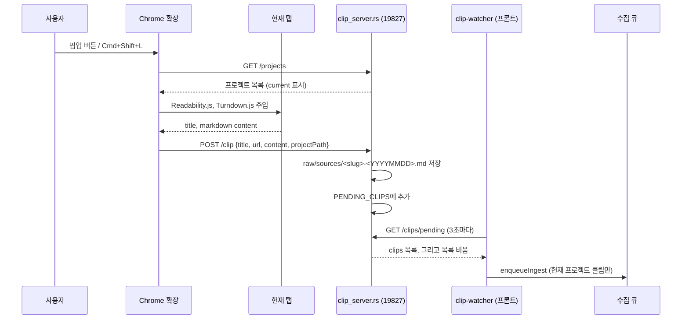

웹 클립은 브라우저 확장이 로컬 서버로 보낸 페이지를 원본으로 저장한다.

## 웹 클립

### 구성



| 구성 요소 | 파일 | 역할 |
| --- | --- | --- |
| 확장 매니페스트 | [manifest.json](https://github.com/nashsu/llm_wiki/blob/e08cfce65aad8b76b13546a081c1a8d4422b70c3/extension/manifest.json#L1-L46) | Manifest V3, 권한, 단축키, 기본 호스트 권한 `127.0.0.1:19827`, `localhost:19827` |
| 공통 로직 | [clipper-core.js](https://github.com/nashsu/llm_wiki/blob/e08cfce65aad8b76b13546a081c1a8d4422b70c3/extension/clipper-core.js#L1-L226) | 서버 주소 정규화, 본문 추출, 프로젝트 선택, 전송 |
| 단축키 처리 | [background.js](https://github.com/nashsu/llm_wiki/blob/e08cfce65aad8b76b13546a081c1a8d4422b70c3/extension/background.js#L1-L56) | service worker, 배지로 진행 상태 표시 |
| 팝업 | [popup.js](https://github.com/nashsu/llm_wiki/blob/e08cfce65aad8b76b13546a081c1a8d4422b70c3/extension/popup.js#L1-L205) | 연결 상태, 프로젝트 선택, 미리보기, 서버 주소와 토큰 저장 |
| 로컬 서버 | [clip_server.rs](https://github.com/nashsu/llm_wiki/blob/e08cfce65aad8b76b13546a081c1a8d4422b70c3/src-tauri/src/clip_server.rs#L1-L516) | tiny_http, 포트 19827, 파일 저장, 대기 목록 |
| 프론트 폴러 | [clip-watcher.ts](https://github.com/nashsu/llm_wiki/blob/e08cfce65aad8b76b13546a081c1a8d4422b70c3/src/lib/clip-watcher.ts#L1-L57) | 대기 목록을 가져와 수집 큐에 등록 |

### 확장: 본문 추출

`extractActiveTab`은 현재 탭에 Readability.js와 Turndown.js를 주입한 뒤, 직렬화 가능한 함수 `extractReadablePage`를 탭 안에서 실행한다([clipper-core.js#L144-L182](https://github.com/nashsu/llm_wiki/blob/e08cfce65aad8b76b13546a081c1a8d4422b70c3/extension/clipper-core.js#L144-L182)). 이 함수는 탭 안으로 직렬화되어 들어가므로 바깥 변수를 참조하면 안 된다는 주석이 붙어 있다([clipper-core.js#L77-L78](https://github.com/nashsu/llm_wiki/blob/e08cfce65aad8b76b13546a081c1a8d4422b70c3/extension/clipper-core.js#L77-L78)).

기본 Turndown은 HTML 표를 Markdown 표로 바꾸지 않아서 `th`, `td`, `tr`, `table` 규칙을 직접 추가했다([clipper-core.js#L93-L111](https://github.com/nashsu/llm_wiki/blob/e08cfce65aad8b76b13546a081c1a8d4422b70c3/extension/clipper-core.js#L93-L111)). 첫 행을 머리글로 보고 그 아래에 구분선을 끼운다. 셀 안의 줄바꿈이나 병합 셀은 처리하지 않는다(코드에 해당 분기 없음). 폭 또는 높이가 10px 미만인 이미지는 추적 픽셀로 보고 지운다. Readability가 본문을 찾지 못하면 `script`, `nav`, `header`, `footer` 등을 지운 `innerText`로 대신한다([clipper-core.js#L132-L142](https://github.com/nashsu/llm_wiki/blob/e08cfce65aad8b76b13546a081c1a8d4422b70c3/extension/clipper-core.js#L132-L142)). 추출 결과는 1,000,000자에서 자르고 잘렸다는 문장을 덧붙인다([clipper-core.js#L3-L10](https://github.com/nashsu/llm_wiki/blob/e08cfce65aad8b76b13546a081c1a8d4422b70c3/extension/clipper-core.js#L3-L10)).

`http`, `https`가 아닌 페이지(`chrome://` 등)는 거절한다. 팝업은 앱이 꺼져 있어도 추출은 항상 실행해서 미리보기를 보여 준다(README의 "Offline preview").

### 확장: 서버 연결

| 동작 | 코드 | 설명 |
| --- | --- | --- |
| 서버 주소 정규화 | `normalizeServerUrl` ([#L12-L25](https://github.com/nashsu/llm_wiki/blob/e08cfce65aad8b76b13546a081c1a8d4422b70c3/extension/clipper-core.js#L12-L25)) | scheme이 없으면 `http://`, 포트가 없으면 19827. 경로, 쿼리, 사용자 정보가 있으면 거절 |
| 재시도 | `clipFetch` ([#L52-L75](https://github.com/nashsu/llm_wiki/blob/e08cfce65aad8b76b13546a081c1a8d4422b70c3/extension/clipper-core.js#L52-L75)) | GET이고 기본 로컬 주소일 때만 `127.0.0.1`과 `localhost`를 번갈아 시도. POST는 재시도하지 않음 |
| 인증 | `requestHeaders` ([#L46-L50](https://github.com/nashsu/llm_wiki/blob/e08cfce65aad8b76b13546a081c1a8d4422b70c3/extension/clipper-core.js#L46-L50)) | 토큰이 있으면 `Authorization: Bearer` |
| 프로젝트 선택 | `selectProject` ([#L192-L197](https://github.com/nashsu/llm_wiki/blob/e08cfce65aad8b76b13546a081c1a8d4422b70c3/extension/clipper-core.js#L192-L197)) | 저장된 선호 경로, 앱의 현재 프로젝트, 첫 프로젝트 순 |
| 다른 기기 주소 권한 | `chrome.permissions.request` ([popup.js#L158-L166](https://github.com/nashsu/llm_wiki/blob/e08cfce65aad8b76b13546a081c1a8d4422b70c3/extension/popup.js#L158-L166)) | 기본 외 주소를 저장할 때 그 origin 권한을 요청 (`optional_host_permissions`) |

POST를 재시도하지 않는 이유는 주석에 있다. 첫 요청이 서버에 도달했는데 응답만 잃어버린 경우 재시도하면 같은 클립이 두 번 저장된다([clipper-core.js#L55-L56](https://github.com/nashsu/llm_wiki/blob/e08cfce65aad8b76b13546a081c1a8d4422b70c3/extension/clipper-core.js#L55-L56)).

단축키 경로(`background.js`)는 `clipInFlight` 플래그로 동시에 두 번 클립하지 않게 막고, 배지에 `…`, `✓`, `!`를 표시한다. Chrome은 단축키 이벤트와 함께 해당 탭에 대한 임시 `activeTab` 권한을 주므로, 단축키 경로에서는 이벤트로 받은 탭을 그대로 쓴다([clipper-core.js#L145-L150](https://github.com/nashsu/llm_wiki/blob/e08cfce65aad8b76b13546a081c1a8d4422b70c3/extension/clipper-core.js#L145-L150)). 단축키는 기본 `Alt+Shift+L`, macOS는 `Command+Shift+L`이다([manifest.json#L26-L33](https://github.com/nashsu/llm_wiki/blob/e08cfce65aad8b76b13546a081c1a8d4422b70c3/extension/manifest.json#L26-L33)).

### 서버: 클립 저장

Rust 쪽 `handle_clip`은 받은 Markdown을 frontmatter로 감싸 `raw/sources/`에 쓴다.

무엇을 보는지: 저장되는 파일 형식.
[src-tauri/src/clip_server.rs#L483-L491](https://github.com/nashsu/llm_wiki/blob/e08cfce65aad8b76b13546a081c1a8d4422b70c3/src-tauri/src/clip_server.rs#L483-L491)

```rust
let markdown = format!(
    "---\ntype: clip\ntitle: \"{}\"\nurl: \"{}\"\nclipped: {}\norigin: web-clip\nsources: []\ntags: [web-clip]\n---\n\n# {}\n\nSource: {}\n\n{}\n",
    title.replace('"', r#"\""#),
    url.replace('"', r#"\""#),
    date,
    title,
    url,
    content,
);
```

- 파일명은 제목에서 글자, 숫자, 공백, 하이픈만 남겨 소문자 slug로 만들고 50자에서 자른 뒤 `-YYYYMMDD`를 붙인다. 이름이 겹치면 `-2`, `-3`을 붙인다([clip_server.rs#L437-L474](https://github.com/nashsu/llm_wiki/blob/e08cfce65aad8b76b13546a081c1a8d4422b70c3/src-tauri/src/clip_server.rs#L437-L474)). Rust의 `is_alphanumeric`은 Unicode 글자를 포함하므로 한글 제목도 slug에 남는다.
- frontmatter의 `title`과 `url`은 큰따옴표만 이스케이프한다. 제목에 역슬래시나 줄바꿈이 있으면 YAML이 깨질 수 있다(코드로 추론, 미검증).
- 저장 후 `(projectPath, filePath)`를 `PENDING_CLIPS` 목록에 넣는다([clip_server.rs#L506-L509](https://github.com/nashsu/llm_wiki/blob/e08cfce65aad8b76b13546a081c1a8d4422b70c3/src-tauri/src/clip_server.rs#L506-L509)).

서버는 루프백 주소에서 온 요청은 토큰 없이 받고, 그 밖의 주소에서 온 요청에는 19828 API 서버와 같은 토큰을 요구한다([clip_server.rs#L119-L134](https://github.com/nashsu/llm_wiki/blob/e08cfce65aad8b76b13546a081c1a8d4422b70c3/src-tauri/src/clip_server.rs#L119-L134)). 주석은 토큰 없이 열면 같은 네트워크의 모든 기기가 프로젝트 경로를 읽고 파일을 쓸 수 있다고 설명한다. 바인딩 주소 설정과 토큰 검증은 13장에서 다룬다.

### 프론트: clip-watcher

프론트엔드는 앱 시작 시 `startClipWatcher()`를 한 번 부른다([App.tsx#L140-L144](https://github.com/nashsu/llm_wiki/blob/e08cfce65aad8b76b13546a081c1a8d4422b70c3/src/App.tsx#L140-L144)).

무엇을 보는지: 3초 폴링과 현재 프로젝트 필터.
[src/lib/clip-watcher.ts#L16-L44](https://github.com/nashsu/llm_wiki/blob/e08cfce65aad8b76b13546a081c1a8d4422b70c3/src/lib/clip-watcher.ts#L16-L44)

```ts
intervalId = setInterval(async () => {
  try {
    const res = await fetch("http://127.0.0.1:19827/clips/pending", { method: "GET" })
    const data = await res.json()
    if (!data.ok || !data.clips || data.clips.length === 0) return
    const store = useWikiStore.getState()
    const project = store.project
    for (const clip of data.clips) {
      const clipProjectPath: string = clip.projectPath
      const clipFilePath: string = clip.filePath
      if (project && clipProjectPath === project.path) {
        await refreshProjectFileTree(project.path, { projectId: project.id })
        if (hasUsableLlm(store.llmConfig)) {
          enqueueIngest(project.id, clipFilePath).catch(/* ... */)
        }
```

해설:

- 클립을 수집 파이프라인에 바로 넣지 않고 수집 큐에 등록한다. 주석은 큐에 넣어야 작업이 디스크에 저장된 큐에 남아 화면을 새로 고쳐도 살아남는다고 설명한다. 수집 큐의 구조는 4장에서 다룬다.
- 서버의 `GET /clips/pending`은 목록을 돌려준 뒤 비운다([clip_server.rs#L239-L259](https://github.com/nashsu/llm_wiki/blob/e08cfce65aad8b76b13546a081c1a8d4422b70c3/src-tauri/src/clip_server.rs#L239-L259)). 한 번 가져간 클립은 다시 오지 않는다.

> **주의**: 폴러는 현재 열린 프로젝트의 클립만 수집 큐에 넣는다. 다른 프로젝트로 보낸 클립은 서버 목록에서 이미 지워졌으므로, 그 파일은 `raw/sources/`에 남지만 이 경로로는 수집되지 않는다. LLM이 설정되지 않은 상태에서 온 클립도 같다. 원본 폴더 감시(5장)가 나중에 이 파일을 잡아 주는지는 이 장에서 확인하지 않았다(미검증).
