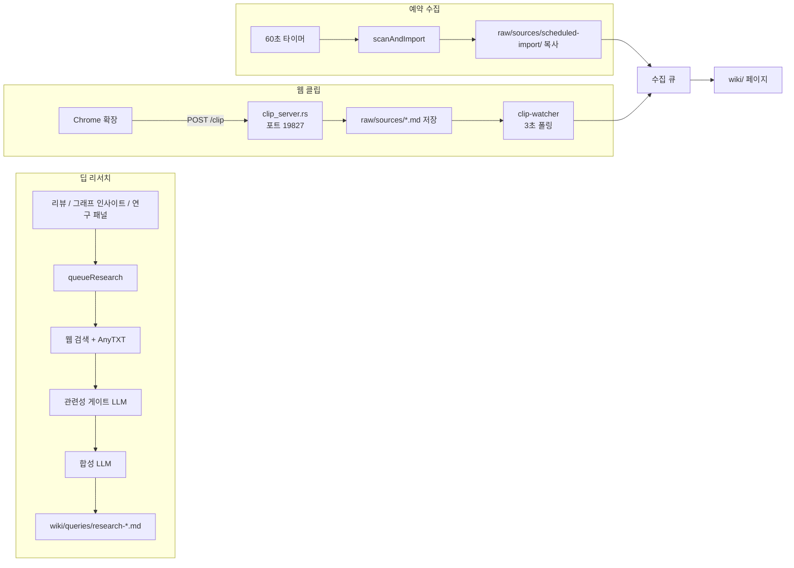

사용자가 파일을 하나씩 끌어다 놓는 것 말고도 위키에 내용이 들어오는 길이 세 개 더 있다. 딥 리서치는 웹 검색 결과를 LLM이 합성해 `wiki/queries/`에 바로 페이지로 쓰고, 예약 수집은 외부 폴더를 주기적으로 조회해 바뀐 파일을 수집 큐에 넣고, 웹 클립은 브라우저 확장이 로컬 서버로 보낸 페이지를 `raw/sources/`에 저장한 뒤 수집 큐에 넣는다.

이 장은 세 경로를 차례로 읽고, 이 경로들이 남긴 상태를 디스크에 안전하게 쓰는 auto-save와 에이전트가 고친 파일을 추적하는 agent-file-activity를 함께 다룬다. 수집 큐 자체의 동작은 4장에서, 로컬 API 서버의 인증과 바인딩은 13장에서 다룬다.

## 세 경로 개요

세 경로는 결과가 위키에 들어가는 방식이 다르다. 예약 수집과 웹 클립은 원본을 `raw/sources/`에 두고 4장의 수집 파이프라인을 거친다. 딥 리서치는 결과가 이미 합성된 위키 페이지이므로 수집을 거치지 않고 `wiki/queries/`에 직접 쓴다.

| 경로 | 시작 계기 | 원본 저장 위치 | 수집 큐 경유 | 주요 파일 |
| --- | --- | --- | --- | --- |
| 딥 리서치 | 사용자 버튼 (리뷰, 그래프, 연구 패널) | 저장하지 않음 (검색 스니펫만 사용) | 아니오 | `deep-research.ts`, `research-store.ts` |
| 예약 수집 | 앱 시작 + 60초 간격 타이머 | `raw/sources/scheduled-import/` | 예 | `scheduled-import.ts` |
| 웹 클립 | 확장 팝업 버튼, 단축키 | `raw/sources/` | 예 | `extension/`, `clip_server.rs`, `clip-watcher.ts` |

## 원본 아이디어와의 대응

Karpathy의 [llm-wiki.md](https://github.com/nashsu/llm_wiki/blob/e08cfce65aad8b76b13546a081c1a8d4422b70c3/llm-wiki.md#L41-L41)는 Lint 단계에서 "웹 검색으로 채울 수 있는 데이터 공백"을 찾으라고 하고, LLM이 "새로 조사할 질문과 새로 찾을 원본을 제안하는 데 능하다"고 쓴다. 딥 리서치는 이 제안을 실제 검색과 합성으로 이어 붙인 기능이다. 9장에서 본 리뷰 큐의 `suggestion`과 `missing-page` 항목이 딥 리서치의 주요 입력이다.

원문은 원본 수집 도구로 Obsidian Web Clipper를 예로 든다([llm-wiki.md#L57](https://github.com/nashsu/llm_wiki/blob/e08cfce65aad8b76b13546a081c1a8d4422b70c3/llm-wiki.md#L57-L57)). 구현은 이 자리를 전용 Chrome 확장으로 채웠다. README는 "The original mentions Obsidian Web Clipper. We built a dedicated Chrome Extension"이라고 적는다([README.md#L304-L318](https://github.com/nashsu/llm_wiki/blob/e08cfce65aad8b76b13546a081c1a8d4422b70c3/README.md#L304-L318)). 예약 수집은 원문에 없는 기능이다.

## 정리

- 딥 리서치는 검색 결과(최대 20건)를 LLM 관련성 게이트로 거른 뒤 합성하고, 글자 수와 `[N]` 인용 검증을 통과해야만 `wiki/queries/`에 저장한다. 결과 페이지는 수집 파이프라인을 거치지 않고 바로 임베딩해, 연구가 리뷰를 만들고 리뷰가 다시 연구를 부르는 고리를 끊는다. README의 "Auto-ingest" 설명은 기준 커밋 코드와 맞지 않는다.
- 리뷰에서 시작한 연구는 저장과 재검증이 끝난 뒤에야 그 리뷰를 해결한다. 연구 작업 자체는 메모리에만 있고 동시 실행은 3개다.
- 예약 수집은 60초마다 깨어나 현재 프로젝트와 최근 프로젝트의 간격을 확인하고, 크기와 수정 시각, MD5 두 단계로 바뀐 파일만 `raw/sources/scheduled-import/`에 복사해 수집 큐에 넣는다. 등록에 실패한 파일은 기록하지 않아 다음 스캔에서 다시 시도한다.
- 감시 폴더에서 사라진 파일은 복사본과 생성된 위키 페이지까지 지운다. 이 삭제는 활성 프로젝트에서만 한다.
- 웹 클립은 Chrome 확장이 Readability와 Turndown으로 만든 Markdown을 19827 포트 로컬 서버에 보내고, 서버가 `raw/sources/`에 쓴 뒤 3초 폴러가 현재 프로젝트의 클립만 수집 큐에 넣는다. POST는 중복 저장을 피하려고 재시도하지 않는다.
- auto-save는 프로젝트 전환 때 먼저 실제 데이터를 쓰고 저장을 멈춰, 빈 저장소가 이전 프로젝트 파일을 덮지 않게 한다. agent-file-activity는 에이전트의 파일 변경을 선형 시간 diff로 남기고, 현재 내용이 에이전트가 쓴 그대로일 때만 되돌린다.
