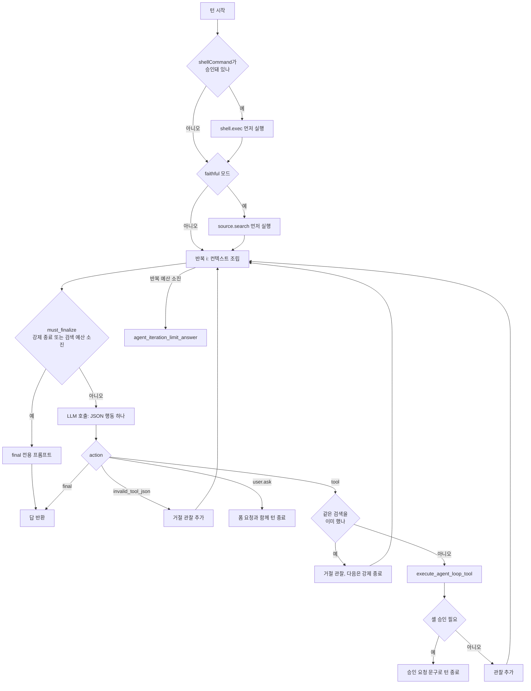

모델 호출과 도구 실행을 반복하는 에이전트 루프의 구조를 본다.

## 에이전트 루프

루프는 ReAct류의 한 단계 한 행동 구조다. 매 반복마다 컨텍스트를 새로 조립하고, 모델에게 JSON 행동 하나를 받고, 도구를 실행해 관찰을 쌓는다. 반복 예산이나 검색 예산이 차면 도구를 빼고 최종 답만 요구한다.



### 반복의 머리

코드 분석: [`src-tauri/src/agent/runtime.rs#L1427-L1446`](https://github.com/nashsu/llm_wiki/blob/e08cfce65aad8b76b13546a081c1a8d4422b70c3/src-tauri/src/agent/runtime.rs#L1427-L1446)

무엇을 보는지: 매 반복마다 취소를 확인하고 컨텍스트를 처음부터 다시 만든다.

```rust
        for iteration in 0..max_iterations {
            check_cancel(cancellation)?;
            let must_finalize = force_final_next || retrieval_steps >= retrieval_budget;
            let built_context = fit_context_to_model(
                build_agent_context(AgentContextInput {
                    query: message,
                    project: &project_context,
                    router: &router,
                    history: &request.history,
                    skills: &skills,
                    skill_mode: request.skill_mode,
                    references: &references,
                    // Loop observations are appended below in the loop-specific
                    // user block. Passing them through the generic retrieval
                    // summary as well would duplicate large tool outputs on
                    // every iteration.
                    retrieval_summary: "",
                    explicit_files: &explicit_files,
                }),
```

관찰(도구 결과 요약)은 `build_agent_loop_user`가 user 블록 끝에 덧붙인다. 같은 블록에 "Iteration budget: step N of M"과 남은 단계 수를 적고, 남은 단계가 2 이하이면 "지금 final을 반환하라"는 문장을 추가한다([`runtime.rs#L3014-L3074`](https://github.com/nashsu/llm_wiki/blob/e08cfce65aad8b76b13546a081c1a8d4422b70c3/src-tauri/src/agent/runtime.rs#L3014-L3074)). 이미지는 첫 반복에서만 보낸다. 반복마다 큰 base64를 다시 보내면 비용과 지연이 곱으로 늘기 때문이라고 주석이 설명한다.

### JSON 행동 프로토콜

system 프롬프트 끝에 붙는 `Agent loop protocol`은 "compact JSON만 반환하고 한 턴에 행동 하나를 고르라"고 요구한다([`runtime.rs#L2915-L2951`](https://github.com/nashsu/llm_wiki/blob/e08cfce65aad8b76b13546a081c1a8d4422b70c3/src-tauri/src/agent/runtime.rs#L2915-L2951)). 형식은 `{"action":"tool","tool":"wiki.search","query":"..."}` 또는 `{"action":"final","answer":"..."}`이다. 공급자의 native tool calling을 쓰지 않고 텍스트 JSON으로 통일했으므로, OpenAI · Anthropic · Gemini · Ollama가 같은 루프를 탄다.

코드 분석: [`src-tauri/src/agent/runtime.rs#L3076-L3092`](https://github.com/nashsu/llm_wiki/blob/e08cfce65aad8b76b13546a081c1a8d4422b70c3/src-tauri/src/agent/runtime.rs#L3076-L3092)

무엇을 보는지: 모델 출력에서 JSON을 꺼내는 순서와 잘린 JSON 처리.

```rust
fn parse_agent_loop_action(raw: &str) -> AgentLoopAction {
    let trimmed = raw.trim();
    if let Ok(action) = serde_json::from_str::<AgentLoopAction>(trimmed) {
        return normalize_agent_loop_action(action);
    }
    if let Some(json) = extract_json_object(trimmed) {
        if let Ok(action) = serde_json::from_str::<AgentLoopAction>(json) {
            return normalize_agent_loop_action(action);
        }
    }
    if looks_like_agent_tool_json(trimmed) {
        return AgentLoopAction {
            action: "invalid_tool_json".to_string(),
```

전체가 JSON이면 그대로, 앞뒤에 다른 글이 있으면 가장 바깥 객체를 잘라 시도한다. 둘 다 실패하면 `invalid_tool_json` 행동이 되고, 루프는 고쳐 보내라는 거절 관찰을 넣고 다음 반복으로 간다. 큰 HTML을 JSON 하나에 담다 잘리는 경우를 위해 "write_file로 시작하고 append_file로 이어 쓰라"는 안내를 오류 문구에 넣었다. `normalize_agent_loop_action`은 `{"action":"wiki.search"}`처럼 도구 이름을 `action`에 넣은 출력을 `tool` 행동으로 고치고, `AskUserQuestion` 같은 별칭을 `user.ask`로 맞춘다([`runtime.rs#L3114-L3136`](https://github.com/nashsu/llm_wiki/blob/e08cfce65aad8b76b13546a081c1a8d4422b70c3/src-tauri/src/agent/runtime.rs#L3114-L3136)).

### 예산

반복 예산은 모드와 명시 선택 스킬 여부로 정해지고([`runtime.rs#L2798-L2812`](https://github.com/nashsu/llm_wiki/blob/e08cfce65aad8b76b13546a081c1a8d4422b70c3/src-tauri/src/agent/runtime.rs#L2798-L2812)), 검색 예산은 검색 도구(`wiki.search`, `wiki.read_page`, `source.search`, `graph.search`, `web.search`, `anytxt.search`)를 몇 번 부를 수 있는지다([`runtime.rs#L2814-L2843`](https://github.com/nashsu/llm_wiki/blob/e08cfce65aad8b76b13546a081c1a8d4422b70c3/src-tauri/src/agent/runtime.rs#L2814-L2843)). 스킬 턴은 파일 생성처럼 단계가 많은 작업이라 반복을 두 배 가까이 준다.

| 모드 | 반복 (스킬 없음) | 반복 (명시 스킬) | 검색 standard | 검색 standard + 명시 스킬 | 검색 smart | 검색 faithful |
|---|---|---|---|---|---|---|
| `fast` | 4 | 8 | 2 | 6 | 3 | 2 |
| `standard`, `local_first` | 8 | 16 | 4 | 8 | 4 | 3 |
| `deep` | 12 | 20 | 8 | 12 | 6 | 5 |

### 중복 검색과 무진전 감시

같은 검색을 다시 부르면 실행하지 않고 거절 관찰을 넣은 뒤 다음 반복을 강제 종료로 돌린다.

코드 분석: [`src-tauri/src/agent/runtime.rs#L1725-L1745`](https://github.com/nashsu/llm_wiki/blob/e08cfce65aad8b76b13546a081c1a8d4422b70c3/src-tauri/src/agent/runtime.rs#L1725-L1745)

무엇을 보는지: 도구 이름과 입력 JSON으로 만든 서명이 이미 있으면 건너뛴다.

```rust
            let retrieval_tool = action.tool.as_deref().is_some_and(is_agent_retrieval_tool);
            let evidence_count_before = smart_evidence_count(&references);
            if retrieval_tool {
                let tool = action.tool.as_deref().unwrap_or_default();
                if let Ok(input) = self.agent_loop_tool_input(request, tool, &action) {
                    let signature = retrieval_signature(tool, &input, request.retrieval_mode);
                    if !executed_retrievals.insert(signature) {
                        observations.push(record_loop_tool_rejection(
                            tool,
                            "duplicate retrieval skipped; use the existing observation and answer the user"
                                .to_string(),
                            &mut tool_events,
                            &mut events,
                            &event_sink,
                        ));
                        force_final_next = true;
                        continue;
                    }
                }
```

`retrieval_signature`는 standard 모드에서 입력 JSON을 그대로 쓰고, smart · faithful 모드에서는 질의를 소문자로 바꾸고 공백과 ASCII 문장부호로 쪼갠 뒤 다시 이어 붙여 "같은 뜻의 질의"를 같은 서명으로 만든다([`runtime.rs#L2861-L2880`](https://github.com/nashsu/llm_wiki/blob/e08cfce65aad8b76b13546a081c1a8d4422b70c3/src-tauri/src/agent/runtime.rs#L2861-L2880)). smart 모드에는 하나가 더 있다. 검색 뒤에 참조의 `kind:path` 집합이 늘지 않았고 `wiki.read_page` 본문도 비었으면 "진전 없음"으로 세고, 연속 2회면 다음 반복을 강제 종료한다([`runtime.rs#L1800-L1816`](https://github.com/nashsu/llm_wiki/blob/e08cfce65aad8b76b13546a081c1a8d4422b70c3/src-tauri/src/agent/runtime.rs#L1800-L1816)).

강제 종료 반복은 system 프롬프트를 "검색 단계가 끝났다. 도구는 없다"로 바꾸고 관찰 전체를 붙인다([`runtime.rs#L2953-L2973`](https://github.com/nashsu/llm_wiki/blob/e08cfce65aad8b76b13546a081c1a8d4422b70c3/src-tauri/src/agent/runtime.rs#L2953-L2973)). 모델이 그래도 도구 JSON을 내면 `forced_final_answer`가 참조 상위 8개의 제목 · 경로 · 320자 발췌로 답을 대신 만든다([`runtime.rs#L2975-L3012`](https://github.com/nashsu/llm_wiki/blob/e08cfce65aad8b76b13546a081c1a8d4422b70c3/src-tauri/src/agent/runtime.rs#L2975-L3012)). 반복 예산이 끝까지 차면 `agent_iteration_limit_answer`가 생성된 작업 공간 파일 목록을 포함한 안내문을 돌려준다([`runtime.rs#L1817-L1855`](https://github.com/nashsu/llm_wiki/blob/e08cfce65aad8b76b13546a081c1a8d4422b70c3/src-tauri/src/agent/runtime.rs#L1817-L1855)).

### 사용자 입력 폼

`user.ask` 행동은 턴을 끝내고 응답의 `userInputRequest`에 폼을 싣는다. `sanitize_user_input_request`는 필드를 12개, 선택지를 8개, 문자열을 400자로 자르고, 알 수 없는 필드 종류는 버리며, 중복 id를 고친다([`runtime.rs#L3163-L3380`](https://github.com/nashsu/llm_wiki/blob/e08cfce65aad8b76b13546a081c1a8d4422b70c3/src-tauri/src/agent/runtime.rs#L3163-L3380)). 필드 종류는 single · multi 선택, text, textarea, 확인이다. 스킬이 "어떤 템플릿으로 만들까요" 같은 질문을 구조화된 폼으로 물을 수 있게 하는 장치이고, 사용자의 답은 다음 턴의 메시지로 돌아온다.
