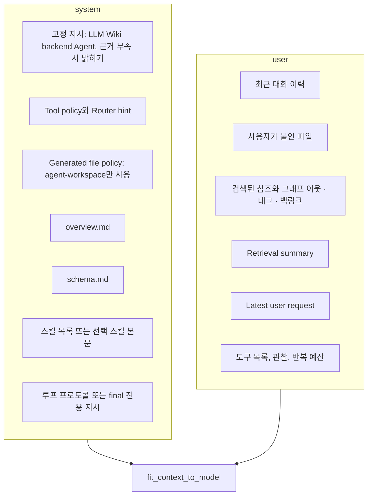

스킬 로딩, 컨텍스트 조립, 이벤트 · 취소 · 세션 관리를 본다.

## 스킬

스킬은 `SKILL.md` 하나와 참고 파일로 된 폴더, 또는 단일 `.md` 파일이다. 네 곳을 순서대로 찾고, 같은 id가 여럿이면 앞쪽이 이긴다.

코드 분석: [`src-tauri/src/agent/skills.rs#L79-L99`](https://github.com/nashsu/llm_wiki/blob/e08cfce65aad8b76b13546a081c1a8d4422b70c3/src-tauri/src/agent/skills.rs#L79-L99)

무엇을 보는지: 프로젝트 스킬이 사용자 전역 스킬보다 먼저 온다.

```rust
fn skill_roots(project_path: &str) -> Vec<SkillRoot> {
    let mut roots = vec![SkillRoot {
        path: Path::new(project_path).join(".llm-wiki").join("skills"),
        source: "project".to_string(),
    }];
    if let Some(home) = home_dir() {
        roots.push(SkillRoot {
            path: home.join(".claude").join("skills"),
            source: "claude".to_string(),
        });
        roots.push(SkillRoot {
            path: home.join(".codex").join("skills"),
            source: "codex".to_string(),
        });
        roots.push(SkillRoot {
            path: home.join(".agents").join("skills"),
            source: "agents".to_string(),
        });
```

Claude Code, Codex용으로 설치한 스킬 폴더를 그대로 읽는다는 점이 눈에 띈다. 사용자가 이미 가진 스킬 생태계를 앱 안 에이전트가 재사용한다.

| 규칙 | 값 | 근거 |
|---|---|---|
| 스킬 파일 크기 | 64,000바이트 이하 | [`skills.rs#L7`](https://github.com/nashsu/llm_wiki/blob/e08cfce65aad8b76b13546a081c1a8d4422b70c3/src-tauri/src/agent/skills.rs#L7) |
| 하위 폴더 탐색 깊이 | 8 | [`skills.rs#L8`](https://github.com/nashsu/llm_wiki/blob/e08cfce65aad8b76b13546a081c1a8d4422b70c3/src-tauri/src/agent/skills.rs#L8) |
| 필수 frontmatter | `description` (없으면 로드 실패), `name`은 없으면 폴더 이름 | [`skills.rs#L238-L272`](https://github.com/nashsu/llm_wiki/blob/e08cfce65aad8b76b13546a081c1a8d4422b70c3/src-tauri/src/agent/skills.rs#L238-L272) |
| 심볼릭 링크 | 스킬 파일 · 폴더 모두 거절 | 같은 범위 |
| 건너뛰는 폴더 | `.`으로 시작, `node_modules`, 이식 불가능한 이름 | [`skills.rs#L220-L226`](https://github.com/nashsu/llm_wiki/blob/e08cfce65aad8b76b13546a081c1a8d4422b70c3/src-tauri/src/agent/skills.rs#L220-L226) |
| 참고 파일 읽기 | `skill.read_file`, 스킬 폴더 안 일반 파일, 256 KiB 이하 | [`runtime.rs#L2498-L2548`](https://github.com/nashsu/llm_wiki/blob/e08cfce65aad8b76b13546a081c1a8d4422b70c3/src-tauri/src/agent/runtime.rs#L2498-L2548) |

`skillMode`는 주입 방식을 바꾼다. `auto`는 켜 둔 스킬을 후보로만 보여 준다. system 프롬프트에 `<available_skills>` 목록(이름, 설명, `SKILL.md` 위치)을 최대 48개, 12,000자까지 넣고, 넘치면 생략 개수를 적는다. 모델은 관련 있다고 판단한 뒤에 `skill.read_file`로 본문을 읽는다. `explicit`은 사용자가 `/skill`로 고른 스킬의 지시문 전체를 18,000자 예산 안에서 `<skill>` 태그로 넣는다([`context.rs#L112-L174`](https://github.com/nashsu/llm_wiki/blob/e08cfce65aad8b76b13546a081c1a8d4422b70c3/src-tauri/src/agent/context.rs#L112-L174)). 참고 파일은 두 방식 모두 필요할 때 읽게 한다. 주석은 평범한 대화 턴에 쓰지 않을 참고 자료가 쏟아지지 않게 하려는 선택이라고 설명한다([`skills.rs#L274-L286`](https://github.com/nashsu/llm_wiki/blob/e08cfce65aad8b76b13546a081c1a8d4422b70c3/src-tauri/src/agent/skills.rs#L274-L286)).

## 컨텍스트 조립

`build_agent_context`는 system과 user 두 덩어리를 만든다.



상수는 [`context.rs#L9-L18`](https://github.com/nashsu/llm_wiki/blob/e08cfce65aad8b76b13546a081c1a8d4422b70c3/src-tauri/src/agent/context.rs#L9-L18)에 모여 있다.

| 상수 | 값 | 대상 |
|---|---|---|
| `MAX_OVERVIEW_CHARS` | 8,000 | `overview.md` (루트 또는 `wiki/`) |
| `MAX_SCHEMA_CHARS` | 6,000 | `schema.md` (루트 또는 `wiki/`) |
| `MAX_HISTORY_CHARS` | 12,000 | 최근 12개 메시지 |
| `MAX_REFERENCE_CHARS` | 24,000 | 검색 참조 렌더링 |
| `MAX_SKILL_CHARS` | 18,000 | 명시 선택 스킬 본문 |
| `MAX_AUTO_SKILL_INDEX_CHARS`, `MAX_AUTO_SKILLS` | 12,000, 48 | 자동 스킬 목록 |
| `MAX_EXPLICIT_CONTEXT_FILES` | 8 | 첨부 파일 수 |
| `MAX_EXPLICIT_CONTEXT_CHARS`, `MAX_EXPLICIT_FILE_CHARS` | 24,000, 8,000 | 첨부 파일 합계와 파일당 |

참조마다 `knowledge_context`가 있으면 "Graph neighbors of", "Tags", "Links to", "Backlinks", 최근 버전의 작성자 · 도구 · 시각을 한 줄씩 붙인다([`context.rs#L218-L262`](https://github.com/nashsu/llm_wiki/blob/e08cfce65aad8b76b13546a081c1a8d4422b70c3/src-tauri/src/agent/context.rs#L218-L262)). 위키의 링크 구조가 답변 컨텍스트에 직접 들어가는 지점이다(그래프 구성은 7장에서 다룬다).

첨부 파일은 프로젝트 상대 경로만 받고, `..`나 숨김 구간을 거절하고, canonical 경로가 프로젝트 안인지 확인한 다음 앱의 공용 파일 리더로 읽는다. 그래서 PDF · Office 문서도 미리보기와 같은 방식으로 텍스트가 된다([`context.rs#L273-L327`](https://github.com/nashsu/llm_wiki/blob/e08cfce65aad8b76b13546a081c1a8d4422b70c3/src-tauri/src/agent/context.rs#L273-L327)). 파일 본문은 XML 이스케이프해 `<file>` 태그를 닫지 못하게 하고, 잘라도 닫는 태그가 남도록 예산을 따로 잡는다.

마지막으로 `fit_context_to_model`이 전체 크기를 맞춘다.

코드 분석: [`src-tauri/src/agent/runtime.rs#L3845-L3866`](https://github.com/nashsu/llm_wiki/blob/e08cfce65aad8b76b13546a081c1a8d4422b70c3/src-tauri/src/agent/runtime.rs#L3845-L3866)

무엇을 보는지: 설정의 `maxContextSize`(글자 수)를 8,000에서 400,000 사이로 묶고 user에 최소 4,000자를 남긴다.

```rust
    let Some(max_context_size) = config.and_then(|cfg| cfg.max_context_size) else {
        return context;
    };
    let max_chars = max_context_size.clamp(8_000, 400_000);
    let total_chars = context.system.chars().count() + context.user.chars().count();
    if total_chars <= max_chars {
        return context;
    }
    let minimum_user_budget = 4_000;
    let system_budget = max_chars.saturating_sub(minimum_user_budget);
    if context.system.chars().count() > system_budget {
        context.system = trim_chars(&context.system, system_budget);
    }
```

예산 단위가 토큰이 아니라 글자라는 점은 `LlmConfig.max_context_size` 주석이 밝힌다. TypeScript 쪽 예산 모델과 맞추려고 글자 수로 둔다는 것이다([`provider.rs#L50-L53`](https://github.com/nashsu/llm_wiki/blob/e08cfce65aad8b76b13546a081c1a8d4422b70c3/src-tauri/src/agent/provider.rs#L50-L53)).

## 이벤트, 취소, 세션

스트리밍 턴은 `AgentEvent`를 `event_sink`로 흘려보낸다. UI에서는 Tauri 이벤트 `agent-event`로, API에서는 SSE `agent` 프레임으로 나간다.

| 이벤트 | 내용 |
|---|---|
| `agentStart`, `turnStart` | 세션 id, 모드 라벨 |
| `toolStart`, `toolEnd` | 도구 이름과 입력 · 출력 요약 |
| `referenceAdded` | 새 참조 하나 |
| `fileChanged` | 경로, 도구, 이전 존재 여부, 되돌리기용 이전 내용 |
| `messageDelta` | 답 텍스트 |
| `userInputRequired` | `user.ask` 폼 |
| `error`, `done` | 오류 메시지, 종료 |

정의는 [`events.rs#L5-L45`](https://github.com/nashsu/llm_wiki/blob/e08cfce65aad8b76b13546a081c1a8d4422b70c3/src-tauri/src/agent/events.rs#L5-L45)이다. 루프는 모델 출력을 JSON으로 받은 뒤 답을 꺼내야 하므로 `messageDelta`를 최종 답 하나로 보낸다. 토큰 단위 스트리밍은 루프 밖의 검색 전용 경로에서 생성기를 부를 때만 쓰인다([`runtime.rs#L1197-L1215`](https://github.com/nashsu/llm_wiki/blob/e08cfce65aad8b76b13546a081c1a8d4422b70c3/src-tauri/src/agent/runtime.rs#L1197-L1215)).

취소는 프로젝트 · 세션 · 실행 id 키를 가진 `AtomicBool` 토큰이다. `cancelled()`는 50 ms마다 확인하는 future이고, 도구 실행과 LLM 호출을 `tokio::select!`로 감싸 취소되면 바로 "Agent turn cancelled"를 돌려준다([`cancel.rs#L12-L36`](https://github.com/nashsu/llm_wiki/blob/e08cfce65aad8b76b13546a081c1a8d4422b70c3/src-tauri/src/agent/cancel.rs#L12-L36), [`runtime.rs#L3869-L3889`](https://github.com/nashsu/llm_wiki/blob/e08cfce65aad8b76b13546a081c1a8d4422b70c3/src-tauri/src/agent/runtime.rs#L3869-L3889)). 주석은 블로킹 풀에서 이미 돌고 있는 작업은 강제로 죽일 수 없으므로 계약이 "턴을 빨리 멈춘다"이지 "OS 작업을 끝낸다"가 아니라고 적는다. 셸 자식 프로세스는 `kill_on_drop`이 걸려 있다.

세션은 `.llm-wiki/agent-sessions/<id>.json`에 남는다. 세션당 메시지 40개, 메모리 캐시 128개가 상한이고, id에 `/`, `\`, `..`가 있거나 128자를 넘으면 저장하지 않는다([`session.rs#L9-L12`](https://github.com/nashsu/llm_wiki/blob/e08cfce65aad8b76b13546a081c1a8d4422b70c3/src-tauri/src/agent/session.rs#L9-L12), [`session.rs#L177-L200`](https://github.com/nashsu/llm_wiki/blob/e08cfce65aad8b76b13546a081c1a8d4422b70c3/src-tauri/src/agent/session.rs#L177-L200)). 저장은 런타임이 아니라 호출자(`agent_start_turn`, `persist_chat_response`)가 응답을 받은 뒤 한다.
