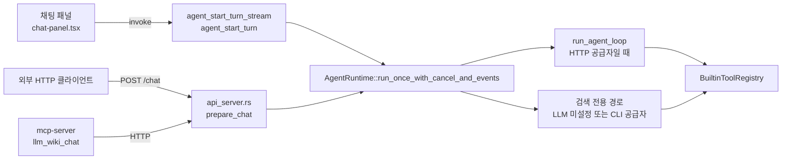
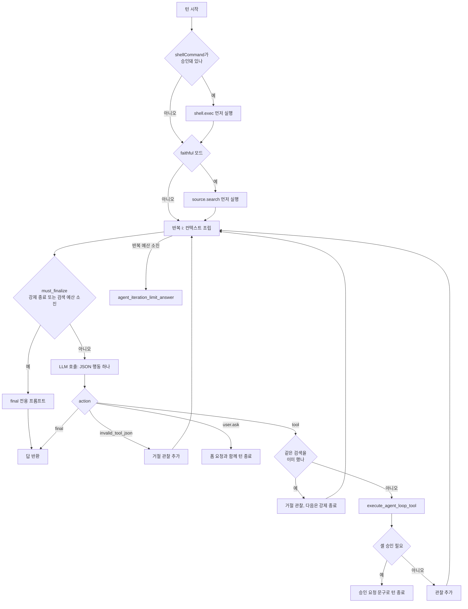
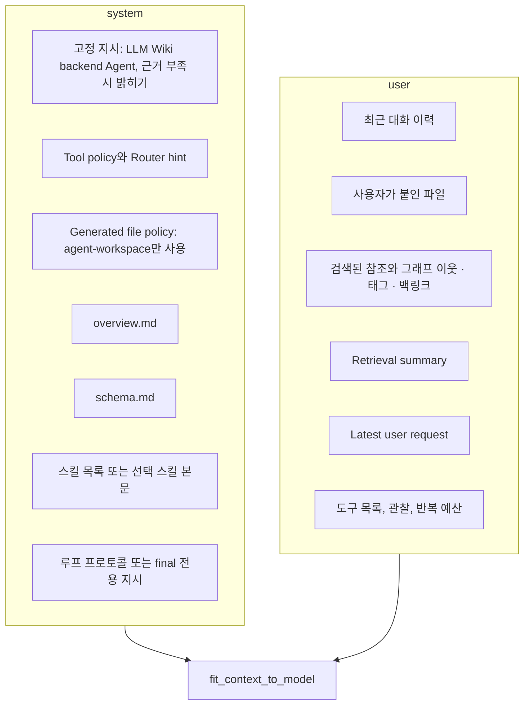

LLM Wiki의 채팅은 브라우저 안의 TypeScript 루프가 아니라 Rust 백엔드의 에이전트 런타임에서 돈다. 데스크톱 채팅 화면, 로컬 HTTP API, MCP 서버가 모두 같은 `AgentRuntime`을 호출하므로 도구 목록, 권한, 반복 상한, 컨텍스트 예산이 한 곳에서 정해진다. 이 장은 `src-tauri/src/agent/` 모듈을 따라가며 한 턴이 어떻게 시작되고, 모델이 도구를 어떻게 고르고, 어떤 경계가 쓰기와 셸 실행을 막는지 정리한다.

## 에이전트 모듈의 자리

모듈 맨 위 주석이 설계 의도를 그대로 밝힌다. 라우팅, 검색, 도구 실행, 컨텍스트 조립, 세션, 취소는 Rust에 두고 React 쪽은 화면만 그린다. 그렇지 않으면 API · MCP · UI의 동작이 어긋난다는 것이다.

코드 따라가기: [`src-tauri/src/agent/mod.rs#L1-L6`](https://github.com/nashsu/llm_wiki/blob/e08cfce65aad8b76b13546a081c1a8d4422b70c3/src-tauri/src/agent/mod.rs#L1-L6)

무엇을 보는지: 에이전트 코어를 Rust 한 곳에 묶어 두는 이유.

```rust
//! Backend Agent substrate shared by the desktop UI, local HTTP API, and MCP.
//!
//! Keep routing, retrieval, tool execution, context assembly, sessions, and
//! cancellation in this Rust module. The React/TypeScript side may render UI
//! state and bridge provider-specific transports, but it should not reimplement
//! the Agent core; otherwise API/MCP/UI behavior will drift.
```

호출 경로는 세 갈래다. 데스크톱 UI는 Tauri command `agent_start_turn`과 `agent_start_turn_stream`([`lib.rs#L64-L256`](https://github.com/nashsu/llm_wiki/blob/e08cfce65aad8b76b13546a081c1a8d4422b70c3/src-tauri/src/lib.rs#L64-L256))을 부르고, HTTP API는 `prepare_chat`에서 런타임을 만든다([`api_server.rs#L1995-L2067`](https://github.com/nashsu/llm_wiki/blob/e08cfce65aad8b76b13546a081c1a8d4422b70c3/src-tauri/src/api_server.rs#L1995-L2067)). MCP 서버는 HTTP API를 거치므로 결국 같은 경로로 들어온다(13장에서 다룬다).



| 파일 | 줄 수 | 역할 |
|---|---|---|
| `runtime.rs` | 5,818 | 턴 진입점, 에이전트 루프, 도구 실행 분기, 셸 승인 판단, 프롬프트 문구 |
| `tools.rs` | 3,888 | 도구 명세, `BuiltinToolRegistry`, 위키 쓰기, 셸 실행, 웹 · AnyTXT · 그래프 · 원본 검색 |
| `provider.rs` | 1,715 | Rust 쪽 HTTP LLM 클라이언트 (12장에서 다룬다) |
| `skills.rs` | 699 | 스킬 폴더 탐색과 `SKILL.md` 로딩 |
| `context.rs` | 645 | system · user 프롬프트 조립과 글자 수 예산 |
| `types.rs` | 392 | `AgentChatRequest`, `AgentMode`, `AgentRetrievalMode` 등 요청 · 응답 타입 |
| `session.rs` | 337 | 세션 기록 저장 |
| `cancel.rs` | 163 | 취소 토큰과 레지스트리 |
| `router.rs` | 155 | 메시지 문구로 의도 힌트를 붙이는 보수적 라우터 |
| `events.rs` | 119 | 스트리밍 이벤트 타입 |
| `permissions.rs` | 66 | `AgentCapability`와 `PermissionPolicy` |
| `workspace.rs` | 17 | 생성 파일을 두는 `agent-workspace` 경로 |

## 한도는 백엔드에 둔다

`runtime.rs` 머리에 있는 상수들은 비용과 안전 한도다. 주석은 API와 MCP 호출자가 React UI를 거치지 않으므로 한도를 UI가 아닌 백엔드에 둔다고 적는다.

코드 따라가기: [`src-tauri/src/agent/runtime.rs#L31-L45`](https://github.com/nashsu/llm_wiki/blob/e08cfce65aad8b76b13546a081c1a8d4422b70c3/src-tauri/src/agent/runtime.rs#L31-L45)

무엇을 보는지: 반복 횟수, 이미지 크기, 출력 토큰, 사용자 입력 폼의 상한.

```rust
// These limits are intentionally enforced in the backend Agent rather than the
// React UI. API and MCP callers bypass the UI, so safety and cost boundaries
// must live here.
const DEFAULT_CHAT_SEARCH_RESULTS: usize = 5;
const MAX_CHAT_SEARCH_RESULTS: usize = 10;
const MAX_IMAGES_PER_TURN: usize = 5;
const MAX_IMAGE_BASE64_BYTES: usize = 7 * 1024 * 1024;
const MAX_AGENT_TOOL_ITERATIONS: usize = 8;
const AGENT_STRUCTURED_MAX_TOKENS: u32 = 8192;
const AGENT_SKILL_STRUCTURED_MAX_TOKENS: u32 = 16384;
const MAX_SKILL_REFERENCE_BYTES: u64 = 256 * 1024;
const MAX_USER_INPUT_FIELDS: usize = 12;
const MAX_USER_INPUT_OPTIONS: usize = 8;
const MAX_USER_INPUT_TEXT_CHARS: usize = 400;
const SHELL_APPROVAL_REQUIRED_OBSERVATION: &str = "shell.exec.approval_required";
```

이미지는 한 턴에 5장, base64 기준 장당 7 MiB까지이고 형식은 png · jpeg · webp · gif만 받는다([`runtime.rs#L3891-L3913`](https://github.com/nashsu/llm_wiki/blob/e08cfce65aad8b76b13546a081c1a8d4422b70c3/src-tauri/src/agent/runtime.rs#L3891-L3913)). 스킬이 있는 턴은 구조화 출력 상한이 8,192에서 16,384 토큰으로 늘어난다.

## 요청의 모양

한 턴의 입력은 `AgentChatRequest` 하나다. UI, API, MCP가 모두 이 구조를 JSON으로 보낸다.

| 필드 | 기본값 | 의미 |
|---|---|---|
| `message` | 필수 | 사용자 메시지. 비어 있으면 `message is required` |
| `sessionId`, `runId` | 없음 | 비어 있으면 UI는 `ui_`, API는 `api_` 접두사로 새로 만든다 |
| `mode` | `standard` | `fast` · `standard` · `deep` · `local_first`. 반복 · 검색 예산을 바꾼다 |
| `retrievalMode` | `standard` | `standard` · `smart` · `faithful`. 근거 수집 방식을 바꾼다 |
| `tools` | `{wiki: true, web: false, anytxt: false}` | 이번 턴에 켤 도구 묶음 |
| `history`, `historyExplicit` | 빈 배열, `false` | 대화 이력. `historyExplicit`가 거짓이고 이력이 비면 저장된 세션 최근 12개를 불러온다 |
| `skills`, `skillMode` | 빈 배열, `explicit` | 켤 스킬 이름과 주입 방식 |
| `contextFiles` | 빈 배열 | 사용자가 `@`로 붙인 프로젝트 상대 경로 |
| `approvedShellCommands`, `shellCommand` | 빈 배열, 없음 | 사용자가 승인한 셸 명령 원문 |
| `images` | 빈 배열 | 첫 모델 호출에만 붙는 이미지 |
| `allowEmptyRetrieval` | `false` | CLI 공급자용 검색 전용 사전 호출 표시 |
| `persistSession` | `true` | 턴을 세션 파일에 남길지 |

출처는 [`types.rs#L88-L170`](https://github.com/nashsu/llm_wiki/blob/e08cfce65aad8b76b13546a081c1a8d4422b70c3/src-tauri/src/agent/types.rs#L88-L170)이다. `approvedShellCommands` 위에는 "모델 출력, 저장된 대화, 스킬 지시에서 채우면 안 된다"는 주석이 붙어 있다. 이 목록은 사람이 승인한 명령만 담는다는 계약이다.

`AgentRetrievalMode`의 세 값은 주석이 뜻을 밝힌다([`types.rs#L18-L29`](https://github.com/nashsu/llm_wiki/blob/e08cfce65aad8b76b13546a081c1a8d4422b70c3/src-tauri/src/agent/types.rs#L18-L29)). `standard`는 기존 단일 패스 동작, `smart`는 예산과 무진전 감시 아래 근거 공백을 반복해서 메우는 방식, `faithful`은 raw 원본 발췌만 근거로 쓰는 방식이다. `faithful`은 사용자의 명시적 선택이며 문구로 추론하지 않는다.

## 턴의 입구와 두 갈래

`run_once_with_cancel_and_events`는 메시지와 이미지를 검사하고, 세션 id를 정하고, `AgentStart` · `TurnStart` 이벤트를 낸 뒤 라우터를 돌리고 스킬을 읽는다. 그다음 갈림길이 나온다.

코드 따라가기: [`src-tauri/src/agent/runtime.rs#L243-L265`](https://github.com/nashsu/llm_wiki/blob/e08cfce65aad8b76b13546a081c1a8d4422b70c3/src-tauri/src/agent/runtime.rs#L243-L265)

무엇을 보는지: HTTP로 부를 수 있는 LLM이 있으면 루프로, 없으면 아래쪽 검색 전용 경로로 간다.

```rust
        let tool_registry = tools::BuiltinToolRegistry::default();
        if self
            .llm_config
            .as_ref()
            .is_some_and(|cfg| cfg.is_usable_for_backend_http())
        {
            return self
                .run_agent_loop(
                    &request,
                    message,
                    // ... 세션 id, 라우터 결과, 스킬, 정책, 레지스트리, 이벤트 버퍼 등
                    cancellation.as_ref(),
                )
                .await;
        }
```

`is_usable_for_backend_http`는 공급자별로 모델 이름과 키 또는 엔드포인트가 있는지 본다. `claude-code`와 `codex-cli`는 항상 거짓을 돌려준다([`provider.rs#L66-L82`](https://github.com/nashsu/llm_wiki/blob/e08cfce65aad8b76b13546a081c1a8d4422b70c3/src-tauri/src/agent/provider.rs#L66-L82)). 그래서 CLI 공급자를 쓰면 런타임은 루프에 들어가지 않는다.

채팅 패널은 이 성질을 이용한다. 공급자가 CLI가 아니면 `agent_start_turn_stream`으로 루프를 돌리고, CLI이면 `agent_start_turn`에 `allowEmptyRetrieval: true`, `persistSession: false`를 실어 검색만 먼저 시킨 뒤 받은 참조를 컨텍스트로 붙여 TypeScript의 `streamChat`으로 CLI를 부른다([`chat-panel.tsx#L771-L773`](https://github.com/nashsu/llm_wiki/blob/e08cfce65aad8b76b13546a081c1a8d4422b70c3/src/components/chat/chat-panel.tsx#L771-L773), [`chat-panel.tsx#L1065-L1073`](https://github.com/nashsu/llm_wiki/blob/e08cfce65aad8b76b13546a081c1a8d4422b70c3/src/components/chat/chat-panel.tsx#L1065-L1073)). 검색 전용 경로는 모델 계획기를 쓰지 못하므로 `should_fallback_wiki_search`가 참이면 `wiki.search`를 대신 돌린다. 단, 스킬이 있는 턴은 이 대체 검색을 하지 않는다([`runtime.rs#L2907-L2913`](https://github.com/nashsu/llm_wiki/blob/e08cfce65aad8b76b13546a081c1a8d4422b70c3/src-tauri/src/agent/runtime.rs#L2907-L2913)).

| 공급자 | 런타임 경로 | 답을 쓰는 곳 |
|---|---|---|
| `openai`, `anthropic`, `google`, `azure`, `minimax`, `ollama`, `custom` | `run_agent_loop` | Rust `LlmClient` |
| `claude-code`, `codex-cli` (UI) | 검색 전용 경로 (`allowEmptyRetrieval`) | TypeScript CLI 전송 (12장) |
| LLM 미설정 (API) | 검색 전용 경로 | 참조가 있으면 참조 목록, 없으면 설정 오류 |

API는 `prepare_chat`에서 `allow_empty_retrieval`을 항상 거짓으로 덮어쓴다([`api_server.rs#L2003-L2005`](https://github.com/nashsu/llm_wiki/blob/e08cfce65aad8b76b13546a081c1a8d4422b70c3/src-tauri/src/api_server.rs#L2003-L2005)). 외부 호출자가 생성기 없이 빈 답을 받는 일을 막고, 설정을 고치라는 오류를 그대로 받게 한다.

## 라우터는 힌트만 붙인다

`route_query`는 메시지에 "web search", "latest", "graph", "write to wiki" 같은 영어 · 중국어 낱말이 있는지 보고 의도 라벨을 붙인다. 그러나 위키 검색을 켜는 결정은 하지 않는다.

코드 따라가기: [`src-tauri/src/agent/router.rs#L85-L90`](https://github.com/nashsu/llm_wiki/blob/e08cfce65aad8b76b13546a081c1a8d4422b70c3/src-tauri/src/agent/router.rs#L85-L90)

무엇을 보는지: 메시지 길이나 물음표 같은 겉모양으로 검색을 강제하지 않는다는 원칙.

```rust
    // This router is intentionally conservative. It may label obvious user
    // hints for the final prompt, but it must not infer retrieval from message
    // shape such as length or a question mark. Tool execution is decided by the
    // model planner so capability/meta questions can be answered from the
    // runtime context without an unnecessary wiki search.
    let should_search_wiki = false;
```

라우터 결과는 system 프롬프트의 `Router hint` 한 줄로만 들어간다. 테스트 `router_does_not_force_search_from_question_shape`는 "지금 쓸 수 있는 skill이 뭐가 있나" 같은 질문이 `Ambiguous`로 남고 검색을 켜지 않는지 확인한다([`router.rs#L145-L154`](https://github.com/nashsu/llm_wiki/blob/e08cfce65aad8b76b13546a081c1a8d4422b70c3/src-tauri/src/agent/router.rs#L145-L154)). 도구 목록을 묻는 질문에 위키를 뒤지는 실수를 막으려는 장치다.

## 에이전트 루프

루프는 ReAct류의 한 단계 한 행동 구조다. 매 반복마다 컨텍스트를 새로 조립하고, 모델에게 JSON 행동 하나를 받고, 도구를 실행해 관찰을 쌓는다. 반복 예산이나 검색 예산이 차면 도구를 빼고 최종 답만 요구한다.



### 반복의 머리

코드 따라가기: [`src-tauri/src/agent/runtime.rs#L1427-L1446`](https://github.com/nashsu/llm_wiki/blob/e08cfce65aad8b76b13546a081c1a8d4422b70c3/src-tauri/src/agent/runtime.rs#L1427-L1446)

무엇을 보는지: 매 반복마다 취소를 확인하고 컨텍스트를 처음부터 다시 만든다.

```rust
        for iteration in 0..max_iterations {
            check_cancel(cancellation)?;
            let must_finalize = force_final_next || retrieval_steps >= retrieval_budget;
            let built_context = fit_context_to_model(
                build_agent_context(AgentContextInput {
                    query: message,
                    project: &project_context,
                    router: &router,
                    history: &request.history,
                    skills: &skills,
                    skill_mode: request.skill_mode,
                    references: &references,
                    // Loop observations are appended below in the loop-specific
                    // user block. Passing them through the generic retrieval
                    // summary as well would duplicate large tool outputs on
                    // every iteration.
                    retrieval_summary: "",
                    explicit_files: &explicit_files,
                }),
```

관찰(도구 결과 요약)은 `build_agent_loop_user`가 user 블록 끝에 덧붙인다. 같은 블록에 "Iteration budget: step N of M"과 남은 단계 수를 적고, 남은 단계가 2 이하이면 "지금 final을 반환하라"는 문장을 추가한다([`runtime.rs#L3014-L3074`](https://github.com/nashsu/llm_wiki/blob/e08cfce65aad8b76b13546a081c1a8d4422b70c3/src-tauri/src/agent/runtime.rs#L3014-L3074)). 이미지는 첫 반복에서만 보낸다. 반복마다 큰 base64를 다시 보내면 비용과 지연이 곱으로 늘기 때문이라고 주석이 설명한다.

### JSON 행동 프로토콜

system 프롬프트 끝에 붙는 `Agent loop protocol`은 "compact JSON만 반환하고 한 턴에 행동 하나를 고르라"고 요구한다([`runtime.rs#L2915-L2951`](https://github.com/nashsu/llm_wiki/blob/e08cfce65aad8b76b13546a081c1a8d4422b70c3/src-tauri/src/agent/runtime.rs#L2915-L2951)). 형식은 `{"action":"tool","tool":"wiki.search","query":"..."}` 또는 `{"action":"final","answer":"..."}`이다. 공급자의 native tool calling을 쓰지 않고 텍스트 JSON으로 통일했으므로, OpenAI · Anthropic · Gemini · Ollama가 같은 루프를 탄다.

코드 따라가기: [`src-tauri/src/agent/runtime.rs#L3076-L3092`](https://github.com/nashsu/llm_wiki/blob/e08cfce65aad8b76b13546a081c1a8d4422b70c3/src-tauri/src/agent/runtime.rs#L3076-L3092)

무엇을 보는지: 모델 출력에서 JSON을 꺼내는 순서와 잘린 JSON 처리.

```rust
fn parse_agent_loop_action(raw: &str) -> AgentLoopAction {
    let trimmed = raw.trim();
    if let Ok(action) = serde_json::from_str::<AgentLoopAction>(trimmed) {
        return normalize_agent_loop_action(action);
    }
    if let Some(json) = extract_json_object(trimmed) {
        if let Ok(action) = serde_json::from_str::<AgentLoopAction>(json) {
            return normalize_agent_loop_action(action);
        }
    }
    if looks_like_agent_tool_json(trimmed) {
        return AgentLoopAction {
            action: "invalid_tool_json".to_string(),
```

전체가 JSON이면 그대로, 앞뒤에 다른 글이 있으면 가장 바깥 객체를 잘라 시도한다. 둘 다 실패하면 `invalid_tool_json` 행동이 되고, 루프는 고쳐 보내라는 거절 관찰을 넣고 다음 반복으로 간다. 큰 HTML을 JSON 하나에 담다 잘리는 경우를 위해 "write_file로 시작하고 append_file로 이어 쓰라"는 안내를 오류 문구에 넣었다. `normalize_agent_loop_action`은 `{"action":"wiki.search"}`처럼 도구 이름을 `action`에 넣은 출력을 `tool` 행동으로 고치고, `AskUserQuestion` 같은 별칭을 `user.ask`로 맞춘다([`runtime.rs#L3114-L3136`](https://github.com/nashsu/llm_wiki/blob/e08cfce65aad8b76b13546a081c1a8d4422b70c3/src-tauri/src/agent/runtime.rs#L3114-L3136)).

### 예산

반복 예산은 모드와 명시 선택 스킬 여부로 정해지고([`runtime.rs#L2798-L2812`](https://github.com/nashsu/llm_wiki/blob/e08cfce65aad8b76b13546a081c1a8d4422b70c3/src-tauri/src/agent/runtime.rs#L2798-L2812)), 검색 예산은 검색 도구(`wiki.search`, `wiki.read_page`, `source.search`, `graph.search`, `web.search`, `anytxt.search`)를 몇 번 부를 수 있는지다([`runtime.rs#L2814-L2843`](https://github.com/nashsu/llm_wiki/blob/e08cfce65aad8b76b13546a081c1a8d4422b70c3/src-tauri/src/agent/runtime.rs#L2814-L2843)). 스킬 턴은 파일 생성처럼 단계가 많은 작업이라 반복을 두 배 가까이 준다.

| 모드 | 반복 (스킬 없음) | 반복 (명시 스킬) | 검색 standard | 검색 standard + 명시 스킬 | 검색 smart | 검색 faithful |
|---|---|---|---|---|---|---|
| `fast` | 4 | 8 | 2 | 6 | 3 | 2 |
| `standard`, `local_first` | 8 | 16 | 4 | 8 | 4 | 3 |
| `deep` | 12 | 20 | 8 | 12 | 6 | 5 |

### 중복 검색과 무진전 감시

같은 검색을 다시 부르면 실행하지 않고 거절 관찰을 넣은 뒤 다음 반복을 강제 종료로 돌린다.

코드 따라가기: [`src-tauri/src/agent/runtime.rs#L1725-L1745`](https://github.com/nashsu/llm_wiki/blob/e08cfce65aad8b76b13546a081c1a8d4422b70c3/src-tauri/src/agent/runtime.rs#L1725-L1745)

무엇을 보는지: 도구 이름과 입력 JSON으로 만든 서명이 이미 있으면 건너뛴다.

```rust
            let retrieval_tool = action.tool.as_deref().is_some_and(is_agent_retrieval_tool);
            let evidence_count_before = smart_evidence_count(&references);
            if retrieval_tool {
                let tool = action.tool.as_deref().unwrap_or_default();
                if let Ok(input) = self.agent_loop_tool_input(request, tool, &action) {
                    let signature = retrieval_signature(tool, &input, request.retrieval_mode);
                    if !executed_retrievals.insert(signature) {
                        observations.push(record_loop_tool_rejection(
                            tool,
                            "duplicate retrieval skipped; use the existing observation and answer the user"
                                .to_string(),
                            &mut tool_events,
                            &mut events,
                            &event_sink,
                        ));
                        force_final_next = true;
                        continue;
                    }
                }
```

`retrieval_signature`는 standard 모드에서 입력 JSON을 그대로 쓰고, smart · faithful 모드에서는 질의를 소문자로 바꾸고 공백과 ASCII 문장부호로 쪼갠 뒤 다시 이어 붙여 "같은 뜻의 질의"를 같은 서명으로 만든다([`runtime.rs#L2861-L2880`](https://github.com/nashsu/llm_wiki/blob/e08cfce65aad8b76b13546a081c1a8d4422b70c3/src-tauri/src/agent/runtime.rs#L2861-L2880)). smart 모드에는 하나가 더 있다. 검색 뒤에 참조의 `kind:path` 집합이 늘지 않았고 `wiki.read_page` 본문도 비었으면 "진전 없음"으로 세고, 연속 2회면 다음 반복을 강제 종료한다([`runtime.rs#L1800-L1816`](https://github.com/nashsu/llm_wiki/blob/e08cfce65aad8b76b13546a081c1a8d4422b70c3/src-tauri/src/agent/runtime.rs#L1800-L1816)).

강제 종료 반복은 system 프롬프트를 "검색 단계가 끝났다. 도구는 없다"로 바꾸고 관찰 전체를 붙인다([`runtime.rs#L2953-L2973`](https://github.com/nashsu/llm_wiki/blob/e08cfce65aad8b76b13546a081c1a8d4422b70c3/src-tauri/src/agent/runtime.rs#L2953-L2973)). 모델이 그래도 도구 JSON을 내면 `forced_final_answer`가 참조 상위 8개의 제목 · 경로 · 320자 발췌로 답을 대신 만든다([`runtime.rs#L2975-L3012`](https://github.com/nashsu/llm_wiki/blob/e08cfce65aad8b76b13546a081c1a8d4422b70c3/src-tauri/src/agent/runtime.rs#L2975-L3012)). 반복 예산이 끝까지 차면 `agent_iteration_limit_answer`가 생성된 작업 공간 파일 목록을 포함한 안내문을 돌려준다([`runtime.rs#L1817-L1855`](https://github.com/nashsu/llm_wiki/blob/e08cfce65aad8b76b13546a081c1a8d4422b70c3/src-tauri/src/agent/runtime.rs#L1817-L1855)).

### 사용자 입력 폼

`user.ask` 행동은 턴을 끝내고 응답의 `userInputRequest`에 폼을 싣는다. `sanitize_user_input_request`는 필드를 12개, 선택지를 8개, 문자열을 400자로 자르고, 알 수 없는 필드 종류는 버리며, 중복 id를 고친다([`runtime.rs#L3163-L3380`](https://github.com/nashsu/llm_wiki/blob/e08cfce65aad8b76b13546a081c1a8d4422b70c3/src-tauri/src/agent/runtime.rs#L3163-L3380)). 필드 종류는 single · multi 선택, text, textarea, 확인이다. 스킬이 "어떤 템플릿으로 만들까요" 같은 질문을 구조화된 폼으로 물을 수 있게 하는 장치이고, 사용자의 답은 다음 턴의 메시지로 돌아온다.

## 도구 목록과 권한

`builtin_tool_specs`는 도구 14개를 이름, 설명, 효과(`Read` · `Write` · `Network` · `Process`), JSON 스키마로 정의한다([`tools.rs#L433-L640`](https://github.com/nashsu/llm_wiki/blob/e08cfce65aad8b76b13546a081c1a8d4422b70c3/src-tauri/src/agent/tools.rs#L433-L640)). 실제 실행은 `BuiltinToolRegistry::execute`의 `match name` 한 곳에서 갈린다([`tools.rs#L103-L288`](https://github.com/nashsu/llm_wiki/blob/e08cfce65aad8b76b13546a081c1a8d4422b70c3/src-tauri/src/agent/tools.rs#L103-L288)).

| 도구 | 효과 | 켜지는 조건 | 필요 권한 |
|---|---|---|---|
| `wiki.search` | Read | `tools.wiki`, faithful 아님 | `SearchWiki` |
| `wiki.read_page` | Read | `tools.wiki`, faithful 아님 | `ReadProject` |
| `graph.search` | Read | `tools.wiki`, faithful 아님 | `ReadProject` |
| `source.search` | Read | `tools.wiki` | `ReadSource` |
| `wiki.write_page` | Write | `tools.wiki`, faithful 아님 | `WriteWiki` |
| `web.search` | Network | `tools.web`, faithful 아님 | `Network` |
| `anytxt.search` | Network, Read | `tools.anytxt`, faithful 아님 | `Network` |
| `skill.read_file` | Read | 스킬이 하나 이상 | `ReadProject` |
| `workspace.write_file`, `workspace.append_file` | Write | 스킬이 하나 이상 | `WriteWiki` |
| `shell.exec` | Read, Process | 스킬이 하나 이상, 승인 또는 작업 공간 한정 | `Process` |
| `user.ask` | 없음 | 루프 프로토콜에 항상 예시로 실린다. 도구 목록 안내는 스킬이 있을 때만 | 없음 |
| `deep_research.run` | Network, Read | 루프에서는 항상 거절 | 해당 없음 |
| `llm.generate`, `skills.load` | Network, Read | 이벤트 이름으로만 쓰인다 | 해당 없음 |

"켜지는 조건"은 `build_agent_loop_user`가 모델에게 보여 주는 목록([`runtime.rs#L3025-L3049`](https://github.com/nashsu/llm_wiki/blob/e08cfce65aad8b76b13546a081c1a8d4422b70c3/src-tauri/src/agent/runtime.rs#L3025-L3049))과 `require_tool_permission`의 검사를 합친 것이다. 모델이 목록에 없는 도구를 불러도 두 번째 검사에서 거절되어 관찰로 돌아간다.

### 권한 정책

`PermissionPolicy`는 능력(capability) 목록이다. 그런데 API 기본 정책은 `RunDeepResearch`를 뺀 모든 능력을 허용한다.

코드 따라가기: [`src-tauri/src/agent/permissions.rs#L23-L42`](https://github.com/nashsu/llm_wiki/blob/e08cfce65aad8b76b13546a081c1a8d4422b70c3/src-tauri/src/agent/permissions.rs#L23-L42)

무엇을 보는지: `Process`가 허용 목록에 있지만 별도 승인 없이는 쓰이지 않는다는 주석.

```rust
    pub fn api_default() -> Self {
        Self {
            allowed: vec![
                AgentCapability::ReadProject,
                AgentCapability::ReadSource,
                AgentCapability::SearchWiki,
                AgentCapability::SearchWeb,
                AgentCapability::SearchAnyTxt,
                AgentCapability::WriteWiki,
                AgentCapability::Network,
                // Process remains inert unless AgentChatRequest carries a
                // separately approved exact shell command. Do not populate that
                // approval list from model output or persisted conversation data.
                AgentCapability::Process,
            ],
        }
    }
```

런타임은 턴마다 `PermissionPolicy::api_default()`만 쓴다([`runtime.rs#L198`](https://github.com/nashsu/llm_wiki/blob/e08cfce65aad8b76b13546a081c1a8d4422b70c3/src-tauri/src/agent/runtime.rs#L198)). 그래서 실제로 도구를 가르는 것은 정책보다 요청의 `tools` 플래그, `retrievalMode`, 스킬 유무, 셸 승인 목록이다. 능력 체계는 정책을 바꿔 끼울 자리를 만들어 둔 구조로 보인다(추정).

코드 따라가기: [`src-tauri/src/agent/runtime.rs#L3519-L3533`](https://github.com/nashsu/llm_wiki/blob/e08cfce65aad8b76b13546a081c1a8d4422b70c3/src-tauri/src/agent/runtime.rs#L3519-L3533)

무엇을 보는지: faithful 모드의 근거 경계를 프롬프트가 아니라 실행 검사로 강제한다.

```rust
fn require_tool_permission(
    tool: &str,
    request: &AgentChatRequest,
    permission_policy: &PermissionPolicy,
) -> Result<(), String> {
    if request.retrieval_mode == AgentRetrievalMode::Faithful
        && matches!(
            tool,
            "wiki.search" | "wiki.read_page" | "graph.search" | "web.search" | "anytxt.search"
        )
    {
        return Err(format!(
            "{tool} is unavailable in faithful-source mode; use source.search"
        ));
    }
```

faithful 모드는 이 검사 말고도 두 겹이 더 있다. 루프 시작 전에 `source.search`를 사용자 메시지로 한 번 돌리고, `project_context_for_retrieval_mode`가 `overview.md`와 `schema.md`를 컨텍스트에서 지운다([`runtime.rs#L2783-L2796`](https://github.com/nashsu/llm_wiki/blob/e08cfce65aad8b76b13546a081c1a8d4422b70c3/src-tauri/src/agent/runtime.rs#L2783-L2796)). 주석은 overview가 LLM이 생성한 지식이므로 "무시하라"고 부탁하는 것은 약한 보장일 뿐이라고 적는다.

## 쓰기 도구의 안전장치

### wiki.write_page

위키 쓰기는 기본이 생성 전용이다. 경로는 `wiki/`로 시작하고 `.md`로 끝나야 하며 숨김 경로와 `..`를 거절한다([`tools.rs#L2723-L2748`](https://github.com/nashsu/llm_wiki/blob/e08cfce65aad8b76b13546a081c1a8d4422b70c3/src-tauri/src/agent/tools.rs#L2723-L2748)). 본문은 2 MiB까지이고, 전역 `WIKI_WRITE_LOCK`으로 동시 쓰기를 한 줄로 세운다.

코드 따라가기: [`src-tauri/src/agent/tools.rs#L711-L746`](https://github.com/nashsu/llm_wiki/blob/e08cfce65aad8b76b13546a081c1a8d4422b70c3/src-tauri/src/agent/tools.rs#L711-L746) (아래는 앞부분 발췌)

무엇을 보는지: 덮어쓰기 거절, 심볼릭 링크 거절, 쓰기 후 바이트 검증과 되돌리기.

```rust
    // Create-only by default. Prompt injection in retrieved context must not be
    // able to silently truncate an existing wiki page.
    if path.exists() && !allow_overwrite {
        return Err(
            "wiki.write_page refuses to overwrite an existing page without allowOverwrite=true"
                .to_string(),
        );
    }
    if path
        .symlink_metadata()
        .map(|metadata| metadata.file_type().is_symlink())
        .unwrap_or(false)
    {
        return Err("wiki.write_page refuses to overwrite a symlink".to_string());
    }
```

이어지는 코드는 쓰기 전 버전을 `file_history`에 `baseline`으로 남기고, 임시 파일에 쓴 뒤 바꿔치기(`atomic_replace_file`)하고, 다시 읽어 바이트가 다르면 이전 내용으로 되돌리거나 새 파일을 지운다. 성공하면 `agent` 작성자로 버전을 하나 더 남긴다. 검색된 컨텍스트에 숨은 프롬프트 인젝션이 기존 페이지를 지우는 경우를 주석이 직접 위협으로 든다. 루프는 성공 시 `FileChanged` 이벤트에 이전 내용(`previousContent`)을 실어 UI가 즉시 되돌리기를 보여 줄 수 있게 하는데, HTTP API로 나갈 때는 이 값을 지운다(13장).

### workspace.write_file과 append_file

스킬이 만드는 HTML, SVG, 스크립트 같은 산출물은 프로젝트 안의 `agent-workspace/` 아래에만 쓴다([`workspace.rs#L1-L17`](https://github.com/nashsu/llm_wiki/blob/e08cfce65aad8b76b13546a081c1a8d4422b70c3/src-tauri/src/agent/workspace.rs#L1-L17)). 경로가 `wiki/`나 `raw/`로 시작하거나 숨김 구간을 포함하면 거절한다([`tools.rs#L2750-L2774`](https://github.com/nashsu/llm_wiki/blob/e08cfce65aad8b76b13546a081c1a8d4422b70c3/src-tauri/src/agent/tools.rs#L2750-L2774)). 파일당 2 MiB이고, 되돌리기 스냅샷은 512 KiB 이하 파일만 만든다([`tools.rs#L31-L37`](https://github.com/nashsu/llm_wiki/blob/e08cfce65aad8b76b13546a081c1a8d4422b70c3/src-tauri/src/agent/tools.rs#L31-L37)). 폴더 이름을 숨김으로 두지 않은 이유는 사용자가 생성물을 앱 메타데이터 폴더를 뒤지지 않고 찾게 하려는 것이라고 주석이 적는다.

## shell.exec와 승인

셸 실행은 가장 경계가 많은 도구다. 단계별로 보면 다음과 같다.

1. 스킬이 하나도 없는 턴에서는 거절한다([`runtime.rs#L1900-L1909`](https://github.com/nashsu/llm_wiki/blob/e08cfce65aad8b76b13546a081c1a8d4422b70c3/src-tauri/src/agent/runtime.rs#L1900-L1909)).
2. 스킬 선호 설정 파일을 들여다보기만 하는 명령(`test -f` 류)은 실행하지 않고 건너뛰었다고 관찰을 돌려준다.
3. 명령이 `approvedShellCommands`의 한 항목과 공백을 뺀 문자열로 정확히 같거나, 작업 공간 한정 명령이면 바로 실행한다.
4. 둘 다 아니면 `shell.exec.approval_required` 관찰을 만들고 그 자리에서 턴을 끝낸다. UI는 승인 버튼을 띄우고, 승인되면 `shellCommand`와 `approvedShellCommands`에 같은 명령을 넣어 다시 요청한다.

코드 따라가기: [`src-tauri/src/agent/runtime.rs#L3664-L3686`](https://github.com/nashsu/llm_wiki/blob/e08cfce65aad8b76b13546a081c1a8d4422b70c3/src-tauri/src/agent/runtime.rs#L3664-L3686)

무엇을 보는지: 승인 없이 실행해도 되는 "작업 공간 한정" 판정의 첫 단계.

```rust
fn is_shell_command_scoped_to_agent_workspace(command: &str, project_path: &str) -> bool {
    let command = command.trim();
    if command.is_empty() {
        return false;
    }
    let lower = command.to_ascii_lowercase();
    if lower.contains("http://")
        || lower.contains("https://")
        || lower.contains("ftp://")
        || lower.contains("sftp://")
        || lower.contains("curl ")
        || lower.starts_with("curl ")
        || lower.contains("wget ")
        || lower.starts_with("wget ")
        || lower.contains("scp ")
        || lower.starts_with("scp ")
```

URL, 네트워크 도구 이름, 명령 치환(`$(`와 백틱)이 보이면 승인 대상이다. 그다음 명령을 따옴표를 고려해 토큰으로 쪼개고, 토큰이 `~`, `$HOME`, `$TMP` 같은 변수, `..`, 작업 공간 밖 절대 경로를 가리키면 승인 대상이다([`runtime.rs#L3702-L3752`](https://github.com/nashsu/llm_wiki/blob/e08cfce65aad8b76b13546a081c1a8d4422b70c3/src-tauri/src/agent/runtime.rs#L3702-L3752)).

> **주의**: 이 판정은 명령 문자열의 토큰만 본다. 작업 공간 안의 스크립트를 실행하는 명령(예: 상대 경로 스크립트 실행)은 토큰에 외부 경로가 없으므로 자동 실행되고, 그 스크립트가 안에서 무엇을 하는지는 검사하지 않는다. `apply_sanitized_shell_env` 주석도 "이것은 환경 변수 최소화이지 OS 샌드박스가 아니다"라고 적는다([`tools.rs#L1197-L1245`](https://github.com/nashsu/llm_wiki/blob/e08cfce65aad8b76b13546a081c1a8d4422b70c3/src-tauri/src/agent/tools.rs#L1197-L1245)).

실행 쪽 제약은 다음 표와 같다.

| 항목 | 값 | 근거 |
|---|---|---|
| 셸 | Unix `/bin/sh -c`, Windows `ComSpec /C` | [`tools.rs#L1020-L1033`](https://github.com/nashsu/llm_wiki/blob/e08cfce65aad8b76b13546a081c1a8d4422b70c3/src-tauri/src/agent/tools.rs#L1020-L1033) |
| 작업 디렉터리 | `<프로젝트>/agent-workspace` | 같은 함수 |
| 시간 제한 | 기본 30초, 스키마상 최대 30초 | [`tools.rs#L43`](https://github.com/nashsu/llm_wiki/blob/e08cfce65aad8b76b13546a081c1a8d4422b70c3/src-tauri/src/agent/tools.rs#L43) |
| 명령 길이 | 4,000자 | [`tools.rs#L44`](https://github.com/nashsu/llm_wiki/blob/e08cfce65aad8b76b13546a081c1a8d4422b70c3/src-tauri/src/agent/tools.rs#L44) |
| stdout · stderr 상한 | 각 20,000자 | [`tools.rs#L45`](https://github.com/nashsu/llm_wiki/blob/e08cfce65aad8b76b13546a081c1a8d4422b70c3/src-tauri/src/agent/tools.rs#L45) |
| 생성 파일 보고 | 최대 50개 | [`tools.rs#L46`](https://github.com/nashsu/llm_wiki/blob/e08cfce65aad8b76b13546a081c1a8d4422b70c3/src-tauri/src/agent/tools.rs#L46) |
| 환경 변수 | `env_clear` 후 PATH · LANG · HOME 등만 남기고 `LLM_WIKI_PROJECT`, `LLM_WIKI_AGENT_WORKSPACE` 추가 | [`tools.rs#L1197-L1245`](https://github.com/nashsu/llm_wiki/blob/e08cfce65aad8b76b13546a081c1a8d4422b70c3/src-tauri/src/agent/tools.rs#L1197-L1245) |

실행 전후로 작업 공간 파일의 크기와 내용 해시를 찍어 바뀐 파일을 찾고, 그 파일들을 `workspace` 종류 참조로 답에 붙인다([`tools.rs#L1101-L1177`](https://github.com/nashsu/llm_wiki/blob/e08cfce65aad8b76b13546a081c1a8d4422b70c3/src-tauri/src/agent/tools.rs#L1101-L1177)). 크기가 같은 덮어쓰기도 해시로 잡는다.

> **주의**: `approvedShellCommands`는 HTTP API의 `/chat` 요청 본문에서도 그대로 역직렬화되며 `prepare_chat`이 이 필드를 비우지 않는다. 토큰이 있는 API 호출자는 승인 목록을 직접 실어 보낼 수 있다는 뜻이다. 다만 `shell.exec`는 스킬이 켜진 턴에서만 동작하고, `/chat`은 무인증 모드에서도 토큰을 요구한다(13장).

## 스킬

스킬은 `SKILL.md` 하나와 참고 파일로 된 폴더, 또는 단일 `.md` 파일이다. 네 곳을 순서대로 찾고, 같은 id가 여럿이면 앞쪽이 이긴다.

코드 따라가기: [`src-tauri/src/agent/skills.rs#L79-L99`](https://github.com/nashsu/llm_wiki/blob/e08cfce65aad8b76b13546a081c1a8d4422b70c3/src-tauri/src/agent/skills.rs#L79-L99)

무엇을 보는지: 프로젝트 스킬이 사용자 전역 스킬보다 먼저 온다.

```rust
fn skill_roots(project_path: &str) -> Vec<SkillRoot> {
    let mut roots = vec![SkillRoot {
        path: Path::new(project_path).join(".llm-wiki").join("skills"),
        source: "project".to_string(),
    }];
    if let Some(home) = home_dir() {
        roots.push(SkillRoot {
            path: home.join(".claude").join("skills"),
            source: "claude".to_string(),
        });
        roots.push(SkillRoot {
            path: home.join(".codex").join("skills"),
            source: "codex".to_string(),
        });
        roots.push(SkillRoot {
            path: home.join(".agents").join("skills"),
            source: "agents".to_string(),
        });
```

Claude Code, Codex용으로 설치한 스킬 폴더를 그대로 읽는다는 점이 눈에 띈다. 사용자가 이미 가진 스킬 생태계를 앱 안 에이전트가 재사용한다.

| 규칙 | 값 | 근거 |
|---|---|---|
| 스킬 파일 크기 | 64,000바이트 이하 | [`skills.rs#L7`](https://github.com/nashsu/llm_wiki/blob/e08cfce65aad8b76b13546a081c1a8d4422b70c3/src-tauri/src/agent/skills.rs#L7) |
| 하위 폴더 탐색 깊이 | 8 | [`skills.rs#L8`](https://github.com/nashsu/llm_wiki/blob/e08cfce65aad8b76b13546a081c1a8d4422b70c3/src-tauri/src/agent/skills.rs#L8) |
| 필수 frontmatter | `description` (없으면 로드 실패), `name`은 없으면 폴더 이름 | [`skills.rs#L238-L272`](https://github.com/nashsu/llm_wiki/blob/e08cfce65aad8b76b13546a081c1a8d4422b70c3/src-tauri/src/agent/skills.rs#L238-L272) |
| 심볼릭 링크 | 스킬 파일 · 폴더 모두 거절 | 같은 범위 |
| 건너뛰는 폴더 | `.`으로 시작, `node_modules`, 이식 불가능한 이름 | [`skills.rs#L220-L226`](https://github.com/nashsu/llm_wiki/blob/e08cfce65aad8b76b13546a081c1a8d4422b70c3/src-tauri/src/agent/skills.rs#L220-L226) |
| 참고 파일 읽기 | `skill.read_file`, 스킬 폴더 안 일반 파일, 256 KiB 이하 | [`runtime.rs#L2498-L2548`](https://github.com/nashsu/llm_wiki/blob/e08cfce65aad8b76b13546a081c1a8d4422b70c3/src-tauri/src/agent/runtime.rs#L2498-L2548) |

`skillMode`는 주입 방식을 바꾼다. `auto`는 켜 둔 스킬을 후보로만 보여 준다. system 프롬프트에 `<available_skills>` 목록(이름, 설명, `SKILL.md` 위치)을 최대 48개, 12,000자까지 넣고, 넘치면 생략 개수를 적는다. 모델은 관련 있다고 판단한 뒤에 `skill.read_file`로 본문을 읽는다. `explicit`은 사용자가 `/skill`로 고른 스킬의 지시문 전체를 18,000자 예산 안에서 `<skill>` 태그로 넣는다([`context.rs#L112-L174`](https://github.com/nashsu/llm_wiki/blob/e08cfce65aad8b76b13546a081c1a8d4422b70c3/src-tauri/src/agent/context.rs#L112-L174)). 참고 파일은 두 방식 모두 필요할 때 읽게 한다. 주석은 평범한 대화 턴에 쓰지 않을 참고 자료가 쏟아지지 않게 하려는 선택이라고 설명한다([`skills.rs#L274-L286`](https://github.com/nashsu/llm_wiki/blob/e08cfce65aad8b76b13546a081c1a8d4422b70c3/src-tauri/src/agent/skills.rs#L274-L286)).

## 컨텍스트 조립

`build_agent_context`는 system과 user 두 덩어리를 만든다.



상수는 [`context.rs#L9-L18`](https://github.com/nashsu/llm_wiki/blob/e08cfce65aad8b76b13546a081c1a8d4422b70c3/src-tauri/src/agent/context.rs#L9-L18)에 모여 있다.

| 상수 | 값 | 대상 |
|---|---|---|
| `MAX_OVERVIEW_CHARS` | 8,000 | `overview.md` (루트 또는 `wiki/`) |
| `MAX_SCHEMA_CHARS` | 6,000 | `schema.md` (루트 또는 `wiki/`) |
| `MAX_HISTORY_CHARS` | 12,000 | 최근 12개 메시지 |
| `MAX_REFERENCE_CHARS` | 24,000 | 검색 참조 렌더링 |
| `MAX_SKILL_CHARS` | 18,000 | 명시 선택 스킬 본문 |
| `MAX_AUTO_SKILL_INDEX_CHARS`, `MAX_AUTO_SKILLS` | 12,000, 48 | 자동 스킬 목록 |
| `MAX_EXPLICIT_CONTEXT_FILES` | 8 | 첨부 파일 수 |
| `MAX_EXPLICIT_CONTEXT_CHARS`, `MAX_EXPLICIT_FILE_CHARS` | 24,000, 8,000 | 첨부 파일 합계와 파일당 |

참조마다 `knowledge_context`가 있으면 "Graph neighbors of", "Tags", "Links to", "Backlinks", 최근 버전의 작성자 · 도구 · 시각을 한 줄씩 붙인다([`context.rs#L218-L262`](https://github.com/nashsu/llm_wiki/blob/e08cfce65aad8b76b13546a081c1a8d4422b70c3/src-tauri/src/agent/context.rs#L218-L262)). 위키의 링크 구조가 답변 컨텍스트에 직접 들어가는 지점이다(그래프 구성은 7장에서 다룬다).

첨부 파일은 프로젝트 상대 경로만 받고, `..`나 숨김 구간을 거절하고, canonical 경로가 프로젝트 안인지 확인한 다음 앱의 공용 파일 리더로 읽는다. 그래서 PDF · Office 문서도 미리보기와 같은 방식으로 텍스트가 된다([`context.rs#L273-L327`](https://github.com/nashsu/llm_wiki/blob/e08cfce65aad8b76b13546a081c1a8d4422b70c3/src-tauri/src/agent/context.rs#L273-L327)). 파일 본문은 XML 이스케이프해 `<file>` 태그를 닫지 못하게 하고, 잘라도 닫는 태그가 남도록 예산을 따로 잡는다.

마지막으로 `fit_context_to_model`이 전체 크기를 맞춘다.

코드 따라가기: [`src-tauri/src/agent/runtime.rs#L3845-L3866`](https://github.com/nashsu/llm_wiki/blob/e08cfce65aad8b76b13546a081c1a8d4422b70c3/src-tauri/src/agent/runtime.rs#L3845-L3866)

무엇을 보는지: 설정의 `maxContextSize`(글자 수)를 8,000에서 400,000 사이로 묶고 user에 최소 4,000자를 남긴다.

```rust
    let Some(max_context_size) = config.and_then(|cfg| cfg.max_context_size) else {
        return context;
    };
    let max_chars = max_context_size.clamp(8_000, 400_000);
    let total_chars = context.system.chars().count() + context.user.chars().count();
    if total_chars <= max_chars {
        return context;
    }
    let minimum_user_budget = 4_000;
    let system_budget = max_chars.saturating_sub(minimum_user_budget);
    if context.system.chars().count() > system_budget {
        context.system = trim_chars(&context.system, system_budget);
    }
```

예산 단위가 토큰이 아니라 글자라는 점은 `LlmConfig.max_context_size` 주석이 밝힌다. TypeScript 쪽 예산 모델과 맞추려고 글자 수로 둔다는 것이다([`provider.rs#L50-L53`](https://github.com/nashsu/llm_wiki/blob/e08cfce65aad8b76b13546a081c1a8d4422b70c3/src-tauri/src/agent/provider.rs#L50-L53)).

## 이벤트, 취소, 세션

스트리밍 턴은 `AgentEvent`를 `event_sink`로 흘려보낸다. UI에서는 Tauri 이벤트 `agent-event`로, API에서는 SSE `agent` 프레임으로 나간다.

| 이벤트 | 내용 |
|---|---|
| `agentStart`, `turnStart` | 세션 id, 모드 라벨 |
| `toolStart`, `toolEnd` | 도구 이름과 입력 · 출력 요약 |
| `referenceAdded` | 새 참조 하나 |
| `fileChanged` | 경로, 도구, 이전 존재 여부, 되돌리기용 이전 내용 |
| `messageDelta` | 답 텍스트 |
| `userInputRequired` | `user.ask` 폼 |
| `error`, `done` | 오류 메시지, 종료 |

정의는 [`events.rs#L5-L45`](https://github.com/nashsu/llm_wiki/blob/e08cfce65aad8b76b13546a081c1a8d4422b70c3/src-tauri/src/agent/events.rs#L5-L45)이다. 루프는 모델 출력을 JSON으로 받은 뒤 답을 꺼내야 하므로 `messageDelta`를 최종 답 하나로 보낸다. 토큰 단위 스트리밍은 루프 밖의 검색 전용 경로에서 생성기를 부를 때만 쓰인다([`runtime.rs#L1197-L1215`](https://github.com/nashsu/llm_wiki/blob/e08cfce65aad8b76b13546a081c1a8d4422b70c3/src-tauri/src/agent/runtime.rs#L1197-L1215)).

취소는 프로젝트 · 세션 · 실행 id 키를 가진 `AtomicBool` 토큰이다. `cancelled()`는 50 ms마다 확인하는 future이고, 도구 실행과 LLM 호출을 `tokio::select!`로 감싸 취소되면 바로 "Agent turn cancelled"를 돌려준다([`cancel.rs#L12-L36`](https://github.com/nashsu/llm_wiki/blob/e08cfce65aad8b76b13546a081c1a8d4422b70c3/src-tauri/src/agent/cancel.rs#L12-L36), [`runtime.rs#L3869-L3889`](https://github.com/nashsu/llm_wiki/blob/e08cfce65aad8b76b13546a081c1a8d4422b70c3/src-tauri/src/agent/runtime.rs#L3869-L3889)). 주석은 블로킹 풀에서 이미 돌고 있는 작업은 강제로 죽일 수 없으므로 계약이 "턴을 빨리 멈춘다"이지 "OS 작업을 끝낸다"가 아니라고 적는다. 셸 자식 프로세스는 `kill_on_drop`이 걸려 있다.

세션은 `.llm-wiki/agent-sessions/<id>.json`에 남는다. 세션당 메시지 40개, 메모리 캐시 128개가 상한이고, id에 `/`, `\`, `..`가 있거나 128자를 넘으면 저장하지 않는다([`session.rs#L9-L12`](https://github.com/nashsu/llm_wiki/blob/e08cfce65aad8b76b13546a081c1a8d4422b70c3/src-tauri/src/agent/session.rs#L9-L12), [`session.rs#L177-L200`](https://github.com/nashsu/llm_wiki/blob/e08cfce65aad8b76b13546a081c1a8d4422b70c3/src-tauri/src/agent/session.rs#L177-L200)). 저장은 런타임이 아니라 호출자(`agent_start_turn`, `persist_chat_response`)가 응답을 받은 뒤 한다.

## LLM Wiki 패턴과의 대응

Karpathy의 [`llm-wiki.md`](https://github.com/nashsu/llm_wiki/blob/e08cfce65aad8b76b13546a081c1a8d4422b70c3/llm-wiki.md#L5-L15)는 Claude Code나 Codex 같은 외부 LLM 에이전트를 한쪽에, Obsidian을 다른 쪽에 두고 대화로 위키를 고치는 그림을 그린다. 에이전트의 행동 규칙은 `CLAUDE.md`나 `AGENTS.md` 같은 schema 문서가 정한다([`llm-wiki.md#L33`](https://github.com/nashsu/llm_wiki/blob/e08cfce65aad8b76b13546a081c1a8d4422b70c3/llm-wiki.md#L33)). 위키가 커지면 검색 도구를 CLI나 MCP로 붙이라는 제안도 있다([`llm-wiki.md#L51-L53`](https://github.com/nashsu/llm_wiki/blob/e08cfce65aad8b76b13546a081c1a8d4422b70c3/llm-wiki.md#L51-L53)).

| 원본 패턴 | LLM Wiki 구현 |
|---|---|
| 외부 LLM 에이전트 | 앱 안의 `AgentRuntime` (외부 에이전트는 MCP로 연결, 13장) |
| schema 문서 (`CLAUDE.md`, `AGENTS.md`) | 프로젝트 `schema.md`를 system 프롬프트에 6,000자까지 주입 |
| index 파일로 시작하는 탐색 | `overview.md`를 system에, 페이지 검색은 `wiki.search` · `wiki.read_page` |
| 검색 엔진 CLI · MCP | 내장 하이브리드 검색과 `graph.search` 도구 (6장, 7장) |
| 좋은 답을 위키에 다시 쌓기 | `wiki.write_page` (생성 전용, 검증 후 기록, 8장) |
| 에이전트가 자유롭게 셸 사용 | 스킬이 있을 때만, 작업 공간 한정 또는 정확 일치 승인 |

원본은 에이전트에게 큰 재량을 준다. 구현은 그 재량을 데스크톱 앱 안으로 옮기면서 도구를 이름 있는 목록으로 좁히고, 쓰기는 생성 전용과 검증으로, 셸은 승인으로 묶었다. 원본에서 사람이 하던 "LLM의 수정을 실시간으로 보고 고르는" 역할은 `fileChanged` 이벤트와 되돌리기, 그리고 9장의 리뷰 큐가 이어받는다.

## 정리

- 에이전트 코어는 `src-tauri/src/agent/`에 있고, UI · HTTP API · MCP가 모두 같은 `AgentRuntime`을 부른다. 한도와 권한을 백엔드에 두어 호출 경로마다 동작이 갈리지 않게 했다.
- 루프는 공급자의 native tool calling 대신 "JSON 행동 하나"를 텍스트로 받는다. 파싱 실패, 중복 검색, smart 모드의 무진전 2회, 검색 · 반복 예산 소진이 모두 강제 종료 경로로 이어진다.
- HTTP로 부를 수 있는 공급자만 루프를 탄다. `claude-code` · `codex-cli`는 Rust 쪽에서 검색만 먼저 하고 답은 TypeScript CLI 전송이 쓴다(12장).
- 쓰기는 `wiki/` 아래 Markdown에 생성 전용으로만 허용되고, 쓰기 후 바이트 검증과 되돌리기, 파일 이력 기록이 붙는다. 생성물은 보이는 폴더 `agent-workspace/`로 모은다.
- `shell.exec`는 스킬 턴에서만 열리고, 명령 문자열의 정확 일치 승인 또는 토큰 기반 작업 공간 한정 판정을 통과해야 한다. 환경 변수 최소화일 뿐 OS 샌드박스는 아니다.
- 스킬은 프로젝트와 `~/.claude` · `~/.codex` · `~/.agents`의 `SKILL.md`를 재사용하며, auto 모드는 목록만, explicit 모드는 본문까지 넣고 참고 파일은 필요할 때 읽게 한다.
