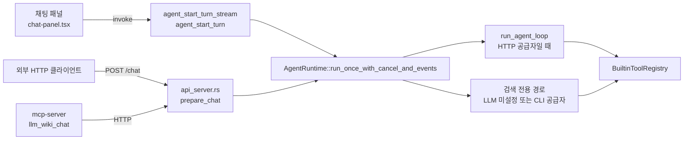

LLM Wiki의 채팅은 브라우저 안의 TypeScript 루프가 아니라 Rust 백엔드의 에이전트 런타임에서 돈다. 데스크톱 채팅 화면, 로컬 HTTP API, MCP 서버가 모두 같은 `AgentRuntime`을 호출하므로 도구 목록, 권한, 반복 상한, 컨텍스트 예산이 한 곳에서 정해진다. 이 장은 `src-tauri/src/agent/` 모듈을 따라가며 한 턴이 어떻게 시작되고, 모델이 도구를 어떻게 고르고, 어떤 경계가 쓰기와 셸 실행을 막는지 정리한다.

## 에이전트 모듈의 위치

모듈 맨 위 주석이 설계 의도를 그대로 밝힌다. 라우팅, 검색, 도구 실행, 컨텍스트 조립, 세션, 취소는 Rust에 두고 React 쪽은 화면만 그린다. 그렇지 않으면 API · MCP · UI의 동작이 어긋난다는 것이다.

코드 분석: [`src-tauri/src/agent/mod.rs#L1-L6`](https://github.com/nashsu/llm_wiki/blob/e08cfce65aad8b76b13546a081c1a8d4422b70c3/src-tauri/src/agent/mod.rs#L1-L6)

무엇을 보는지: 에이전트 코어를 Rust 한 곳에 묶어 두는 이유.

```rust
//! Backend Agent substrate shared by the desktop UI, local HTTP API, and MCP.
//!
//! Keep routing, retrieval, tool execution, context assembly, sessions, and
//! cancellation in this Rust module. The React/TypeScript side may render UI
//! state and bridge provider-specific transports, but it should not reimplement
//! the Agent core; otherwise API/MCP/UI behavior will drift.
```

호출 경로는 세 가지다. 데스크톱 UI는 Tauri command `agent_start_turn`과 `agent_start_turn_stream`([`lib.rs#L64-L256`](https://github.com/nashsu/llm_wiki/blob/e08cfce65aad8b76b13546a081c1a8d4422b70c3/src-tauri/src/lib.rs#L64-L256))을 부르고, HTTP API는 `prepare_chat`에서 런타임을 만든다([`api_server.rs#L1995-L2067`](https://github.com/nashsu/llm_wiki/blob/e08cfce65aad8b76b13546a081c1a8d4422b70c3/src-tauri/src/api_server.rs#L1995-L2067)). MCP 서버는 HTTP API를 거치므로 결국 같은 경로로 들어온다(13장에서 다룬다).



| 파일 | 줄 수 | 역할 |
|---|---|---|
| `runtime.rs` | 5,818 | 턴 진입점, 에이전트 루프, 도구 실행 분기, 셸 승인 판단, 프롬프트 문구 |
| `tools.rs` | 3,888 | 도구 명세, `BuiltinToolRegistry`, 위키 쓰기, 셸 실행, 웹 · AnyTXT · 그래프 · 원본 검색 |
| `provider.rs` | 1,715 | Rust 쪽 HTTP LLM 클라이언트 (12장에서 다룬다) |
| `skills.rs` | 699 | 스킬 폴더 탐색과 `SKILL.md` 로딩 |
| `context.rs` | 645 | system · user 프롬프트 조립과 글자 수 예산 |
| `types.rs` | 392 | `AgentChatRequest`, `AgentMode`, `AgentRetrievalMode` 등 요청 · 응답 타입 |
| `session.rs` | 337 | 세션 기록 저장 |
| `cancel.rs` | 163 | 취소 토큰과 레지스트리 |
| `router.rs` | 155 | 메시지 문구로 의도 힌트를 붙이는 보수적 라우터 |
| `events.rs` | 119 | 스트리밍 이벤트 타입 |
| `permissions.rs` | 66 | `AgentCapability`와 `PermissionPolicy` |
| `workspace.rs` | 17 | 생성 파일을 두는 `agent-workspace` 경로 |

## LLM Wiki 패턴과의 대응

Karpathy의 [`llm-wiki.md`](https://github.com/nashsu/llm_wiki/blob/e08cfce65aad8b76b13546a081c1a8d4422b70c3/llm-wiki.md#L5-L15)는 Claude Code나 Codex 같은 외부 LLM 에이전트를 한쪽에, Obsidian을 다른 쪽에 두고 대화로 위키를 고치는 그림을 그린다. 에이전트의 행동 규칙은 `CLAUDE.md`나 `AGENTS.md` 같은 schema 문서가 정한다([`llm-wiki.md#L33`](https://github.com/nashsu/llm_wiki/blob/e08cfce65aad8b76b13546a081c1a8d4422b70c3/llm-wiki.md#L33)). 위키가 커지면 검색 도구를 CLI나 MCP로 붙이라는 제안도 있다([`llm-wiki.md#L51-L53`](https://github.com/nashsu/llm_wiki/blob/e08cfce65aad8b76b13546a081c1a8d4422b70c3/llm-wiki.md#L51-L53)).

| 원본 패턴 | LLM Wiki 구현 |
|---|---|
| 외부 LLM 에이전트 | 앱 안의 `AgentRuntime` (외부 에이전트는 MCP로 연결, 13장) |
| schema 문서 (`CLAUDE.md`, `AGENTS.md`) | 프로젝트 `schema.md`를 system 프롬프트에 6,000자까지 주입 |
| index 파일로 시작하는 탐색 | `overview.md`를 system에, 페이지 검색은 `wiki.search` · `wiki.read_page` |
| 검색 엔진 CLI · MCP | 내장 하이브리드 검색과 `graph.search` 도구 (6장, 7장) |
| 좋은 답을 위키에 다시 쌓기 | `wiki.write_page` (생성 전용, 검증 후 기록, 8장) |
| 에이전트가 자유롭게 셸 사용 | 스킬이 있을 때만, 작업 공간 한정 또는 정확 일치 승인 |

원본은 에이전트에게 큰 재량을 준다. 구현은 그 재량을 데스크톱 앱 안으로 옮기면서 도구를 이름 있는 목록으로 좁히고, 쓰기는 생성 전용과 검증으로, 셸은 승인으로 묶었다. 원본에서 사람이 하던 "LLM의 수정을 실시간으로 보고 고르는" 역할은 `fileChanged` 이벤트와 되돌리기, 그리고 9장의 리뷰 큐가 이어받는다.

## 정리

- 에이전트 코어는 `src-tauri/src/agent/`에 있고, UI · HTTP API · MCP가 모두 같은 `AgentRuntime`을 부른다. 한도와 권한을 백엔드에 두어 호출 경로마다 동작이 갈리지 않게 했다.
- 루프는 공급자의 native tool calling 대신 "JSON 행동 하나"를 텍스트로 받는다. 파싱 실패, 중복 검색, smart 모드의 무진전 2회, 검색 · 반복 예산 소진이 모두 강제 종료 경로로 이어진다.
- HTTP로 부를 수 있는 공급자만 루프를 탄다. `claude-code` · `codex-cli`는 Rust 쪽에서 검색만 먼저 하고 답은 TypeScript CLI 전송이 쓴다(12장).
- 쓰기는 `wiki/` 아래 Markdown에 생성 전용으로만 허용되고, 쓰기 후 바이트 검증과 되돌리기, 파일 이력 기록이 붙는다. 생성물은 보이는 폴더 `agent-workspace/`로 모은다.
- `shell.exec`는 스킬 턴에서만 열리고, 명령 문자열의 정확 일치 승인 또는 토큰 기반 작업 공간 한정 판정을 통과해야 한다. 환경 변수 최소화일 뿐 OS 샌드박스는 아니다.
- 스킬은 프로젝트와 `~/.claude` · `~/.codex` · `~/.agents`의 `SKILL.md`를 재사용하며, auto 모드는 목록만, explicit 모드는 본문까지 넣고 참고 파일은 필요할 때 읽게 한다.
