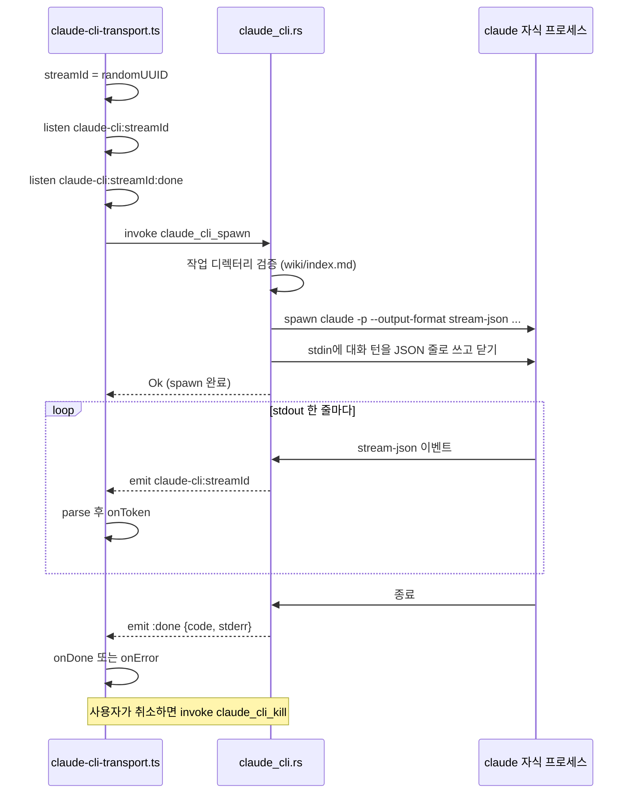

Claude Code와 Codex CLI를 하위 프로세스로 실행해 공급자로 쓰는 경로를 본다.

## CLI 전송

`claude-code`와 `codex-cli`는 API 키 대신 사용자가 이미 로그인해 둔 CLI를 빌려 쓴다. 구조는 둘이 같다. TypeScript가 스트림 id를 만들고 Tauri 이벤트를 먼저 구독한 뒤 Rust 명령으로 자식 프로세스를 띄운다. Rust는 stdout을 줄 단위로 이벤트로 흘리고, 종료 코드와 stderr를 `:done` 이벤트로 보낸다.



### 자식 프로세스의 작업 디렉터리

두 CLI 모두 작업 디렉터리를 현재 프로젝트 경로로 고정하고, 그 경로가 정말 LLM Wiki 프로젝트인지 확인한다.

코드 분석: [`src-tauri/src/commands/claude_cli.rs#L496-L508`](https://github.com/nashsu/llm_wiki/blob/e08cfce65aad8b76b13546a081c1a8d4422b70c3/src-tauri/src/commands/claude_cli.rs#L496-L508)

무엇을 보는지: 절대 경로이고 디렉터리이며 `wiki/index.md`가 있어야 spawn한다.

```rust
    let index_path = path.join("wiki").join("index.md");
    let index_meta = tokio::fs::metadata(&index_path).await.map_err(|e| {
        eprintln!("[claude-cli] failed to read wiki/index.md metadata for {raw}: {e}");
        format!("Claude Code CLI working directory must be an LLM Wiki project containing wiki/index.md: {raw}")
    })?;
    if !index_meta.is_file() {
        return Err(format!(
            "Claude Code CLI working directory must be an LLM Wiki project containing wiki/index.md: {raw}"
        ));
    }
    tokio::fs::canonicalize(path)
        .await
        .map_err(|e| format!("Failed to canonicalize Claude Code CLI working directory {raw}: {e}"))
}
```

Codex 쪽도 같은 검사를 한다([`codex_cli.rs#L338-L371`](https://github.com/nashsu/llm_wiki/blob/e08cfce65aad8b76b13546a081c1a8d4422b70c3/src-tauri/src/commands/codex_cli.rs#L338-L371)). CLI 에이전트는 작업 디렉터리의 `CLAUDE.md`나 `AGENTS.md`를 읽을 수 있으므로, 홈 폴더 같은 엉뚱한 곳에서 실행되지 않게 막는 의미가 있다(추정).

실행 파일은 `cli_resolver.rs`의 `find_cli_command`로 찾고 결과를 캐시한다. macOS에서 Finder로 앱을 띄우면 launchd의 짧은 PATH를 물려받아 nvm 아래 `node`를 찾지 못한다. 그래서 로그인 셸(`-ilc`)을 한 번 띄워 PATH를 얻고, 자식 프로세스 PATH 앞에 붙인다([`cli_resolver.rs#L44-L76`](https://github.com/nashsu/llm_wiki/blob/e08cfce65aad8b76b13546a081c1a8d4422b70c3/src-tauri/src/commands/cli_resolver.rs#L44-L76)). `--version` 확인은 10초 제한이 있다([`cli_resolver.rs#L12`](https://github.com/nashsu/llm_wiki/blob/e08cfce65aad8b76b13546a081c1a8d4422b70c3/src-tauri/src/commands/cli_resolver.rs#L12)).

### Claude Code: stream-json 기반 대화 턴 전송

`claude_cli_spawn`은 메시지 배열에서 system 메시지를 모아 첫 user 턴 앞에 붙인다. 주석은 `--system-prompt` 계열 플래그가 CLI 버전마다 있다 없다 해서 본문에 넣는 쪽을 택했다고 적는다([`claude_cli.rs#L261-L289`](https://github.com/nashsu/llm_wiki/blob/e08cfce65aad8b76b13546a081c1a8d4422b70c3/src-tauri/src/commands/claude_cli.rs#L261-L289)). 텍스트 블록이 있으면 그 블록 앞에 합치고, 이미지만 있는 턴에만 텍스트 블록을 하나 새로 끼운다. 독립된 user 블록이 역할 바꾸기처럼 보이면 Claude Code의 prompt injection 방어가 거절할 수 있기 때문이다([`claude_cli.rs#L121-L156`](https://github.com/nashsu/llm_wiki/blob/e08cfce65aad8b76b13546a081c1a8d4422b70c3/src-tauri/src/commands/claude_cli.rs#L121-L156)).

그다음 각 턴을 `{"type": role, "message": {"role", "content"}}` 한 줄로 stdin에 쓰고 닫는다. `content`는 반드시 블록 배열이어야 한다. 문자열을 넣으면 assistant 턴에서 CLI가 `tool_use_id` 검사 중 죽는다는 관찰이 주석에 남아 있다([`claude_cli.rs#L328-L356`](https://github.com/nashsu/llm_wiki/blob/e08cfce65aad8b76b13546a081c1a8d4422b70c3/src-tauri/src/commands/claude_cli.rs#L328-L356)).

코드 분석: [`src-tauri/src/commands/claude_cli.rs#L441-L456`](https://github.com/nashsu/llm_wiki/blob/e08cfce65aad8b76b13546a081c1a8d4422b70c3/src-tauri/src/commands/claude_cli.rs#L441-L456) 

무엇을 보는지: `localCliIsolation`을 켜면 사용자 전역 설정, 도구, 세션 저장, 슬래시 명령을 끈다.

```rust
    if isolate_local_config {
        // Claude has no documented "empty setting sources" mode. Keep the
        // narrow project source so explicit project-level Claude settings can
        // still apply, while user/global config, MCP, tools, sessions, and
        // slash commands are constrained below.
        args.extend([
            "--setting-sources".to_string(),
            "project".to_string(),
            "--disable-slash-commands".to_string(),
            "--tools".to_string(),
            "".to_string(),
            "--no-session-persistence".to_string(),
            "--prompt-suggestions".to_string(),
            "false".to_string(),
        ]);
    }
```

격리 모드는 끝에 `--strict-mcp-config --mcp-config {"mcpServers":{}}`도 붙여 MCP 서버를 하나도 띄우지 않는다. `--mcp-config`가 여러 값을 받으므로 맨 뒤에 두어 뒤 플래그를 설정 경로로 먹지 않게 한다는 주석이 있다([`claude_cli.rs#L459-L469`](https://github.com/nashsu/llm_wiki/blob/e08cfce65aad8b76b13546a081c1a8d4422b70c3/src-tauri/src/commands/claude_cli.rs#L459-L469)). 기본값은 꺼짐이다. 이미 쓰고 있는 고급 사용자의 설정을 깨지 않으려는 선택이다([`wiki-store.ts#L47-L52`](https://github.com/nashsu/llm_wiki/blob/e08cfce65aad8b76b13546a081c1a8d4422b70c3/src/stores/wiki-store.ts#L47-L52)).

### Claude Code: 스트림 해석

stdout의 stream-json에는 같은 답이 두 번 실린다. `--verbose`일 때 오는 `stream_event`의 `text_delta`는 토큰 단위 조각이고, `assistant` 이벤트는 지금까지의 전체 메시지다.

코드 분석: [`src/lib/claude-cli-transport.ts#L55-L65`](https://github.com/nashsu/llm_wiki/blob/e08cfce65aad8b76b13546a081c1a8d4422b70c3/src/lib/claude-cli-transport.ts#L55-L65)

무엇을 보는지: 조각이 한 번이라도 오면 이후 전체 메시지 이벤트는 건너뛴다.

```ts
    if (type === "stream_event") {
      const event = obj.event as Record<string, unknown> | undefined
      if (event?.type === "content_block_delta") {
        const delta = event.delta as Record<string, unknown> | undefined
        if (delta?.type === "text_delta" && typeof delta.text === "string") {
          sawDelta = true
          return delta.text
        }
      }
      return null
    }
```

조각이 없는 이전 CLI 버전에서는 `assistant` 이벤트의 텍스트가 이전에 내보낸 텍스트로 시작하면 늘어난 부분만 내보낸다([`claude-cli-transport.ts#L70-L95`](https://github.com/nashsu/llm_wiki/blob/e08cfce65aad8b76b13546a081c1a8d4422b70c3/src/lib/claude-cli-transport.ts#L70-L95)). 세션 초기화, `tool_use`, `result` 요약은 무시한다.

종료 처리는 세 가지다([`claude-cli-transport.ts#L287-L316`](https://github.com/nashsu/llm_wiki/blob/e08cfce65aad8b76b13546a081c1a8d4422b70c3/src/lib/claude-cli-transport.ts#L287-L316)). 종료 코드가 0이 아니거나 `result` 이벤트에 `is_error: true`가 있으면 오류다. 0으로 끝났는데 텍스트가 하나도 없으면 역시 오류로 돌린다. 수집 파이프라인이 빈 스텁 페이지를 조용히 쓰는 대신 다시 시도하게 하려는 것이다. `buildExitError`는 stderr에 "unauthenticated", "oauth expired" 같은 문구가 있으면 "터미널에서 `claude`를 실행해 로그인하라"는 안내로 바꾼다. 앱은 실행 파일만 띄울 뿐 로그인 절차를 대신할 수 없기 때문이다([`claude-cli-transport.ts#L384-L416`](https://github.com/nashsu/llm_wiki/blob/e08cfce65aad8b76b13546a081c1a8d4422b70c3/src/lib/claude-cli-transport.ts#L384-L416)). 진단용 stdout 줄은 4,096자 고리 버퍼에 오류성 줄만 모은다.

### Codex: 프롬프트 한 덩어리와 read-only sandbox

Codex 쪽은 대화 턴을 따로 보내지 않고 역할 태그로 감싼 프롬프트 하나를 만든다.

코드 분석: [`src/lib/codex-cli-transport.ts#L46-L59`](https://github.com/nashsu/llm_wiki/blob/e08cfce65aad8b76b13546a081c1a8d4422b70c3/src/lib/codex-cli-transport.ts#L46-L59)

무엇을 보는지: 본문 안의 `<SYSTEM>` 같은 대문자 태그를 이스케이프해 역할 경계를 위조하지 못하게 한다.

```ts
function escapePromptContent(text: string): string {
  return text.replace(/<\/?[A-Z_][A-Z0-9_]*>/gi, (tag) =>
    tag.replace(/</g, "&lt;").replace(/>/g, "&gt;"),
  )
}

export function buildPrompt(messages: ChatMessage[]): string {
  return messages
    .map((message) => {
      const role = message.role.toUpperCase()
      return `<${role}>\n${escapePromptContent(contentToText(message.content))}\n</${role}>`
    })
    .join("\n\n")
}
```

이미지는 `[Image omitted: image/png]` 같은 자리 표시로 바뀐다([`codex-cli-transport.ts#L36-L44`](https://github.com/nashsu/llm_wiki/blob/e08cfce65aad8b76b13546a081c1a8d4422b70c3/src/lib/codex-cli-transport.ts#L36-L44)). 앞에서 본 `supportsImageInput`이 `codex-cli`를 불가로 판정하는 이유와 맞물린다.

코드 분석: [`src-tauri/src/commands/codex_cli.rs#L315-L336`](https://github.com/nashsu/llm_wiki/blob/e08cfce65aad8b76b13546a081c1a8d4422b70c3/src-tauri/src/commands/codex_cli.rs#L315-L336) (발췌)

무엇을 보는지: 승인 요청 없음, JSON 출력, 읽기 전용 sandbox, 일회성 세션, stdin에서 프롬프트 읽기.

```rust
fn build_codex_cli_args(model: &str, isolate_local_config: bool) -> Vec<String> {
    let mut args = vec!["-a".to_string(), "never".to_string(), "exec".to_string()];

    if isolate_local_config {
        args.extend([
            "--ignore-user-config".to_string(),
            "--ignore-rules".to_string(),
        ]);
    }

    args.extend([
        "--json".to_string(),
        "--skip-git-repo-check".to_string(),
        "--sandbox".to_string(),
        "read-only".to_string(),
        "--ephemeral".to_string(),
        "--model".to_string(),
        model.to_string(),
        "-".to_string(),
    ]);
```

`--sandbox read-only`는 격리 모드와 관계없이 항상 붙는다. Codex가 프로젝트 폴더에서 돌더라도 파일을 고치지 못하게 하고, 위키 쓰기는 앱의 수집 · 저장 경로만 맡게 한다. JSONL 출력 중 쓰는 것은 `item.completed` 이벤트의 `agent_message` 텍스트 하나다([`codex-cli-transport.ts#L16-L34`](https://github.com/nashsu/llm_wiki/blob/e08cfce65aad8b76b13546a081c1a8d4422b70c3/src/lib/codex-cli-transport.ts#L16-L34)). Claude처럼 토큰 조각이 오지 않으므로, Codex는 답이 완성된 메시지 단위로 도착한다.

Codex에는 전체 실행 시간 상한이 있다. 기본 10분, 1분에서 240분 사이로 묶는다([`codex_cli.rs#L39-L41`](https://github.com/nashsu/llm_wiki/blob/e08cfce65aad8b76b13546a081c1a8d4422b70c3/src-tauri/src/commands/codex_cli.rs#L39-L41)). 시간이 지나면 별도 태스크가 자식을 레지스트리에서 꺼내 죽이고 `timedOut` 플래그를 세운다. stdout · stderr는 각각 1 MiB까지 모은다. 주석은 시간 초과를 종료 코드 -1로 보고했더니 의도된 중단이 CLI 충돌처럼 보였다는 경험에서 `timedOut`을 별도 필드로 뺐다고 설명한다([`codex_cli.rs#L266-L282`](https://github.com/nashsu/llm_wiki/blob/e08cfce65aad8b76b13546a081c1a8d4422b70c3/src-tauri/src/commands/codex_cli.rs#L266-L282)). TypeScript 쪽도 `timedOut`을 종료 코드보다 먼저 확인한다. 그렇지 않으면 부분 출력이 있던 시간 초과가 성공으로 보고되기 때문이다([`codex-cli-transport.ts#L172-L195`](https://github.com/nashsu/llm_wiki/blob/e08cfce65aad8b76b13546a081c1a8d4422b70c3/src/lib/codex-cli-transport.ts#L172-L195)).

| 항목 | Claude Code | Codex |
|---|---|---|
| 입력 | 턴별 stream-json 줄 | 역할 태그로 감싼 프롬프트 하나 |
| system 메시지 | 첫 user 텍스트 블록 앞에 합침 | `<SYSTEM>` 블록 |
| 이미지 | 블록 그대로 전달 | 자리 표시 문자열 |
| 출력 단위 | `text_delta` 조각 | `agent_message` 완성본 |
| 파일 쓰기 | 격리 시 `--tools ""` | 항상 `--sandbox read-only` |
| 격리 플래그 | `--setting-sources project`, 빈 MCP 설정 등 | `--ignore-user-config`, `--ignore-rules` |
| 시간 상한 | 없음 (TypeScript 취소에 의존) | 기본 10분, 1~240분 |
| stdout 보관 | 이벤트로만 흘림 | 1 MiB까지 모아 `:done`에 동봉 |

> **주의**: CLI 전송에서는 temperature, top_p, max_tokens, stop 같은 요청 조정값이 전달되지 않는다. Claude 쪽은 개발 빌드에서만 무시 경고를 콘솔에 남긴다([`claude-cli-transport.ts#L197-L209`](https://github.com/nashsu/llm_wiki/blob/e08cfce65aad8b76b13546a081c1a8d4422b70c3/src/lib/claude-cli-transport.ts#L197-L209)). 수집 단계가 결정성을 위해 보내는 낮은 temperature도 CLI 공급자에서는 적용되지 않는다.

### 취소

사용자가 취소하면 `AbortSignal` 리스너가 `claude_cli_kill` 또는 `codex_cli_kill`을 부르고 곧바로 `onDone`으로 끝낸다. Rust는 스트림 id로 레지스트리에서 자식을 꺼내 `start_kill`한다. 자식은 `kill_on_drop(true)`로 만들어져 핸들이 버려질 때도 죽는다. 이벤트 구독을 spawn보다 먼저 해서 빠른 CLI의 첫 줄을 놓치지 않게 하고, spawn이 끝난 뒤에도 `completion` 프로미스를 기다려 호출자가 빈 버퍼를 받지 않게 한다([`claude-cli-transport.ts#L267-L341`](https://github.com/nashsu/llm_wiki/blob/e08cfce65aad8b76b13546a081c1a8d4422b70c3/src/lib/claude-cli-transport.ts#L267-L341)).
