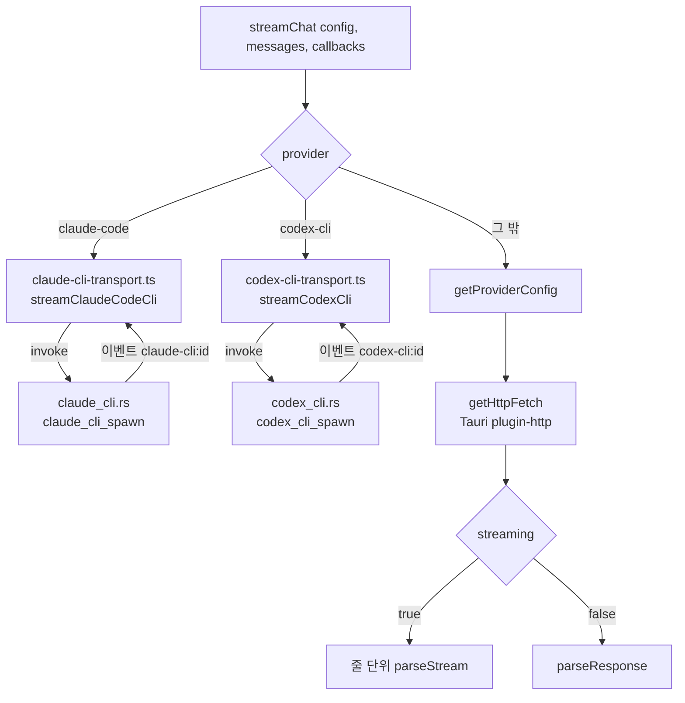

LLM Wiki는 공급자 9종을 하나의 `LlmConfig`로 다룬다. 7종은 HTTP API로 부르고, 나머지 2종(`claude-code`, `codex-cli`)은 사용자의 PC에 설치된 CLI를 자식 프로세스로 띄워 stdin과 stdout으로 대화한다. 이 장은 TypeScript 쪽 `streamChat`이 두 전송 방식을 어떻게 가르는지, 공급자마다 다른 URL · 헤더 · 요청 본문을 어디서 맞추는지, CLI 자식 프로세스를 Rust가 어떻게 띄우고 거두는지 정리한다.

## 공급자 목록과 두 가지 전송

공급자 종류는 스토어의 `LlmConfig.provider` 유니온 타입이 정한다([`wiki-store.ts#L27-L63`](https://github.com/nashsu/llm_wiki/blob/e08cfce65aad8b76b13546a081c1a8d4422b70c3/src/stores/wiki-store.ts#L27-L63)).

| `provider` | 전송 | 기본 URL 또는 실행 파일 | 인증 헤더 | 응답 형식 |
|---|---|---|---|---|
| `openai` | HTTP | `https://api.openai.com/v1/chat/completions` | `Authorization: Bearer` | OpenAI SSE |
| `anthropic` | HTTP | `https://api.anthropic.com/v1/messages` | `x-api-key` | Anthropic SSE |
| `google` | HTTP | `.../v1beta/models/{model}:streamGenerateContent?alt=sse` | `x-goog-api-key` | Gemini SSE |
| `azure` | HTTP | `{resource}/openai/deployments/{dep}/chat/completions?api-version=` | `api-key` | OpenAI SSE |
| `ollama` | HTTP | `{ollamaUrl}/v1/chat/completions` | 없음, `Origin: http://localhost` | OpenAI SSE |
| `minimax` | HTTP | `https://api.minimax.io/anthropic/v1/messages` | `Authorization: Bearer` | Anthropic SSE |
| `custom` | HTTP | 사용자 엔드포인트, `apiMode`로 OpenAI 또는 Anthropic wire | 키가 있으면 Bearer 또는 `api-key` | 선택한 wire |
| `claude-code` | 자식 프로세스 | `claude -p --output-format stream-json ...` | CLI 자체 로그인 | stream-json 줄 |
| `codex-cli` | 자식 프로세스 | `codex -a never exec --json ...` | CLI 자체 로그인 | JSONL 줄 |

HTTP 7종의 분기는 `getProviderConfig` 한 함수에 모여 있다([`llm-providers.ts#L929-L1147`](https://github.com/nashsu/llm_wiki/blob/e08cfce65aad8b76b13546a081c1a8d4422b70c3/src/lib/llm-providers.ts#L929-L1147)). 이 함수는 공급자마다 `url`, `headers`, `buildBody`, `parseStream`, `parseResponse`, `streaming` 여섯 항목을 담은 `ProviderConfig`를 돌려준다. `default` 분기는 `never` 타입으로 막아, 공급자를 추가하고 분기를 빠뜨리면 컴파일이 실패하게 했다.

## LLM Wiki 패턴과의 대응

Karpathy의 원본 아이디어 문서는 이 문서를 "OpenAI Codex, Claude Code, OpenCode 같은 자기 LLM 에이전트에 붙여 넣으라"고 시작한다([`llm-wiki.md#L5`](https://github.com/nashsu/llm_wiki/blob/e08cfce65aad8b76b13546a081c1a8d4422b70c3/llm-wiki.md#L5)). 원본에서 위키를 쓰는 주체가 바로 그 CLI 에이전트다. LLM Wiki는 이 관계를 뒤집어, 앱이 위키 구조와 수집 절차를 관리하고 CLI는 텍스트를 생성하는 공급자 하나로 쓴다. Codex에 `--sandbox read-only`를, Claude에 격리 옵션을 주는 이유가 여기서 나온다. CLI가 원래 가진 파일 편집 능력을 꺼야 앱의 생성 전용 쓰기, 검증, 리뷰 큐(9장, 11장)가 우회되지 않는다. 반대 방향, 즉 외부 CLI 에이전트가 주체가 되어 앱의 위키를 읽고 쓰는 경로는 13장의 MCP 서버가 맡는다.

## 정리

- 공급자는 9종이고, HTTP 7종은 `getProviderConfig`가 URL · 헤더 · 본문 · 파서를 한 함수에서 정한다. CLI 2종은 `streamChat` 입구에서 먼저 갈라져 자식 프로세스 전송으로 간다.
- HTTP 요청은 Tauri `plugin-http`를 거쳐 CORS를 피하고, 사용자 헤더는 인증 헤더를 덮어쓰지 못하게 대소문자 무시로 합친다. Ollama와 사설망 `custom`에는 `Origin: http://localhost`를 고정한다.
- OpenAI 호환 wire는 GPT-5 · o 계열, Kimi, MiMo, OpenRouter, DeepSeek, Ollama마다 temperature · 토큰 필드 · 추론 옵션을 고친다. 수집용 추론 설정을 채팅과 분리해 빈 `content`로 페이지가 사라지는 일을 막는다.
- Claude Code는 대화를 stream-json 줄로 보내고 `text_delta`를 토큰으로 받는다. Codex는 역할 태그 프롬프트 하나를 보내고 `agent_message` 완성본을 받으며, 항상 `--sandbox read-only`와 기본 10분 시간 상한이 걸린다.
- 두 CLI 모두 작업 디렉터리가 `wiki/index.md`를 가진 프로젝트여야 하고, 로그인 셸 PATH를 빌려 GUI 실행에서도 `node`를 찾는다. 요청 조정값(temperature 등)은 CLI로 전달되지 않는다.
- 채팅 에이전트는 Rust `LlmClient`로 같은 wire를 따로 구현한다. 프로젝트별 모델 덮어쓰기 규칙도 TypeScript와 Rust에 나란히 있어 두 구현이 서로를 가리키는 주석으로 묶여 있다.
