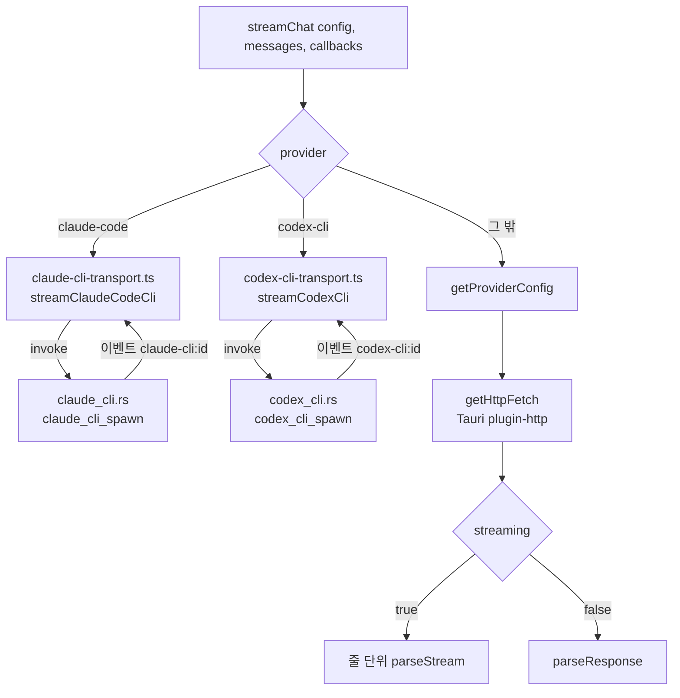
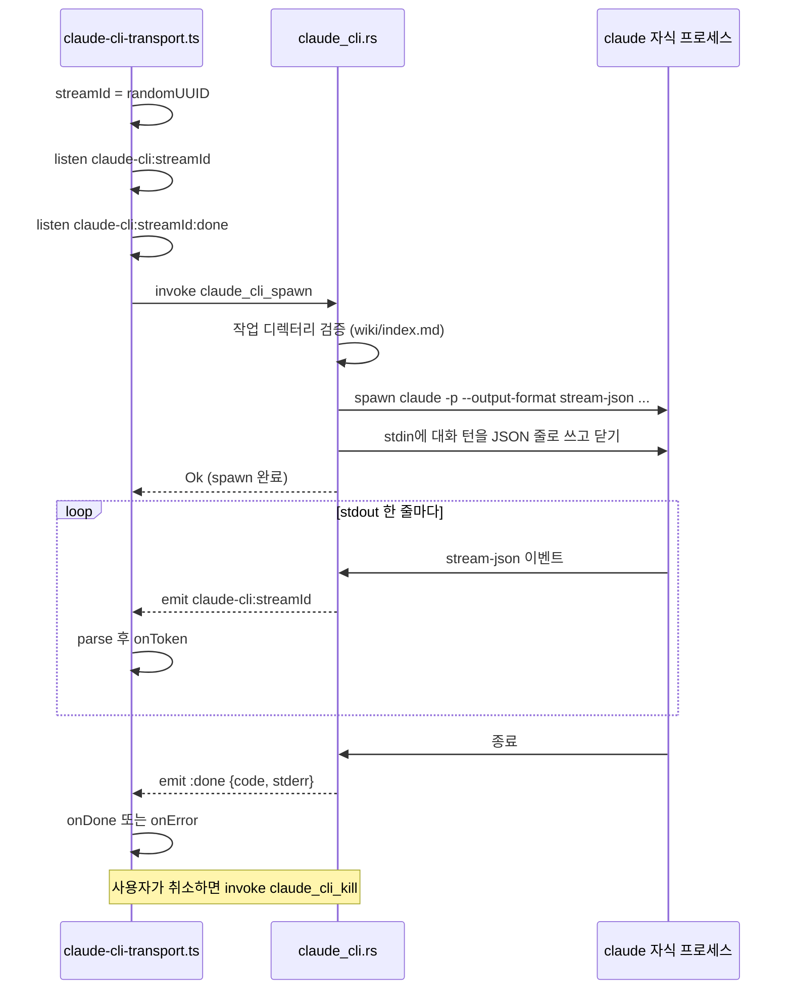

LLM Wiki는 공급자 9종을 하나의 `LlmConfig`로 다룬다. 7종은 HTTP API로 부르고, 나머지 2종(`claude-code`, `codex-cli`)은 사용자의 PC에 설치된 CLI를 자식 프로세스로 띄워 stdin과 stdout으로 대화한다. 이 장은 TypeScript 쪽 `streamChat`이 두 전송 방식을 어떻게 가르는지, 공급자마다 다른 URL · 헤더 · 요청 본문을 어디서 맞추는지, CLI 자식 프로세스를 Rust가 어떻게 띄우고 거두는지 정리한다.

## 공급자 목록과 두 가지 전송

공급자 종류는 스토어의 `LlmConfig.provider` 유니온 타입이 정한다([`wiki-store.ts#L27-L63`](https://github.com/nashsu/llm_wiki/blob/e08cfce65aad8b76b13546a081c1a8d4422b70c3/src/stores/wiki-store.ts#L27-L63)).

| `provider` | 전송 | 기본 URL 또는 실행 파일 | 인증 헤더 | 응답 형식 |
|---|---|---|---|---|
| `openai` | HTTP | `https://api.openai.com/v1/chat/completions` | `Authorization: Bearer` | OpenAI SSE |
| `anthropic` | HTTP | `https://api.anthropic.com/v1/messages` | `x-api-key` | Anthropic SSE |
| `google` | HTTP | `.../v1beta/models/{model}:streamGenerateContent?alt=sse` | `x-goog-api-key` | Gemini SSE |
| `azure` | HTTP | `{resource}/openai/deployments/{dep}/chat/completions?api-version=` | `api-key` | OpenAI SSE |
| `ollama` | HTTP | `{ollamaUrl}/v1/chat/completions` | 없음, `Origin: http://localhost` | OpenAI SSE |
| `minimax` | HTTP | `https://api.minimax.io/anthropic/v1/messages` | `Authorization: Bearer` | Anthropic SSE |
| `custom` | HTTP | 사용자 엔드포인트, `apiMode`로 OpenAI 또는 Anthropic wire | 키가 있으면 Bearer 또는 `api-key` | 선택한 wire |
| `claude-code` | 자식 프로세스 | `claude -p --output-format stream-json ...` | CLI 자체 로그인 | stream-json 줄 |
| `codex-cli` | 자식 프로세스 | `codex -a never exec --json ...` | CLI 자체 로그인 | JSONL 줄 |

HTTP 7종의 분기는 `getProviderConfig` 한 함수에 모여 있다([`llm-providers.ts#L929-L1147`](https://github.com/nashsu/llm_wiki/blob/e08cfce65aad8b76b13546a081c1a8d4422b70c3/src/lib/llm-providers.ts#L929-L1147)). 이 함수는 공급자마다 `url`, `headers`, `buildBody`, `parseStream`, `parseResponse`, `streaming` 여섯 항목을 담은 `ProviderConfig`를 돌려준다. `default` 분기는 `never` 타입으로 막아, 공급자를 추가하고 분기를 빠뜨리면 컴파일이 실패하게 했다.



## streamChat의 입구

`streamChat`은 앱의 모든 TypeScript LLM 호출(수집, 린트, 질의, 연결 시험)이 쓰는 함수다. 콜백 계약은 `onToken`, `onReasoningToken`, `onDone`, `onError` 네 개다([`llm-client.ts#L10-L20`](https://github.com/nashsu/llm_wiki/blob/e08cfce65aad8b76b13546a081c1a8d4422b70c3/src/lib/llm-client.ts#L10-L20)).

코드 따라가기: [`src/lib/llm-client.ts#L226-L243`](https://github.com/nashsu/llm_wiki/blob/e08cfce65aad8b76b13546a081c1a8d4422b70c3/src/lib/llm-client.ts#L226-L243)

무엇을 보는지: CLI 공급자는 HTTP 설정을 만들기 전에 갈라 나간다.

```ts
  if (config.provider === "claude-code") {
    return streamViaClaudeCodeCli(
      config,
      messages,
      config.streamingEnabled === false ? bufferedStreamCallbacks(callbacks) : callbacks,
      signal,
      requestOverrides,
    )
  }

  if (config.provider === "codex-cli") {
    return streamViaCodexCli(
      config,
      messages,
      config.streamingEnabled === false ? bufferedStreamCallbacks(callbacks) : callbacks,
      signal,
      requestOverrides,
    )
  }
```

CLI 전송 모듈은 동적 `import()`로 불러온다. 주석은 Tauri 이벤트 바인딩이 테스트 번들에 섞이지 않게 하려는 것이라고 적는다([`llm-client.ts#L76-L96`](https://github.com/nashsu/llm_wiki/blob/e08cfce65aad8b76b13546a081c1a8d4422b70c3/src/lib/llm-client.ts#L76-L96)). 스트리밍을 끈 설정이면 `bufferedStreamCallbacks`가 토큰을 모았다가 `onDone` 직전에 한 번에 넘긴다([`llm-client.ts#L22-L35`](https://github.com/nashsu/llm_wiki/blob/e08cfce65aad8b76b13546a081c1a8d4422b70c3/src/lib/llm-client.ts#L22-L35)). 그래서 호출자는 스트리밍 여부와 관계없이 같은 콜백을 쓴다.

`getProviderConfig`에도 같은 방어가 있다. CLI 공급자로 이 함수에 들어오면 "배선이 잘못됐다"는 예외를 던진다([`llm-providers.ts#L1069-L1077`](https://github.com/nashsu/llm_wiki/blob/e08cfce65aad8b76b13546a081c1a8d4422b70c3/src/lib/llm-providers.ts#L1069-L1077)).

## HTTP 전송

### 요청과 타임아웃

HTTP 공급자는 `getHttpFetch()`가 돌려주는 fetch로 요청한다. 이 fetch는 Tauri의 Rust 기반 `plugin-http`이므로 브라우저 CORS를 거치지 않는다. `tauri-fetch.ts` 머리 주석은 MiniMax의 `/anthropic`이 CORS 허용 헤더에 `x-api-key`를 빠뜨리고, 일부 중국 클라우드 게이트웨이가 `Authorization`을 빠뜨리는 사례를 이유로 든다([`tauri-fetch.ts#L1-L17`](https://github.com/nashsu/llm_wiki/blob/e08cfce65aad8b76b13546a081c1a8d4422b70c3/src/lib/tauri-fetch.ts#L1-L17)).

요청 시간 상한은 `requestTimeoutMinutes`(기본 30분)를 1분에서 1,440분 사이로 묶은 값이다([`llm-client.ts#L253-L254`](https://github.com/nashsu/llm_wiki/blob/e08cfce65aad8b76b13546a081c1a8d4422b70c3/src/lib/llm-client.ts#L253-L254)). 이 상한은 막힌 요청을 끊는 안전망이고, 몇 초 만에 뜨는 "Load failed"는 DNS · TLS · 404 같은 빠른 네트워크 실패라고 주석이 구분한다. 그래서 시간 초과가 실제로 일어났는지 `timeoutFired` 플래그로 따로 기록하고, 빠른 실패는 "엔드포인트 URL, API 키, 연결을 확인하라"는 문구로 바꾼다.

응답 처리에서 눈여겨볼 지점은 셋이다.

- `custom` 공급자가 temperature를 거부하는 400 · 422를 돌려주면, 오류 본문에 "temperature"와 "unsupported" 같은 낱말이 함께 있을 때 temperature를 빼고 한 번 더 보낸다([`llm-client.ts#L187-L204`](https://github.com/nashsu/llm_wiki/blob/e08cfce65aad8b76b13546a081c1a8d4422b70c3/src/lib/llm-client.ts#L187-L204)).
- 스트림이 끝났는데 본문 글자가 0이고 finish reason이 `length` · `max_tokens` 류면 `truncated: true`로 끝낸다.
- 본문 글자가 0인데 추론(reasoning) 글자가 200자 이상이면 "추론만 하고 답을 내지 않았다"는 진단 오류를 낸다([`llm-client.ts#L474-L500`](https://github.com/nashsu/llm_wiki/blob/e08cfce65aad8b76b13546a081c1a8d4422b70c3/src/lib/llm-client.ts#L474-L500)). 빈 문자열이 몇 단계 위에서 "분석 없음"으로 조용히 바뀌는 일을 막으려는 것이다.

### 헤더 합치기

사용자는 공급자 프리셋마다 게이트웨이용 헤더를 추가할 수 있다. 이 헤더가 인증 헤더를 덮어쓰지 못하게 하는 함수가 `mergeLlmRequestHeaders`다.

코드 따라가기: [`src/lib/llm-providers.ts#L85-L101`](https://github.com/nashsu/llm_wiki/blob/e08cfce65aad8b76b13546a081c1a8d4422b70c3/src/lib/llm-providers.ts#L85-L101)

무엇을 보는지: 사용자 헤더를 먼저 넣고 프로토콜 헤더를 나중에 넣어, 이름이 겹치면 프로토콜 쪽이 이긴다.

```ts
export function mergeLlmRequestHeaders(
  custom: Record<string, string> | undefined,
  required: Record<string, string>,
): Record<string, string> {
  const merged = new Map<string, [string, string]>()
  for (const [name, value] of Object.entries(custom ?? {})) {
    const trimmedName = name.trim()
    const trimmedValue = value.trim()
    if (!HTTP_HEADER_NAME_RE.test(trimmedName) || !trimmedValue || /[\r\n]/.test(trimmedValue)) continue
    merged.set(trimmedName.toLowerCase(), [trimmedName, trimmedValue])
  }
  for (const [name, value] of Object.entries(required)) {
    if (!value) continue
    merged.set(name.toLowerCase(), [name, value])
  }
  return Object.fromEntries(merged.values())
}
```

키를 소문자로 비교하므로 `authorization`처럼 대소문자만 바꾼 헤더로 인증 우선순위를 뒤집을 수 없다. 이름이 RFC 토큰 문자가 아니거나 값에 CR · LF가 있으면 버린다. 주석은 설정 UI 검증 이전에 저장된 값이 남아 있을 수 있어서 경계에서 다시 거른다고 적는다.

### 로컬 서버와 Origin 헤더

Ollama 분기는 항상 `Origin: http://localhost`를 붙인다. `localLlmOriginHeader` 위의 긴 주석이 이유를 설명한다([`llm-providers.ts#L105-L153`](https://github.com/nashsu/llm_wiki/blob/e08cfce65aad8b76b13546a081c1a8d4422b70c3/src/lib/llm-providers.ts#L105-L153)). Tauri `plugin-http`가 웹뷰의 Origin(`tauri://localhost` 또는 Windows의 `http://tauri.localhost`)을 자동으로 넣는데, Ollama 기본 `OLLAMA_ORIGINS`는 후자를 허용하지 않아 Windows에서 403이 났다. 요청 대상의 실제 Origin을 넣으면 LAN의 다른 PC에 있는 Ollama가 거절한다. `http://localhost`는 Ollama 기본 허용 목록에 항상 있으므로 이 값으로 고정했다.

`custom` 공급자는 엔드포인트가 사설 주소일 때만 같은 헤더를 붙인다. `isLocalOrPrivateHttpEndpoint`는 `localhost`, `127.0.0.1`, `::1`, `10.x`, `192.168.x`, `172.16`부터 `172.31`까지를 사설로 본다([`llm-providers.ts#L155-L172`](https://github.com/nashsu/llm_wiki/blob/e08cfce65aad8b76b13546a081c1a8d4422b70c3/src/lib/llm-providers.ts#L155-L172)). 공개 게이트웨이는 낯선 브라우저 Origin을 거절할 수 있기 때문이다.

### Anthropic wire의 URL과 인증

Anthropic 형식은 `anthropic`, `minimax`, `apiMode: "anthropic_messages"`인 `custom`이 함께 쓴다. 사용자가 붙여 넣는 주소 모양이 제각각이라 URL을 맞추는 함수가 따로 있다.

코드 따라가기: [`src/lib/llm-providers.ts#L801-L821`](https://github.com/nashsu/llm_wiki/blob/e08cfce65aad8b76b13546a081c1a8d4422b70c3/src/lib/llm-providers.ts#L801-L821)

무엇을 보는지: `/v1/messages`가 이미 있으면 그대로, `/v1`로 끝나면 `/messages`만, 그 밖에는 `/v1/messages`를 붙인다.

```ts
export function buildAnthropicUrl(base: string): string {
  const trimmed = normalizeMiniMaxAnthropicBase(base).replace(/\/+$/, "")
  if (/\/v\d+\/messages$/i.test(trimmed)) return trimmed
  if (/\/v\d+$/i.test(trimmed)) return `${trimmed}/messages`
  return `${trimmed}/v1/messages`
}

function buildAnthropicHeaders(config: LlmConfig, url: string): Record<string, string> {
  const apiKey = config.apiKey
  const base: Record<string, string> = {
    "Content-Type": JSON_CONTENT_TYPE,
    "anthropic-version": "2023-06-01",
  }
  if (requiresBearerAuth(url)) {
    base.Authorization = `Bearer ${apiKey}`
  } else {
    base["x-api-key"] = apiKey
    base["anthropic-dangerous-direct-browser-access"] = "true"
  }
```

`requiresBearerAuth`는 Anthropic 형식을 흉내 내지만 `Authorization: Bearer`로 인증하는 호스트 목록이다. MiniMax(전역 · 중국), Alibaba Bailian Coding Plan, Xiaomi MiMo Token Plan, Kimi Coding, Moonshot이 들어 있다([`llm-providers.ts#L696-L719`](https://github.com/nashsu/llm_wiki/blob/e08cfce65aad8b76b13546a081c1a8d4422b70c3/src/lib/llm-providers.ts#L696-L719)). system 프롬프트는 텍스트 블록 배열로 보내고 `cache_control: { type: "ephemeral" }`을 달아 prompt caching을 켠다([`llm-providers.ts#L591-L603`](https://github.com/nashsu/llm_wiki/blob/e08cfce65aad8b76b13546a081c1a8d4422b70c3/src/lib/llm-providers.ts#L591-L603)). Anthropic wire의 기본 `max_tokens`는 고정값이 아니라 `maxContextSize`에서 응답 예비분을 구해 3으로 나누고 16,384로 자른 값이다([`llm-providers.ts#L924-L927`](https://github.com/nashsu/llm_wiki/blob/e08cfce65aad8b76b13546a081c1a8d4422b70c3/src/lib/llm-providers.ts#L924-L927)).

$$
\text{max\_tokens} = \max\left(1,\ \min\left(16384,\ \left\lfloor \frac{\text{responseReserve}}{3} \right\rfloor\right)\right)
$$

여기서 3은 "토큰당 약 3글자"라는 근사다. 호출자가 `max_tokens`를 넘기면 그 값이 이긴다.

### OpenAI 호환 wire의 공급자별 보정

OpenAI 형식 본문은 `buildOpenAiCompatibleBody`가 만든 뒤 엔드포인트에 따라 고친다([`llm-providers.ts#L461-L546`](https://github.com/nashsu/llm_wiki/blob/e08cfce65aad8b76b13546a081c1a8d4422b70c3/src/lib/llm-providers.ts#L461-L546)). 수집 단계가 결정성을 위해 `temperature: 0.1`을 보내는데, 이를 거부하는 모델이 많아서 생긴 분기가 대부분이다.

| 대상 판정 | 보정 | 근거 |
|---|---|---|
| `gpt-5` 이상, `o` 계열 (OpenAI · Azure) | `max_tokens`를 `max_completion_tokens`로, temperature · top_p · top_k 삭제 | [`llm-providers.ts#L391-L420`](https://github.com/nashsu/llm_wiki/blob/e08cfce65aad8b76b13546a081c1a8d4422b70c3/src/lib/llm-providers.ts#L391-L420) |
| Moonshot · Kimi | temperature 삭제 | [`llm-providers.ts#L422-L430`](https://github.com/nashsu/llm_wiki/blob/e08cfce65aad8b76b13546a081c1a8d4422b70c3/src/lib/llm-providers.ts#L422-L430) |
| Xiaomi MiMo | `max_completion_tokens`, 추론 off면 `thinking.type=disabled` | [`llm-providers.ts#L432-L459`](https://github.com/nashsu/llm_wiki/blob/e08cfce65aad8b76b13546a081c1a8d4422b70c3/src/lib/llm-providers.ts#L432-L459) |
| OpenRouter | `reasoning.max_tokens` 또는 `reasoning.effort` | [`llm-providers.ts#L479-L486`](https://github.com/nashsu/llm_wiki/blob/e08cfce65aad8b76b13546a081c1a8d4422b70c3/src/lib/llm-providers.ts#L479-L486) |
| DeepSeek V4 | `thinking.type` enabled · disabled, `reasoning_effort` | [`llm-providers.ts#L488-L504`](https://github.com/nashsu/llm_wiki/blob/e08cfce65aad8b76b13546a081c1a8d4422b70c3/src/lib/llm-providers.ts#L488-L504) |
| Ollama | 추론 off면 `reasoning_effort: "none"`, `max`는 `high` | [`llm-providers.ts#L506-L532`](https://github.com/nashsu/llm_wiki/blob/e08cfce65aad8b76b13546a081c1a8d4422b70c3/src/lib/llm-providers.ts#L506-L532) |
| `custom` (Anthropic 모드 제외) | `extraRequestBody` 병합, 단 `messages` · `model` · `stream` · `__proto__` 등은 무시 | [`llm-providers.ts#L359-L368`](https://github.com/nashsu/llm_wiki/blob/e08cfce65aad8b76b13546a081c1a8d4422b70c3/src/lib/llm-providers.ts#L359-L368) |

Ollama 분기 주석은 이 보정이 왜 중요한지 구체적으로 적는다. thinking 모델이 토큰 예산을 모두 사고 과정에 쓰고 `content`가 빈 채로 끝나면, 수집 결과 페이지 하나가 사라진다. 그래서 `LlmConfig`에는 채팅용 `reasoning`과 별개로 수집용 `ingestReasoning`이 있고 기본값은 off다([`wiki-store.ts#L37-L46`](https://github.com/nashsu/llm_wiki/blob/e08cfce65aad8b76b13546a081c1a8d4422b70c3/src/stores/wiki-store.ts#L37-L46)).

이미지 입력 가능 여부도 공급자마다 다르다. `supportsImageInput`은 `codex-cli`를 불가로, MiniMax는 M3 모델만, Zhipu BigModel은 GLM 비전 모델만 가능으로 판정한다([`llm-providers.ts#L777-L786`](https://github.com/nashsu/llm_wiki/blob/e08cfce65aad8b76b13546a081c1a8d4422b70c3/src/lib/llm-providers.ts#L777-L786)).

### Azure 엔드포인트

Azure는 리소스 주소, 배포 이름, API 버전 세 조각으로 URL을 만든다. `parseAzureOpenAiEndpoint`는 사용자가 호스트만, 배포 경로까지, 전체 채팅 URL까지 어느 모양으로 붙여 넣어도 세 조각으로 나눈다. 경로 안의 배포 이름이 설정의 모델 이름보다 우선하고, 질의 문자열의 `api-version`이 설정값보다 우선한다([`azure-openai.ts#L25-L62`](https://github.com/nashsu/llm_wiki/blob/e08cfce65aad8b76b13546a081c1a8d4422b70c3/src/lib/azure-openai.ts#L25-L62)). 기본 API 버전은 `2024-10-21`이다([`azure-openai.ts#L1`](https://github.com/nashsu/llm_wiki/blob/e08cfce65aad8b76b13546a081c1a8d4422b70c3/src/lib/azure-openai.ts#L1)). `custom` 공급자라도 호스트가 `.openai.azure.com`으로 끝나면 같은 Azure 규칙과 `api-key` 헤더를 쓴다.

## 엔드포인트 입력 보정

설정 화면의 엔드포인트 입력란은 포커스를 잃을 때 `normalizeEndpoint`로 주소를 고치고 경고를 보여 준다([`llm-provider-section.tsx#L989`](https://github.com/nashsu/llm_wiki/blob/e08cfce65aad8b76b13546a081c1a8d4422b70c3/src/components/settings/sections/llm-provider-section.tsx#L989)). 주석이 꼽는 흔한 실수는 둘이다. 요청 경로까지 붙여 넣어 `/chat/completions`가 두 번 붙는 경우, 버전 구간(`/v1`)을 빠뜨리는 경우다.

코드 따라가기: [`src/lib/endpoint-normalizer.ts#L36-L40`](https://github.com/nashsu/llm_wiki/blob/e08cfce65aad8b76b13546a081c1a8d4422b70c3/src/lib/endpoint-normalizer.ts#L36-L40)

무엇을 보는지: 언제나 지워도 되는 꼬리와 모드에 따라 다른 꼬리를 나눈다.

```ts
const ALWAYS_WRONG_TAILS = /\/+(chat\/completions|embeddings)\/?$/i
// `/messages` is ambiguous: in anthropic_messages mode our dispatch uses
// it verbatim when present, so we must preserve it. Only strip when the
// configured mode is chat_completions.
const MESSAGES_TAIL = /\/+messages\/?$/i
```

| 입력 상황 | 처리 | 저장을 막는가 |
|---|---|---|
| `http(s)://` 없음 | 끝 슬래시만 지우고 경고 | 아니오 |
| `new URL`로 해석 불가 | 경고 ("호스트 · 포트 · 경로 오타 확인") | 아니오 |
| 숫자 점 표기인데 IPv4 4옥텟이 아님 | 경고 | 아니오 |
| Azure 호스트 | `/chat/completions`와 질의 문자열 제거, 배포 경로는 유지 | 아니오 |
| `/chat/completions`, `/embeddings` 꼬리 | 제거하고 알림 | 아니오 |
| chat 모드에서 `/messages` 꼬리 | 제거하고 알림 | 아니오 |
| chat 모드에서 `/v1`, `/api/paas/v4` 류 버전 구간 없음 | 경고만 | 아니오 |

경고는 저장을 막지 않는다. 주석은 일부 자체 호스팅 게이트웨이가 정말로 맨 호스트에 API를 둔다고 설명한다([`endpoint-normalizer.ts#L4-L19`](https://github.com/nashsu/llm_wiki/blob/e08cfce65aad8b76b13546a081c1a8d4422b70c3/src/lib/endpoint-normalizer.ts#L4-L19)). 그리고 `getProviderConfig`의 `custom`과 `ollama` 분기가 같은 꼬리를 한 번 더 지운다. 정규화 기능이 생기기 전에 저장된 설정을 위한 이중 방어다([`llm-providers.ts#L1019-L1031`](https://github.com/nashsu/llm_wiki/blob/e08cfce65aad8b76b13546a081c1a8d4422b70c3/src/lib/llm-providers.ts#L1019-L1031)).

## CLI 전송

`claude-code`와 `codex-cli`는 API 키 대신 사용자가 이미 로그인해 둔 CLI를 빌려 쓴다. 구조는 둘이 같다. TypeScript가 스트림 id를 만들고 Tauri 이벤트를 먼저 구독한 뒤 Rust 명령으로 자식 프로세스를 띄운다. Rust는 stdout을 줄 단위로 이벤트로 흘리고, 종료 코드와 stderr를 `:done` 이벤트로 보낸다.



### 자식 프로세스의 작업 디렉터리

두 CLI 모두 작업 디렉터리를 현재 프로젝트 경로로 고정하고, 그 경로가 정말 LLM Wiki 프로젝트인지 확인한다.

코드 따라가기: [`src-tauri/src/commands/claude_cli.rs#L496-L508`](https://github.com/nashsu/llm_wiki/blob/e08cfce65aad8b76b13546a081c1a8d4422b70c3/src-tauri/src/commands/claude_cli.rs#L496-L508)

무엇을 보는지: 절대 경로이고 디렉터리이며 `wiki/index.md`가 있어야 spawn한다.

```rust
    let index_path = path.join("wiki").join("index.md");
    let index_meta = tokio::fs::metadata(&index_path).await.map_err(|e| {
        eprintln!("[claude-cli] failed to read wiki/index.md metadata for {raw}: {e}");
        format!("Claude Code CLI working directory must be an LLM Wiki project containing wiki/index.md: {raw}")
    })?;
    if !index_meta.is_file() {
        return Err(format!(
            "Claude Code CLI working directory must be an LLM Wiki project containing wiki/index.md: {raw}"
        ));
    }
    tokio::fs::canonicalize(path)
        .await
        .map_err(|e| format!("Failed to canonicalize Claude Code CLI working directory {raw}: {e}"))
}
```

Codex 쪽도 같은 검사를 한다([`codex_cli.rs#L338-L371`](https://github.com/nashsu/llm_wiki/blob/e08cfce65aad8b76b13546a081c1a8d4422b70c3/src-tauri/src/commands/codex_cli.rs#L338-L371)). CLI 에이전트는 작업 디렉터리의 `CLAUDE.md`나 `AGENTS.md`를 읽을 수 있으므로, 홈 폴더 같은 엉뚱한 곳에서 실행되지 않게 막는 의미가 있다(추정).

실행 파일은 `cli_resolver.rs`의 `find_cli_command`로 찾고 결과를 캐시한다. macOS에서 Finder로 앱을 띄우면 launchd의 짧은 PATH를 물려받아 nvm 아래 `node`를 찾지 못한다. 그래서 로그인 셸(`-ilc`)을 한 번 띄워 PATH를 얻고, 자식 프로세스 PATH 앞에 붙인다([`cli_resolver.rs#L44-L76`](https://github.com/nashsu/llm_wiki/blob/e08cfce65aad8b76b13546a081c1a8d4422b70c3/src-tauri/src/commands/cli_resolver.rs#L44-L76)). `--version` 확인은 10초 제한이 있다([`cli_resolver.rs#L12`](https://github.com/nashsu/llm_wiki/blob/e08cfce65aad8b76b13546a081c1a8d4422b70c3/src-tauri/src/commands/cli_resolver.rs#L12)).

### Claude Code: 대화 턴을 stream-json으로 보내기

`claude_cli_spawn`은 메시지 배열에서 system 메시지를 모아 첫 user 턴 앞에 붙인다. 주석은 `--system-prompt` 계열 플래그가 CLI 버전마다 있다 없다 해서 본문에 넣는 쪽을 택했다고 적는다([`claude_cli.rs#L261-L289`](https://github.com/nashsu/llm_wiki/blob/e08cfce65aad8b76b13546a081c1a8d4422b70c3/src-tauri/src/commands/claude_cli.rs#L261-L289)). 텍스트 블록이 있으면 그 블록 앞에 합치고, 이미지만 있는 턴에만 텍스트 블록을 하나 새로 끼운다. 독립된 user 블록이 역할 바꾸기처럼 보이면 Claude Code의 prompt injection 방어가 거절할 수 있기 때문이다([`claude_cli.rs#L121-L156`](https://github.com/nashsu/llm_wiki/blob/e08cfce65aad8b76b13546a081c1a8d4422b70c3/src-tauri/src/commands/claude_cli.rs#L121-L156)).

그다음 각 턴을 `{"type": role, "message": {"role", "content"}}` 한 줄로 stdin에 쓰고 닫는다. `content`는 반드시 블록 배열이어야 한다. 문자열을 넣으면 assistant 턴에서 CLI가 `tool_use_id` 검사 중 죽는다는 관찰이 주석에 남아 있다([`claude_cli.rs#L328-L356`](https://github.com/nashsu/llm_wiki/blob/e08cfce65aad8b76b13546a081c1a8d4422b70c3/src-tauri/src/commands/claude_cli.rs#L328-L356)).

코드 따라가기: [`src-tauri/src/commands/claude_cli.rs#L441-L456`](https://github.com/nashsu/llm_wiki/blob/e08cfce65aad8b76b13546a081c1a8d4422b70c3/src-tauri/src/commands/claude_cli.rs#L441-L456) 

무엇을 보는지: `localCliIsolation`을 켜면 사용자 전역 설정, 도구, 세션 저장, 슬래시 명령을 끈다.

```rust
    if isolate_local_config {
        // Claude has no documented "empty setting sources" mode. Keep the
        // narrow project source so explicit project-level Claude settings can
        // still apply, while user/global config, MCP, tools, sessions, and
        // slash commands are constrained below.
        args.extend([
            "--setting-sources".to_string(),
            "project".to_string(),
            "--disable-slash-commands".to_string(),
            "--tools".to_string(),
            "".to_string(),
            "--no-session-persistence".to_string(),
            "--prompt-suggestions".to_string(),
            "false".to_string(),
        ]);
    }
```

격리 모드는 끝에 `--strict-mcp-config --mcp-config {"mcpServers":{}}`도 붙여 MCP 서버를 하나도 띄우지 않는다. `--mcp-config`가 여러 값을 받으므로 맨 뒤에 두어 뒤 플래그를 설정 경로로 먹지 않게 한다는 주석이 있다([`claude_cli.rs#L459-L469`](https://github.com/nashsu/llm_wiki/blob/e08cfce65aad8b76b13546a081c1a8d4422b70c3/src-tauri/src/commands/claude_cli.rs#L459-L469)). 기본값은 꺼짐이다. 이미 쓰고 있는 고급 사용자의 설정을 깨지 않으려는 선택이다([`wiki-store.ts#L47-L52`](https://github.com/nashsu/llm_wiki/blob/e08cfce65aad8b76b13546a081c1a8d4422b70c3/src/stores/wiki-store.ts#L47-L52)).

### Claude Code: 스트림 해석

stdout의 stream-json에는 같은 답이 두 번 실린다. `--verbose`일 때 오는 `stream_event`의 `text_delta`는 토큰 단위 조각이고, `assistant` 이벤트는 지금까지의 전체 메시지다.

코드 따라가기: [`src/lib/claude-cli-transport.ts#L55-L65`](https://github.com/nashsu/llm_wiki/blob/e08cfce65aad8b76b13546a081c1a8d4422b70c3/src/lib/claude-cli-transport.ts#L55-L65)

무엇을 보는지: 조각이 한 번이라도 오면 이후 전체 메시지 이벤트는 건너뛴다.

```ts
    if (type === "stream_event") {
      const event = obj.event as Record<string, unknown> | undefined
      if (event?.type === "content_block_delta") {
        const delta = event.delta as Record<string, unknown> | undefined
        if (delta?.type === "text_delta" && typeof delta.text === "string") {
          sawDelta = true
          return delta.text
        }
      }
      return null
    }
```

조각이 없는 이전 CLI 버전에서는 `assistant` 이벤트의 텍스트가 이전에 내보낸 텍스트로 시작하면 늘어난 부분만 내보낸다([`claude-cli-transport.ts#L70-L95`](https://github.com/nashsu/llm_wiki/blob/e08cfce65aad8b76b13546a081c1a8d4422b70c3/src/lib/claude-cli-transport.ts#L70-L95)). 세션 초기화, `tool_use`, `result` 요약은 무시한다.

종료 처리는 세 갈래다([`claude-cli-transport.ts#L287-L316`](https://github.com/nashsu/llm_wiki/blob/e08cfce65aad8b76b13546a081c1a8d4422b70c3/src/lib/claude-cli-transport.ts#L287-L316)). 종료 코드가 0이 아니거나 `result` 이벤트에 `is_error: true`가 있으면 오류다. 0으로 끝났는데 텍스트가 하나도 없으면 역시 오류로 돌린다. 수집 파이프라인이 빈 스텁 페이지를 조용히 쓰는 대신 다시 시도하게 하려는 것이다. `buildExitError`는 stderr에 "unauthenticated", "oauth expired" 같은 문구가 있으면 "터미널에서 `claude`를 실행해 로그인하라"는 안내로 바꾼다. 앱은 실행 파일만 띄울 뿐 로그인 절차를 대신할 수 없기 때문이다([`claude-cli-transport.ts#L384-L416`](https://github.com/nashsu/llm_wiki/blob/e08cfce65aad8b76b13546a081c1a8d4422b70c3/src/lib/claude-cli-transport.ts#L384-L416)). 진단용 stdout 줄은 4,096자 고리 버퍼에 오류성 줄만 모은다.

### Codex: 프롬프트 한 덩어리와 read-only sandbox

Codex 쪽은 대화 턴을 따로 보내지 않고 역할 태그로 감싼 프롬프트 하나를 만든다.

코드 따라가기: [`src/lib/codex-cli-transport.ts#L46-L59`](https://github.com/nashsu/llm_wiki/blob/e08cfce65aad8b76b13546a081c1a8d4422b70c3/src/lib/codex-cli-transport.ts#L46-L59)

무엇을 보는지: 본문 안의 `<SYSTEM>` 같은 대문자 태그를 이스케이프해 역할 경계를 위조하지 못하게 한다.

```ts
function escapePromptContent(text: string): string {
  return text.replace(/<\/?[A-Z_][A-Z0-9_]*>/gi, (tag) =>
    tag.replace(/</g, "&lt;").replace(/>/g, "&gt;"),
  )
}

export function buildPrompt(messages: ChatMessage[]): string {
  return messages
    .map((message) => {
      const role = message.role.toUpperCase()
      return `<${role}>\n${escapePromptContent(contentToText(message.content))}\n</${role}>`
    })
    .join("\n\n")
}
```

이미지는 `[Image omitted: image/png]` 같은 자리 표시로 바뀐다([`codex-cli-transport.ts#L36-L44`](https://github.com/nashsu/llm_wiki/blob/e08cfce65aad8b76b13546a081c1a8d4422b70c3/src/lib/codex-cli-transport.ts#L36-L44)). 앞에서 본 `supportsImageInput`이 `codex-cli`를 불가로 판정하는 이유와 맞물린다.

코드 따라가기: [`src-tauri/src/commands/codex_cli.rs#L315-L336`](https://github.com/nashsu/llm_wiki/blob/e08cfce65aad8b76b13546a081c1a8d4422b70c3/src-tauri/src/commands/codex_cli.rs#L315-L336) (발췌)

무엇을 보는지: 승인 요청 없음, JSON 출력, 읽기 전용 sandbox, 일회성 세션, stdin에서 프롬프트 읽기.

```rust
fn build_codex_cli_args(model: &str, isolate_local_config: bool) -> Vec<String> {
    let mut args = vec!["-a".to_string(), "never".to_string(), "exec".to_string()];

    if isolate_local_config {
        args.extend([
            "--ignore-user-config".to_string(),
            "--ignore-rules".to_string(),
        ]);
    }

    args.extend([
        "--json".to_string(),
        "--skip-git-repo-check".to_string(),
        "--sandbox".to_string(),
        "read-only".to_string(),
        "--ephemeral".to_string(),
        "--model".to_string(),
        model.to_string(),
        "-".to_string(),
    ]);
```

`--sandbox read-only`는 격리 모드와 관계없이 항상 붙는다. Codex가 프로젝트 폴더에서 돌더라도 파일을 고치지 못하게 하고, 위키 쓰기는 앱의 수집 · 저장 경로만 맡게 한다. JSONL 출력 중 쓰는 것은 `item.completed` 이벤트의 `agent_message` 텍스트 하나다([`codex-cli-transport.ts#L16-L34`](https://github.com/nashsu/llm_wiki/blob/e08cfce65aad8b76b13546a081c1a8d4422b70c3/src/lib/codex-cli-transport.ts#L16-L34)). Claude처럼 토큰 조각이 오지 않으므로, Codex는 답이 완성된 메시지 단위로 도착한다.

Codex에는 전체 실행 시간 상한이 있다. 기본 10분, 1분에서 240분 사이로 묶는다([`codex_cli.rs#L39-L41`](https://github.com/nashsu/llm_wiki/blob/e08cfce65aad8b76b13546a081c1a8d4422b70c3/src-tauri/src/commands/codex_cli.rs#L39-L41)). 시간이 지나면 별도 태스크가 자식을 레지스트리에서 꺼내 죽이고 `timedOut` 플래그를 세운다. stdout · stderr는 각각 1 MiB까지 모은다. 주석은 시간 초과를 종료 코드 -1로 보고했더니 의도된 중단이 CLI 충돌처럼 보였다는 경험에서 `timedOut`을 별도 필드로 뺐다고 설명한다([`codex_cli.rs#L266-L282`](https://github.com/nashsu/llm_wiki/blob/e08cfce65aad8b76b13546a081c1a8d4422b70c3/src-tauri/src/commands/codex_cli.rs#L266-L282)). TypeScript 쪽도 `timedOut`을 종료 코드보다 먼저 확인한다. 그렇지 않으면 부분 출력이 있던 시간 초과가 성공으로 보고되기 때문이다([`codex-cli-transport.ts#L172-L195`](https://github.com/nashsu/llm_wiki/blob/e08cfce65aad8b76b13546a081c1a8d4422b70c3/src/lib/codex-cli-transport.ts#L172-L195)).

| 항목 | Claude Code | Codex |
|---|---|---|
| 입력 | 턴별 stream-json 줄 | 역할 태그로 감싼 프롬프트 하나 |
| system 메시지 | 첫 user 텍스트 블록 앞에 합침 | `<SYSTEM>` 블록 |
| 이미지 | 블록 그대로 전달 | 자리 표시 문자열 |
| 출력 단위 | `text_delta` 조각 | `agent_message` 완성본 |
| 파일 쓰기 | 격리 시 `--tools ""` | 항상 `--sandbox read-only` |
| 격리 플래그 | `--setting-sources project`, 빈 MCP 설정 등 | `--ignore-user-config`, `--ignore-rules` |
| 시간 상한 | 없음 (TypeScript 취소에 의존) | 기본 10분, 1~240분 |
| stdout 보관 | 이벤트로만 흘림 | 1 MiB까지 모아 `:done`에 동봉 |

> **주의**: CLI 전송에서는 temperature, top_p, max_tokens, stop 같은 요청 조정값이 전달되지 않는다. Claude 쪽은 개발 빌드에서만 무시 경고를 콘솔에 남긴다([`claude-cli-transport.ts#L197-L209`](https://github.com/nashsu/llm_wiki/blob/e08cfce65aad8b76b13546a081c1a8d4422b70c3/src/lib/claude-cli-transport.ts#L197-L209)). 수집 단계가 결정성을 위해 보내는 낮은 temperature도 CLI 공급자에서는 적용되지 않는다.

### 취소

사용자가 취소하면 `AbortSignal` 리스너가 `claude_cli_kill` 또는 `codex_cli_kill`을 부르고 곧바로 `onDone`으로 끝낸다. Rust는 스트림 id로 레지스트리에서 자식을 꺼내 `start_kill`한다. 자식은 `kill_on_drop(true)`로 만들어져 핸들이 버려질 때도 죽는다. 이벤트 구독을 spawn보다 먼저 해서 빠른 CLI의 첫 줄을 놓치지 않게 하고, spawn이 끝난 뒤에도 `completion` 프로미스를 기다려 호출자가 빈 버퍼를 받지 않게 한다([`claude-cli-transport.ts#L267-L341`](https://github.com/nashsu/llm_wiki/blob/e08cfce65aad8b76b13546a081c1a8d4422b70c3/src/lib/claude-cli-transport.ts#L267-L341)).

## Rust 쪽 공급자와의 관계

11장의 에이전트 루프는 TypeScript `streamChat`을 쓰지 않고 Rust `LlmClient`로 같은 공급자를 직접 부른다([`provider.rs#L151-L215`](https://github.com/nashsu/llm_wiki/blob/e08cfce65aad8b76b13546a081c1a8d4422b70c3/src-tauri/src/agent/provider.rs#L151-L215)). 같은 wire를 두 언어로 두 번 구현한 셈이다. Rust 쪽 상수도 TypeScript와 맞춰져 있다. Anthropic 버전 `2023-06-01`, Azure API 버전 `2024-10-21`이고, 요청 타임아웃은 180초다([`provider.rs#L13-L16`](https://github.com/nashsu/llm_wiki/blob/e08cfce65aad8b76b13546a081c1a8d4422b70c3/src-tauri/src/agent/provider.rs#L13-L16)).

| 호출 경로 | 구현 | CLI 공급자 |
|---|---|---|
| 수집 · 린트 · 딥 리서치 · 연결 시험 | TypeScript `streamChat` | 지원 |
| 채팅 (HTTP 공급자) | Rust `AgentRuntime` + `LlmClient` | 해당 없음 |
| 채팅 (CLI 공급자) | Rust 검색 전용 + TypeScript `streamChat` | 지원 |
| HTTP API · MCP의 `/chat` | Rust `AgentRuntime` | 미지원, 설정 오류 반환 |

프로젝트별 모델 덮어쓰기도 두 곳에 있다. TypeScript `resolveProjectLlmConfig`와 Rust `project_llm_config`가 같은 규칙(삭제된 사용자 프리셋은 전역 설정으로 되돌림)을 따르도록 서로를 가리키는 주석이 달려 있다([`llm-task-routing.ts#L14-L31`](https://github.com/nashsu/llm_wiki/blob/e08cfce65aad8b76b13546a081c1a8d4422b70c3/src/lib/llm-task-routing.ts#L14-L31), [`api_server.rs#L2363-L2440`](https://github.com/nashsu/llm_wiki/blob/e08cfce65aad8b76b13546a081c1a8d4422b70c3/src-tauri/src/api_server.rs#L2363-L2440)). API 키와 사용자 헤더는 프로젝트 기록에 복사하지 않고 실행 시점에 공급자 자격 증명 기록에서 합친다.

> **주의**: 두 구현은 서로 다른 테스트로 지켜진다. 한쪽에만 들어간 공급자 보정(예: 특정 게이트웨이의 temperature 처리)이 다른 쪽에 없을 수 있으므로, 같은 모델이라도 수집과 채팅의 동작이 다를 가능성이 있다(미검증).

## 연결 시험

설정 화면의 "연결 시험"과 "기능 시험" 버튼은 `connection-tests.ts`를 부른다. 둘 다 실제 `streamChat`을 거치므로 CLI 공급자도 같은 버튼으로 확인한다.

코드 따라가기: [`src/lib/connection-tests.ts#L93-L123`](https://github.com/nashsu/llm_wiki/blob/e08cfce65aad8b76b13546a081c1a8d4422b70c3/src/lib/connection-tests.ts#L93-L123) (발췌)

무엇을 보는지: 기능 시험은 정해진 토큰을 그대로 따라 말하는지 본다.

```ts
export async function testLlmFunction(cfg: LlmConfig): Promise<ProviderTestResult> {
  let content = ""
  let errorMessage: string | null = null

  await streamChat(
    cfg,
    [
      {
        role: "system",
        content: "You are a deterministic API test. Do not explain. Output only the requested token.",
      },
      { role: "user", content: "Output exactly this token and nothing else: LLM_WIKI_TEST_OK" },
    ],
```

| 시험 | 보내는 것 | 통과 조건 |
|---|---|---|
| `testLlmConnection` | "Reply with one short word." | 오류 없음, 빈 응답 아님. 걸린 ms와 응답 앞 80자 표시 |
| `testLlmFunction` | `LLM_WIKI_TEST_OK`를 그대로 출력하라는 지시 | 응답에 그 토큰이 들어 있음 |
| `testEmbeddingConnection` | 짧은 문장 하나 | 벡터가 돌아옴. 차원 수 표시 |
| `testEmbeddingFunction` | 같은 문장 두 번 | 두 벡터 차원이 같고, 값이 모두 유한하고, norm이 0보다 큼 |

LLM 시험은 `max_tokens: 512`, `reasoning: { mode: "auto" }`로 보낸다([`connection-tests.ts#L10`](https://github.com/nashsu/llm_wiki/blob/e08cfce65aad8b76b13546a081c1a8d4422b70c3/src/lib/connection-tests.ts#L10)). 첫 시험은 "닿는가", 두 번째는 "지시를 따르는가"를 본다. 엔드포인트는 맞는데 모델이 추론만 하다 끝나거나 엉뚱한 모델이 걸린 경우를 두 번째 시험이 걸러 낸다.

## 설정 보조 유틸

| 모듈 | 내용 | 쓰는 곳 |
|---|---|---|
| `concurrency-limits.ts` | 사용자 입력 동시성 값을 정수로 내리고 1에서 64 사이로 묶는다 | 임베딩 · 멀티모달 동시성, 원본 감시 설정 |
| `api-token.ts` | Web Crypto로 32바이트 난수를 만들어 base64url(`+`, `/`, `=` 없음)로 인코딩한다 | API 설정 화면의 토큰 생성 버튼 |
| `api-server-constants.ts` | 포트 19828, `http://127.0.0.1:19828`, `/api/v1/health` | API 설정 화면의 상태 표시 |

출처는 [`concurrency-limits.ts#L1-L10`](https://github.com/nashsu/llm_wiki/blob/e08cfce65aad8b76b13546a081c1a8d4422b70c3/src/lib/concurrency-limits.ts#L1-L10), [`api-token.ts#L1-L23`](https://github.com/nashsu/llm_wiki/blob/e08cfce65aad8b76b13546a081c1a8d4422b70c3/src/lib/api-token.ts#L1-L23), [`api-server-constants.ts#L1-L3`](https://github.com/nashsu/llm_wiki/blob/e08cfce65aad8b76b13546a081c1a8d4422b70c3/src/lib/api-server-constants.ts#L1-L3)이다. 토큰은 256비트이고, 셸 · 환경 변수 · 헤더 · 질의 문자열에 이스케이프 없이 붙여 넣을 수 있게 base64url을 골랐다고 주석이 적는다. 이 토큰이 서버에서 어떻게 검사되는지는 13장에서 다룬다.

## LLM Wiki 패턴과의 대응

Karpathy의 원본 아이디어 문서는 이 문서를 "OpenAI Codex, Claude Code, OpenCode 같은 자기 LLM 에이전트에 붙여 넣으라"고 시작한다([`llm-wiki.md#L5`](https://github.com/nashsu/llm_wiki/blob/e08cfce65aad8b76b13546a081c1a8d4422b70c3/llm-wiki.md#L5)). 원본에서 위키를 쓰는 주체가 바로 그 CLI 에이전트다. LLM Wiki는 이 관계를 뒤집어, 앱이 위키 구조와 수집 절차를 쥐고 CLI는 텍스트를 생성하는 공급자 하나로 쓴다. Codex에 `--sandbox read-only`를, Claude에 격리 옵션을 주는 이유가 여기서 나온다. CLI가 원래 가진 파일 편집 능력을 꺼야 앱의 생성 전용 쓰기, 검증, 리뷰 큐(9장, 11장)가 우회되지 않는다. 반대 방향, 즉 외부 CLI 에이전트가 주체가 되어 앱의 위키를 읽고 쓰는 경로는 13장의 MCP 서버가 맡는다.

## 정리

- 공급자는 9종이고, HTTP 7종은 `getProviderConfig`가 URL · 헤더 · 본문 · 파서를 한 함수에서 정한다. CLI 2종은 `streamChat` 입구에서 먼저 갈라져 자식 프로세스 전송으로 간다.
- HTTP 요청은 Tauri `plugin-http`를 거쳐 CORS를 피하고, 사용자 헤더는 인증 헤더를 덮어쓰지 못하게 대소문자 무시로 합친다. Ollama와 사설망 `custom`에는 `Origin: http://localhost`를 고정한다.
- OpenAI 호환 wire는 GPT-5 · o 계열, Kimi, MiMo, OpenRouter, DeepSeek, Ollama마다 temperature · 토큰 필드 · 추론 옵션을 고친다. 수집용 추론 설정을 채팅과 분리해 빈 `content`로 페이지가 사라지는 일을 막는다.
- Claude Code는 대화를 stream-json 줄로 보내고 `text_delta`를 토큰으로 받는다. Codex는 역할 태그 프롬프트 하나를 보내고 `agent_message` 완성본을 받으며, 항상 `--sandbox read-only`와 기본 10분 시간 상한이 걸린다.
- 두 CLI 모두 작업 디렉터리가 `wiki/index.md`를 가진 프로젝트여야 하고, 로그인 셸 PATH를 빌려 GUI 실행에서도 `node`를 찾는다. 요청 조정값(temperature 등)은 CLI로 전달되지 않는다.
- 채팅 에이전트는 Rust `LlmClient`로 같은 wire를 따로 구현한다. 프로젝트별 모델 덮어쓰기 규칙도 TypeScript와 Rust에 나란히 있어 두 구현이 서로를 가리키는 주석으로 묶여 있다.
