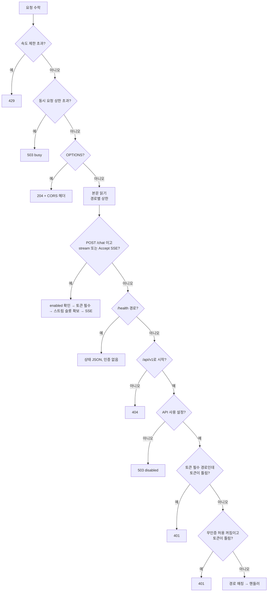

앱 안의 로컬 HTTP API 서버가 제공하는 엔드포인트와 채팅 엔드포인트를 본다.

## 로컬 HTTP API 서버

### 상수

`api_server.rs`(4,106줄) 머리의 상수가 서버의 한도를 정한다.

코드 분석: [`src-tauri/src/api_server.rs#L23-L47`](https://github.com/nashsu/llm_wiki/blob/e08cfce65aad8b76b13546a081c1a8d4422b70c3/src-tauri/src/api_server.rs#L23-L47) (발췌)

무엇을 보는지: 본문 크기, 목록 크기, 초당 요청 수, 동시 실행 수 상한.

```rust
const PORT: u16 = 19828;
const API_PREFIX: &str = "/api/v1";
const MAX_BODY_BYTES: usize = 1024 * 1024;
const MAX_CHAT_BODY_BYTES: usize = 40 * 1024 * 1024;
const MAX_FILE_CONTENT_BYTES: u64 = 2 * 1024 * 1024;
const DEFAULT_MAX_FILES: usize = 2_000;
const HARD_MAX_FILES: usize = 10_000;
const DEFAULT_MAX_REVIEWS: usize = 200;
const HARD_MAX_REVIEWS: usize = 1_000;
const MAX_SEARCH_RESULTS: usize = 50;
const RATE_LIMIT_WINDOW: Duration = Duration::from_secs(1);
const RATE_LIMIT_MAX_REQUESTS: usize = 120;
const MAX_IN_FLIGHT_REQUESTS: usize = 64;
const MAX_IN_FLIGHT_CHAT_STREAMS: usize = 8;
const MAX_IN_FLIGHT_PAGE_EMBEDS: usize = 4;
```

| 상수 | 값 | 의미 |
|---|---|---|
| `MAX_BODY_BYTES` | 1 MiB | 일반 요청 본문 |
| `MAX_CHAT_BODY_BYTES` | 40 MiB | `/chat` 본문 (이미지 base64 포함) |
| `MAX_PAGE_WRITE_BODY_BYTES` | 6 × 2 MiB + 16 KiB | `/pages/write` 본문 (2 MiB 페이지의 JSON 이스케이프 여유) |
| `MAX_FILE_CONTENT_BYTES` | 2 MiB | `/files/content`로 돌려줄 파일 크기 |
| `DEFAULT_MAX_FILES`, `HARD_MAX_FILES` | 2,000, 10,000 | 파일 목록 기본값과 상한 |
| `DEFAULT_MAX_REVIEWS`, `HARD_MAX_REVIEWS` | 200, 1,000 | 리뷰 항목 기본값과 상한 |
| `MAX_SEARCH_RESULTS` | 50 | 검색 `topK` 상한 (기본 10) |
| `RATE_LIMIT_MAX_REQUESTS` | 1초당 120 | `/health`와 OPTIONS 제외 |
| `MAX_IN_FLIGHT_REQUESTS` | 64 | 동시 처리 스레드 |
| `MAX_IN_FLIGHT_CHAT_STREAMS` | 8 | 동시 SSE 채팅 |
| `MAX_IN_FLIGHT_PAGE_EMBEDS` | 4 | 동시 페이지 임베딩 |
| `SSE_HEARTBEAT_INTERVAL` | 10초 | SSE keepalive 주기 |
| `APP_STATE_CACHE_TTL`, `GRAPH_CACHE_TTL` | 5초, 5초 | 설정 파일과 그래프 캐시 수명 |

`MAX_PAGE_WRITE_BODY_BYTES`에 6을 곱한 이유는 바로 위 주석이 밝힌다. JSON은 입력 한 바이트를 `\u00XX` 6바이트로 인코딩할 수 있으므로, 전송 경계를 실제 기준인 디코딩 후 2 MiB보다 위에 둔다([`api_server.rs#L27-L29`](https://github.com/nashsu/llm_wiki/blob/e08cfce65aad8b76b13546a081c1a8d4422b70c3/src-tauri/src/api_server.rs#L27-L29)).

### 수락 루프

서버는 `tiny_http`로 동작한다. 수락 루프는 별도 스레드에서 돌고, 요청마다 새 스레드를 띄운다.

코드 분석: [`src-tauri/src/api_server.rs#L104-L126`](https://github.com/nashsu/llm_wiki/blob/e08cfce65aad8b76b13546a081c1a8d4422b70c3/src-tauri/src/api_server.rs#L104-L126) (발췌)

무엇을 보는지: 속도 제한과 동시 실행 슬롯을 요청 본문을 읽기 전에 검사한다.

```rust
        for request in server.incoming_requests() {
            let method = request.method().clone();
            let url = request.url().to_string();
            let origin = request_origin(&request);
            if should_rate_limit(&method, &url) && !allow_request() {
                respond_error(request, 429, "Too many requests", origin.as_deref());
                continue;
            }
            let Some(slot) = try_acquire_request_slot() else {
                respond_error(request, 503, "API server is busy", origin.as_deref());
                continue;
            };
            let app = app.clone();
            thread::spawn(move || {
                let _slot = slot;
                let result = std::panic::catch_unwind(std::panic::AssertUnwindSafe(|| {
                    process_request(app, request);
                }));
```

속도 제한은 최근 1초 안의 요청 시각을 `VecDeque`에 담아 세는 미끄럼 창이다([`api_server.rs#L405-L420`](https://github.com/nashsu/llm_wiki/blob/e08cfce65aad8b76b13546a081c1a8d4422b70c3/src-tauri/src/api_server.rs#L405-L420)). 슬롯은 원자 카운터와 `Drop`으로 반납되는 RAII 값이다. 핸들러가 패닉해도 `catch_unwind`가 잡아 500을 돌려주고 루프는 계속 돈다. 바인딩이 세 번 실패하면 상태를 `port_conflict`로 두고 2초 뒤 다시 시도하며, 루프가 끝나도 다시 시작한다([`api_server.rs#L89-L151`](https://github.com/nashsu/llm_wiki/blob/e08cfce65aad8b76b13546a081c1a8d4422b70c3/src-tauri/src/api_server.rs#L89-L151)).

### 요청 처리 순서



### 엔드포인트

라우팅은 `(메서드, 경로 조각 배열)` 패턴 매칭 하나로 끝난다([`api_server.rs#L356-L394`](https://github.com/nashsu/llm_wiki/blob/e08cfce65aad8b76b13546a081c1a8d4422b70c3/src-tauri/src/api_server.rs#L356-L394)). 아래 표의 `{id}`는 프로젝트 UUID, 퍼센트 인코딩한 프로젝트 경로, 또는 `current` 중 하나다([`api_server.rs#L854-L865`](https://github.com/nashsu/llm_wiki/blob/e08cfce65aad8b76b13546a081c1a8d4422b70c3/src-tauri/src/api_server.rs#L854-L865)).

| 메서드 | 경로 (`/api/v1` 뒤) | 하는 일 | 토큰 |
|---|---|---|---|
| GET | `/health` | 상태, 버전, 인증 · MCP · LAN 설정값 | 불필요 (API 꺼져도 응답) |
| GET | `/projects` | 앱에 등록된 프로젝트와 현재 프로젝트 | 무인증 허용 시 불필요 |
| GET | `/projects/{id}/files` | `root=wiki`·`sources`·`all`, `recursive`, `maxFiles` | 무인증 허용 시 불필요 |
| GET | `/projects/{id}/files/content` | `path` 하나의 텍스트 내용 | 무인증 허용 시 불필요 |
| GET | `/projects/{id}/reviews` | 리뷰 항목, `status`·`type`·`limit` | 무인증 허용 시 불필요 |
| POST | `/projects/{id}/reviews/resolve` | 리뷰 여러 개 일괄 해결 | 무인증 허용 시 불필요 |
| PATCH | `/projects/{id}/reviews/{reviewId}` | 리뷰 하나 해결 · 재개 | 무인증 허용 시 불필요 |
| DELETE | `/projects/{id}/reviews/{reviewId}` | 리뷰 하나 삭제 | 무인증 허용 시 불필요 |
| POST | `/projects/{id}/search` | 키워드 · 벡터 · 그래프 1홉 하이브리드 검색 | 무인증 허용 시 불필요 |
| GET | `/projects/{id}/graph` | 위키링크 그래프, `q`·`nodeType`·`limit`(최대 1,000)·`offset`·`edgeScope` | 무인증 허용 시 불필요 |
| POST | `/projects/{id}/sources/rescan` | 원본 감시 규칙으로 다시 스캔 | 무인증 허용 시 불필요 |
| POST | `/projects/{id}/pages/embed` | 위키 페이지 하나의 벡터 색인 | 항상 필요 |
| POST | `/projects/{id}/pages/write` | 위키 페이지 하나 생성 · 덮어쓰기 | 항상 필요 |
| POST | `/projects/{id}/chat` | 백엔드 에이전트 한 턴, JSON 또는 SSE | 항상 필요 |
| POST | `/projects/{id}/chat/{sessionId}/cancel` | 진행 중인 턴 취소 | 항상 필요 |

"항상 필요"는 `is_token_required_request`가 정한다.

코드 분석: [`src-tauri/src/api_server.rs#L433-L445`](https://github.com/nashsu/llm_wiki/blob/e08cfce65aad8b76b13546a081c1a8d4422b70c3/src-tauri/src/api_server.rs#L433-L445)

무엇을 보는지: 채팅 · 취소 · 임베딩 · 쓰기는 무인증 모드에서도 토큰을 요구한다.

```rust
fn is_token_required_request(method: &Method, path: &str) -> bool {
    if is_agent_chat_request(method, path) {
        return true;
    }
    let Some(parts) = api_path_parts(path) else {
        return false;
    };
    method == &Method::Post
        && matches!(
            parts.as_slice(),
            ["projects", _, "pages", "embed"] | ["projects", _, "pages", "write"]
        )
}
```

> **주의**: 무인증 모드에서 토큰 없이 쓸 수 있는 경로에는 읽기만 있지 않다. 리뷰 일괄 해결 · 수정 · 삭제와 원본 재스캔도 상태를 바꾸지만 `is_token_required_request` 목록에 없으므로, `allowUnauthenticated`가 켜져 있으면 토큰 없이 실행된다.

README의 엔드포인트 목록에는 `/pages/write`, 리뷰 삭제, 채팅 취소가 빠져 있다([`README.md#L444-L454`](https://github.com/nashsu/llm_wiki/blob/e08cfce65aad8b76b13546a081c1a8d4422b70c3/README.md#L444-L454)). 코드의 라우팅 표가 기준이다.

### 응답 형식과 상태 코드

성공 응답은 `{"ok": true, "projectId": ..., ...}`, 실패는 `{"ok": false, "error": "..."}`로 통일된다([`api_server.rs#L284-L298`](https://github.com/nashsu/llm_wiki/blob/e08cfce65aad8b76b13546a081c1a8d4422b70c3/src-tauri/src/api_server.rs#L284-L298)). 상태 코드는 오류 종류를 구분하는 데 쓴다.

| 코드 | 쓰이는 곳 |
|---|---|
| 400 | JSON 파싱 실패, 필수 필드 없음, 경로 순회, 본문 상한 초과, UTF-8 아님 |
| 401 | 토큰 없음 또는 불일치 |
| 403 | `/files/content`가 공개 경로 밖을 요청 |
| 404 | 알 수 없는 프로젝트 · 경로 · 파일 |
| 409 | `/pages/write`에서 기존 페이지를 `allowOverwrite` 없이 덮어쓰려 함 |
| 413 | 파일 목록 상한 초과, 파일이 2 MiB 초과 |
| 415 | 텍스트 확장자가 아니거나 UTF-8이 아닌 파일 |
| 429 | 초당 120 초과 |
| 499 | 채팅 턴이 취소됨 |
| 502 | 채팅 에이전트 오류, 임베딩 공급자 오류 |
| 503 | API 꺼짐, 동시 요청 · 스트림 · 임베딩 슬롯 부족 |
| 504 | 페이지 임베딩 시간 초과 |

`/pages/write`는 에이전트의 `wiki.write_page`와 같은 `write_wiki_page_verified`를 부른다(11장). 오류 문자열에 "without allowoverwrite"가 있으면 409, "path" · "markdown file" · "too large"가 있으면 400으로 바꾼다([`api_server.rs#L1840-L1878`](https://github.com/nashsu/llm_wiki/blob/e08cfce65aad8b76b13546a081c1a8d4422b70c3/src-tauri/src/api_server.rs#L1840-L1878)). 상태 코드를 오류 문구에서 거꾸로 뽑으므로, 쓰기 함수의 문구가 바뀌면 코드도 함께 바뀐다는 결합이 있다.

## 채팅 엔드포인트

### JSON과 SSE

`/chat`은 본문의 `stream` 값이 있으면 그것을, 없으면 `Accept: text/event-stream` 헤더를 보고 SSE 여부를 정한다([`api_server.rs#L472-L495`](https://github.com/nashsu/llm_wiki/blob/e08cfce65aad8b76b13546a081c1a8d4422b70c3/src-tauri/src/api_server.rs#L472-L495)). SSE 판정은 `handle_request`보다 앞에서 일어나므로 SSE 경로는 따로 `enabled`와 토큰을 확인하고, 동시 스트림 슬롯 8개 중 하나를 잡는다.

SSE 응답의 흐름은 다음 순서다([`api_server.rs#L2188-L2333`](https://github.com/nashsu/llm_wiki/blob/e08cfce65aad8b76b13546a081c1a8d4422b70c3/src-tauri/src/api_server.rs#L2188-L2333)).

1. `prepare_chat`이 세션 id와 실행 id를 정하고, 이력을 채우고, 런타임과 취소 토큰을 만든다.
2. 첫 프레임 `meta`로 `projectId`, `sessionId`, `runId`를 보낸다. 클라이언트는 이 값으로 취소 엔드포인트를 부를 수 있다.
3. 비동기 태스크가 `run_once_with_cancel_and_events`를 돌리며 에이전트 이벤트마다 `agent` 프레임을 보낸다.
4. 별도 스레드가 10초마다 `: keepalive` 주석 줄을 보낸다.
5. 끝나면 `done`(전체 응답), `cancelled`, `error` 중 하나를 보내고 닫는다.

이벤트 큐 크기는 64다. 하트비트 스레드가 보내기에 실패해 연결이 끊긴 것을 알면 취소 레지스트리로 그 턴을 취소한다([`api_server.rs#L2223-L2249`](https://github.com/nashsu/llm_wiki/blob/e08cfce65aad8b76b13546a081c1a8d4422b70c3/src-tauri/src/api_server.rs#L2223-L2249)). 클라이언트가 떠난 뒤에도 LLM 호출이 계속 돌며 비용을 쓰는 일을 막는다. README는 `done` 프레임이 전체 응답을 담고 있으므로 클라이언트가 `messageDelta`와 최종 메시지를 둘 다 답으로 그리지 말라고 당부한다([`README.md#L451`](https://github.com/nashsu/llm_wiki/blob/e08cfce65aad8b76b13546a081c1a8d4422b70c3/README.md#L451)).

### 외부 응답 정제

외부 호출자용으로 바뀌는 지점은 둘이다. `prepare_chat`은 `allow_empty_retrieval`을 항상 거짓으로 덮어써, 생성기 없이 빈 답을 받는 데스크톱 전용 사전 호출 경로를 막는다(11장). `external_chat_response`는 응답을 내보내기 전에 `FileChanged` 이벤트의 `previousContent`를 지운다.

코드 분석: [`src-tauri/src/api_server.rs#L2086-L2104`](https://github.com/nashsu/llm_wiki/blob/e08cfce65aad8b76b13546a081c1a8d4422b70c3/src-tauri/src/api_server.rs#L2086-L2104)

무엇을 보는지: 데스크톱 UI의 즉시 되돌리기용 스냅샷은 공개 이벤트 계약에 들어가지 않는다.

```rust
fn external_chat_response(mut response: agent::types::AgentChatResponse) -> Value {
    for event in &mut response.events {
        event.redact_for_external_api();
    }
    json!({
        "ok": true,
        "projectId": response.project_id,
        "sessionId": response.session_id,
        "mode": response.mode,
        "message": {
            "role": "assistant",
            "content": response.message,
        },
        "references": response.references,
        "toolEvents": response.tool_events,
        "events": response.events,
        "usage": response.usage,
    })
}
```

API 채팅은 앱에 저장된 LLM 설정을 쓰고, 프로젝트별 모델 덮어쓰기가 켜져 있으면 그 설정을 공급자 자격 증명과 합쳐 쓴다(12장). `claude-code` · `codex-cli`로 설정되어 있으면 에이전트 루프를 탈 수 없으므로, 검색 결과가 있으면 참조 목록이, 없으면 "LLM이 설정되지 않았다"는 오류가 돌아간다.

> **주의**: 요청 본문은 `AgentChatRequest`로 그대로 역직렬화된다. 그래서 `approvedShellCommands`, `shellCommand`, `contextFiles`, `skills` 같은 필드도 API 호출자가 직접 채울 수 있다. 토큰이 이 필드들의 유일한 문지기라는 뜻이다(11장의 셸 승인 절 참고).
