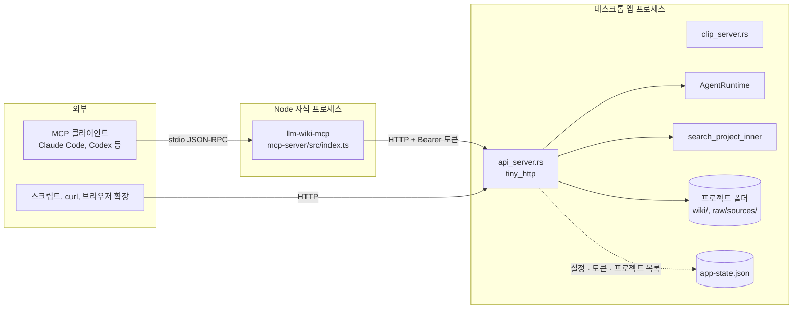

LLM Wiki는 데스크톱 앱 안에 로컬 HTTP API 서버를 띄우고, 그 위에 얇은 MCP 서버 계층을 두어 Claude Code나 Codex 같은 외부 에이전트가 위키를 검색하고, 읽고, 쓰고, 백엔드 에이전트와 대화하게 한다. MCP 서버는 프로젝트 폴더를 직접 읽지 않고 모든 일을 HTTP API에 위임하므로, 보안 경계는 Rust 쪽 `api_server.rs` 한 곳에 모인다. 이 장은 두 서버의 노출 범위와 인증 · 바인딩 · 경로 제한 · 부하 제한을 차례로 정리한다.

## 전체 구조

MCP README가 이 관계를 한 문장으로 밝힌다. MCP 서버는 프로젝트 폴더를 스캔하지 않고 앱의 검색 · 그래프 로직을 복사하지도 않으며, 모든 도구가 `http://127.0.0.1:19828/api/v1`을 부른다([`mcp-server/README.md#L1-L5`](https://github.com/nashsu/llm_wiki/blob/e08cfce65aad8b76b13546a081c1a8d4422b70c3/mcp-server/README.md#L1-L5)). 그래서 MCP 클라이언트는 앱과 같은 프로젝트 목록, 파일 권한, 검색 백엔드, 원본 감시 규칙을 쓴다. 웹 클립용 서버(포트 19827)는 같은 바인딩 설정을 공유하지만 10장에서 다룬다.

## LLM Wiki 패턴과의 대응

Karpathy의 아이디어 문서는 위키가 커지면 검색 엔진을 붙이라고 하면서 qmd를 예로 든다. qmd는 CLI(LLM이 셸로 부른다)와 MCP 서버(LLM이 native tool로 쓴다) 두 형태로 제공된다는 점을 짚는다([`llm-wiki.md#L51-L53`](https://github.com/nashsu/llm_wiki/blob/e08cfce65aad8b76b13546a081c1a8d4422b70c3/llm-wiki.md#L51-L53)). LLM Wiki의 MCP 서버는 이 제안을 앱 전체로 넓힌 것이다. 검색뿐 아니라 파일 읽기, 그래프, 리뷰 큐, 원본 재스캔, 페이지 쓰기와 임베딩, 백엔드 에이전트 대화까지 외부 에이전트에게 연다.

| 원본 패턴 | LLM Wiki 구현 |
|---|---|
| 외부 에이전트가 위키 폴더를 직접 편집 | MCP `llm_wiki_write_page`가 API를 거쳐 생성 전용 · 검증 쓰기 |
| 검색 엔진을 CLI · MCP로 노출 | `llm_wiki_search`가 앱의 하이브리드 검색을 그대로 사용 |
| index 파일과 log를 에이전트가 읽음 | `llm_wiki_read_file`로 `wiki/` 아래 공개 파일 읽기 |
| lint 결과를 사람이 보고 판단 | `llm_wiki_reviews`로 리뷰 큐를 읽고, API로 해결 처리 |
| 새로 쓴 페이지를 검색에 반영 | `llm_wiki_embed_page`로 페이지 하나만 재색인 |

원본에서는 에이전트가 파일 시스템을 마음대로 만졌다. 여기서는 에이전트가 앱의 규칙(공개 경로, 생성 전용 쓰기, 바이트 검증, 리뷰 큐)을 통과해야만 위키에 기록된다. 사용자가 외부 에이전트를 계속 쓰면서도 위키의 일관성은 앱이 지키는 분업이다. README가 소개하는 별도 스킬 저장소(`llm_wiki_skill`)는 같은 HTTP API를 쓰는 다른 진입점이다([`README.md#L462-L470`](https://github.com/nashsu/llm_wiki/blob/e08cfce65aad8b76b13546a081c1a8d4422b70c3/README.md#L462-L470)).

## 정리

- 로컬 API는 `tiny_http` 기반으로 포트 19828, `/api/v1` 아래 15개 엔드포인트를 연다. 초당 120 요청, 동시 64 요청, 동시 SSE 8개, 동시 임베딩 4개, 경로별 본문 상한으로 부하를 묶는다.
- 인증은 환경 변수 또는 설정의 토큰을 질의 문자열 · `X-LLM-Wiki-Token` · Bearer 헤더에서 상수 시간으로 비교한다. 채팅 · 취소 · 임베딩 · 쓰기는 무인증 모드에서도 토큰이 필요하지만, 리뷰 변경과 재스캔은 그렇지 않다.
- 기본 바인딩은 `127.0.0.1`이고 `LLM_WIKI_BIND_HOST` 또는 LAN 허용 스위치로 `0.0.0.0`까지 열 수 있다. 원격 주소 검사는 없으므로 LAN 허용과 무인증 허용을 함께 켜는 조합은 피해야 한다.
- 파일 읽기는 `purpose.md`, `schema.md`, `wiki/`, `raw/sources/`의 텍스트 파일만, canonical 경로 확인과 2 MiB 상한을 거쳐 허용한다. 내부 상태 폴더 `.llm-wiki/`는 열지 않는다.
- `/chat`은 JSON과 SSE를 모두 지원하고, SSE 연결이 끊기면 하트비트가 턴을 취소한다. 외부 응답에서는 되돌리기용 이전 내용을 지운다.
- MCP 서버는 12개 도구를 가진 얇은 HTTP 클라이언트다. `mcpEnabled` 확인, 프로젝트 고정, `[activeProject]` 표식, 쓰기 인자 사전 검사를 MCP 쪽에서 하고, 실제 권한 판단은 모두 HTTP API에 맡긴다.
