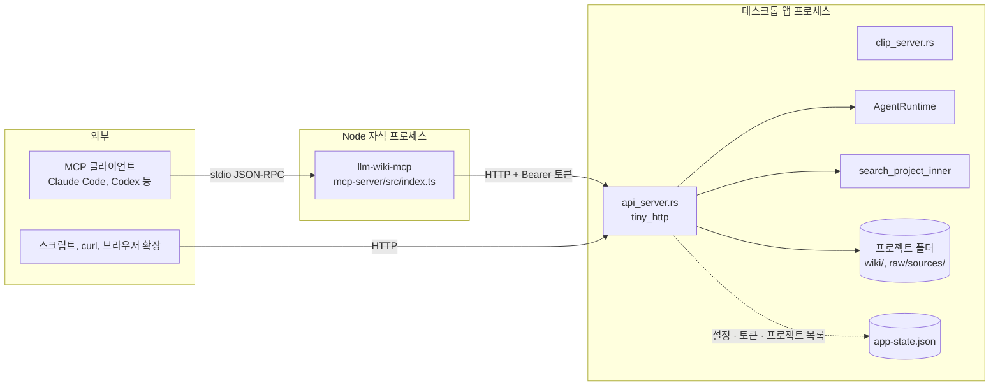
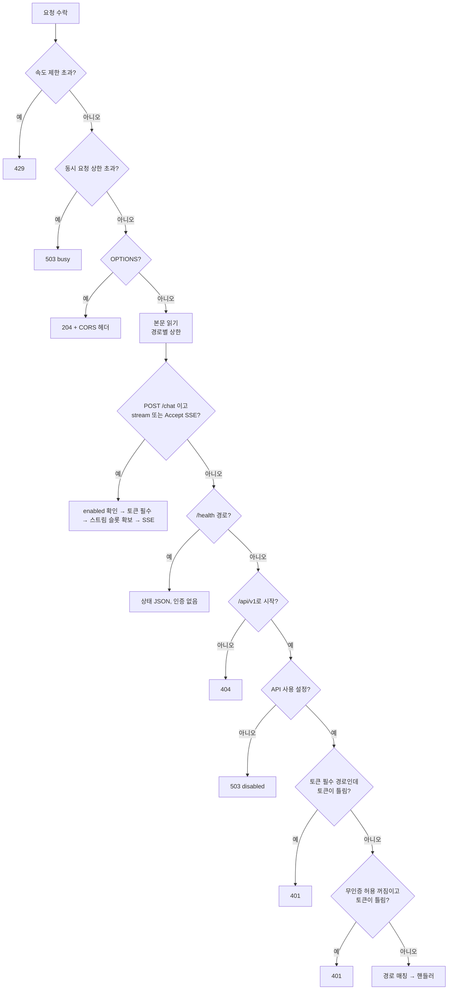

LLM Wiki는 데스크톱 앱 안에 로컬 HTTP API 서버를 띄우고, 그 위에 얇은 MCP 서버 계층을 두어 Claude Code나 Codex 같은 외부 에이전트가 위키를 검색하고, 읽고, 쓰고, 백엔드 에이전트와 대화하게 한다. MCP 서버는 프로젝트 폴더를 직접 읽지 않고 모든 일을 HTTP API에 위임하므로, 보안 경계는 Rust 쪽 `api_server.rs` 한 곳에 모인다. 이 장은 두 서버의 노출 범위와 인증 · 바인딩 · 경로 제한 · 부하 제한을 차례로 정리한다.

## 전체 구조



MCP README가 이 관계를 한 문장으로 밝힌다. MCP 서버는 프로젝트 폴더를 스캔하지 않고 앱의 검색 · 그래프 로직을 복사하지도 않으며, 모든 도구가 `http://127.0.0.1:19828/api/v1`을 부른다([`mcp-server/README.md#L1-L5`](https://github.com/nashsu/llm_wiki/blob/e08cfce65aad8b76b13546a081c1a8d4422b70c3/mcp-server/README.md#L1-L5)). 그래서 MCP 클라이언트는 앱과 같은 프로젝트 목록, 파일 권한, 검색 백엔드, 원본 감시 규칙을 쓴다. 웹 클립용 서버(포트 19827)는 같은 바인딩 설정을 공유하지만 10장에서 다룬다.

## 로컬 HTTP API 서버

### 상수

`api_server.rs`(4,106줄) 머리의 상수가 서버의 한도를 정한다.

코드 분석: [`src-tauri/src/api_server.rs#L23-L47`](https://github.com/nashsu/llm_wiki/blob/e08cfce65aad8b76b13546a081c1a8d4422b70c3/src-tauri/src/api_server.rs#L23-L47) (발췌)

무엇을 보는지: 본문 크기, 목록 크기, 초당 요청 수, 동시 실행 수 상한.

```rust
const PORT: u16 = 19828;
const API_PREFIX: &str = "/api/v1";
const MAX_BODY_BYTES: usize = 1024 * 1024;
const MAX_CHAT_BODY_BYTES: usize = 40 * 1024 * 1024;
const MAX_FILE_CONTENT_BYTES: u64 = 2 * 1024 * 1024;
const DEFAULT_MAX_FILES: usize = 2_000;
const HARD_MAX_FILES: usize = 10_000;
const DEFAULT_MAX_REVIEWS: usize = 200;
const HARD_MAX_REVIEWS: usize = 1_000;
const MAX_SEARCH_RESULTS: usize = 50;
const RATE_LIMIT_WINDOW: Duration = Duration::from_secs(1);
const RATE_LIMIT_MAX_REQUESTS: usize = 120;
const MAX_IN_FLIGHT_REQUESTS: usize = 64;
const MAX_IN_FLIGHT_CHAT_STREAMS: usize = 8;
const MAX_IN_FLIGHT_PAGE_EMBEDS: usize = 4;
```

| 상수 | 값 | 의미 |
|---|---|---|
| `MAX_BODY_BYTES` | 1 MiB | 일반 요청 본문 |
| `MAX_CHAT_BODY_BYTES` | 40 MiB | `/chat` 본문 (이미지 base64 포함) |
| `MAX_PAGE_WRITE_BODY_BYTES` | 6 × 2 MiB + 16 KiB | `/pages/write` 본문 (2 MiB 페이지의 JSON 이스케이프 여유) |
| `MAX_FILE_CONTENT_BYTES` | 2 MiB | `/files/content`로 돌려줄 파일 크기 |
| `DEFAULT_MAX_FILES`, `HARD_MAX_FILES` | 2,000, 10,000 | 파일 목록 기본값과 상한 |
| `DEFAULT_MAX_REVIEWS`, `HARD_MAX_REVIEWS` | 200, 1,000 | 리뷰 항목 기본값과 상한 |
| `MAX_SEARCH_RESULTS` | 50 | 검색 `topK` 상한 (기본 10) |
| `RATE_LIMIT_MAX_REQUESTS` | 1초당 120 | `/health`와 OPTIONS 제외 |
| `MAX_IN_FLIGHT_REQUESTS` | 64 | 동시 처리 스레드 |
| `MAX_IN_FLIGHT_CHAT_STREAMS` | 8 | 동시 SSE 채팅 |
| `MAX_IN_FLIGHT_PAGE_EMBEDS` | 4 | 동시 페이지 임베딩 |
| `SSE_HEARTBEAT_INTERVAL` | 10초 | SSE keepalive 주기 |
| `APP_STATE_CACHE_TTL`, `GRAPH_CACHE_TTL` | 5초, 5초 | 설정 파일과 그래프 캐시 수명 |

`MAX_PAGE_WRITE_BODY_BYTES`에 6을 곱한 이유는 바로 위 주석이 밝힌다. JSON은 입력 한 바이트를 `\u00XX` 6바이트로 인코딩할 수 있으므로, 전송 경계를 실제 기준인 디코딩 후 2 MiB보다 위에 둔다([`api_server.rs#L27-L29`](https://github.com/nashsu/llm_wiki/blob/e08cfce65aad8b76b13546a081c1a8d4422b70c3/src-tauri/src/api_server.rs#L27-L29)).

### 수락 루프

서버는 `tiny_http`로 동작한다. 수락 루프는 별도 스레드에서 돌고, 요청마다 새 스레드를 띄운다.

코드 분석: [`src-tauri/src/api_server.rs#L104-L126`](https://github.com/nashsu/llm_wiki/blob/e08cfce65aad8b76b13546a081c1a8d4422b70c3/src-tauri/src/api_server.rs#L104-L126) (발췌)

무엇을 보는지: 속도 제한과 동시 실행 슬롯을 요청 본문을 읽기 전에 검사한다.

```rust
        for request in server.incoming_requests() {
            let method = request.method().clone();
            let url = request.url().to_string();
            let origin = request_origin(&request);
            if should_rate_limit(&method, &url) && !allow_request() {
                respond_error(request, 429, "Too many requests", origin.as_deref());
                continue;
            }
            let Some(slot) = try_acquire_request_slot() else {
                respond_error(request, 503, "API server is busy", origin.as_deref());
                continue;
            };
            let app = app.clone();
            thread::spawn(move || {
                let _slot = slot;
                let result = std::panic::catch_unwind(std::panic::AssertUnwindSafe(|| {
                    process_request(app, request);
                }));
```

속도 제한은 최근 1초 안의 요청 시각을 `VecDeque`에 담아 세는 미끄럼 창이다([`api_server.rs#L405-L420`](https://github.com/nashsu/llm_wiki/blob/e08cfce65aad8b76b13546a081c1a8d4422b70c3/src-tauri/src/api_server.rs#L405-L420)). 슬롯은 원자 카운터와 `Drop`으로 반납되는 RAII 값이다. 핸들러가 패닉해도 `catch_unwind`가 잡아 500을 돌려주고 루프는 계속 돈다. 바인딩이 세 번 실패하면 상태를 `port_conflict`로 두고 2초 뒤 다시 시도하며, 루프가 끝나도 다시 시작한다([`api_server.rs#L89-L151`](https://github.com/nashsu/llm_wiki/blob/e08cfce65aad8b76b13546a081c1a8d4422b70c3/src-tauri/src/api_server.rs#L89-L151)).

### 요청 처리 순서



### 엔드포인트

라우팅은 `(메서드, 경로 조각 배열)` 패턴 매칭 하나로 끝난다([`api_server.rs#L356-L394`](https://github.com/nashsu/llm_wiki/blob/e08cfce65aad8b76b13546a081c1a8d4422b70c3/src-tauri/src/api_server.rs#L356-L394)). 아래 표의 `{id}`는 프로젝트 UUID, 퍼센트 인코딩한 프로젝트 경로, 또는 `current` 중 하나다([`api_server.rs#L854-L865`](https://github.com/nashsu/llm_wiki/blob/e08cfce65aad8b76b13546a081c1a8d4422b70c3/src-tauri/src/api_server.rs#L854-L865)).

| 메서드 | 경로 (`/api/v1` 뒤) | 하는 일 | 토큰 |
|---|---|---|---|
| GET | `/health` | 상태, 버전, 인증 · MCP · LAN 설정값 | 불필요 (API 꺼져도 응답) |
| GET | `/projects` | 앱에 등록된 프로젝트와 현재 프로젝트 | 무인증 허용 시 불필요 |
| GET | `/projects/{id}/files` | `root=wiki`·`sources`·`all`, `recursive`, `maxFiles` | 무인증 허용 시 불필요 |
| GET | `/projects/{id}/files/content` | `path` 하나의 텍스트 내용 | 무인증 허용 시 불필요 |
| GET | `/projects/{id}/reviews` | 리뷰 항목, `status`·`type`·`limit` | 무인증 허용 시 불필요 |
| POST | `/projects/{id}/reviews/resolve` | 리뷰 여러 개 일괄 해결 | 무인증 허용 시 불필요 |
| PATCH | `/projects/{id}/reviews/{reviewId}` | 리뷰 하나 해결 · 재개 | 무인증 허용 시 불필요 |
| DELETE | `/projects/{id}/reviews/{reviewId}` | 리뷰 하나 삭제 | 무인증 허용 시 불필요 |
| POST | `/projects/{id}/search` | 키워드 · 벡터 · 그래프 1홉 하이브리드 검색 | 무인증 허용 시 불필요 |
| GET | `/projects/{id}/graph` | 위키링크 그래프, `q`·`nodeType`·`limit`(최대 1,000)·`offset`·`edgeScope` | 무인증 허용 시 불필요 |
| POST | `/projects/{id}/sources/rescan` | 원본 감시 규칙으로 다시 스캔 | 무인증 허용 시 불필요 |
| POST | `/projects/{id}/pages/embed` | 위키 페이지 하나의 벡터 색인 | 항상 필요 |
| POST | `/projects/{id}/pages/write` | 위키 페이지 하나 생성 · 덮어쓰기 | 항상 필요 |
| POST | `/projects/{id}/chat` | 백엔드 에이전트 한 턴, JSON 또는 SSE | 항상 필요 |
| POST | `/projects/{id}/chat/{sessionId}/cancel` | 진행 중인 턴 취소 | 항상 필요 |

"항상 필요"는 `is_token_required_request`가 정한다.

코드 분석: [`src-tauri/src/api_server.rs#L433-L445`](https://github.com/nashsu/llm_wiki/blob/e08cfce65aad8b76b13546a081c1a8d4422b70c3/src-tauri/src/api_server.rs#L433-L445)

무엇을 보는지: 채팅 · 취소 · 임베딩 · 쓰기는 무인증 모드에서도 토큰을 요구한다.

```rust
fn is_token_required_request(method: &Method, path: &str) -> bool {
    if is_agent_chat_request(method, path) {
        return true;
    }
    let Some(parts) = api_path_parts(path) else {
        return false;
    };
    method == &Method::Post
        && matches!(
            parts.as_slice(),
            ["projects", _, "pages", "embed"] | ["projects", _, "pages", "write"]
        )
}
```

> **주의**: 무인증 모드에서 토큰 없이 쓸 수 있는 경로에는 읽기만 있지 않다. 리뷰 일괄 해결 · 수정 · 삭제와 원본 재스캔도 상태를 바꾸지만 `is_token_required_request` 목록에 없으므로, `allowUnauthenticated`가 켜져 있으면 토큰 없이 실행된다.

README의 엔드포인트 목록에는 `/pages/write`, 리뷰 삭제, 채팅 취소가 빠져 있다([`README.md#L444-L454`](https://github.com/nashsu/llm_wiki/blob/e08cfce65aad8b76b13546a081c1a8d4422b70c3/README.md#L444-L454)). 코드의 라우팅 표가 기준이다.

### 응답 형식과 상태 코드

성공 응답은 `{"ok": true, "projectId": ..., ...}`, 실패는 `{"ok": false, "error": "..."}`로 통일된다([`api_server.rs#L284-L298`](https://github.com/nashsu/llm_wiki/blob/e08cfce65aad8b76b13546a081c1a8d4422b70c3/src-tauri/src/api_server.rs#L284-L298)). 상태 코드는 오류 종류를 구분하는 데 쓴다.

| 코드 | 쓰이는 곳 |
|---|---|
| 400 | JSON 파싱 실패, 필수 필드 없음, 경로 순회, 본문 상한 초과, UTF-8 아님 |
| 401 | 토큰 없음 또는 불일치 |
| 403 | `/files/content`가 공개 경로 밖을 요청 |
| 404 | 알 수 없는 프로젝트 · 경로 · 파일 |
| 409 | `/pages/write`에서 기존 페이지를 `allowOverwrite` 없이 덮어쓰려 함 |
| 413 | 파일 목록 상한 초과, 파일이 2 MiB 초과 |
| 415 | 텍스트 확장자가 아니거나 UTF-8이 아닌 파일 |
| 429 | 초당 120 초과 |
| 499 | 채팅 턴이 취소됨 |
| 502 | 채팅 에이전트 오류, 임베딩 공급자 오류 |
| 503 | API 꺼짐, 동시 요청 · 스트림 · 임베딩 슬롯 부족 |
| 504 | 페이지 임베딩 시간 초과 |

`/pages/write`는 에이전트의 `wiki.write_page`와 같은 `write_wiki_page_verified`를 부른다(11장). 오류 문자열에 "without allowoverwrite"가 있으면 409, "path" · "markdown file" · "too large"가 있으면 400으로 바꾼다([`api_server.rs#L1840-L1878`](https://github.com/nashsu/llm_wiki/blob/e08cfce65aad8b76b13546a081c1a8d4422b70c3/src-tauri/src/api_server.rs#L1840-L1878)). 상태 코드를 오류 문구에서 거꾸로 뽑으므로, 쓰기 함수의 문구가 바뀌면 코드도 함께 바뀐다는 결합이 있다.

## 인증

### 토큰의 출처와 비교

토큰은 환경 변수 `LLM_WIKI_API_TOKEN`이 있으면 그것을, 없으면 `app-state.json`의 `apiConfig.token`을 쓴다([`api_server.rs#L623-L637`](https://github.com/nashsu/llm_wiki/blob/e08cfce65aad8b76b13546a081c1a8d4422b70c3/src-tauri/src/api_server.rs#L623-L637)). 설정 화면의 생성 버튼은 12장의 `generateApiToken`으로 256비트 base64url 값을 만든다.

코드 분석: [`src-tauri/src/api_server.rs#L593-L621`](https://github.com/nashsu/llm_wiki/blob/e08cfce65aad8b76b13546a081c1a8d4422b70c3/src-tauri/src/api_server.rs#L593-L621) (발췌)

무엇을 보는지: 질의 문자열, 전용 헤더, Bearer 헤더 세 곳을 상수 시간 비교로 확인한다.

```rust
    let Some(token) = api_token(app) else {
        return false;
    };
    let params = parse_query(query);
    if params
        .get("token")
        .map(|v| constant_time_eq(v.as_bytes(), token.as_bytes()))
        .unwrap_or(false)
    {
        return true;
    }
    headers.iter().any(|(key, value)| {
        if key == "x-llm-wiki-token" {
            return constant_time_eq(value.as_bytes(), token.as_bytes());
        }
        if key == "authorization" {
            return value
                .strip_prefix("Bearer ")
                .map(|v| constant_time_eq(v.as_bytes(), token.as_bytes()))
```

토큰이 설정되지 않았으면 무조건 거짓이다. 그래서 새로 설치한 상태는 "API 켜짐 + 토큰 없음 = 401"이 되어 닫힌 쪽으로 실패한다고 `api_enabled` 주석이 설명한다([`api_server.rs#L687-L703`](https://github.com/nashsu/llm_wiki/blob/e08cfce65aad8b76b13546a081c1a8d4422b70c3/src-tauri/src/api_server.rs#L687-L703)). `constant_time_eq`는 길이가 달라도 긴 쪽 끝까지 XOR를 누적해 비교 시간이 일치 위치에 따라 달라지지 않게 한다([`api_server.rs#L716-L725`](https://github.com/nashsu/llm_wiki/blob/e08cfce65aad8b76b13546a081c1a8d4422b70c3/src-tauri/src/api_server.rs#L716-L725)).

> **주의**: `?token=` 질의 문자열도 허용된다. 브라우저 확장처럼 헤더를 붙이기 어려운 클라이언트를 위한 선택으로 보이지만(추정), URL에 실린 토큰은 셸 기록이나 프록시 로그에 남을 수 있다. MCP README는 토큰을 명령줄 인자가 아닌 환경 변수로 넘기라고 권한다([`mcp-server/README.md#L77`](https://github.com/nashsu/llm_wiki/blob/e08cfce65aad8b76b13546a081c1a8d4422b70c3/mcp-server/README.md#L77)).

### 설정 스위치

인증과 노출에 관한 설정은 모두 `app-state.json`의 `apiConfig` 아래에 있고, 서버는 이 파일을 5초 캐시로 읽는다([`api_server.rs#L727-L753`](https://github.com/nashsu/llm_wiki/blob/e08cfce65aad8b76b13546a081c1a8d4422b70c3/src-tauri/src/api_server.rs#L727-L753)). 설정을 저장하면 앱이 `invalidate_config_cache`를 불러 캐시를 비운다([`lib.rs#L58`](https://github.com/nashsu/llm_wiki/blob/e08cfce65aad8b76b13546a081c1a8d4422b70c3/src-tauri/src/lib.rs#L58)).

| 키 | 설정 없을 때 | 효과 | 검사하는 곳 |
|---|---|---|---|
| `enabled` | 참 | 거짓이면 `/health` 말고 모두 503 | `api_enabled` |
| `token` | 없음 | 토큰 값. 환경 변수가 우선 | `api_token` |
| `allowUnauthenticated` | 거짓 | 참이면 토큰 필수 경로를 뺀 나머지를 토큰 없이 허용 | `api_allow_unauthenticated` |
| `allowLanAccess` | 거짓 | 참이면 재시작 후 `0.0.0.0`에 바인딩 | `server_bind.rs` |
| `mcpEnabled` | 거짓 | `/health` 응답에만 실린다. 차단은 MCP 서버가 한다 | `api_mcp_enabled` |

`enabled`의 기본값이 참인 이유는 주석에 있다. 끄기 스위치가 생기기 전부터 환경 변수 토큰만으로 쓰던 사용자의 설정을 깨지 않으려는 것이다.

> **주의**: `mcpEnabled`는 HTTP 서버가 강제하지 않는다. `api_mcp_enabled`의 호출처는 `/health` 응답 하나뿐이고([`api_server.rs#L322`](https://github.com/nashsu/llm_wiki/blob/e08cfce65aad8b76b13546a081c1a8d4422b70c3/src-tauri/src/api_server.rs#L322)), MCP 서버가 도구마다 `/health`를 읽어 꺼져 있으면 스스로 거절한다. 토큰을 가진 클라이언트가 HTTP를 직접 부르는 것은 이 스위치로 막히지 않는다.

## 바인딩 주소와 CORS

### 바인딩

기본 바인딩은 `127.0.0.1`이다. 바꾸는 방법은 두 가지다.

코드 분석: [`src-tauri/src/server_bind.rs#L6-L31`](https://github.com/nashsu/llm_wiki/blob/e08cfce65aad8b76b13546a081c1a8d4422b70c3/src-tauri/src/server_bind.rs#L6-L31) (발췌)

무엇을 보는지: 환경 변수가 먼저, 그다음 LAN 허용 스위치, 둘 다 없으면 루프백.

```rust
const DEFAULT_BIND_HOST: &str = "127.0.0.1";
const PUBLIC_BIND_HOST: &str = "0.0.0.0";
const BIND_HOST_ENV: &str = "LLM_WIKI_BIND_HOST";

pub fn configured_bind_host(app: &AppHandle) -> String {
    configured_env_bind_host()
        .or_else(|| configured_store_bind_host(app))
        .unwrap_or_else(|| DEFAULT_BIND_HOST.to_string())
}
```

`LLM_WIKI_BIND_HOST`는 영숫자와 `.`, `-`, `_`, `:`, `[`, `]`만 허용해 `0.0.0.0:19828/path`나 `127.0.0.1;rm` 같은 주입을 거절한다([`server_bind.rs#L41-L54`](https://github.com/nashsu/llm_wiki/blob/e08cfce65aad8b76b13546a081c1a8d4422b70c3/src-tauri/src/server_bind.rs#L41-L54)). IPv6 주소는 대괄호로 감싼다. 설정 화면의 LAN 허용 스위치 설명은 "앱을 재시작하면 API와 Clip 서버가 `0.0.0.0`에서 듣는다. 신뢰하는 네트워크에서만 쓰고, LAN을 완전히 믿지 않으면 토큰 인증을 유지하라"고 적는다([`api-server-section.tsx#L330-L338`](https://github.com/nashsu/llm_wiki/blob/e08cfce65aad8b76b13546a081c1a8d4422b70c3/src/components/settings/sections/api-server-section.tsx#L330-L338)).

> **주의**: 서버는 요청의 원격 주소를 검사하지 않는다. LAN 허용과 무인증 허용을 함께 켜면 같은 네트워크의 누구나 읽기 경로와 리뷰 변경 · 재스캔 경로를 토큰 없이 부를 수 있다. 두 스위치를 묶는 서버 쪽 검사는 코드에서 찾지 못했다.

### CORS

브라우저에서 오는 요청은 `Origin` 헤더가 허용 목록에 있을 때만 `Access-Control-Allow-Origin`을 돌려받는다.

코드 분석: [`src-tauri/src/cors.rs#L11-L23`](https://github.com/nashsu/llm_wiki/blob/e08cfce65aad8b76b13546a081c1a8d4422b70c3/src-tauri/src/cors.rs#L11-L23)

무엇을 보는지: 브라우저 확장, 로컬호스트, Tauri 웹뷰만 허용한다.

```rust
pub fn is_allowed_browser_origin(origin: &str) -> bool {
    origin.starts_with("chrome-extension://")
        || origin.starts_with("moz-extension://")
        || origin == "http://localhost"
        || origin.starts_with("http://localhost:")
        || origin == "http://127.0.0.1"
        || origin.starts_with("http://127.0.0.1:")
        || origin == "http://[::1]"
        || origin.starts_with("http://[::1]:")
        || origin == "tauri://localhost"
        || origin == "http://tauri.localhost"
        || origin == "https://tauri.localhost"
}
```

허용되면 `Vary: Origin`과 `Access-Control-Allow-Private-Network: true`도 붙인다([`cors.rs#L25-L41`](https://github.com/nashsu/llm_wiki/blob/e08cfce65aad8b76b13546a081c1a8d4422b70c3/src-tauri/src/cors.rs#L25-L41)). 임의의 웹사이트가 사용자 브라우저에서 로컬 API 응답을 읽는 것을 막는 장치다. 다만 CORS는 응답 읽기를 막을 뿐 요청 전송 자체를 막지는 않으므로, 상태를 바꾸는 경로를 지키는 것은 결국 토큰이다. `chrome-extension://` 전체를 허용하므로 설치된 어떤 확장이든 응답을 읽을 수 있다는 점도 함께 기억해 둘 만하다.

## 경로 제한

파일 읽기는 두 겹으로 막는다. 먼저 공개 경로인지 본다.

코드 분석: [`src-tauri/src/api_server.rs#L1031-L1044`](https://github.com/nashsu/llm_wiki/blob/e08cfce65aad8b76b13546a081c1a8d4422b70c3/src-tauri/src/api_server.rs#L1031-L1044)

무엇을 보는지: `purpose.md`, `schema.md`, `wiki/`, `raw/sources/`만 열고 숨김 구간은 모두 거절한다.

```rust
fn is_public_project_rel(rel: &str) -> bool {
    let rel = normalize_path(rel).trim_start_matches('/').to_string();
    if rel
        .split('/')
        .any(|part| part.is_empty() || part.starts_with('.'))
    {
        return false;
    }
    let lower = rel.to_lowercase();
    lower == "purpose.md"
        || lower == "schema.md"
        || lower.starts_with("wiki/")
        || lower.starts_with("raw/sources/")
}
```

`.llm-wiki/` 아래의 프로젝트 설정, 세션, 리뷰 원본 파일은 이 검사에서 걸러진다. 리뷰는 전용 엔드포인트를 통해서만, 그것도 필드를 골라 담은 사본으로 나간다([`api_server.rs#L1341-L1359`](https://github.com/nashsu/llm_wiki/blob/e08cfce65aad8b76b13546a081c1a8d4422b70c3/src-tauri/src/api_server.rs#L1341-L1359)). 다음으로 `safe_join`이 절대 경로와 `..`, 루트 구성 요소를 거절하고, 대상이 있으면 canonical 경로가 프로젝트 안인지, 없으면 부모의 canonical 경로가 프로젝트 안인지 확인한다([`api_server.rs#L989-L1029`](https://github.com/nashsu/llm_wiki/blob/e08cfce65aad8b76b13546a081c1a8d4422b70c3/src-tauri/src/api_server.rs#L989-L1029)). 심볼릭 링크로 프로젝트 밖을 가리키는 경우가 여기서 걸린다. 마지막으로 확장자가 `md`, `mdx`, `txt`, `csv`, `json`, `yaml`, `yml`, `xml`, `html`, `htm`, `log` 중 하나여야 한다([`api_server.rs#L1046-L1057`](https://github.com/nashsu/llm_wiki/blob/e08cfce65aad8b76b13546a081c1a8d4422b70c3/src-tauri/src/api_server.rs#L1046-L1057)).

이 공개 경로 규칙은 에이전트 도구의 `is_public_read_rel`과 같은 내용으로 따로 구현되어 있다([`tools.rs#L2699-L2708`](https://github.com/nashsu/llm_wiki/blob/e08cfce65aad8b76b13546a081c1a8d4422b70c3/src-tauri/src/agent/tools.rs#L2699-L2708)).

## 채팅 엔드포인트

### JSON과 SSE

`/chat`은 본문의 `stream` 값이 있으면 그것을, 없으면 `Accept: text/event-stream` 헤더를 보고 SSE 여부를 정한다([`api_server.rs#L472-L495`](https://github.com/nashsu/llm_wiki/blob/e08cfce65aad8b76b13546a081c1a8d4422b70c3/src-tauri/src/api_server.rs#L472-L495)). SSE 판정은 `handle_request`보다 앞에서 일어나므로 SSE 경로는 따로 `enabled`와 토큰을 확인하고, 동시 스트림 슬롯 8개 중 하나를 잡는다.

SSE 응답의 흐름은 다음 순서다([`api_server.rs#L2188-L2333`](https://github.com/nashsu/llm_wiki/blob/e08cfce65aad8b76b13546a081c1a8d4422b70c3/src-tauri/src/api_server.rs#L2188-L2333)).

1. `prepare_chat`이 세션 id와 실행 id를 정하고, 이력을 채우고, 런타임과 취소 토큰을 만든다.
2. 첫 프레임 `meta`로 `projectId`, `sessionId`, `runId`를 보낸다. 클라이언트는 이 값으로 취소 엔드포인트를 부를 수 있다.
3. 비동기 태스크가 `run_once_with_cancel_and_events`를 돌리며 에이전트 이벤트마다 `agent` 프레임을 보낸다.
4. 별도 스레드가 10초마다 `: keepalive` 주석 줄을 보낸다.
5. 끝나면 `done`(전체 응답), `cancelled`, `error` 중 하나를 보내고 닫는다.

이벤트 큐 크기는 64다. 하트비트 스레드가 보내기에 실패해 연결이 끊긴 것을 알면 취소 레지스트리로 그 턴을 취소한다([`api_server.rs#L2223-L2249`](https://github.com/nashsu/llm_wiki/blob/e08cfce65aad8b76b13546a081c1a8d4422b70c3/src-tauri/src/api_server.rs#L2223-L2249)). 클라이언트가 떠난 뒤에도 LLM 호출이 계속 돌며 비용을 쓰는 일을 막는다. README는 `done` 프레임이 전체 응답을 담고 있으므로 클라이언트가 `messageDelta`와 최종 메시지를 둘 다 답으로 그리지 말라고 당부한다([`README.md#L451`](https://github.com/nashsu/llm_wiki/blob/e08cfce65aad8b76b13546a081c1a8d4422b70c3/README.md#L451)).

### 외부 응답 정제

외부 호출자용으로 바뀌는 지점은 둘이다. `prepare_chat`은 `allow_empty_retrieval`을 항상 거짓으로 덮어써, 생성기 없이 빈 답을 받는 데스크톱 전용 사전 호출 경로를 막는다(11장). `external_chat_response`는 응답을 내보내기 전에 `FileChanged` 이벤트의 `previousContent`를 지운다.

코드 분석: [`src-tauri/src/api_server.rs#L2086-L2104`](https://github.com/nashsu/llm_wiki/blob/e08cfce65aad8b76b13546a081c1a8d4422b70c3/src-tauri/src/api_server.rs#L2086-L2104)

무엇을 보는지: 데스크톱 UI의 즉시 되돌리기용 스냅샷은 공개 이벤트 계약에 들어가지 않는다.

```rust
fn external_chat_response(mut response: agent::types::AgentChatResponse) -> Value {
    for event in &mut response.events {
        event.redact_for_external_api();
    }
    json!({
        "ok": true,
        "projectId": response.project_id,
        "sessionId": response.session_id,
        "mode": response.mode,
        "message": {
            "role": "assistant",
            "content": response.message,
        },
        "references": response.references,
        "toolEvents": response.tool_events,
        "events": response.events,
        "usage": response.usage,
    })
}
```

API 채팅은 앱에 저장된 LLM 설정을 쓰고, 프로젝트별 모델 덮어쓰기가 켜져 있으면 그 설정을 공급자 자격 증명과 합쳐 쓴다(12장). `claude-code` · `codex-cli`로 설정되어 있으면 에이전트 루프를 탈 수 없으므로, 검색 결과가 있으면 참조 목록이, 없으면 "LLM이 설정되지 않았다"는 오류가 돌아간다.

> **주의**: 요청 본문은 `AgentChatRequest`로 그대로 역직렬화된다. 그래서 `approvedShellCommands`, `shellCommand`, `contextFiles`, `skills` 같은 필드도 API 호출자가 직접 채울 수 있다. 토큰이 이 필드들의 유일한 문지기라는 뜻이다(11장의 셸 승인 절 참고).

## MCP 서버

### 패키지와 실행

`mcp-server/`는 독립 npm 패키지 `llm-wiki-mcp-server`이고, 의존성은 `@modelcontextprotocol/sdk` 하나다. Node 20 이상에서 `dist/src/index.js`를 실행하면 stdio 전송으로 MCP 서버가 뜬다([`mcp-server/package.json#L1-L31`](https://github.com/nashsu/llm_wiki/blob/e08cfce65aad8b76b13546a081c1a8d4422b70c3/mcp-server/package.json#L1-L31), [`index.ts#L589-L592`](https://github.com/nashsu/llm_wiki/blob/e08cfce65aad8b76b13546a081c1a8d4422b70c3/mcp-server/src/index.ts#L589-L592)). 데스크톱 빌드 스크립트가 `mcp:build`를 먼저 돌려 산출물을 앱 리소스로 묶고([`package.json#L10`](https://github.com/nashsu/llm_wiki/blob/e08cfce65aad8b76b13546a081c1a8d4422b70c3/package.json#L10)), 설정 화면은 사용자 PC의 실제 경로를 넣은 MCP 클라이언트 설정 JSON을 복사 버튼과 함께 보여 준다([`api-server-section.tsx#L143-L165`](https://github.com/nashsu/llm_wiki/blob/e08cfce65aad8b76b13546a081c1a8d4422b70c3/src/components/settings/sections/api-server-section.tsx#L143-L165)).

API 클라이언트는 `LLM_WIKI_API_BASE_URL`(기본 `http://127.0.0.1:19828`)과 `LLM_WIKI_API_TOKEN` 환경 변수를 읽는다. 토큰이 있으면 `/health`를 뺀 모든 요청에 `Authorization: Bearer`를 붙인다([`api-client.ts#L200-L209`](https://github.com/nashsu/llm_wiki/blob/e08cfce65aad8b76b13546a081c1a8d4422b70c3/mcp-server/src/api-client.ts#L200-L209), [`api-client.ts#L386-L419`](https://github.com/nashsu/llm_wiki/blob/e08cfce65aad8b76b13546a081c1a8d4422b70c3/mcp-server/src/api-client.ts#L386-L419)). 응답이 JSON이 아니거나 `ok: false`면 상태 코드와 오류 문구를 담은 예외로 바꾼다.

### 노출 도구

`ListTools` 응답에 12개 도구가 있다([`index.ts#L35-L206`](https://github.com/nashsu/llm_wiki/blob/e08cfce65aad8b76b13546a081c1a8d4422b70c3/mcp-server/src/index.ts#L35-L206)).

| 도구 | 주요 인자 | 부르는 API | 비고 |
|---|---|---|---|
| `llm_wiki_status` | 없음 | `GET /health`, `GET /projects` | MCP가 꺼져 있어도 동작 (진단용) |
| `llm_wiki_projects` | 없음 | `GET /projects` | 고정된 세션 프로젝트도 함께 표시 |
| `llm_wiki_set_project` | `project_id` | `GET /projects` | 이 MCP 프로세스를 한 프로젝트에 고정 |
| `llm_wiki_files` | `root`, `recursive`, `max_files` | `GET /files` | 결과를 트리 텍스트로 변환 |
| `llm_wiki_read_file` | `path` | `GET /files/content` | 120,000바이트에서 자름 |
| `llm_wiki_reviews` | `status`, `type`, `limit` | `GET /reviews` | 기본 `unresolved` |
| `llm_wiki_search` | `query`, `top_k`, `include_content` | `POST /search` | |
| `llm_wiki_chat` | `message`, `mode`, `web`, `anytxt`, `skills`, `session_id` | `POST /chat` | `session_id`가 있을 때만 세션 저장 |
| `llm_wiki_graph` | `q`, `node_type`, `limit`, `offset`, `edge_scope` | `GET /graph` | `offset`이 있으면 기본 `filtered` |
| `llm_wiki_rescan_sources` | 없음 | `POST /sources/rescan` | |
| `llm_wiki_embed_page` | `path`, `force` | `POST /pages/embed` | |
| `llm_wiki_write_page` | `path`, `content`, `allow_overwrite` | `POST /pages/write` | 바이트 단위 검증 후에만 성공 |

모든 도구 응답은 MCP `text` 콘텐츠 하나다. 검색 · 그래프 · 리뷰 결과는 JSON을 그대로 넘기지 않고 사람이 읽을 수 있는 텍스트로 바꿔 넘긴다(`formatSearchResults`, `formatGraph` 등). 에이전트가 읽기 쉬운 형태를 택한 것이다. MCP README의 도구 목록에는 `llm_wiki_embed_page`와 `llm_wiki_write_page`가 빠져 있다([`mcp-server/README.md#L53-L64`](https://github.com/nashsu/llm_wiki/blob/e08cfce65aad8b76b13546a081c1a8d4422b70c3/mcp-server/README.md#L53-L64)).

`llm_wiki_chat`은 `retrievalMode`, `approvedShellCommands`, `stream`을 보내지 않는다([`api-client.ts#L276-L293`](https://github.com/nashsu/llm_wiki/blob/e08cfce65aad8b76b13546a081c1a8d4422b70c3/mcp-server/src/api-client.ts#L276-L293)). 그래서 MCP로 오는 채팅은 standard 검색 모드의 JSON 응답이고, 스킬을 넘겨도 셸 명령은 작업 공간 한정 명령만 실행되며 그 밖은 승인 요청 문구로 끝난다.

### MCP 사용 스위치 확인

도구 대부분은 실행 전에 `/health`를 불러 `mcpEnabled`를 확인한다.

코드 분석: [`mcp-server/src/index.ts#L341-L349`](https://github.com/nashsu/llm_wiki/blob/e08cfce65aad8b76b13546a081c1a8d4422b70c3/mcp-server/src/index.ts#L341-L349)

무엇을 보는지: 꺼져 있으면 설정 위치를 알려 주는 오류로 거절한다.

```ts
async function assertMcpEnabled(): Promise<void> {
  const health = await client.health()
  if (health.mcpEnabled === false) {
    throw new McpError(
      ErrorCode.InvalidRequest,
      "LLM Wiki MCP access is disabled. Enable Settings -> API + MCP -> Enable MCP access in the desktop app.",
    )
  }
}
```

앞에서 본 대로 이 검사는 MCP 서버 쪽 약속이다. 도구 호출마다 `/health`를 한 번 더 부르므로 호출당 HTTP 왕복이 하나씩 늘어난다.

### 프로젝트 고정

여러 프로젝트를 쓰는 사용자가 데스크톱 UI에서 프로젝트를 바꾸면 `current`가 가리키는 대상도 바뀐다. 외부 에이전트가 작업 도중 다른 프로젝트에 쓰는 사고를 막으려고 `McpProjectBinding`이 있다.

코드 분석: [`mcp-server/src/project-binding.ts#L23-L37`](https://github.com/nashsu/llm_wiki/blob/e08cfce65aad8b76b13546a081c1a8d4422b70c3/mcp-server/src/project-binding.ts#L23-L37)

무엇을 보는지: 고정된 뒤에는 다른 프로젝트 id나 경로를 넘기면 거절한다.

```ts
  resolve(requested?: string): string {
    if (!this.pinned) return requested ?? "current"
    if (
      requested &&
      requested !== "current" &&
      requested !== this.pinned.id &&
      requested !== this.pinned.path
    ) {
      throw new Error(
        `This MCP session is pinned to ${this.pinned.name} (${this.pinned.id}); ` +
        `project override ${requested} was rejected. Call llm_wiki_set_project to change scope.`,
      )
    }
    return this.pinned.id
  }
```

고정되면 `current`를 넘겨도 고정된 프로젝트의 UUID로 바뀌므로 UI 전환의 영향을 받지 않는다. 모든 도구 응답 맨 앞에 `[activeProject: 이름 (id)]` 표식을 붙이고, 오류 문구에도 같은 표식을 붙여 에이전트가 지금 어느 프로젝트에서 일하는지 매번 보게 한다([`project-binding.ts#L40-L45`](https://github.com/nashsu/llm_wiki/blob/e08cfce65aad8b76b13546a081c1a8d4422b70c3/mcp-server/src/project-binding.ts#L40-L45)). 고정은 MCP 자식 프로세스의 메모리에만 있어, 클라이언트가 서버를 다시 띄우면 풀린다.

### 쓰기 인자 사전 검사

`llm_wiki_write_page`는 API에 보내기 전에 경로와 본문을 한 번 더 거른다. 경로는 4,096바이트 이하, `wiki/`로 시작하고 `.md`로 끝나야 하며, 역슬래시 · 선행 `/` · 빈 구간 · `.` · `..` · 숨김 구간을 거절한다. 본문은 2 MiB 이하다([`index.ts#L391-L414`](https://github.com/nashsu/llm_wiki/blob/e08cfce65aad8b76b13546a081c1a8d4422b70c3/mcp-server/src/index.ts#L391-L414)). 서버의 `normalize_wiki_write_path`(11장)와 같은 규칙을 앞에서 걸러 의미 있는 오류를 MCP `InvalidParams`로 돌려준다.

## LLM Wiki 패턴과의 대응

Karpathy의 아이디어 문서는 위키가 커지면 검색 엔진을 붙이라고 하면서 qmd를 예로 든다. qmd는 CLI(LLM이 셸로 부른다)와 MCP 서버(LLM이 native tool로 쓴다) 두 형태로 제공된다는 점을 짚는다([`llm-wiki.md#L51-L53`](https://github.com/nashsu/llm_wiki/blob/e08cfce65aad8b76b13546a081c1a8d4422b70c3/llm-wiki.md#L51-L53)). LLM Wiki의 MCP 서버는 이 제안을 앱 전체로 넓힌 것이다. 검색뿐 아니라 파일 읽기, 그래프, 리뷰 큐, 원본 재스캔, 페이지 쓰기와 임베딩, 백엔드 에이전트 대화까지 외부 에이전트에게 연다.

| 원본 패턴 | LLM Wiki 구현 |
|---|---|
| 외부 에이전트가 위키 폴더를 직접 편집 | MCP `llm_wiki_write_page`가 API를 거쳐 생성 전용 · 검증 쓰기 |
| 검색 엔진을 CLI · MCP로 노출 | `llm_wiki_search`가 앱의 하이브리드 검색을 그대로 사용 |
| index 파일과 log를 에이전트가 읽음 | `llm_wiki_read_file`로 `wiki/` 아래 공개 파일 읽기 |
| lint 결과를 사람이 보고 판단 | `llm_wiki_reviews`로 리뷰 큐를 읽고, API로 해결 처리 |
| 새로 쓴 페이지를 검색에 반영 | `llm_wiki_embed_page`로 페이지 하나만 재색인 |

원본에서는 에이전트가 파일 시스템을 마음대로 만졌다. 여기서는 에이전트가 앱의 규칙(공개 경로, 생성 전용 쓰기, 바이트 검증, 리뷰 큐)을 통과해야만 위키에 기록된다. 사용자가 외부 에이전트를 계속 쓰면서도 위키의 일관성은 앱이 지키는 분업이다. README가 소개하는 별도 스킬 저장소(`llm_wiki_skill`)는 같은 HTTP API를 쓰는 다른 진입점이다([`README.md#L462-L470`](https://github.com/nashsu/llm_wiki/blob/e08cfce65aad8b76b13546a081c1a8d4422b70c3/README.md#L462-L470)).

## 정리

- 로컬 API는 `tiny_http` 기반으로 포트 19828, `/api/v1` 아래 15개 엔드포인트를 연다. 초당 120 요청, 동시 64 요청, 동시 SSE 8개, 동시 임베딩 4개, 경로별 본문 상한으로 부하를 묶는다.
- 인증은 환경 변수 또는 설정의 토큰을 질의 문자열 · `X-LLM-Wiki-Token` · Bearer 헤더에서 상수 시간으로 비교한다. 채팅 · 취소 · 임베딩 · 쓰기는 무인증 모드에서도 토큰이 필요하지만, 리뷰 변경과 재스캔은 그렇지 않다.
- 기본 바인딩은 `127.0.0.1`이고 `LLM_WIKI_BIND_HOST` 또는 LAN 허용 스위치로 `0.0.0.0`까지 열 수 있다. 원격 주소 검사는 없으므로 LAN 허용과 무인증 허용을 함께 켜는 조합은 피해야 한다.
- 파일 읽기는 `purpose.md`, `schema.md`, `wiki/`, `raw/sources/`의 텍스트 파일만, canonical 경로 확인과 2 MiB 상한을 거쳐 허용한다. 내부 상태 폴더 `.llm-wiki/`는 열지 않는다.
- `/chat`은 JSON과 SSE를 모두 지원하고, SSE 연결이 끊기면 하트비트가 턴을 취소한다. 외부 응답에서는 되돌리기용 이전 내용을 지운다.
- MCP 서버는 12개 도구를 가진 얇은 HTTP 클라이언트다. `mcpEnabled` 확인, 프로젝트 고정, `[activeProject]` 표식, 쓰기 인자 사전 검사를 MCP 쪽에서 하고, 실제 권한 판단은 모두 HTTP API에 맡긴다.
