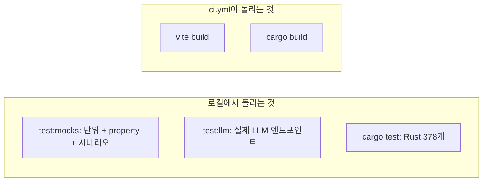
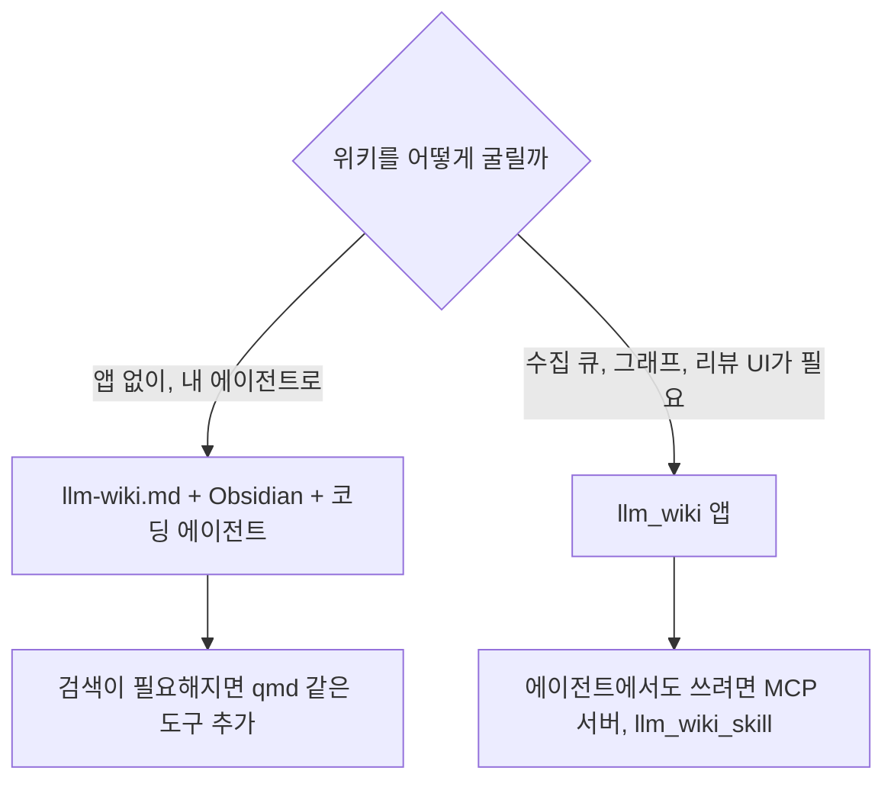

llm_wiki는 테스트를 많이 갖췄지만 CI는 빌드만 확인한다. 이 장은 테스트 구성을 먼저 보고, 앞 장들에서 코드로 확인한 내용을 바탕으로 이 앱의 장점과 단점, 그리고 비슷한 도구와의 관계를 정리한다.

## 테스트 구성

| 종류 | 파일 형식 | 개수 | 실행 조건 |
|---|---|---|---|
| 일반 단위 테스트 (TS) | `*.test.ts`, `*.test.tsx` | 152개 파일 (아래 세 종류 포함) | `npm run test:mocks` |
| property 테스트 | `*.property.test.ts` | 5개 파일 | 위와 같음. [fast-check](https://github.com/nashsu/llm_wiki/blob/e08cfce65aad8b76b13546a081c1a8d4422b70c3/package.json)로 무작위 입력 생성 |
| 시나리오 테스트 | `*.scenarios.test.ts` | 5개 파일 | 위와 같음. 수집 · 검색 · 린트 · 위키링크 · 리뷰 정리 |
| 실제 LLM 테스트 | `*.real-llm.test.ts` | 10개 파일 | `npm run test:llm`. `RUN_LLM_TESTS=1`과 엔드포인트 환경변수가 있어야 실행 |
| Rust 단위 테스트 | `#[test]` | 31개 파일, 378개 | `cargo test` |

> **주의**: 개수는 기준 커밋에서 파일명과 `#[test]` 표식을 센 값이다. 실행해서 확인하지 않았다.



### 코드 따라가기: npm 스크립트

[`package.json`](https://github.com/nashsu/llm_wiki/blob/e08cfce65aad8b76b13546a081c1a8d4422b70c3/package.json#L12-L14)의 테스트 스크립트는 모의(mock) 테스트와 실제 LLM 테스트를 나눈다.

```json
"test": "npm run test:mocks && npm run test:llm",
"test:mocks": "vitest run --exclude='**/*.real-llm.test.ts' --exclude='**/mcp-server/**'",
"test:llm": "vitest run real-llm --no-file-parallelism --reporter=verbose",
```

- 실제 LLM 테스트는 파일 병렬 실행을 끈다. 엔드포인트 하나에 동시에 요청이 몰리지 않게 하려는 것으로 보인다(추정)
- 실제 LLM 테스트는 [`embedding.real-llm.test.ts`](https://github.com/nashsu/llm_wiki/blob/e08cfce65aad8b76b13546a081c1a8d4422b70c3/src/lib/embedding.real-llm.test.ts#L54)처럼 `RUN_LLM_TESTS === "1"`일 때만 켜지고, 아니면 `it.skipIf`로 건너뛴다. 환경변수는 [`load-test-env.ts`](https://github.com/nashsu/llm_wiki/blob/e08cfce65aad8b76b13546a081c1a8d4422b70c3/src/test-helpers/load-test-env.ts)가 `.env.test.local`에서 읽는다

### property 테스트가 지키는 것

[`review-store.property.test.ts`](https://github.com/nashsu/llm_wiki/blob/e08cfce65aad8b76b13546a081c1a8d4422b70c3/src/stores/review-store.property.test.ts#L34-L97)는 리뷰 큐(09장)의 불변식을 무작위 입력으로 확인한다.

| 불변식 | 뜻 |
|---|---|
| 어떤 순서로 항목을 더해도 대기 항목의 (타입, 정규화한 제목)이 겹치지 않는다 | 같은 리뷰가 두 번 쌓이지 않는다 |
| 중복을 합칠 때 영향받는 페이지 목록은 합집합으로 남는다 | 합치다가 정보를 잃지 않는다 |
| 이미 처리한 키를 다시 더하면 처리 상태가 이긴다 | 처리한 리뷰가 되살아나지 않는다 |

LLM이 같은 리뷰를 표현만 바꿔 여러 번 낼 수 있기 때문에, 중복 제거 규칙을 예시 몇 개가 아니라 성질로 검사한 선택이다.

### CI가 돌리는 것

[`.github/workflows/ci.yml`](https://github.com/nashsu/llm_wiki/blob/e08cfce65aad8b76b13546a081c1a8d4422b70c3/.github/workflows/ci.yml#L52-L62)의 단계는 의존성 설치, `npx vite build`, MCP 서버 리소스 준비, `cargo build`다. 테스트를 실행하는 단계는 없다. 152개 TS 테스트 파일과 Rust 테스트 378개는 개발자가 로컬에서 돌릴 때만 실행된다.

> **주의**: 앞 장들이 찾은 README와 코드의 불일치(04장의 schema 경로, 06장의 검색 범위, 07장의 희소 커뮤니티 기준, 08장의 컨텍스트 배분)는 테스트가 CI에서 돌지 않는 것과 직접 관계가 있다고 단정할 수 없다. 다만 문서와 동작이 어긋나도 자동으로 걸러질 장치가 없다는 점은 같다.

## 장점

| 장점 | 근거 | 장 |
|---|---|---|
| 아이디어 문서의 세 층과 세 작업을 그대로 지킨다 | `raw/sources`, `wiki/`, `schema.md`, 수집 · 질의 · 린트 | 01 |
| 결과물이 그냥 마크다운 폴더다 | Obsidian vault로 열리고 git으로 이력을 남길 수 있다. 앱이 없어져도 위키는 남는다 | 01, 05 |
| 수집이 견고하다 | 분석과 생성을 나눈 2단계 호출, SHA256 증분 캐시, 디스크에 저장되는 큐와 재시도 | 04 |
| 출처를 끝까지 따라간다 | 모든 페이지 frontmatter의 `sources: []`가 그래프의 출처 겹침 신호로도 쓰인다 | 05, 07 |
| 그래프가 단순 링크 그림이 아니다 | 4가지 신호 관련성, Louvain 커뮤니티, 고립 페이지 · 브리지 노드 인사이트 | 07 |
| 사람 판단이 필요한 곳을 분리한다 | LLM이 리뷰 항목을 따로 내고, 사람이 처리한다 | 09 |
| 밖에서 쓸 수 있다 | 로컬 HTTP API와 MCP 서버로 Claude Code · Codex에서 위키를 검색 · 읽기 · 쓰기 | 13 |
| LLM 선택 폭이 넓다 | 공급자 프리셋 23개, Claude · Codex CLI 전송 | 02, 12 |

## 단점

| 단점 | 근거 | 장 |
|---|---|---|
| README와 코드가 여러 곳에서 다르다 | 검색 범위(`wiki/`만 봄), 컨텍스트 배분, 희소 커뮤니티 기준, 딥 리서치 자동 수집, index · overview 갱신 방식 | 04, 06, 07, 08, 10 |
| 경로 처리가 일관되지 않다 | 수집은 루트의 `schema.md`, Write to Wiki는 `wiki/schema.md`를 읽는다. 그래프 노드 id가 파일명만 써서 폴더가 달라도 이름이 같으면 겹친다 | 04, 07 |
| 질의 때 purpose를 안 쓴다 | 채팅 에이전트 고정 컨텍스트에 `purpose.md`가 없다 | 08 |
| 한국어 검색이 약하다 | 한글은 CJK bigram 대상이 아니고 공백 단위 토큰으로만 비교한다. 조사가 붙으면 맞지 않을 수 있다(미검증) | 06 |
| 비밀 정보 보관이 약하다 | API 키를 `app-state.json`에 평문으로 저장한다 | 02 |
| 셸 실행 경계가 얇다 | 외부 경로가 명령 문자열에 없으면 승인 없이 실행하고, 코드 주석도 OS 샌드박스가 아니라고 밝힌다 | 11 |
| 로컬 API의 보호 장치가 토큰 하나다 | `/chat` 요청 본문으로 셸 승인 목록을 넣을 수 있다. 인증 없는 모드에서는 리뷰 처리 · 수정 · 삭제와 원본 재스캔이 토큰 없이 된다. `mcpEnabled` 스위치를 API 서버가 강제하지 않는다 | 13 |
| CI가 테스트를 돌리지 않는다 | 빌드만 확인한다 | 14 |
| 라이선스가 GPL-3.0이다 | 코드를 가져다 다른 제품에 넣으려면 GPL 조건을 따라야 한다 | 00 |

## 비슷한 도구와의 관계

| 도구 | 관계 | 출처 |
|---|---|---|
| [Karpathy의 llm-wiki.md](https://github.com/nashsu/llm_wiki/blob/e08cfce65aad8b76b13546a081c1a8d4422b70c3/llm-wiki.md) | 원본 아이디어 문서. 코딩 에이전트에 붙여 넣어 각자 구현하라고 한다. llm_wiki는 그것을 앱으로 만든 구현 하나다 | 01장 |
| Obsidian + 코딩 에이전트 | 아이디어 문서가 권하는 기본 조합("Obsidian is the IDE; the LLM is the programmer"). 앱 없이 같은 패턴을 쓸 수 있다 | llm-wiki.md |
| [qmd](https://github.com/tobi/qmd) | 아이디어 문서가 위키가 커질 때 쓰라고 권하는 로컬 마크다운 검색 엔진(BM25 · 벡터 하이브리드). llm_wiki는 검색을 자체 구현했다(06장) | llm-wiki.md |
| NotebookLM, 파일 업로드형 RAG | 아이디어 문서가 대비 대상으로 든 방식. 질문할 때마다 다시 찾고 쌓지 않는다 | llm-wiki.md |
| [llm_wiki_skill](https://github.com/nashsu/llm_wiki_skill) | 같은 저자의 에이전트 스킬. Claude Code · Codex가 llm_wiki의 로컬 API를 쓰게 한다(13장) | README |



- 패턴 자체가 목적이면 앱 없이 아이디어 문서와 코딩 에이전트만으로 시작할 수 있다. 결과물이 마크다운 폴더라 나중에 llm_wiki로 열어도 된다
- llm_wiki가 더해 주는 것은 수집 큐, 증분 캐시, 그래프 분석, 리뷰 UI 같은 "관리 비용을 낮추는 장치"다. 아이디어 문서가 말한 "유지 비용이 0에 가까워진다"를 실제로 받쳐 주는 부분이다
- 로컬 API를 켜려면 13장의 보안 경계(토큰, 인증 없는 모드, LAN 접근)를 먼저 확인한다

## 정리

- 테스트는 단위 · property · 시나리오 · 실제 LLM · Rust로 다양하지만 CI는 빌드만 돌린다
- 장점은 마크다운 결과물, 견고한 수집, 출처 추적, 그래프 분석, 리뷰 분리, MCP 연결이다
- 단점은 README와 코드의 여러 불일치, 경로 처리 불일치, 약한 비밀 보관과 셸 경계, 토큰 하나에 기대는 로컬 API다
- 한국어 위키라면 검색 토큰화(06장)를 먼저 확인한다
- 패턴만 쓰려면 앱 없이도 되고, 앱은 관리 비용을 낮추는 장치로 고른다
