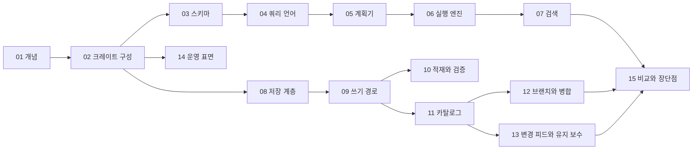

Omnigraph는 타입이 정해진 속성 그래프를 객체 저장소 위의 Lance dataset 여러 개로 저장하고, Git처럼 브랜치를 만들고 병합하는 그래프 데이터베이스다. 이 책은 그 Rust 코드를 따라가며 "브랜치되는 타입 그래프"라는 설명이 실제로 어떤 크레이트와 함수로 나뉘는지 설명한다.

## 책의 구성

원본 [README](https://github.com/ModernRelay/omnigraph/blob/00b8cca842f2bf009bebeefcf765672b5ff64b26/README.md)는 Omnigraph를 여러 에이전트가 하나의 타입 있는 세계 모델을 공유하며 계속 읽고 고치는 작업을 위한 저장소로 소개한다. 기능 목록은 짧지만 코드는 크다. 기준 커밋에서 Rust 코드는 테스트를 포함해 약 69만 줄이고, 그중 경로에 `test`가 들어간 파일만 약 26만 5천 줄이다. 벤치마크와 deterministic 시뮬레이션 크레이트도 따로 있다. 이 책은 그래프 데이터베이스로서 고유한 설계가 몰려 있는 핵심 엔진 크레이트 여섯 개(`omnigraph`, `omnigraph-compiler`, `omnigraph-planner`, `omnigraph-catalog`, `omnigraph-core`, `omnigraph-storage`)를 깊게 다루고, CLI, 서버, 클러스터, 정책, MCP는 14장에서 개요만 다룬다.

| 부분 | 장 |
|---|---|
| 개념과 크레이트 구성 | 01~02장 |
| 읽기 쪽 언어: 스키마와 쿼리 | 03~04장 |
| 읽기 쪽 실행: 계획기, 실행 엔진, 검색 | 05~07장 |
| 쓰기 쪽: 저장 계층, 쓰기 경로, 적재와 검증 | 08~10장 |
| 버전 관리: 카탈로그, 브랜치와 병합, 변경 피드와 유지 보수 | 11~13장 |
| 운영 표면과 정리 | 14~15장 |

## 권장 읽기 순서

- 그래프 데이터베이스의 쿼리 처리에 관심 있는 사람은 03~07장을 순서대로 읽는다. 텍스트 쿼리가 Lance 스캔과 순회 연산자가 되는 경로다
- 객체 저장소 위의 트랜잭션과 버전 관리에 관심 있는 사람은 08, 09, 11, 12장을 먼저 읽는다. Omnigraph만의 설계가 가장 많이 드러나는 부분이다
- 에이전트 메모리나 지식 그래프 용도로 도입을 검토하는 사람은 01장과 15장으로 전체 그림을 잡고 07장(검색)과 12장(브랜치)을 본다

## 기준과 표기

- **기준 커밋**: [`00b8cca`](https://github.com/ModernRelay/omnigraph/tree/00b8cca842f2bf009bebeefcf765672b5ff64b26) (v0.16.0, 2026-11-19). 모든 코드 링크는 이 커밋에 고정했다. Omnigraph는 하루에도 여러 번 커밋이 올라오는 저장소라 최신 main과 줄 번호가 다를 수 있다
- **라이선스**: 원본은 MIT다. 코드는 해설에 필요한 만큼만 짧게 인용하고 매번 원문 줄 범위를 링크로 건다
- **확인 수준**: 코드에서 확인하지 못한 추정은 "(추정)", 다른 프로젝트와의 비교처럼 직접 읽지 않은 내용은 "(미검증)"으로 표시한다. 바이너리를 직접 실행해 확인한 내용은 없고, 모두 코드와 저장소 문서 읽기에 근거한다
- **문서와 코드의 차이**: 원본은 `docs/dev`, `docs/rfcs`에 설계 문서가 많다. 문서와 코드가 다르면 코드를 따르고 차이를 본문에 적는다
- **용어**: Lance, Arrow, manifest, fragment, dataset, branch, merge, ANN, BM25, RRF, Cedar, MCP처럼 개발자가 그대로 쓰는 말은 번역하지 않는다. 코드 식별자는 백틱으로 원래 이름을 쓴다

## 정리

- Omnigraph는 타입 그래프를 객체 저장소의 Lance dataset 여러 개로 저장하고 그래프 전체를 브랜치하는 데이터베이스다
- 책은 개념, 언어, 읽기 실행, 쓰기, 버전 관리, 운영 표면 순서로 나뉜다
- 핵심 엔진 크레이트 여섯 개를 깊게 다루고 운영 쪽 크레이트는 개요만 다룬다
- 코드 링크는 커밋 `00b8cca`에 고정했고 인용은 짧게 한다
- 실행이 아니라 코드 읽기에 근거하며, 확인하지 못한 내용은 표시한다
