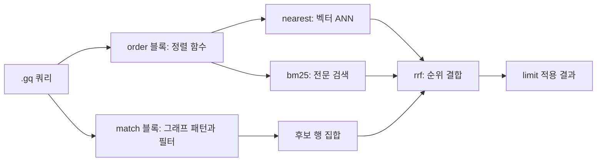
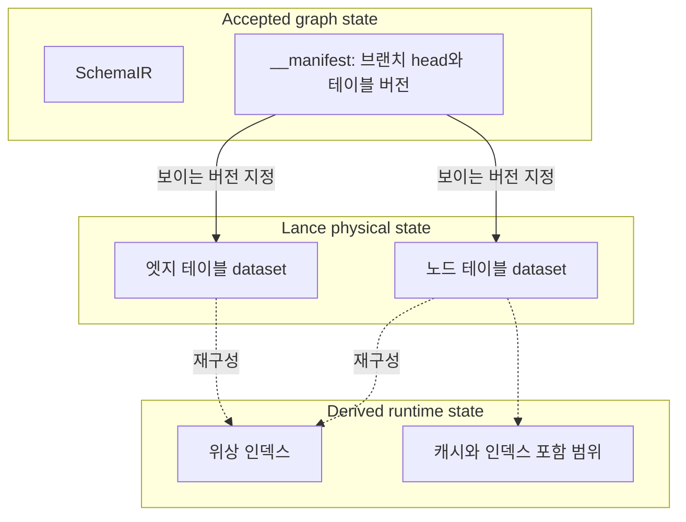
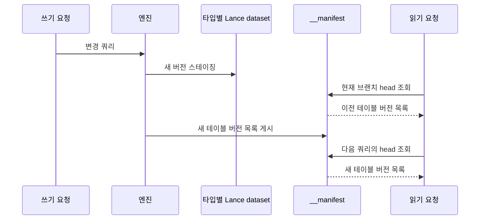

Omnigraph의 핵심은 그래프 하나를 타입별 Lance dataset 여러 개로 나눠 저장하고, 그 위에 `__manifest`라는 Lance 테이블 하나를 두어 "지금 그래프에서 보이는 각 테이블의 버전"을 한 번에 바꾸는 것이다. 이 장은 README가 내세우는 여섯 가지 기능이 어떤 크레이트와 장에 대응하는지 정리하고, 이후 모든 장의 전제인 세 종류의 상태를 설명한다.

## README 기능과 구현의 대응

[README](https://github.com/ModernRelay/omnigraph/blob/00b8cca842f2bf009bebeefcf765672b5ff64b26/README.md)는 Omnigraph를 "long-horizon agents"가 공유하는 타입 있는 세계 모델로 소개하고, 기능을 여섯 줄로 정리한다. 기능마다 실제로 구현하는 크레이트와 이 책의 장을 대응시키면 아래와 같다.

| README 기능 | README 설명 요지 | 주요 구현 위치 | 장 |
|---|---|---|---|
| Typed ontology | `.pg` 스키마로 노드, 엣지 타입, 키, 제약을 선언하고 모든 쓰기에서 검사 | `omnigraph-compiler`의 스키마 파서와 SchemaIR, 엔진의 `validate` | 03, 10 |
| Multimodal retrieval | 그래프 순회, 벡터 ANN, 전문 검색, RRF를 한 쿼리에서 결합 | 엔진의 `engine/search.rs`, `embedding.rs`, `graph_index` | 04, 06, 07 |
| Branching | 에이전트나 작업마다 브랜치, 3방향 병합, 그래프 전체 time travel | `omnigraph-catalog`, `exec/merge.rs`, `omnigraph-core`의 `branch_control` | 11, 12, 13 |
| Declared as code | `cluster.yaml`로 그래프, 스키마, 저장 쿼리, 정책 선언. `cluster plan`, `cluster apply` | `omnigraph-cluster`, `omnigraph-cli` | 14 |
| Security as code | 모든 변경에 서버 쪽 Cedar 정책 적용 | `omnigraph-policy`, `omnigraph-server` | 14 |
| Object-storage native, open format | 로컬 디스크, S3 호환 저장소, Azure에 Lance 형식으로 저장 | `omnigraph-storage`, 엔진의 `table_store` | 08 |

이 표에서 보듯 README의 한 줄이 크레이트 하나와 맞아떨어지지 않는다. 예를 들어 "Branching"은 Lance가 dataset 단위로 제공하는 브랜치 기능을 그래프 전체 단위로 묶는 작업이라, 카탈로그(11장), 병합 실행기(12장), 변경 피드(13장)에 나뉘어 구현된다.

## 타입 그래프 모델

Omnigraph의 데이터 모델은 속성 그래프다. [개념 문서](https://github.com/ModernRelay/omnigraph/blob/00b8cca842f2bf009bebeefcf765672b5ff64b26/docs/user/concepts/index.md#L1-L19)는 노드 타입, 엣지 타입, 속성, 제약을 기본 단위로 정의한다. 스키마는 `.pg` 언어로 쓴다. 테스트 고정 데이터의 스키마가 가장 짧은 예다.

### 코드 분석: 최소 스키마

노드 두 종류와 엣지 두 종류를 선언하는 스키마다. [`crates/omnigraph/tests/fixtures/test.pg` L1-L14](https://github.com/ModernRelay/omnigraph/blob/00b8cca842f2bf009bebeefcf765672b5ff64b26/crates/omnigraph/tests/fixtures/test.pg#L1-L14)

```text
node Person {
    name: String @key
    age: I32?
}

node Company {
    name: String @key
}

edge Knows: Person -> Person {
    since: Date?
}

edge WorksAt: Person -> Company
```

- `@key`는 노드의 논리 식별자가 되는 속성이다. 쓰기 경로는 이 키로 행을 찾고 중복을 막는다(09, 10장)
- `I32?`처럼 `?`가 붙은 타입은 null을 허용한다
- 엣지는 `Person -> Company`처럼 출발과 도착 노드 타입을 고정한다. 엣지도 자체 속성(`since`)을 가질 수 있다
- 스키마 문법, 파서, SchemaIR 변환은 03장에서 다룬다

### 코드 분석: 순회 쿼리

같은 고정 데이터 폴더의 `.gq` 파일에 있는 1홉 순회 쿼리다. [`crates/omnigraph/tests/fixtures/test.gq` L20-L26](https://github.com/ModernRelay/omnigraph/blob/00b8cca842f2bf009bebeefcf765672b5ff64b26/crates/omnigraph/tests/fixtures/test.gq#L20-L26)

```text
query friends_of($name: String) {
    match {
        $p: Person { name: $name }
        $p knows $f
    }
    return { $f.name, $f.age }
}
```

- 쿼리는 이름과 타입 있는 매개변수를 가진다. 서버와 CLI는 이 이름으로 저장 쿼리를 실행한다
- `match` 블록은 변수 바인딩과 패턴이고, `$p knows $f`는 엣지 타입 `Knows`를 따라가는 순회다. 엣지 이름은 소문자로 시작하는 형태로 쓴다
- 쿼리 언어의 파서와 타입 검사는 04장, 실행 계획은 05장, 순회 실행은 06장에서 다룬다

쓰기도 같은 `.gq` 파일 안의 이름 있는 쿼리로 선언한다. [변경 문서](https://github.com/ModernRelay/omnigraph/blob/00b8cca842f2bf009bebeefcf765672b5ff64b26/docs/user/mutations/index.md#L19-L25)는 `insert`, `update ... set ... where`, `delete ... where` 세 문장을 기본으로 둔다.

## 그래프 검색과 벡터, 전문 검색의 결합

README가 "Multimodal retrieval"이라고 부르는 기능은 별도의 검색 엔진을 붙인 것이 아니라 쿼리 언어의 정렬 함수로 들어가 있다.

### 코드 분석: 하이브리드 검색 쿼리

벡터 유사도와 BM25 순위를 RRF로 합쳐 정렬하는 쿼리다. [`crates/omnigraph/tests/fixtures/search.gq` L39-L44](https://github.com/ModernRelay/omnigraph/blob/00b8cca842f2bf009bebeefcf765672b5ff64b26/crates/omnigraph/tests/fixtures/search.gq#L39-L44)

```text
query hybrid_search($vq: Vector(4), $tq: String) {
    match { $d: Doc }
    return { $d.slug, $d.title }
    order { rrf(nearest($d.embedding, $vq), bm25($d.title, $tq)) }
    limit 3
}
```

- `nearest`는 벡터 ANN, `bm25`는 전문 검색 점수, `rrf`는 두 순위를 Reciprocal Rank Fusion으로 합친다
- 검색 대상 속성은 스키마에서 `Vector(4)` 타입이나 `@index` 표시로 선언한다([`search.pg` L1-L6](https://github.com/ModernRelay/omnigraph/blob/00b8cca842f2bf009bebeefcf765672b5ff64b26/crates/omnigraph/tests/fixtures/search.pg#L1-L6))
- `match` 블록에 순회 패턴을 함께 쓰면 그래프 조건으로 후보를 좁힌 뒤 검색 순위를 매길 수 있다. 실행 순서와 인덱스 사용 여부는 07장에서 다룬다



## 세 종류의 상태

개발자 문서 [architecture.md](https://github.com/ModernRelay/omnigraph/blob/00b8cca842f2bf009bebeefcf765672b5ff64b26/docs/dev/architecture.md#L78-L89)는 "섞어서는 안 되는 세 종류의 상태"를 정의한다. 이 구분이 Omnigraph 코드 전체의 설계 원칙이다.

| 상태 | 담는 것 | 권한 | 장 |
|---|---|---|---|
| Accepted graph state | 승인된 SchemaIR(이름이 바뀌어도 유지되는 타입, 속성, 테이블 식별자), `__manifest`의 브랜치 head, 보이는 테이블 버전, 계보 | 그래프 내용의 유일한 기준 | 03, 11 |
| Lance physical state | 노드, 엣지 타입마다 하나인 Lance dataset의 버전, 브랜치, fragment, 인덱스 | 물리 저장. 단독으로는 그래프에 보이지 않음 | 08, 09 |
| Derived runtime state | 위상 인덱스, 인덱스 포함 범위, 캐시, fragment 배치, 서빙용 투영 | 다시 만들 수 있음. 기준이 되지 않음 | 06, 07, 13 |

문서는 첫째 상태에 대해 "One manifest publication makes a graph change visible"이라고 적는다([architecture.md L80-L83](https://github.com/ModernRelay/omnigraph/blob/00b8cca842f2bf009bebeefcf765672b5ff64b26/docs/dev/architecture.md#L80-L83)). 둘째 상태에 대해서는 그래프 쓰기가 detached 버전을 스테이징하며, 등록된 테이블의 선형 HEAD는 생성 버전에 머문다고 적는다([L84-L86](https://github.com/ModernRelay/omnigraph/blob/00b8cca842f2bf009bebeefcf765672b5ff64b26/docs/dev/architecture.md#L84-L86)). 즉 Lance dataset의 "최신 버전"은 그래프 입장에서 의미가 없고, `__manifest`가 가리키는 버전만 의미가 있다.



### 코드 분석: 최상위 핸들 Omnigraph

엔진의 공개 진입점 타입이 위 구분을 필드로 드러낸다. [`crates/omnigraph/src/db/omnigraph.rs` L402-L419](https://github.com/ModernRelay/omnigraph/blob/00b8cca842f2bf009bebeefcf765672b5ff64b26/crates/omnigraph/src/db/omnigraph.rs#L402-L419)

```rust
/// Top-level handle to an Omnigraph database.
///
/// An Omnigraph is a Lance-native graph database with git-style branching.
/// It stores typed property graphs as per-type Lance datasets coordinated
/// through a Lance manifest table.
pub struct Omnigraph {
    root_uri: String,
    storage: Arc<dyn StorageAdapter>,
    /// Split Lance access context: data tables receive a graph-scoped cached
    /// session, while mutable control metadata uses a zero-cache session. Both
    /// share one process-wide object-store registry/client pool.
    lance_access: crate::lance_access::LanceAccessContext,
    /// The installed state of the bound branch: an immutable value readers
    /// load with no lock, replaced whole by `install_coordinator` once a
    /// publish or refresh has done its storage round trips on a clone.
    coordinator: Arc<ArcSwap<GraphCoordinator>>,
    table_store: TableStore,
    runtime_cache: RuntimeCache,
```

- `coordinator`는 바인딩된 브랜치의 매니페스트 상태를 담는 불변 값이다. `ArcSwap`으로 감싸 읽는 쪽은 잠금 없이 읽고, 게시나 갱신이 끝나면 값 전체를 교체한다. 그래프 조정자는 09장과 11장에서 다룬다
- `table_store`는 Lance dataset을 열고 쓰는 물리 계층이고(08장), `runtime_cache`는 셋째 상태인 파생 캐시다
- 데이터 테이블과 제어 메타데이터의 Lance 세션을 나눈 점(`lance_access`)이 눈에 띈다. 데이터는 캐시를 쓰고, 계속 바뀌는 매니페스트는 캐시 없는 세션으로 읽는다

### 코드 분석: 매니페스트와 이력 경로

그래프 루트 아래의 제어 dataset 이름은 상수로 고정돼 있다. [`crates/omnigraph-catalog/src/layout.rs` L14-L38](https://github.com/ModernRelay/omnigraph/blob/00b8cca842f2bf009bebeefcf765672b5ff64b26/crates/omnigraph-catalog/src/layout.rs#L14-L38)

```rust
const MANIFEST_DIR: &str = "__manifest";
const HISTORY_DIR: &str = "__history";
// ...
pub fn manifest_uri(root: &str) -> String {
    format!("{}/{}", root.trim_end_matches('/'), MANIFEST_DIR)
}

/// The `__history` dataset of the graph at `root`, a sibling of `__manifest`
/// that every graph branch shares.
pub fn history_uri(root: &str) -> String {
    format!("{}/{}", root.trim_end_matches('/'), HISTORY_DIR)
}
```

- `__manifest`는 그래프 루트 바로 아래의 Lance dataset이다. 같은 파일의 [L40-L56](https://github.com/ModernRelay/omnigraph/blob/00b8cca842f2bf009bebeefcf765672b5ff64b26/crates/omnigraph-catalog/src/layout.rs#L40-L56) 주석은 "매니페스트 dataset의 ref 목록이 곧 브랜치 레지스트리"라고 적는다. 그래프 브랜치는 Lance의 native branch ref로 표현된다
- `__history`는 모든 브랜치가 공유하는 커밋 이력 dataset이다. 둘의 구조와 게시 절차는 11장에서 다룬다

## Lance와 Omnigraph의 역할 분담

Omnigraph는 저장 형식, 버전, 브랜치, 인덱스를 직접 구현하지 않고 Lance에 맡긴다. architecture.md의 [계층 표](https://github.com/ModernRelay/omnigraph/blob/00b8cca842f2bf009bebeefcf765672b5ff64b26/docs/dev/architecture.md#L96-L121)를 요약하면 다음과 같다.

| 기능 | Lance가 제공 | Omnigraph가 추가 |
|---|---|---|
| 저장 | 컬럼 기반 dataset 파일, fragment | 타입마다 dataset 하나, 그래프 루트 단위 묶음 |
| 버전 | dataset별 선형 버전, 트랜잭션 | `__manifest`로 여러 dataset 버전을 한 번에 게시 |
| 브랜치 | dataset별 native ref | 그래프 전체 브랜치, 이름 규칙, 계보, 3방향 병합 |
| 인덱스 | 벡터 인덱스, 전문 검색 인덱스, 스칼라 인덱스 | 인덱스 포함 범위 추적, 인덱스 밖 행 보완 검색 |
| 정리 | compaction, 버전 정리 | 살아 있는 브랜치가 쓰는 버전 보존 규칙 |
| 질의 | 스캔, 필터, ANN, FTS | 스키마, 쿼리 언어, 계획기, 순회 연산자, 정책 |

이 분담 때문에 Omnigraph의 어려운 문제는 대부분 "여러 Lance dataset을 하나의 트랜잭션처럼 보이게 하는 것"에서 생긴다. 쓰기 경로의 스테이징과 fence(09장), 매니페스트 게시와 CAS(11장), 병합의 fragment 단위 채택(12장), 복구(13장)가 모두 이 문제의 다른 측면이다.

## 일관성과 이력 보장

사용자 문서는 엔진이 지키는 보장을 짧게 정리한다([개념 문서 L21-L44](https://github.com/ModernRelay/omnigraph/blob/00b8cca842f2bf009bebeefcf765672b5ff64b26/docs/user/concepts/index.md#L21-L44)).

| 보장 | 내용 | 구현 장 |
|---|---|---|
| 스냅샷 읽기 | 모든 쿼리는 그래프 전체의 일관된 스냅샷 하나를 읽는다. 동시 쓰기가 쿼리 중간에 보이지 않는다 | 06, 11 |
| 원자적 커밋 | 변경 쿼리 하나나 적재 하나가 그래프 커밋 하나를 게시한다. 실패하면 아무것도 보이지 않는다 | 09, 10 |
| 브랜치 병합 | 병합 결과는 대상 브랜치에 원자적 커밋 하나로 보인다 | 12 |
| 이력 조회 | 커밋과 actor 조회, 이전 커밋 읽기, 두 시점 비교 | 11, 13 |
| 그래프 경계 | 저장 루트 하나가 일관성과 이력의 경계다. 그래프 간 트랜잭션은 없다 | 08 |
| 인덱스 | 인덱스는 성능용이고 정확성을 정하지 않는다. 인덱스가 덮지 않은 최신 행도 결과에 포함된다 | 07, 13 |



- 스테이징된 Lance 버전은 매니페스트가 가리키기 전까지 어떤 읽기에도 보이지 않는다
- 게시가 실패하면 스테이징된 버전은 버려지고, 읽기는 계속 이전 버전 목록을 본다. 남은 파일 정리는 13장에서 다룬다

## 정리

- Omnigraph는 타입마다 Lance dataset 하나를 두고 `__manifest` 하나로 그래프 전체의 보이는 버전을 정한다
- README의 여섯 기능은 크레이트 하나씩과 대응하지 않는다. 특히 브랜치는 카탈로그, 병합, 변경 피드에 나뉘어 있다
- 상태는 승인된 그래프 상태, Lance 물리 상태, 파생 런타임 상태 세 가지로 나뉘고 첫째만 기준이 된다
- 검색은 쿼리 언어의 `nearest`, `bm25`, `rrf` 정렬 함수로 그래프 패턴과 한 쿼리 안에서 결합된다
- 엔진의 어려운 부분은 대부분 여러 Lance dataset을 하나의 트랜잭션처럼 보이게 하는 문제에서 생긴다
